====================================================
Building a Vehicle: From the Examples to a Whole One
====================================================

.. contents:: Table of Contents
   :depth: 1
   :local:

What this guide is for
======================
The shipped examples each show one idea: one payload, one computation, one
gateway. A mission's vehicle has all of them at once, and the ways they
combine -- names shared across the graph, ports and ids that move as nodes
are added, files that include others, rates that add up on one link -- are
what no single example shows.

This guide builds one vehicle, a small lunar lander's science deck, a stage
at a time, from the minimal example to a configuration a mission could start
from. Each stage adds one thing and says why it is added the way it is. Every
stage is a configuration that ``tcs-verify`` passes and that runs on a desk
under ``--simulate=all``, and a test holds every one of them to that, so the
files the guide shows are the files that work.

It is a companion to the manuals, not a replacement: each stage names the
section of the `tcspecial manual <tcspecial.html>`__ that says everything
about what it adds.

* **Who it is for:** someone who has run an example and now has a vehicle of
  their own to describe.
* **What it assumes:** the programs are built or installed (the tcspecial
  manual's "Installing"), and the reader has run the minimal example once.

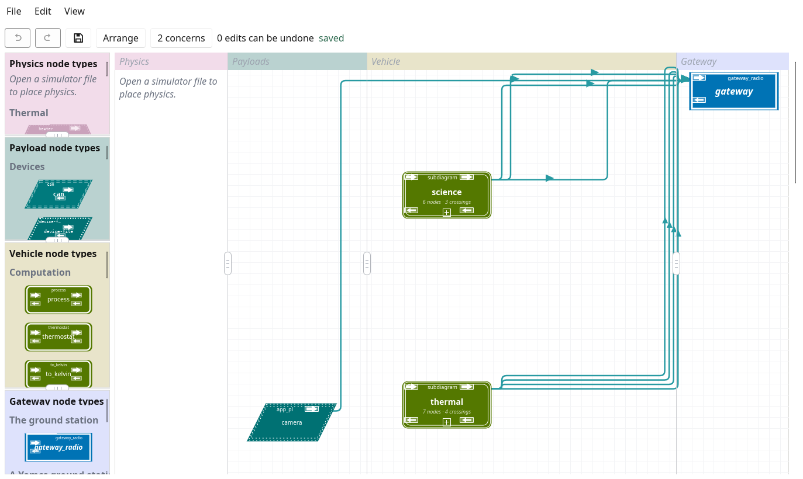
         boxes, science and thermal, the camera, and the gateway node, joined
         by lines to the gateway.

   Where the guide ends: the deck of stage 9 as tcs-gui draws it, its two
   subsystems collapsed into boxes, the camera beside them, and every line
   ending at the gateway node.

The vehicle
===========
A lander's science deck, chosen so that each stage needs a different part of
TCSpecial, and so that every payload has a simulated device tcs-sim already
provides:

==========================  =========================  =====
Payload                     Interface                  Stage
==========================  =========================  =====
``seismometer``             network (UDP)              1
``regolith_thermometer``    serial, asked with ``T?``  2
``probe_heater``            GPIO line                  4
``hull_temp_1`` to ``_3``   I\ :sup:`2`\ C             6
``camera``                  an app node (a program)    9
==========================  =========================  =====

The regolith thermometer and its heater are a heat-flow probe, as the Apollo
landers carried: the probe is warmed above the ground around it, and how fast
it cools says how well the regolith conducts heat. The three hull sensors
watch the deck's own temperature, and are three so that one going wrong does
not take the reading with it.

Each stage is a directory of ``docs/building-a-vehicle/``: ``stage-01`` to
``stage-10``, and ``stage-10-cfs`` and ``stage-10-yamcs`` beside the last,
each holding the configuration in both spellings,
``deck.ytcs`` and ``deck.xtcs``, and its simulator file, ``deck-sim.yaml``.
From stage 7 the stages include files in ``docs/building-a-vehicle/common/``.
Any stage can be started from, and two compared with ``diff``:

.. code-block:: console

   $ diff docs/building-a-vehicle/stage-02/deck.ytcs \
          docs/building-a-vehicle/stage-03/deck.ytcs

Every stage runs the way an example does, tcs-moc starting tcspecial and
tcs-sim itself:

.. code-block:: console

   $ make run TCSPECIAL_CONFIG_FILE=docs/building-a-vehicle/stage-04/deck \
          TCSPECIAL_SIM_FILE=docs/building-a-vehicle/stage-04/deck-sim.yaml

Stage 1: one payload to the ground
==================================
*Starts from:* ``examples/minimal``, with the payload named for what it is.

A configuration has a ``tcspecial`` section, which says where tcspecial takes
its commands, where it sends its beacons and where it keeps its state, and
then the nodes. Stage 1 has one node, the seismometer: software on the deck's
science computer that sends each reading over UDP of its own accord.

.. include:: building-a-vehicle/stage-01/deck.ytcs
   :literal:
   :start-after: payloads:
   :end-before: tcs-gui:

Nothing is drawn from the seismometer to anywhere, so tcspecial sends what it
reads straight to the ground over the ``tcspecial`` section's
``payload_telemetry``: to its ``dest_base`` port plus the seismometer's
*device id*. A device id is a node's place among the names of all the nodes,
sorted, counting from nought. The seismometer is the only node, so it is 0,
and the ground hears it on 127.0.0.1:6100.

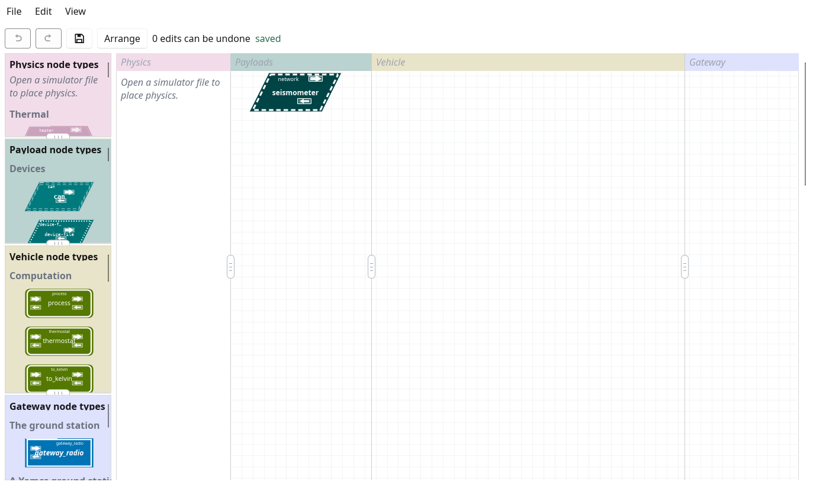
         column, with no lines.

   Stage 1 in tcs-gui: one payload, nothing drawn from it.

Check it, then run it:

.. code-block:: console

   $ tcs-verify docs/building-a-vehicle/stage-01/deck.ytcs \
               docs/building-a-vehicle/stage-01/deck-sim.yaml

tcs-moc shows the beacon, which says the vehicle is alive and which
configuration it runs, and a panel for the seismometer.

*See:* "A Network Payload" in the tcspecial manual.

Stage 2: a second payload, and where ports come from
====================================================
The regolith thermometer is a probe on a serial line: asked ``T?``, it
answers two bytes, a signed temperature in sixteenths of a degree Celsius.
It is asked once a second, by its own ``trigger_interval``.

.. include:: building-a-vehicle/stage-02/deck.ytcs
   :literal:
   :start-after:   - type serial:
   :end-before: tcs-gui:

The simulator file gains a device for it too, a pseudo-terminal at
``/tmp/tcs-deck-regolith`` that answers when asked.

Adding a node can move every other node's port. Device ids are places in the
sorted names, and ``regolith_thermometer`` sorts before ``seismometer``:

========================  =========  =============  ================
Node                      Device id  Port, stage 1  Port, stage 2
========================  =========  =============  ================
``regolith_thermometer``  0          --             6100
``seismometer``           1 (was 0)  6100           **6101** (moved)
========================  =========  =============  ================

A ground station written for stage 1 now listens to the thermometer on the
seismometer's old port. This is why a ground station should take its ports from
the configuration -- tcsmoc's and tcs-moc's do -- rather than from a list
written beside it, and why ``tcs-verify --summary`` (`Checking the whole
vehicle`_) lists every port a configuration uses.

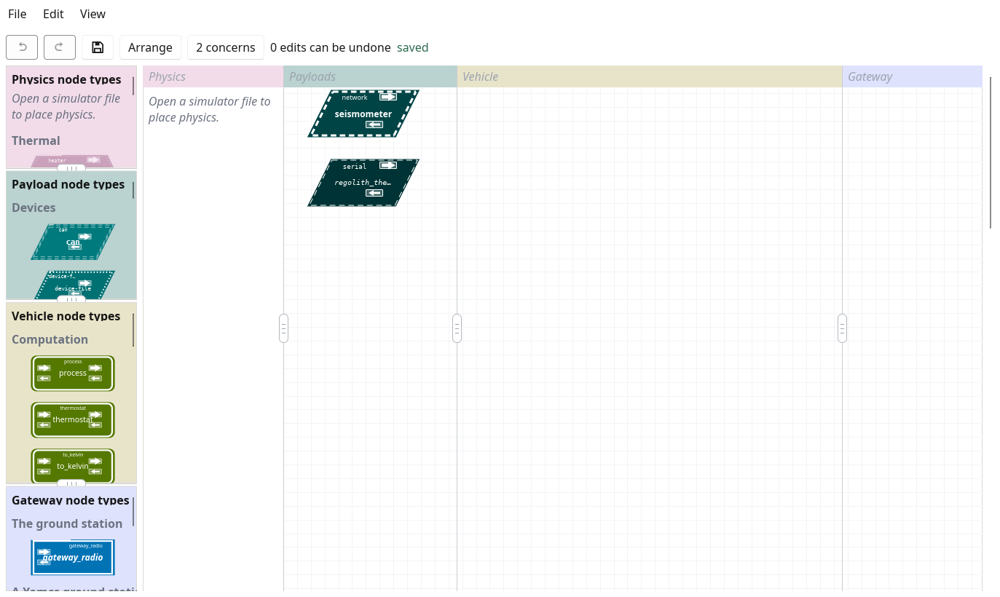
         with no lines.

   Stage 2: two payloads, each still reporting straight to the ground.

*See:* "A Serial Payload" in the tcspecial manual.

Stage 3: a computation, and a gateway to reach the ground
=========================================================
The thermometer's two bytes mean nothing to the ground until they are a
temperature. A ``to_kelvin`` computation, ``regolith_kelvin``, makes them
one: it is a *vehicle node*, between a payload and the ground.

.. include:: building-a-vehicle/stage-03/deck.ytcs
   :literal:
   :start-after:   - type compute:
   :end-before: payloads:

A node joins others through four *terminals*, one at each corner. Readings
travel across the top, towards the ground; what the ground sends back travels
across the bottom, towards a payload:

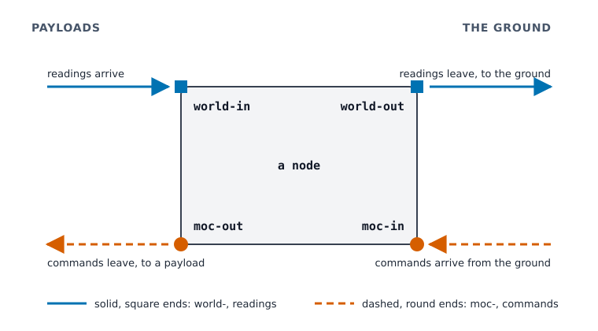
         right, readings flowing left to right towards the ground, and
         moc-in at the lower right and moc-out at the lower left, commands
         flowing right to left towards a payload.

   A node's four terminals. A line is written under its source as
   ``node.name`` -- ``regolith_kelvin.regolith_thermometer`` under the
   thermometer's ``world-out`` -- and the node it reaches lists the name
   under its sink, ``world-in: [regolith_thermometer]``.

Lines are typed: the thermometer states that it sends an ``i16``
(``world-out-type``), the computation that it takes one (``type-in``), and a
line between two that disagree is refused when the configuration is loaded.

A node with lines goes where its lines say and nowhere else, so
``regolith_kelvin``'s temperatures need a line to somewhere, and the ground
is reached through a *gateway node*. It arrives here, at the stage that first
needs it, and the seismometer is drawn into it too, so that the ground has
one place to receive everything from:

.. include:: building-a-vehicle/stage-03/deck.ytcs
   :literal:
   :start-after: gateways:
   :end-before: vehicle:

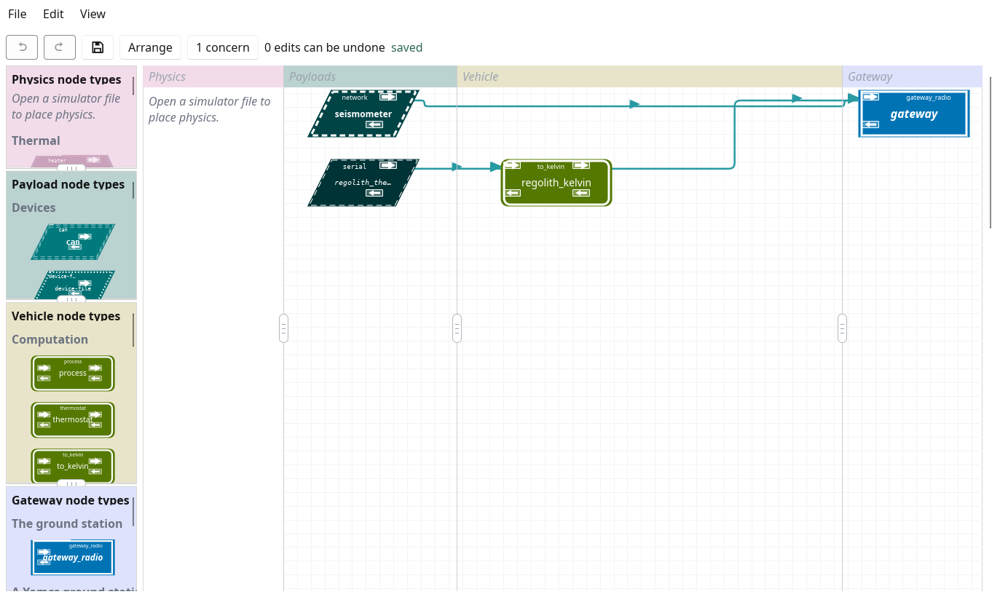
         regolith_kelvin and the seismometer feeding the gateway node.

   Stage 3: the first computation, and the gateway node on the right.

*See:* "The vocabulary" and the computations in the tcspecial manual.

Stage 4: commands back down
===========================
The heat-flow probe needs its heater: a GPIO line, ``probe_heater``, which a
``thermostat`` computation switches from the probe's temperature. The
thermostat's decision leaves at its ``moc-out`` and arrives at the heater's
``moc-in`` -- the bottom of the terminals figure above.

.. include:: building-a-vehicle/stage-04/deck.ytcs
   :literal:
   :start-after:   - type gpio_inout:
   :end-before:   - type network:

The heater reports to the gateway every second what it was last told, so the
ground follows it on a beat and a lost report is made good by the next. On a
desk, tcs-sim answers for the line over UDP at its ``sim_address``; flown, the
GPIO chip is opened instead, and nothing in the configuration changes.

The ground does not switch the heater itself: the thermostat decides again on
every reading, and a command to the heater would be overruled within a
second. What the ground sets is the thermostat's setpoint, through a
*command binding*, the one way the ground may change a node's attribute while
the vehicle runs:

.. include:: building-a-vehicle/stage-04/deck.ytcs
   :literal:
   :start-after:           - regolith_kelvin.regolith_thermometer
   :end-before: tcs-gui:

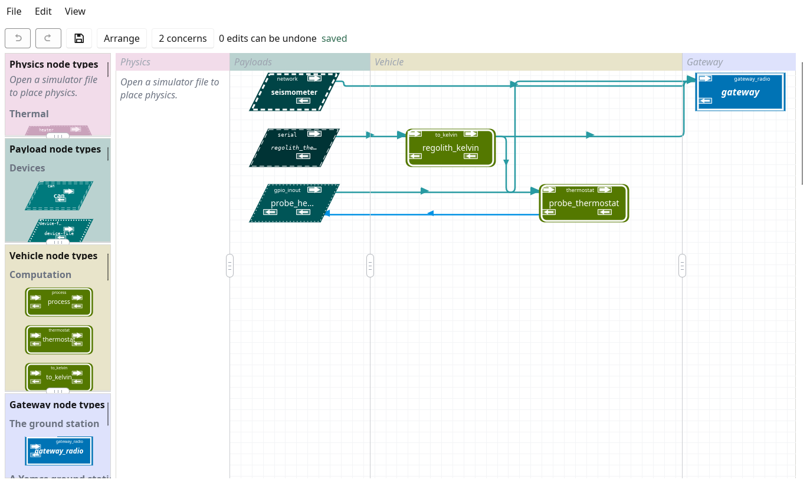
         from its lower left back to probe_heater.

   Stage 4: the thermostat's decision travelling back to the heater.

From here on tcs-gui's toolbar says *2 concerns*. A concern is a shape that
may be a mistake and may be meant, never something that stops the
configuration being read or flown, and these two are meant:

* ``"gateway": nothing is linked to its moc-out``. The ground reaches this
  deck through the setpoint's command binding, not through a line out of the
  gateway node, so nothing leaves its ``moc-out``.
* ``"probe_heater": nothing is linked to its moc-out``. The heater is where
  the commands stop: it switches its line, and there is nothing further down
  for it to command.

Each can be set aside in the concerns window, as the window says, if it is
what was meant.

*See:* "A GPIO Payload" in the tcspecial manual, and the `tcs-moc manual
<tcs-moc.html>`__ for sending the setpoint.

Stage 5: rates and groups
=========================
A thermal moonquake -- the regolith cracking as it warms and cools -- means
most beside the temperature taken at the same moment. A *group* is a clock
shared by its members, so that readings to be compared are taken together:

.. include:: building-a-vehicle/stage-05/deck.ytcs
   :literal:
   :start-after: payload_groups:
   :end-before: gateways:

The seismometer and the thermometer join ``science_readings``, and the
thermometer gives up its own ``trigger_interval``: a payload has one clock,
its group's or its own, never both.

A rate costs link. Each payload read on a schedule sends that many data a
second, each node fed by it at most as many, and the beacon one every
``default_interval``; their sum is what the link must carry, with margin.
``tcs-verify --summary`` adds it up (`Checking the whole vehicle`_).

The drawing is stage 4's: a group changes when nodes are read, not how they
are joined. When they are read is this:

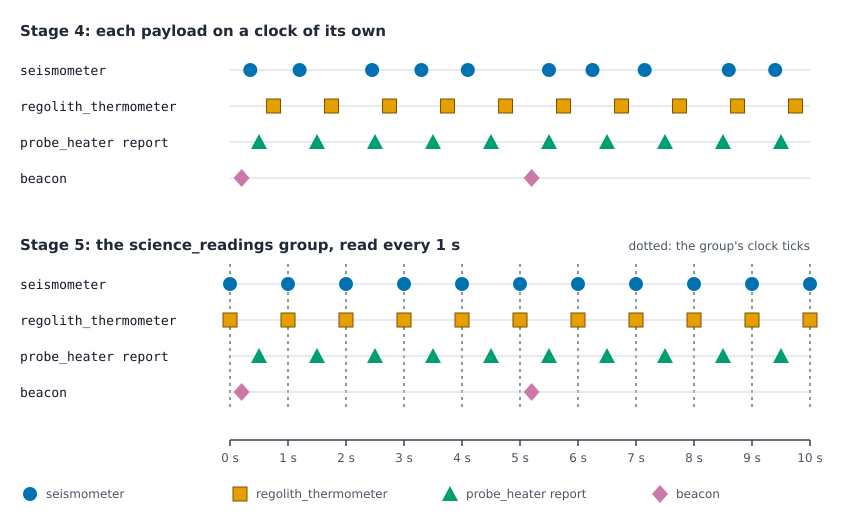
         arrive at no regular time and the thermometer is asked on a clock
         of its own, so none line up; in stage 5 both are taken on each
         tick of the science_readings group's clock. The heater's report
         and the beacon keep their own clocks in both.

   Stage 4 and stage 5 over ten seconds. A group lines its members up; it
   does not touch the heater's ``state_interval`` or the beacon's
   ``default_interval``.

*See:* "Lengths of Time" and the groups in the tcspecial manual.

Stage 6: redundant sensors and a vote
=====================================
Three hull temperature sensors on one thermal mass, each with its
conversion, and a ``vote`` that takes the three and sends one value on:

.. include:: building-a-vehicle/stage-06/deck.ytcs
   :literal:
   :start-after:   - type compute:
   :end-before: payloads:

The vote takes the median, so one sensor that drifts or stops is outvoted
rather than averaged in, and it produces a value on every arrival, so one
sensor that stops reporting does not stop the deck from knowing its
temperature. In tcs-sim, fail one sensor and watch ``hull_temp`` hold while
the failed sensor's own reading goes astray.

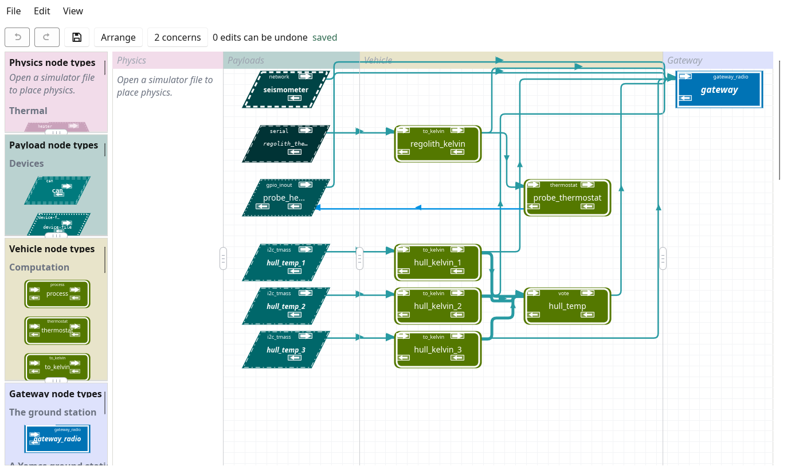
         conversion, the three conversions feeding hull_temp, and everything
         reaching the gateway.

   Stage 6: the deck in one file, at the size where one file stops being
   comfortable.

*See:* "Temperature Sensors on a Thermal Mass" in the tcspecial manual.

Stage 7: splitting the vehicle into files
=========================================
Stage 6 is past one screen. Its graph does not change in stage 7; it is
divided, each subsystem into a file of its own, which the top file includes:

.. include:: building-a-vehicle/stage-07/deck.ytcs
   :literal:
   :start-after: include:
   :end-before: gateways:

An included file has no ``tcspecial`` section and includes no others. It
says which of its nodes a line from another file may reach, in its
``exports``, so that a subsystem's insides stay its own:

.. include:: building-a-vehicle/common/thermal.ytcs
   :literal:
   :start-after: exports:
   :end-before: # Payloads read together

A line that crosses into or out of a file anywhere else is refused, saying
which list to add the node to. Device ids, and so ports, do not change: a
node is known by its name in every file.

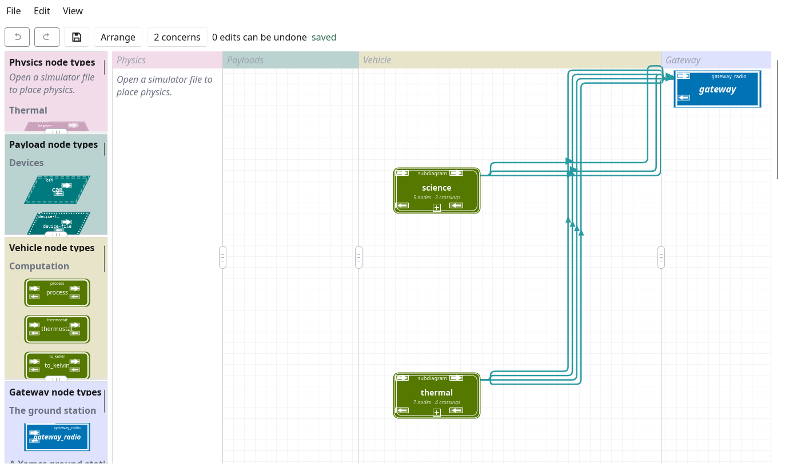
         several lines to the gateway node.

   Stage 7: the same graph as stage 6, drawn as tcs-gui draws included
   files: a box each, whose corners are its exports.

Two vehicles may include one file, as the thermostat examples share
``examples/thermostat-common``: a subsystem written once and flown in
several configurations.

*See:* "Which Files There Are" in the tcspecial manual.

Stage 8: keeping a log aboard
=============================
A lander is out of contact for hours. A ``log`` node keeps what it is sent in
segment files aboard, for the ground to ask for when it can. The science
subsystem gains one, fed by the seismometer and the probe's temperature:

.. include:: building-a-vehicle/common/science-logged.ytcs
   :literal:
   :start-after:   - type log:
   :end-before: payloads:

Stage 7 must not change when stage 8 is written, so the logged subsystem is
``common/science-logged``, a copy of ``common/science`` with the log, and
the top file changes only the path it includes. ``diff`` the two to see the
log alone.

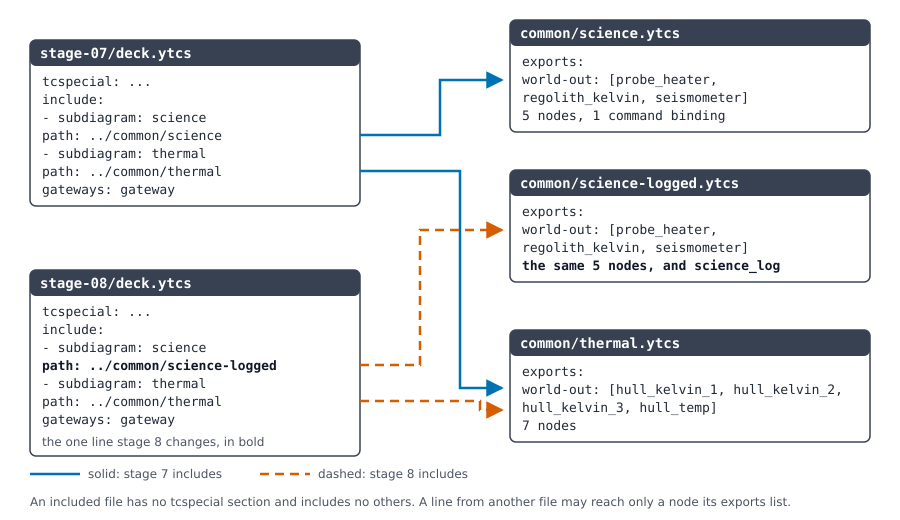
         stage 7 includes common/science and common/thermal, stage 8
         common/science-logged and common/thermal. Each included file lists
         its exports.

   The deck's files at stages 7 and 8. Each file is read in its includer's
   spelling: ``deck.xtcs`` includes ``common/thermal.xtcs``.

*See:* "The logging node" in the `design <tcspecial-design.html>`__, and
"Where the logs' segments go" in the tcspecial manual.

Stage 9: a payload with code of its own
=======================================
The camera's software exists already, and is not a device on a bus: it is a
program. An *app node* runs it, and it takes part in the graph like any
other node:

.. include:: building-a-vehicle/stage-09/deck.ytcs
   :literal:
   :start-after:   - type app_pl:
   :end-before: tcs-gui:

The program is joined to tcspecial by three file interfaces it inherits, so
a program in any language that can read its standard input can take part:

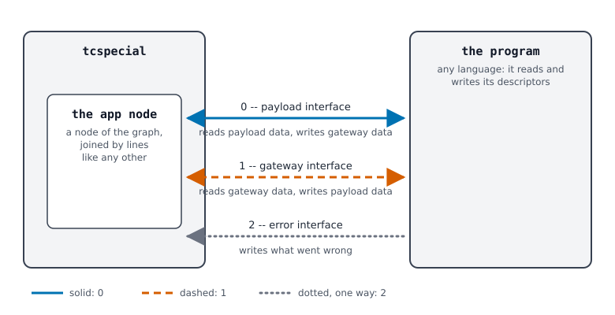
         right, joined by descriptor 0, the payload interface, and
         descriptor 1, the gateway interface, each both ways, and descriptor
         2, the error interface, from the program only.

   An app node and its program. ``camera.py`` beside the stages stands in
   for a camera, sending a numbered frame every ten seconds.

Use an app node for code that exists already or must change without
rebuilding the flight software; write a node type (see `Writing node types
<node-types.html>`__) for what many vehicles will need, checked as tcspecial
checks its own.

         reaching the gateway.

   Stage 9: the whole deck.

tcs-gui draws each included file as a box, which is the right size for
editing and the wrong one for seeing what reaches what. Opened, the deck is
this:

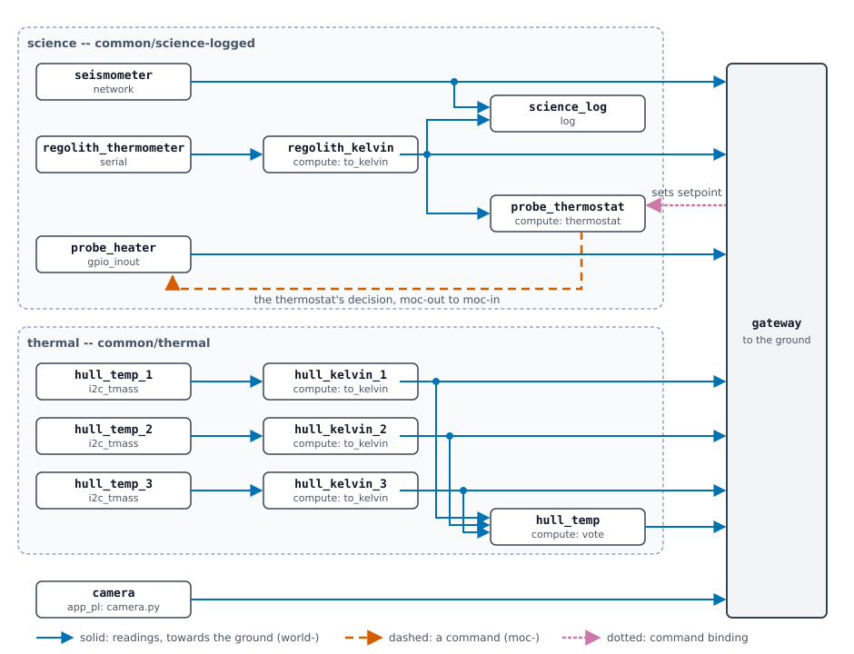
         open, the camera below them, and the gateway node on the right,
         with every line between them.

   The deck of stages 9 and 10, every node drawn. Fifteen nodes, so device
   ids 0 to 14, and eight lines into the gateway node.

Stage 10: choosing the gateway
==============================
Until now the deck has spoken to the ground directly, by radio. Most
missions put something in between, and tcspecial answers to three of them:

F´ (F Prime)
    NASA JPL's open-source flight software framework. A flight computer's
    software is built of components, joined in a *topology*; each kind of
    telemetry has an ID. It flew on the Ingenuity helicopter and flies on
    small spacecraft.

cFS (the core Flight System)
    NASA Goddard's open-source flight software framework. A flight
    computer's applications send each other messages on a *software bus*,
    each kind of message known by its *message ID*, and its Software Bus
    Network (SBN) joins the buses of several processors into one. It flies
    on many NASA missions.

Yamcs
    An open-source mission control system, for the ground rather than the
    vehicle. It speaks CCSDS packets, each kind known by its *APID*, and
    decodes them by a mission database written in XTCE.

Stage 10 is stage 9 answering to an F´ flight computer:

.. include:: building-a-vehicle/stage-10/deck.ytcs
   :literal:
   :start-after:   - type gateway_fprime:
   :end-before: payloads:

Beside it, ``stage-10-cfs`` answers to a cFS flight computer, and
``stage-10-yamcs`` to Yamcs on the ground. In each, the gateway node keeps
its name, ``gateway``, which every line to it is written with, so no
subsystem file changes. What does change is how each reading is addressed
on its way:

==================  ==========  ==================  ==============================
Stage               gateway     gateway node        a reading from device id *k*
==================  ==========  ==================  ==============================
``stage-09``        ``radio``   ``gateway_radio``   a UDP datagram to
                                                    ``ground_base`` + *k*
``stage-10``        ``fprime``  ``gateway_fprime``  the same, to ``bridge_base`` +
                                                    *k*, which F´'s TcsBridge
                                                    gives the ID
                                                    ``fprime_id_base`` + *k*
``stage-10-cfs``    ``cfs``     ``gateway_cfs``     a cFS packet on the software
                                                    bus, message ID
                                                    ``tlm_base`` + *k*
``stage-10-yamcs``  ``yamcs``   ``gateway_yamcs``   a CCSDS packet to
                                                    ``ground_base`` + *k*, APID
                                                    ``apid_base`` + *k*
==================  ==========  ==================  ==============================

F´ changes the gateway node and the ``tcspecial`` section's ``gateway``,
and nothing else. Yamcs gives each link of the section an APID besides. cFS
changes the section throughout, because on a
software bus every link is a message ID rather than an address and port, and
the vehicle is one more SBN peer:

.. include:: building-a-vehicle/stage-10-cfs/deck.ytcs
   :literal:
   :start-after:   - type gateway_cfs:
   :end-before: payloads:

The gateway node's ``cmd_msgid`` is there for the command binding: a
command binding leaving a ``gateway_cfs`` node needs one, so that the
ground's setpoint has a message ID to arrive on. ``diff`` stage 9 with each
of the three to see the whole of each difference.

The F´ and cFS stages run as the others do, tcs-moc playing the F´ bridge or
joining the simulated software bus as the ground, as the ``fprime`` and
``cfs`` examples do. The Yamcs stage is checked as every stage is, but its
ground is Yamcs, which tcs-moc is not; ``thermostat-yamcs`` shows a vehicle
run with Yamcs.

*See:* "The fprime example", "The cfs example" and "The thermostat-yamcs
example" in the tcspecial manual.

Checking the whole vehicle
==========================
``tcs-verify`` checks the whole configuration, every file it includes, and
the simulator file beside it:

.. code-block:: console

   $ tcs-verify docs/building-a-vehicle/stage-09/deck.ytcs \
               docs/building-a-vehicle/stage-09/deck-sim.yaml

``tcs-verify a.xtcs a.ytcs a-sim.yaml`` holds the two spellings to saying the
same thing.

``tcs-verify --summary`` adds, after the problems, everything the vehicle
uses of what must not clash or overflow: each address and port, and who
binds it; the device ids; message IDs and APIDs, where there are any; and
the rates that reach the ground, added up. Two things on one socket fail the
run. For stage 9, shortened:

.. code-block:: text

   Addresses and ports
     address         bound by  what
     0.0.0.0:4000    vehicle   tcs_cmd.recv, where spacecraft commands ...
     ...
     127.0.0.1:5100  ground    "gateway" ground_base plus device id 0: ...
     127.0.0.1:5105  ground    "gateway" ground_base plus device id 5: ...
     127.0.0.1:5114  ground    "gateway" ground_base plus device id 14: ...
     ...
   Rates to the ground
     link                     data/s  bytes/datum  bytes/s  how
     hull_temp to gateway      <=0.6            4    <=2.4  one per datum ...
     probe_heater to gateway       1            1        1  state_interval 1 s
     seismometer to gateway        1            ?        ?  group ... 1 s
     beacon                      0.2            ?        ?  default_interval 5 s
     total                     <=4.4                 <=9.8  not counting ...

A ``?`` is what the configuration does not say: the seismometer sends bytes
of no fixed length, and the camera sends whenever it has a frame. A mission
fills those in from what it knows of its instruments.

*See:* the `tcs-verify manual <tcs-verify.html>`__.

From the desk to flight
=======================
What changes between the configuration that has run on a desk and the one
that flies is a checklist of its own, `From the desk to flight
<desk-to-flight.html>`__, each item linking to where it is said in full: the
flight setting, the real addresses, storage that survives a power cycle, the
build, the packages, the supervisor, the configurations kept aboard, and the
ground's agreeing to the configuration.

Where to go next
================
* The `tcspecial manual <tcspecial.html>`__, for every payload type and
  attribute.
* `Writing node types <node-types.html>`__, for what no shipped type does.
* The `tcs-gui manual <tcs-gui.html>`__, for drawing and editing the
  configuration.
* The `examples <../examples/README.html>`__, which the stages drew on.

How this guide is kept true
===========================
* The excerpts above are read from the stage files when the page is made, so
  they cannot say other than the files do.
* ``tcs-verify/tests/vehicle_guide.rs`` verifies every stage with its
  simulator file, holds the two spellings to each other, and checks each
  names the interface of the build; ``make set-interfaces`` and ``make
  comparespellings`` take in the stages with the examples.
* The tcs-gui drawings are made by ``docs/building-a-vehicle/screenshots.sh``,
  which opens each stage in tcs-gui on an X display of its own and captures
  it. The other figures are SVG drawn by hand, their colours the Okabe-Ito
  palette's, each paired with a label, a shape or a line style.
