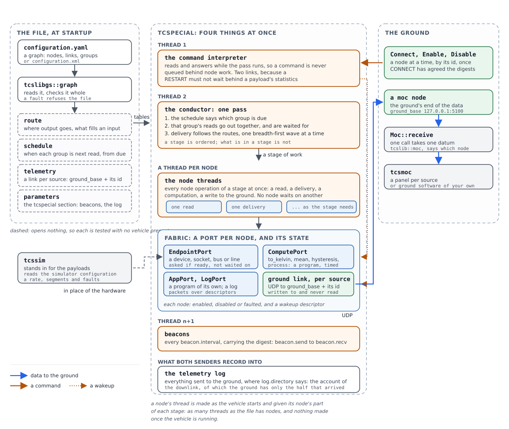

================
TCSpecial Design
================
.. contents:: Table of Contents
   :depth: 4
   :local:

Introduction
============

.. note::
   TCSpecial has been designed for spacecraft and ground communication with high
   latency communication links. It is just as applicable for other environments,
   such as submersibles, drones, etc. Simply translate "spacecraft" to your
   device type.

What there is, in the order a reader meets it:

``tcspecial``
    The flight software. It serves the payloads its configuration file
    describes, takes commands from the ground, and sends beacons.

``tcslibgs``
    What both ends share: the configuration file formats and the rules about
    them, the command and telemetry messages, and the digest each end says it
    read. Every rule in this document is stated there once.

``tcslib``
    What a control application on the ground is built on. A mission control
    system drives a client rather than speaking the protocol itself.

``tcsmoc``
    A simulated operations center, for testing: a window of panels, one per
    payload, that commands them and shows what they have moved.

``tcssim``
    Simulated payloads, for testing: it stands in for the far end of every
    link a configuration describes.

``tcsverify``
    Reads a configuration and says what is wrong with it, running none of it.
    See `tcsverify`_.

The ranked quality attributes
-----------------------------

Four attributes, in order. The order is the point: where two designs satisfy
the requirements differently, the earlier attribute decides, and an argument
about such a choice should cite this list rather than taste.

1. **Reliability.** The vehicle is not reachable for repair. A mechanism that
   can fail in a new way loses to a rigid one that cannot, and a fault found
   when a configuration is loaded beats the same fault found in flight.
2. **Ease of use.** An operator under time pressure must be able to read what
   the system does and say what it will do next. Clarity of the configuration
   and of what the programs report counts as a requirement, not a courtesy.
3. **Maintainability.** The software outlives the people who wrote it. One
   concern per module, a test per claim, and a written reason for anything that
   is not obvious.
4. **Flexibility and extensibility.** New interfaces, new computations and new
   vehicle arrangements must be reachable without disturbing what already
   flies -- but never at the cost of the three above.

Terminology
===========

These words are used in one sense each, here and in the code. Several of them
had been used in two, which is why they are written down: "device" in
particular had been both a type of endpoint and a protocol beside TCP and UDP.

endpoint
    One end of the path a data handler's data travels. A handler has two: the
    OC endpoint, where the ground's data arrives and leaves, and the payload
    endpoint, where the payload's does. An endpoint is of exactly one type, and
    the type decides what is needed to open it and what terms it is operated
    on.

endpoint type
    What an endpoint is made of, and so what locates it and what else must be
    said about it. Five are supported -- ``network``, ``device-file``,
    ``serial``, ``i2c`` and ``spi`` -- and five more are experimental:
    ``can``, ``iio``, ``rpmsg``, ``gpio`` and ``hdlc``. A type is not a protocol -- a network endpoint
    carries the protocol it runs over, and no other type is addressed that
    way.

device
    An endpoint that is a device file, opened and read as it comes. Not the
    general word for hardware: a serial line, an I2C device and a SPI
    peripheral are all reached through device files and are none of them a
    device endpoint, because each has terms of its own that a plain device has
    not. A device *file* is the thing in the filesystem; a device *endpoint* is
    one type among the nine.

bus
    A device that several devices are reached through, each by an address on
    it. I2C is the one in use. The bus is named by a device file and the device
    on it by an address, which is why an endpoint on a bus carries both.

payload
    What is at the far end of a payload endpoint: the instrument, recorder or
    radio whose data a handler carries. Also what tcssim stands in for, and
    what the payload configuration describes.

data handler
    The pair of conduits between one payload endpoint and one OC endpoint,
    named by a ``name``, which is what every command addresses it by.
    "Handler" alone always means this.

conduit
    One direction of one data handler: a thread that reads one endpoint and
    writes the other. A handler has two, and they share each endpoint between
    them.

OC
    The Operations Center: the ground. The OC endpoint of every handler is a
    UDP address, and the OC's own address is learnt from what it sends rather
    than configured.

commander
    Whatever tcspecial answers to: what commands it, and what its telemetry
    goes to. The ground over a radio is one, a cFS flight computer on its
    software bus another, and an F´ flight computer through a bridge
    component the third. "MOC" was the word while the ground was the only
    one, and is still the word for the ground itself, which is one kind of
    commander.

gateway
    The node through which tcspecial reaches its commander, and the link it
    holds: ``gateway_radio``, ``gateway_cfs`` or ``gateway_fprime``. It was
    also the word for the commander itself, which left one word for both ends
    of a link. See `Gateways: what the vehicle answers to`_.

test harness
    Whatever sets up a test run and takes it down: it starts the simulator,
    waits for it to be ready, starts tcspecial, and stops what it started.
    Tcsmoc is one, besides being a ground station; with cFS or F´ as the
    commander, the harness is not the commander at all. See `Waiting for the
    Simulator`_.

link
    A configured pairing of two endpoints that data passes between. Used of
    the whole path, where "endpoint" is used of one end of it.

tcspecial configuration file
    The file tcspecial is configured by: the command interpreter's own
    settings in its ``tcspecial`` section, and the payload configuration
    section beside them. No name of its own -- any name ending ``.yaml`` or
    ``.xml`` -- the shipped examples being ``examples/minimal/minimal.yaml``
    and the rest.

payload configuration section
    The part of that file describing payloads: which data handlers there are,
    how tcspecial reaches each one, and how large its packets are. A section
    rather than a file, because what tcspecial serves and what tcspecial is
    are one configuration.

simulator configuration file
    The file describing how a simulated payload behaves: how often it produces
    a packet and how it divides one into segments. Properties of a simulation
    rather than of a payload, which is why they are not in the payload
    configuration.

stand-in
    What a payload endpoint reaches when it does not reach the payload: a
    pseudo-terminal or a socket that tcssim answers, or a kernel's simulated
    bus, chip or interface -- ``i2c-stub``, ``gpio-sim``, ``iio_dummy``,
    ``vcan``. See `How a Stand-in Is Recognised`_.

simulation mode
    How many of a run's payloads may be stand-ins: ``none``, ``some`` or
    ``all``, given to each program as ``--simulate``. See `Simulation
    Modes`_.

The Node Architecture
=====================

What this supersedes
--------------------

TCSpecial began as a set of data handlers, each one a fixed pair: a payload
endpoint at one end, an OC endpoint at the other, and a conduit in each
direction between them. ``dh.rs`` says so in its own fields -- one
``ground_to_payload`` and one ``payload_to_ground`` -- and that is the whole of
the topology the software could express. It served while every payload's data
went to the ground and nowhere else.

It cannot express a control loop. Three sensors whose readings are averaged and
compared against a setpoint, with the comparison driving heaters, needs a
reading to reach two places at once, needs three readings to arrive at one
place, needs something aboard that remembers a setpoint, and needs a set of
discrete lines to be driven rather than read. None of those is a type of
endpoint; all of them are shapes of connection.

So the fixed pair is replaced by a graph the configuration describes. A data
handler is no longer a thing: what it did -- joining a device to the ground in
both directions -- is two links, and the software that moved its bytes is the
machinery that moves bytes along any link.

The four concepts
-----------------

Deliberately four, and no more. Each is a thing an engineer already thinks
about, which is the ease-of-use argument; each is checkable before anything
runs, which is the reliability one.

node
    Anything the configuration names. A node has a name unique across the
    configuration, a type, and the attributes its type requires. Three families
    of type:

    *devices* -- ``i2c``, ``spi``, ``serial``, ``hdlc``, ``can``, ``gpio``,
    ``iio``, ``rpmsg``, ``network``, ``device-file`` -- which are the interfaces
    real
    hardware arrives on. Each is what used to be called a payload endpoint, and
    the attributes are unchanged: a bus and an address, a chip and a set of
    lines, a path.

    *MOC links* -- ``moc`` -- a network link carrying telemetry to the ground
    and commands back. This is what the OC endpoint was.

    *compute elements* -- ``compute`` -- software that transforms what arrives.

    *sinks* -- ``log`` -- somewhere data is kept rather than passed on. See
    `The logging node`_.

    *generic vehicle nodes* -- ``null-moc``, ``null-payload``, ``tee-moc``,
    ``tee-payload`` -- nodes that do nothing to what passes. Each takes one
    stream: a null node drops it, and a tee sends each datum on both ways, on
    its own stream and again on the other. See `Null nodes and tees`_.

    *link checks* -- ``ping`` -- a node that answers each ping the ground sends
    it with the vehicle's time. See `The ping node`_.

group
    A set of devices read on one interval, so that readings which will be
    compared with one another are taken as close to together as the hardware
    allows. A device in no group is read on its own interval, as every payload
    was.

    The interval belongs to the group and not to its members. A member may not
    state one: two sensors in a group with intervals of their own would be a
    configuration whose own description disagrees with itself, and it is
    refused.

link
    A directed connection from one node to one or more destinations. One
    destination is the ordinary case. Several is how a reading reaches the
    ground and an on-board computation at once -- the arrangement usually drawn
    as a "T" -- and it is a property of the link rather than a node of its own,
    because a node that only copied its input would be a type to implement,
    test, configure and get wrong for no gain.

    Within one stream, that is. A link carries one stream and may not carry it
    into the other, so a copy that has to cross -- what the ground sent, back
    to the ground as payload data; a reading, to something that takes the
    ground's data -- is what the ``tee-moc`` and ``tee-payload`` nodes are
    for. The crossing is a node, drawn and named, rather than a link that
    could be drawn backwards by mistake: see `Terminals: where a link is
    attached`_.

    Where a destination takes more than one input, the link names which: a mean
    over three sensors is three links into three named inputs, and a
    configuration that leaves one unbound is refused rather than averaging two
    numbers and a zero.

    A link is written as an **attribute of the node it leaves**, named after
    the data source it leaves by, with one entry per line:

    .. code-block:: yaml

       - name: k_fore
         type: compute
         function: "to_kelvin"
         payload-out:
           - target: moc
           - target: mean_temp
             input: in0
           - target: housekeeping

    An entry's ``target`` is the node the line goes to and its ``input`` is
    which of that node's inputs it feeds, where it feeds a named one. One entry
    per line is what makes several of them safe: the alternative was two lists
    read against each other, and a list one name short is a configuration that
    reads as valid and delivers a reading to somebody else's input. A word an
    entry does not know is refused rather than ignored, because ``targte: moc``
    quietly ignored is a line that goes nowhere.

    The short spelling is still read -- ``payload-out: moc``, or ``payload-out: [moc,
    mean_temp.in0]``, the node and its input separated by a dot. Every
    configuration written before entries existed says what it said, and a link
    to one place is still a line somebody can write in a line. All of them read
    into the same thing, because every rule about a link is about where it goes
    and not about how the file said so.

    So there is no links section. A node and the links out of it are read,
    written and deleted together, which is where a reader of the file wants
    them: a list at the bottom has to be read against the nodes to make sense
    of either. It also settles a question the old shape left open -- which file
    of a configuration a link belongs in. A link is in the file its source node
    is in, once, however far it reaches.

    The node a link arrives at says so as well, under the data sink it arrives
    at:

    .. code-block:: yaml

       - name: mean_temp
         type: compute
         function: "mean"
         inputs: "in0,in1,in2"
         payload-out:
           - target: moc
           - target: thermostat
         payload-in: true

    That is a record of the links above and not a link. The point of it is a
    node whose entry said nothing about what fed it: a sensor's entry named
    everywhere its reading went, and the computation at the other end named
    nothing, so a reader had to read the whole configuration against a node to
    see whether anything reached it. Now a node's entry says it is connected at
    both ends.

    A flag and not the name of the node the line comes from. That name is
    written on the node the line leaves, which is where the link is; a copy of
    it here would be the same connection written twice, and at a sink that
    several lines arrive at one name would read as "and nothing else" -- the
    ground's sink is such a sink in every configuration, every payload aboard
    reporting to it. What a node can say about its own sink without repeating
    the graph is whether anything arrives there, and that is what it says.
    ``false`` is a node saying none does.

    Which sink a line arrives at is the stream's own answer -- what leaves by
    ``payload-out`` arrives at a ``payload-in`` and nowhere else -- so a
    destination's named input, ``mean_temp.in0``, counts at the stream's sink.
    Which input it feeds is written once, on the node the link leaves.

    Two statements of one fact can disagree, and the answer to that is not to
    believe the second one. The flag is checked against the links it is a
    record of where the configuration is read, and both directions are refused:
    a sink that says a line arrives where none does, and one that says none
    does where a link is written. Nothing downstream reads it --
    ``tcslibgs::graph::mirror`` has it only long enough to check it -- so the
    graph the vehicle flies comes from one place however many places say so.

    It is optional. A file written by hand may say nothing about its sinks and
    be complete: there is nothing in a flag the links do not already say, and
    every configuration written before these existed still reads. A word that
    is neither ``true`` nor ``false`` is refused saying what the field means,
    rather than read as a name -- a name there was legal for a while, and a
    file written against that is better refused than half understood. The
    editor writes the flags on every node it writes.

    In memory they are still a list, because every rule about a link is about
    both of its ends and a list is what a rule can be written against.

command binding
    A statement that a named command from the MOC sets a named attribute of a
    node. A setpoint arrives this way. The binding is in the configuration, so
    what the ground is able to change in flight is written down and checkable,
    rather than being whatever the compute element happens to accept.

The three sections
------------------

A configuration's nodes are written in three sections, and they are the three
working panes of the editor:

``moc``
    the ground links: the other end of the link, which is not the vehicle at
    all.

``vehicle``
    what the vehicle itself runs -- computations, logs, pass-throughs, pages of
    their own.

``payloads``
    what it carries this flight: a device on a bus, a line it drives, a link to
    something aboard.

Which section a node belongs in is its type's own answer, and there is one
statement of it: ``tcslibgs::graph::section_of``. The editor's panes read it
and so does the file reader, so a file and a drawing cannot come to disagree
about what a node is.

Requirement
    A node written in the wrong section is refused where the file is read,
    naming the node, the section it is in and the one it belongs in. A payload
    written under ``vehicle`` is a file whose own arrangement contradicts the
    rule the editor enforces everywhere else, and a reader would have to be
    told which of the two to believe.

Requirement
    A section with nothing in it is not written. A configuration with no
    payloads yet is one somebody is partway through, and ``payloads:`` with
    nothing under it reads back as nothing anyway.

The sets of payloads that share a sampling interval are ``payload_groups``,
which is what the simulator's file calls them too: one vocabulary for the two
languages, so a reader who has learned one has learned the other.

Terminals: where a link is attached
-----------------------------------

A link joins one node's **data source** to another's **data sink**. Each end
has a name, and the name says two things about the data and nothing about what
is at the other end: whose it is, and whether it arrives here or leaves.
``payload-`` is a payload's own data, on its way to the ground; ``moc-`` is
what the ground sends, on its way to a payload. ``-in`` is where it arrives and
``-out`` is where it leaves -- so **every ``-out`` is a data source and every
``-in`` a data sink**, which is the whole of the rule a reader has to remember.
There are four:

.. list-table::
   :header-rows: 1
   :widths: 20 20 20 40

   * - stream
     - leaves at
     - arrives at
     - what it carries
   * - groundward
     - ``payload-out``
     - ``payload-in``
     - a payload's readings, on their way to the ground
   * - vehicleward
     - ``moc-out``
     - ``moc-in``
     - what the ground sends back: a command, a trigger, a setpoint

So one stream is named twice -- ``payload-out`` where it leaves a node and
``payload-in`` where it arrives at the next -- and the two words are a sentence
about the same bytes read from either end. The names say nothing about the type
at the far end: with no vehicle node in the way, a payload's ``payload-out``
connects to a MOC link's ``payload-in``, and with one it connects to that
node's ``payload-in`` instead and the node's own ``payload-out`` carries it the
rest of the way.

A link end is written ``node.terminal``, and may be written as ``node`` alone
wherever the type has one terminal of the kind the end needs: ``{ from:
temp_fore, to: moc }`` is unambiguous, because a payload has one data source
and a MOC link has one data sink. A type with two of either has to be told
which, which is why the links out of a tee name their terminals.

Which types have which:

payloads
    ``moc-in`` and ``payload-out``. A payload receives what asks it for a reading
    -- a trigger, a command, a byte written to a line -- and sends what it
    read.

MOC links
    ``payload-in`` and ``moc-out``. The ground is the other end of both.

``null-moc``
    ``moc-in`` alone: what the ground sends arrives, and nothing leaves.

``null-payload``
    ``payload-in`` alone: a payload's data arrives, and nothing leaves.

``tee-moc``
    ``moc-in``, and both sources, ``moc-out`` and ``payload-out``: what the
    ground sends arrives, and leaves both ways.

``tee-payload``
    ``payload-in``, and both sources, ``payload-out`` and ``moc-out``.

``app_all_veh``
    all four, a program with both interfaces: see `App nodes`_.

``ping``
    ``moc-in`` and ``payload-out``, a payload's pair: what the ground sends
    arrives, and the answer leaves groundward, to arrive at a MOC link.

A computation's and a log's terminals are their own rules' business: a
computation's data sinks are the inputs it declares, and a log's are whatever
is written to it. Both are checked where the type is.

Requirement
    A data sink is either absent or linked to one data source. Two sources
    into one sink would be two streams interleaved on one link, arriving in
    whatever order they were sent, with nothing to say which was which.

Requirement
    A data source is either absent or linked to one data sink or several. One
    reading reaching the ground and an on-board computation at once is the
    ordinary case -- the arrangement drawn as a "T".

Requirement
    A MOC link's data sink takes as many sources as the configuration gives
    it. The exception to the rule above, and not one made to let the examples
    through: the ground is the one place that *can* tell interleaved streams
    apart, because each payload's telemetry arrives at its own socket --
    ``payload_telemetry.source_base`` plus the payload's id -- and the id is
    what says whose a datagram is. Every payload aboard reporting to one
    ``moc`` node is the ordinary shape of a configuration.

Requirement
    A payload or a MOC link with no link on it at all is refused. Either a
    sink or a source will do: a payload that is only read has a source and no
    sink, one that is only driven -- a heater, a valve, a latch -- has a sink
    and no source, and both are configurations somebody means. Neither is a
    payload the configuration describes and nothing reads or drives.

Requirement
    Each terminal may be linked to one other terminal, and the pairing is four
    sentences: a ``payload-out`` only to a ``payload-in``, a ``payload-in`` only
    to a ``payload-out``, a ``moc-out`` only to a ``moc-in``, a ``moc-in``
    only to a ``moc-out``. Which is one sentence twice over -- a stream
    leaves at one terminal and arrives at the other -- so the pairing is
    derived from the table above rather than written out again.

    The editor is held to it as a *gesture*: a line dragged from a terminal
    goes to the terminal that pairs with it and to no other, and a node with
    none takes nothing -- so a bad link cannot be drawn in the first place. The checking refuses a written-out configuration
    for the same reason, which is what a file edited by hand is still held to.
    What that rules out is a link that carries one stream into the other, and
    with it the circular link a drawing could otherwise be made to say.
    Loops within the vehicle are still possible -- a vehicle node may feed
    another and be fed by it -- and this rule is not what would stop one.

Requirement
    A link whose two ends carry opposite streams is refused. One end of it is
    drawn backwards, and nothing else in the configuration would show it: both
    nodes exist, both terminals exist, and in flight it is a payload that
    answers nothing.

Requirement
    A link end naming a terminal its node does not have is refused, and a
    terminal named at the wrong end of the link is refused as the mistake it is
    rather than as a name nothing knows. The name is right and the end is
    wrong, which is worth saying in those words.

Requirement
    A terminal is written into a file only where it says which. A node with one
    data source and one data sink needs neither name -- ``{ from: temp_fore,
    to: moc }`` is unambiguous, and the schema reads an unnamed end as the only
    terminal of the kind that end needs -- so the editor writes a terminal only
    where the type has two of the kind, a tee's sources and an
    ``app_all_veh``'s four. A tool that wrote a name into every
    link of every file it saved would churn every configuration it opened for
    no gain.

Requirement
    A terminal is not a named input. ``in0`` is which *of several* ways into a
    computation and the mean is built on knowing; a terminal is which *way* the
    data is going, and a node that has one has only one of each kind. So a
    terminal is resolved where the routing table is built and never reaches a
    port -- a device's port refuses an input a device does not have, and a
    configuration that passed the ground check and stopped delivering when it
    flew would be the worst of both checks.

What tcspecial itself is configured with
----------------------------------------

Four concepts describe what a vehicle carries and what is done with it. None of
them says where any of it goes, and one section does: ``tcspecial``, the same
section every configuration holds, and it is required of every one of them.

.. code-block:: yaml

   tcspecial:
     gateway: radio
     tcs_cmd:
       recv: 0.0.0.0:4000
       send: 127.0.0.1:4100
     payload_command:
       source_base: 127.0.0.1:4300
       dest_base: 0.0.0.0:4200
     payload_telemetry:
       source_base: 0.0.0.0:6000
       dest_base: 127.0.0.1:6100
     beacon:
       interval: "5 s"
       send: "0.0.0.0:5550"
       recv: "127.0.0.1:5650"
     log:
       directory: /var/log/tcspecial
       segment_size: 65536
     restart_arm_valid: "20 min"

Five of its seven entries are subsections, because each of them is one thing
with more than one attribute to it: the spacecraft command link has two ends,
the commands about nodes have two, a payload's telemetry has two, the beacon
has two and a timing, and the log has a place and a size. The other two,
``gateway`` and ``restart_arm_valid``, are one fact each and are written as
one. ``gateway`` is what the vehicle answers to -- see `Gateways: what the
vehicle answers to`_. A prefix repeated
on two or three flat names -- ``beacon.send``, ``beacon.recv``, ``beacon.interval`` -- is a subsection
somebody declined to write, and the names under one are short for the same
reason: ``beacon.send`` says what ``beacon.send`` said, where the reader is
already looking at the beacon.

Ten of the thirteen attributes must be stated, and are required rather than
defaulted for one reason: a configuration that has not been asked the question
has not answered it. What the vehicle answers to, where commands are taken and
where beacons go are mission facts, and a file that was silently given an answer to either is a vehicle
nobody can reach whose configuration looks complete. The two in ``log`` are the
exception, and so is ``log`` itself: no ``log.directory`` means the telemetry
log is not kept, which is a configuration somebody may mean -- a vehicle with
no writable storage -- and ``log.segment_size`` is a tuning choice with a
defensible answer, so it has one.

``restart_arm_valid`` is the third that may be left out: how long a
RESTART_ARM licenses a RESTART for, as a length of time -- ``20 min``,
``90 s``. Absent is twenty minutes,
``tcslibgs::commands::RESTART_ARM_VALID_DEFAULT``, the length an arm had
before it could be configured: long enough to arm, look at what the vehicle is
doing and decide over a link with minutes of latency, short enough that an arm
left behind by a session that ended does not stand ready for the next RESTART
anybody sends. A mission whose link is slower, or whose operators want the
window narrower, says so. Nought is refused, being an arm that lapses as it
is taken and a vehicle that can never be restarted.

Five of them are a host and a port written together, as ``address:port``: two
things only ever used together are one fact about a configuration, and writing
them apart invites a file that states one and not the other. Each is split at
its last colon, so whatever a host is called the port is the part after it, and
the address is kept as text -- what a name resolves to is the business of the
moment the socket is made.

``tcs_cmd`` is the spacecraft command link, which is one conversation and two
sockets. ``tcs_cmd.recv`` is tcspecial's own: it receives commands about the
spacecraft there and sends its responses to the MOC from there, a response
going back out of the socket its command arrived on. ``tcs_cmd.send`` is the
MOC's own, which it sends those commands from and receives the responses on.
Both ends in one file because both ends read this file: a configuration stating
only its own end would leave the other to be told separately, and two places to
say one thing is one place for them to disagree.

Separate command links because what the ground needs in a hurry must never be
queued behind what it asked for at leisure: a command about the spacecraft --
ping it, arm it, restart it -- is taken on ``tcs_cmd.recv``, and one about a
payload on that payload's own socket. On a space link these become virtual
channels, which is where the priority between them is really decided; here they
are sockets, which is what an IP network has to divide traffic with.

``payload_command`` is where the payloads are commanded, and it has two bases
for the reason ``payload_telemetry`` does: the link has two ends. A payload's
socket on each side is that side's base plus the payload's own id, so four
payloads based at 4300 and 4200 are commanded from 4300 to 4303 and take those
commands on 4200 to 4203.

Simple payloads -- a device or a socket that tcspecial reads or drives -- do
not use payload commands. What a simple payload is configured with is in the
tcspecial configuration file, and it is not changed while tcspecial is
running. At present only applications, the payloads and vehicle nodes that are
programs of their own, use the ``payload_command`` values.

One socket per payload rather than one for all of them, which is what
``payload_interface`` was. That worked, and left two things undone. Nothing
said which socket the ground sent from -- the MOC bound whatever port the
system gave it -- so tcspecial could not be told what a payload command should
come from, where every other link in this section is written down at both ends.
And one socket is one queue: a command about a payload that takes its time to
start was ahead of a command about one that would have answered at once.

``payload_telemetry`` is where each payload's own data link is, and it has two
bases because the link has two ends. tcspecial binds its end at
``payload_telemetry.source_base`` plus the payload's own id -- the position the
payload has in the configuration -- and the MOC binds its end at
``payload_telemetry.dest_base`` plus the same id. Four payloads based at 6000 and 6100 are at 6000 to 6003 on the
vehicle and 6100 to 6103 on the ground.

Both ends come out of the one file both ends read, so neither has to be told
the other's: tcspecial sends a payload's telemetry to the end the MOC binds,
from the first datagram, and the MOC sends nothing at all.

It did have to be told. The ground's end was whatever port the system chose, so
nothing in the configuration said where it was; tcspecial's end learnt it from
whatever arrived there, and the MOC taught it by saying hello -- an empty
datagram, once a second, to every payload. Once a second because starting or
stopping a payload rebound that socket and the learnt peer went with it, so a
ground station that said hello once was silently cut off by the next Enable. Naming
the ground's end removed the hello, the silence after it, and the last traffic
the MOC sent without being asked.

That is why a payload states no address for its ground link. It used to state
``oc_address`` and ``oc_port``, which for forty payloads was forty chances to
repeat a port -- and a repeated port is two payloads whose data arrives
interleaved, each reporting part of the other's stream as though it were the
whole. One base and one arithmetic rule cannot be written inconsistently, and a
base so high that the payloads counted from it would pass 65535 is refused by
name while the file is being read rather than when the socket is made.

The protocol is not stated and cannot be. Every link in this section is UDP,
so an attribute for it would be an attribute that could say something untrue -- and a configuration able to describe a link the software
cannot make is worse than one that cannot describe it at all.

It is read by one struct wherever it is written. A second
statement of what the command interpreter needs would be two statements
drifting apart a flight at a time, and the first symptom would be a
configuration that verifies on the ground and starts something else aboard.

Only the top file of a configuration may state it. A configuration has one
command interpreter, so one of its files says what that is; an included file
that declared a section of its own is refused as the configuration is read,
rather than quietly ignored, because two sections would be two answers with the
winner decided by the order the files happened to be read in.

Gateways: what the vehicle answers to
-------------------------------------

**Specified, and built as far as the F´ gateway node.** ``tcspecial.gateway``
is read and required; ``radio`` and ``fprime`` are the kinds it accepts, and a
configuration naming ``cfs`` is refused as specified but not yet built --
``tcslibgs::gateway`` is the one place that says which kinds are built, which
node type is which kind's, and what each calls its far end. The radio is the
``moc`` node, under its old name; the F´ gateway is the ``gateway_fprime``
node, opened, counted and driven as the radio's is, and ``examples/fprime``
flies it. Not yet built: the bridge's F´ model generated from the
configuration, and the ``TcsBridge`` component itself.

The gateway nodes are written in the ``moc`` section, linked through
``moc-in`` and ``moc-out``, with ``tee-moc``, ``null-moc`` and ``app_moc_veh``
beside them. The rename to ``gateway`` changes configuration keys, so it is
held back to land with the ``payload`` rename, when the configuration schema
is complete; until then a file says ``moc`` wherever this section says
``gateway``, and the radio's node type is ``moc`` where this section says
``gateway_radio``. The rest of this section is written in the names it will
have, because it is the statement the code is to be built to.

tcspecial was written to answer to the ground. What it does well -- reach a
payload over any of the interfaces in `Payloads`_ from a configuration
alone, and check that configuration before it flies -- is what a flight
computer running cFS or F´ does not have: there, each instrument is an
application or a component written, built and tested for it. So tcspecial is
also to run as the payload processor beside such a computer, answering to it
rather than to the ground, and the computer answers to the ground in turn.
Whatever tcspecial answers to is its commander, reached through a gateway
node, and there are three kinds of gateway:

.. list-table::
   :header-rows: 1
   :widths: 18 27 27 28

   * - kind
     - what is at the far end
     - how it is reached
     - what the node states
   * - ``gateway_radio``
     - the ground, through the vehicle's radio
     - UDP, as the ``moc`` node is today
     - ``address``, ``port``, ``ground_base``
   * - ``gateway_cfs``
     - a cFS flight computer's software bus
     - as a peer of its Software Bus Network (SBN) application, over SBN's
       UDP protocol module
     - ``cmd_msgid``, ``tlm_base``
   * - ``gateway_fprime``
     - an F´ flight computer, through a bridge component in its deployment
     - UDP, in the radio's own protocol, the bridge playing the MOC
     - ``address``, ``port``, ``bridge_base``, ``fprime_id_base``

All three are in the ``gateway`` section, and all three have the terminals a
MOC link has today: ``payload-in``, which takes as many sources as the
configuration gives it, and ``gateway-out``.

One kind per configuration
~~~~~~~~~~~~~~~~~~~~~~~~~~

A vehicle answers to one gateway kind, and the ``tcspecial`` section says
which:

.. code-block:: yaml

   tcspecial:
     gateway: cfs

Requirement
    ``tcspecial.gateway`` is stated, as ``radio``, ``cfs`` or ``fprime``, and
    has no default. What the vehicle answers to is a mission fact, and a file
    given an answer it was never asked for is a vehicle that listens for
    commands where nobody sends them.

Requirement
    Every node in the ``gateway`` section is of the kind ``tcspecial.gateway``
    names, and one that is not is refused, naming the node, its type and the
    kind the configuration states.

One kind, because the gateway is not only where data goes. Commands about the
spacecraft, commands about a payload, a payload's own telemetry and the beacon
all go to whatever the vehicle answers to, and a configuration that could
send its data to cFS and take its commands from the ground by radio is one
whose operator has to ask which of two masters a command came from. Every
mixture is also a combination to check and to test, for a flexibility no
mission has asked for.

So the kind decides how the other links in ``tcspecial`` are written, as an
endpoint's type decides what locates it:

.. list-table::
   :header-rows: 1
   :widths: 22 39 39

   * - link
     - ``radio`` and ``fprime``: UDP sockets
     - ``cfs``: software bus message IDs
   * - ``tcs_cmd``
     - ``recv``, ``send``, as now
     - ``cmd_msgid``, ``response_msgid``
   * - ``payload_command``
     - ``source_base``, ``dest_base``, as now
     - ``cmd_base``, ``response_base``
   * - ``payload_telemetry``
     - ``source_base``, ``dest_base``, as now
     - ``tlm_base``
   * - ``beacon``
     - ``interval``, ``send``, ``recv``, as now
     - ``interval``, ``tlm_msgid``
   * - the gateway node's data
     - ``ground_base`` or ``bridge_base`` plus the source's device id
     - ``tlm_base`` plus the source's device id

Requirement
    A link in ``tcspecial`` states the attributes of the gateway kind and no
    others. A ``recv`` in a configuration that answers to cFS is refused by
    name rather than ignored: it is an address somebody expects to be
    listened on, and nothing will be.

Every base counts on by the same rule, the one ``payload_telemetry`` has now:
a base plus the node's own id. A message ID is a number, and counts as a port
does; ``tcslibgs::graph::telemetry`` stays the one place that counts, for
ports and message IDs alike.

The radio: ``gateway_radio``
~~~~~~~~~~~~~~~~~~~~~~~~~~~~

The ``moc`` node, renamed, and nothing else changed. Every requirement on a
``moc`` node in `What a device node says`_ and `Where the Addresses Are`_ is
a requirement on it, and its link is UDP, which it will remain.

cFS: ``gateway_cfs``
~~~~~~~~~~~~~~~~~~~~

tcspecial is a process of its own on a payload processor, and cFS's software
bus is a set of calls inside the cFS process; nothing outside can call them.
What cFS already has for a bus that spans processors is SBN, the Software Bus
Network application: each cFS that runs it is a peer, and a message one peer
publishes reaches every peer that subscribed to it. tcspecial joins as one
more peer, and so needs no new code in the cFS build -- the mission adds a
peer to its SBN table, and allots tcspecial its message IDs.

What follows was checked against SBN v7.0.1 and cFE as they stood in
October 2026, by reading their source; where a rule rests on one of their
details, it says which.

The cost of joining as a peer is that tcspecial speaks SBN's own wire format,
which is SBN's to change and has changed between releases. That is answered
by naming what the far end was built from, and refusing anything else, at
both moments it can be seen.

The peer is one connection for everything the vehicle sends and takes, so it
is stated once, in ``tcspecial``:

.. code-block:: yaml

   tcspecial:
     gateway: cfs
     sbn:
       release: "v7.0.1"
       ident: "0653995939d714ac94906f867b4397e9953ca66a"
       spacecraft_id: "0x42"
       processor_id: "2"
       local: "0.0.0.0:2234"
       peer: "10.0.0.1:2234"
       peer_processor_id: "1"
       max_message: "32768"
     msgid_range: { first: "0x4200", last: "0x42FF" }
     tcs_cmd: { cmd_msgid: "0x4280", response_msgid: "0x4200" }
     payload_command: { cmd_base: "0x4290", response_base: "0x4210" }
     payload_telemetry: { tlm_base: "0x4220" }
     beacon: { interval: "5 s", tlm_msgid: "0x4201" }

   gateway:
     - name: fsw
       type: gateway_cfs
       cmd_msgid: "0x4281"
       tlm_base: "0x4240"
       payload-in: true

(The numbers are illustrative, and laid out for the message-ID mapping below;
the allotment is the mission's.)

What SBN is, on the wire
^^^^^^^^^^^^^^^^^^^^^^^^

Every SBN message over UDP is one datagram: a 13-byte header -- the length of
what follows as four bytes, the message type as one, the sender's processor
ID as four and its spacecraft ID as four, all most significant byte first --
and then the message. The types are a subscription, an unsubscription, an
application's message (a cFS packet, carried whole), and SBN's protocol
version; the UDP module adds a heartbeat, an announcement and a disconnect of
its own. A peer is connected by the first datagram that arrives from it, sends
a heartbeat when it has sent nothing for five seconds, and is disconnected by
ten seconds of silence. Each of those numbers is compiled into SBN and none
can be configured from this side.

Two facts in that shape decide requirements here:

* SBN on a cFS announces itself only to a peer whose spacecraft ID *and*
  processor ID both differ from its own. tcspecial is on the same spacecraft,
  so cFS will never speak first: the link exists when tcspecial starts it, and
  not otherwise.
* What SBN checks a peer by is not a release number. Its protocol version --
  ``SBN_PROTO_VER``, 11 in v7.0.1 -- is compared and a difference only
  logged. What is enforced is ``SBN_IDENT``: 48 bytes that open every
  subscription message, and a subscription whose bytes are not the receiver's
  own is refused. Those bytes are git's ``$Id$`` of ``sbn_types.h`` -- the
  hash of that one file as it was checked out -- so they differ between
  releases, and between a release and a mission's copy of it with that file
  changed.

Requirement
    ``sbn.release`` names an SBN release this build of tcspecial speaks, and
    one it does not is refused where the file is read, naming the releases it
    does. The release decides the layout of every message.

Requirement
    ``sbn.ident`` is the hash in the far end's ``SBN_IDENT``, 40 hexadecimal
    digits, as SBN prints it in its start-up event, and tcspecial puts it into
    every subscription it sends. It is stated rather than known from the
    release because it is the far end's build that it has to match, and it
    has no default because a wrong one is a link that connects, heartbeats,
    and carries nothing: SBN refuses every subscription, so nothing tcspecial
    publishes is wanted and nothing it subscribes to is sent.

Requirement
    A peer whose protocol-version message is not the release's, or whose
    subscriptions carry another ident, is refused, and the refusal is logged
    with what was expected and what arrived, every time the peer tries again:
    a link that half works is the fault this is here to prevent, and SBN
    itself only logs the first of the two.

Requirement
    tcspecial announces itself to ``sbn.peer`` until it is answered, and once
    connected sends a heartbeat after five seconds without sending anything,
    as SBN does, so that the far end's ten seconds of silence never come. A peer silent for
    ten seconds is disconnected on this side too, and announced to again.

Requirement
    SBN's UDP protocol module is the one spoken. SBN has others -- TCP,
    SpaceWire, serial, DTN -- and each would be a second implementation to
    build, test and keep in step with SBN, for a link between two computers
    on one vehicle that UDP already serves.

Requirement
    ``sbn.local`` and ``sbn.peer`` are ``address:port``, as every other
    address in ``tcspecial`` is; ``spacecraft_id``, ``processor_id`` and
    ``peer_processor_id`` are the numbers SBN identifies peers by, and
    ``processor_id`` and ``peer_processor_id`` may not be equal. The far end's
    SBN table must list tcspecial with the same three, which nothing on this
    side can check, so the manual says so where these are described.

Requirement
    ``sbn.max_message`` is the cFS build's ``CFE_MISSION_SB_MAX_SB_MSG_SIZE``
    -- 32768 in cFE's example -- and has no default, because it is a
    compile-time setting of the far end. A source whose largest datum, with
    the packet's headers, would not fit is refused where the file is read,
    naming the node and both sizes, rather than cut short or dropped as it is
    sent: SBN drops a message longer than this on arrival, and says so only
    in an event on the cFS side.

What crosses the bus
^^^^^^^^^^^^^^^^^^^^

Requirement
    What crosses the bus is a cFS packet: the CCSDS primary header, cFS's
    extended header, and a secondary header -- for a command, a function code
    and a checksum; for telemetry, a time -- and then exactly what the UDP
    link carries in a datagram. A command's function code is its tcspecial
    command code, and its data is the command as tcspecial already encodes
    it; a response, a beacon and a datum are the data of a telemetry packet.
    Each command, response and the beacon is then still stated once, in
    ``tcslibgs``, and the gateway changes how it is carried and nothing about
    what it says.

Requirement
    The extended header is the one supported, as a cFS built with
    ``MISSION_INCLUDE_CCSDSEXT_HEADER`` frames every packet, and the
    primary-only header is not. A cFS built without it is a different packet
    on the wire, which each end would misread as the other's, so a mission
    running one cannot use tcspecial until it builds with the extended
    header. One header is one packing to build and test, and none to state
    wrongly: the configuration says nothing about it, because there is
    nothing it could choose.

Requirement
    A cFS function code is seven bits, so every tcspecial command code is
    below 128. ``tcslibgs`` holds the codes to that where they are listed,
    in a test, rather than leaving it to be found by the first code that
    is not.

Requirement
    A command's checksum is checked as it arrives, as cFS's own applications
    check theirs, and a command whose checksum is wrong is answered as one
    that could not be read; every command and response tcspecial sends
    carries a correct one.

Requirement
    At start tcspecial subscribes to its command message IDs --
    ``tcs_cmd.cmd_msgid``, each payload's ``payload_command.cmd_base`` plus
    its id, and each ``gateway_cfs`` node's ``cmd_msgid`` -- and to nothing
    else, and it publishes nothing outside ``msgid_range``.

Requirement
    ``msgid_range`` is the block of message IDs the mission allotted
    tcspecial, and every message ID the configuration states, or counts to
    from a base, lies inside it; one outside it is refused, naming the
    attribute, the ID and the range. No ID is used twice, and an ID stated
    as a command's is one the mapping reads as a command, and a telemetry
    ID one it reads as telemetry. tcspecial cannot see the message-ID
    header the cFS build was compiled with, so the range is the one fact the
    two can be held to, and a collision with another application's ID -- two
    kinds of packet arriving under one ID, each read as the other -- is
    refused on the ground rather than discovered in flight.

Requirement
    ``CONNECT`` and the beacon go over the bus as they go over the radio: the
    first on ``tcs_cmd``, the second published on ``beacon.tlm_msgid`` every
    ``beacon.interval``. What the cFS side does with the beacon -- forward it
    to the ground, record it, watch it -- is the mission's, and the digest it
    carries is the same digest.

Requirement
    A ``gateway_cfs`` node that the bus sends through -- a command binding
    comes from it, or a line leaves it -- states ``cmd_msgid``, as a
    ``gateway_radio`` node states ``address`` and ``port``. What each node
    drawn into it produces is published at ``tlm_base`` plus the source's
    device id.

Requirement
    tcssim stands in for the cFS end as an SBN peer, and tcslib gains an SBN
    transport, so that tcsmoc can test a configuration that answers to cFS as
    it tests one that answers to the ground. A run against cFS's own Linux
    build, with SBN, is the test that the wire format is SBN's and not only
    ours.

Requirement
    A message ID is read and written by cFE's version 2 mapping, which a cFS
    built with ``MISSION_MSGID_V2`` uses, and by no other: the low seven bits
    are the low seven of the packet's APID, ``0x80`` is set for a command and
    clear for telemetry, and the high byte is the extended header's
    subsystem. The rest of the APID is zero in every packet tcspecial sends.
    One mapping is one packing to test, and it matches the extended header
    the vehicle is built with. A mission's allotment is then naturally one
    subsystem -- ``0x4200`` to ``0x42FF`` above being subsystem ``0x42``,
    its telemetry below ``0x4280`` and its commands from there.

Requirement
    A telemetry packet's time is tcspecial's own clock when the datum was
    taken -- the reading's time, not its arrival's -- in cFE's six bytes:
    seconds as four and 1/65536ths of a second as two, most significant
    first. It is counted from the epoch, and on the time scale, the cFS
    build was compiled with, which the configuration states:

    .. code-block:: yaml

       tcspecial:
         cfe_time:
           epoch: "1980-01-01T00:00:00"
           scale: tai
           leap_seconds: "37"

    ``epoch`` is a UTC date and time, ``scale`` is ``tai`` or ``utc``, and
    ``leap_seconds`` -- TAI less UTC -- is stated where the scale is TAI and
    refused where it is UTC. None has a default: each copies a compile-time
    setting of the far end -- ``CFE_MISSION_TIME_EPOCH_*``,
    ``CFE_MISSION_TIME_CFG_DEFAULT_TAI`` -- and a wrong one is every packet
    stamped wrong by the same amount, which nothing downstream can see.
    The leap-second count is fixed for as long as the configuration is, and
    a change is a new configuration; none has been added since 2017.

Requirement
    Commands are carried tunnelled, as stated above, for now. A cFS ground
    system sees a tcspecial command as its function code and its bytes, and
    stating each command's parameters in XTCE, so that one can show them,
    is a later step.

F´: ``gateway_fprime``
~~~~~~~~~~~~~~~~~~~~~~

The F´ end is a component in the F´ deployment, ``TcsBridge``, built on
``tcslib-c`` and so in C++ against the header every C and C++ ground station
uses. To tcspecial it is a MOC: it opens the same configuration, sends
``CONNECT`` and compares digests, takes beacons, sends commands and receives
data, all in the radio's own UDP protocol. To the rest of the deployment it
is a component like any other, with commands in and telemetry channels out,
and the deployment sends them to the ground with whatever it already uses.

.. code-block:: yaml

   tcspecial:
     gateway: fprime
     # tcs_cmd, payload_command, payload_telemetry and beacon as for the radio

   gateway:
     - name: fsw
       type: gateway_fprime
       address: "0.0.0.0"
       port: "7600"
       bridge_base: "10.0.0.1:7700"
       fprime_id_base: "0x3000"
       payload-in: true

A type of its own although the wire is the radio's, because what is at the far
end decides what the configuration has to say and what can be made from it.

Requirement
    A ``gateway_fprime`` node states ``bridge_base`` where a radio states
    ``ground_base``, with the same meaning and the same counting, and states
    ``address`` and ``port`` under the same rule a radio does.

Requirement
    ``fprime_id_base`` is where the F´ IDs of what tcspecial sends begin:
    each source drawn into the node is the channel at ``fprime_id_base`` plus
    its device id, named after the node. The bridge's F´ model -- its
    channels and their names -- is generated from the configuration, by the
    same code that counts ports, and never written by hand, so the F´
    dictionary and tcspecial cannot disagree about which channel is which.
    An ID the generated model would repeat is refused where the file is read.

Requirement
    The component lives in ``fprime/`` in this tree, is built with F´'s own
    tools rather than cargo, and is tested by an F´ deployment that runs it
    against tcssim, as tcsmoc is tested against it.

Requirement
    The bridge allocates nothing once the deployment is running, as a ground
    station's loop built on tcslib does not: a datum is taken into a buffer
    made when the component was, and a channel is written from it.

What a device node says
-----------------------

A node of an interface type says where it is, what the link is set up as, and
how it is read. The second of those -- a data rate, a bus address, a clock
mode, a set of line numbers -- is written once, in ``tcslibgs``, per type:
those rules are the ones that have been tested against real buses, and a
second statement of them would be two statements of every rule drifting apart
one flight at a time. A node's attributes are handed to those per-type rules,
which refuse in the same words wherever the node is written.

What locates a node depends on its type:

.. code-block:: text

   network, moc    address, port, and for network the protocol
   i2c             path (the bus) and address (the device on it)
   can             interface and can_id
   everything else path

And every interface type may say, beyond the terms of its own link:

.. code-block:: text

   group           which group reads it, which the schedule reads
   read_size       how many bytes one read asks for
   trigger         what to write to make it answer
   max_length      where one read of a line ends. A node's attributes are
   read_timeout    flat, so these are written beside the line's terms
   terminators     rather than nested
   length_prefix

Requirement
    An attribute nothing reads is refused, by name, for the type it is written
    on. A term belonging to another type is refused by that type's own rules;
    a term belonging to no type at all would otherwise vanish, and
    ``max_speeed`` ignored is a peripheral clocked at whatever the last
    program left the bus at, which looks exactly like a configured one.

Requirement
    An attribute that locates another type is refused. A port on a node
    reached through a device file is a file that looks configured and is not.

Requirement
    ``read_size`` bounds a read, and the buffer offered bounds it too: the
    smaller wins. A bus master clocks exactly as many bytes as it asks for, so
    a sensor that answers in two bytes read sixty-four at a time is a sensor
    clocked sixty-two bytes past the end of what it has to say.

Requirement
    A node with a ``trigger`` is a node that is asked, and there is no
    separate word for the mode: a trigger and nothing else is what makes a
    node triggered, so a second word could only disagree with it.

Requirement
    A trigger on an interface that cannot be asked is refused. A set of
    discrete lines is read or driven and not both, so a trigger written on one
    is bytes nothing would send; an IIO device's sample buffer is read and
    never written, what such a device is configured with being in sysfs and
    not in the character device, so a trigger there would be a question asked
    down a path that carries answers. Both are refused with the configuration
    rather than at the first read, because what the node would then do is
    nothing at all -- a vehicle that came up and asked a question it cannot
    ask would have a sensor reporting nothing and nothing saying why.

Requirement
    A ``read_size`` larger than one read of the interface carries is refused,
    and the message names both numbers. A CAN frame carries eight bytes, or
    sixty-four on an FD bus, and an rpmsg message carries what the channel's
    ``max_message_bytes`` says, 496 by default. A read asking for more than
    that is refused rather than split across two frames: a reading assembled
    out of two frames is a reading that half arrives when one of them is lost,
    and nothing in the configuration says how to put the halves back together.

Requirement
    A port of ``0`` is refused. It is the one number a socket would accept and
    a configuration cannot mean -- it asks the kernel for whichever port is
    free, so a configuration stating it describes a link nothing could be told
    where to find.

Requirement
    A ``moc`` node needs no protocol and a ``network`` node does. A ground link
    is a datagram link, as the one tcspecial has always had is; a device
    reached over a socket could be any of the four, and guessing which is how a
    stream payload comes to be addressed as datagrams.

Requirement
    A ``moc`` node is the ground's end of the vehicle's data, and states where
    the ground is as ``ground_base``, ``address:port``. What each node drawn
    into it produces is sent by tcspecial as UDP datagrams to that address, at
    that port plus the source node's device id -- its position among all the
    configuration's nodes, in the order the files write them
    (``tcslibgs::graph::order``). So each source arrives
    on a port of its own and the ground tells them apart by the port, and the
    vehicle sends from the first reading without being spoken to.
    ``tcslibgs::graph::telemetry`` is the one place that counts the ports, for
    both ends; two sources landing on one port are refused.

Requirement
    The ground and the vehicle are held to one configuration. Both digest the
    configuration files they read with one function,
    ``tcslibgs::config_digest::digest_of_graph``: an MD5 over everything the
    vehicle and the ground act on -- the ``tcspecial`` section, the payload
    groups, the nodes in the order the files write them with their
    attributes, the links and the command bindings -- across every included
    file, the same for either spelling, and not the editor's layout or the
    description. tcspecial says its digest as it starts and sends it in a
    beacon every ``beacon.interval``, from ``beacon.send`` to
    ``beacon.recv``. tcsmoc compares the digest in each beacon with the one it
    computed itself; when they differ it says so on the beacon line and the
    console and asks the operator whether to continue anyway, quitting -- and
    stopping the tcspecial and tcssim it started -- if not.

Requirement
    Ground software gets a ``moc`` node's data with a function call --
    ``tcslib::moc::Moc::open`` names the node in the configuration, and
    ``Moc::receive`` returns each datum with the name of the node that
    produced it -- rather than opening sockets of its own. One function
    between the configuration and the data is one place that counts ports,
    and it counts them as the vehicle does.

Requirement
    A ground station's loop allocates nothing once it runs: a beacon pass,
    a datum taken with ``Moc::receive_into`` into a buffer of
    ``moc::DATUM_BYTES`` made beforehand, a ping and the folding in of its
    answer, and a command sent each reuse room made when they were opened.
    A datum longer than the buffer is refused, saying how long it was,
    rather than cut short. What still allocates does so only where
    something happens -- a remark on the beacon pass where something
    changed, the answer to a command, a datum that is not an answer to a
    ping -- and says so where it does; ``Moc::receive``, which hands each
    datum back to be kept, allocates it, and the ground programs here --
    tcsmoc and ``lorem_moc`` -- use ``receive_into``.

Requirement
    A ``moc`` node that the ground sends through -- a command binding comes
    from it, or a line leaves it -- states the ``address`` and ``port``
    tcspecial binds to receive what the ground sends. One that only receives
    the vehicle's data states neither. ``ground_base`` is refused on every
    other node.

Numbers, as a configuration writes them
---------------------------------------

Every integer in every file this program reads has one grammar, in
``tcslibgs::whole``: decimal, or hexadecimal with an ``0x`` prefix, with
underscores anywhere among the digits. ``1000``, ``1_000``, ``0x3e8`` and
``0X3E8`` are one number written four ways, and the underscores carry no
meaning beyond grouping digits for a reader.

Hexadecimal because half of these numbers are hardware's own: an I2C address
is ``0x48`` in every datasheet and ``72`` in none of them, and a configuration
that made somebody convert it by hand would be a configuration with a
transcription error in it. Underscores because a number long enough to be
miscounted is a number somebody will miscount, and they are the convention
Rust and most other languages already use, so nobody has to learn one here.

No sign. Every integer in these files counts something -- bytes, ports,
microseconds, retries -- and a negative count is not a value to refuse later
but a thing to refuse where it is read.

Requirement
    One grammar, in one place. These numbers were parsed in five places with
    three slightly different grammars -- one took hex, one did not, one took a
    sign nothing wanted -- which is three answers to "may I write this in
    hex", and which answer somebody got depended on which field they were
    filling in.

Requirement
    Two different complaints, because they have two different answers: a
    number that is not one at all, and a number too large for what it is
    counting. The second names the limit, since "65536 is not a port" is only
    useful beside "a port is 1 to 65535".

Every length of time in a configuration is a number, whitespace, and a unit,
and the units are these:

.. table:: The units of a length of time
   :widths: auto

   =======  ============  ==================================================
   Unit     What it is    Written
   =======  ============  ==================================================
   ``us``   microseconds  ``250 us``
   ``ms``   milliseconds  ``500 ms``
   ``s``    seconds       ``3 s``, ``1.5 s``
   ``min``  minutes       ``15 min``
   ``h``    hours         ``6 h``
   ``d``    days          ``1 d``, ``0.5 d``
   ``w``    weeks         ``1 w``
   =======  ============  ==================================================

The number is decimal, whole or a fraction, with underscores allowed among
the digits: ``1_000 ms``, ``1.5 s`` and ``1500 ms`` are one length of time
written three ways. The value is kept in whole microseconds, rounded to the
nearest, so a fraction finer than a microsecond is rounded rather than
silently truncated. There is no hexadecimal and none is planned, and no sign
and no exponent: a length is neither negative nor written for a machine to
read.

Requirement
    One or more whitespace characters stand between the number and the unit.
    A tab reads as a space does and a run of them reads as one, so ``500 ms``
    and ``500  ms`` are the same length of time, and ``500ms`` is refused --
    told to write the space rather than told that ``500ms`` is not a unit,
    which is a message about the wrong half of the value.

The separator is what makes the two halves two things. A value written
together has to be taken apart by a reader that knows every unit there is and
looks for one at the end, which is how the longest match and its surprises
arrive -- and it is what would stand in the way of the number ever growing a
notation of its own, hexadecimal being the obvious one. Nothing supports
hexadecimal today and nothing is planned to; the point is that the grammar no
longer forecloses it.

Every unit from a microsecond to a week, because a reading taken once a week
is written ``1 w`` and not ``604800 s``, and a number nobody can read at a
glance is a number nobody can check. The same argument covers the middle of
the range: ``15 min`` and ``6 h`` are how a schedule is discussed, and making
somebody write ``900 s`` and ``21600 s`` is making them do the arithmetic the
mistake hides in.

Nothing in the table is ambiguous, and that is the reason minutes are
``min``. A single ``m`` is one letter from ``ms`` and a thousand-fold apart
from it, so a slip of a finger would have made a reading taken sixty thousand
times less often with nothing in the file to say so. It is refused by name,
and so is anything else that could be read two ways:

``m``
    Say ``min`` for minutes or ``ms`` for milliseconds.

a month or a year -- ``mon``, ``mo``, ``month``, ``y``, ``yr``, ``year``
    Not lengths of time at all. A month needs a calendar, a reference date
    and a timezone, none of which a vehicle carries; a span of about that
    size is written exactly, as ``30 d`` or a number of days. These are
    refused so that nobody writes one and is answered by whatever a calendar
    would have said.

``µs``
    Say ``us``. This grammar is ASCII.

An interval of nought is refused in every unit -- it is no interval at all,
and a schedule asking for one is a schedule asking to be run again before it
has finished -- and so is a fraction that rounds to nought, which is the same
thing spelled differently. So is a length too long to count: a number that
overflowed rather than an interval anybody meant.

Where a configuration does mean "as fast as that can be done" it says so in
a word rather than in a length of time: a simulated payload's
``packet_interval`` and ``segment_interval`` take ``continuous``, and nought
is refused there as it is everywhere else.

Requirement
    A value that means "as fast as it can be driven" is a word and not
    nought. Nought is what a file arrives at by accident -- an interval
    computed to nothing, a field cleared to a zero, a setting carried over
    from a reader that counted milliseconds -- and what it would ask for here
    is the fastest thing this software does, which nobody asks for by
    accident. A file writing ``0 s`` is refused and told the word, and the word
    is read only where it means something: how often a packet is produced, and
    how often the segments of one are. A jitter of ``continuous`` is refused
    for the same reason from the other side, a packet not being able to be
    late continuously.

The unit is a word of its own, so nothing depends on which spelling ends with
which: ``1 w``, ``7 d`` and ``168 h`` are one interval, and ``ms`` is read as
``ms`` rather than as an ``m`` that happens to precede an ``s``.

A **timeout** takes everything in the table and one word besides: ``none``,
which is a read that does not time out at all. That word is the whole of the
difference between the two, and it is why an attribute says which of the two
it takes rather than leaving it to be guessed from the attribute's name --
see the ``kind`` of an attribute in the node description tree, which is
``interval`` or ``timeout``. A computation's ``timeout`` is an ``interval``
for that reason: a deadline that may be ``none`` is a program that may hang.

One reader for all of it, ``graph::parse_interval``, with the timeout's word
in front of it in ``endpoint_config::parse_timeout``. There were two
grammars, differing by two units and by the fraction, and a configuration
could say ``1.5 s`` in one place and not the other with nothing to say why.

So a timeout takes every unit in the table, including the ones no read would
sensibly use. A timeout of hours is a configuration that will look like a
hang, which is a thing to notice in review rather than a thing to spell
differently from every other length of time in the files.

The logging node
----------------

Keyword ``type: log`` records what reaches it, built on ``tcslog`` -- the same library
the telemetry log already uses, so a log node is a generalisation of something
the software does rather than a new mechanism to trust. Two attributes:

.. code-block:: text

   directory      where the log's segment files are written
   format         fixed: <n> | variable_simple | variable_ts_rc

It is the first node with no fixed number of inputs. Any number of sources may
link into one log, which is the point of it: a flight's housekeeping is one log
holding what several devices produced, and a reader of that log wants the
records interleaved as they happened rather than a file per sensor. A node with
named inputs, like a mean over three sensors, is the other case and is checked
the other way.

What "any number" does not mean is any *type*. A source is accepted only if its
records fit the format the log was opened with, and the three formats accept
different things:

``fixed: <n>``
    Every record holds exactly ``n`` bytes and no data header is written, which
    is the most compact log and the one whose length cannot change for the life
    of the log. A source is compatible only if every record it produces is
    exactly ``n`` bytes -- a device read in fixed-size packets, a computation
    with a fixed-width result. A source whose records vary is refused, naming
    the source, the log and the two lengths.

``variable_simple``
    Records of nought to ``tcslog::RecSize::MAX`` bytes, each with a four-byte
    length header. Any source whose largest record fits is compatible. Suited
    to data that already carries its own timestamp.

``variable_ts_rc``
    As ``variable_simple``, and the header also carries the time the record was
    written and its position in the session. The format to choose when the
    question asked of the log later will be *when*, which for a control loop it
    usually is.

The compatibility is settled when the configuration is loaded, not when a
record is written. A log that would have to refuse a record in flight is a log
that loses telemetry at the moment telemetry is worth most, so the arrangement
is refused on the ground instead: either every source fits the format or the
configuration does not load.

A log with no source links into it records nothing, and is named at load for the
same reason a node with no outbound link is -- a configuration that cannot do
anything is more likely a mistake than an intention.

Requirement
    A temperature a configuration states is held to the range a value
    carries, and the attributes that are temperatures are the ones held to it:
    a hysteresis's ``setpoint`` and ``half_band``, and a conversion's
    ``offset``, which is what a count of nought converts to. A ``scale`` is
    not -- it is kelvin per count rather than a temperature, and what it may
    be depends on the part's counts, which no file states.

Requirement
    A fixed-length log takes only sources whose record length the
    configuration states, which means a device with a ``read_size``. A
    computation's length is its function's and not the file's -- four bytes
    from one built-in and one byte of a decision from another -- and it is
    deliberately not read off the function: a configuration that fitted a log
    only because of what a built-in happens to produce would be made valid or
    invalid by a change to tcspecial, which is not something a file can be
    checked against. A source whose length is not knowable is refused with that
    reason rather than with a number it does not have. The two variable formats
    take any source.

Requirement
    A log is never read, and no link may leave one. It is where data stops; a
    link out of a log would be a log read back into the vehicle that wrote it.

Requirement
    Segment files are named for the node: ``log-<node>-`` and the sequence
    ``tcslog`` gives them. Two logs may write into one directory -- a
    housekeeping log and a log of one noisy instrument, say -- and a reader of
    that directory has to be able to tell which files are which.

Requirement
    A log node may say ``segment_bytes`` and need not. The default is the
    telemetry log's, because a log node whose segment size differed from it for
    no stated reason would be two answers to one question; a segment smaller
    than one record is refused, being a log that would fill a file per record
    and then fail on the one that would not fit.

Requirement
    The directory must already exist. A log node is not the thing to be
    creating directories on a vehicle: a mistyped path created would become a
    log nobody is looking in, where a mistyped path refused is a configuration
    somebody fixes.

Requirement
    A record is not flushed as it is written. A log flushed per arrival is a
    write system call per reading, and the records are in the kernel's hands
    either way; what is flushed is a pass, and anything the log should be on
    the far side of.

Requirement
    A write that fails is reported and counted, not swallowed. The fabric
    attempts each destination of a link independently, so a log that cannot be
    written does not stop the ground getting its telemetry -- which is exactly
    why the failure must be visible: a silent one would be a log that stopped
    recording with everything else still working.

.. code-block:: yaml

   nodes:
     - { name: housekeeping, type: log, directory: /var/log/tcspecial,
         format: variable_ts_rc }

   links:
     - { from: k_fore, to: [moc, mean_temp.in0, housekeeping] }
     - { from: k_aft, to: [moc, mean_temp.in1, housekeeping] }
     - { from: k_bay, to: [moc, mean_temp.in2, housekeeping] }
     - { from: thermostat, to: [heaters, housekeeping] }

That is the thermostat's three converted readings and what the comparison
decided, in one log, in the order they happened -- which is what reconstructing
the loop's behaviour afterwards requires, and what a log per sensor could not
give.

Null nodes and tees
-------------------

Four vehicle nodes that do nothing to what passes, each taking one stream.
They replace the ``null`` node, which took both streams and passed both on
through one queue: what arrived from the payload side and what arrived from
the ground left by every link it had, so a configuration that used both of its
streams sent commands to the ground and readings to the payloads, which nothing
in the file showed.

``null-moc`` and ``null-payload``
    take one stream -- what the ground sends at a ``null-moc``'s ``moc-in``, a
    payload's data at a ``null-payload``'s ``payload-in`` -- and drop it. For a
    stream that has to go somewhere and has nowhere to go yet. They have no
    data source.

``tee-moc`` and ``tee-payload``
    take one stream and send each datum on both ways. A ``tee-moc`` sends what
    arrives at its ``moc-in`` on by its ``moc-out``, as it was going, and again
    by its ``payload-out``; a ``tee-payload`` sends what arrives at its
    ``payload-in`` on by its ``payload-out`` and again by its ``moc-out``.

.. code-block:: yaml

   moc:
     - { name: ground, type: moc, address: 127.0.0.1, port: "5000",
         ground_base: "127.0.0.1:5100", moc-out: echo }
   payloads:
     - { name: heater, type: gpio, direction: output, lines: "4",
         path: /dev/gpiochip0 }
   vehicle:
     # What the ground sends the heater, and back to the ground to be seen.
     - name: echo
       type: tee-moc
       moc-out: [heater]
       payload-out: [ground]

Requirement
    A tee delivers each datum that arrives at it to every link leaving each of
    its data sources, unchanged and in the order it arrived: one copy for each
    link, each link's copy on that link's stream. A data source with no link
    on it sends nothing, so a tee with one source linked is a pass-through.

Requirement
    A null node accepts every datum delivered to it and keeps none. Each is
    counted as delivered, because it was.

Requirement
    None of the four takes an attribute, and one written on any of them is
    refused naming it: what each does is fixed, and a word nothing reads is
    most likely left behind by a type that was changed.

Requirement
    A ``null`` node is refused as a type that does not exist, naming the types
    there are. Which of the four replaces one depends on which of its streams
    the configuration used, and that is a choice the file's author makes, not
    the reader.

The ping node
-------------

``type: ping`` answers the ground. Each message the MOC sends it comes back
with the time the vehicle had it written on the end, so that the ground can
see how long a message takes to reach the vehicle and to come back, and how
far apart the two clocks are -- which a ping is the one exchange able to show.

.. code-block:: yaml

   moc:
     - { name: ground, type: moc, address: 127.0.0.1, port: "5000",
         ground_base: "127.0.0.1:5100", moc-out: pinger }
   vehicle:
     - { name: pinger, type: ping, payload-out: ground }

The ground sends its pings to the MOC link's ``address`` and ``port``, and the
answers arrive at its ``ground_base`` plus the ping node's device id, as any
node's telemetry does.

Requirement
    A ping is ``ping #`` followed by the count, a space, and the time the MOC
    sent it: ``ping #1 1760900000.000000001``. The count is a decimal number
    with no leading nought, which is one for the first ping and one more for
    each after it. The time is the number of seconds since the UNIX epoch,
    with exactly nine digits after the point, so that it is written to the
    nanosecond.

Requirement
    The answer is the ping as it arrived, one space, and the vehicle's time,
    written as the ping's time is: ``ping #1 1760900000.000000001
    1760900000.250000000``. The vehicle's time is the time the ping was handed
    to the node, which is the vehicle's account of when it arrived.

Requirement
    Every number has a largest value -- a count and a whole number of seconds
    are each at most ``u64::MAX``, twenty digits -- so a ping is at most 57
    bytes and an answer at most 88. A ping is answered in a buffer of the
    second size, which holds the largest ping, the space and the largest time
    the vehicle could add: an answer is never cut short, and nothing is
    allocated per ping.

Requirement
    A message that is not a ping is refused and not answered, and the refusal
    is logged aboard naming the node and what was wrong. An answer to it would
    be a message the ground could not read as one, which tells it less.

Requirement
    A ping node has no attributes, and one written on it is refused when the
    configuration is checked: what it does is fixed by the format.

Requirement
    A ping node may be neither stopped nor started from the ground. A
    ``STOP_NODE`` or ``START_NODE`` about one is answered ``InvalidCommand`` and
    changes nothing. A ping node is how the ground learns that the link and
    the vehicle are alive, and a check that can be switched off is one that
    can be silenced by mistake, after which a vehicle that is well and one
    that is not look the same from the ground. It comes up enabled, as every
    node does, and so it stays.

What a ping and its answer say is ``tcslibgs::node::vehicle::ping``, which a
ground station writes pings and reads answers with: the format is stated once,
for both ends. The node is ``tcspecial::node::vehicle::ping``.

Compute elements
----------------

Two of them, and the difference is where the code lives.

What a computation reads and writes is a **value**: four bytes of a signed
count of micro-kelvin, least significant byte first. A reading is a value from
the conversion that made it to the computation that uses it, to the log that
records it and to the link that carries it to the ground, and it is a value in
kelvins -- one unit everywhere, so that a comparison between two readings is a
comparison and not a conversion.

Decimal text was tried first and gave the number up a digit at a time: a
temperature written to four places is not the number the sensor's counts
converted to, every hop rounded it again, and a vote between three sensors was
being decided on the fourth decimal place of numbers that had each lost it.
What replaced it is a whole number of a unit finer than anything these sensors
resolve -- the parts the examples use report in sixteenths and hundredths of a
kelvin -- so nothing a part said is lost in the rounding, and the number on
the link is then *exact*. That is the property the arithmetic wants. Three
doubles of one temperature can differ in their last bit, and a comparison
between them turns on dust; three counts of micro-kelvin are equal or they are
not. Little endian because every other number this software puts on a wire is:
a timestamp's microseconds, a node's id, a beacon interval. A sensor's own
bytes are the exception, and say which way round they are.

Signed, although a temperature in kelvin is not. The arithmetic that produces
one is signed -- a conversion is ``counts * scale + offset``, and a wrong
scale produces a negative, which has to arrive as a negative to be seen for
what it is rather than as a temperature near 4295 K. And a difference of two
temperatures is a width, which a band is, and that is signed by nature.

The range is what it costs, and it is stated rather than worked around: a
signed count of micro-kelvin reaches 2147.483647 K either way. That is above
anything these nodes are pointed at and below a great deal that exists -- a
thruster's throat is hotter -- so a temperature outside it is refused, and
refused where the value is made, which is where the number is still in hand to
name in the complaint. Not wrapped, which would turn 2200 K into a cabin 42 K
below zero, and not pinned to the end of the range, which would turn a runaway
into a part that looks hot but surviving: either is a thermostat acting
confidently on a number nobody produced. A node that must carry more than this
wants a unit of its own, and that is a change to make deliberately.

The same range holds a temperature a *file* states, and that is checked where
a file is read: a setpoint of 3000 K is a thermostat whose readings can never
reach it, so the heaters would be driven on and held there for the whole
flight, and an offset of -2500 K is every reading of that part outside the
range. On a desk each is one line to change, which is the argument for the
rule living with the other rules. The form of a value lives there too, in
``tcslibgs``: the range and the representation are the same fact, and half of
a fact in each crate is two places for it to drift. It is also one thing the
vehicle writes and the ground reads back, so it belongs beside the protocol
the two already share -- a ground station that decodes a reading rather than
showing four bytes of hexadecimal has it to hand.

Four bytes carry one other consequence worth saying plainly. Every four bytes
are a value, there being no bit pattern of a 32-bit integer that is not a
count of micro-kelvin, so a four-character word delivered where a reading was
meant would be read as a temperature -- where eight bytes of a double at least
refused a NaN. What catches a datum that is not a reading is its width, and
almost nothing a link can deliver here is four bytes long: a sensor's raw
bytes are two or three, a decision is one, a line of text is longer. The one
that is would not be caught, and nothing downstream could catch it either --
which is the argument for the conversions being the only nodes that make
values.

A **decision** is not a value and is still text: ``1`` or ``0``, one byte,
which is what a thermostat sends a heater. A device driven by a decision is
driven by the byte the configuration says that device wants, and a heater's
line is not a number. Where a value becomes text -- a program's pipe, a
command's value from the ground -- the conversion happens at that boundary and
nowhere else.

The rest of the cost is paid where data is shown rather than used. A log holds
four bytes per reading where it held six or seven characters, and a panel
showing the head of what arrived shows four bytes of hexadecimal where it
showed a number somebody could read. The log is read by a program that knows
the format; the panel is the one place a reader loses something, and it is a
reading nobody is deciding on.

A **built-in** names a function compiled into tcspecial: ``to_kelvin``,
``mean``, ``hysteresis`` and the rest of a catalogue that grows as flights need
it. These are the ones to prefer. They are written in Rust, tested with the
rest of the software, cannot fail to start, and cost nothing to call.

An **external process** names a program. tcspecial starts it, writes what
arrives on its standard input and reads results from its standard output. It
buys a computation that can be written in anything and changed without
rebuilding the flight software, which is why it is here; it costs a process to
supervise, and that is a new way to fail. Reliability outranks the flexibility,
so the arrangement is deliberately strict:

* the program is started when the configuration is loaded, not at the first
  datum, so a program that cannot be executed is a configuration fault found on
  the ground.
* every result has a deadline. A program that has not answered within its
  ``timeout`` is treated as having failed, not waited for.
* a failed or exited program does not silently swallow data. Its link is
  **refused**: what would have gone into it is dropped, counted, and reported
  in telemetry, so the ground sees a computation stop rather than seeing
  plausible numbers that are stale.
* restarting is declared, and the answer is yes or no. ``restart: false`` is
  what a node that says nothing means, because a heater driven by a
  computation that restarts under load is worse than a heater driven by
  nothing -- so coming back at all is something a configuration has to ask
  for, in the word ``true``.
* a built-in and an external process are interchangeable in the graph, so a
  computation can be proved as a program and later moved into the catalogue
  without the configuration changing shape.

A node that runs a program names it in ``executable`` -- the same word an app
node names its application with, a program being a program -- says how long it
may take, and says whether it may be restarted:

.. code-block:: yaml

   - { name: attitude, type: compute, function: process,
       executable: /opt/flight/attitude, timeout: 500 ms, restart: false }

What the program sees is a line per arrival on its standard input and a line
per answer on its standard output:

.. code-block:: text

   in:  293.15          an arrival on a link that names no input
   in:  in1=293.15      an arrival on a link that names one
   out: 291.0           a result, which is passed on
   out:                 an empty line: nothing to send yet

Requirement
    The program is handed lines and answers in lines, in decimal. A value on a
    link is four bytes of micro-kelvin, and tcspecial converts at the pipe in
    both directions: a line is what every language reads without a library,
    which is the point of this type of node existing at all, and a program that
    had to unpack a little-endian integer and scale it would not be writable in
    a shell. Nothing is lost by the trip -- a value is a whole number of
    micro-kelvin, so six decimal places say all of it -- and a program's answer
    is held to the range a reading is held to, with the complaint naming the
    program.

Requirement
    An empty line is the program saying "nothing to send yet", and is the same
    answer a built-in gives by handing back nothing. A computation over several
    inputs has to be able to say it: an external mean over three sensors
    answers on the third arrival and not before, and a program that answered
    something on every line would have to invent a value twice per pass.

Requirement
    A program that misses its deadline is put down, not left running. It still
    holds the datum it was given, so a second datum handed to it would be
    answered with the first one's result -- a control loop reading last pass's
    number as this pass's.

Requirement
    A datum that went into a program which then failed is refused, including
    when the program was started again. It went into a computation that died
    without answering, and saying otherwise would be inventing a result.

Requirement
    A restart happens at once, in the pass the program died in, rather than at
    the next datum. A vehicle is better off learning what became of the
    program -- that it is back, or that it is not coming back -- while
    something is still watching the pass that killed it.

Requirement
    A program is killed and waited for when its node goes. A child that is
    killed and not waited for is a zombie, and a vehicle that restarted a
    computation a few times would collect one per restart; a vehicle that
    stopped and left one running would leave the next start to find a program
    already holding whatever the last one held.

Requirement
    Standard error is left alone. Whatever the program complains about arrives
    wherever tcspecial's own complaints do, which is where somebody reading a
    vehicle's log is already looking.

Requirement
    A child inherits nothing but its two pipes and the standard error it
    shares. Everything this software opens, it opens close-on-exec, so a
    computation starts without the command socket, without the chip another
    node holds, and without the log's segment file -- none of which it has
    any business with, and one of which, a chip's line request, is given to a
    single owner at a time. Sweeping the descriptors closed in the child by
    hand was tried and taken out again: the descriptor the standard library
    reports a failed exec on is one such a sweep closes, and with it closed a
    program that cannot be run looks like a program that started.

Requirement
    A blocking receive that a signal interrupts is waited on again, not
    treated as a failure. This matters because of the node above: a computation
    exiting is enough to interrupt a receive elsewhere in the process, and the
    two command loops used to return on it -- which would have stopped the link
    a spacecraft is commanded over because a program on it had finished.

App nodes
---------

The other way of putting a program of somebody's own into the graph, and the
one that does not pretend to be arithmetic. A compute node whose function is
``process`` runs a program on *values*: a line of text in, a line of text out,
one answer per arrival. An app node runs a program on *streams*: packets
arrive, packets leave, and how many of the second follow from the first is the
program's own business. Which is what a part of the telemetry and control
system looks like when it is not a calculation -- a protocol converter, a
recorder, something written in another language because that is where it
already exists.

Five node types, differing in which of two file interfaces the program is run
with and on which side of the graph the node stands. Three are the vehicle's
own, parts of the telemetry and control system itself:

``app_payload_veh``
    Reads payload data, writes MOC data. A sink for what travels groundward and
    a source of what travels vehicleward, which is the shape the ground link
    has: it takes readings and answers with commands.

``app_moc_veh``
    The mirror of it. Reads MOC data, writes payload data, which is the shape a
    payload has: it is asked for something and answers with it.

``app_all_veh``
    Both, and so all four terminals. The one kind that can carry a stream
    *through* -- payload data in at the one interface and out at the other --
    and the one type that carries both, each kept apart, with something done to
    what passes.

And two are payloads: what the vehicle carries this flight, where what it
carries is a program the mission wrote rather than a device on a bus. A payload
sends readings and is sent what asks for them, so neither of these is run with
the payload interface -- payload data is what they *write*, and the interface
payload data is written on is the MOC one. Both are written in the ``payloads``
section, drawn on the payload pane, and read the way a sensor is read.

``app_pl``
    Writes payload data and reads nothing. A payload that is never asked: it
    samples on a clock of its own, or reports when something happens, and what
    decides is in the program. The one node type in the whole configuration
    with no data sink at all, which is not an omission but the statement of
    what it is -- there is nothing to ask it with, so nothing may be linked
    into it.

``app_all_pl``
    Reads MOC data, writes payload data, which is a payload's own shape: asked
    for a reading, and answering with one. It states no ``trigger`` as a device
    on a bus does, and for the reason a trigger exists: the bytes that ask a
    sensor are written before a read because a sensor has no other way of being
    told, where a program is told by being given the packet.

The payload pair hold the same interface an ``app_moc_veh`` holds and do the
same two things with it. What tells the node types apart is which side of the
graph each stands on -- which section of the file, which pane of the editor,
which family of ``tcspecial::node`` opens it -- and not anything the program
can see. Which is the right place for the difference to live: a program that
answers what it is asked is the same program whether the thing asking is the
ground or the vehicle's own graph.

The interfaces are files in the sense that matters: things read and written the
way a file is, which every language already has a library for. On a UNIX-like
system they are the program's own descriptors 0, 1 and 2, inherited when
tcspecial starts it -- the first two each one end of a socket pair, because
each of them is read *and* written, and the third for what went wrong. A
program that can read its standard input can take part.

Every interface carries packets rather than bytes: four bytes of length and
then that many bytes. The length is in the machine's own byte order, which is
what makes it four bytes and not a stated encoding -- both ends are processes
on one vehicle, started by one program, so there is no byte order to agree on.
A zero-length packet is a packet, and that is deliberate: a program with
nothing to say and a program that has said something empty are different
things, so reading answers with an ``Option`` and the interface ending is the
``None``.

An interface the app does not support is not opened for it at all: the
descriptor is closed in the child between the fork and the exec, so reaching
for it is ``EBADF`` -- for any program that leaves it closed. A Rust program is
not such a program, and the reason is worth writing down: its standard library
opens ``/dev/null`` over any of descriptors 0, 1 and 2 that it finds closed,
before ``main`` runs, guarding against this very hazard -- a closed standard
descriptor is the number the next ``open`` hands out, and then a write meant
for the terminal goes into somebody's file. So what a Rust app finds at an
interface it does not support is a descriptor that swallows what is written and
reads as having ended: no error, but no data either.

Which is why the refusal that matters is the one that needs no descriptor. An
app holds a type with nothing on it for the interface it has not got, so
reaching for it does not compile; the closed descriptor is the second line of
defence, and the third is that an app says at once when what it was handed is
not what its kind is run with -- a socket where it should have none, or none
where it needs one. Asked of what the descriptor *is* rather than of whether it
is open, for the reason above.

What a configuration says about one is where the application is, what to tell
it about each stream it handles, and what to do when it stops. ``executable``
is required and there is no default: an app node is the program it names. A
leading ``~`` in it is the home directory and ``$HOME`` is the value of the
environment variable ``HOME``, both expanded as a shell would expand them, and
that happens where the program is run rather than where the file is read --
the value is kept as written, so a ground tool is not answering a question
about its own workstation. A ``process`` computation names its program with
``executable`` as well, one program being much like another. Nothing else is
expanded: another variable would be a configuration that behaved differently on
two vehicles, and ``~somebody`` is refused rather than guessed at. ``restart`` is the same attribute a ``process``
computation takes, read in the same one place and ``false`` unless a
configuration says ``true``, because a part of the control system that restarts
under load is worse than one that stays stopped and says so. It is started when
the configuration is loaded rather than at the first datum, so a program that
cannot be executed is a fault found on the ground.

What it is told on its command line is a short, fixed list. The name of the
node it is comes first, for every kind: one program may be several nodes of one
configuration, and three processes that cannot say which of them each is are
three processes whose complaints an operator cannot act on. Then one argument
per stream the kind handles -- ``app-payload-arg`` for the kinds that handle
payload data, ``app-moc-arg`` for the kinds that handle MOC data, payload
before MOC where a kind has both:

.. code-block:: yaml

   vehicle:
     - name: through
       type: app_all_veh
       executable: $HOME/libexec/tcs/through
       app-payload-arg: --readings
       app-moc-arg: --commands

   payloads:
     - name: bay_2
       type: app_pl
       executable: ~/libexec/tcs/bay-2
       app-payload-arg: --bay-2

which are run as ``through --readings --commands`` and ``bay_2 --bay-2``, each
after its program's own path. Both attributes are required of the kinds that
take them, and refused of the kinds that do not. Required because the order is
the whole of what makes the list readable from the program end: a list whose
length depends on which attributes somebody wrote is a list a program has to
count before it can read, and it would count wrongly on the day a node's type
changed. Refused because an ``app-moc-arg`` on a kind that handles no MOC data
is an argument written for a program that will not be given it.

The data never comes that way. What a node was given arrives on an interface,
and a command line carrying readings would be a node whose work was in neither
the configuration nor the program.

Where it all lives: ``tcsapp`` is the one statement of the protocol and holds
both ends of it -- what the program itself holds, and the starting of one with
the other end of each interface. ``tcslibgs::node::app`` is what a file may say
and what is wrong with what it says, which is what the editor and ``tcsverify``
read; it sits beside the two node families rather than in one of them, because
the rule is one rule and the kind says which family a given app belongs to.
``tcspecial::node::vehicle::app_payload_veh`` and its four neighbours are the
flight side, two of them under ``tcspecial::node::payload`` because two of the
kinds are payloads. And ``app_payload_veh``, ``app_moc_veh``, ``app_all_veh``,
``app_pl`` and ``app_all_pl`` are five programs of their own, built as crates
and not installed: they are what the arrangement is tested with -- three of
them answer what arrives, one carries each stream through to the other
interface, one reports without being asked, and a test that a packet comes back
out of the interface it was *not* going to is how the streams are held apart.

Which stream a datum is on
~~~~~~~~~~~~~~~~~~~~~~~~~~

An app node is what made the fabric learn this, and the rule is worth stating
on its own because every node type is now part of it.

Most nodes need no opinion about which stream a datum belongs to. A device has
one source terminal, so where its readings go is the link's business and not
its own; a computation's result is one result however many ways the
configuration sends it -- a thermostat's answer goes to the heaters and to the
ground, and neither of those is the stream it is "on". Those say nothing, and
every link out of them is followed, which is what the fabric always did.

A node with more than one terminal at either end has to be told and has to say.
An ``app_all_veh`` is the one that does: it reads payload data on the one
interface and MOC data on the other, so each datum it produces belongs to one
of the two, and delivering a reading to the links leaving its ``moc-out`` would
send telemetry out as a command. So the stream travels with the bytes --
``Taken`` carries it out of a node, ``Arriving`` carries it in -- and
``Fabric`` follows only the links that carry it.

Which stream a link carries is settled once, where the routing table is built:
from the terminal either end names, and failing that from the only terminal the
type at either end has. A payload has one source and one sink, so a link from
one is groundward whether or not the word was written, which is why nearly
every link in every file needs none of this. ``route::stream_of`` is where
those three answers are, in that order.

Two consequences worth knowing. A delivery whose stream nothing settled takes
whatever comes, and a datum on no stream in particular goes everywhere its
node's links go: it is only a node that says which stream it produced on,
delivering to a link that says which stream it carries, that can be told apart
at all -- so every configuration that worked before works unchanged. And a tee
uses it: one stream arrives at a tee, and each datum leaves on no stream in
particular, so that it goes down every link the tee has, on both streams --
one copy for each link. A node that took both streams and passed both on that
way would hand the ground's commands to the ground and its readings to the
payloads, which is why the ``null`` node that did is gone and each of the four
that replaced it takes one stream. A configuration that needs both carried
through has ``app_all_veh``, whose two interfaces are two streams.

An app node is read like a device in no group: ``system::is_polled`` includes
it, so every pass asks it, and both interfaces of an ``app_all_veh`` are asked
turn and turn about so that a busy stream does not starve the other. Nothing
waits on it -- ``tcsapp``'s reads answer with what has arrived and keep the
packet that has half arrived until the rest of it comes -- because a vehicle
that waited on a program would stop reading its sensors while it waited.

The architecture
----------------

A vehicle is a graph of nodes and the links between them, and the
software that runs one is in two halves that never meet: what the file becomes,
which opens nothing, and what runs, which opens everything. The first half is
arithmetic over the configuration and can be exercised with no vehicle present;
the second is threads, descriptors and bytes.

         checks the file and four pieces that open nothing -- route, schedule,
         telemetry and parameters -- turn it into tables. Then system opens a
         port per node and holds them in a fabric. Four things run at once: the
         command interpreter on its own thread, the conductor running one pass,
         a thread for each node, given its part of every stage, and the beacons. Each node has a state and a wakeup descriptor, so a
         command that disables a node reaches it while it is waiting. On the
         ground, data arrives as UDP and is taken with tcslib::moc::Moc::receive.
   :width: 100%

   What a configuration becomes, and what runs at once.

What the file becomes
~~~~~~~~~~~~~~~~~~~~~

``tcslibgs::graph`` reads the file and checks it whole: a fault refuses the
configuration rather than the node it is in, because a vehicle that started
with one node missing would be a vehicle flying a configuration nobody wrote.
What survives the check is turned into four tables, described under `Running a
graph`_: ``route`` says where each node's output goes and which link fills each
of its named inputs, ``schedule`` says when each group is next read,
``telemetry`` gives each source its own link to the ground -- a ``moc`` node's
``ground_base`` counted on by that source's device id -- and ``parameters``
reads the ``tcspecial`` section for the beacons, the log and the two command
ports. None of the four opens anything, which is what lets each be tested
against a file on a workstation.

``system`` then opens one port per node and one per ground link, and holds them
in a ``fabric``. A port that will not open stops the start and names itself: a
vehicle half opened is a vehicle whose configuration nobody has run.

What runs at once
~~~~~~~~~~~~~~~~~

Four things run at the same time, and the division between them is what keeps
any one of them from holding up the others.

the command interpreter
    Its own thread, owning both command links -- the spacecraft's and the
    payloads' -- so that a command is read and answered while the pass is
    running. There are two links because what the ground needs in a hurry
    must never be queued behind what it asked for at leisure.

the conductor
    One thread, running one pass: it asks the schedule which group is due,
    hands each of that group's reads to its node's thread, waits for them all,
    and then walks the routes, one breadth-first wave at a time, each wave's
    deliveries handed out the same way.

the node threads
    One per node, made as the vehicle starts. Every operation of a stage -- a
    read, a delivery, a computation, a write to the ground -- runs on its
    node's thread at the same time as every other operation of that stage,
    and no node operation waits on another node.

the beacons
    Their own thread: a beacon every
    ``beacon.interval``, carrying the digest of the configuration, from
    ``beacon.send`` to ``beacon.recv``.

Requirement
    The beacon socket is bound and ``beacon.recv`` resolved before the beacon
    thread starts, and either failing stops tcspecial before it starts, naming
    the setting to change. Found on the thread, the failure ended the thread
    in silence and the vehicle flew on without beacons -- which the ground
    cannot tell from a vehicle that is not there. Once beacons are going,
    nothing ends them: a send that fails is reported once when the beacons
    stop going and once when they go again, so an hour without a route is two
    lines in the log rather than one per beacon.

Requirement
    Commands are read and answered on a thread of their own, and never on the
    thread that runs the pass. A command interpreter that took its turn inside
    a pass would answer at the rate of the slowest group in the configuration,
    and the one command that matters most -- stop that payload -- would be the
    one waiting on it.

Requirement
    What a command *changes* takes effect between stages, so that no node has
    its configuration altered in the middle of an operation. The exception is
    stopping a node, which takes effect at once: a payload the ground has
    disabled is a payload that must stop, not one that stops after the current
    read finishes.

Requirement
    Every node operation of a stage may run at the same time as every other.
    What is ordered is the stages: the reads of a due group go out together and
    are all collected before any delivery begins, and delivery follows the
    routes breadth first, a wave at a time. That is the order the graph's
    meaning rests on -- readings that will be compared are taken together, and
    the ground has a reading before an on-board computation over it begins --
    and it is the only ordering parallel execution may not take away.

Requirement
    Each node has a thread of its own, made when the node is first held, as
    the vehicle starts. A stage hands each of its operations to the thread of
    the node it is about, and ends when the last of them has finished. Not a
    thread made for each operation, and not a pool.

A thread made for each operation was the design, and it allocates: a
thread's stack, its handle and the closure it runs are all made when it is
started, and nothing a pass does may allocate -- memory is allocated as the
vehicle starts and not once it is running. A pool has a size, and nothing can
choose it correctly. A pool smaller than the stage serialises operations the
graph says may run together, which is the one ordering parallel execution may not take away --
and the figure that is too small depends on the configuration, so a number
chosen here would be wrong for some file somebody writes later. A pool larger
than the stage holds threads that do nothing. And a pool needs a queue
between the conductor and the workers, which is a second place for a stage to
stall and a place where one slow operation delays an operation it has nothing
to do with.

A stage never has more operations than there are nodes, since a node is held
by one thread at a time -- a group of three sensors is three reads, a wave
that gives one computation three arrivals is one operation that takes all
three in turn -- so a thread per node gives exactly the parallelism the file
describes, bounded by the file rather than by a figure nobody chose, and
nothing is made once the vehicle is running. A thread that the system will
not start is said once, and leaves its node's operations to the conductor,
done in turn: slower, and still the vehicle's work done.

Requirement
    A node operation that panics is a failure of that node, reported against
    it like any other, and the stage ends as it would have. A thread that died
    without saying it had finished would leave the conductor waiting for it
    for the rest of the flight.

Requirement
    A wave reads the results of the wave before it and writes its own
    somewhere else: each node has two banks of result buffers, and the waves
    take them in turn. A node whose result is on its way to its destinations
    can be given something itself in the same wave -- a diamond in the graph
    does that -- and one buffer would be written while it was read.

Requirement
    A port is held by one thread at a time. A node is a thing with a
    descriptor, a position in a stream and a buffer, so two threads inside one
    port would be two readers of one socket: the fabric hands a port to a
    thread for an operation and has it back before the stage ends.

Requirement
    A node's state -- enabled, disabled or faulted -- is its own, and is read
    without taking anything the pass holds across an operation. A pass that had
    to take a lock the command interpreter also takes would be a pass the
    command interpreter could stall, which is the thing the separate thread was
    for.

How a node is driven
~~~~~~~~~~~~~~~~~~~~

Two questions decide it, and between them they make four cases. The first is
about the interface: does the payload put data there by itself, or is the data
there only because the vehicle went and read it? The second is about the part:
does it have to be asked?

A **part that originates nothing** holds a value that the act of reading
refreshes -- a register on a bus, a device file, a peripheral on a clocked
link. Nothing arrives at the vehicle unless the vehicle reads, so a periodic
timer drives the reading:

* with no trigger, the action is the read itself, no oftener than
  ``poll_interval``;
* with a trigger, the action is the whole exchange: send the trigger, wait
  ``read_delay``, read what came back. Every ``trigger_interval``.

A **part that sends** puts data on the interface when it has some -- a socket,
a line, a channel, a set of discrete lines. The vehicle does not decide when:

* with no trigger, data arrives when it arrives and the vehicle takes it as it
  becomes readable. There is no rate to state and none to state it with;
* with a trigger, a periodic timer drives the trigger alone, every
  ``trigger_interval``, and the answer arrives when it arrives. There is no
  ``read_delay``, because nothing waits: the answer is taken on the pass it
  becomes readable on, like any other arrival.

Requirement
    A periodic timer drives the action, and the timer's period is what the
    configuration states. The clock runs from when an action was *due* and not
    from when it finished, so a pass that ran late does not push the next one
    later: a reading every three seconds stays every three seconds rather than
    drifting by the cost of the work. That is the rule for a group's interval
    and for ``trigger_interval``, which are rates somebody chose.

Requirement
    ``poll_interval`` is a floor and not a rate: the least time between
    issuing one read and issuing the next. It is not a cadence because the
    data is not on one -- nothing says how soon a descriptor will have
    something, so a vehicle that promised a reading every so often would be
    promising on the part's behalf. What the interval does is keep a
    descriptor with nothing on it from being read again immediately, which is
    a pass spent on a question already answered.

Requirement
    ``poll_interval`` is for a part the vehicle must read and is not asked:
    a register that sits unchanged until it is read, and a device file, where
    there is no telling how soon anything will be there. It says nothing
    about a part that is asked, which is read because it was asked.

Requirement
    ``read_delay`` is for a part that originates nothing and is asked. It is
    the time that part takes to answer, which its interface document states;
    a part that sends answers when it answers, and a vehicle that waited a
    stated time for it would be guessing at a link's latency.

Requirement
    ``trigger_interval`` is for any part that is asked, whichever kind of
    interface it has. What the timer does differs -- an exchange for one, a
    write for the other -- and how often the question goes out does not.

Requirement
    A part that sends and is not asked states no rate at all, and a
    configuration that gives it one is refused. Nothing in the vehicle decides
    when that data exists, so a number there would describe something nobody
    controls.

Requirement
    Which kind of interface a node has is the node's type, and the one table
    that says which is which is in the library. It is not a thing for a file
    to state: a payload that said it originated nothing while sitting on a
    socket would be a file disagreeing with the interface it names.

A payload that is spoken to first
~~~~~~~~~~~~~~~~~~~~~~~~~~~~~~~~~

A heater, a valve, a relay: a payload the vehicle writes to and never reads.
Or a sensor the vehicle asks: one whose trigger is the first word on the
link. The links and the trigger say which a payload is, and for every kind of
interface but the datagram sockets that changes nothing about how it is
opened. A device is opened whichever way it is used, and a TCP payload is
connected to.

A datagram socket is the exception, and the reason is the one that decided
the ordinary case. A UDP payload that is read and not asked is reached by
binding its address and waiting for it to speak, because a datagram connect
sends nothing and such a payload produces data because it is running; the
vehicle learns where its payload is from the first packet. A payload that is
never read has no first packet, and one that is asked has none until it has
been asked. So the vehicle would wait at the address for ever, and every
write would be refused for want of a peer -- the vehicle deciding to switch
the heaters on, or sending a trigger, and having nowhere to send it.

Requirement
    A datagram payload speaks first when it is read and not asked, and
    every other datagram payload is spoken to first. The rule is stated once,
    in the library, and the vehicle, the simulator and the configuration
    check all ask it, so that the two ends of a link and the check of it
    cannot disagree about which end waits.

Requirement
    For a UDP payload that is spoken to first, the ends swap roles: the
    vehicle sends to the address and port the node states, from a port of
    its own that nothing has to find, and the payload is the end that waits
    at the stated address. A payload that is asked answers to the vehicle's
    port, where its answers are read.

That is what the address already means. ``address`` and ``port`` say where the
vehicle reaches the payload, and for a payload that is spoken to first the
reading is the literal one.

Requirement
    What arrives on that socket does not change where it sends. A stranger
    that speaks to the vehicle's end of a heater link does not become the
    heater.

Requirement
    Nor is it read. A datagram from anywhere but the address the node
    states -- the exact host and port, or the exact path -- is turned away
    and counted, never handed on as the payload's reading: a reading nobody
    measured, voted on and acted on, is the failure nothing downstream could
    catch. A read turns away a bounded number before it gives up for the
    pass, so a flood costs a payload a pass and not the vehicle its loop. A
    payload that answers from another address than the one its node states
    -- a host with several, answering from the wrong one -- is turned away
    too, and the climbing count is what says to bind it to the address its
    node states.

A datagram payload that speaks first has no address in the file to read
from: the vehicle learns where it is from what arrives, and the first sender
it hears is taken for the payload. Locking onto that sender would be strict
and brittle at once -- a payload that restarts from a new port would be shut
out until the node was restarted -- so the file says it instead, where it can.

Requirement
    A ``udp`` or ``unix_dgram`` payload that speaks first may state
    ``sends_from``: a host and port over UDP, an IP address and not a name,
    or a path over a Unix datagram socket. With it, the payload is read from
    that address alone, others turned away and counted as for a payload
    reached at its address. Without it, the payload is learnt from what
    arrives, as before. It is refused on any other protocol, on any other
    kind of node, where it is the node's own address, and on a payload that
    is asked or only driven -- the first three having no use for it and the
    last being read only from its address already. The simulator's stand-in
    sends from it, and a simulator file that states ``payload_address`` or
    ``payload_port`` for that payload is refused, the address being said once.

A Unix datagram payload has the same shape and is reached the same way, with
one difference: the vehicle's end is bound to a name the kernel chooses in
the abstract namespace, where the UDP one binds a port of its own. A path for
the vehicle's end would be a thing for a file to state rather than for the
software to invent, and a name outside the filesystem is neither: it is
unique without anyone choosing it, a payload that is asked has somewhere to
answer to, and nothing of the vehicle's end is left in the filesystem to be
cleared up after a vehicle that was killed.

Requirement
    For a Unix datagram payload that is spoken to first, the ends swap roles
    as they do for UDP: the vehicle sends to the path the node states, from
    a socket bound to a name the kernel chooses in the abstract namespace,
    and the payload is the end that binds that path. The simulator's
    stand-in binds it, and the dead-socket rule applies to it like any other
    path this software binds.

Requirement
    The simulator stands in for a datagram payload that is asked by waiting
    at the address the configuration gives and answering whoever asked. A
    simulator file that gives such a payload an address of its own --
    ``payload_address`` or ``payload_port`` -- is refused, the address being
    one nothing would read.

What a payload starts in
~~~~~~~~~~~~~~~~~~~~~~~~

A payload the vehicle drives is in whatever state its hardware came up in
until the vehicle first decides something about it, and that may be a while:
a thermostat decides when its group has been read, and a heater that came up
on warms the cabin until then. A payload's ``init`` says what it starts in
instead.

Requirement
    ``init`` is bytes, written in the notation a ``trigger`` is -- parts one
    after another, each a C string in quotes or bytes in brackets -- and read
    by the same code, which
    says what is wrong with one in the words of the attribute it is in.

Requirement
    The init is written as the node is opened, before anything else is
    written to it or read from it: as the vehicle starts, and again whenever
    the ground starts the node after stopping it, opening being the same work
    by the same function both times.

Requirement
    A write of the init that fails is a node that did not open. The vehicle
    does not start, or the ``START_NODE`` is answered with the failure, and
    either way the message names the node and the init. A payload whose
    starting state nobody knows is what ``init`` exists to prevent, so it is
    not flown without one.

Requirement
    ``init`` is refused, where the configuration is read, wherever nothing
    can be written as the node opens: a set of discrete lines that is watched
    rather than driven, a sensor's sample buffer, a link to the ground, and a
    ``udp`` or ``unix_dgram`` payload that is read and not asked. The last is
    the payload that speaks first -- the vehicle learns where it is from what
    arrives -- and as the node opens nothing has, so the write would fail
    every time. A datagram payload that is spoken to first, being driven or
    asked, is reached where it is, and takes one.

Requirement
    It is not only for what is driven. A part that must have a register set
    before it reads sensibly states that write as its init, and is read as
    any other.

Holding a device at a decision
~~~~~~~~~~~~~~~~~~~~~~~~~~~~~~

A heater is not told a reading; it is told what to be. So the thing that
decides -- a thermostat -- and the thing that records what was decided want
opposite treatment, and treating them alike cost this project a failure mode
worth writing down.

The thermostat used to emit only when its decision *changed*. The argument was
about the record: a node re-sending the same command fills the telemetry log
with a decision nobody made and leaves a reader unable to see when the heaters
actually switched. True, and it was applied to the link as well, where it does
not hold. A heater's state then lived in one place -- the vehicle's last
decision -- and was asserted only on a change, with nothing reading back what
the heater was doing. One lost datagram stood for ever: the vehicle believing
it had switched the heaters off, the mass climbing past the top of the band,
and the thermostat deciding ``Off`` again, finding it had already said so, and
staying silent. The decision that would correct it is the one it thinks it has
already sent.

Requirement
    A computation that drives a device asserts its decision on every sample.
    What the device is held at is asked of the computation on every arrival
    that produced nothing new, so a lost datagram costs one sample rather than
    standing until something else changes.

Requirement
    A re-assertion reaches the devices and nothing else. A log or a ground
    link told the same decision ten times a second would bury the moment it
    changed, and a further computation would be made to compute again over a
    value that has not moved. What is recorded is the transitions, which is
    what the argument above was really asking for.

Requirement
    A re-assertion that is not sent to a node is not counted as anything. It
    is not a datum dropped -- it was never for that node -- and counting it as
    loss would make every counter on a log climb for ever.

Requirement
    A computation that produces measurements asserts nothing. A conversion and
    a vote answer that there is nothing to hold a device at, because a reading
    nobody took is not a reading, where a decision nobody has changed is still
    the decision.

Requirement
    A thermostat that has decided nothing holds nothing. Before the first
    reading, and for a reading in the band before any decision, nothing is
    sent at all: asserting ``Off`` because the vehicle had not yet looked
    would be a decision nobody made.

How often "every sample" is depends on what feeds it. The decision is asserted
once for every temperature that arrives, and a vote over a trio of sensors
produces one on every reading -- so a trio read ten times a second is thirty
assertions a second to each heater. That follows from the vote, not from the
thermostat, and it is the rate at which a lost decision is corrected.

What it is not is a substitute for reading the device back. Nothing here knows
what a heater is doing; it knows what it was last told. A payload that can be
read as well as driven would say more, and the discrete lines of the shipped
example can be: that is worth having and is not what this is.

What each command means
~~~~~~~~~~~~~~~~~~~~~~~

Ten commands. Which link each belongs on is ``CommandType::link``, the one table
both ends read; what follows is what a vehicle made of nodes does with each.

``PING``
    Answers. It says the interpreter is reading its socket, which is a
    different fact from the beacon's -- a beacon says the vehicle is alive,
    and a PING says this link reaches it.

``CONNECT``
    Answers with this build's version and the digest of the configuration
    being flown. Asked as the link comes up, and
    what licenses every command that carries a node id: see `How a
    command names a node`_.

``RESTART_ARM`` and ``RESTART``
    The process is what restarts: a vehicle that comes back
    reads the configuration file again, so a RESTART is how a changed
    configuration is flown. The arm key is the interlock, and an unarmed
    RESTART is refused. See `Restarting`_.

``CONFIG``
    Sets the beacon interval. The beacon thread is retimed where it waits, so
    the next beacon goes at the new interval rather than after the old one
    elapses.

``START_NODE`` and ``STOP_NODE``
    Enable and disable a node. The unit is a node of the graph, so a
    computation, a log and a payload are each something the ground can stop.

``QUERY_NODE``
    What that node has moved, from the node's own counters, and whether it is
    running. Both, because they are read together: counts that have stopped
    going up mean one thing for a node the ground disabled and another for one
    that is running, and an operator who had to ask twice to tell those apart
    would be asking twice every time.

``QUERY_NODE_SAMPLE``
    The last datum that node moved each way, for an operator who wants to see
    the bytes rather than a count of them.

``SET_NODE``
    Sets an attribute of a node. A graph's ``commands`` section says which
    attribute of which node the ground may set, so this is the command that
    section was written for -- until there was one, the bindings were checked
    when the file was read and then applied by nothing.

    Which node, by its id; which attribute, by the name the section spells;
    and the value, as bytes. The attribute is text where the node is a number
    because a node has a position in the configuration and an attribute has no
    such number of its own -- a binding's position in the ``commands`` section
    would be one, and would carry the node with it -- and a command that says
    ``setpoint`` is one a log reads back.

    Each has a largest size: an attribute of 64 bytes, ``ATTRIBUTE_BYTES``, and
    a value of 256, ``VALUE_BYTES``, both in ``tcslibgs::commands``. Fixed, so
    that the vehicle reads a ``SET_NODE`` into room it holds and allocates
    nothing to take one.

Requirement
    Any node may be disabled, whatever its kind, but a ping node. A graph does
    not divide into payloads and the rest -- a computation that must stop and a
    sensor that must stop are the same request -- and a rule that admitted only
    some kinds would be a rule an operator has to remember in the middle of a
    fault. The one exception is the node the ground checks the vehicle with,
    which is refused both commands: see `The ping node`_.

Requirement
    Enabling a node opens what it needs again, and a node that cannot be
    opened is answered with the failure and left disabled rather than left in
    a state of its own. Disabling released the endpoint -- see `Disabling a
    node that is waiting`_ -- so enabling is the same work as starting it at
    startup, and it can fail the same ways: a device that is gone, an address
    already taken, a program that will not execute.

Requirement
    Enabling a node that is enabled, and disabling one that is disabled,
    answer success. A command that arrives twice, or whose answer was lost, is
    the ordinary case on a link with latency, and an operator who presses
    Disable twice has asked for a state, not an action.

Requirement
    A node comes up enabled. Every node of a checked configuration is opened
    when the vehicle starts and runs until it is stopped, because what a graph
    describes is a system that works as a whole: telemetry reaches the ground
    with no ground station having said anything, which is what a vehicle out
    of contact has to do. Coming up idle and being told which nodes to start
    would suit a set of payloads that are separately useful, and does not
    suit a graph whose links describe one machine.

Requirement
    A ``START_NODE`` carries no kind. A kind in the message, refused on a
    mismatch, would be a check against the two ends reading different
    configurations; the node id and the digest make that check beforehand and
    for every command, so it would be a second answer to a settled question.

Requirement
    Both carry one thing, the node id, and both are answered with the status
    and that same id. One body for the two: there is nothing to say about a
    node beyond which node it is.

Requirement
    Every node counts what it has moved: bytes taken and bytes given, the
    operations that produced them, the failures, and when it last moved
    anything. They are the node's own, and they survive a disable -- a node
    that was stopped and started again has moved what it moved before, and an
    operator asking what a payload has done wants the answer for the flight
    and not for the latest spell of it.

Requirement
    A read of nought bytes is counted as neither a read nor a failure. It is
    the ordinary answer from a device that is not due, and counting it would
    make a silent payload the busiest thing in the telemetry.

Requirement
    Triggers are counted apart from the deliveries, and the triggers that
    would not go apart from the ones that did. A trigger is a write with no
    read behind it, so without a count of its own it would appear in none at
    all -- and a payload that has stopped answering, one that has gone away,
    and a vehicle that has stopped asking are three states that one count
    could not tell apart.

Requirement
    Datagrams a node's socket turned away as a stranger's are counted, apart
    from everything else, as ``strangers``. Counted and not logged: each
    failure is a line in the log, and a sender flooding a port would be a
    log filling and a message made in the loop for each datagram, where a
    count is one number climbing. A count that moves at all is something on
    the vehicle's network talking to a node it has no business with.

Requirement
    Deliveries dropped because a node is disabled are counted apart from the
    ones it refused. They are different news: a refused delivery is a node
    that would not take what it was given, and a dropped one is the
    configuration working as the ground asked.

Requirement
    The counts are read without the pass stopping to be read. They are
    atomics the pass writes as it moves data and the command interpreter
    reads from its own thread, so a query is answered while a pass is running
    and neither waits for the other. A query that had to take something the
    pass holds would be a query that could stall the vehicle.

Requirement
    A node's samples are kept best effort. The path that moves payload data
    does not wait for a reader of the samples to finish: a lost sample costs
    one stale line on a display, where a blocked pass costs data.

Requirement
    A node that has moved nothing has no time, which is not the same as one
    that moved something long ago. The first has never spoken and the second
    has gone quiet, and a display that showed them alike would hide the
    difference an operator is looking for.

Requirement
    What a pass reports and what a node counts are different things.
    ``Moved`` says what one pass did, which is how the loop reports itself;
    a node's counters say what that node has done since the vehicle started.
    A ``QUERY_NODE`` answered from the pass's figures would answer about the
    last twenty milliseconds.

Requirement
    A ``SET_NODE`` is refused unless the configuration binds that attribute
    of that node to the ground. The ``commands`` section is what says a
    setpoint may be set from the ground, and a vehicle that took any attribute
    from a command would have no checked configuration at all: a bus address
    or a set of line numbers is what the file said.

Requirement
    A command binding whose attribute is longer than ``ATTRIBUTE_BYTES`` is
    refused where the configuration is read, since the ground could never
    name it. A ``SET_NODE`` whose attribute or value is longer than its
    largest is refused on the ground and not sent; one that arrives anyway is
    refused by the vehicle as it is read, rather than cut short.

Requirement
    An attribute no binding mentions and a value the node will not take are
    both ``InvalidParameter``. From the ground's side they are the same thing
    -- the configuration does not allow what was asked -- and what tells the
    two apart is the reason, which the answer carries as well as the
    vehicle's log: an operator told only the status would have to read a log
    aboard to find out which word to change.

Requirement
    The answer to a ``SET_NODE`` carries why it was refused, as text of at
    most ``REASON_BYTES``, 160, in ``tcslibgs::telemetry``: the attribute no
    binding names, with its spelling where that was what was wrong; what the
    node would not take; the id no node has. A longer reason is cut at a
    character and ends ``...``, the whole of it being in the log. Held in
    room of that size, so that the vehicle makes an answer without
    allocating, as it reads a command. Empty for a ``SET_NODE`` that was
    done, and read as empty from a vehicle that sends none.

Requirement
    Nothing is half applied. The value is read and checked before anything
    changes, so a command that is refused leaves the node running on what it
    had: a thermostat that took half of a setpoint would be a thermostat
    holding a temperature nobody chose.

Requirement
    A ``SET_NODE`` is applied between stages, like every other change a
    command makes. A node whose setpoint moved in the middle of a computation
    would be a node doing half of one thing and half of another, and the
    answer waits for it, so a success means the node is running on the new
    value.

Requirement
    A command about a disabled node is answered rather than ignored. A
    ``QUERY_NODE`` of a disabled node answers with its counters and says it
    is disabled; a ``SET_NODE`` of one is applied if the attribute is bound,
    since what it sets is the node's configuration rather than its traffic --
    so a payload the ground stopped can be reconfigured before it is started
    again.

How a command names a node
~~~~~~~~~~~~~~~~~~~~~~~~~~

By its node id: the number the node has from the order the configuration
declares it, counted across every node whatever its kind. It is not a number
invented for commands -- it is the one a node's link to the ground is already
counted by, a ``moc`` node's ``ground_base`` plus that node's id -- so the id
in a command and the port its telemetry arrives on are the same number, worked
out in one place.

Requirement
    A command about a node names it by its node id, in a field of fixed
    length. A name is text of no particular length, and every message carrying
    one is a message whose construction and parsing have a length to get
    right; a number is a field like the sequence and the type beside it.

Requirement
    Node ids are given by one algorithm, in one place, from the order the
    configuration is read in. Two components that compute them separately
    would be two tables that can drift apart, and the drift would show as
    commands about the wrong node rather than as an error.

Requirement
    What makes the two ends' ids the same is the digest. It is computed over
    the configuration *including the order the nodes appear in* -- see
    `What Each End Read`_ -- so two ends whose digests agree have read the
    same nodes in the same order and cannot disagree about which node an id
    names. Agreeing about the digest is what ``CONNECT`` establishes, and it
    is asked on the spacecraft's link before any node command is sent.

Requirement
    A ground station whose digest does not match the vehicle's does not send
    commands about nodes. The id it would send means a node of the
    configuration it read, which is not the one being flown, and a command
    acted on under that misunderstanding is a command that starts or stops
    something nobody chose.

Requirement
    An id the configuration does not have is refused, saying which id and how
    many nodes there are. A fixed-length field holds any number, so a command
    carrying one is a thing to answer rather than a thing to parse: the range
    check is the whole of what the vehicle can say about it.

Requirement
    An answer carries the id the command carried, so a response can be matched
    to its command without the name. The ground shows the name, which it has
    from the configuration it read -- the same file the id is counted from --
    so what an operator sees is a name and what the link carries is a number.

How many links, and what the thread does with one
~~~~~~~~~~~~~~~~~~~~~~~~~~~~~~~~~~~~~~~~~~~~~~~~~

Requirement
    Two links: one for the spacecraft and one for commands about nodes. What
    the ground needs in a hurry must never be queued behind what it asked for
    at leisure, and a ``RESTART`` waiting behind a node's statistics is a
    vehicle that cannot be rescued while it is busy.

Requirement
    One link for every node, and not one per node. A socket per node would
    do two things: say which node a command was about, and keep a command
    that takes time from delaying a command about another node. The node id
    does the first, and the thread a node operation runs on does the second.
    A graph also has many more nodes than payloads -- a thermostat of four
    sensors is eleven nodes -- so a socket apiece would spend ports on
    computations and logs that nothing addresses from the ground.

Requirement
    That link is bound at ``payload_command.dest_base`` with nothing added to
    it, and commands on it are taken from ``payload_command.source_base``.
    The base itself, with nothing counted off it: the node id is in the
    message.

Requirement
    Both links are waited on together, with the descriptor that stops the
    interpreter in the same poll set. The thread therefore wakes when there is
    a command or a shutdown and for nothing else. A thread per link with a
    read timeout would be a wakeup several times a second per link to ask a
    question whose answer is almost always no.

Requirement
    A command this vehicle does not implement is refused and not ignored. It
    is something the ground can see and work around, where a command that goes
    quiet is a link the ground cannot tell from a dead one. A refusal carries
    the telemetry type the command asked for, so the ground can pair it with
    what it sent.

Requirement
    The command interpreter does not do a node's work on its thread. It hands
    the work over and answers when the work is done, so that a ``START_NODE``
    opening a device does not stop the next command being read.

Requirement
    A pass waiting for the next group to come due is woken when work is handed
    to it. The wait between passes may be seconds, and a command answered when
    the next group happened to be read would be a ground station left
    wondering for most of an interval whether its command arrived.

Requirement
    A ``STOP_NODE`` is answered after the release, not before it. Stopping the
    node happens first and at once, so it stops whatever the pass is doing;
    the answer waits for the release, because a ground station that stopped a
    node to free a device is about to give that device to something else. An answer
    carries the sequence of the command it answers, so answers that overtake
    one another are still matched to what was asked.

Requirement
    An answer goes back to the address the command came from: a datagram's
    sender is the only statement of where the ground is, and a configuration that stated it as well would be a second
    answer that can disagree.

Requirement
    A command from anywhere but the address the configuration states is
    ignored. A command is a command to restart a vehicle or stop a payload;
    taking one from whoever sent it would be taking the ground's word from a
    stranger.

That two ends address the same node by the same id is checked before any
command and for every command: the ids two ends use are the same ids exactly
when their digests agree, and ``CONNECT`` is what establishes that.

The telemetry log
~~~~~~~~~~~~~~~~~

One log for everything the vehicle sends to the ground, where the
``tcspecial`` section's ``log.directory`` says and in segments of
``log.segment_size``. The beacons record into it, and so do the command
interpreter's answers. Each segment it fills is handed to ``segsend``: see
`Filled segments`_.

Requirement
    A ``log.directory`` that is not there, or is not a directory, stops
    tcspecial before it starts, naming the directory and saying to create it
    or to change the setting. tcspecial makes no directory of its own: one
    named wrongly would be a log kept where nobody looks.

Requirement
    Every sender records into one log. Beacons go from a thread of their own
    and answers from the command interpreter's, and a log only one of them
    could reach would hold part of what went to the ground -- which is the one
    thing a telemetry log exists to make reconstructable. The handle is shared
    and a handle on no log records nothing, so no sender has to ask whether
    logging is on.

Requirement
    The log is opened before anything records into it, and a directory that is
    not there stops the start. A vehicle that came up and discovered at the
    first beacon that it had nowhere to write would have lost the beacons it
    sent in between.

Requirement
    What is recorded is flushed when the vehicle stops. The log is the account
    of what was sent, and an account missing its last page is one nobody can
    rely on.

Requirement
    A ``log`` node is not this and this is not a ``log`` node. A log node
    records what is delivered to it, and the configuration's links decide what
    that is; this records what leaves the vehicle on the links no graph
    describes -- beacons go to ``beacon.recv`` and answers to whoever asked,
    and neither travels a link a node could be drawn into. The two use one
    library, ``tcslog``, which is why a log node was a generalisation of
    something the software already did rather than a mechanism of its own.

Filled segments
~~~~~~~~~~~~~~~

A segment that has filled is no longer the log's to keep, and a long flight
that kept them all would fill the directory it was given. Each one is handed,
by name, to a program called ``segsend``, which takes it from there:
downlinks it, compresses it, or -- the one built with tcspecial, which is for
testing -- deletes it. What a mission does with its segments is the
mission's own business, and a program of its own is where that can be written
without changing the flight software.

Requirement
    Every segment a log fills is handed to ``segsend``, the telemetry log's
    and every ``log`` node's alike, with the segment's file name as its one
    argument. So is every segment a log finds in its directory as it opens,
    which is what an earlier run was writing when it stopped.

Requirement
    ``segsend`` is the program of that name beside tcspecial's own
    executable, where a build puts both and where tcsmoc finds tcspecial. A
    configuration that keeps a log -- a ``log.directory``, or a ``log`` node --
    does not start without one there that this user may run, and is told
    where it was looked for. A vehicle that found out at its first full
    segment that it had nothing to hand it to would fill its log directory
    without a word. A configuration that keeps no log does not need one.

Requirement
    A segment leaves the log's name before it is handed over: ``.segsend``
    is put on the end of it, and it is that name ``segsend`` is given.
    ``tcslog`` requires that a filled segment leave its naming pattern, and a
    rename within a directory is cheap enough to do while the log is held. A
    segment renamed and not yet dealt with -- tcspecial stopped first, or
    ``segsend`` fell behind -- is found by its suffix at the next start and
    handed over then, before anything that fills after it.

Requirement
    ``segsend`` is run on one thread of its own, one segment at a time, in
    the order they filled, and waited for. Neither the pass nor the command
    interpreter waits for it. One at a time because the segments of every log
    go down one link, and two at once would be racing for it.

Requirement
    Handing a segment over allocates nothing. Its name is copied into a
    buffer of fixed size, the queue to the thread has its room made at the
    start, and ``segsend`` is started with ``posix_spawn`` from those
    buffers. A queue that is full leaves the segment renamed in the
    directory, said once until the queue has room again, for the next start
    to hand over.

Requirement
    A ``segsend`` that ends with a status other than nought is reported,
    with the segment it was given. What it did with the segment is its own
    to say; tcspecial does not hand it over again.

Disabling a node that is waiting
~~~~~~~~~~~~~~~~~~~~~~~~~~~~~~~~

Nothing in a pass waits for data to arrive. A descriptor is asked whether it is
ready and a node with nothing to say reads as nought bytes, so a device that is
silent costs a poll and not a pass -- see ``EndpointPort::ready_to_read``. What
remains are the waits that are part of an operation rather than a wait for one:
a ``process`` computation waits for its program's answer up to the deadline the
configuration gives it, and a write to a part that is not ready can wait on the
part.

Requirement
    Every wait a port makes has that node's wakeup descriptor in its poll set.
    Disabling a node writes to that descriptor, so the wait returns at once,
    the operation is abandoned and the node stops where it is. A disable that
    waited out a deadline would be a disable that arrives up to a timeout late,
    which on a part that has stopped answering is exactly when it is wanted.

Requirement
    An operation abandoned that way produces nothing and reports nothing. The
    node has been told to stop, so what is on its interface is the answer to a
    question that is no longer being asked, and a stop the ground asked for is
    not a fault to be counted.

Requirement
    The flag goes down before the descriptor is written. A wait woken before
    the state said disabled would look up, find the node enabled and wait
    again, and the disable would arrive a timeout later after all.

Requirement
    Enabling a node clears whatever a previous disable left in its descriptor.
    Otherwise the first wait the node makes after being started would return
    at once, and every wait after it, on the strength of a disable that has
    already been answered.

Requirement
    A disabled node releases what it held: the endpoint is closed and the
    device, bus address or socket is free. A node held open but idle looks from
    outside like a node that is running, and the port it keeps is a port
    nothing else may take.

Requirement
    A delivery to a disabled node is dropped and counted, not queued. A queue
    for a node nobody has re-enabled is a queue that grows without bound, and a
    reading delivered minutes later is a reading that describes a moment that
    has passed.

The mechanism is a descriptor in the poll set beside the endpoint's: stopping
a node writes one byte to it, so a thread waiting on a silent payload returns
at once and is joined. There is one per node, so stopping one node wakes that
node's wait and no other.

.. note::
   **What runs today.** One thread makes the whole pass, in order, with the
   beacons beside it on a thread of their own and the command interpreter on a
   third. It never blocks waiting for data -- that part of the design is
   already true -- and the only wait inside a pass is a ``process``
   computation's deadline.

   The command interpreter is there: two links, each taking commands only from
   the address the configuration states, answering PING, CONNECT, CONFIG and
   the five NODE commands, and recording every answer in the log
   beside the beacons. Each node has a state and a wakeup descriptor, and
   stopping a node takes effect at once -- it is not read, not asked, and
   deliveries to it are dropped and counted.

   A stopped node releases what it held: the port is dropped, which closes
   the device, frees the bus address or gives up the socket, and starting it
   again opens it with the same function that opened it at startup -- so it
   can fail the same ways, and a node that will not open is answered with the
   failure and left stopped. That work is the pass's and not the command
   interpreter's: the interpreter hands it over, the pass does it between
   stages, and the answer goes out when it is done, so a success means the
   device really is free.

   Every wait that is part of an operation has the node's wakeup descriptor
   in it: the delay between a trigger and the read that answers it, and a
   ``process`` computation's deadline. Disabling the node ends either one
   where it stands.

   A stage's node operations run at once, each on its node's own thread:
   the reads of a due group together, then each wave of deliveries together.

   SET_NODE is answered too, so the ``commands`` section finally does
   something: a setpoint set from the ground reaches the node between stages,
   and the next pass decides by it.

   Every node counts what it has moved, and QUERY_NODE and QUERY_NODE_SAMPLE
   answer with those counts and with the last datum each way. They are
   answered on the interpreter's own thread and hand nothing over: the counts
   are atomics and the samples are taken only if the lock is free.

   RESTART_ARM and RESTART are answered: see `Restarting`_.

Restarting
~~~~~~~~~~

A RESTART runs tcspecial again, in the process it is already running in.

Requirement
    A RESTART_ARM is taken, with its key, and answered ``Success``. A second
    arm replaces the first, so the arm that counts is the one the operator
    gave last.

Requirement
    A RESTART is taken only with the key of an arm taken within
    ``restart_arm_valid`` -- twenty minutes where the configuration does not
    say -- and uses the arm up: one lost or repeated datagram
    must not be able to restart the flight software. Anything else is
    answered ``NotArmed``. A key that does not match leaves the arm standing,
    so an operator who mistyped it sends the RESTART again without arming
    again.

Requirement
    A RESTART that is taken is answered before anything stops, so the ground
    hears that it was taken before the links close under it. The vehicle then
    stops as it does on a signal -- the pass finished, the command links
    closed, the telemetry log flushed, every node released -- because a
    restart that left a log part way through a record would lose what the
    restart was meant to keep going.

Requirement
    Then every descriptor tcspecial opened is closed, and it ``exec``\ s its own
    executable with the arguments it was started with, keeping the
    descriptors it was started with and only those: the standard three and
    whatever a supervisor handed it. Which those were is asked as the process
    starts, before anything is opened, from ``/proc/self/fd`` or ``/dev/fd``.
    The process id stays the same, so a supervisor sees one process
    throughout, and the beacons start again at #1, which is how the ground
    tells a restart from a gap.

Requirement
    Where that cannot be done -- neither directory could be read as the
    process started, or the ``exec`` fails -- tcspecial says why on its error
    output and exits. A restart that cannot keep what it was handed is not
    one, and a process that carried on after being told to restart would be
    flying something the ground believes has gone.

Running a graph
---------------

Four pieces, and the first three open nothing. That is on purpose: they are the
arithmetic of the graph, they can be tested against a configuration with no
vehicle present, and a fault in any of them would otherwise look like a fault
in a device.

routing
    The links, turned into a table once at startup: for each node, where its
    output goes, and which link fills each of its named inputs. A link is
    written the way a person wants to write one -- from a node to one or more
    destinations -- and that is not the shape running software wants, which is
    "this node has produced bytes, where do they go". Answering that by walking
    every link would be a scan per datum.

schedule
    When each group is next read. A group's clock runs from the time a read was
    *due* and not from the time it happened, so a pass that ran late does not
    push the next one later -- a reading every three seconds stays every three
    seconds rather than drifting by the cost of the work.

fabric
    What holds the nodes and moves the bytes, using the other two. Delivery is
    attempted per destination and the failures are counted rather than raised:
    a log that cannot be written must not stop the ground getting its
    telemetry, and a heater that will not take a command must not stop the next
    reading being taken. What must never happen is a failure nobody hears
    about, so every one is counted and named.

ports
    The piece that does open something: an endpoint, presented as a node the
    fabric can move bytes to and from. One type for every interface rather than
    one per interface -- every endpoint already answers the same two traits, and
    a port per type would be nine copies of one delegation with nine places to
    drift apart. A computation is a port of its own, holding what a function
    produced until the fabric takes it.

Requirement
    A delivery that produces a result carries on from there, in the same pass.
    Three sensors read on one interval must become three temperatures, an
    average, a decision and a command to the heaters before the pass is over;
    a fabric that stopped at the first delivery would leave a result sitting in
    a computation until something else happened to read it, and a control loop
    whose steps happen on different passes is a control loop whose delay
    depends on the shape of the graph.

Requirement
    A node is asked whether it has a result rather than simply read after a
    delivery. The two are different things: a sensor has a reading when its
    group is due and a delivery does not change that, while a computation has
    one *because* something arrived. Reading every destination instead would
    cost a device read per delivery, and would take a command off a MOC link
    and pass it on as though it were a result.

Requirement
    Delivery is breadth first. The three destinations of a "T" are all reached
    before any of their own destinations are, so the ground has a reading
    before an on-board computation over it begins -- the order an operator
    watching telemetry expects, and the order that loses least when a later
    step fails.

Requirement
    A result is passed on at most as far as there are nodes, and a cascade that
    goes further is stopped and reported as a cycle. A path through a graph
    with no cycle visits each node at most once. The links are checked for
    cycles before any of this runs, so this is the backstop for a check that
    was wrong rather than the rule itself -- and what it must not do is loop: a
    fabric going round a cycle is a vehicle that has stopped reading its
    sensors, with no telemetry to say why.

Requirement
    A computation that produces nothing produces no deliveries, and that is not
    a failure. A function waiting for the rest of its inputs and one that
    decided nothing needs to change give the same answer, and a relay
    commanded to the state it is already in every three seconds is a relay
    nobody could tell had stopped answering.

Requirement
    A result too large for the buffer it is asked for is reported and kept, not
    cut to fit. Half of a number is a different number, and keeping it leaves
    it there for a caller with room.

Requirement
    What a compute node may say is checked by the same code in both places,
    and it lives in the shared library rather than in the flight software.
    ``tcsverify`` reads a configuration on a desk and cannot check what it
    cannot see: these rules used to sit beside the arithmetic, inside
    tcspecial, so a thermostat with no band or a program with no deadline
    passed the ground check in silence and was refused when the vehicle
    started. That is the wrong end of the trip. The arithmetic stays where it
    was; what moved is the reading of attributes.

Requirement
    A command from the ground has to get past two gates, in this order. The
    configuration must have a binding saying that this attribute of this node
    may be set -- an attribute no binding mentions cannot be set, which is what
    makes what the ground can change in flight something written down and
    checkable rather than whatever a computation happens to accept. The node
    must then accept the value, which is where a setpoint that is not a number,
    or a band of nought, is refused.

Requirement
    A device accepts no settings. A bus address or a set of line numbers is
    what the configuration said, and a vehicle whose hardware could be
    re-described from the ground in flight would have no checked configuration
    at all. What the ground changes is a parameter of a computation.

Requirement
    A refused command changes nothing. The value is read and checked before
    anything is written, so a thermostat whose new setpoint was rejected goes
    on running against the one it had rather than against half of a number.

Requirement
    A command does not act on its own. Setting a setpoint does not recompute
    the decision; the next reading does, one interval away at most. Acting
    immediately would switch the heaters on the strength of a number rather
    than of a temperature.

Requirement
    One pass is: every group that is due, read in full and in order; then the
    nodes in no group, polled; then the logs flushed. A group is read in full
    before anything else happens because that is what a group is for, and each
    reading is delivered as it is taken -- so a converted reading reaches the
    ground, the mean and the log before the next sensor is read, and the
    decision reaches the heaters inside the pass that read the sensors.

Requirement
    A pass asks a descriptor whether there is anything before reading it, with
    no waiting at all, and a node with nothing to say is a read of no bytes.
    Some endpoints are opened blocking -- a device file is opened as a file --
    so a read of one with nothing in it does not return, and a pass that
    blocked there would never end: the group that was due unfinished, every
    other group starved, and a stop unnoticed, a stop being noticed between
    passes.

Requirement
    A node is polled only if it is in no group, its output goes somewhere, and
    it produces by the clock rather than by arrival. Each of those rules out a
    read whose result would be discarded. The one that matters is a MOC link:
    what arrives on one is a command, which sets an attribute rather than
    travelling a link, so polling it would be taking commands off the socket
    and throwing them away. A ground link that does feed the graph says so with
    a link out of it, and is polled like anything else.

Requirement
    A vehicle starts only if every node opens, and the complaint lists every
    reason rather than the first. The configuration was checked on the ground,
    so a failure here is the hardware. Carrying on without one node sounds
    kinder and is not: a thermostat whose third sensor did not open would vote
    over two live readings and one that never arrives, which is a trio that
    has already spent the redundancy it exists for -- the next sensor to fail
    takes the decision with it -- and nothing in the telemetry would say that
    is why. An operator who wants to fly without a sensor changes the
    configuration, which is checkable, visible in the diagram and recorded in
    the beacon's digest.

Requirement
    The checks are run again before anything is opened, by the same code the
    ground tool runs. A configuration that reached a vehicle unchecked is the
    one case the ground tool cannot help with, and a bus opened on the strength
    of a file nobody checked is worse than a vehicle that will not start.

Requirement
    A stop takes effect between passes. A signal sets a flag and returns; the
    loop notices within one pause, finishes the pass it is making and flushes
    its logs. Stopping inside a pass would leave a log part way through a
    record and a heater in a state nothing decided. Both an interrupt and a
    termination are answered, those being the two ways a vehicle is stopped: a
    person at a console and a service manager.

Requirement
    A pass that delivered everything reports nothing. A vehicle reading three
    sensors every three seconds would otherwise fill its log with the news that
    it is working, and the refusals -- which are what somebody is looking for
    -- would be the hardest lines to find in it.

Requirement
    A command binding counts as a connection at both of its ends. A MOC link
    exists to carry commands as much as telemetry, and a computation whose
    setpoint is the only thing the ground sets is reached by its binding and by
    nothing else -- so a configuration judged by its links alone would call
    both of them unconnected and refuse something correct.

Requirement
    A node is opened for the direction the configuration uses it in, and the
    other direction is refused. The links say which: a node whose output goes
    somewhere is read, a node things are delivered to is written, and a node
    that is both is both. The refusal names which way the configuration has it,
    because the fault is in the file and not in the attempt.

Requirement
    A MOC link that a command binding arrives on is read as well as written,
    though no link leaves it. A command sets an attribute rather than
    travelling a link, so the ``commands`` section is the only statement that
    anything arrives from the ground -- and a ground link judged by its links
    alone would be opened as something only written, with a setpoint that never
    arrives and nothing saying so.

Requirement
    A node no link touches is refused. A device opened and never read holds its
    lines or claims its bus address and says nothing; the usual cause is a node
    whose links were deleted and whose declaration was left behind. The
    configuration checks say so on the ground, and the port says so again
    aboard.

Requirement
    A datum is delivered whole or refused. A write that moved some of the bytes
    is reported, naming how many moved, and a write that moved none of them is
    a failure and not a success of zero bytes. A reading cut in half is not a
    smaller reading, it is a different number, and the ground cannot tell a
    truncated record from a short one.

Requirement
    Nothing to read is not a failure. A read of no bytes is the ordinary answer
    from a device that is not due, which on most passes is most devices. A port
    that reported those would bury the real faults among them.

Requirement
    Both halves of an endpoint are kept whichever direction the graph uses.
    They are not independent -- a UDP writer learns where the far end is from
    what its reader received -- and a device that is only read today is one a
    command binding reaches tomorrow, which should be a configuration change
    and not a code change.

Requirement
    A link that names an input of a device is refused rather than delivered
    anyway. Only a computation has named inputs; a device has one way in and
    does not name it. Delivering it would make a file that says something it
    does not mean work by accident. A *terminal* is not one of those -- see
    `Terminals: where a link is attached`_ -- and never reaches a port: a
    device's ``moc-in`` is its one way in, spelled, and is resolved where the
    routing table is built.

Requirement
    A device that must be asked before it answers is asked after it is read,
    not before. Asked and read in the same breath, a device has had no time to
    answer, so what comes back is either nothing or the answer to the previous
    question arriving by luck -- and a control loop cannot tell those apart. A
    pass takes what the last question produced and then asks again, which costs
    the first pass after a start and makes every later reading one of a known
    age: one interval.

Requirement
    A question that could not be asked is reported even when the reading
    succeeded. The reading in hand is the last one that node will produce, so a
    pass that took one and could not ask for the next has not succeeded.

Configuration
-------------

One logical configuration, which may be written as several files.

The top file may carry an ``include`` list naming others; their contents are
merged into it. Nothing is discovered by scanning a directory: what is read is
what a file names, so the set of files that make up a configuration is itself
written down. The digest the beacon carries is taken over the whole set, so the
ground can say which configuration is flying rather than which top file is.

A small vehicle needs no split and should not have one. Where a split earns its
place, the useful seam is who owns a file and how often it changes, not what
type of data is in it:

.. code-block:: text

   platform.yaml   what hardware exists and how it is reached -- bus,
                   address, chip, lines, paths. Changes when the vehicle does.
   graph.yaml      nodes, groups, links, command bindings. Changes when the
                   control strategy does.
   tuning.yaml     setpoints, intervals, thresholds: the values the MOC may
                   also change in flight.

What is checked before anything runs
------------------------------------

The reliability argument for the whole design is that a graph is checkable, and
``tcsverify`` performs these checks on the ground against the same code that
performs them again aboard. One command, on one file:

.. code-block:: console

   $ tcsverify tests/manual/thermostat.yaml
   $ make verify TCSGUI_FILE=tests/manual/thermostat.yaml

The editor reads what it writes. A configuration opened in tcsgui comes up on
the canvas -- nodes where their ``editor`` positions put them, links between
them, groups and command bindings held and written back -- and the comments
come with it: a comment is written as a comment rather than as a field, so the
editor reads the run of comment lines above an entry as that entry's.

An *entry* is a node, a link, a group or a command binding, and that is the
limit of it. Four kinds of comment in a hand-written file are not kept, and all
four are lost the first time the editor writes the file -- which the Save
button does on demand, whether or not anything was edited:

* prose attached to nothing: a heading at the top of a file, or a paragraph
  after the last entry, belongs to no entry.
* a comment above the ``tcspecial`` section, which is not an entry either.
* a comment above one *attribute* of an entry rather than above the entry
  itself -- the line explaining why a sensor is at ``0x49`` is kept, and the
  same line written directly above the ``address`` attribute is not.

A comment above a link is kept, and a link is now an attribute -- so this is
the one attribute whose comment survives a save: the run of comment lines above
a ``payload-out:`` or ``moc-out:`` is read as a note about the links that
attribute makes. Where the attribute names several destinations the note is
about all of them, one line carrying one comment.

A comment above a ``payload-in:`` or ``moc-in:`` is not kept, those being
a record of links rather than links: the note belongs above the link, at the
end it is written at, and a comment the editor kept in a derived line would be
a comment it moved. It is the fourth kind in the list above.

The attribute order is not kept either: the editor writes a node's attributes
and the section's parameters in the order a dictionary gives them, which is
alphabetical, where a hand-written file usually groups them by what they mean.
So a hand-written configuration opened and saved stays correct and stops
looking hand-written. For the shipped examples that is what ``git diff`` is
for; for a working configuration it is worth knowing before the first Save.

The canvas is divided in three, and each part says in its top left corner what
it is for. Left to right: the *payload working pane*, labelled ``Payloads``,
which holds everything the vehicle carries: a device on a bus, a line it
drives, a link to something aboard; the *vehicle working pane*, labelled
``Vehicle``, which holds the vehicle's own graph -- the computations, the log,
a page of its own; and the *moc working pane*, labelled ``MOC``, which holds
the ground link. It is the order the examples' diagrams in the manual are drawn
in, so a diagram there and the same configuration in the editor read alike.

The labels are light grey and italic, which is this window's way of saying "not
part of the drawing": one in the colour and the face of a node would read as
something placed. They are drawn under the nodes, so a node may cover one. A
label is there to be found when a pane is empty and when somebody has lost
their bearings, and a pane that reserved a row for its own name would be a pane
with a row nothing can be put in.

There is a selection pane for each, one above another in the same order the
working panes are in -- payloads at the top, then the vehicle's, then the
MOC's -- and which one a shape was pressed in is what decides where it lands.
A node stays in its pane: a drag that would carry a payload rightwards across a
divider stops at it.

Each of the three lists is as tall as its own share of the column, with a line
between each pair that can be dragged to change the two it is between -- the
same arrangement as the working panes, turned on its side, and kept in the same
settings file as percentages. A line moves the boundary between its own two
neighbours and leaves the third alone, which is what a person dragging it
expects: the list above grows by what the list below gives up. The upper line
is between the payload list and the vehicle's, the lower one between the
vehicle's and the MOC's. The arithmetic
is ``tcsgui::list_shares_after``, in Rust where it can be tested, and the
markup reports a drag as how far it went and how tall the column is -- what a
share is depends on what it is a share of.

No list may be squeezed below a twentieth of the column, so a line dragged to
the top or the bottom stops a twentieth short of it. It is the rule the working
panes already have and the same constant: a list with nothing showing is a list
whose entries cannot be reached, and a line dragged to the edge is easy to do
by accident and hard to understand afterwards.

And every list shows a node when the window opens, which a share of a column
cannot be trusted to do by itself: a twentieth of an 820-pixel window is
forty-one pixels, enough for the list's own heading and nothing under it. So
the three default shares -- 20, 35 and 45 -- are checked against what the three
lists actually have to draw at the height the window opens at, and the test
reads both the window's preferred height and the list's own padding out of
``main.slint`` rather than restating them: a rule about what fits is a rule
about numbers in two files, and a test that copied them would pass while the
window showed nothing.

What that buys is a drawing that can be compared with last mission's. The three
parts change on different schedules -- the ground is the other end of the link
and not the vehicle at all, the vehicle's own graph persists, and what it
carries changes between flights -- so a diagram that puts each in its own
column shows at a glance what is different. Links cross the dividers freely --
that is what a payload is for -- and only positions are confined.

Each divider is drawn, and each can be moved: it carries a handle halfway down
it, and dragging that handle moves the line and resizes the two panes either
side of it. No pane may be squeezed below a twentieth of the working pane, so
none can be dragged shut -- a pane with nothing visible in it is a pane whose
nodes cannot be reached, and the drag that does it is one press away. With
three panes that means a divider stops a twentieth short of its neighbour as
well as of the edge. A divider also stops against a node rather than passing
over it: against the right edge of the rightmost node of the pane on its left
and the left edge of the leftmost node of the pane on its right. The
alternative was to let it go where it liked and shunt the nodes it passed,
which is a gesture that quietly rearranges a diagram -- and one that would have
to carry every node it moved through the history to be undoable. A line that
stops where it would orphan something says what it is doing while it does it. A
node already on the wrong side holds nothing, so one such node cannot freeze
the control.

Where the dividers sit is kept in ``$HOME/.tcsgui/preferences.xml``, as the
percentages of the working pane the moc and vehicle working panes take, the
payload pane taking what is left. Each is kept by the pane it is about rather
than by its place on the screen, so a file written when the moc pane was the
leftmost still means the same widths now that it is the rightmost. The file is
read when the editor starts and is what places the dividers; it is written
whenever a line is moved. The directory is made automatically, and a
preferences file that is missing, unreadable or hand-edited into nonsense
leaves the defaults in place and says so on the error output: an editor that
refused to start because it could not remember a pane width would be an editor
traded for a preference. A file written before there was a moc working pane
states only the vehicle's share, and the new pane's share is taken out of that
one rather than out of the payload column somebody had arranged. The file was
called ``config.xml`` in one build and is still read under that name when the
current one is absent, so the rename forgets nothing; the old file is left for
its owner to delete.

That file and not the configuration, which is the distinction worth stating. A
node's position is in the configuration because it is part of the diagram --
two people reading one configuration should see one drawing -- in a ``tcsgui``
section at the end of the file rather than on the node it is about:

.. code-block:: yaml

   tcsgui:
     nodes:
       - { name: payload, x: 40, y: 160 }
       - { name: moc, x: 784, y: 40 }

Last, and in a section of its own, because it is a different kind of thing.
The sections above say what the vehicle carries and what it is told; this says
where somebody put the boxes on a screen, which the flight software ignores
entirely. So a reader meets the vehicle first and can stop reading when the
vehicle stops, and a node entry is about the vehicle and nothing else. A node's
position written on the node is refused where the file is read, saying where it
has gone.

How the canvas is divided is a different question again, and the answer is the
other way about: it is not part of the diagram at all: it is a working preference of the person at
the keyboard, and writing it into the configuration would make resizing a pane
a change to a file that flies. A percentage rather than pixels for the same
reason: a percentage is the thing the person chose, where a pixel count is how
this build happens to lay a canvas out.

Within a session the divider is one position in the document's own
coordinates, shared by every window, and not three quarters of whatever window
it is drawn in. Which pane a node is in says what it is allowed to be, so a
divider that moved with the window would make a payload into a vehicle node by
being looked at on a smaller screen.

Reading a configuration puts every node in the pane its type belongs to. A
payload the file draws in the vehicle working pane is a drawing that
contradicts the rule the editor enforces everywhere else, and a reader has to
be told which of the two to believe; the commonest source of one is a file
written before the canvas was divided at all. A node that has to move keeps its
height and takes the near edge of its own pane, which is the smallest move that
obeys the rule, and steps down the grid from there if that would land it on top
of another -- a file with its payloads in a row would otherwise come up as one
payload with the rest hidden behind it. A node off the grid is brought to the
nearest grid point in the same way.

That is a change to the document, so it is worth saying what it is not. It is
not an edit: nothing goes into the history, because undoing it would put a node
back somewhere the editor refuses to put one. And it writes nothing -- the file
is byte for byte what it was until something is actually edited, at which point
the corrected positions are written along with everything else, because every
edit rewrites the whole file. Opening a configuration to look at it is not
editing it, and an editor that rewrote a file under version control by being
pointed at it would be an editor nobody could point at anything.

Every node is drawn the same width. Nodes of four widths in a column have no
edge to line up on, and a diagram built from them looks approximate however
carefully each node was placed.

And every node is drawn the same height, 64 pixels, for the reason that follows
from the terminals: they are drawn a fixed inset from the top and the bottom of
a node, so one height is what puts every node's two rows of terminals the same
distance apart. Two nodes level on the grid have their terminals level too, and
a line between them runs straight across rather than stepping by the
difference between two heights. Height used to be one of the channels that
told two types apart, running from 40 to 96 pixels; without it, and with every
payload a parallelogram, four edges by two weights could no longer keep the
twelve payload types two channels apart. So there are six edges -- one line,
two, dashed, dashed and doubled, dotted, and dotted and doubled -- each payload
has a line and a weight no other payload has and a typeface of its own, and the
other types that leaned on height were given an edge, a weight or a typeface
instead. The rule that no two types differ by colour alone is unchanged, and
the test that holds it is unchanged.

The canvas is measured in millimetres -- 96/25.4 of its pixels, which is what
the window toolkit means by a millimetre -- each one rounded to the nearest
whole pixel, so positions in the file stay whole numbers and the grid never
drifts. A node's terminals are on lines five millimetres apart, and a node
moves in steps of five millimetres to keep them there: its upper left corner is
a millimetre short of a line -- at 4 mm, 9 mm, 14 mm and so on -- which puts
its terminals' first line a millimetre inside it. A node at any millimetre
would have its terminals rounded up to five millimetres from where they belong,
and in a node seventeen millimetres tall the two rows would meet. A node
placed, a node dragged and a node read from a file all land on one of these
places; the dividers between the panes sit on the millimetre grid, and a pane's
edges are taken in to the places just inside them, so a node held against an
edge is where a node may be as well. The canvas draws a faint line every five
millimetres, which are the lines the terminals are on.

Each working pane is painted, and every node type has its own colour inside its
pane's family. The MOC pane is a pale blue, the vehicle pane a pale green and
the payload pane a pale blush: all three light and neutral -- no chroma above
14 -- so that a pane reads as tinted paper rather than as a coloured panel. The
nodes drawn on one are darker members of its own hue family: a payload is a
plum or a maroon, a vehicle node a green or an olive, the ground link an azure.

So a node's colour says two things at once. The hue says which family it is in,
which makes a node drawn in the wrong pane visible as one; the step within the
family -- lightness mostly, with chroma and a little hue beside it -- says
which type it is. The selection panes carry their family's ground too, so
picking a shape out of a list on a blush ground and putting it on a blush pane
says where it goes twice.

The colours were searched for rather than chosen, and three things were asked
of the search at once: that every tint stay in the hue family of its own pane,
that it be dark enough against that pane to read as a shape -- a contrast of
three to one, which is the threshold for something that is not text, and at
least 25 CIE units darker -- and that, subject to those, the smallest perceived
difference between any two of the fifteen node tints be as large as it can be,
measured in CIE L\*a\*b\* under normal vision and under simulated protanopia,
deuteranopia and tritanopia at once.

It is fourteen CIE units, where two or three is "the same colour in two
printings" and ten is "clearly two colours". So a pair anybody can tell apart
is a pair everybody can tell apart, which is what colour blindness asks of a
palette; the three pane grounds are fifteen apart under all four.

Fourteen and not the seventeen the earlier family-free palette managed, and the
three units are the price of the families: a palette free to put its colours
anywhere spreads them further than one whose reds must stay red. What the
families buy is a colour that says which pane a node belongs in, which no
amount of separation would have told anybody. The families are told apart by
more than hue as well, because hue is what a dichromacy takes: the payload
family is dark, the vehicle family light, and the ground link's one tint sits
where nothing else does. Lightness is the one channel every kind of colour
blindness keeps, the total ones included.

The simulation and all of these checks are in the editor's own tests, run
against the colours the window is actually given, because a tint nudged by hand
would be a near-copy of another under one of the dichromacies and nobody with
normal vision would see it. A failure there means the search has to be run
again rather than a value adjusted.

A link is drawn as an orthogonal route rather than a straight line -- out of
the source, across, into the target, corners rounded -- and it goes around
whatever is in the way. Out of the source and into the target, and which way
each of those is, is what the terminals decide: the groundward stream leaves a
node's right side and arrives at the next one's left side, the ground being the
rightmost working pane, and the vehicleward stream leaves a node's left side
and arrives at the next one's right side. So a line's first turn is to the left
of a node whose terminal is on its left, and the arrowhead at the end points
the way the line is actually travelling when it arrives. Before there were
terminals a link left every node by the middle of its right edge and arrived at
the middle of the next one's left edge, which made a command from the ground to
a payload drawn to its left run out to the right and all the way back. A line
that runs through a node says there is a connection where there is none, which
is worse than a line that is hard to follow: a reader tracing it arrives at the
wrong node and has no way of knowing. So a route is chosen rather than
computed. A handful of shapes are laid out -- straight through, a vertical run
down the middle or beside each node in the way, and a run along a clear row
above or below everything -- each is checked against every node on the page,
and the one that crosses fewest, turns least and runs shortest is drawn, in
that order of priority. Crossings first because a line through a node is a lie
about the graph; turns before length because two orthogonal routes between one
pair of points are usually the same length, and of two equal routes the one
with fewer corners is the one that can be followed. A line keeps six pixels off
any node it only passes, because a line along a node's edge reads as a line
that touches it. And a route's runs are on the millimetre grid, as the nodes
are -- every vertical run, and every horizontal one but the two level with its
own ends, which are where its terminals put it -- with the lanes a line may be
moved into two millimetres apart, so the lines of a drawing line up with each
other and with the boxes they run between. Where nothing misses everything -- a
target walled in on every side -- the best available is drawn anyway: a link
with no line is a connection that does not appear in the drawing at all.

What is wrong with a node is not drawn on it. The node is painted red -- its
outline, its label and its terminals, and in the one shape no real type uses,
so colour is never the only thing carrying it -- and the sentence is in that
node's own window and in the alert that pops the first time it is wrong. On the
canvas it was a sentence inside a box forty-eight pixels tall, which is a
paragraph in the middle of a diagram; a diagram is read for its shape.

A node is drawn with its terminals on it: a rectangle of 36 by 14 pixels in
each corner it has one in, with an arrow in it pointing the way the data on it
travels across the canvas. Two rows, which are the two streams. Along the top,
left to right, the payload's own data on its way to the ground: it arrives at
``payload-in`` and leaves at ``payload-out``. Along the bottom, right to left,
what the ground sends on its way to a payload: it arrives at ``moc-in`` and
leaves at ``moc-out``. Each box's upper left corner is on one of the lines
five millimetres apart, so the terminals of nodes line up with each other and
with those lines, and a line between two level terminals runs along one: worked
out from where the node is, a millimetre not being a whole number of pixels,
and taken at the first line in from the border -- the last at the bottom and
the right -- so a box never leaves its node or crosses its slant. The two rows
are ten millimetres apart.

So the arrows along the top point right and the arrows along the bottom point
left, because that is the way the canvas itself is laid out -- the payloads
are the leftmost working pane and the ground the rightmost. A reader who has
worked that out once need not read the names again; and a reader who reads them
is told whose data it is and whether it arrives or leaves, which is the
question somebody about to draw a line is asking.

The boxes were 24 by 10 -- wide enough for an arrow and no wider -- and that is
a strip to aim at. A press has to land on a terminal exactly, the terminal being
what says which stream the line carries, where the release only has to land on
a node; so the box is now twice the area and bigger in both directions, the
hand being short in whichever one it is short. What bounds them is a node's
size, 152 by 64, ``app_all_veh`` being the one type with all four: two rows
and their insets have to fit inside that height with daylight between them,
and two columns inside the width. A name never collides with them however they grow, being
padded away from whichever side carries terminals.

Only the terminals the type actually has. A payload carries its two on its
right, a MOC link its two on its left, an ``app_all_veh`` all four, a tee its
three, a null node its one, a log the one
it receives on, and a page of its own none -- what a page has is what the nodes
inside it have, and nothing outside it knows that. A drawing that showed four
on every node would say nothing about what may be linked to what, which is the
one thing about a graph that the shapes cannot say. The table is the schema's
own, read rather than copied, so a terminal added there appears on the canvas
without the editor being touched.

The label is padded away from whichever side carries terminals rather than a
row being reserved at the top and the bottom: the name stays in the middle of
the node and stops short of the corner boxes, where reserving rows would leave
a few pixels for a name on the shortest node.

Things that might be wrong are counted on a button rather than refused.

A **concern** is a shape that might be a mistake and might be meant: a payload
whose readings reach nothing, a vehicle node a stream arrives at and nothing
leaves, one something leaves and nothing arrives at. None of those stops a
configuration being read, and every one of them is the ordinary state of a
diagram halfway through being drawn -- so an editor that called them errors
would be an editor crying wolf at its own user, and one that said nothing would
leave a sensor nobody reads to be found in flight.

So the bar carries two buttons, and only when there is something to count:
*"3 concerns"* and *"1 set aside"*. Each opens a list with a line per concern,
a **Go to it** that chooses the node, scrolls the sheet to it and opens its
window, and a button that moves it between the two lists. Two buttons because
they are two questions: "is there anything I have not looked at", and "what did
I decide to leave" -- a decision nobody can find again is a decision nobody can
change.

Which rules apply to a node depends on which pane it is in, because that is
what the data flow is: a payload is where the payload's own data begins and a
MOC link is where it ends, and the other stream runs the other way. A payload's
``payload-out`` with nothing on it is a concern -- those readings reach nobody
-- where a computation's is not, a computation being free to send its result
the other way or to be read by nothing yet. What is asked of a vehicle node is
that a stream passing through it comes out somewhere, which is the shape of the
whole graph. A log is the exception by having no data source at all: it is
where a stream stops on purpose.

Setting one aside is an edit, so undo takes it back, and it is written in the
file's own ``tcsgui`` section beside where the nodes were drawn: two people
editing one configuration should not each have to decide again that a payload
nobody reads yet is on purpose. It is remembered by node and kind, so a concern
that stops applying leaves both lists by itself and comes back if the line it
was about is deleted -- nothing has to be tidied up after drawing.

A click on a node opens a menu of what there is to do with it: **Edit**, which
opens the window of what the node says, and **Delete**, which asks before
anything goes. A node is not in the menu bar -- that is for the configuration
as a whole -- and it has nowhere else to put its own commands, so the node
itself is where they are asked for. Edit is first because it is what nearly
every click wants, and because it is what a click used to do on its own.

A right click opens it, as a right click opens a menu anywhere else, and so
does a left click that moved nothing: a press is how a drag starts, so a
gesture that moved the node is a move and one that stayed put is this.
Choosing a node is still the left press -- a node somebody has started to move
is the node they are interested in -- so the node the menu is about is the node
drawn as chosen while it is open.

The right click had to be handled by hand rather than left to Slint's
``ContextMenuArea``. The grip that takes a drag covers the whole node and is
above everything, so it takes every press on it and the menu area underneath
never sees one; the grip shows the menu by name instead.

"Stayed put" is within three pixels, not exactly nowhere. The test was that
the release landed on the very pixel of the press, which a hand on a mouse does
not manage: every click carried a fraction of a pixel, every click was read as
a drag, and the menu was unreachable by the gesture meant to open it. The same
slack keeps a trembling click from recording a one-pixel move as an edit.

Delete asks, with the node's name and what goes with it: "two lines are
attached to it and go with it". Undo would put all of that back, a removal
being one edit, but an undo somebody has to discover is no answer to a node
that has already gone and taken four lines with it -- and the press that
deleted it is one key away from the press that opens its attributes. Cancel
leaves the document exactly as it was, the history included: a question
answered no is not an edit.

Lines are also laid clear of each other. Two lines that *cross* are two lines:
the crossing is a point, and a reader follows each one through it. Two lines
that run along the same track are one line on the screen -- whichever was
drawn second is the only one anybody sees, and a link that is invisible reads
as a link that is not there. So each route is laid against the routes already
laid: every column and row is offered in lanes either side of itself, seven
pixels apart (a line is five wide), and a shared run costs more than a bend.
The order the router weighs things in is now: nodes crossed, then length shared
with another line, then bends, then distance.

Two overlaps are not the router's to fix, and both are short. Two links
leaving one terminal leave from the same point, so their first segments run
together for the length of a stub whatever either does afterwards; the same
goes for two links arriving at one terminal, which the ground station invites
by merging. At that length it reads as one line dividing rather than as a line
gone missing, so a shared run shorter than a stub is not counted at all.

What is left is counted and budgeted. On the worked example the lanes take the
overlap from a hundred and seven lane-widths to twenty-two -- four fifths of it
-- and the remainder is columns with nodes either side and no lane free. The
test states the twenty-two as a budget rather than asserting nothing, so that
a change which brings wholesale overlap back fails, and so that the day the
router learns to clear the rest the number comes down rather than the rule
being quietly satisfied by a simpler drawing.

A link is drawn by dragging from a terminal onto the node it is to reach. The
terminal is where a line is taken *from*, and it is the only handle there is:
there were two round handles on every node -- one on each side, meaning "a link
leaves here" and "a link arrives here" -- and they are gone, because a node has
two places a link may leave and two it may arrive at, and a handle in the
middle of an edge could not say which of them was meant. So the boxes a reader
looks at to see what may be linked to what are the boxes a person presses to
link them, which is one thing to learn instead of two.

Where it is let go of is a node and not a terminal. Anywhere on the node will
do -- its name, its middle, a corner box, the wrong corner box -- because
there is nothing else the gesture could have meant: a stream has one name at
each of its ends, so a line drawn from a ``payload-out`` can only arrive at a
``payload-in``, and the editor works out which terminal that is and draws the
line to it. The terminals stay drawn, since they are what says which streams a
type carries and which way; what has gone is having to hit a small box in a
corner to say something the stream already said.

Which does not widen what may be joined to what. A node with no terminal of
that stream takes nothing: the ground receives readings and is sent nothing, so
a line carrying what the ground sends has nowhere to land on a ``moc`` node,
and a log has nothing to leave it by. The rule is still
``tcslibgs::graph::terminals``; only the aiming has changed.

A link that is already there can be taken hold of by either of its ends. Press
the terminal it is attached to and the line comes off the drawing; where it is
let go of decides what happens to it. Anywhere on the node it is already
attached to: nothing changes, a gesture that has thought better of itself
leaving no trace. On another node that has that terminal: the link moves there,
in one edit, so one undo puts it back -- the end being carried keeps its own
name, a ``payload-in`` taken off one node going on another node's
``payload-in`` and nowhere else. On a node that has no such terminal, or one
the same link already reaches: nothing changes, as a line that cannot be drawn
is not drawn.

And over no node at all, it depends which end is in the hand. From the end a
line *leaves* by, the line is deleted -- the gesture a person reaches for, pull
the wire out of the thing that is sending and drop it on the floor, and the
only way to delete one. From the end it *arrives* at, nothing happens: a sink
takes one source, so dragging its end away and letting go over empty canvas is
a slip far more often than a decision, and the line is written on the node it
leaves whatever its arriving end was dragged across. Nothing becomes
undeletable by that: a line into a sink that takes several -- the ground's --
is deleted from its source end, which has the one line on it.

A terminal with one link on it hands that link over; one with none starts a new
one, and so does one with several, because nothing says which of several was
meant. A data sink takes one source, so dragging from a sink is usually "move
this line"; a data source may reach several sinks, and the one it already feeds
is what makes a press on it ambiguous.

Where it lands settles that. A node that could be *this* end -- one with the
same terminal -- takes the end, which is the re-routing gesture. A node that
could only be the *other* end gets a new line instead, and the line that was
picked up stays where it was. So the moc node already feeding one payload,
pressed on its ``moc-out`` and let go of over a second payload, feeds the
second one as well: a payload cannot be a data source, so there is nothing else
the gesture could have meant.

That case used to do nothing at all, and it is the first thing somebody tried.
A second line out of a data source could only be drawn from the sink end -- a
rule nobody guessed, and one the drawing gives no hint of.

While the hand is moving, the line being drawn follows it: a dashed line from
the end that is staying put to wherever the pointer is, erased and drawn again
on every movement. Without it a person aims at nothing -- the line appeared
when the gesture was already over, which is to say when it was too late to aim
-- and the line in hand is what says the gesture started at all.

Dashed because it is not a connection yet, and straight where a link's own
route is orthogonal: this one is being aimed, and a route that turned corners
as the hand moved would jump about under it. The dashes are a run of short
subpaths, a path in this toolkit having no dash pattern of its own, and the
last of them ends under the pointer rather than wherever the pattern stopped:
the tip is what somebody is aiming with. Which end stays put is the terminal
the gesture started at when a line is being drawn, and the *far* end when a
line is being carried by one of its ends -- that end is in the hand, and the
other one is what it still hangs from.

Only the lines are redrawn, never the nodes. Rebuilding the nodes would
destroy the element holding the pointer and take the rest of the gesture with
it -- which is a fault this window has made once already, when the same press
that chose a node rebuilt the canvas under it.

A link may be drawn either way about: from the data source that feeds it or
from the data sink that wants feeding. It is the same link, and the file says
the same thing -- a person drawing a diagram works in whichever direction they
are reading it, and an editor that insisted on one would be an editor to be
remembered rather than used.

The gesture will not make a link that the configuration check would refuse.
Letting go over a node that has no terminal of the stream being drawn does
nothing at all, and so does letting go over the node the drag started on, over
empty canvas, or over a node the same link is already drawn to. An editor that
cannot make a bad link is worth more than one that makes it and marks it red --
and these refusals are the ways a person's hand slips, not ways of being wrong
about the vehicle.

Which terminal was pressed is the whole of what the first half of the gesture
says. The second half is a point: a press grabs the pointer, so every event up
to the release goes to the terminal that was pressed, and which node is under
the pointer at the end is worked out from where the nodes are. That arithmetic
is in Rust, with the rest of the geometry, where it can be tested without a
window -- and it is now a question about one rectangle per node rather than
four small ones, which is the whole of what made aiming hard.

A terminal is drawn inside its node and over the area a drag is taken from, so
a press on a corner draws a link and a press anywhere else moves the node. That
is the one thing the arrangement costs: a node can no longer be dragged by its
corners.

A line's colour says which stream it carries, and a line is drawn twice as
wide as it was. Both halves of that are the same point: a line is the thing a
reader of a diagram follows, and a grey one two pixels wide left the two
streams to be told apart by which corner each line left -- which is reading a
diagram by its arithmetic.

So a line carrying the payload's own data is of the payload family and one
carrying what the ground sends is of the ground's, each **one shade lighter
than the lightest node in that panel**: ten of CIE lightness above it, where
the steps between neighbouring tints are two to eight. Lighter so that a line
is not taken for a node's outline, and of the family so that the colour says
the stream.
``tcsgui::tests::a_line_is_one_shade_lighter_than_its_lightest_node`` holds
both to the panels themselves, so a palette change that made a node lighter
than its lines fails there -- and holds the two lines fourteen CIE units apart
under normal vision and the three dichromacies, which is the floor the palette
itself is held to.

What it costs is contrast against the panes: a line at that lightness is
between two and three to one against the three grounds, where a node is held
to three. The width is what pays for it -- the rule a node is held to is for a
shape, and a five-pixel line is read far more easily than its contrast ratio
suggests -- but it is a trade and it is written down here rather than left to
be noticed.

Each selection panel draws its shapes at three quarters of the size they are
on the canvas -- outline, terminals and name together -- so a list is a list of
the shapes rather than a column of the canvas, and more of it is in view at
once.

Each selection panel is in alphabetical order under each of its headings. A
palette is a thing people look in rather than read, and the order it had was
the order the type table happens to declare things in, which is no order at
all to somebody hunting for ``rpmsg``. Within a heading and not across the
panel: a heading is a statement about the entries under it, so a list sorted
past its headings would file a device under whichever heading its first letter
landed in. The headings keep the table's order, which is the one place that
order says something -- devices, then the things that are driven, then the ends
of the graph.

There are three outlines, one to a pane, so the outline says which pane a node
belongs in before anything else is read: a payload is a parallelogram, a part
of the vehicle a rectangle with rounded corners, and the ground the plain
rectangle. Within an outline the types are told apart by the line around them,
its weight and the way the name is set.

Every part of the vehicle is a **rectangle with rounded corners**, the process
of a data-flow diagram: a computation, a log, a null node, a tee, a page of its own
and the three apps aboard. They were five shapes once -- a log the open-ended
data store, a page and the apps the barred predefined process -- and each of
those said something about the node at the cost of saying it is part of the
vehicle. The corners are arcs of nine pixels drawn as a path, in eight straight
pieces each, rather than a corner radius on a rectangle: a radius cannot be
dashed or doubled, and seven types of one outline need the edges to be told
apart by. Nine pixels is tight enough that a terminal three pixels in from the
border is inside the curve, so a rounded node's terminals sit where every other
node's do.

A payload is a **parallelogram**, every one of them, the flowchart symbol for
input and output on an unspecified medium -- which is what a payload is: a
bus, a socket, a channel, a sample buffer, a file, lines driven, a program.
The outline alone then says which nodes are what the vehicle carries; ``gpio``
was a keyed rectangle and the two payloads that are programs wore the bars of
a predefined process, and each of those said something about the node at the
cost of saying it is a payload. It is the one symbol in the
notation that means *data crossing a boundary* rather than a thing or a step,
and a payload is exactly that boundary. It leans right, as the symbol is
drawn, so the corners it gives away are the top left and the bottom right.

The top left is where a payload's ``payload-out`` terminal is, so this is the
first shape whose slant had to be paid for rather than dodged. Three things
move with it, all of them from ``style::room_at``, which says how far in the
shape is at the row a given terminal sits in: the terminal box itself, so the
arrow stays on the node; the point where a line joins the node, so the line
stops where the shape is instead of out in the notch beside it; and the column
the name is padded away from, so a name is not padded into a terminal that has
moved. The room is measured at the edge of the terminal's box nearest the top
or the bottom, not at the row's middle, because a leaning side is furthest in
at one end of the box and taking the middle would leave half of it hanging
out.

Nothing is drawn inside a leaning shape that could spill out of it. The second
line of a doubled edge is inset as a *smaller box* and so leans by its own
slant, and a test holds it inside the outer line.

The shapes are the ones the standard notations use, which is worth more than
being inventive: a reader who has seen a data-flow diagram already knows that a
parallelogram is data crossing a boundary, a rounded box is a process and a
plain rectangle is something outside the system.

The ground station has worn a pill and a five-sided point before this. Both
said "not like the others" by being unlike anything; the rectangle says it by
being the one shape a reader of these notations already knows the meaning of,
and it is free to say it now that the payloads wear the data symbol. It is the
same size as everything else, 152 by 64, and it is wide, solid, azure and
set in the largest italic, so it catches the eye without being the node shaped
oddly.

Every outline -- a side that leans, corners drawn in pieces, a plain box --
arrives as path data from ``style::shape_of`` and the markup draws them with a
``Path`` -- the same arrangement as the link routes, and for the same reason:
geometry that can be read and tested belongs in Rust rather than in a layout
language. A ``Path`` has no drop shadow, so the lift such a node gets while it
is being dragged is a second copy of the shape, three pixels lower and barely
visible, drawn under the first.

A terminal is drawn in the corner of a node's box, so a shape that gives a
corner away has to answer for the terminal that was in it. A test holds every
shape drawn from a path to that: each terminal of the type has to be inside
the path, and anything the markup draws inside the shape has to be inside it
too. It is checked as the rule rather than as the shape, because the reasoning
is about where the terminals are, and a shape kept while a terminal moved
would otherwise draw an arrow floating beside the node.

Nothing is drawn as a pattern inside a node. A body is its own colour and
nothing else: a pattern there competes with the name written over it and with
the colour the body carries, and it was the one channel that looked like noise
rather than like a statement. What it used to tell apart is now told apart by
the line around the outside, which may be **doubled**, **broken**, both or
neither -- two independent facts, so four values out of one channel.

Only four pairs of types ever leaned on the old pattern channel, all of them
payload kinds drawn at the same shape, width and height, and the new one
carries all four: a dashed serial against a plain I2C, and HDLC doubled,
Network dashed and IIO both, which separates the three of them from each
other.

A broken line is only available to a straight-sided outline. Dashes are walked
along the shape's own polygon -- ``style::polygon_of``, which is also where the
filled shape and the inner line come from -- and the rounded outline is a
corner radius with no polygon to walk. A test holds the two types drawn with a
radius to a single whole line, because the markup would otherwise draw a plain
rounded rectangle and say nothing about the dash it could not manage.

The dashes themselves are subpaths, one per dash: Slint's ``Path`` takes no
dash pattern, so a broken line is drawn as the pieces that are there, which is
what ``route.rs`` already does for the line being dragged. The pattern is
walked round the whole shape rather than restarted at each side, so it carries
on around a corner instead of putting a dash on all four of them. And the
shape is filled by one path and stroked by another, because filling a row of
short subpaths would fill each dash rather than the node.

Colour remains the redundant channel for all that. Nothing is told apart by
colour alone: every type differs from every other in at least two of outline,
border width, the line around it, height and the way its label is set, and a
test fails if
that stops being true. Red is reserved for things that are wrong.

The colours themselves are three tiers of one hue family, lightest first: a
**working pane** is the palest shade of it, a **link line** carrying that
family's data is darker, and the **node bodies** are darker still. A drawing
then reads as one picture -- a pale sheet, lines drawn on the sheet, solid
blocks sitting on the lines -- rather than as three unrelated colour choices,
and a line can never be mistaken for a node's own edge. Each step is at least
eight CIE units, which is "clearly lighter" rather than "possibly lighter".

The three panes are chosen **as a set**: a blue, a green and a teal, each a
wash, 14 CIE units apart from one another under four ways of seeing. That is
the thing that changed. They used to be chosen one at a time, and came out at
84, 91 and 95 of lightness with chromas of 6, 14 and 14 -- a pale blue, a
near-white green and a grey. Three pale colours are told apart mostly by
*lightness*, so that spread was their separation, and a canvas whose three
grounds have nothing in common is a canvas that reads as three unrelated
choices rather than one palette.

The trade was measured before it was made. Holding the three within four
points of lightness and three of chroma -- the most coherent the gamut allows
-- the best floor any trio reaches is 13.2; within six, 13.8; within eight,
14.6; and with no constraint at all, 17.1, which is the shape the canvas had.
These three sit at 90, 90 and 82 with chromas of 13.5, 13.5 and 8.6, and their
closest pair is 14.5 against the 15.2 of the three that came before. Half a
unit, for a canvas that holds together.

A pane no longer carries its family's hue; the payload pane and what it
holds happen to share one, teal, and the other two need not. Which pane a node
belongs in is said by the family's own hue -- ``family_hue`` -- and a pane's
job is to be a quiet ground that the other two are not. What a pane is still
held to is the rest of it: above 82 of lightness, under a chroma of 14, 8
clear of both link lines, 10 clear of the window's white chrome, and
light enough that its own family's lightest body keeps three to one against it
and sits 25 points below it. The contrasts across all fifteen bodies run 3.2
to 9.4 to one, and the scheme floor for everything a reader must tell apart is
where it was, at 12.2.

One rule had to change to say what it always meant. A node's colour says which
pane it belongs in, and that was checked against the *pane's* hue; a pane with
a chroma of 1.8 has no hue worth measuring against, its number being
arithmetic on a rounding error. Each family's hue is declared instead --
``family_hue``: the blue of the ground link at 265 degrees, the green of the
vehicle's own graph at 118, the teal of what it carries at 200 -- and the three
are held 60 degrees apart, because a family spans 40 either side of its centre
and two families that overlap say nothing about where a node belongs.

Node body colours are **derived**, not chosen. Each panel's nodes are a ramp:
it starts twelve CIE units below the line that carries that panel's data --
the vehicle panel below both lines, having none of its own -- and steps three
and a half units darker for each node, taking the panel's nodes in
alphabetical order. The ground station takes one rung, the vehicle's four, and
what the vehicle carries ten, from 46.2 of lightness down to 15.0 -- the first
twelve below the payload line, which is the same family's hue, so that the
lightest payload body is a darker teal than the line and plainly not it. A reader
finds a node in a panel by how dark it is, and a panel reads as one family
instead of as a set of unrelated colours.

The first step is twelve rather than the eight the tiers ask, because the
ground station's line and its bodies are the same hue: at one hue a step in
lightness *is* the difference between two colours, and twelve is this scheme's
floor. The ramp stops at thirteen of lightness, which is where the three
families stop being told apart -- below it a dark blue, a dark green and a
dark teal converge under deuteranopia. A panel with more nodes than its
ramp has rungs starts again at its first colour, so two of its nodes share
one. The apps are the ones that wrap: a panel's other types are walked first
and the apps after them, so the two payload apps take the first two payload
colours again and the three vehicle apps the first three vehicle colours,
and no type that had a colour before the apps came lost it.

What this gives up is the twelve units between *neighbours* in one panel. Ten
steps of twelve would want a hundred and twenty units of lightness out of the
eighty-seven there are, so within a panel the steps are three to four units --
"a shade darker" -- while across panels the closest pair is 29.9. That is a
deliberate trade and the reason colour is the redundant channel here: every
pair of node types differs in two of outline, edge, border width, size and the
way its label is set, and a test holds them to it. What a body's colour says
is which panel it belongs to and how far down the panel it sits.

A body is painted in its own tint now rather than washed with a fifth of it,
and what is written on it -- the outline, the name, the terminals, the marks
in its corners -- is white. The pane's own shade was the first thing tried for
that and is not light enough: the payload pane is the darkest of the three at
84 of lightness, and its shade on its own lightest body is 3.4 to one, under
the floor for text somebody has to read. White clears 4.5 to one against every
body, and a test says so.

Each link line is a **darker shade of the pane its data comes from**. The
payload's own readings start in the payload pane and generally end at the
ground, so that line is a teal taken from the teal pane they leave; what the
ground sends starts in the moc pane and ends at a payload, so that line is a
darker blue. A reader can then see where a line's data started without
following it back, and the hue is held within twenty degrees of its own pane's
by a test.

"A bit darker" turned out to be twenty-four and thirty-two points, and the
reason is worth writing down. A line has to stay eight points above the
lightest node body, which puts its floor at 57.4 of lightness; and it has to be
seen on a pane at 90, which puts the lightest usable shade at 58.2. The two
meet, with nothing in between: anything lighter reaches about 1.3 to one
against its own pane and vanishes, and nothing in the gamut reaches 2.5 to one
at all while staying clear of the bodies. So both lines sit at 58.2 -- as light
as a line can be here -- and the panes they are shades of are simply much
paler than they are.

A link line also has to be unmistakable from the fault red, which is the one
colour that means something on its own. The payload line was once a dusty red at
hue 23 -- the fault's own side of the colour space, 27 CIE units from it, which
is "another colour" to measure and "something is wrong with that line" to look
at. It is a teal now, 42 units away, and the ground's line is a blue at 80. The floor is 35,
asked under each of the four ways of seeing, and it is a floor for lines only.
A node body is not held to it: a faulty node is drawn in the fault's colour
*and* in the one shape no real type uses, so a dark green body can exist
because the shape carries the warning too. A line has no second channel.

Getting the tiers cost two units of separation. Every colour of the scheme is
held apart from every other -- the twenty of them, panes and lines and bodies
together, under normal vision and each of the three dichromacies -- and the
floor is now 12 where the bodies alone managed 14. Six bodies moved down to
get under the lines, which took the top off the range they had; the closest
pair left is an olive and a gold at 12.2. Twelve is still above the ten that
means "clearly two colours" and well above the two or three of "the same
colour in two printings".

What was asked for and is not there is a rung per body: each body a step
darker than the last, down the panel. It does not exist. Under protanopia and
deuteranopia a single hue family is very nearly a lightness scale, so ten
payload bodies each far enough from the rest would want ten steps of fourteen
-- a hundred and forty units of lightness out of the eighty-seven there are.
Forcing a ladder drops the floor to about ten, and re-fitting the family to
win it back leaves each colour's name describing a colour it no longer is. The
bodies are a *range* of shades instead, spanning 33 units from the lightest to
the darkest, and what separates any two of them is the floor above.

The directory a configuration goes in is made if it is not there. A name the
editor is started on need not exist -- that is how a new configuration is
begun -- and a name in a directory that does not exist is the same intention
one level up. Without that, every write of the session failed: the editor
saves each edit as it is made, so somebody who named a path with a new
directory in it got a window that worked, an alert about the first edit, and
nothing on the disk. All the missing components are made, since a path
somebody typed may name several. A directory that cannot be made at all --
usually a file in the way of one -- is its own kind of failure with its own
sentence, because its answer is different: the others are answered by freeing
space or by waiting, and this one by naming a directory that can exist.

Nothing is raised about a configuration that is one node or none. A new
configuration opens with the ground station already in it, and the moment that
node exists every rule above has something to say about it: nothing is linked
to it, because there is nothing to link it to. A count on the button before
anybody has drawn anything is a complaint about the editor's own first act,
and it cannot be acted on until there is a second node. The rules come back as
soon as there is a graph to apply them to.

A configuration that does not exist yet opens with the ground station already
in it, at the upper right, in the moc working pane. Every graph has
one -- a vehicle whose telemetry reaches nobody is a vehicle nobody is
operating -- so placing it is work the editor can do rather than work it can
wait for. It is placed through the history like any other edit, so it can be
taken back by somebody drawing a page of a larger configuration.

A configuration the editor can read and the vehicle could not fly is asked
about when it is opened, in a window of its own: **one row per problem with a
node**, each said in the words of the rule it breaks, each offering what can
be done about that kind of problem. A node named twice, a node with no name, a
type this build does not know, attributes that do not hold together, a node in
a group nobody declared, a payload that is written to and states no trigger.

What is offered depends on what is wrong. Where a *name* is the fix -- two
nodes sharing one, or a node without one -- the row carries a field and a
**Suggest** button, which offers the name the editor would have placed the node
with; that is the one kind of problem the editor can mend by itself. Every row
whose node is in the document also offers **Edit**, which opens that node's own
window, and **Delete**, which goes through the same confirmation any other
deletion does. **Rename** waits until the names all differ, none is blank and
none belongs to a third node, since a repair that left the same question
standing would be no answer; what is wrong with the names is said under the
list rather than beside a row, so the list does not shift as somebody types.

**Every fault gets a row.** A problem with no row went to the alert on its
own, which says what is wrong and offers nothing -- and an alert with nothing
to press is a complaint rather than a question. So a line that goes nowhere
offers *delete the line*, a group with nothing in it offers *delete the
group*, and a ``tcspecial`` parameter that does not hold together offers *edit
the parameters*, which opens that window. The line whose removal is offered is
the one the document holds, origin and input included, because that is what a
removal is matched by.

**Doing nothing is one of the offers, and there are two of them.** *Leave this
one* closes the window on that problem. *Ignore them all* answers every
remaining problem at once, which is what somebody opening a file to look at it
wants: **the nodes are added as they stand**, the faults stay faults -- drawn
in red on their own nodes, refused by ``tcsverify`` -- and nothing says any of
it again for the rest of the session.

That last part is a decision about the session and not about the file, which is
worth stating. A judgement about a *concern* is written into the file, since
somebody else reading the drawing should see what was decided; nobody should
inherit somebody else's decision to ignore an error, so this one is forgotten
when the editor closes. A fault that goes away and comes back is raised again,
the set being kept by what each one says.

Either way **the node is on the canvas in its own working pane**, which is what
lets somebody look at the drawing before choosing. A type nothing knows goes in
the vehicle pane, the two others meaning something about what a node *is* where
that type says nothing. An editor that would not show a configuration until it
was correct could not be used to correct one.

Answering one problem leaves the window on the rest rather than closing it: a
file with four problems should not need opening four times, and one that has
been mended should leave the list rather than sit there answered.

And the alert says nothing about the state the file arrived in. Both windows
used to open on a file with problems -- one that offered something and one that
offered nothing -- so what the file came with is counted as said before either
is shown. What the alert is for afterwards is what goes wrong *while somebody
works*, which is news.

**Whatever comes up as the editor starts is in front of the main window, and
the main window takes nothing until it has been answered.** The question about
the file's problems, and an alert about a file that could not be read, are
asked *inside* the main window, as a dialog in front of its drawing, rather
than in windows of their own. A window of its own cannot be kept in front: the
order of windows is the window manager's, and on Wayland no program can ask
for its window to stay on top, so a question shown in a window of its own could
land behind the drawing waiting for it, where nobody finds it and nothing in
front of them takes a press. While the main window waits, a grey veil over the
whole of it greys everything under it and holds its presses, the dialog is in
front of the veil, and the menu items are disabled, the keyboard being another
way to them. The drawing is still there to be read through the veil, being
what the question is about. What goes wrong *while somebody works* is still
said in the alert's own window, the main window not waiting for it. tcsmoc
does the same for the question it asks when tcspecial serves a different
configuration: asked inside its main window, in front of a veil that greys the
panels. tcsmoc and tcssim show what they found at startup in a window that
stays on top and is closed before their main windows open.

**Everything a popup says can be copied.** A message is often the thing
somebody has to pass on, and one that can only be read has to be typed out
again, wrongly. So popups say what they say in text that can be selected --
drag across it for some of it, Ctrl+A for all of it, Ctrl+C to copy -- and each
has a Copy button for the whole of it at once, heading and lines one to a
line. The small popups on tcsmoc's and tcssim's panels close on a press outside
them rather than on any press, a press inside being somebody selecting.

Renaming one of two nodes that share a name is done **by position**, which is
the one thing ``Edit::RenameNode`` cannot express: a name is how an edit says
which node it means, so an edit cannot mean "the second of the two". It is also
not recorded in the history, which is the decision worth stating. A duplicate
is the file being unreadable rather than somebody's drawing, and an undo would
put it back -- which, every edit being written as it is made, would write a
broken configuration to the disk. Undo takes back what was drawn; this was not
drawn. The repair is written at once instead, so the document and the file
never disagree about a name.

The links stay with whoever keeps the name. A link names a name: while two
nodes shared one, every link naming it was ambiguous, and renaming one of them
does not make the link mean the other. When the last holder of a name is
renamed there is no ambiguity left and the links follow, as they do for any
other rename.

The simulator's file is held to the same rule from both ends. Two entries of
one name are refused outright -- a name is the whole of how the two files are
joined, so two of them are two sets of settings for one payload and the file
does not say which applies -- and so is an entry naming a payload the
configuration does not have. Both are refused rather than half-read: the file
parses, so adopting part of it would mean writing the rest of it away at the
next edit. A file that cannot be parsed at all is different and keeps its old
treatment -- reported, and an empty one put in its place, because an editor
that will not start on a damaged file cannot be used to fix one. That is the
distinction ``sim::Trouble`` draws. And renaming a payload node carries its
simulated entry with it, so the editor cannot be the thing that breaks the
join.

A node placed from a palette is named after its type, a hyphen, and the first
number that is free: ``i2c-1``, then ``i2c-2``, and ``i2c-1`` again if the
first one is deleted -- the number says which of them this is, not how many
have ever been placed. Numbered from the first rather than from the second,
which is what it used to be: a bare ``i2c`` and then an ``i2c-2`` is two kinds
of name for one kind of thing, the first one's name becomes the odd one out the
moment a second is placed, and a diagram of type names reads as a diagram of
types rather than of nodes. A number on every one of them also says plainly
that the name is the editor's suggestion rather than a description. The ground
station a new configuration is given is named the same way, by the same
function, because a name the editor chose should look the same whichever of its
hands chose it.

Nothing the editor places itself covers a pane's own name. The three names are
written across the top of the sheet -- "MOC", "Vehicle", "Payloads", one per
pane at the same height -- and they are what a pane has to say when it is empty
or when somebody has lost their bearings. A node somebody *drags* over one is
their own business, the sheet being their drawing; a node the editor put there
would be the editor covering a name nobody asked it to cover. So the strip they
sit in is reserved against automatic placement: ``pane::NAMES``, four pixels
down and sixteen tall, across every pane rather than three strips, because a
name belongs to a pane and the panes' edges move with their dividers. Sixteen
for a ten-pixel face is the line box and a pixel, so a node's border does not
sit on a descender -- minimal in the sense asked for, encompassing the three
names and nothing else.

It is reserved for everything the editor places, not only for a node placed by
hand: arranging the whole canvas goes through the same placing, and the ground
station a new configuration is given is held clear of it by an assertion at
the constant. A test reads the names' own geometry out of ``main.slint`` and
holds the reserved strip against it, so a name moved down the sheet cannot
leave the strip reserved where nothing is written.

A new node goes as high as it will fit in its own pane without covering
anything, and in view: the highest free place in the part of the sheet the
window is showing, or failing that the lowest free place above it, or the
highest below -- and then the sheet is scrolled so the new node's top is at the
top of the view. A node placed where it cannot be seen is a press that did
nothing as far as the person who made it can tell.

**Edit -> Arrange the nodes** applies that rule to every node at once: each to
the top of its own pane, in the order the file holds them, nothing covering
anything, and the view back at the top of the sheet. The sheet is 960 by 2400
and a window shows a few hundred pixels of it, so a configuration read out of a
file -- or one left spread about by a morning's dragging -- can have most of
itself outside the window with nothing to say so. This is the one press that
brings it back.

It is one edit, not one per node, so one undo puts a hand-made layout back:
somebody who arranged a diagram carefully and then tidied it by accident must
not have to press undo eleven times and get it half right. Nothing is recorded
when there was nothing to move, because an undo that changes nothing is an undo
that looks broken. And it is an edit, which `Document::settle` deliberately is
not -- settling puts a node where the editor would never let one be dragged,
and arranging puts it where anybody could have dragged it.

The menu bar holds what belongs to the configuration as a whole rather than to
anything on the canvas -- there is nothing to press on a diagram that would mean
"the configuration", or "the groups", or "the way out". **File** holds Save,
the two kinds of group, and Exit; **Edit** holds the tcspecial parameters,
arranging the nodes, and generating the Rust.

Exit offers to write anything the files do not have before it goes, which is
normally nothing. Three answers rather than two: *Save and leave*, *Leave
without saving* -- because somebody who has just been told the device is full
may want to go and deal with it, and a program that insisted on writing first
would be one they cannot get out of -- and *Stay*, because the menu is next to
everything else and gets pressed by accident.

The undo history
----------------

Every edit is written to the configuration as it is made, so the history is
not protecting anybody's work: the work is on the disk already. What it buys is
the ability to undo past a restart or a crash -- a convenience and not a safety
net, which is what decides where it lives and how long for.

It lives in the user's own state directory: ``$XDG_STATE_HOME/tcsgui``, or
``~/.local/state/tcsgui`` where that is not set. The specification names this
exact case -- state that should persist between restarts but is not important
enough to be data, with history given as an example -- and it is deliberately
not the cache directory, a cache being something a program can regenerate.

It used to sit beside the configuration, as ``<name>.tcsgui-history``, on the
argument that a configuration copied to another machine should take its history
with it. That argument was worth less than it cost: a configuration lives in a
directory under version control, so the file turned up in ``git status``, in
review and in release tarballs -- and nobody has ever wanted to undo an edit on
a machine they copied a file to.

Each history is named for the configuration's own name and a digest of its
absolute path -- ``graph-3f91c2d4e5f60718.yaml`` -- so that a person looking in
the directory can tell what belongs to what and two configurations called
``graph.yaml`` in two directories are two histories. The file says which
configuration it is the history of, because a digest cannot be read backwards.
The digest is FNV-1a written out in the source rather than the standard
library's hasher, which does not promise the same answer across Rust releases:
a hash that changed with the toolchain would orphan every history on the disk
without saying so.

It is deleted on a clean exit, which is what every other editor does: the
history of a session that ended tidily is of no further use, and a directory
that only ever grows is one somebody has to tidy. It is **kept** when the
editor does not exit tidily -- a crash, a kill, a machine that went down --
because that is the undo somebody will want when they come back; and kept, too,
when the exit was asked for but the last save failed, which is the one case
where the history is the only copy of a session's work.

And it is pruned at startup, two ways: a history older than a week, and one
whose configuration is no longer where it was. The first is the ordinary bound
-- a crash a fortnight ago is not an undo anybody is waiting for -- and the
second is tidiness nothing else would do, a configuration being free to be
deleted or renamed by anything at all. A file in that directory that tcsgui
does not understand is left alone: it is not the prune's place to decide that
somebody else's file is rubbish.

What tcspecial itself is configured with is edited from the Edit menu, under
**Edit tcspecial parameters**. That is the one part of a configuration which is about
the whole of it rather than about anything in it -- so there is nothing on the
canvas to press that would mean "the configuration", and a command is how it is
reached. The window offers every attribute the section may have, the ones that
must be stated first and marked as such, and the list it is built from is the
checker's own: two lists would drift, and what that would look like is a
configuration the editor called complete and ``tcsverify`` refused.

A field is updated in place rather than rebuilt. Every character typed is an
edit, every edit a refresh, and a refresh used to replace the model a window's
fields are built from -- which destroys the elements the repeater made from it,
the text box among them, and takes the cursor with it. The symptom was a value
that had to be typed one character and one click at a time, with the focus
underline flickering under each. So a list of the same shape has its rows
updated where they differ and is otherwise left alone, and a list that is a
different list is replaced, the elements not being the same elements anyway.
It is the same rule the canvas already followed for a drag -- rebuild nothing
the pointer is holding -- and `refilled` is where it is written.

The section is read as the words a file holds rather than as the struct the
command interpreter wants, and the strictness applied afterwards. That is what
lets the editor write a section somebody is halfway through filling in: a port
cleared on the way to typing another leaves a file that still opens, says what
is missing, and can be put right, where a file read strictly would not open at
all -- and a file the editor cannot read back is a file it has destroyed. A
parameter somebody clears is written out of the file rather than written empty,
absent and empty meaning the same thing to the checking. The same goes for a
node's attributes, and on the way in as well as the way out: a hand-written
``address:`` with nothing after it is read as a question not yet answered -- as
is ``address: ""`` -- and saved as neither, the line simply not being there.

The simulator's file is the one place a blank is written out, because there the
blank is the point: that file is a form, with every payload of the
configuration and every setting a payload may state, so that a reader can see
what there is to answer. An unanswered setting is written with nothing after
the colon rather than as ``""``: the two read the same, and ``""`` says
somebody typed two quotation marks.

A configuration that does not exist yet is given the section's attributes and,
with one exception, none of its values. The window then has a field apiece and the configuration
answers nothing, which is the honest state of it: an editor that filled in a
protocol and a beacon interval on the grounds that they are the same on every
vehicle until somebody has a reason would be making a configuration that looks
as answered as one somebody thought about. Nothing of an unanswered section
reaches the file -- a ``tcspecial:`` with nothing under it would read back as no
section at all.

The exception is the beacon's interval, which a new configuration starts at
1000 ms. It is an exception because it is a different kind of question. A
socket is a fact about this mission and there is no value that is right until
somebody says so; "how often does the vehicle say it is alive" has an answer
that is right until somebody has a reason, and once a second is that answer.
``parameters::default_of`` is where it is written, so the editor and anything
else that makes a new section agree about it.

The description tree
--------------------

What node types there are is data rather than code in the editor. A node type
arrives as two files: Rust in tcspecial, and a description tcsgui reads.

Two trees with one structure, family by family. A description at
``vehicle/compute/vote.yaml`` has its Rust at
``tcspecial/src/node/vehicle/compute/vote.rs``; one at ``payload/i2c.yaml``
has ``node/payload/i2c/``, a directory with as many files under it as it takes.
``moc.yaml`` sits at the root of the tree because the ground station has no
Rust of its own: it is the other end of the link rather than part of the
vehicle, and the code that serves one is the network payload's.

The correspondence is checked both ways by
``tcsgui::nodes::tests::every_description_has_its_rust``: a description with no
Rust is a node the editor offers and the vehicle cannot run, and a node type
implemented and not described is one nobody can place. The second direction is
asked of the directories the descriptions cover, so that once a family has one
description in it, every file in that family needs one -- which is what keeps a
family from being half described.

Which terminals a type has is declared there, and so is what a node of it may
be told. Both were written in Rust where nobody adding a node type could see
them, and both are still *read* from Rust by the parts that cannot afford to
read a file -- the checking and the flight software have
``tcslibgs::graph::terminals``, and a window has
``style::NodeType::attributes`` for a type the tree does not describe. So the
tree is held against those: ``the_trees_terminals_are_the_schemas`` and
``a_description_of_a_whole_type_says_what_the_type_says``. A description of one
*variant* of a type is exempt from the second, since ``mean`` lists what a mean
needs where the table lists what any compute node may say; for those the
description is the authority, a node's window being built from it.

Two trees rather than one was a decision, and the reason is what each tree is
for. The descriptions are data read at run time, installed on a workstation,
and editable; the Rust is compiled into the flight software. A ``.yaml`` beside
a ``.rs`` in ``src/`` would be a file cargo neither builds nor ships, sitting
where everything else is both.

A description is YAML or XML as its extension says, file by file, and nothing
cares which a given node used -- one of the shipped ones is XML for exactly
that reason. One file per node, in one spelling, which
``every_node_is_described_once_and_in_one_spelling`` says: a node described
twice is two statements of what its terminals are. What it says:

.. code-block:: yaml

   node: mean                 # what the palette shows, and the name a placed
                              # node starts with
   type: compute              # the configuration's own word for the type
   about: The mean of the readings arriving at its named inputs.
   sets:                      # attributes the editor fills in and does not ask
     function: mean
   payload-sink: true         # which of the four terminals a node of this
   payload-source: true       # type has: the payload's own data in and out,
   moc-sink: true             # and what the ground sends in and out
   moc-source: true
   attributes:                # what a node of this kind says for itself
     - name: inputs
       required: true
       about: Which inputs it is over, comma separated.

The shape of one of those files has two schemas of its own, ``node.xsd`` and
``node.schema.json``, beside the configuration's pair and installed with them;
they are held against each other and against the reader by
``tcsgui/tests/schema.rs``.

``sets`` is what turns one node type into several things to place. ``compute``
is one type, and the tree makes it four entries -- ``mean``, ``hysteresis``,
``to_kelvin`` and ``process`` -- each a compute node with its ``function``
already answered. Pressing ``mean`` puts down a node called ``mean`` that is a
mean from the moment it exists, so the panel asks it for a mean's attributes
and the checking holds it to a mean's rules. Before the tree it put down a node
called ``compute`` with nothing answered, and a person had to know that
``function`` was a word and that ``mean`` was one of its values.

Which is also the rule for the selection panes: **a type the tree describes is
offered as its descriptions; a type the tree says nothing about is offered as
itself.** A page of its own is described by nothing -- what a page holds is
what has terminals -- so it is still offered as itself, and so is every
payload. An editor that cannot find the tree at all offers every type as
itself, which is exactly what it offered before there was a tree.

What a computation is told is the flight software's own list, and the tree is
held to it: ``tcslibgs::node::compute::attributes_of`` says what each
computation takes, ``params_of`` refuses anything else, and a test says each
description asks for exactly that list. A description that asked for something
else would be a panel filling in a field the checking then refuses, or leaving
out one it requires.

A file that is not a description is refused on its own and the rest of the tree
is still read: a tree people edit has a half-written file in it sooner or
later, and an editor that offered nothing because one file has a typo in it
would be an editor a typo turns off. What is wrong goes to the error output, as
an unreadable preferences file does. Two descriptions of one name are refused
the same way -- a name picks out one node here as it does in a configuration.

Each attribute's ``about`` is shown at the foot of a node's window, in a box
that cannot be written in, while that attribute's field has the focus; the
node's own ``about`` is shown there while no field with something said about it
has. At the foot rather than beside each field, so that the rows stay a row
each however long a sentence is, and read-only because what a description says
is the tree's to say and not the node's.

Schemas beside the tree
-----------------------

``tcsgui/share/schema`` holds a schema for each file tcsgui edits, in each
spelling: a JSON Schema for the YAML and an XML Schema for the XML, for the
configuration and for the simulator's file. They are installed with the
description tree, under ``$(PREFIX)/share/tcsgui/schema``.

What they are for is the one thing an editor cannot do for a file somebody is
writing by hand or with another tool: tell them, in their own editor, that
``payloads`` is a section and ``payload`` is not. A JSON Schema is what an
editor's YAML language server actually reads, and a YAML document is a JSON
document in another spelling, so the pair covers both.

What they check is shape: which sections there are, what an entry may say, and
which words are words. What they do not check is whether a configuration can be
flown -- which attributes a node of a given type must state, whether two
payloads claim one socket, whether a mean's inputs are the ones its links bind.
Those are rules about meaning, they are tested against real buses, and
``tcsverify`` is the one place they live. A file a schema accepts may still be
refused, and the refusal will say why; the README beside the schemas says this
to whoever installs them.

Two things follow from that division. A node's attributes are the union over
every node type -- a bus address, a baud rate and a setpoint are all allowed on
any node -- because a schema that knew which type takes which would be a second
copy of rules that already exist. And the XSD cannot say that a node's ``name``
appears exactly once: ``payload-out`` may appear many times, several destinations
being several elements, and XSD 1.0 allows neither repeats nor a mixture inside
``xs:all``. A node with two names is refused where the file is read instead.

A schema an editor has to be pointed at by hand is a schema nobody points it
at, so every configuration this project writes names its own. In XML
that is the two attributes every XML tool reads::

    <configuration
        xmlns:xsi="http://www.w3.org/2001/XMLSchema-instance"
        xsi:noNamespaceSchemaLocation="tcsgui/share/schema/tcspecial.xsd">

and in YAML it is a comment, there being no other way to say it in YAML::

    # yaml-language-server: $schema=tcsgui/share/schema/tcspecial.schema.json

Both are written by ``nodes::schema_reference``, which gives the path relative
to the file where the schemas are above it -- which is a checkout, where these
examples live and where the relative path is the one that is true -- and the
installed path where they are not. A file saved anywhere else therefore points
at ``$(PREFIX)/share/tcsgui/schema``, which is where the schemas are on a
machine the program is installed on.

Two consequences. The YAML comment is followed by a blank line, which is what
keeps it a note about the file rather than about the first entry: a comment's
claim on what comes after it ends at a blank line, and that rule is
``read::comments_of``'s. And ``GraphFile`` names those two XML attributes as
fields it reads and ignores, because ``deny_unknown_fields`` is worth keeping:
a misspelled section is one the software silently does nothing about, so every
word a configuration may contain is a word named in that struct.

The simulator's file says the same thing about ``tcspecial-sim.schema.json``,
written by ``sim::to_yaml`` from the path the file is going to. It names no
XSD, the editor writing that file in YAML and nothing else -- the XML spelling
of that schema is shipped for a file written by hand.

Nothing aboard reads any of these references. They are for the person editing
the file, in the same way the ``tcsgui`` section is.

A schema nothing is checked against is worse than no schema: it refuses files
the software accepts, or accepts what the software refuses, and either way the
person believes the schema. So ``tcsgui/tests/schema.rs`` holds each against
the lists the software itself reads from -- the section's parameters from
``graph::parameters::ATTRIBUTES``, the simulator's settings from
``sim_config::SETTINGS`` -- rather than against a copy written out there, which
would be the same problem one step further away. Every shipped XML file is
validated with ``xmllint``, and every key of every shipped YAML file is looked
for in the JSON Schema, every shipped configuration and every shipped
simulator configuration is checked for the reference to its own schema and for
that schema being where it says, and every shipped XML file is checked for
being well formed XML at all.
That last check found four files that were not: they said ``--`` inside a
comment, which XML forbids, and nothing had noticed because ``quick-xml``
reads them anyway and no other tool had been asked to.

That last test found a real fault the moment it was written: an XML comment may
not contain two hyphens in a row, and this project writes ``--`` as an em dash
everywhere -- so a note somebody typed in the editor made the file unreadable
rather than merely different. The writer now folds a run of hyphens to one in
an XML comment, which is a thing the XML spelling does not preserve.

Where the tree is, in order: ``$TCSGUI_DATA``, then
``$XDG_DATA_HOME/tcsgui`` (or ``~/.local/share/tcsgui``), then
``/usr/local/share/tcsgui``, then ``/usr/share/tcsgui``, then ``tcsgui/share``
and ``share`` under the working directory. The user's own directory before the
installed one, because that is where edited descriptions belong and where a
person's own node goes; the working directory last, so that running the editor
out of a checkout finds the checkout's own. ``make install-data`` puts them
under ``$(PREFIX)/share/tcsgui``, which is ``/usr/local/share/tcsgui`` for
software built locally and ``/usr/share/tcsgui`` for a distribution's package:
architecture-independent data belonging to one package, which is where the
filesystem hierarchy standard puts it.

The editor is lazy
------------------

It requires every value to be **valid** and requires none of them to be
**entered**.

An editor that insisted on a complete node before it would let you move on is
an editor that fights a person working out what they are describing: a diagram
is drawn by placing things and filling them in afterwards, in whatever order
the thinking goes. So an empty field is a question not yet answered, not a
fault, and nothing in the window is red for being blank. A field the
configuration will need says so with a mark beside its name, which is
information rather than a complaint.

What *is* entered is held to the rules that have been tested against real
buses. A bus address of ``0xZZ`` is wrong the moment it is typed, an attribute
belonging to another type is wrong on this one, and a beacon address with no
port is wrong as soon as the section is complete -- each in
the words the flight software would refuse it with, because the editor reaches
those rules rather than restating them. A node is put to them once everything
its type must have is there: until then the only thing to say is "this is
unfinished", which the person at the keyboard already knows.

Requiring that it all be entered is ``tcsverify``'s and the flight software's,
where the complaint can name the file, the line and the attribute::

   vehicle.yaml:11: "temp_fore" is an i2c node, so it needs the device it is
   reached through: say path
   vehicle.yaml:13: "moc" is a network node, so it needs the host it is at:
   say address

That check is new, and the editor's laziness rests on it: before it, a node
that said nothing at all passed every ground check and was found when the
vehicle tried to open it.

The simulator's own configuration is edited from the menu too, where the
editor was given one: tcsgui takes a second file name, and **Edit simulated
groups** opens the groups of settings it declares. The entry is greyed when
there is no second file rather than hidden -- a menu whose entries come and go
is a menu nobody learns.

Requirement
    The simulator configuration is written as a form: every payload the
    configuration has gets an entry, and every entry gets every setting,
    written empty where nobody has filled it in. A file holding nothing said
    nothing about which payloads there were to configure or
    what could be said about them, which is what somebody opening it wanted to
    know.

    Which payloads there are is the configuration's to say, so the entries are
    its payload nodes in its own order -- a computation, a log and the ground
    link are not simulated and get none. An entry the file already held for a
    name that is not a payload is written out after them: it is somebody's
    typing, and ``tcsverify`` is what says a simulated payload names no
    payload.

Requirement
    The simulator's own reader takes a setting written empty as a setting not
    stated. Without that the form would be a file written to be rejected: an
    empty numeric setting was a type error, so a half-filled form could not be
    loaded at all. It is the rule the editor already states for every field it
    offers -- absent and empty are one thing to the checking, and a cleared
    field is not an answer -- and a value that is there and wrong is still
    refused, naming it.

Requirement
    That second file is YAML, and its name has to end in ``.yaml``. A name
    that does not is refused on the command line, naming the file and saying
    what is wanted, and the session does not start. A simulator configuration
    is a YAML file -- that is what the shipped sets are -- and one spelling of
    it is one thing for a reader to know rather than two. The editor could
    write it as XML, the formats being two spellings of one set of values
    everywhere else here, and does not: nothing wanted the second spelling,
    and a file nobody writes is a format nobody has read back. ``.yml`` is
    refused with the rest, being the same language under a second name.

Requirement
    ``-r``, ``--read-only`` or ``--readonly``, anywhere on the command line,
    starts a session that shows the configuration and changes nothing:
    ``tcsgui --read-only thermostat.yaml``. The window is the editor's, with
    the controls that would change something greyed rather than hidden -- Edit
    and Delete on a node and in the window about the file's problems,
    renaming, Undo, Redo, Save, arranging, placing a node, drawing a line,
    every field in every window -- and nodes stay where they are when dragged.
    What the file came with is still checked and still said as the editor
    starts, in the same windows, because a configuration somebody opened to
    look at is one they want to know the state of; and every window that
    shows something can still be opened. The title bar says ``(read-only)``.

    The greying is the window's half. The editor's is that a read-only session
    takes no edit and writes no file -- not the configuration, not the
    simulator's, not the history beside them -- whatever asks, and deletes no
    other session's history as it starts or ends. Any other word starting with
    a dash is refused, as a misspelled flag would otherwise be taken for the
    name of a configuration to create.

Nothing of it is on the canvas, and that is not a shortcut. The simulator file
adds settings to payloads that are already drawn and declares groups of
settings for them to share; it introduces no nodes and no connections, so a
drawing of it would be the same drawing with numbers on it. What it is, is two
lists of settings.

One of those lists needs no window of its own. A simulated payload's settings
are about a payload that is already on the canvas, so they are in that node's
own window, below a rule: a window of its own would be a second place to look
for what one node says about itself. The rule is there because the fields above
it and the fields below go to different files, and nothing else would say so.
The settings appear only for a payload and only where the session was given the
simulator's file -- a computation, a log and the ground link have nothing
standing in for them.

The names are the configuration's and are never invented here: the two files
are joined by name, every payload needs settings in the simulator's file, and a
name there that no payload has is an error rather than a line with no effect.
So a file whose payloads were renamed shows the new names with nothing in them,
which is the truth about it. The groups window offers what the simulator file
declares and can make and remove one, a group being that file's own.

Both files are one session. They are edited together, checked together and must
agree, so one Save writes both and one Undo takes back whichever of them the
last edit touched. Every setting is optional -- what a payload does not state
it takes from the group it names -- so nothing in either place is marked.

``make runsimguiy`` and ``make runsimguix`` open a configuration and the
simulator file beside it, in YAML and in XML; ``TCSGUI_SIM`` names the second
file and defaults to the first's stem with ``sim`` on the end, which is what
the shipped sets are called. The simulator file is YAML whichever spelling the
configuration is in, that being the one spelling it has.

What a node says about itself
-----------------------------

In a window of its own, one per node, opened by clicking the node and closed by
a press of the Close button.

It was a panel down the right-hand side, which showed whichever node had last
been pressed. That made the commonest thing somebody filling in a
configuration does -- comparing two sensors on one bus -- a matter of pressing
one, reading it, pressing the other and remembering. Several windows can be
open at once, so the two can be read side by side, and closing takes a press of
its own: a window that went away when something else was pressed would be the
panel again.

Opened by a *click* and not by a press, because a press is how a drag starts. A
gesture that moved the node is a move and one that moved nothing is a request
to see what the node says -- told apart by the distance and not by the time,
since a gesture that means one thing or another depending on how long it took
is a gesture that does the wrong one under pressure. A click is therefore not
an edit and leaves nothing in the history.

The window holds the attributes the node's type declares, whatever else the
node happens to hold, its comment, what is wrong with it if anything, and the
simulator's settings for it where there are any -- those with their labels in
italic, which says on every row what the rule above them says once: a reader
who has scrolled past the rule still knows which file they are typing into.
Removing the panel also gave the canvas the 260 pixels it was using, which the
three working panes now have.

Groups are edited in a window of their own, reached from **File -> Edit payload
groups**. A group is not on the canvas and should not be: it is a set of
payloads read together, and which payloads those are is written on the nodes
rather than drawn between them. The window chooses which group, states its
name, how often it is read, and which payloads are in it -- and below those,
the attributes that *all* of those payloads declare. The chooser is in the
window rather than in the bar, where it was: a list of what a configuration
happens to contain is data, and a control holding data belongs with the form
that edits it.

Typing a value into one of those writes it to every payload in the group, as a
single edit. That is what a group is for beyond the schedule: a dozen sensors
on one bus are told the bus once. One edit and not a dozen, because undo has to
take back the gesture rather than the first of its consequences, and the edit
carries what each payload had so that undoing it puts back exactly what was
there -- including the payloads that had nothing, which have the attribute
taken off again rather than emptied. A field whose payloads disagree says so,
because typing into it will overwrite several different values with one.

Two attributes are never propagated. ``group`` is the group itself, and
``interval`` belongs to the group rather than to its members -- a member
stating one is a fault the flight reader refuses -- so it is the group's own
field and goes nowhere else. Renaming a group renames it on every node in it,
as one edit, for the same reason: a rename that left the members behind would
silently unschedule them.

A configuration that exists in two spellings is written in both. ``vehicle.yaml``
beside ``vehicle.xml`` is one configuration written twice, and two files meant
to say the same thing drift the moment only one of them is written -- the
shipped example is such a pair, and keeping it a pair by hand meant a command
to remember after every session. Only where the sibling is already there:
writing one that is not would be the editor deciding somebody wants their
configuration in two languages, which is not a thing to decide for them.

Every edit is written as it is made, so saving is not something to remember.
There is a Save button all the same. It writes every file of the session now, which covers the three things the ordinary case does not: retrying a write
that failed once whatever stopped it has been put right, rewriting a set of
files left half new by a failure between two of them, and answering somebody
who has been taught by every other program to save their work. The way out of
the program does the same for anything the files do not have, and says on the
error output whether it got there -- leaving a session's work in a process that
is ending is the one way this editor could lose anything.

Anything that goes wrong is said twice: in the red line along the bottom of the
window, and in a small window of its own that has to be acknowledged. The line
is the state -- ``saved``, or what stopped the last write -- and the window is
the moment it happened. Both, because either alone is wrong: a line is easy to
carry on typing past without reading, and the thing it says is the one thing in
this editor that silence makes worse -- a full device stays full while every
edit after it is one more the files do not have. The window says what failed,
and says that the session is still open and nothing has been lost, because the
useful response is to put the cause right and press Save rather than to start
again.

Something wrong with the *configuration* goes there too, the first time it is
wrong. A fault -- two nodes of one name, two lines into one input, a value a
rule refuses -- is an error: ``tcsverify`` fails on it and the flight software
would refuse the file. The editor said so in red inside the node it is about
and nowhere else, which is a sentence in a box forty-eight pixels tall, and on
a canvas somebody is not looking at. So it is said in the window as well, with
a heading of its own: "Something is wrong with the configuration" rather than
"Something did not work", because the second is about a command that failed and
there is nothing to press Save about. The red on the node stays, and so does
the sentence in that node's own window; the window is the moment it appeared.

It appears once per thing that goes wrong, not once per edit. With a directory
that cannot be written every edit fails with the same sentence, and a window
that came back on each of them would be a window nobody could type past; the
red line goes on saying it for as long as it is true. A failure that was put
right and then happened again is a new thing, and is shown again. A fault is
remembered by its own sentence and forgotten when it stops being true, which is
what makes "put right and made again" the same as "new". The window is
made at startup and hidden rather than made when it is needed: the moment it is
needed is the moment something has already failed, and a window that could not
be made then would leave nothing to say it with.

Undo and redo are a drawn arrow apiece beside the name of the edit they would
take back or put again. The arrow is what the button does and the name is what
it will do it to, which is the half worth keeping: "Undo" on a button is a word
anybody could have guessed, where ``move "payload"`` is something only this
session knows. Save is a floppy disk and no word at all -- the mark every
program uses for it, where the other two need their names because what they
would undo is a thing only this session knows. The icons are drawn here as SVG
rather than taken from an icon set, for the reason every other mark in the
window is drawn from primitives: there is nothing to fail to load.

``TCSGUI_FILE`` is the same variable the editor takes, so checking what was
just edited is the same name in both commands: ``make runguiy`` and ``make
runguix`` open it as YAML and as XML, one target per spelling as the
``runmocy`` and ``runmocx`` pair is, and ``make verify`` checks the file the
variable names.

It prints one line per problem -- the file, the line to look at, and what is
wrong -- and says nothing at all about a configuration it accepts. A
configuration made of several files has each problem reported in the file it
is in, which is not the file that was named on the command line.

These are the checks:

* every name a link mentions is a node that exists, and no two nodes share a
  name.
* every input of every destination is bound exactly once. None missing, none
  twice. A node that takes any number of them -- a log -- is exempt from the
  count and not from the rest: it must have at least one source, and every
  source must suit its format.
* no cycle, unless a node on it declares itself a loop and states what breaks
  the cycle -- a control loop is a cycle on purpose, and an accidental one is a
  configuration that would run forever on its own output.
* every node that is opened says what opening it takes, and says nothing its
  type does not know. A device on a bus needs the bus and the address, a
  network link the protocol and the address and the port, a set of discrete
  lines the chip and the lines. The rules are the ones that have been tested
  against real buses, reached rather than restated, so a node is refused here
  for exactly what the flight software would refuse it for -- and refused on a
  desk rather than when the vehicle tries to open it. This is also what lets
  the editor be lazy about what has been filled in.
* the configuration says what tcspecial itself is configured with. The
  ``tcspecial`` section -- where commands are taken, where beacons go, where
  the telemetry log is written -- is required of every configuration, and
  required rather than defaulted for the reason the attributes inside it are:
  a configuration that has not been asked the question has not answered it. It
  is the one section every configuration holds and is read by the one
  struct, so one mistake is one complaint wherever it is written. Only the top
  file of a configuration may state one: a configuration has one command
  interpreter, and a second section would be two answers to one question with
  the winner decided by the order the files happened to be read in.
* a payload that is read is written to only if it says what asks it. What is
  written to a payload that is read is the question it answers, and the
  ``trigger`` is the bytes of that question -- so a payload stating none is one
  the configuration describes as only read, and a link delivering into it has
  nowhere to go. The usual cause is a link drawn to the wrong node, which
  nothing else in a configuration would reveal. A payload that is written and
  never read is exempt: a heater, a valve or a latch is driven rather than
  asked, and a trigger on one would be bytes written before a read that never
  happens.
* direction agrees with the type. A set of discrete lines driven as outputs is
  not also read; a sensor buffer is not written; a node with no outbound link
  produces data nobody reads and is named as such.
* every device in a group is readable on the group's interval, and no member
  states an interval of its own.
* every command binding names an attribute its node will accept, and a
  attribute no binding mentions cannot be set from the ground.
* every compute node names a computation that exists and says what that
  computation cannot run without -- a conversion's format, scale and offset, a
  thermostat's setpoint and band, a program's deadline -- and nothing else. An
  attribute belonging to another computation, or to none, is refused by name.
* every mean is over the inputs the links bind, and says which they are. A
  mean over three sensors whose third link was deleted has two inputs, each
  bound exactly once, and the declaration is what makes that a fault instead
  of a mean over two.
* every external process has a timeout. Whether it can be *executed* is the
  vehicle's answer and not this tool's -- the program is on the vehicle -- so
  that one is found when the configuration is loaded aboard.
* every source of a log produces records the log's format can hold, which for
  ``fixed: <n>`` means a stated ``read_size`` of exactly ``n`` from every one
  of them. A source whose record length the configuration does not state --
  every computation -- can feed a variable-length log and not a fixed one.

Example: a cabin thermostat
---------------------------

Three temperature sensors of one place, two on an I\ :superscript:`2`\ C bus
and one on a SPI link, each producing a different format. All three are read
together ten times a second. Each reading is converted to kelvin, and each
converted reading goes to two places: down to the MOC, and into a vote. The
vote takes the middle of the three and goes to the MOC as well, and into a
comparison against a setpoint the ground sets. More than two degrees above it,
two sets of heater lines are unasserted; more than two below, they are
asserted.

The trio is the point of the example. Three sensors of one place, separated
only because two parts cannot occupy one point, so that the temperature
survives one of them going wrong: the third is a different part on a different
bus with a format and a scale of its own, so no one bus and no one part number
can take the whole trio out, and the vote leaves the odd reading out of the
answer rather than averaging it in.

This is the shape of the shipped ``examples/thermostat``. Left out for room
are its ``tcspecial`` section, which every configuration must have and without
which this would be refused, its log node, and the editor's layout; its
addresses are its own. What is here is checked as it stands, with a
``tcspecial`` section added back.

.. code-block:: yaml

   description: Cabin thermostat

   payload_groups:
     - { name: cabin_temps, interval: "100 ms" }

   moc:
     - { name: moc, type: moc, address: "10.0.0.1", port: "5000",
         ground_base: "10.0.0.2:5100", payload-in: true }

   vehicle:
     - { name: k_1, type: compute, function: to_kelvin, format: i16_be,
         scale: "0.0625", offset: "273.15", payload-in: true,
         payload-out: [{ target: moc }, { target: cabin_temp, input: in0 }] }
     - { name: k_2, type: compute, function: to_kelvin, format: i16_be,
         scale: "0.0625", offset: "273.15", payload-in: true,
         payload-out: [{ target: moc }, { target: cabin_temp, input: in1 }] }
     - { name: k_3, type: compute, function: to_kelvin, format: u24_be,
         scale: "0.0078", offset: "255.37", payload-in: true,
         payload-out: [{ target: moc }, { target: cabin_temp, input: in2 }] }

     - { name: cabin_temp, type: compute, function: vote, algorithm: median,
         inputs: "in0,in1,in2", payload-in: true,
         payload-out: [{ target: moc }, { target: thermostat }] }
     - { name: thermostat, type: compute, function: hysteresis,
         setpoint: "293.15", half_band: "2.0", payload-in: true,
         payload-out: [{ target: moc }],
         moc-out: [{ target: heaters_1 }, { target: heaters_2 }] }

   payloads:
     - { name: temp_1, type: i2c, group: cabin_temps, path: "/dev/i2c-1",
         address: "0x48", read_size: "2", payload-out: [{ target: k_1 }] }
     - { name: temp_2, type: i2c, group: cabin_temps, path: "/dev/i2c-1",
         address: "0x49", read_size: "2", payload-out: [{ target: k_2 }] }
     - { name: temp_3, type: spi, group: cabin_temps, path: "/dev/spidev0.0",
         max_speed: "1000000", spi_mode: "0", read_size: "3",
         payload-out: [{ target: k_3 }] }

     - { name: heaters_1, type: gpio, direction: output, path: "/dev/gpiochip0",
         lines: "3,4,5", moc-in: true }
     - { name: heaters_2, type: gpio, direction: output, path: "/dev/gpiochip0",
         lines: "6,7,8", moc-in: true }

   commands:
     - { from: moc, sets: thermostat.setpoint }

A line is written once, on the node it leaves, under the terminal it leaves
by: ``payload-out`` on each sensor names the conversion it feeds, and the
conversions name the vote's input they bind. The thermostat's decision leaves
by two terminals, which is the file saying two different things with it -- its
``payload-out`` sends it to the ground as telemetry, and its ``moc-out`` drives
the two heaters.

Several things in that file are refusals waiting to happen, which is the point.
Drop ``cabin_temp.in2`` from ``k_3``'s links and the configuration is refused
for a vote whose declared inputs are not the ones that arrive, rather than
voting over two readings and calling it a trio. Give ``temp_2`` an interval of
its own and it is refused for disagreeing with the group that says when it is
read. Remove ``direction: output`` from ``heaters_1`` and it is refused for
being driven as an input -- lines with no direction are inputs, a set of
discretes being more often something read, so the omission reads as though it
were right and the flight software would refuse every decision for that node
for as long as it ran. None of those is discovered in flight.

What the cycle costs is also visible in the file rather than in the code. The
group interval paces the readings and everything downstream of them runs on
arrival rather than on a clock of its own, so a tenth of a second is a tenth of
a second of sensing -- and three readings a tenth of a second is three votes
and three decisions, the vote producing a value on every arrival so that a
sensor which stops reporting is outvoted rather than waited for. The decision
is asserted to the heaters each time; what reaches the ground and the log is
the transitions.

Features
========

* Centralized control

  * Statistics
    
    * Bytes transferred and I/O operations attempted and completed

    * Maintained on global and per payload basis

  * Memory allocation complete during initialization

* TCSpecial code is comprised of:
  
  * Running on spacecraft

    * tcspecial: process running on spacecraft

* Testing software is:

  * tcsmoc: Simple interface using tcslib for visualizing tcspecial operation and doing testing. 

  * tcssim: Simulated payloads

* There are two libraries and two configuration files -- the tcspecial
  configuration, which holds the payload configuration section, and the
  simulator configuration beside it:

    * tcslib: ground software library providing simple integration with mission control software

    * tcslibgs: software library containing the commands, the telemetry, and
      the configuration languages -- what tcspecial and tcslib share, and what
      the two GUIs share with them: every configuration file format is parsed
      here, including the simulator's, and a time or a sample of a transfer is
      formatted here so that both windows show it the same way

    * the configuration: the nodes tcspecial serves, tcsmoc watches and
      commands, and tcssim simulates the payloads of -- one file, named on
      each program's command line

    * the simulator file beside it: what simulating those payloads takes,
      which is not part of describing them

      * Network connections support Stream and datagram
    
      * Network and device
  
        * Support for <n> interfaces on Linux
  
        * Network devices are specified by node and server, like getaddrinfo(), along
          with the other getaddrinfo() hints.
  
        * Other devices are specified by a pathname.
  
        * Streams, both network streams, and devices, have a message length and
          a wait interval.

      * There are as many data handlers as are defined in this file.

* Radio interfaces

  * UDP standard

* Straight-forward extensibility for custom payload and uplink/downlink interfaces

* Extensible in any language: a node may be a program of its own, in whatever
  language the vehicle can execute, which tcspecial starts from the
  configuration and connects into the graph

  * App nodes: three on the vehicle's side (``app_payload_veh``,
    ``app_moc_veh``, ``app_all_veh``) and two that are payloads (``app_pl``,
    ``app_all_pl``), each naming its ``executable``

  * The interface is file descriptors carrying length-prefixed packets, so a
    program links against nothing of tcspecial's -- ``tcsapp`` speaks it for
    Rust, and ``examples/simple-app`` has a payload in Python 3 with nothing
    outside its standard library

  * A ``process`` computation hands what arrives to any program a line at a
    time and takes back what it writes

  * A capability added this way needs no change to the flight software and no
    rebuild of it

* Written in Rust:

    * Provides a high degree of portability

    * Take advantage of Rust memory ownership features to eliminate many errors

    * Leverage the many features Rust has to produce clean, well documented code, with many modern features to make it easy to write code.

High-Level View of TCSpecial
----------------------------
Tcspecial fits into the ground and space portions of the command and telemetry
systems as follows:

**High-Level View of TCSpecial**

.. code-block:: text

          GROUND              :                   SPACE
   ===========================:==================================================
                              :
   +=======================+  :   +===========================+   +=============+
   ||  Ground Ops         ||  :   ||  Flight Software        ||   || Payload Bay||
   +=======================+  :   +===========================+   +=============+
   |  +---------+          |  :   |  tcspecial (tcslibgs)     |   |             |
   |  | Mission |          |  :   |  +---------------------+  |   |             |
   |  | Control |          |  :   |  | Command interpreter |  |   |             |
   |  | S/W     |          |  :   |  +---------------------+  |   |             |
   |  +---------+          |  :   |  | Beacon              |  |   |             |
   |       ^               |  :   |  +---------------------+  |   |             |
   |       |               |  :   |  | The graph           |  |   | +---------+ |
   |       v               |  :   |  |  moc nodes          |  |   | |Payload 0| |
   |  +-----------------+  |  :   |  |  vehicle nodes:     |  |   | +---------+ |
   |  | tcslib          |<------->|  |   compute, log,     |  |   | +---------+ |
   |  | tcslib-c        |  |  :   |  |   tee, null, ping,  |  |   | |Payload 1| |
   |  | python/tcslib   |  |  :   |  |   apps              |  |   | +---------+ |
   |  | (tcslibgs)      |  |  :   |  |  payload nodes  <------------->   .     | |
   |  +-----------------+  |  :   |  +---------------------+  |   | +---------+ |
   |  |  configuration  |  |  :   |  |  configuration      |  |   | |Payload n| |
   |  +-----------------+  |  :   |  +---------------------+  |   | +---------+ |
   +-----------------------+  :   +---------------------------+   +-------------+

On the ground, a mission's control software (such as YAMCS or MCT) is built on
tcslib -- or on tcslib-c from C and C++, or on the Python ``tcslib`` -- to send
commands, receive the vehicle's data and listen for its beacons. These are
shown as a single communications link, though they could be using multiple
frequencies or channels. Both ends read the same configuration, and a beacon
carries its digest, so each can tell when the other is reading another one.

Over IP the link is several sockets, each saying by the port it is on what it
carries -- see `Where the Addresses Are`_. Commands about the spacecraft go to
the command interpreter on one port and commands about a payload on another;
the command interpreter answers each. The beacon is sent on a link of its own.
What the ground sends into the graph arrives at a ``moc`` node, and what leaves
the graph for the ground goes from each source to the ``moc`` node's
``ground_base``, at a port of its own. On a space link the same division is by
virtual channel.

Inside tcspecial the payloads are nodes of a graph the configuration draws: a
payload node is the vehicle's end of an interface to one payload, a vehicle
node is something the vehicle itself does -- a computation, a log, a tee or a
null node, a ping, a program of its own -- and the links between them say
where each datum goes. Every node runs in the one process, so a reading
reaching two places is a link with two destinations rather than two programs
talking to each other. See `The four concepts`_.

The tcslibgs library contains definitions shared between the ground portion of the
software, tcslib, and the space portion, tcspecial.

Commands and Telemetry
======================
Both command and telemetry messages are subject to loss between the sender
and the receiver. Thus, commands must be idempotent, generating the same
resulting state and the same telemetry response

The formats of command and telemetry messages are as given in the document:

   `CCSDS 732.1-B-3 Unified Space Data Link Protocol <https://ccsds.org/Pubs/732x1b3e1.pdf>`_ (Blue Book, June 2024)

Commands and Response Telemetry
-------------------------------
Commands cause generation of one or more telemetry responses. Every response
contains a success failure and may contain additional parameter values

Every response carries a header before whatever else it says: the sequence
number of the command it answers, which type of response it is, the status,
and the time the spacecraft made it. The tables below list what each type
adds to that.

Requirement
    A timestamp is microseconds since the UNIX epoch: one number and one
    unit, wherever a time is carried -- a response's header, a handler's
    samples and statistics, a beacon. Two ends comparing times, or a log read
    long afterwards, then have nothing to agree about beyond the epoch.

Requirement
    On the wire a timestamp is eight bytes, least significant byte first.
    Little-endian because both ends run on little-endian machines, so network
    order would be a byte swap at each of them to agree with nothing, and
    because the records a payload reads are already written that way.

Requirement
    All ones -- ``FF FF FF FF FF FF FF FF`` -- is the one value that is not a
    time: it says the spacecraft could not tell what time it was. A clock
    nobody has set, one set to before the epoch, and one reading so far ahead
    that the count will not fit are all sent as that.

The ground is told the clock failed rather than given a number, because a
time nobody can vouch for looks exactly like a time somebody can. A telemetry
log full of 1970 reads as data from the epoch rather than as a clock that was
never set, and every interval worked out from it reads as fifty years. All
ones rather than nought for the same reason the other way round: nought is a
real time, the epoch itself, and a field of them is a time the ground might
believe.

Requirement
    Nothing computes an interval from a timestamp the clock failed on, and
    nothing computes one from a later time minus an earlier one that comes out
    negative. Both are "cannot say", and a display shows what it shows for a
    reading it has not got. A clock that moved is not a reason to call a
    payload's data current.

Requirement
    A time that cannot be shown is shown as ``--:--:--``, which is what a
    panel already shows for a transfer that has not happened.

Eight bytes because four will not do. Four bytes of microseconds run out
4294.967295 seconds after the epoch -- 1970-01-01 01:11:34 UTC -- so a
four-byte field would have overflowed before this software was first written.
Eight reach 586524-01-19 08:01:49 UTC, one microsecond short of which is the
last time that is not the clock fault.

Microseconds rather than the milliseconds this was: a payload that is
triggered and read a fraction of a millisecond later is two transfers a
millisecond clock stamps with one time, and the ground cannot then tell which
happened first. Microseconds are finer than any interval here is written in
and still leave the range above.

Before the milliseconds it was a pair, seconds and nanoseconds within the
second, which is two fields to carry, two to serialize and two to get wrong:
arithmetic had to borrow across the second, and nothing ever read the
nanoseconds.

PING
~~~~
Verify that TLSpecial is able to process commands.

+----------------+-------------------------------------------------------------+
| Name           | Parameters                                                  |
+================+============+===========+====================================+
| PING_CM        | Name       | Type      | Description                        |
|                +------------+-----------+------------------------------------+
|                | None                                                        |
+----------------+----------+-----------+--------------------------------------+
| PING_TM        | Parameters                                                  |
|                +------------+-----------+------------------------------------+
|                | None, beyond the header every response carries              |
+----------------+-------------------------------------------------------------+

RESTART_ARM
~~~~~~~~~~~
Enable a restart of TCSpecial for as long as the ``tcspecial`` section's
``restart_arm_valid`` says, and for twenty minutes where it says nothing.

+----------------+-------------------------------------------------------------+
| Name           | Parameters                                                  |
+================+============+===========+====================================+
| RESTART_ARM_CM | Name       | Type      | Description                        |
|                +------------+-----------+------------------------------------+
|                | arm_key    | ArmKey    | Value that must match the RESTART  |
|                |            |           | command key                        |
+----------------+------------+-----------+------------------------------------+
| RESTART_ARM_TM | Parameters                                                  |
|                +------------+-----------+------------------------------------+
|                | Name       | Type      |  Description                       |
|                +------------+-----------+------------------------------------+
|                | None                                                        |
+----------------+------------+-----------+------------------------------------+

RESTART
~~~~~~~
Restart TCSpecial if the time is within ``restart_arm_valid`` -- twenty
minutes where it is not stated -- of the last RESTART_ARM command and arm_key matches the value of arm_key from
the last RESTART_ARM command. Otherwise it is answered ``NotArmed``. See
`Restarting`_ for what a restart does.

+----------------+-------------------------------------------------------------+
| Name           | Parameters                                                  |
+================+============+===========+====================================+
| RESTART_CM     | Name       | Type      | Description                        |
|                +------------+-----------+------------------------------------+
|                | arm_key    | ArmKey    | Value that must match the          |
|                |            |           | RESTART_ARM command key            |
+----------------+------------+-----------+------------------------------------+
| RESTART_TM     | Parameters                                                  |
|                +------------+-----------+------------------------------------+
|                | Name       | Type      |  Description                       |
|                +------------+-----------+------------------------------------+
|                | None                                                        |
+----------------+------------+-----------+------------------------------------+

**The rest of these need work done, but do list the applicatable commands**

Configure
~~~~~~~~~
Configure various TCSpecial values

+----------------+-------------------------------------------------------------+
| Name           | Parameters                                                  |
+================+============+================+===============================+
| CONFIG_CM      | Name       | Type           | Description                   |
|                +------------+----------------+-------------------------------+
|                | beacon_int | BeaconInterval | Interval at which BEACON      |
|                |            |                | telemetry is sent             |
+----------------+------------+----------------+-------------------------------+
| CONFIG_TM      | Parameters                                                  |
|                +------------+----------------+-------------------------------+
|                | Name       | Type           |  Description                  |
|                +------------+----------------+-------------------------------+
|                | None                                                        |
+----------------+------------+----------------+-------------------------------+

Requirement
    The interval is eight bytes of microseconds, least significant byte
    first: the unit and the order a timestamp uses, so that a number crossing
    this link means one thing whichever field it is in. There is no reserved
    value in it -- an interval, unlike a clock, cannot fail to be read -- and
    nought is refused where the sender is retimed rather than meaning
    anything here.

Requirement
    A spacecraft asked for an interval longer than eight bytes of
    microseconds can state uses the longest it can state. The alternative is
    a very long interval arriving as a very short one, which is a spacecraft
    beaconing as fast as it can because the ground asked it to beacon once a
    century. Nothing will meet the limit: eight bytes of microseconds are
    584,554 years.

It is called ``BeaconInterval`` because it is a length of time and not a time
of day. It was ``BeaconTime``, which read as the time a beacon was sent, so the one
thing in the system named "beacon time" was the one thing that was not a
time.

Asynchronous Telemetry
----------------------
Beacon

The beacon is not JSON, as the answers to commands are. It is 34 bytes in a
fixed layout, stated once, in XTCE, in ``tcslibgs/xtce/beacon.xml``, and packed
and unpacked by the code tcs-xtce generates from that file: Rust in
``tcslibgs::beacon``, which tcspecial and ``tcslib`` use, and Python in
``python/tcslibgs/beacon.py``. tcs-xtce is vendored in ``vendor/tcs-xtce`` until
it is published.

+----------------+-------------------------------------------------------------+
| Name           | Parameters                                                  |
+================+============+===========+====================================+
| BEACON         | Name       | Type      |  Description                       |
|                +------------+-----------+------------------------------------+
|                | name       | 10 bytes  | ``tcspecial`` and a space, as      |
|                |            |           | text                               |
|                +------------+-----------+------------------------------------+
|                | version    | 3 bytes   | Major, minor and patch version of  |
|                |            |           | the tcspecial build sending it,    |
|                |            |           | from its ``Cargo.toml``, a byte    |
|                |            |           | each                               |
|                +------------+-----------+------------------------------------+
|                | separator  | 1 byte    | A space                            |
|                +------------+-----------+------------------------------------+
|                | digest     | 16 bytes  | MD5 of the configuration file this |
|                |            |           | tcspecial read                     |
|                +------------+-----------+------------------------------------+
|                | sequence   | 4 bytes   | Which beacon this is: the number   |
|                |            |           | of beacons this process has sent,  |
|                |            |           | from one, most significant byte    |
|                |            |           | first                              |
+----------------+------------+-----------+------------------------------------+

Requirement
    A beacon is exactly 34 bytes, in the layout above, and the ground refuses
    a datagram of any other length or without the name and the space where
    they belong, showing what arrived rather than a beacon. Something else
    sending to the beacon port is then seen for what it is.

Requirement
    The layout is stated once, in ``tcslibgs/xtce/beacon.xml``, and the code
    that packs and unpacks it, in every language, is generated from that file
    by ``make beacon-packet`` in ``tcslibgs/`` and never written by hand.

Requirement
    Packing a beacon allocates nothing once the packer is made: tcspecial's
    beacon thread makes one ``BeaconPacker`` when it starts and packs every
    beacon into its buffer. Unpacking one allocates three times, because
    tcs-xtce's Rust decoder hands back the name, the space and the digest as a
    ``String``, a ``String`` and a ``Vec``; ``tcslib``'s tests hold a beacon
    pass to exactly those.

Requirement
    A beacon carries no time. What the ground shows is when the last one
    arrived, by the ground's clock: a spacecraft whose clock had stopped would
    otherwise look as though its beacons had.

Requirement
    A beacon carries the version and the digest a CONNECT is answered with. A beacon arrives whether or not anything has
    connected, so a ground station that is only listening
    can see which software is flying and which configuration it is serving
    rather than having to ask first.

Requirement
    Neither a beacon nor the answer to a CONNECT carries a configuration
    version. A configuration states none, and the version of the language
    this software reads, ``tcslibgs::graph::VERSION``, is taken into the
    digest: two builds that read the language differently announce different
    digests, which is the difference a version would have told.

Requirement
    The MOC shows what the last beacon said as one line, each of the two
    labelled: ``tcspecial v0.1.0 md5`` and the digest's sixteen bytes in
    hex with nothing between them. The answer to a ``CONNECT`` is
    written the same way; see `What Each End Read`_.

Requirement
    Both are settled when the process starts, not read when a beacon goes
    out. The digest is of the file this process read, and a file edited since
    would otherwise have the beacons claiming a configuration nothing is
    serving.

Requirement
    Every telemetry response carries the time the spacecraft made it, in its
    header. Not the time the command was received, and not the time of
    whatever the answer is about: a ``QUERY_NODE_SAMPLE`` carries the times
    its samples moved, and this is the time it was asked. The two are worth
    telling apart -- a sample from an hour ago in an answer made a second ago
    is a node that has gone quiet, and without a time on the answer there is
    nothing to read that against.

Two of them used to carry a time of their own, PING and the beacon, and the
other eight carried none; the header carries it for all of the answers now,
and a header is built one way so that a type of telemetry added later cannot
be the ninth. The beacon is not an answer and has no header: see Beacon.

Requirement
    Every beacon carries its own number, counted by the sender from one. A
    beacon answers nothing, so the number it carries is not a command's as
    every other telemetry's is: it says which beacon this is.

A beacon says only that the spacecraft is alive, and without a number a
ground station cannot tell a beacon it missed from one the spacecraft never
sent -- which are a network to look at and a spacecraft to look at. The
indicator says how long ago the last beacon was; the number says how many
there should have been in between.

Requirement
    The count is the sender's, so it starts again at one when tcspecial does.
    A number that does not go forward is therefore a restart rather than a
    gap, and the MOC says which it was: *n beacons did not arrive*, or *the
    beacons start again at #1, so tcspecial has restarted*.

TCSpecial
=========

Configuration Files
-------------------
Requirement
    Every configuration file may be written in YAML or XML: the command
    interpreter's own settings, the payload configuration beside them, and a
    simulator configuration alike. Both formats describe the same settings and
    are read into the same Rust values, so which one a file uses is a matter of
    local preference and tooling and never of capability.

Requirement
    The format is taken from the file's extension and from nothing else.
    ``.yaml`` and ``.yml`` are YAML, ``.xml`` is XML, and a file whose
    extension is neither is refused, naming the file and what a configuration
    file is called.

Refused rather than assumed. JSON was read as well and was what an
extensionless or unfamiliar name was taken to be, so a misspelled extension
was not an error but a file parsed as the wrong language -- a ``.yam`` file
"describing no payloads" rather than a file whose name was wrong. Nothing was
written in JSON that was not also written in YAML.

The structs the files parse into are the single description of the data, in
``tcslibgs``; a format is a spelling of it. Adding a third would be a variant
of ``ConfigFormat`` and no second set of structs. Every shipped configuration
exists in both formats, so each parser is exercised by a file someone runs
rather than only by a fixture, and a test loads both of every set and
compares the payloads they produce.

**How the two correspond**

A section is a key in YAML and an element in XML; a value is a key in YAML and
a child element in XML.

Requirement
    In XML every value is a child element and never an attribute. The two
    formats then say the same thing in the same shape, and one reader of a
    configuration file learns one convention.

Requirement
    A sequence in XML is repeated sibling elements named for the field, and
    the repeats are contiguous. There is no wrapper element around a list:
    two payloads are two ``<payloads>`` elements, which is how a sequence
    reaches serde from quick-xml.

Requirement
    An optional value nothing states is an omitted element, not an empty one.
    An empty element is a value of no characters, which is a different thing
    from an absent one.

A value's own syntax is the same in both -- a number may be decimal or
hexadecimal, a flag is ``true`` or ``false``, a timeout carries its unit; see
`Value Syntax`_. The YAML of a shipped set is the one to read, because it
carries the comments.

(The command link carries JSON between the ground and the spacecraft. That is
not configuration and is no part of this.)

tcspecial
---------
Tcspecial reads one configuration file, named on its command line. It
describes the nodes, the links between them and the payloads among them --
see `Payloads`_ -- and it states what tcspecial itself is configured with in
its ``tcspecial`` section: where commands are taken, where beacons go, the
beacon interval, and where the telemetry log is written.

How many of the payloads it reaches may be stand-ins is said on the command
line too, by ``--simulate``, and is not part of the configuration; see
`Simulation Modes`_.

Which payload types it can reach at all is decided when it is built; see
`Which Node Types Are Built`_.

It read two. The second was its own, ``tcspecial/src/tcspecial.yaml``, named
by ``TCSPECIAL_CONFIG_PATH``. A configuration must have the section, so a
second file could only disagree with the one being flown.

Both choose their parser from their extension, as every configuration file in
the project does, so either may be written in YAML or XML; see `Configuration
Files`_. The shipped one is YAML because that is what the rest of the
project's configuration is written in.

This is the ``tcspecial`` section of the shipped ``tests/manual/thermostat.yaml``:

.. code-block:: yaml

   tcspecial:
     beacon:
       interval: "5 s"
       recv: "127.0.0.1:5650"
       send: "0.0.0.0:5550"
     log:
       directory: "/var/log/tcspecial"
       segment_size: "65536"
     payload_command:
       dest_base: "0.0.0.0:4200"
       source_base: "127.0.0.1:4300"
     payload_telemetry:
       dest_base: "127.0.0.1:6100"
       source_base: "0.0.0.0:6000"
     tcs_cmd:
       recv: "0.0.0.0:4000"
       send: "127.0.0.1:4100"

``tcs_cmd.recv`` is where the command interpreter binds for commands about the
spacecraft, which is where the ground sends them; ``payload_command`` is the
two ends of the link commands about nodes take, one socket for every node; and
``beacon.send`` and ``beacon.recv`` are the two ends of the beacon link.
Every address tcspecial uses is in this section and nowhere else: see
`Where the Addresses Are`_. The quotes on the addresses are deliberate:
unquoted, ``0.0.0.0`` is a string in YAML only because it happens not to be a
number, which is a thin reason to rely on. ``log.directory`` holds the telemetry log's
segment files and must already exist; logging is off when it is absent.
Each segment that fills is handed to ``segsend``: see `Filled segments`_.
``log.segment_size`` is the payload bytes in one segment file, the header
being added on top of that.

Tcspecial hass a command interpreter (CI) running on the spacecraft where the
payloads are located. CI has one or more threads to handle OC communications, i.e.
data exchanged with tcslib over a bi-directional communication link. It
defaults to using datagram communication to the tcslib, though this is usually actually
a link to the spacecraft radio. The radio may use a different protocol.

Tcspecial also has threads associated with each data handler (DH). Each DH
communicates to payloads via a bi-direction channel. A key feature of tcspecial
is that
each DH may use a different protocol to communicate with its payload. This includes
not only the core communication protocols supported by the operating system, such
as stream or datagram protocols, or serial or parallel interfaces,
but also stackable DH protocols that can be
employed to build custom protocol stacks.

EndPoints
~~~~~~~~~
Endpoints handle the low level I/O and each one is associated with a thread.

The EndpointWaitable trait defines wait_for_event() as a function that waits for
an event to occur on a Read or Write trait, similar to the Linux poll()
system call.

Derived from the EndpointWaitable trait is the trait EndpointReadable,
which defines
read() for reading, and EndpointWritable, which defines write() for
writing. Each is used after EndpointWaitable::wait_for_event() indicates I/O
of the particular type is possible on a corresponding Read or Write
trait.

Requirement
    Each Endpoint has an I/O file descriptor

Requirement
    Each Endpoint has a command file descriptor

In order for tcspecial to notify a given endpoint that it has some action
to perform, it passes it a command file descriptor, which is a pipe
interface, during endpoint initialization.
When it wants an endpoint to perform some action, it writes a byte to that
file descriptor.
By waiting on the I/O file descriptor for a read or write, and the command file
descriptor, for a read, the Endpoint
will know that it has a command waiting or I/O waiting, or conceivably both,
by using select(), epoll(), or a similar call.

Requirement
    When an Endpoint needs to perform I/O, it first uses a select()-like interface
    to wait for the the I/O file descriptor to become ready for a read or write,
    depending on the operation, and a read of the command file descriptor.

Requirement
    When the select()-like operation completes, the Endpoint will first check the
    command file descriptor

Requirement
    If the command file descriptor has data ready, the Endpoint will read one byte
    from that file descriptor and call the command interpreter to handle the command.

Requirement
    Regardless whether the command interpreter command handle is successful or not,
    the Endpoint will return the the select()-like call.

Requirement
    If the select()-like call indicates an operation can be performed on the I/O
    file descriptor and one cannot be performed on the command file descriptor, it
    will issue the appropriate I/O with the NO_DELAY option.

Requirement
   When the I/O file descriptor operation succeeds, the Endpoint will return a status
   of Ok(n) where n is a u32 indicate the number of bytes transferred.

Requirement
   If the I/O file descriptor operation fails, it will be repeated after a delay
   up to a specific number of times

Requirement
   The initial value of the delay is a configurable named EndpointDelayInit

Requirement
   Each time the I/O file descriptor fails, the delay is set to twice its previous
   value up to a configurable named EndpointDelayMax.

Requirement
   If the next value of the delay reaches EndpointDelayMax, the Endpoint will
   exit with an appropriate Err() value.

Stream and Datagram Endpoints
"^^^^^^^^^^^^^^^^^^^^^^^^^^^^^
Stream data flows along a communication link as one or more bytes at a time with
generally irregular timing and without any error checking. 
Datagrams differ in that all data in a datagram is either transferred in a complete
block with no errors, or it is discarded.

Datagram Endpoints
^^^^^^^^^^^^^^^^^^
A consequence of datagrams being transferred in a single block is that select()-like
calls indicate that the entire datagram is present or none is. There is no need to
read a piece at a time. It is possible to read the amount of data available and allocate
a bigger buffer but tcspecial does not support this capability.

Stream Endpoints
^^^^^^^^^^^^^^^^
Streams do not have embedded markers to indicate data boundaries, so select()-like
calls indicate only that one or more bytes are available. Transferring one byte
at a time will incur a significant amount of overhead, so tcspecial can delay for
some time to collect more bytes. This configurable is known as StreamEPDelay.

When the select()-like operation indicates at least one byte is available,
Stream Endpoints with values of StreamEPDelay, the Stream Endpoint will pause
for StreamEPDelay and only afterwards perform a non-blocking read of up to the
buffer size to get the data.

Network and Device Endpoints
"^^^^^^^^^^^^^^^^^^^^^^^^^^^^^
Endpoints may correspond to a variety of file descriptor types. In a broad
sense, these are network-related and device-related. While device-related
file descriptors are generally stream devices, network-related file
descriptors may behave like streams or datagrams.

Network Endpoints
^^^^^^^^^^^^^^^^^

The table below lists network protocols supported on Linux-based systems. The
protocols below are generally available, see the man page for socket(2) and
other, associated, documentation. The protocol family, socket type, and protocol
information is provided to the Rust Socket::new() interface as follows:

.. code-block:: rust

   use socket2::{Domain, Type, Protocol, Socket};

   pub fn new(domain: Domain, type_: Type, protocol: Option<Protocol>) -> io::Result<Socket>

What a ``network`` node takes today is one of five protocols, named by its
``protocol`` attribute: ``tcp``, ``udp``, ``unix_stream``, ``unix_dgram`` and
``raw`` -- ``AF_INET`` or ``AF_INET6`` with ``SOCK_STREAM`` or ``SOCK_DGRAM``,
``AF_UNIX`` with the same two, and ``AF_INET`` or ``AF_INET6`` with
``SOCK_RAW`` and the number the node's ``ip_protocol`` states. Anything else
is refused where the configuration is read, naming the five (see
``tcslibgs::graph::reach``).

Requirement
    A ``raw`` node states an ``address`` and an ``ip_protocol`` from 1 to 254,
    and no ``port``: an IP datagram has none, and the number and the host are
    what say which datagrams are the node's. 0 is refused, being no protocol
    on a raw socket, and so is 255, ``IPPROTO_RAW``, which can only send.
    ``ip_protocol`` on any other protocol is refused, naming the protocol.

Requirement
    The raw socket is connected to the node's address, whichever way the node
    is used: a connected raw socket is handed only its protocol's datagrams
    from that address and sends to it, and there is no port for either end to
    wait at. What a read hands on is the payload, the IPv4 header taken off in
    the buffer it was read into; IPv6 delivers none.

Requirement
    Two raw nodes reading one protocol from one host are refused as two
    claims on one thing, each being handed the other's datagrams.

Requirement
    Without ``CAP_NET_RAW`` the node is refused as it opens, saying that the
    capability is what is missing and how to give it. The simulator does not
    stand in for a raw node: on one host every raw socket of a protocol hears
    every datagram of it, its own included, so a stand-in beside tcspecial
    would be each end reading its own words back.

The tables below are what Linux offers beyond them: the families and types a
network node could be given, and the semantics each would have, so that one
added later is added knowing which of the two kinds of endpoint above it is.

In the tables, every socket type but ``SOCK_STREAM`` has datagram semantics --
``SOCK_SEQPACKET`` and ``SOCK_RDM`` keep each message's boundaries, which is
what makes them datagrams here, though both are connection-oriented or
reliable as well. ``SOCK_STREAM`` has stream semantics. "yes" under protocol
is a family whose sockets must be told one -- an ``IPPROTO_``, ``ETH_P_``,
``NETLINK_``, ``CAN_`` or ``BTPROTO_`` number -- and 0 one where the default
will do.

**Linux Networking Families and Types**

+--------------+----------------+-----------+-----------+
| domain       | type           | protocol  | Stream or |
|              |                |           | Datagram  |
+==============+================+===========+===========+
| AF_UNIX      | SOCK_STREAM    | 0         | stream    |
| or           +----------------+-----------+-----------+
| AF_LOCAL     | SOCK_DGRAM     | 0         | datagram  |
|              +----------------+-----------+-----------+
|              | SOCK_SEQPACKET | 0         | datagram  |
+--------------+----------------+-----------+-----------+
| AF_INET      | SOCK_STREAM    | 0         | stream    |
|              +----------------+-----------+-----------+
|              | SOCK_DGRAM     | 0         | datagram  |
|              +----------------+-----------+-----------+
|              | SOCK_RAW       | yes       | datagram  |
+--------------+----------------+-----------+-----------+
| AF_AX25      | SOCK_SEQPACKET | 0         | datagram  |
|              +----------------+-----------+-----------+
|              | SOCK_DGRAM     | 0         | datagram  |
|              +----------------+-----------+-----------+
|              | SOCK_RAW       | yes       | datagram  |
+--------------+----------------+-----------+-----------+
| AF_APPLETALK | SOCK_DGRAM     | yes       | datagram  |
|              +----------------+-----------+-----------+
|              | SOCK_RAW       | yes       | datagram  |
+--------------+----------------+-----------+-----------+
| AF_X25       | SOCK_SEQPACKET | 0         | datagram  |
+--------------+----------------+-----------+-----------+
| AF_INET6     | SOCK_STREAM    | 0         | stream    |
|              +----------------+-----------+-----------+
|              | SOCK_DGRAM     | 0         | datagram  |
|              +----------------+-----------+-----------+
|              | SOCK_RAW       | yes       | datagram  |
+--------------+----------------+-----------+-----------+
| AF_NETLINK   | SOCK_DGRAM     | yes       | datagram  |
|              +----------------+-----------+-----------+
|              | SOCK_RAW       | yes       | datagram  |
+--------------+----------------+-----------+-----------+
| AF_PACKET    | SOCK_DGRAM     | yes       | datagram  |
|              +----------------+-----------+-----------+
|              | SOCK_RAW       | yes       | datagram  |
+--------------+----------------+-----------+-----------+
| AF_RDS       | SOCK_SEQPACKET | 0         | datagram  |
+--------------+----------------+-----------+-----------+
| AF_LLC       | SOCK_STREAM    | 0         | stream    |
|              +----------------+-----------+-----------+
|              | SOCK_DGRAM     | 0         | datagram  |
+--------------+----------------+-----------+-----------+
| AF_CAN       | SOCK_RAW       | yes       | datagram  |
|              +----------------+-----------+-----------+
|              | SOCK_DGRAM     | yes       | datagram  |
+--------------+----------------+-----------+-----------+
| AF_TIPC      | SOCK_STREAM    | 0         | stream    |
|              +----------------+-----------+-----------+
|              | SOCK_SEQPACKET | 0         | datagram  |
|              +----------------+-----------+-----------+
|              | SOCK_RDM       | 0         | datagram  |
|              +----------------+-----------+-----------+
|              | SOCK_DGRAM     | 0         | datagram  |
+--------------+----------------+-----------+-----------+
| AF_BLUETOOTH | SOCK_STREAM    | yes       | stream    |
|              +----------------+-----------+-----------+
|              | SOCK_SEQPACKET | yes       | datagram  |
|              +----------------+-----------+-----------+
|              | SOCK_DGRAM     | yes       | datagram  |
|              +----------------+-----------+-----------+
|              | SOCK_RAW       | yes       | datagram  |
+--------------+----------------+-----------+-----------+
| AF_VSOCK     | SOCK_STREAM    | 0         | stream    |
|              +----------------+-----------+-----------+
|              | SOCK_DGRAM     | 0         | datagram  |
|              +----------------+-----------+-----------+
|              | SOCK_SEQPACKET | 0         | datagram  |
+--------------+----------------+-----------+-----------+

Which protocol a type is given where the family needs one: ``AF_CAN``'s
``SOCK_RAW`` is ``CAN_RAW`` and its ``SOCK_DGRAM`` is ``CAN_BCM``,
``CAN_ISOTP`` or ``CAN_J1939`` -- though a CAN bus has a node type of its own,
``can``, and is reached through that; ``AF_BLUETOOTH``'s ``SOCK_STREAM`` is
RFCOMM, its ``SOCK_SEQPACKET`` L2CAP, SCO or ISO, its ``SOCK_DGRAM``
connectionless L2CAP and its ``SOCK_RAW`` HCI.

**Unsupported Domains**

Families that carry nothing a payload could send, or are gone from Linux, and
which a network node will not be given.

+--------------+-----------------------------------------------------------+
| domain       | why                                                       |
+==============+===========================================================+
| AF_IPX       | removed from Linux in 4.18                                |
+--------------+-----------------------------------------------------------+
| AF_DECnet    | removed from Linux in 6.1                                 |
+--------------+-----------------------------------------------------------+
| AF_KEY       | ``SOCK_RAW`` with ``PF_KEY_V2``: IPsec key management, not|
|              | a channel for data                                        |
+--------------+-----------------------------------------------------------+
| AF_PPPOX     | sets up a PPP channel -- PPPoE, L2TP -- whose data then   |
|              | moves through ``/dev/ppp``, not the socket                |
+--------------+-----------------------------------------------------------+
| AF_IB        | an address family for the RDMA connection manager; Linux  |
|              | makes no socket of it                                     |
+--------------+-----------------------------------------------------------+
| AF_MPLS      | configured over netlink; Linux makes no socket of it      |
+--------------+-----------------------------------------------------------+
| AF_ALG       | ``SOCK_SEQPACKET``: the kernel's cryptography, not a      |
|              | channel for data                                          |
+--------------+-----------------------------------------------------------+
| AF_XDP       | ``SOCK_RAW``: packets pass through rings shared with the  |
|              | kernel, not through reads and writes                      |
+--------------+-----------------------------------------------------------+
| AF_KCM       | ``SOCK_DGRAM`` or ``SOCK_SEQPACKET``: messages framed by  |
|              | a BPF program over TCP connections it is handed, which is |
|              | framing this software does itself                         |
+--------------+-----------------------------------------------------------+

Protocol support may require configuring the Linux kernel
to include protocol drivers. Of course, the hardware supporting the protocol
must also be present. For more information on each of the address families, consult
the Linux man page address_families(7).

Requirement
   Tcspecial and tclib must translate the operating system dependent values, such as
   the address families, types, and protocols, to canonical values, and back again
   to avoid building in operating system dependent code. All values transmitted
   must use the canonical values.

Endpoints Opened Through Device Files
"^^^^^^^^^^^^^^^^^^^^^^^^^^^^^^^^^^^^^
Most of the endpoint types are opened through an entry in ``/dev``. Which type
an entry is depends on what is at the end of it, and not on the entry's name:
the name says where to look, and the type says what else must be said about it
and which implementation opens it. The two that are not device files at all
are ``network``, which is a socket at an address, and the experimental
``can``, which is a socket on an interface.

**Endpoints Opened Through Device Files**

+----------------+-------------------------------+--------------------------+
| Name           | What is there                 | Endpoint type            |
+================+===============================+==========================+
| /dev/ttyS0     | Serial port, RS-232 or RS-422 | ``serial``: the line's   |
|                |                               | rate and framing are     |
|                |                               | configured with it       |
+----------------+-------------------------------+--------------------------+
| /dev/ttyUSB0   | USB serial adapter, to RS-232 | ``serial``, as above     |
|                | or RS-422                     |                          |
+----------------+-------------------------------+--------------------------+
| /dev/i2c-2     | I2C bus, with several devices | ``i2c``: the endpoint    |
|                | addressed on it               | carries the address too  |
+----------------+-------------------------------+--------------------------+
| /dev/spidev0.1 | SPI peripheral, bus and chip  | ``spi``: the clock, mode |
|                | select named together         | and word are configured  |
|                |                               | with it                  |
+----------------+-------------------------------+--------------------------+
| /dev/urandom   | A character device read as it | ``device-file``: only    |
|                | comes                         | the path is needed       |
+----------------+-------------------------------+--------------------------+

A ``device-file`` endpoint is the last of these and only that: a file opened
and read as it comes. The other three are device files too, and were device
endpoints until each was given a type of its own, which is what let their terms
reach the handler that opens them.

Which Node Types Are Built
--------------------------
Every node type was built into every tcspecial, which assumed that every
platform offers every interface: a GPIO character device, an IIO buffer, an
rpmsg channel, SocketCAN. Not every platform does, and a vehicle that flies a
serial line and an I2C bus has no use for the rest. So which payload types a
tcspecial contains is chosen when it is built, and a configuration is held to
what was chosen.

Requirement
    Each payload type is a Cargo feature of the ``tcspecial`` crate, declared
    in ``tcspecial/Cargo.toml`` and named as the type is written in a
    configuration: ``device-file``, ``serial``, ``i2c``, ``spi``, ``can``,
    ``iio``, ``rpmsg``, ``gpio`` and ``hdlc``, with ``raw`` for the raw
    protocol of the network type. One word for a type in the configuration,
    the build and the refusal means none of them has to be translated into
    another. The words are ``tcslibgs::graph::built::OPTIONAL_TYPES``, and a
    test holds the features in ``Cargo.toml`` to them.

Requirement
    A feature includes or leaves out that type's module in
    ``tcspecial::node::payload`` and nothing else. The rules for the type in
    ``tcslibgs::node`` are built whatever tcspecial is built with: tcsverify
    and tcsgui run on the ground and check configurations for any vehicle, so
    what a configuration may say about a type cannot depend on how one
    vehicle's tcspecial was built. Tcssim is built with every type, since it
    runs on a development host and not on the target.

Requirement
    Some of tcspecial is in every build. The network type over UDP, TCP and
    Unix-domain sockets is, because the link to the ground is UDP and a
    tcspecial that could not reach the ground would be no tcspecial at all;
    so are the nodes that reach no interface -- computations, logs, tees,
    null nodes, the ping node and the app nodes -- which run wherever
    tcspecial does.

Requirement
    The default features are every type. ``cargo build --workspace``,
    ``cargo test`` and the programs started by tcsmoc are then what they were
    before the types were made optional, and a build for a target says what
    it flies::

       cargo build -p tcspecial --release --no-default-features --features serial,i2c

Requirement
    The types a build contains are listed in one place, made from those
    features: ``tcspecial::node::payload::BUILT``. The open that reaches a
    payload, the check made as a configuration is loaded and the startup
    summary all read that list, so the three cannot disagree about what was
    built.

Requirement
    A configuration with a node of a type the build does not contain is
    refused as it is loaded, before anything is opened, naming the node, its
    type and the feature that would build it. For example::

       "temp_1" is an i2c node, and the tcspecial it is for is built without
       i2c: build tcspecial with --features i2c, or take the node out of the
       configuration

    The rule and its sentence are ``tcslibgs::graph::built``, which tcspecial
    asks through ``tcsverify::verify_built`` with the types it contains. An
    open of a type the build lacks says the same, though the load means none
    is ever reached.

    A configuration refused on the ground costs a rebuild, where one that
    reached a node it could not open would have failed in flight.

Requirement
    A type the platform cannot have is a compile error. GPIO character
    devices, IIO, rpmsg, ``spidev``, ``i2c-dev``, SocketCAN and generic HDLC
    are Linux interfaces, and enabling one of those features for another
    operating system stops the build at a ``compile_error!`` naming the type
    and the platform. A feature says what was chosen and the platform says
    what is possible, and a build that contained a type its platform lacked
    would fail only when a node of it was opened.

Requirement
    Tcspecial says which types it contains. ``tcspecial --types`` prints them
    on one line, separated by commas, and exits; the startup summary says
    them as ``payload types built:``, before the configuration is checked, so
    that a node refused for its type is read beside the list. What a build
    holds is then read off the binary that will fly rather than recalled from
    how it was built.

Requirement
    Tcsverify can hold a configuration to a build: ``--types=serial,i2c``
    checks it as a tcspecial containing only those types would, and reports
    each node of another type as that tcspecial would refuse it, in the same
    words. A configuration can then be checked against the vehicle it is for
    on the ground, without the vehicle. The words are the ones the features
    are named by, in the form ``tcspecial --types`` prints, so that one can
    be handed to the other::

       tcsverify --types=$(tcspecial --types) x.yaml

    A word that names no type is refused, listing those that do. Without
    ``--types``, every type is taken to be built.

Requirement
    A crate that uses tcspecial as a library depends on it with
    ``default-features = false`` and names the types it uses; tcsmoc uses
    none. Cargo turns on,
    for a crate built in one command, every feature any crate in that command
    asks for, so tcsmoc depending on tcspecial with its defaults would put
    every type back into a ``cargo build`` that named both. A build for a
    target is therefore made with ``-p tcspecial``, and nothing in the
    workspace is to depend on a type it does not use.

Requirement
    ``make check`` runs clippy over tcspecial with no optional types and
    with each type alone, taking the types from ``tcspecial --types`` of a
    build with the defaults rather than from a list of its own. A gate that leaves a reference to a type's module outside it --
    the open in ``endpoint.rs`` naming the I2C endpoint whatever was built,
    say -- breaks only the builds without that type, which a workspace built
    with every type never makes.

The Visual Window
-----------------
A configuration is a drawing in tcsgui and a running process in tcspecial, and
nothing showed the one as the other: what a vehicle on a desk was doing could
be read only from its logs and from the ground station's panels. The visual
window draws the running graph as the editor draws the configuration and lights
each link as data crosses it.

Requirement
    ``tcspecial --visual`` opens the window, in a tcspecial built with the
    Cargo feature ``visual``. A tcspecial built without it refuses the flag
    before anything is read or opened, saying that the window is only in a
    build with the feature and how to make one. The feature is not a default
    and is never in a build that flies: it brings a window toolkit into the
    flight software, and a build that has it says so as a warning every time
    it starts, window or not.

Requirement
    ``--visual`` is refused under ``--simulate=none``, in every build and
    before anything is read or opened, saying to give ``--simulate=some`` or
    ``--simulate=all`` with it. ``none`` is the flight setting and what a run
    that leaves ``--simulate`` out gets (see `Simulation Modes`_), so a window
    there would be a window opened in flight; a run with no stand-ins that is
    not flight is a mistake about which run it is. The refusal comes before
    the build's own, so that what a flight launch meets does not depend on
    how the binary was built.

Requirement
    The window shows the three working panes as tcsgui shows them, with every
    node of the top file where tcsgui would place it and every link along the
    route tcsgui gives it. Where the panes are divided is the person's own
    tcsgui setting, read and never written, and the nodes are settled into
    their panes by the rule the editor settles a file it opens with. A line to
    a node in an included file is drawn to a stub, as the editor draws it.

Requirement
    The drawing is one drawing. What a node, a link and the sheet look like --
    the shapes, the routes, the colours, the panes -- is the crate
    ``tcsdiagram``, Rust that produces paths, sizes and colours and the markup
    ``tcsdiagram/ui/diagram.slint`` that paints them, and both tcsgui and
    tcspecial draw with it. Two copies of the drawing would be two answers to
    where a node is.

Requirement
    A link is lit while data crosses it. Each datum sent over a link draws,
    under the link's ordinary line, a second line three times as wide and a
    shade lighter than the ordinary line's colour -- half way to white, so the
    colour still says which way the data is travelling -- and the wide line is
    taken away ``LINE_BLINK`` after the datum was sent: 0.25 seconds,
    ``tcspecial::visual::LINE_BLINK``. The ordinary line is drawn whether or
    not the wide one is, on top of it, exactly as tcsgui draws it.

Requirement
    The window takes no press: a node is not dragged, a terminal draws no
    link, a menu does not open. It keeps what the window manager gives every
    window -- raising, lowering and closing -- and closing it stops tcspecial,
    as an interrupt would: the pass finished, the links closed, the log
    flushed. A tcspecial that stops, or that never starts, closes the window.

Requirement
    What the vehicle does to be shown is one atomic store per datum sent, into
    a slot of a table made before the vehicle starts. It allocates nothing,
    takes no lock and waits for nothing, so a window that is slow to draw
    cannot slow the vehicle. The window runs on the main thread, which a
    window has to, and the vehicle on a thread of its own beside it; the
    window looks at the table every 40 milliseconds, well inside
    ``LINE_BLINK``. A delivery says which line of the drawing it travelled by
    the line's place among the configuration's links counted one per
    destination in the file's order, which is the order tcsgui draws them in.

tcslib
------
The TCSpecial library has a set of operations for global control and status
and a set of per-payload interface operations.  It is used for building control applications using mission control
software such as YAMCS or MCT.

Those operations are ``tcslib::client::TcsClient``. A control application
drives one of those rather than speaking the command and telemetry protocol
itself: each operation sends its command, waits for the answering telemetry,
and hands back what that telemetry carried. The spacecraft's own operations
are PING, CONNECT, RESTART_ARM, RESTART and CONFIG; the per-node ones are
START_NODE, STOP_NODE, SET_NODE, QUERY_NODE and QUERY_NODE_SAMPLE.

Requirement
    An operation that is not answered within the client's timeout is an error.
    A control application on a link that has gone quiet is told so rather than
    left waiting.

The transport is a ``Connection``. The link to the CI is UDP, so a client is
built on a ``UdpConnection``; the trait is what lets the client's tests stand a
canned spacecraft in its place. Tcsmoc is built on this client, which is why it is here
rather than in tcsmoc: a second copy of it would be a second thing to keep
correct, and the one in tcsmoc was the only one that existed.

tcslibgs
--------
The TCSpecial ground/space library contains definitions used by both
tcslib and tcspecial.

What Each End Read
------------------
Requirement
    A link begins with each end saying what it read. The ground sends a
    ``CONNECT`` carrying its software version and a digest of its
    configuration, and the spacecraft answers with its own.

Requirement
    The version is three bytes -- major, minor and patch, each in binary --
    and the digest is an MD5.

Requirement
    The answer is shown as one line, each of the two labelled:
    ``tcspecial v0.1.0 md5`` and the digest in hex. The same two facts a
    beacon carries, written the same way by the same function, because
    the two are read against each other.

Requirement
    The ground compares and the spacecraft says. Tcsmoc is the end that knows
    which file it read and can name it, so it reports the difference; tcspecial
    answers with what it read and logs a disagreement it can see.

Requirement
    Each end says its own version and the digest before it makes the socket the link runs over. A socket that
    cannot be made, or a far end that is not answering, takes the exchange
    with it -- and that is exactly when those facts are wanted. In tcspecial
    this also puts an address already in use under the configuration it was
    going to serve rather than instead of it.

Requirement
    The two ends write that line the same way, each naming itself:

    .. code-block:: text

       tcspecial v0.1.0 md5 8d908f54a3d72d0704213113b92d958b

    Two ends reading one configuration therefore print the same line twice,
    which is what makes a difference in any part of it worth reading. The
    MOC's line used to be written differently -- ``Version 0.1.0`` and a bare
    ``md5`` -- so the two could only be compared by the one fact they spelled
    alike.

Nothing else in the protocol makes the two ends prove they are talking about
the same configuration, and when they were not, the only sign was a command
answered ``NotFound`` for a payload the operator could see on the screen: a
tcspecial left running from an earlier set, which tcsmoc attaches to rather
than replacing. The two ends also say what they read on their own consoles as
they start, so the question can be answered without a link at all.

Requirement
    The digest is of what a file says, not of its bytes. Two ends reading
    different spellings of one configuration have read the same thing and must
    agree, so the two formats a set is written in digest alike, and so do
    two files differing only in comments, indentation, the order of their
    sections or the order of one payload's attributes.

Requirement
    The order of the payloads does change the digest. Ids will be assigned in
    the order the payloads appear, so that order is configuration rather than
    spelling.

Requirement
    Each payload is given a sequence number as the file is read: the first is
    0. A file may not state it -- the number is what this program read, not
    something a file gets to assert.

Requirement
    The digest takes the payloads in order of their sequence numbers. Two ends
    that read the same file then agree about which came first whatever either
    has since done with its own list.

The numbering rests on one assumption: that a parser hands entries to the code
above it in the order the file gave them. Both formats here do, and a format
that did not would be unusable for a language whose payload order means
something.

The payloads are numbered as the list is deserialized, which is the one place
every format arrives through, so nothing can hold a configuration whose
payloads do not know which ones they are. A file stating a number of its own
is refused by name.

Carried by the data rather than left to the order a list happens to keep. The
order used to live only in that, so anything sorting the payloads -- for a
lookup, for a display -- would have changed what the configuration said about
which payload came first, and the only thing in the way was that nothing did
it yet. The two halves of the check are then independent: walking by sequence
number is what makes a list in some other order digest the same, and hashing
the numbers themselves is what makes a *file* in some other order digest
differently.

A sequence number and not a line number. A line is not something these parsers
hand to the code that builds a document, and it would be a different number in
each of the two formats one set is written in, where the sequence number is
the same in both -- which is what lets them digest alike.

How it is reached: a file is parsed into the document it describes and that
document is written back out as a tree of values, which is where the format
stops showing through -- a number is a number rather than the text that spelled
it, a list is a list rather than XML's repeated sibling elements, and an
attribute nobody stated is absent rather than missing. The tree is then written
to bytes with every map's keys in order and every list in the order it was
given, and those bytes are what the MD5 is of.

A map's keys are put in order twice over, deliberately. The document is a set
of Rust structs, and a struct writes its fields in the order it declares them
however the file gave them, so the order a file used is already gone; sorting
is what keeps the rule true of anything that is a map rather than a struct.
What a file's own order does reach the digest through is the sequence number
each payload was given as it was read, which is the one ordering that means
something.

Payloads
========
The ``payloads`` section of a configuration describes the payloads themselves:
which there are, how tcspecial reaches each one, and what one read of it asks
for. What it deliberately does not describe is how a *simulated* payload
behaves; see `Simulator Configuration Files`_ for that.

This chapter is about reaching a payload, which is the same question whatever
draws the rest of the configuration: a line, a bus, a peripheral, a socket and
a set of discrete lines each have terms of their own, and each is checked
against the rules of its kind. Where those terms are written is in `The Node
Architecture`_; what they mean is here.

A payload is a node, and `What a device node says`_ is the section a reader of
a configuration wants beside this one.

How a Payload Is Made to Send
-----------------------------
Payloads are generally one of two types, and which type a payload is decides
where the timing of it is written down.

Requirement
    A payload says which type it is by stating a trigger or by stating none.
    There is no ``mode`` attribute: it said in a word what the trigger already
    says, so a file could state ``periodic`` and then give a trigger, and
    something had to decide which half of it to believe. A file stating one is
    refused by name and told that the trigger is what says it.

Requirement
    A periodic payload sends of its own accord and tcspecial reads what
    arrives. It states no trigger and no interval in the payload
    configuration: there is nothing to send it, and how fast a simulated one
    produces data is a property of the simulation, stated in the simulator
    configuration file.

Requirement
    A triggered payload answers a request. It states the trigger to send,
    which is flight behaviour: tcspecial does the sending, and what to send
    comes from the payload's interface document. Its simulator configuration
    states no interval at all, packet or segment, and takes none from the
    group it names: it sends when it is asked, so a rate there would govern
    nothing and the segments of one answer go as fast as they can.

Requirement
    How often a triggered payload is asked is the ``interval`` of the
    payload group it is in, or, for a payload in no group, its own
    ``trigger_interval``. Payloads read on one schedule are what a group is,
    so a payload in a group that states a ``trigger_interval`` beside it is
    refused, and told that the rate belongs to its group.

Requirement
    A name this language no longer has is refused with the name it has now,
    rather than reported as a word nothing knows. The value commonly changes
    with the name -- a bare count became a length of time -- so a reader told
    only "unknown" would write the number again under the new name and be
    wrong by whatever the unit was.

The two attributes are exclusive, and a file giving both is reported rather
than run: either guess about what was meant would operate the payload in a way
nobody asked for. The exclusion is also structural in the Rust the file parses
into -- a periodic handler has nowhere to put a trigger -- so it cannot be lost
downstream of the check.

Requirement
    A datagram payload may be triggered. One that is asked is spoken to
    first, so the vehicle sends its trigger to the address the node states
    and reads the answer on a socket of its own, as `A payload that is spoken
    to first`_ says. There is somewhere to send a trigger before the payload
    has said anything, which there would not be were the vehicle to wait at
    that address to learn where the payload is.

A trigger is bytes rather than text: a payload's interface document asks for
what it asks for, and that is as likely to be ``55`` as ``"READ\r"``.

Requirement
    A trigger is written as one or more parts, one after another, and is the
    bytes the parts make together. A part is a string in C's notation, in
    quotes, or bytes in hexadecimal, in square brackets: ``"READ\r"``,
    ``[55 AA]``, ``"AT" [0D 0A]``. Parts may stand with space between them or
    none. One notation for text and one for bytes, and either may say any
    run of bytes, so a value whose bytes are mostly text and partly not is
    written as what each part is.

Requirement
    Inside brackets each byte is one or two hexadecimal digits, in either
    case, with space between one byte and the next: ``5`` and ``05`` are the
    same byte, a datasheet writing either. A run of digits longer than two is
    refused rather than split -- ``[55AA]`` is not two bytes -- so that how
    many bytes a value means never depends on counting its digits. There is
    no ``0x`` inside brackets: everything there is hexadecimal, and a prefix
    saying so would be saying it for a notation that has no alternative.

Requirement
    Which notation a part is in follows from its first character and nothing
    else: a quote opens text and a bracket opens bytes. ``52`` is a plausible
    byte and a plausible pair of digits of something longer, so something has
    to say which, and a file that meant one and got the other would send
    something nobody asked for. Anything else where a part should begin is
    refused, naming the character.

Requirement
    A value written bare -- ``55``, ``0x55``, ``55 AA``, which is how one
    byte was written before brackets -- is refused, and told the brackets it
    wants: ``[55]``. A terminator was a byte in decimal unless it said ``0x``,
    and is told the byte it meant: ``13`` is ``[0D]``.

Requirement
    The marks are part of the value rather than part of the way the file is
    written. So a YAML file writes them inside its own quotes --
    ``'"READ\r"'``, ``'[55]'`` -- and an XML one as
    ``<trigger>&quot;READ\r&quot;</trigger>`` or ``<trigger>[55]</trigger>``.
    A quote or a bracket that opens and does not close is refused.

Requirement
    A C string's escapes are C's own -- ``\\`` ``\"`` ``\'`` ``\n`` ``\r``
    ``\t`` ``\0`` ``\a`` ``\b`` ``\f`` ``\v`` and ``\xNN`` -- and an escape
    C does not have is refused rather than passed through. A file that wrote
    ``\q`` meant something, and a backslash and a q is unlikely to be it. This
    is also what lets an XML configuration state a trigger that a YAML one
    states with the format's own escapes.

Requirement
    A trigger is one byte or more. A payload that answers requests has to be
    asked something, and nought bytes asks nothing.

Requirement
    A trigger's bytes go out as the file wrote them, and are shown as a file
    could have written them: text as a C string, and anything else as bytes
    in brackets. See ``tcslibgs::trigger``, which is the one reader of the
    notation for triggers, inits and terminators alike.

Requirement
    Tcspecial sends a trigger on the conduit that writes the payload, and
    sends the first one as soon as the handler starts. A payload that answers
    requests has nothing to say until it has been asked, so waiting out an
    interval first would be a handler that begins by doing nothing.

Requirement
    Triggers are counted separately from the data a handler carries. A
    handler's received and sent are the ground's data in each direction, so
    the payload side of each conduit is deliberately left out of both -- those
    are the same bytes seen twice -- and a trigger is a write with no read
    behind it. Without a count of its own it would appear in no statistic, and
    a payload that had stopped answering would look exactly like a handler
    that had stopped asking.

Requirement
    A handler goes on asking its payload however the asking goes. A trigger
    that will not go is the payload's silence and not the handler's: the
    payload may come back, and a node is stopped by a ``STOP_NODE`` rather
    than by a payload that has gone away. It used to give up three different ways
    -- the write failing, the payload's end of a stream reading as end of
    file, and the wait on the endpoint reporting POLLERR or POLLHUP -- and in
    two of them it spun through the interval it was no longer asking in.

Requirement
    Triggers that failed are counted apart from triggers that were taken, and
    apart from the writes that carry data to the ground. A payload that is
    answering, one that has gone away, and a handler that has given up asking
    are three states, and one count of attempts could not tell them apart. A
    failed write to the ground is data the ground did not get; a failed
    trigger is a payload that would not take a request.

Requirement
    A conduit with nothing to read and nothing to wait on pauses before going
    round again, and spends the pause watching its command pipe rather than
    asleep. An endpoint in error or at its end is ready the instant it is
    polled and yields nothing every time, so a conduit that only went round
    held a core down for as long as its handler ran; and one that slept the
    pause out would answer a ``STOP_NODE`` only when it woke. A conduit that asks
    pauses until its next trigger is due, so the asking keeps its interval.

The format has no packet interval. How fast a payload produces packets is a
property of a simulation rather than of the payload, and belongs to a
simulator configuration file.

Requirement
    A tcspecial configuration file states no packet interval, and one stated
    here is an error naming the file it belongs in. How fast a payload sends is
    a property of the simulation, so a tcspecial configuration that states an
    interval is describing a simulation. It was ignored for a while, which was
    the same silence the mode rules exist to prevent: a file that states an
    interval has said something about the payload's timing, and reading it as
    though it had not is reading a different file than the one that was
    written. An interval a payload takes from its group is refused as one it
    states itself is.

Requirement
    A ``name`` belongs to a data handler and never to a group. It is what
    tells one handler of a group from another, and what every command about a
    handler addresses it by.

Requirement
    A data handler has no number. It was addressed by a ``dh_id`` the file
    stated and found by its name, which meant a file could state two
    identities for one payload and keep them consistent by hand -- and a
    command naming an id the ground had and the spacecraft had not was
    reported against a number nobody reading the file would recognise. The
    name was already required, already unique and already what the panels and
    the simulator configuration use, so it is the identity.

Requirement
    A data handler takes each attribute it does not state from the group it
    names, and overrides any the group does state. A group therefore holds what
    its handlers share without keeping one of them from differing.

Requirement
    A data handler has a type and a packet size, from itself or from its group.
    A handler with no packet size is an error rather than a handler whose
    packets are zero bytes long.

Requirement
    A data handler names a group the file defines. A name matching no group is
    an error, because the handler would otherwise be left with none of the
    attributes the group was to supply, which is a more confusing failure than
    the misspelling that really caused it.

Requirement
    A group name is defined once in a file. Two groups sharing a name is an
    error rather than one silently shadowing the other.

Requirement
    A payload name is defined once in a file. It picks out one payload, and a
    repeat parses cleanly and then loses one: tcspecial keeps its handlers by
    name, so a repeated name has one silently replace the other, and a
    simulator configuration is joined to the payloads by name, so it would
    drive two payloads from one entry.

Requirement
    Each of these names is unique within its file and nowhere wider. Two
    payload sets are two descriptions of what a mission flies, and a set that
    had to rename its payloads because another set in the same directory had
    used the names would be renaming them for no reason: a set is read on its
    own, with the simulator file beside it, and nothing compares the names in
    one file with the names in another. The shipped sets rely on it: set 3 is
    set 2's first payload over a stream and carries the same name,
    ``auto-send``.

Requirement
    An attribute of another type of payload is an error. A device file payload
    stating a protocol, an address or a port, or a network payload stating a
    path, has written something nothing will read -- and a payload that looks
    configured and is not is worse than one that is refused. A link's own
    terms are refused the same way, by the rules for its type: see
    `Link Terms`_.

Requirement
    The check is made after a group has been laid under a payload, because an
    attribute inherited from a group reaches the payload exactly as one it
    states itself does. A payload of one type joining a group written for
    another is the case this catches.

Requirement
    A word that is not an attribute is an error. A misspelled attribute is
    otherwise ignored, which is silence about something the file plainly
    meant: a payload whose ``oc_address`` is misspelled has nowhere to send
    its data and nothing says so. ``packet_interval`` on a payload and
    ``mode`` are the words this language still knows without accepting: each
    is named so that a file stating one is told where that figure belongs, or
    what says what it said, rather than told the word is unknown.

Requirement
    No two nodes want the same thing. Two at one address cannot both be
    started; two on one device file, one serial line or one SPI peripheral is
    worse, each taking part of the one stream and reporting it as though it
    were the whole. Every node that is opened is compared with every other --
    the payloads and the MOC node, a port being a port whatever claims it --
    and the node whose claim came second is the one named, since the first
    claim is the one that stands and a reader given both names has to change
    one of them. The claim is per kind, because what a kind shares by design
    differs: a path is claimed whole, an I\ :superscript:`2`\ C bus is shared
    and an address on it is not, a CAN interface is shared and an identifier
    on it is not, and a GPIO chip is shared while a line of it is given to one
    request at a time.

    An app node is not compared, having no interface to claim: a payload that
    is a program is reached by running it, which is why it names a program and
    no bus. A node whose terms will not parse is left out as well, so that the
    complaint about what is actually wrong with it is not buried under a
    second one built on half-read terms.

Requirement
    Hosts that certainly mean this host -- ``localhost``, ``127.0.0.1`` and
    ``::1`` -- are one host, so naming a port's host differently does not make
    it a different port. Two names for some other host are left as written:
    resolving them is a question for the network rather than for a file.

Requirement
    A Unix socket collides by its path. It is named by a file rather than by a
    port, so its port means nothing here, and a device handler opening that
    same path is the same collision from the other side. Every path is one
    type of claim for that reason, whichever type of handler opens it.

Requirement
    A bus is shared and a place on it is not. Several devices on one
    I\ :superscript:`2`\ C bus is what a bus is for, so a claim is on the bus
    and the address together rather than on the bus device.

Requirement
    The rule is applied in one place, over the handlers a file produced rather
    than over the words that produced them. The hazard belongs to the
    handlers: two of them opening one device file collide whatever either was
    called in the file.

Requirement
    A group is named by a data handler. A group no handler names is an error
    rather than a section with no effect, because that is also what a group
    whose name a handler misspelled looks like.

A misspelled group name leaves the group unnamed and the name undefined at
once. The handler's end is where the misspelling actually is, so that is the
error reported.

Link Terms
----------
Three types of payload are on a link of their own -- a serial line, a device
on an I2C bus, a peripheral on a SPI bus -- and each has terms that say how
that link is driven: a data rate, an address on a bus, the shape of a clock.
A node states them among its attributes, beside everything else it states.

The rules are in ``tcslibgs::endpoint_config`` and the per-type modules beside
it, and are asked of a node by ``graph::reach``, through
``types::kind_of_terms``.

Requirement
    A term that belongs to another type of link is an error rather than
    something ignored, so that a misspelled or misplaced term is reported
    where it was written. ``pec`` on a line, ``cs_active`` on a bus, and
    ``datarate`` on a peripheral are each refused.

Requirement
    A payload documents and takes only keywords whose values it can set
    through the interface it uses. A value a file states and nothing applies
    is worse than no keyword at all: the file looks configured, a reader
    believes what it says, and the equipment is doing something else. Four
    words went for that reason -- ``bus_speed``, ``bitrate``, ``channels`` and
    ``sample_rate``. Each said something true about the equipment and none of
    them could be set by a program that opens the interface: a bus clock
    belongs to the controller the platform configures, a CAN bitrate to the
    interface as it is brought up, and a sensor's channels and rate to the
    ``sysfs`` entries whoever brought the sensor up wrote. A file that states
    one is refused by name and told why, as a file writing any other name
    this language has dropped is told what to say instead.

    A synchronous serial line keeps it too, through the interface the kernel
    gives such a line rather than through a device file: ``standard``,
    ``clock_type``, ``clock_rate``, ``loopback``, ``encoding`` and
    ``frame_check`` are every field of the two structures ``SIOCWANDEV``
    takes for a raw HDLC line, and each is set and read back. See `HDLC
    Payloads: a Synchronous Line`_.

Requirement
    A term of a link is refused on the two types that are not on one: a
    network address and a plain device file. Every other type refuses what
    belongs to another type as its own rules are asked, and these two have no
    rules to ask -- so a term written on one of them was read and dropped. A
    device file payload could state a data rate, or a sensor's channels, and be
    read as a device file payload that had said nothing of the sort: a
    misspelling that configured nothing and reported nothing. A network
    payload's ``protocol`` is a term of its own type and is allowed.

Requirement
    Such a term is refused whether the payload stated it or took it from its
    group, and the error says which. The two are fixed differently: a line is
    deleted from the payload, or a payload is in a group that was not written
    for it.

Requirement
    A term a payload does not state is taken from the group it names, exactly
    as every other attribute of a payload is. A term reaches the link the same
    way whichever of the two stated it, so both are checked the same way.

Requirement
    The SPI mode is written ``spi_mode``. A payload already has a ``mode`` --
    whether it sends of its own accord or on a trigger -- and one word cannot
    mean both.

What Is Experimental
~~~~~~~~~~~~~~~~~~~~
Some of what follows is **experimental and not yet supported**: RS-485 on a
serial line, and the ``can``, ``iio``, ``rpmsg``, ``gpio`` and ``hdlc`` types
of payload. Each is written, parses, reaches a handler and has tests of its
rules; none has been run against the hardware it describes, and no shipped
configuration uses one. ``hdlc`` is the furthest out of them: every other has
something in the kernel to be exercised against, and a synchronous line has
nothing but a card.

The requirements for them are written the way every other requirement here is,
because that is what they are for: a statement of what the configuration will
be, settled before there is equipment to try it against. They may change,
where the five supported types -- ``network``, ``device-file``, ``serial``,
``i2c``
and ``spi`` -- will not.

GPIO Payloads: Discrete Lines
~~~~~~~~~~~~~~~~~~~~~~~~~~~~~
**Experimental, not yet supported.**

Not every payload is a stream of data. A deployment switch, an arming line, a
thermostat's output: each is one wire that is high or low, and what the ground
wants to know is when it changed. Linux offers those through a chip's
character device, where a program asks for a set of lines with edge detection
and then reads events.

The rules are in ``tcslibgs::endpoint_config_gpio``, the endpoint in
``tcspecial::endpoint_gpio`` and the stand-in in ``tcssim::payload_gpio``.

Requirement
    A GPIO payload states a ``path`` and the ``lines`` it watches, and may
    state the ``edge``, the ``bias``, a ``debounce`` and a
    ``state_interval``. Offsets are separated by commas or spaces and written
    in decimal or hexadecimal, because a file written for a board copies them
    out of a schematic in whichever form the schematic used.

Two ways of watching, and a set of lines may ask for either or both
~~~~~~~~~~~~~~~~~~~~~~~~~~~~~~~~~~~~~~~~~~~~~~~~~~~~~~~~~~~~~~~~~~~

``edge`` says *when a line changed*; ``state_interval`` says *what the lines
are*, every so often. They answer different questions, so a payload may ask
for one, the other, or both:

.. code-block:: text

   edge: both                         changes, which is the default
   edge: rising                       changes, one way only
   state_interval: 5 s                what they are, every five seconds
   edge: both, state_interval: 5 s    both
   edge: none                         refused: nothing would be sent

Requirement
    Edges are the default. A payload that says nothing about watching is
    watched for both of them, which is what every file written before the
    report existed asked for and still means.

Requirement
    A report is made with one ioctl on the line request the payload already
    holds -- ``GPIO_V2_LINE_GET_VALUES_IOCTL`` -- and not with a second
    request. The kernel gives a line to one request at a time, so a second
    request for the same lines is a payload that could not start.

Requirement
    A report makes the same sixteen-byte record an event does, one per line.
    The ground reads the two alike, which is the point: both say that this
    line had this value at this time. The difference is whose time it is --
    an event carries the moment the line changed, a report the moment the
    vehicle looked -- and anything measuring how long an edge took to arrive
    reads the events.

Requirement
    The report exists for the two things edges cannot do. A line that has not
    changed since the vehicle started tells the ground nothing about itself;
    and the kernel's event queue is finite, so a burst can leave the ground
    holding a value that is wrong with no way to know it. A report every so
    often ends both: after one interval at most, what the ground has is what
    the lines are.

Requirement
    The report's clock runs from when a report was due and not from when it
    was made, and a report missed by more than an interval is not made up
    for. What the ground wants is what the lines are now, so a vehicle that
    was busy sends one report late rather than several together.

Requirement
    A payload that asks for neither is refused: ``edge: none`` with no
    ``state_interval`` is a set of lines watched for no changes and reported
    at no interval, which would send nothing at all. Saying it takes writing
    ``edge: none``, so it is not a thing a file does by leaving something
    out.

Requirement
    ``poll_interval`` is not a GPIO word. It is the least time between reads
    of a descriptor whose data appears because the vehicle reads -- see
    `How a node is driven`_ -- and a line request is read when there are
    events in it. What a set of lines states instead is ``state_interval``,
    which is a cadence and says so.

Requirement
    A payload names at least one line, names none of them twice, and names no
    more than the kernel's limit of 64 on one request. A payload watching no
    lines has nothing to report, and one watching a line twice would report
    every change of it twice.

Requirement
    This is the one type whose payload data is made rather than carried, so
    its shape is settled here: each event becomes a record of sixteen bytes
    -- eight of time, four of line offset, four of value. The time is a
    timestamp as every other time here is: microseconds since the UNIX epoch,
    least significant byte first, and all ones for a clock that could not be
    read. A line's change and a telemetry response can then be read against
    each other, which is the whole reason the field is a time since the epoch
    at all; the kernel's own timestamp is nanoseconds on a monotonic clock,
    which says nothing to a ground station.

Requirement
    A ``packet_size`` that is not a whole number of records is refused. A
    packet that was part of a record would be a reading nobody could use.

Requirement
    A chip is shared and a line is not. Several payloads commonly watch lines
    of one chip, as several devices sit on one bus, and the kernel gives a
    line to one request at a time -- so two payloads naming one line are two
    handlers of which the second could not start.

Requirement
    A set of lines states its direction, and the default is ``input``. A set
    of discretes is more often something read -- a deployment switch, an
    arming line -- than something driven, and a line requested as an input is
    one the kernel will not write, so the direction decides the request and
    cannot be deduced from anything else the file says.

Requirement
    ``edge``, ``bias`` and ``debounce`` are refused on an output rather
    than ignored. They are about watching a line, an output has no edges to
    report and nothing to debounce, and a file that states one of them for a
    driven line is saying something it does not mean -- commonly a set of
    lines whose direction was changed and whose other terms were left as they
    were. The refusal names the term that was missed.

Requirement
    A GPIO payload cannot be triggered, and only one of a read and a write is
    open to it. An input refuses a write -- there is nothing to write a
    request to, and driving one would be commanding a payload rather than
    reading it, as the IIO endpoint says of its own. An output refuses a read:
    a driven line reports nothing, so reading one would be reporting what this
    node itself asked for, and a configuration that said ``output`` where it
    meant ``input`` is told so rather than left waiting for events that never
    come. Each refusal names the direction that would allow what was tried.

Requirement
    Driven lines are driven together, to the one state, by a decision on a
    link -- the text ``1`` or ``0``, and nothing else, a decision being the
    one thing on a link that is text rather than a value. There is nothing in the
    configuration to say which line of a set is which, so a pattern would
    have no meaning; and three heater circuits switched one at a time would be
    three thermal states of a vehicle on the way to the one asked for. A datum
    that is neither ``1`` nor ``0`` is refused and not guessed at, because what
    is on the other end of an output is a heater or a valve.

Requirement
    The bits and the mask of a set-values call are indexed by a line's place
    in the request and not by its offset on the chip, which is how the v2
    interface counts. Every line of the request appears in the mask whichever
    way they are going: a mask of zero is a call that says nothing.

Requirement
    The request names the handler as its consumer. A line held by something
    unnamed is the hardest type of conflict to find, and ``gpioinfo`` shows
    the name beside the line.

Requirement
    The line request's descriptor is read without waiting. A read gathers
    every event that is waiting, so a blocking descriptor would have it wait
    for the next one after collecting the last -- a conduit stopped until a
    line happened to change again, holding the events it had already
    gathered.

Requirement
    The kernel's structures are declared in the endpoint and their sizes
    asserted against the kernel's own. ``libc`` has no GPIO character-device
    definitions, and a structure of the wrong size is an ioctl that reads past
    what it was handed -- which nothing else in a test would notice.

Requirement
    The simulator moves lines through ``gpio-sim``, which it finds rather than
    makes. Nothing in user space can drive a wire, so what stands in is a chip
    whose lines exist in memory with a file per line saying what it is pulled
    to; loading the module and making a chip need root, so a payload whose
    chip is not there says how to make one -- as the I2C stand-in does.

Requirement
    A simulated chip is found by the node it became and not by its number. A
    ``gpio-sim`` chip's node is numbered as chips appear, exactly as an
    ``i2c-stub`` adapter's bus is, so the number a payload set names is not an
    identity.

Requirement
    The packet and segment sizes and the faults mean nothing to a simulated
    set of discretes, and it says so rather than appearing to obey them. There
    are no bytes to size, drop, corrupt or truncate: what it produces is an
    edge on each of its lines every packet interval.

rpmsg Payloads: Another Core
~~~~~~~~~~~~~~~~~~~~~~~~~~~~
**Experimental, not yet supported.**

A flight computer is commonly one package with cores of more than one type in
it, and the payload is then software on another core rather than anything on a
wire. Linux talks to it over rpmsg: the remote announces a named channel,
Linux makes a character device for it, and the two ends exchange whole
messages through that device.

The rules are in ``tcslibgs::endpoint_config_rpmsg``, the endpoint in
``tcspecial::endpoint_rpmsg`` and the stand-in in ``tcssim::payload_rpmsg``.

Requirement
    An rpmsg payload states a ``path`` and a ``service``, and the service is
    required. A node's number is not an identity: it is assigned as channels
    announce themselves, so the node a file names can be another core's
    channel after a change in boot order -- the hazard an I2C stub adapter
    has with its bus number.

Requirement
    The handler holds the node it opened against that service, where the
    kernel will say. ``/sys/class/rpmsg/<node>/name`` is the name the remote
    announced; a node that is not the channel the file asked for is refused
    rather than exchanged with, because the alternative is a handler trading
    telemetry with the wrong software.

Requirement
    Where the kernel publishes no name, nothing is refused. A stand-in has no
    ``sysfs`` entry and no node number to move, and the check exists to catch
    a number that moved.

Requirement
    A ``packet_size`` larger than one message is refused where the file is
    read. rpmsg messages go in buffers whose size the transport fixes -- 496
    bytes after the header on the usual virtio transport -- and rpmsg does not
    fragment, so the remote would receive the first part of a packet with no
    way of knowing the rest was coming. A platform with other buffers states
    ``max_message_bytes``.

Requirement
    An rpmsg payload has no stream rule: a read hands over one whole
    message and never part of one.

Requirement
    An rpmsg payload may be triggered. The channel carries both directions, so
    the handler writes a request and the remote answers -- which is what an
    IIO payload cannot do and a CAN payload can.

Requirement
    The stand-in is a pseudo-terminal, which carries the bytes both ways and
    keeps no message boundaries. A payload that writes faster than the handler
    reads will therefore have two messages arrive as one read, where the real
    driver would hand over one per read; said here because it is the one way
    the stand-in differs from the thing.

IIO Payloads: a Sensor's Buffer
~~~~~~~~~~~~~~~~~~~~~~~~~~~~~~~
**Experimental, not yet supported.**

The kernel's Industrial I/O subsystem is what a sensor looks like on Linux. A
program that wants a stream of samples enables the channels it cares about and
a buffer, both through ``sysfs``, and then reads ``/dev/iio:deviceN``, which
hands over packed sample sets as they become ready.

That is a device file a handler reads, which is nearly a ``device-file``
payload.
What makes it a type of its own is that it is read-only. The rules are in
``tcslibgs::node::iio``, the endpoint in ``tcspecial::node::iio`` and the
stand-in in ``tcssim::node::iio``.

Requirement
    An IIO payload is located by a path and states nothing else. It took two
    terms once -- a number of ``channels`` and a ``sample_rate`` -- and both
    were recorded and never applied: channels and buffers are enabled through
    ``sysfs`` by whoever brought the sensor up, and a handler that wrote there
    would be reconfiguring a sensor other programs may be reading. A payload
    documents and takes only what it can set, so a file that states either is
    refused and told which word and why.

Requirement
    An IIO payload has no stream rule. A buffer read hands over whole
    sample sets and never part of one, so there is nothing for a rule about
    where a read ends to say.

Requirement
    An IIO payload cannot be triggered, and the refusal is in the payload
    configuration rather than in the simulator. It is not that a stand-in
    cannot hear a request: a sample buffer is a stream out of the sensor, so
    there is nothing on that descriptor to write and nowhere for a trigger to
    go. A datagram payload is refused in the same place for the same type of
    reason.

Requirement
    The endpoint refuses a write rather than attempting one, and says what an
    IIO payload is. The write would fail anyway -- the device is opened for
    reading -- but a driver's error says nothing about why, where this says
    that a sensor's settings are in sysfs and not on this descriptor.

Requirement
    The stand-in is a pseudo-terminal, as a serial line's is, and stands in
    for the data and not the ``sysfs`` around it. The kernel's ``iio_dummy``
    module would be a sensor and is the wrong shape for this: it generates
    values of its own, so a simulator file would decide nothing about what the
    payload produced. What is missing from the stand-in is missing from the
    handler too, which touches none of those attributes.

CAN Payloads: a Bus of Peers
~~~~~~~~~~~~~~~~~~~~~~~~~~~~
**Experimental, not yet supported.**

A CAN controller is a network interface rather than a device file, so a CAN
payload is located by an interface and by the identifier its frames carry.
Both ends of the link are sockets on that interface, which is what makes this
the one experimental type whose stand-in is as faithful as a socket: a bus
carries every member's frames to every other member, so the simulator joins
the bus rather than standing in for something on it.

The rules are in ``tcslibgs::endpoint_config_can``, the endpoint in
``tcspecial::endpoint_can`` and the stand-in in ``tcssim::payload_can``.

Requirement
    A CAN payload states an ``interface`` and a ``can_id``, and neither is
    optional. The interface is where the bus is; the identifier is what tells
    one payload on a shared bus from another, as an address tells one device
    on an I\ :superscript:`2`\ C bus from another.

Requirement
    A CAN payload states no ``path``, ``payload_address``,
    ``payload_interface`` or ``protocol``,
    and an ``interface`` or a ``can_id`` on any other type is refused. A
    controller is not a device file and not a host and port, and a line that
    named an interface would be a line written for a bus it is not on.

Requirement
    Two payloads may share an interface and may not share an identifier. A
    bus is shared by design -- the reason an I\ :superscript:`2`\ C payload
    claims its address rather than its bus -- and two handlers filtering on
    one identifier would each read the other's frames and count them as its
    own.

Requirement
    A ``packet_size`` a frame cannot carry is refused where the file is read.
    A classic frame carries eight bytes and a CAN FD frame sixty-four, both
    exactly, and CAN does not fragment: a payload whose packets are larger
    would be a handler that could never send one, discovered a frame at a
    time at run time rather than when the file was read.

Requirement
    The identifier's format follows from its value. The base range is eleven
    bits and the extended range twenty-nine, and the two do not overlap, so a
    file stating both a value and a format would have two answers to one
    question. An identifier above the extended range is refused.

Requirement
    A handler's socket is filtered to its payload's identifier. A bus carries
    everybody's traffic, and a handler that read the lot would count another
    payload's frames as its own -- which is the one thing a bus makes easy to
    get wrong.

Requirement
    A CAN payload states no ``bitrate``. It is set where the interface is
    brought up, by the platform or by ``ip link``, and a handler that opens a
    socket on it cannot change it -- so a file stating one would be stating a
    value nothing applies. What a socket *can* set it does state: the frame
    format and the loopback.

Requirement
    A CAN payload may be triggered. Both ends are peers on the bus, so a
    simulated payload really does hear the handler ask -- which a payload on
    an I\ :superscript:`2`\ C bus cannot, the request there being the
    master's own read. The trigger goes out with the payload's own identifier,
    and the socket does not receive its own frames, so a handler never reads
    back the trigger it just sent.

Requirement
    The simulator finds the bus and does not make one. Creating a virtual bus
    and bringing it up need root, so a simulated payload whose interface is
    not there says so and names the two commands that would make one -- as the
    I\ :superscript:`2`\ C stand-in does for its kernel module.

Serial Payloads: a Line
~~~~~~~~~~~~~~~~~~~~~~~
A start-stop line: each byte delimited by its own start and stop bits, which is
what ``termios`` drives. A line whose bits are carried on a clock is not one of
these -- Linux drives such a line as a network interface rather than as a
device file -- and is an `HDLC Payloads: a Synchronous Line`_ instead.

Requirement
    This type is start-stop framing and nothing else. It used to be both,
    reached by saying ``asynchronous: true`` or ``false``, and almost nothing
    about the two is the same: one is located by a path and the other by an
    interface, one is a stream and the other frames, one is set with termios on
    a file descriptor and the other with an ioctl on a socket. Two types with
    one word between them was the arrangement that let a file state a clock
    nothing applied.

Requirement
    ``stop_bits`` is required. A stop bit is what start-stop framing uses in
    place of a clock, so a line that states none is not a line of this type.

Requirement
    A clocked line's terms are refused by name on one of these: ``standard``,
    ``clock_type``, ``clock_rate``, ``encoding``, ``frame_check`` and
    ``loopback`` belong to the ``hdlc`` type, and a start-stop line shares no
    clock.

Requirement
    ``parity`` is what termios sets per character -- ``none``, ``even``,
    ``odd``, ``mark`` or ``space`` -- and a frame check is not one of them. A
    file writing a CRC here is refused with the five a character can have.

Requirement
    A line is read back after it is set, and a parity the port did not take is
    an error. A pseudo-terminal -- which is what a simulated line is -- rejects
    even parity outright and quietly drops the rest, so a handler that did not
    look would be checking nothing while its configuration said it was
    checking every character. The message names the parity and says the port
    is what will not have it.

RS-485: a Two-Wire Bus
~~~~~~~~~~~~~~~~~~~~~~
**Experimental, not yet supported.**

A start-stop line may be half of an RS-485 bus rather than one end of a
point-to-point link: one pair of wires, several transmitters, and each of them
obliged to stop driving the pair the instant it has finished. The turnaround
is a few bit times -- a write returns before the last bit has left the shift
register -- so Linux does it in the UART driver, told through ``TIOCSRS485``.

RS-485 is not a type of link. It is the electrical layer under a start-stop
line: the same termios terms, the same framing, the same device file. So these
are terms of the ``serial`` type, in ``tcslibgs::endpoint_config_rs485``, and a
payload on a four-wire line states none of them and is unchanged.

Requirement
    A line states ``rs485: true`` to be a bus, and says nothing to be a plain
    line. Absent is what every payload set written before this says, and what
    an RS-422 line says.

Requirement
    A line that states ``rs485: true`` states ``rs485_rts_on_send``. Which
    level of RTS drives the transceiver is a property of the board rather than
    of the protocol -- the signal commonly reaches the enable pin through an
    inverter -- so a line given a default would have an even chance of
    transmitting exactly when it should be listening.

Requirement
    The turnaround delays default to nought and are refused above a second. A
    turnaround is measured in bit times, so a file asking for seconds of it
    has mistaken the unit, and a line that held the bus that long would look
    like one that had failed.

Requirement
    A turnaround stated without ``rs485: true`` is refused rather than kept
    against the day it is turned on. A file that set one and left the mode off
    has described a bus whose driver is never released, and reading it as a
    plain line would be reading a different file from the one that was
    written.

Requirement
    None of it applies to an ``hdlc`` payload, and there is no word for it
    there. The kernel's RS-485 support is part of its start-stop drivers,
    where a synchronous line is driven through generic HDLC and a network
    interface instead.

Requirement
    The mode is applied and read back, and a line that did not take it is
    refused rather than started. A driver that does not support the mode may
    take the call and clear the flag, and a line left in point-to-point mode
    on a two-wire bus transmits into every other transmitter on it --
    including the payload this handler is trying to read.

Requirement
    A simulated line cannot be an RS-485 bus and says so. A pseudo-terminal
    has no transceiver and no RTS to drive, so it refuses the mode, and a set
    meant to be run against tcssim states no ``rs485`` -- as it states
    ``parity: none`` for the same reason.

**A line's terms**

+---------------+----------+--------------------------------------------------+
| Name          | Required | Description                                      |
+===============+==========+==================================================+
| datarate      | Yes      | Line rate in bits per second                     |
+---------------+----------+--------------------------------------------------+
| stop_bits     | Yes      | Stop bits after each byte: ``1``, ``1.5``,       |
|               |          | ``2``                                            |
+---------------+----------+--------------------------------------------------+
| parity        | No       | ``none``, ``even``, ``odd``, ``mark`` or         |
|               |          | ``space``, defaulting to ``none``                |
+---------------+----------+--------------------------------------------------+
| byte_length   | Yes      | Data bits in each byte, from 5 to 8              |
+---------------+----------+--------------------------------------------------+
| stream        | Yes      | Stream payload protocol attributes, below        |
+---------------+----------+--------------------------------------------------+
| packet_size   | No       | Bytes in one packet. Shared by every type of     |
|               |          | payload, and listed with the rest above          |
+---------------+----------+--------------------------------------------------+

Requirement
    A serial payload has a stream rule, because a serial port is a stream and
    so there is always a rule deciding where one read ends.

HDLC Payloads: a Synchronous Line
~~~~~~~~~~~~~~~~~~~~~~~~~~~~~~~~~
**Experimental, not yet supported, and the one type with nothing to be run
against.**

A synchronous serial line: bits carried on a clock, framed as HDLC. Linux calls
the mechanism **generic HDLC**, and what it presents is a network interface --
``hdlc0`` -- not a device file. The terms of the line are set with one ioctl on
it, ``SIOCWANDEV``, which carries whichever of the structures in
``linux/hdlc/ioctl.h`` its ``type`` field names; the data is frames on that
interface. The rules are in ``tcslibgs::node::hdlc``, the endpoint in
``tcspecial::node::hdlc``, and there is no stand-in at all.

Requirement
    An hdlc payload is located by an ``interface`` and nothing else. The kernel
    drives such a line as a network interface, so there is no file to open; a
    payload stating a ``path`` is refused and told which word to use.

Requirement
    One interface is one payload. A raw HDLC frame carries no address, so there
    is nothing to tell two payloads on one line apart -- which is what makes
    this a claim on the whole interface, where a CAN payload's claim is on an
    identifier and the bus is shared by design.

Requirement
    The terms are the kernel's own two structures, and nothing beyond them.
    ``standard``, ``clock_type``, ``clock_rate`` and ``loopback`` are
    ``sync_serial_settings`` -- the port's wiring -- and ``encoding`` and
    ``frame_check`` are ``raw_hdlc_proto``, which is what the bits mean once
    the port is clocked. The values are the kernel's, word for word.

Requirement
    ``standard`` and ``clock_type`` are required. A line carries no
    negotiation, so both ends must be told the same thing, and a line read with
    the wrong one of either delivers noise rather than nothing. The encoding
    and the frame check default to the kernel's own plain values -- ``nrz`` and
    ``none`` -- a short cable commonly wanting neither clock recovery nor a
    CRC.

Requirement
    ``t1`` and ``e1`` are not standards this takes. They are telco framings
    rather than a port's wiring, and the kernel takes a different structure for
    them -- ``te1_settings``, with a map of which timeslots the link owns --
    which nothing here states. A file asking for one is told that rather than
    being given a port set up as something else.

Requirement
    ``clock_rate`` belongs to whoever generates the clock: required with
    ``internal`` or ``tx_internal``, where this end drives it, and refused with
    ``external`` or ``tx_from_rx``, where the far end does. A rate this end
    cannot set is a number it has no business stating, which is the rule the
    whole type was rewritten under.

Requirement
    The frame check is called ``frame_check`` and not ``parity``. The kernel's
    field is named ``parity`` for both types of line, and on a synchronous one
    it is a CRC over a frame rather than a bit per character: one word for the
    two was what made a start-stop line's parity and a frame check look like
    one term.

Requirement
    Both halves are read back after they are set, and a line that reports
    something else is refused. ``IF_GET_IFACE`` and ``IF_GET_PROTO`` exist for
    exactly this: a card may take the call and keep less than it was given, and
    a line whose frame check is not the one the configuration asked for is a
    line checking nothing while the file says it checks every frame. It is the
    rule a start-stop line already follows with its parity.

Requirement
    The port's wiring is set before the framing. The framing is attached to a
    port that is already clocked, which is the order ``sethdlc`` uses and the
    order the drivers expect.

Requirement
    The frames move over an ``AF_PACKET`` socket of type ``SOCK_DGRAM`` bound
    to the interface. ``SOCK_DGRAM`` rather than ``SOCK_RAW`` because a raw
    HDLC frame has no link header worth seeing: a read hands over one frame's
    payload and a write puts one payload into one frame, as on a CAN bus.

Requirement
    An hdlc payload has no stream rule. A frame is its own length, so there
    is nothing for a rule about where a read ends to say.

Requirement
    An hdlc payload may be triggered. Both ends are peers on the line, so a
    far end really does hear the handler ask -- as on a CAN bus, and unlike on
    an I\ :superscript:`2`\ C bus where the request is the master's own read.

Requirement
    Bringing the interface up is not this software's business, as it is not for
    a CAN controller: ``ip link set dev hdlc0 up``, from whatever starts the
    vehicle. What this does is set the line's terms and move its frames.

**A line's terms**

+---------------+----------+--------------------------------------------------+
| Name          | Required | Description                                      |
+===============+==========+==================================================+
| interface     | Yes      | The interface the card presents: ``hdlc0``       |
+---------------+----------+--------------------------------------------------+
| standard      | Yes      | How the port is wired: ``v35``, ``v24``,         |
|               |          | ``x21`` or ``x21d``                              |
+---------------+----------+--------------------------------------------------+
| clock_type    | Yes      | Whose clock the bits are on: ``external``,       |
|               |          | ``internal``, ``tx_internal``, ``tx_from_rx``    |
+---------------+----------+--------------------------------------------------+
| clock_rate    | If ours  | Bits per second, where this end generates the    |
|               |          | clock. Refused where the far end does            |
+---------------+----------+--------------------------------------------------+
| encoding      | No       | How the bits are carried: ``nrz`` (the default), |
|               |          | ``nrzi``, ``fm_mark``, ``fm_space``,             |
|               |          | ``manchester``                                   |
+---------------+----------+--------------------------------------------------+
| frame_check   | No       | ``none`` (the default), ``crc16_pr0``,           |
|               |          | ``crc16_pr1``, ``crc16_pr0_ccitt``,              |
|               |          | ``crc16_pr1_ccitt``, ``crc32_pr0_ccitt`` or      |
|               |          | ``crc32_pr1_ccitt``                              |
+---------------+----------+--------------------------------------------------+
| loopback      | No       | ``true`` to put the port in loopback, for        |
|               |          | proving a card with no line attached. Default    |
|               |          | ``false``                                        |
+---------------+----------+--------------------------------------------------+
| packet_size   | No       | Bytes in one packet. Shared by every type of     |
|               |          | payload, and listed with the rest above          |
+---------------+----------+--------------------------------------------------+

I2C Payloads: a Bus
~~~~~~~~~~~~~~~~~~~
A serial port is configured by describing how a byte is framed on the wire.
I2C needs none of that, because the protocol fixes it: every byte is eight
data bits, most significant bit first, followed by an acknowledge bit. What a
payload does carry is how the master addresses the device and how far it will go
to complete a transfer.

**A bus's terms**

+---------------+----------+--------------------------------------------------+
| Name          | Required | Description                                      |
+===============+==========+==================================================+
| ten_bit       | No       | Address the device with 10 address bits rather   |
|               |          | than 7. Default ``false``                        |
+---------------+----------+--------------------------------------------------+
| pec           | No       | Append an SMBus packet error check, a CRC-8, to  |
|               |          | each transfer. Default ``false``                 |
+---------------+----------+--------------------------------------------------+
| retries       | No       | Times a transfer is retried after a lost         |
|               |          | arbitration or an unexpected NAK. Default ``0``  |
+---------------+----------+--------------------------------------------------+
| timeout       | No       | How long a transfer waits before it fails        |
+---------------+----------+--------------------------------------------------+
| packet_size   | No       | Bytes in one packet. Shared by every type of     |
|               |          | payload, and listed with the rest above          |
+---------------+----------+--------------------------------------------------+

Requirement
    An I2C payload specifies no byte length, parity, or stop bits, because the
    protocol fixes the framing of a byte and leaves nothing to configure.

Requirement
    An I2C payload has no stream rule, because the master clocks exactly as
    many bytes as it asks for and a transfer is therefore already bounded.

Requirement
    With 7-bit addressing, an address names a device only in the range
    ``0x08`` to ``0x77``. The specification keeps ``0x00`` to ``0x07`` for the
    general call, the CBUS address, and the high-speed master code, and
    ``0x78`` to ``0x7F`` for the 10-bit addressing prefix and for future use.
    A payload given one of those is reported as an error rather than
    accepted as a device that will never answer.

Requirement
    With 10-bit addressing there is no reserved block, and the whole range
    ``0x000`` to ``0x3FF`` is available. A 10-bit transfer is introduced by
    the ``0x78`` prefix and carries its address in the bytes that follow, so
    the reservations that apply to a 7-bit address do not apply to it.

Requirement
    A timeout takes effect rounded up to a multiple of 10 ms, that being the
    resolution the bus driver keeps it in. The value the file gave is kept as
    it was written, so that what a reader of the file sees and what the bus
    was asked for can both be reported.

Requirement
    An I2C payload states no ``bus_speed``. The bus clock belongs to the
    controller, which the platform configures from the device tree or from
    ACPI, and a program holding an endpoint open cannot change it -- so a file
    stating one would be stating a value nothing applies. It was a term once,
    recorded and never applied, and is refused by name now.

SPI Payloads: a Peripheral
~~~~~~~~~~~~~~~~~~~~~~~~~~
SPI is clocked and full duplex, so, as with I2C, there is no parity and there
are no stop bits; a transfer is delimited by the chip select rather than by
framing bits. What a payload carries is the shape of the clock and of a word.

**A peripheral's terms**

+---------------+----------+--------------------------------------------------+
| Name          | Required | Description                                      |
+===============+==========+==================================================+
| max_speed     | Yes      | Greatest clock rate the peripheral accepts, in   |
|               |          | Hz                                               |
+---------------+----------+--------------------------------------------------+
| spi_mode      | Yes      | Clock polarity and phase: ``0``, ``1``, ``2``,   |
|               |          | ``3``                                            |
+---------------+----------+--------------------------------------------------+
| bits_per_word | No       | Bits in each word. Default ``8``                 |
+---------------+----------+--------------------------------------------------+
| bit_order     | No       | Bit sent first: ``msb`` or ``lsb``. Default      |
|               |          | ``msb``                                          |
+---------------+----------+--------------------------------------------------+
| cs_active     | No       | Chip select asserted ``low`` or ``high``.        |
|               |          | Default ``low``                                  |
+---------------+----------+--------------------------------------------------+
| packet_size   | No       | Bytes in one packet. Shared by every type of     |
|               |          | payload, and listed with the rest above          |
+---------------+----------+--------------------------------------------------+

Requirement
    A SPI payload specifies ``spi_mode``, because the controller has no default that
    is right for every peripheral and a mismatched mode fails the way a
    mismatched data rate fails on a serial line.

Requirement
    A SPI payload has no stream rule, because the master clocks exactly as
    many words as it asks for and a transfer is therefore already bounded.

Requirement
    The clock rate is an upper bound. A controller divides its own clock down
    and so runs at the greatest rate it can produce that does not exceed the
    rate the payload gives.

Where a Read of a Line Ends
~~~~~~~~~~~~~~~~~~~~~~~~~~~
A stream delivers bytes with no frame boundaries of its own, so a node on one
needs to be told where one read ends. Four attributes say so, written flat
beside the node's other terms. A stream is a line or a stream socket: a
network node whose protocol is ``tcp`` or ``unix_stream``.

**Stream attributes**

+---------------+----------+--------------------------------------------------+
| Name          | Required | Description                                      |
+===============+==========+==================================================+
| max_length    | Yes      | The most one read may hold, in bytes             |
+---------------+----------+--------------------------------------------------+
| read_timeout  | See      | How long after its first byte a read ends with   |
|               | below    | what has arrived, or ``none``                    |
+---------------+----------+--------------------------------------------------+
| terminators   | See      | A list of byte sequences, each in the notation a |
|               | below    | trigger is written in, any of which ends a read  |
+---------------+----------+--------------------------------------------------+
| length_prefix | See      | What a read's first bytes say its length is:     |
|               | below    | ``u8``, ``u16be`` or ``u16le``                   |
+---------------+----------+--------------------------------------------------+

Requirement
    A line specifies the maximum read length, and it is at most a datum's,
    ``tcslibgs::DATUM_BYTES``: a read is delivered whole, and one longer than
    a datum would arrive cut short, as pieces nothing knows how to put back
    together.

Requirement
    A line specifies the timeout, the terminator list, the length prefix, or
    the timeout beside either of the other two.

Requirement
    Specifying both a timeout and a terminator list is valid. A read then ends
    on whichever condition occurs first.

Requirement
    A terminator list contains at least one terminator. An empty list is an
    error, because it states a terminator list without naming a terminator.

Requirement
    A terminator is a run of one or more bytes, in the notation a trigger is
    written in, so that a record ending ``"\r\n"`` ends a read only when both
    have arrived, in order. A read ends where the first terminator to arrive
    whole ends -- the earliest to end, not the earliest to begin -- which is
    where it would have ended had the bytes come one at a time. A terminator
    longer than ``max_length`` is an error: no read could hold it, so it
    would end none.

Requirement
    Terminators are a list: a YAML sequence, or one XML element for each. One
    may be written on its own, as a list of one. Several written as one value
    with commas between them are an error -- each is an entry of its own --
    so a list has the one shape in a file. A node holds the list as one value
    with its entries joined by commas, which is what the editor shows; a
    comma inside a string is a character of it, so the join is exact. See
    ``tcslibgs::graph::LISTED``.

Requirement
    A stream socket -- ``tcp`` or ``unix_stream`` -- specifies these
    attributes as a line does, ``max_length`` among them, because it is a
    stream of bytes with no packets of its own: without them a pass would take
    whatever bytes happened to be waiting. A datagram socket -- ``udp``,
    ``unix_dgram``, ``raw`` -- that specifies them is an error: a datagram is
    a packet already, and a rule on one would be a rule nothing applies.

Requirement
    To read a fixed number of bytes at a time, with no timeout and no
    terminator, a line specifies a timeout of ``none``.

Requirement
    A length prefix is ``u8``, one byte; ``u16be``, two bytes, the more
    significant first; or ``u16le``, two bytes, the less significant first.
    The length it gives counts the bytes after the prefix. A read ends when
    it holds the prefix and that many bytes, and is delivered prefix and
    all, as a read ended by a terminator keeps its terminator.

Requirement
    A line with a length prefix specifies a timeout, which may be ``none``.
    One lost byte puts every later prefix in the wrong place and nothing in
    the bytes says so: the timeout is what ends a frame that never finishes,
    so that the next byte is read as a prefix and the reads come back into
    step. ``none`` says there is to be no such recovery, and saying it is
    what tells that intent from a timeout forgotten.

Requirement
    A line with a length prefix does not specify terminators. A terminator's
    byte can appear anywhere in the body of a frame whose length was given,
    and would end a read inside it, at a place that depends on the data.

Requirement
    A line's ``max_length`` holds at least its length prefix.

Requirement
    On a prefixed line the timeout does not deliver what has arrived. A
    frame shorter than its own prefix says is known to be broken, and is let
    go rather than handed to the ground as though it were a reading. A frame
    whose prefix gives more than ``max_length`` is let go as it arrives,
    without being held, so that the frame after it is read from its own
    prefix; a timeout ends the letting go of one that stops arriving. The
    vehicle logs a warning naming the node for each frame let go.

Requirement
    A prefixed read asks the line for its prefix and then for no more than
    the frame the prefix gives, so the next frame's prefix stays in the
    line's buffer; both asks are made in one pass, so that a frame waiting on
    the line is not delayed a group's interval between its prefix and its
    body.

Requirement
    The vehicle acts on the rule: each read of a line is held until it ends,
    and is then one datum. A terminator is the read's last bytes, and what
    arrived after it is the start of the next read; ``max_length`` ends a
    read that has filled; the timeout counts from the read's first byte and
    ends it with what has arrived. Without this a pass would take whatever
    bytes happened to be waiting, which is half a sentence as often as a
    whole one -- and a rule that is checked and then ignored is worse than no
    rule, because it reads as though it were applied. See
    ``tcspecial::runtime::frame``.

Requirement
    No more is held than ``max_length``, and no more is asked of the line than
    would fill the read under way. A line that sends faster than it is read is
    held back by its own driver's buffer, not by a queue aboard that grows.

Requirement
    Holding a read never blocks a pass. A timeout is therefore noticed by the
    first pass after it, and a read that ends by its timeout is late by as
    much as its group's interval; a read already ended is handed over before
    anything more is read.

The fixed-length requirement deserves a word, because it is the one case where
the format asks for something to be stated that could have been left implicit.
A line giving only a maximum length would be ambiguous: it reads
either as "hand me this many bytes at a time", which is a real and useful
intent, or as a file whose author forgot to say when a read should end. These
have different consequences on a link that goes quiet, so the format does not
guess. Writing ``read_timeout: none`` says the first explicitly, and a line with
neither attribute is reported as an error rather than being taken for it.

Value Syntax
~~~~~~~~~~~~
XML carries every attribute value as text, while YAML distinguishes
numbers from strings. Both are accepted everywhere a value is expected, so the
same value may be written ``8`` or ``"8"`` without changing its meaning.

**Value syntax**

+---------------+--------------------------------------------------------------+
| Type          | Syntax                                                       |
+===============+==============================================================+
| Whole number  | Decimal, or hexadecimal with an ``0x`` prefix                |
+---------------+--------------------------------------------------------------+
| Bytes         | Parts one after another, each a C string in quotes or bytes  |
|               | in hexadecimal in square brackets: ``"AT" [0D 0A]``          |
+---------------+--------------------------------------------------------------+
| Timeout       | A whole number with a unit of ``us``, ``ms``, or ``s``, or   |
|               | the word ``none``                                            |
+---------------+--------------------------------------------------------------+
| List          | A YAML sequence, or one XML element for each entry           |
+---------------+--------------------------------------------------------------+
| Flag          | ``true`` or ``false``                                        |
+---------------+--------------------------------------------------------------+
| Bus address   | Decimal or ``0x`` hexadecimal, within the width the          |
|               | payload's addressing allows, and not one the bus reserves    |
+---------------+--------------------------------------------------------------+

Requirement
    A timeout carries an explicit unit. A bare number is an error, so that a
    file cannot silently mean milliseconds where seconds were intended.

Requirement
    A timeout of zero is an error. A read that is not to wait is written
    ``none``.

Requirement
    A hexadecimal value may be written as a number or as a string: ``0x48`` or
    ``"0x48"``. Both formats accept either spelling and both mean the same
    value.

Requirement
    An attribute has one spelling. A file that writes another -- hyphens
    where the name has underscores, or underscores where it has hyphens -- is
    refused like any word nothing reads, and is told the spelling:
    ``max-length`` is answered *it is spelled max_length*. Two spellings would
    be twice the words for the editor, the XML and the YAML to agree about,
    and a node that wrote both would say one thing twice with nothing to
    choose between them. See ``tcslibgs::graph::spelled``.

Requirement
    The rule and its answer are the same wherever a name is refused: a
    node's attribute, an attribute of the ``tcspecial`` section --
    ``log.segment-size`` is answered *it is spelled log.segment_size* -- and
    the attribute a ``SET_NODE`` names, which is told the spelling a command
    binding gives it. A refused ``SET_NODE``'s hint reaches the ground in
    the answer's reason, and the vehicle's log.

Simulator Configuration Files
=============================
The tcspecial configuration describes payloads. Simulating one takes more than
that description holds, and the extra is not payload configuration: how often a
payload produces a packet, and how it divides a packet into segments, are
choices about a simulation. They are stated in a separate file, which only
tcssim acts on. A shipped pair is ``examples/minimal/minimal.yaml`` and
``minimal-sim.yaml`` beside it; the parser is ``tcslibgs::sim_config``.

Requirement
    The parser lives with the other three configuration languages rather than
    inside tcssim. Both GUIs read this file now -- one to simulate payloads
    and one to show what a payload set says about them -- and a configuration
    language read by two programs cannot live inside one of them.

The format is chosen from the extension exactly as every other configuration
file's is, so a simulator configuration may be written in YAML or XML.

File Structure
--------------
A simulator configuration file has a description of its own, a ``tcssim``
section, which is required, and two sections that are optional.

tcssim
    What the simulator itself is configured with. Today that is one address:

    .. code-block:: yaml

       tcssim:
         ready: "127.0.0.1:4800"

    ``ready`` is the UDP address of the readiness socket, where the simulator
    says whether it has made its stand-ins; see `Waiting for the
    Simulator`_. It is required, and every shipped simulator file states one.

simulated payload groups
    Named groups of settings. A group carries what several simulated payloads
    have in common.

simulated payloads
    The simulated payloads themselves. Each names the data handler it stands in
    for, may name a group, and may state settings of its own.

**Settings**

+---------------------+--------+---------------------------------------------+
| Attribute           | Type   | Meaning                                     |
+=====================+========+=============================================+
| packet_interval     | length | How long between packets, as a length of    |
|                     | of     | time -- ``1 s``, ``500 ms`` -- or           |
|                     | time   | ``continuous`` for as fast as the payload   |
|                     |        | can be driven                               |
+---------------------+--------+---------------------------------------------+
| segment_interval    | length | How long between the segments of one        |
|                     | of     | packet, ``continuous`` included. Defaults   |
|                     | time   | to the packet interval                      |
+---------------------+--------+---------------------------------------------+
| segment_size        | number | Bytes in one segment. Defaults to the whole |
|                     |        | packet, whose size the payload configuration|
|                     |        | gives                                       |
+---------------------+--------+---------------------------------------------+

**What it stands in for.** Neither of these is a setting of the simulation.
The payload configuration decides both, and they are stated here again only so
that the two files can be checked against each other.

+---------------------+--------+---------------------------------------------+
| Attribute           | Type   | Meaning                                     |
+=====================+========+=============================================+
| type                | string | The type of payload this stands in for, in  |
|                     |        | the payload configuration's own word:       |
|                     |        | ``network``, ``device-file``, ``serial``,   |
|                     |        | ``i2c``, or ``spi``                         |
+---------------------+--------+---------------------------------------------+
| protocol            | string | Which transport, for a network payload.     |
|                     |        | Refused for every other type                |
+---------------------+--------+---------------------------------------------+

**The payload's own end of the link**, which nothing else states:

+---------------------+--------+---------------------------------------------+
| Attribute           | Type   | Meaning                                     |
+=====================+========+=============================================+
| payload_address     | string | The socket the payload answers from: a host |
|                     |        | for a UDP payload, a path for a Unix        |
|                     |        | datagram one. Optional, and only for those  |
+---------------------+--------+---------------------------------------------+
| payload_port        | number | The port it answers from. Optional, and     |
|                     |        | refused for a Unix datagram payload         |
+---------------------+--------+---------------------------------------------+

**Fault injection settings**, each defaulting to no fault at all:

+------------------------+--------+------------------------------------------+
| Attribute              | Type   | Meaning                                  |
+========================+========+==========================================+
| drop_percent           | number | Packets in a hundred that are never sent |
+------------------------+--------+------------------------------------------+
| corrupt_percent        | number | Packets in a hundred with one byte       |
|                        |        | altered                                  |
+------------------------+--------+------------------------------------------+
| truncate_percent       | number | Packets in a hundred sent short of their |
|                        |        | size                                     |
+------------------------+--------+------------------------------------------+
| jitter                 | length | How late a packet may be, as a length    |
|                        | of     | of time, chosen afresh for each one      |
|                        | time   |                                          |
+------------------------+--------+------------------------------------------+
| silent_after           | number | Packets after which the payload sends no |
|                        |        | more, the link still open. 0 is never    |
+------------------------+--------+------------------------------------------+
| close_after            | number | Packets after which the payload hangs    |
|                        |        | up. 0 is never                           |
+------------------------+--------+------------------------------------------+
| ignore_trigger_percent | number | Requests in a hundred a triggered        |
|                        |        | payload leaves unanswered                |
+------------------------+--------+------------------------------------------+

Requirement
    A simulated payload takes each setting it does not state from the group it
    names.

Requirement
    A simulated periodic payload has a packet interval, from itself or from
    its group. One with none is an error rather than a payload driven at a
    rate nobody chose.

Requirement
    A simulated triggered payload has no packet interval, and stating one is
    an error. It sends when tcspecial asks and at no rate of its own, so an
    interval here would govern nothing -- and a file that gave one has not
    understood which type of payload it is simulating. The segment settings
    still apply: how a payload divides an answer is its own business whichever
    way it was prompted.

Requirement
    A simulated triggered payload sends one packet for each request it is
    sent, and nothing otherwise. A payload that answered on a clock as well
    would be two types at once, and no file could say which rate was which.

Requirement
    The simulator refuses a triggered payload it cannot hear a request on.
    Tcspecial opens a device and reads it, so there is nothing for the
    simulator to be written to; and an I2C master's own read is the trigger,
    which a second master on the bus cannot see. A payload that answered
    nothing would look exactly like a handler whose polling had stopped
    working.

What a Simulated Payload Stands In For
--------------------------------------
The two files are joined by handler name and by nothing else, and a name is
exactly what survives a payload set copied from another one. Two sets that
differ only in how their payload is reached -- one a datagram socket, one a
stream -- therefore have simulator files that each parse perfectly well
against the other's payloads, and the run that follows looks like a
payload that never sends. So each simulated payload says what it stands in
for, and the statement is compared rather than used.

Requirement
    A simulated payload states the type of payload it stands in for, and a
    network payload the transport as well. Neither is taken from this file:
    the payload configuration decides both, and a payload that stated neither
    could not be checked against anything.

Requirement
    The two files cannot disagree about a payload's type or its transport. A
    disagreement is an error naming the payload and what each file says of it,
    rather than one file overriding the other: both describe the one payload,
    so a disagreement means one of them is not the file that was meant.

Requirement
    A transport is stated by a network payload and refused for every other
    type. A line, a bus or a peripheral is not reached by a transport, so one
    stated for it would govern nothing.

Requirement
    The type and the transport are written in the same words the payload
    configuration uses, and the error that refuses a word that is neither
    lists the words that would have worked. The spellings are one table read
    from both files, so the two cannot come to disagree about what a type is
    called.

Requirement
    Where the payload is is not stated here. The simulator takes it from the
    payload configuration, which decides it, so this file stating it again
    would be a second place to keep in step and nothing gained:
    ``payload_interface`` written here -- or ``address`` and ``port``, which
    that file spelled it before -- is refused with the file it belongs in, and
    with the pair this file does have.

What this file may say about an address is the other end of the same link: the
socket the simulated payload answers from.

Requirement
    A simulated payload may be given the socket it binds for itself, as
    ``payload_address`` and ``payload_port``. Nothing in the link needs it --
    a handler learns where its payload is from the first packet it gets -- but
    something outside the simulation may: a rule on a firewall, or a capture
    being read afterwards. Stated by neither file otherwise, so there is
    nothing for this to disagree with.

Requirement
    Only a datagram payload has an address of its own to bind. A stream
    payload is the end that waits, so it binds the address the payload
    configuration gives it, and a second address stated here would be two
    answers to where it is; a device, a line, a bus or a peripheral has no
    address at all.

Requirement
    A Unix datagram payload answers from a path, so it takes a
    ``payload_address`` and no ``payload_port``.

Requirement
    Neither end may be the other. A payload told to bind its handler's own
    socket is refused here rather than left to fail at the bind, which says
    nothing about which file was wrong: two sockets cannot be one, and the two
    ends of a link are two sockets.

Requirement
    A file that states neither gets what every simulator file asked for before
    this existed: any interface and a port the system chooses, or for a Unix
    datagram payload a path beside the handler's.

Requirement
    A group may carry the type and the transport, like every other setting a
    payload does not state. A group whose payloads are not all reached the
    same way leaves them with the payloads: the thermostat's sensors share a
    rate and a thermal mass, and two of the three are on a different kind of
    bus from the third.

Thermal Masses
--------------
Every other simulated payload makes its bytes up. A buffer filled from a
random number generator exercises a link and nothing at all of a control loop:
three sensors sending noise never agree, so the vote over them produces
nothing anybody can check, and a thermostat downstream of it cannot be watched
holding a band.

A thermal mass is what makes them agree. The sensors attached to one report
its temperature, each in its own encoding, and the heaters attached to it warm
it -- so what the vehicle reads is a consequence of what the vehicle drove,
and the whole loop can be watched closing.

Requirement
    The simulator file may declare thermal masses. Each has a name, the
    temperature of the environment it sits in, and a time constant: how long
    it takes to lose a given fraction of the difference between itself and
    that environment.

Requirement
    A simulated payload may be attached to a mass, either as something that
    reads it or as something that heats it. A heater states what it adds, in
    kelvin a second.

Requirement
    A mass nothing is attached to is refused. It would be a state nothing
    reads and nothing changes, which is a file saying something it cannot
    mean.

The arithmetic is Newton's cooling with a constant heat,

.. code-block:: text

   dT/dt = -(T - environment) / time_constant + heat

where ``heat`` is the sum of the rates of the heaters that are on. Between two
changes of that sum it is constant, so the equation has a closed form, and the
mass is stepped by that rather than integrated:

.. code-block:: text

   T(t + dt) = rest + (T - rest) * exp(-dt / time_constant)
   rest      = environment + heat * time_constant

Requirement
    The mass is stepped exactly, whenever it is read and whenever a heater
    changes. A method whose error grew with the step would make the simulated
    temperature depend on how often somebody looked at it.

``rest`` is where the mass would settle with that heat on for ever, and it is
the figure that says whether the heaters can win at all: with a fifty second
constant and six kelvin a second of heat, it is three hundred kelvin above the
environment.

Requirement
    A mass starts at its environment, with its heaters off. A mass that
    started at the setpoint would hide the one part of the loop worth
    watching, and a vehicle coming up cold is the case a thermostat exists
    for.

**What the bytes are**

A sensor has to send bytes the vehicle will read back as the temperature, and
the format, the scale and the offset are not the sensor's own: they are on the
``to_kelvin`` node its readings go to.

Requirement
    The encoding is taken from that node and not stated here. A scale written
    in both files is a scale that can disagree with itself, which would show
    up as a simulated temperature the vehicle reads back as a different one,
    with both files looking right.

Requirement
    A sensor attached to a mass whose readings reach no conversion is
    refused, and so is one whose readings reach two. The first has no
    encoding to borrow and the second has no single answer.

Requirement
    A temperature the format cannot hold is clamped and not wrapped. A
    wrapped count is a sensor reporting the other end of its range, which is
    a fault the vehicle has no way to tell from a reading.

**What a heater is**

Requirement
    A heater sends nothing. Being driven is the whole of what it is for, so a
    packet of its own would be bytes nothing reads.

Requirement
    A heater's packet interval is how often it looks for what the vehicle
    decided. It is the one thing pacing still means for a payload that sends
    nothing, and it is part of how promptly the loop responds: the vehicle
    cannot see a band crossed until its next sample, and the heaters cannot
    hear about it until they next look, so the overshoot is their rate over
    the sum of the two.

Requirement
    A heater acts on the last thing the vehicle said and not on the next
    thing in the queue. A decision is not a reading -- it says what the
    device should be now -- so a vehicle deciding faster than the heater
    looks must not leave it acting on a decision that is older every pass.

Requirement
    A heater must be a kind of payload the simulator can be driven through,
    which today means a socket. A heater on discrete lines is driven through
    ``gpio-sim``, which the simulator drives and cannot yet be driven
    through, so the shipped thermostat example attaches its sensors to a mass
    and its heaters to nothing: what that example shows is the vehicle's half
    of the loop.

Fault Injection
---------------
A payload that always works exercises only the path where everything works.
The settings above have a simulated payload misbehave in the ways a real one
does, so that a handler's own counting, framing, timeouts and reconnection can
be made to happen on purpose rather than waited for.

Requirement
    Fault injection settings appear in the simulator configuration file only.
    A tcspecial configuration file describes the payloads a mission flies, and
    nothing flying is configured to drop a tenth of its packets; a fault
    stated there would also be read by tcspecial, which must be told what the
    payload is meant to do rather than what the simulator is doing to it.

Requirement
    A fault setting is inherited from a group exactly as every other setting
    is. A group of flaky payloads is as much a thing several payloads share as
    a rate is.

Requirement
    A percentage is nought to a hundred. A larger number is an error naming
    the setting and the value, because it is a misunderstanding of the unit
    rather than a request for a severer fault.

Requirement
    A dropped packet is not counted as sent. The simulator's counters and the
    handler's are what tell a dropped packet from a lost one, and counters
    that agreed about a packet that never existed could not.

Requirement
    A corrupted byte is never the byte it was, and a truncated packet is
    always shorter than its size and never empty. A fault that left the data
    as it found it would have a file asking for a tenth of its packets
    corrupted quietly get fewer. A packet of one byte is the exception to
    truncation: there is no length both shorter than one and not empty, so it
    is sent whole, an empty packet being the dropping fault instead.

Requirement
    Jitter is waited out before a packet is sent and inside its interval,
    never added to it. A payload told to send every second still sends every
    second, with the packet late within that second. Late and never early:
    early would be the simulator sending sooner than its own configuration
    asked for.

Requirement
    A payload that has gone silent keeps its link open. That is what makes it
    worth simulating separately from one that closed: a wedged instrument
    looks to the handler exactly like a healthy link carrying nothing.

Requirement
    A payload that hangs up listens again. The handler has to reconnect, which
    is the path being exercised, and a payload gone for the rest of the run
    would exercise it once at most.

Requirement
    The simulator refuses a fault the payload could not have. Only a stream
    has a connection to close, so ``close_after`` is refused for every other
    type; only a triggered payload is asked for anything, so
    ``ignore_trigger_percent`` is refused for a periodic one. Either would
    otherwise sit in the file looking as though it governed something.

Requirement
    A payload starting with any fault set says so once, in a line of log. A
    run whose payload was dropping a tenth of its packets should not have to
    be guessed at from the results afterwards.

Matching
--------
The two files are joined by name, not by position: the order of one file has no
bearing on the other, and a data handler's id is not a row number.

Requirement
    A simulated payload names a data handler of the tcspecial configuration
    file. A name matching no data handler is an error, because a line that
    matched nothing would otherwise be indistinguishable from a misspelled
    name.

Requirement
    Every data handler of the tcspecial configuration file has a simulated
    payload naming it. A handler nothing names is an error, because the
    simulator would otherwise start with a payload that never produces
    anything.

Requirement
    A name is defined once in a file. Two groups or two simulated payloads
    sharing a name is an error rather than one silently shadowing the other,
    and as in the payload configuration the rule reaches no further than the
    file: a simulator file names the payloads of the set it belongs to, and
    two sets may name their payloads alike.

Requirement
    A word that is not a setting is an error, in a payload, in a group, and in
    the file's own sections. A misspelled setting that was ignored would have
    the simulator do something other than what the file asked for and say
    nothing: a payload asked through a misspelling to drop a tenth of its
    packets drops none, and looks exactly like one that was never asked. A
    group is where such a word hides best, being read once and applying to
    every payload that names it.

Requirement
    A group is named by a simulated payload. A group no payload names is an
    error rather than a group with no effect, for the same reason a payload
    configuration's unnamed group is: it is also what a misspelled group name
    looks like. As there, the error is reported from the payload's end.

Example
-------
This is the shipped ``examples/thermostat/thermostat-sim.yaml``, which
simulates the three sensors of ``thermostat.yaml``. All three are read together
and so share a group, which carries their rate and the thermal mass they
report; the mass is what makes three sensors agree about a temperature. The
heaters are not simulated: they are discrete lines, which the simulator drives
rather than being driven through.

.. code-block:: yaml

   description: Simulator settings for the payloads of thermostat.yaml

   thermal_mass:
     - name: cabin
       environment: "283.15"
       time_constant: "50 s"

   simulated_payload_groups:
     - name: cabin_temps
       packet_interval: 100 ms
       reads: cabin

   simulated_payloads:
     - name: temp_1
       type: i2c
       group: cabin_temps

     - name: temp_2
       type: i2c
       group: cabin_temps

     - name: temp_3
       type: spi
       group: cabin_temps

Testing
=======
There are two components of testing software. Tcssim is a GUI used to simulate
payloads and tcsmoc is used to simulate the MOC. Both allow user interaction
to change parameters and see what result the changes produce. A third program,
tcsverify, runs none of it: it reads the files the other three read and says
what is wrong with them.

**High-Level View of Test Configuration**

.. code-block:: text

          GROUND              :                     SPACE
   ===========================:===================================================
                              :
   +=======================+  :    +=========================+     +=================+
   ||  Simulated MOC      ||  :    ||  Flight Software      ||     ||  Simulated    ||
   ||                     ||  :    ||                       ||     || Payloads      ||
   +=======================+  :    +=========================+     +=================+
   |  +---------+          |  :    |    +=================+  |     |                 |
   |  | tcsmoc  |          |  :  ----+->| tcspecial      |  |     |                 |
   |  | Control |          |  : |  | |  | (tcslibgs)      |  |     |                 |
   |  | S/W     |          |  : |  | |  +-----------------+  |     |                 |
   |  +---------+          |  : |  | |  | Command         |  |     |                 |
   |       ^               |  : |  | +->| Interpreter     |  |     |                 |
   |       |               |  : |  | |  +-----------------+  |     |  +-----------+  |
   |       v               |  : |  | |  | Data            |<-------|->| Payload 0 |  |
   |  +-----------------+  |  : |  | +->| Handler 0       |  |     |  +-----------+  |
   |  | tcslib          |<------   | |  +-----------------+  |     |  +-----------+  |
   |  | (tcslibgs)      |  |  :    | |  | Data            |<--------->| Payload 1 |  |
   |  +-----------------+  |  :    | |  | Handler 1       |  |     |  +-----------+  |
   |  |  configuration  |  |  :    | |  |      .          |  |     |                 |
   |  +-----------------+  |  :    |           .             |     |                 |
   +-----------------------+  :    | |  |      .          |  |     |                 |
                              :    | |  +-----------------+  |     |  +-----------+  |
                              :    | +->| Data            |<--------->| Payload n |  |
                              :    |    | Handler n       |  |     |  +-----------+  |
                              :    |    +-----------------+  |     |                 |
                              :    |    |  configuration  |  |     |                 |
                              :    |    +-----------------+  |     |                 |
                              :    +-------------------------+     +-----------------+

Simulation Modes
----------------
**Specified, not yet implemented**, except that tcspecial reads
``--simulate``, ``tcslibgs::simulate``, refusing a mode that is not one of
the three or a flag given twice, and refuses ``--visual`` under ``none``: see
`The Visual Window`_. What a mode requires of the payloads is not yet
checked, and tcssim and tcsmoc do not yet take the flag.

Tcspecial reaches each payload through whatever is at the end of its endpoint,
and nothing in a configuration says whether that is the payload or a stand-in
for it. ``/dev/i2c-7`` is an ``i2c-stub`` on one host and a real bus on
another, and a configuration that names the wrong bus number drives real
hardware while every file involved reads as a simulation. A simulation mode
says which kind of run a run is meant to be, and the programs check it against
what they find rather than against what a file says.

Requirement
    Tcspecial, tcssim and tcsmoc each take ``--simulate=<mode>``, and the mode
    is one of three:

    * ``none``: no payload may be a stand-in. This is the flight setting.
    * ``some``: at least one payload is a stand-in and at least one is not.
      This is for debugging a configuration against part of its hardware.
    * ``all``: every payload is a stand-in. This is for a run that must not
      exercise hardware at all, because a device switched on when nobody
      meant it to be can do damage that nothing afterwards undoes.

Requirement
    The mode is ``none`` when the flag is not given, in all three programs. A
    flight launch that leaves the flag out then gets the flight setting, and a
    test run that leaves it out is refused at its first stand-in, saying which
    flag it wants. Of the two mistakes, that is the cheap one.

Requirement
    The mode is a flag and not part of the configuration. The configuration
    flown is then the configuration tested, byte for byte, and its digest is
    the same under every mode, so a ``CONNECT`` agrees about it whichever mode
    the ground station was started in.

Requirement
    A mode that is not one of the three, or the flag given twice, is refused,
    naming the three modes. A second ``--simulate`` is more likely a mistake
    about which run this is than something meant to override the first.

Requirement
    A payload, for the mode, is a node of an interface type other than the
    gateway: what the configuration reaches over a socket, a line, a bus or a
    device file. Computations, logs, tees and app nodes are counted under no
    mode, because none of them has hardware behind it to stand in for -- an app
    node's program is the thing itself. The gateway is not counted either: it
    is the link the run is commanded over, which is set up by whoever started
    the ground station, and not one of the payloads the configuration serves.

How a Stand-in Is Recognised
~~~~~~~~~~~~~~~~~~~~~~~~~~~~
Requirement
    Tcspecial decides for itself whether each payload is a stand-in, from the
    endpoint it is configured to reach, and does not take the simulator file's
    word for it. The simulator file says what tcssim will stand in for. It
    cannot say what a path, a bus number or an address in the configuration
    actually reaches, and that is where the mistake this exists to catch is
    made.

Requirement
    Each payload is judged before its endpoint is opened, from what is at the
    path, the bus, the interface or the address, and the run is refused before
    anything is opened if the mode is not met. Opening is not always harmless:
    a serial port raises its modem lines as it is opened, and a GPIO line
    requested as an output is driven the moment the request is granted. A
    check made after opening would already have done what ``all`` exists to
    prevent.

Requirement
    A path with nothing at it is not a stand-in. The simulator makes its
    stand-ins before tcspecial starts and says when it has, so a stand-in
    tcspecial does not find is one that was not made; see `Waiting for the
    Simulator`_.

Requirement
    A payload is a stand-in when its endpoint is one of the things the
    simulator, or the stub scripts in ``bin/``, make:

    .. code-block:: text

       network      the address is a loopback address or a Unix-domain path,
                    so the far end is on this host
       i2c          the bus's adapter is the kernel's i2c-stub
       gpio         the chip belongs to the kernel's gpio-sim
       can          the interface is a vcan
       iio          the device belongs to the kernel's iio_dummy, or the path
                    resolves to a pseudo-terminal
       serial, spi,
       rpmsg,
       device-file  the path resolves to a pseudo-terminal's slave, which is
                    what tcssim makes
       hdlc         never: nothing stands in for a synchronous line

Requirement
    What cannot be told apart is real. Under ``all`` it is refused, and the
    refusal says that tcspecial could not tell, which is a different thing
    from having found hardware. Failing that way round is the point of the
    mode: a stand-in mistaken for hardware costs a refused run, and hardware
    mistaken for a stand-in costs the hardware.

Requirement
    The network judgement is the weakest of them, and is said to be here and
    in the manual. An address on this host says only that the far end is on
    this host, so a local program in front of real hardware passes it. A
    datagram payload is judged by the address the handler binds, which under
    ``all`` must be a loopback address, so that nothing off the host can be
    the one that answers.

Requirement
    Each type's judgement is in that type's own module, ``tcslibgs::node``,
    beside the type's other rules, and tcspecial and tcssim both call it. A
    type cannot then be added without saying how its stand-in is told apart,
    and the two programs cannot come to disagree about what a stand-in is.

Requirement
    A refusal names the node, what it reaches, what was found there and the
    mode that forbids it, and says what would satisfy the mode. For example::

       temp_1: /dev/i2c-1 is a real adapter (i915 gmbus), and --simulate=all
       allows only stand-ins: point path at the i2c-stub bus, which
       bin/mki2c makes.

Requirement
    Tcspecial says the mode, and what it judged each payload to be, in its
    startup summary and in the telemetry log. The summary is for whoever is
    watching the vehicle start, and the log is the record of the run, which
    should say what kind of run it was.

What Each Program Does With the Mode
~~~~~~~~~~~~~~~~~~~~~~~~~~~~~~~~~~~~
Tcspecial checks what it finds; tcssim checks what it has been asked to do.
The two catch different mistakes, and only the first protects the hardware.

Requirement
    Tcssim checks the mode before it stands in for anything:

    * Under ``none`` it refuses to start. There is nothing for it to do in a
      run that may have no stand-ins, and a simulator answering in place of a
      missing device is exactly what such a run must not have.
    * Under ``some``, at least one payload is a stand-in and at least one is
      not. A payload counts as a stand-in when its simulator file names it, or
      when it already is one by the rules above -- a heater on a ``gpio-sim``
      chip, say, which ``bin/mkgpio`` made and the simulator file leaves out.
    * Under ``all``, every payload is a stand-in in one of those two ways.

Requirement
    Tcssim's check does not replace tcspecial's. It catches a simulator file
    that forgot a payload before anything runs. Only tcspecial's check protects
    the hardware, because only tcspecial opens it.

Requirement
    Tcsmoc takes the mode and gives the same one to both programs it starts,
    so that the two cannot disagree in a run tcsmoc started. Each program run
    by hand is given the flag by whoever runs it, as each is given its files.

Requirement
    Under ``none``, tcsmoc starts tcspecial and not tcssim. A run that is like
    a flight then looks like one, with no simulator present to answer for a
    device that is missing.

Requirement
    Tcspecial does not start tcssim, and so does not pass the mode on to it.
    Flight software that cannot start a simulator cannot start one by mistake,
    and the code for finding and launching one would be flown although it
    served only testing.

Waiting for the Simulator
-------------------------
**Specified, not yet implemented.**

A stand-in has to exist before tcspecial looks for it. Tcssim makes a
pseudo-terminal and links the payload's path to it, binds a socket, or loads
the bank of an ``i2c-stub`` chip, and until it has, the path, the socket or
the register is either missing or something that is not the stand-in. A
tcspecial started first judges a payload by what is there before the
simulator has put anything there, and a run that worked yesterday fails today
because the two programs started in the other order. So the simulator is
started first, and says when it is ready.

Requirement
    When a run has stand-ins that tcssim makes, tcssim is started before
    tcspecial, and tcspecial is not started until tcssim has said it is
    ready. Whatever starts the two programs -- the test harness -- is what
    waits, and not tcspecial: flight software that knows nothing of a
    simulator cannot wait for the wrong one, or be held up by one that is not
    there.

Requirement
    Tcssim answers on a readiness socket: a UDP address its simulator file
    states, in the ``tcssim`` section as ``ready``. The address is required
    and has no default, so that the harness and the simulator read it from the
    one place and cannot each assume a different one.

Requirement
    The exchange is a request and an answer, and nothing is held between
    exchanges. The harness sends a request carrying a sequence number; tcssim
    answers to the address the request came from, carrying the same number. A
    harness can therefore be stopped and started again, and asked as often as
    it likes, with nothing to reset: there is no connection to be left half
    open, and no reconnection to race the noticing that the old one has gone.
    A request that is lost is sent again, and a repeated one does no harm.

Requirement
    The messages are defined in ``tcslibgs``, beside the commands and
    telemetry, and a ground station waits through one function in ``tcslib``,
    with the same function in the Python ground station's library. Every
    harness then waits the same way, and there is one statement of what the
    messages are.

Requirement
    Tcssim binds the readiness socket before it makes any stand-in, and keeps
    it bound for as long as it runs. A harness that asks while the simulator
    is still starting is told so, rather than told nothing; and an address
    already taken refuses tcssim's start, naming the address. That is how a
    simulator left running from an earlier run is found: it holds the address,
    and a second simulator started beside it is refused rather than left to
    fight it for the payloads' paths.

Requirement
    The answer is the simulator's state now, which is one of three:

    * ``starting``: it is still making stand-ins.
    * ``ready``: every stand-in it will provide exists and answers -- each
      link is made, each socket is bound or listening, and each ``i2c-stub``
      chip is found and loaded. Ready says the stand-ins are there, not that
      any packet has gone over them.
    * ``failed``: it could not make a stand-in, with the payload and the
      reason. A simulator that cannot start would otherwise look exactly
      like one that is slow, and the harness would learn which only when it
      gave up.

    The state is the current one, so a stand-in that fails after the
    simulator was ready changes the answer to ``failed``, and a harness that
    asks an hour later is told the truth.

Requirement
    The answer also says what the simulator is set up for: the digest of the
    tcspecial configuration it read, the digest of its simulator file, and its
    ``--simulate`` mode. The harness compares the three with its own before
    it starts tcspecial, and refuses to go on when any differs, saying which
    and what each side has. A simulator started yesterday on another
    configuration, or under another mode, then stops the run before tcspecial
    reaches a single payload, which is the same reason ``CONNECT`` compares
    digests with the vehicle.

Requirement
    The answer is read and written in fixed-size buffers. The reason a
    ``failed`` answer carries is cut short where it would not fit, as every
    other text the protocol carries is, so that answering is no allocation in
    tcssim's running loop.

Requirement
    A harness waits for a time it is given and then gives up, saying what it
    last heard: nothing at all, which is a simulator not running or an address
    that is wrong, or ``starting``, which is a simulator that has not finished.
    The two are different faults with different remedies.

Requirement
    Tcsmoc is a harness. Under ``some`` or ``all``, it first asks at the
    readiness address. When a simulator answers with the same configuration,
    simulator file and mode, tcsmoc uses that simulator, starts none, and
    leaves it running when it exits, since it did not start it; when one
    answers with something different, tcsmoc refuses, saying what differs;
    and when nothing answers, it starts tcssim and waits for it to be ready.
    In every case tcspecial is started only after a ``ready``. A simulator
    started on its own can then outlive any number of ground station runs,
    and a ground station started twice by mistake does not start a second
    simulator.

Requirement
    ``tcssim --wait`` takes the same files and the same mode as the simulator
    it waits for, and exits successfully once that simulator answers
    ``ready`` with the same digests and mode. It exits with a failure,
    saying why, on ``failed``, on a difference, or when its time runs out.
    This is the harness for a run started by hand::

       tcssim --simulate=all x.yaml x-sim.yaml &
       tcssim --wait --simulate=all x.yaml x-sim.yaml && tcspecial --simulate=all x.yaml

Requirement
    Under ``none`` there is nothing to wait for: tcssim refuses to start, and
    a harness neither starts one nor asks.

tcssim
------
Tcssim is a GUI simulating the payloads. It reads two files. The payload
definition comes from the configuration, named by the ``SIM_PAYLOAD_CONFIG_PATH``
environment variable when that is set, and says which payloads exist, how each
is reached, and how big its packets are. What simulating them takes comes from
the simulator file beside it, named by ``PAYLOAD_SIM_YAML``; see `Simulator Configuration
Files`_.

Requirement
    A tcspecial configuration file describes payloads and says nothing about
    simulating them. How often a payload produces a packet, and how a packet is
    divided into segments, are properties of a simulation rather than of a
    payload, and are stated in the simulator configuration file.

The two are joined by name: a simulated payload names the data handler it stands
in for. Neither file is read in the order of the other.

Requirement
    Every simulated payload names a data handler of the tcspecial
    configuration. A name that matches none is reported rather than simulated
    around, because a misspelled name is otherwise indistinguishable from a
    payload deliberately left out.

Requirement
    A data handler the simulator file does not name is not simulated, and
    whether a run may have one is for the simulation mode to say: under
    ``all`` every payload must be a stand-in, and under ``none`` tcssim does
    not run. See `Simulation Modes`_. Every handler was once required to be
    named, which left no way to write a configuration that is part hardware
    and part simulation.

Which Types Can Be Simulated
~~~~~~~~~~~~~~~~~~~~~~~~~~~~
A simulated payload has to be whatever is at the far end of its handler's
payload endpoint, and the types of endpoint are not equally easy to be. The
experimental types are covered where each of them is: a CAN bus of peers, a
sensor's buffer, a channel to another core and a set of discrete lines.

Requirement
    A synchronous line is the one type nothing stands in for, and the
    simulator says so. Every other type has something in the kernel to be --
    ``vcan``, ``i2c-stub``, ``gpio-sim``, ``iio_dummy``, or a pseudo-terminal
    -- and generic HDLC has nothing: there is no virtual HDLC interface, so
    such a payload needs a card. A set with one in it is refused where the
    simulator is asked to stand in for it, naming the interface and what a
    card would be, rather than becoming a payload that looks simulated and is
    not.

Requirement
    A simulated payload of a network endpoint is a socket of the configured
    protocol, for all four of them. A stream payload listens; a datagram
    payload sends to where the handler waits.

The four divide in two, and which end binds divides with them. A TCP or
Unix-stream payload listens at the configured address and the handler connects
to it. A UDP or Unix-datagram payload that is read and not asked sends first,
so the handler binds that address and the payload reaches out to it; one that
is asked or driven is spoken to first, so it binds the address and the
handler reaches out.

Requirement
    A Unix-domain socket's address is a path, which outlives the process that
    bound it, so what is already at that path is looked at before binding. A
    socket nothing answers was left by a run that was killed rather than
    stopped and is replaced; a socket something answers belongs to something
    running and is left alone, with what is there reported; anything that is
    not a socket is left alone too.

Requirement
    A simulated Unix-datagram payload binds a path of its own, beside the
    handler's, so that the handler can answer it. A datagram socket with no
    path of its own cannot be sent to, where a UDP one gets an address for
    nothing from its port. The path is derived from the handler's rather than
    configured, since nothing need name it: the handler learns where its
    payload is from the first datagram, as it does over UDP.

Requirement
    A simulated payload of a device endpoint produces data and counts it.
    Tcspecial opens and reads the device itself, so there is nothing for the
    simulator to write to and the pacing is the whole of the behaviour.

Requirement
    A simulated payload of a serial endpoint is a pseudo-terminal. Its slave
    is a device file with a line discipline behind it, so the handler opens it,
    sets it to the rate and framing its configuration gives, and reads and
    writes it as it would a real port; the simulator holds the master.

A pty is a line in every respect but the one it cannot be: the kernel accepts
a data rate and ignores it, so bytes cross at memory speed whatever the
configuration says. A simulated line therefore exercises the handler's reading,
its writing and the terms it sets, and says nothing about whether the rate is
one the cable would carry.

Requirement
    The path the handler was told to open is made a symbolic link to the pty's
    slave for as long as the simulated payload runs, the slave's own name being
    the kernel's to choose. The link is removed when the payload stops.

Requirement
    A path that is anything other than a link the simulator itself made is left
    alone, and what is there is reported. A simulator that unlinked
    ``/dev/ttyS0`` to stand in for it would be worse than one that could not,
    and a tcspecial configuration meant for simulation can name a path the
    simulator may create.

Requirement
    A simulated payload of an I2C endpoint is a chip of the kernel's
    ``i2c-stub``. That adapter's chips are a bank of registers in memory and
    every master on the bus reads and writes the same bank, so the bank is the
    payload: the simulator writes packets into it and the handler reads them
    out.

Nothing in user space can answer an address on a bus, which is why this is the
one type of simulated payload that is not the far end of anything. It has two
consequences worth stating.

The first is that a bus is a register and not a stream. Bytes do not queue: a
handler reads whatever is in the register now, so it may read one packet twice
or miss one altogether, depending on how its reading falls against the packet
interval. That is also true of a real sensor read over a bus, and is why a
payload link over a bus is a different thing from one over a line.

The second is that the simulator does not create the bus. ``i2c-stub`` is a
kernel module, loading it needs root, and the addresses its chips answer at are
fixed when it is loaded.

Requirement
    The simulator finds a stub bus by name among the kernel's adapters, since
    their numbers are assigned as they are found and a tcspecial configuration
    cannot know which number the stub will have. With none loaded, or with no
    chip at the configured address, what is reported is the command that would
    put it there.

Requirement
    A handler asks the adapter behind its bus what transfers it can do, and
    uses raw I2C where that is offered and SMBus block transfers to a single
    register where it is not. ``i2c-stub`` has no raw transfer at all -- a
    plain read of it fails -- so a handler that assumed raw transfers could
    talk to real hardware and never to a simulated bus.

A block transfer carries at most thirty-two bytes, so a segment of a packet on
a bus is capped at that: the packet size is a property of the payload and the
thirty-two is a property of SMBus, and the smaller of the two wins without the
file being refused.

Requirement
    A simulated payload of a SPI endpoint is a pseudo-terminal, as a serial
    one is, and carries a peripheral's bytes and none of its clocking.

This is the weakest of the stand-ins and the one place the simulator is openly
not the thing it stands for. Nothing emulates a SPI peripheral: a peripheral is
what a controller clocks, and nothing in user space can be clocked. What a pty
offers is the bytes -- a packet, in its segments, at its pace -- and no clock,
no mode, no chip select and no word width.

Requirement
    A handler takes a terminal at the end of a SPI path as a stand-in for a
    peripheral: it carries bytes on it, says once in the log that it is doing
    so, and does not apply the configured clocking to it, there being nothing
    to apply it to. Anything else that is not a spidev node is refused.

The narrowness is the point. A terminal is what a stand-in is, and a handler
that accepted any node it could open would open a wrongly configured path
confidently -- which is the fault the types were separated to prevent.

What such a link tests is a handler's reading and writing of a peripheral and
the pacing of a payload that produces data in blocks. What it cannot test is
whether the peripheral would stand being clocked that way, which is a question
for the peripheral.

So every type of endpoint, and every protocol of the network type, can be
simulated. The stand-ins are not all of one quality, and that is the thing to
keep in view rather than the coverage: a socket is a socket and a pty is a
line in all but its rate, while a bus is a register bank that every master
shares and a SPI peripheral is a pty with no clock behind it. Each type's own
file says which it is.

Requirement
    A handler opens a payload device with ``O_NOCTTY``. A device that is a
    terminal -- a real serial port, or a pty standing in for one -- otherwise
    becomes the controlling terminal of the process that opened it, and then a
    read from a background process group stops the handler with ``SIGTTIN``
    and a hangup kills it with ``SIGHUP``, for reasons that have nothing to do
    with the payload.

The window is built from the two files. Nothing in the GUI names a payload or
fixes how many there are, so a payload added to or removed from the files adds
or removes a panel.

Each payload occupies a portion of the window, displaying its name, configuration,
and statistics. It also displays when a packet last went each way.

Requirement
    A panel shows the time of the last packet sent and the time of the last
    packet received, and the head of each. A count says how much has moved
    since the payload started, and only a time says whether any of it is
    moving now: a payload stopped ten minutes ago and one sending every
    second look identical by their counts a moment after either is looked at.
    The bytes are what say the traffic is the traffic that was expected
    rather than merely traffic.

Requirement
    The time is taken when the packet moves, not when the window next looks.
    A time stamped by the refresh would creep forward on a payload that had
    stopped sending, which is the fault tcsmoc's samples avoid for the same
    reason.

Requirement
    A payload counts a packet and times it in one operation, so a count
    cannot move without the time moving with it.

Requirement
    A direction nothing has gone in shows ``--:--:--``, as tcsmoc's panels do.
    A payload that has sent nothing has no time to show, which is a different
    thing from one that sent something at midnight.

Requirement
    A panel shows a line for a direction only where that direction can carry
    something. A simulated payload that sends of its own accord is never
    spoken to, so tcssim shows it no received line; a handler whose payload
    sends of its own accord is never asked anything, so tcsmoc shows it no
    sent line. Either would otherwise read the same from the first packet of
    a run to the last, which is a row of a panel spent saying that nothing
    can happen there.

Requirement
    The line stays and the items on it go. Every panel is then the same shape,
    and the rows below do not move from one panel to the next -- a grid of
    ragged panels is harder to read across than a grid with a blank line in
    it.

Requirement
    Every panel of a row is the same width, whatever type of payload it is
    for.

The items go by their text going empty rather than by each of them being
conditional, and that is the whole of why. A layout whose children come and go
is measured differently from one whose children are always there: with the
three texts of tcsmoc's sent line behind an ``if``, the two payloads of set 2
came out 196 and 458 pixels wide -- the triggered one taking every pixel of
slack in the row and the other sitting at its minimum, which says nothing
about either payload and reads as a window that has gone wrong. Empty text
draws nothing, so the line still shows no label and no reading. A test
measures the widths of a mixed row and of a row of each type alone.

Requirement
    A payload keeps the same sample of a transfer that a data handler keeps:
    the time, the head of the data, and the whole length. The two programs
    show the one transfer from opposite ends of a link, so a payload keeping
    something else would have the two panels disagree about what moved.

Requirement
    Both programs show a time and a sample the same way: the time of day, in
    UTC, with the date and the fraction of a second dropped, and the bytes as
    hex pairs with an ellipsis where the transfer was longer than the sample.
    Tcsmoc's panels and tcssim's are read side by side while a link is being
    watched, so one of them showing local time would make a transfer look an
    hour old, and a byte written differently would look like a difference in
    the data. The formatting is one function both call.

The packet size and interval can be changed, as can the segment size and
interval. Each starts at what the files gave it: the packet size from the
tcspecial configuration, the rest from the simulator file.

Requirement
    A segment is a piece of a packet, so a segment larger than the packet is
    refused. Equal is the ordinary case -- a packet sent in one segment, which
    is what a simulator file stating no segment size asks for -- so only a
    segment strictly larger than the packet is wrong.

Requirement
    A pair of sizes that cannot be sent is said at once and the button that
    would start the payload is taken away until they can be. Either alone
    would be worse: a message with the button still there invites a press that
    does something nobody asked for, and a button that had quietly stopped
    working would leave someone pressing it and wondering.

Requirement
    What is said names both sizes and both ways out of it. The two spin boxes
    are side by side and either can be the one that was meant to change, so a
    message naming only one of them answers half the question.

Requirement
    The message is taken back by the edit that makes the sizes sendable
    again. An open popup still saying the sizes cannot be sent, after they
    can, is the wrong answer left on the screen.

Requirement
    The two sizes are checked when the files are read, not only when a spin box
    is touched. A simulator file may state a segment larger than the packet the
    tcspecial configuration gives, and a panel that said nothing until it was
    edited would have the payload refuse to start for no stated reason.

Requirement
    The window decides neither. It asks for the two sizes to be judged and
    obeys the answer -- showing what it says and disabling the button while
    it says anything -- so there is one rule rather than one in each place
    that acts on it.

Each panel has two buttons: one that starts and stops the payload, and one
that shows the whole of what the two files said about it.

Requirement
    The button that starts and stops a payload is labelled with what pressing
    it will do. A payload that is sending offers ``Disable``, which stops it;
    a payload that is not offers ``Enable``, which starts it. There were two
    buttons, Start and Stop, and either was pressable whatever the payload was
    doing: a Stop on a payload that was not sending did nothing and read as
    though it had.

Requirement
    One button here where the MOC's panels have two, because a press in this
    window is the act itself: it starts or stops a payload in this same
    program, so it cannot be lost and there is never a reason to make it
    twice. The status the label is built from is this program's own knowledge
    of its own payload, so the press it offers is the press that is wanted.
    The MOC presses across a link to a spacecraft, where a command may not
    arrive and may have to be sent again; see the MOC's panels for why that
    takes two buttons.

Requirement
    Both windows label those two presses the same way. ``Enable`` and
    ``Disable`` in the MOC's panels and in the simulator's, so that one state
    is said one way in the two windows an operator reads side by side. The
    simulator said ``Send`` and ``Silent`` -- the payload's own words, the
    payload being the thing that sends -- which read well in one window alone
    and left the reader of both translating.

Requirement
    Which way a press goes is decided by the status the label was made from.
    The window builds the label and the program decides what to do, so the two
    are checked against each other: a button that offered one thing and did
    the other would be worse than either button alone.

Requirement
    A payload that failed to start offers ``Enable`` again. It is not
    sending, which is what its status says, and the useful thing to offer is
    the start that failed rather than a stop of something that never began.

Requirement
    Each panel has a button that shows every parameter read from the two
    configuration files for that payload, in both programs. What a panel has
    room for is a name, a size and what has moved; a payload set says a good
    deal more than that -- a trigger, a line rate, a slave address, a clock
    mode, a fault -- and until this there was nowhere to see it but the files
    themselves, which is no use for telling what the program actually read.

Requirement
    That button is labelled ``Configuration`` in both programs and sits to the
    right of the button that starts and stops the payload. The press a panel
    is opened to make comes first, and one word for one button means an
    operator reading the two windows side by side is not told that a ``Config``
    and a ``Configuration`` are the same thing. The MOC's was abbreviated while
    its panel was narrower than the word; the panel is wider now, which is
    what that cost.

Requirement
    Both halves are shown and each is said to come from the file it came from.
    One is flight configuration, which tcspecial serves and the ground
    controls; the other is how a stand-in behaves and reaches no spacecraft at
    all. A list that mixed them would have someone reading a drop percentage
    as something a payload does.

Requirement
    Nothing shown is a measurement. What a payload has done is on the panel
    itself, and a list that mixed the two would leave no way to tell a
    configured value from an observed one.

Requirement
    Only the attributes of the payload's own type are shown, and only the
    faults that were asked for. A device has no protocol and a bus no port;
    six faults of nought say less about a payload than the one that was set.

Requirement
    A value the files did not state is shown as what the program will use
    instead, said to be that rather than passed off as a statement. A handler
    with no OC address says it cannot be started, since that is what the
    absence means.

Requirement
    Both programs describe a payload with one function. They show the same
    payload set from opposite ends of a link, so two descriptions would be two
    things to keep in step and a difference between them would read as a
    difference in the configuration.

Requirement
    Tcsmoc reads the simulator configuration to show it, and does not require
    it. The MOC controls payloads and simulates nothing, so a simulator file
    that is missing, unreadable, or written for another tcspecial configuration
    costs it that half of what a panel can show and nothing else; it says so
    once on the way past, and the panel says so where the parameters are shown.

The panels are laid out in a grid whose shape follows from how many there are.
A row is filled before another is started under it, three panels across, which
is the rule tcsmoc follows and for the same reasons given there.

It replaced one that kept the window wider than tall and chose the shape
nearest square among those that were. The claim here used to be that the two
rules came to the same thing for the counts the shipped sets have. They did
not: five payloads went into two columns and three rows, because a 680x620
window is squarer than a 1062x476 one, so the set went down the window instead
of across it. Squareness was never the thing wanted either -- it was a proxy
for a window that fits a screen, and a column count says that directly.

How many columns there are is worked out in the window rather than handed over
by Rust, from the width the window has at the time, so dragging a window wider
reflows the grid into the room that appeared. Rust opens the window wide enough
for the columns the payload count calls for, and because it opens it at exactly
that many panels' width plus the chrome, the window arrives at the same count.

The five sources of the thermostat example give a row of three and a row of two in a
1206x668 window. The size is the one ``window_size`` gives, which a test reads
out of this document so that the number here cannot quietly stop being the one
the program opens at.

tcsmoc
------
The tcsmoc is a GUI program used to control simulated payloads
interacting with tcspecial using
the tcslib library over a datagram connection to tcspecial.  For testing
purposes, tcsmoc uses tcslib, along with simulated payloads, to support a simple GUI.

Tcsmoc gets the payload definition from a file named on its command line, and
reads the shipped fixture when the command line names none. It takes an argument
rather than an environment variable because it starts tcspecial and tcssim as
subprocesses and they inherit its environment: a variable naming tcsmoc's file
would name theirs too, and so could not point tcsmoc at one file and its
children at another. An argument belongs to tcsmoc alone.

Requirement
    Tcsmoc accepts one tcspecial configuration file. A second path is an error
    rather than an argument with no effect, because it is more likely a mistake
    about which file is being read than something meant to be ignored.

The beacon box carries the indicator and, beside it, the time the last beacon
arrived.

Requirement
    The time the last beacon arrived is shown, and is the time it arrived at
    the MOC rather than the spacecraft time the beacon carries. The line is
    read to find out whether beacons are still coming, so a spacecraft whose
    clock had stopped must not look as though its beacons had. It is shown the
    way every other time in the window is, by the one function that shows them.

Requirement
    The time survives the passes that receive nothing, and a socket error as
    well. The colour beside it is what ages; the beacon arrived when it
    arrived, and blanking the line on a timeout would say that none ever had.

Requirement
    Until a beacon has arrived the line says so, in the words a panel uses for
    a direction that has carried nothing. It was this and nothing else for the
    life of the program before the time was ever set: the window declared the
    line, the receiver set the colour beside it, and the line itself said no
    beacon had arrived while the colour said they were arriving steadily.

Requirement
    The beacons also say whether the spacecraft is being heard from at all,
    which the panels act on. Contact is held for as long as the last beacon's
    age is within the leading run of stages that count as being heard from --
    blinking or steady, an indicator that has begun to blink being beacons
    that are arriving and aging rather than gone -- and is lost past that run,
    when no beacon has ever arrived, and when the system clock has moved so
    that the last one is in the future. One reading serves both the indicator
    and the panels, so the two cannot say different things about one beacon.

Requirement
    The indicator is grey before any beacon has arrived, and never again after
    one has. Wherever it shows no colour once a beacon has arrived -- the dark
    half of a blink, a last beacon a moved clock puts in the future -- it is
    white. Grey says nothing has been heard; an indicator that went from green
    back to grey would say the spacecraft had never been heard from, and look
    like a window that had just opened. ``tcsui::indicator`` is the rule, and
    the Python panel says it again with the same tests.

**Where the beacon's code lives**

Not here. A beacon is the one thing a ground station knows without asking, so
every ground station wants it, and what it means does not depend on the window
it is shown in.

Requirement
    What a beacon is and what has become of it is a library's: the socket, the
    datagram, the digest comparison, the beacons that did not arrive and how
    stale the last one is. No toolkit is linked into it, because a ground
    station with no screen -- a logger, a test, a program that only watches --
    needs the facts and not the look. It is ``tcslib::beacon``.

Requirement
    How stale the last beacon is, is a named stage and not a colour. A stage
    is what is true of the spacecraft; a colour is one way of saying it, and
    the stages are what both the indicator and the panels are worked out from.
    The stages and their timings are one schedule, which is the library's, so
    two ground stations watching one spacecraft cannot differ about how late a
    beacon is.

Requirement
    The panel is shared markup, imported by every window that shows it, with
    what to show on it worked out beside it: ``tcsui``. Two windows show it --
    this one, beside its command link, and the ``beacon`` example, which shows
    it and nothing else -- and an operator who has read one has read the
    other, where an indicator in a different place or a label in different
    words would be two things to learn about one spacecraft.

Requirement
    What is left in a ground program is the wiring: read the configuration to
    find where the beacons are, run the loop on a thread, put each pass in the
    window. The ``beacon`` example is that and nothing else, which is what
    makes it worth reading.

Requirement
    A panel starts unknown and stays unknown until somebody asks. A MOC that
    has just opened has been told nothing about any handler, so a panel
    claiming anything is a panel claiming what nobody said: it claimed
    Stopped, and was commonly wrong, since the MOC attaches to a tcspecial
    that is already serving the set rather than starting a second one, and
    that one's handlers may have been moving data for hours. Enable, Disable
    and Query all are what ask.

Requirement
    A panel's status is what a ``START_NODE`` or ``STOP_NODE`` was answered,
    and the beacons are what can take it away. Beacons stopping makes every
    panel's status unknown: the status is the answer to a command and is worth
    as much as the ground's hearing from the spacecraft, where a node may
    since have stopped or gone with a process that restarted, and a panel
    still claiming a state would be read as a reading. It is said once, when
    contact is lost, rather than every pass of the silence.

Requirement
    The panels are made unknown whether or not there is a command link. A MOC
    that has been disconnected cannot find out either, and the beacon is what
    it has to go on.

Requirement
    The spacecraft is asked what its handlers are doing at two moments, and
    only two: when the first beacon arrives, and when a beacon outage ends.
    Both are a MOC that has just learnt the spacecraft is there and knows
    nothing about its payloads -- it may have been serving them for hours, or
    have restarted during the silence with none of them running.

Requirement
    A payload whose last press was Disable is not asked about. The operator
    said to stop it; asking the spacecraft would spend a command to be told
    what the ground already knows, and a panel saying Stopped because
    somebody stopped it is not a panel with a question hanging over it. An
    Enable clears that, a Disable sets it, and a payload nobody has pressed
    anything about is asked.

Requirement
    The asking happens off the event loop, and what comes back is painted by
    the next pass of the refresh. Each question waits on the spacecraft for as
    long as the timeout allows, and a burst of them on the event loop would
    stop the window repainting at exactly the moment an operator is watching
    it.

Nothing is asked while the command link is down, and the question is not held
until it comes up: the panels keep saying unknown until contact is made again
or somebody presses Query all. Contact returning while the link is down is
rare -- the beacon and the link come back together -- and a question owed
indefinitely is a question that goes out at a moment nobody chose.

Requirement
    The ground does not ask about its payloads on a timer. It asks at the two
    moments above and when somebody presses Query all, and otherwise watches
    what arrives.

    An enabled payload sends on its own -- that is what enabling it does --
    and every datagram it sends arrives on that payload's own telemetry
    socket, where the ground times it. So the ground has what it needs to say
    whether a payload is still delivering without asking anybody.

    There was a poller: a thread that asked every payload what it had moved
    once a second and painted the panels from the answers. It cost a command
    and a response per payload per second -- for forty payloads, eighty
    datagrams a second of housekeeping on the link the spacecraft is also
    commanded over -- and most of what it learnt the arrivals had already
    said. It was also the MOC's second sender of payload commands, which is
    why the ground's end of that link could not be a socket the configuration
    names.

Requirement
    A panel says when its source's data last arrived and nothing more about
    whether that was recent enough. Nothing in a configuration states how
    often a node's data should arrive -- a thermostat's heaters hear from it
    when a decision changes, which may be hours apart -- so an indicator that
    judged it would be an indicator whose colour means nothing, and one that
    never changes is worse than none.

Requirement
    Query all still asks the spacecraft directly, and sets both the status and
    the counters from what it answers. It is the one path by which the
    spacecraft's own account of a handler -- its state, its byte counters,
    the triggers it has sent -- reaches a panel, and somebody pressing it is
    somebody who wants exactly that.

Every program is pointed at its tcspecial configuration the same way: as a
command line argument, failing that the program's own environment variable --
``PAYLOAD_CONFIG_PATH`` for tcspecial and ``SIM_PAYLOAD_CONFIG_PATH`` for
tcssim, while tcsmoc has none for the reason below -- and failing that
the shipped fixture. Tcssim names its simulator configuration separately again,
through ``PAYLOAD_SIM_YAML``.

Requirement
    An argument naming the tcspecial configuration takes precedence over any
    environment variable naming one. The argument is the unambiguous of the
    two: tcsmoc starts the other programs and they inherit its environment, so
    a variable can reach further than it was meant to, where an argument
    reaches exactly the program it is given to.

Requirement
    One configuration file is named, and no other file. A further path is an
    error rather than one with no effect, because it is more likely a mistake
    about which file is being read than something meant to be ignored. A flag
    is not a path: tcspecial's ``--quiet`` and ``--types`` (see `Which Node
    Types Are Built`_), and the ``--simulate`` all three programs take (see
    `Simulation Modes`_), say how a program runs and not what it reads.

Where the Addresses Are
~~~~~~~~~~~~~~~~~~~~~~~
Requirement
    No address appears on tcspecial's command line. The configuration file is
    the only thing it names, and its flags say how it runs, not where anything
    is.

Requirement
    The address and ports the command interpreter binds are in the
    configuration's ``tcspecial`` section, so one file says where commands are
    taken and what is flown.

Requirement
    The command interpreter takes commands on two links: one for the
    spacecraft and one for every node. A command about the spacecraft --
    ``PING``, ``RESTART_ARM``, ``RESTART``, ``CONFIGURE`` -- arrives on
    ``tcs_cmd.recv``; a command about a node -- ``START_NODE``, ``STOP_NODE``,
    ``SET_NODE``, ``QUERY_NODE``, ``QUERY_NODE_SAMPLE`` -- arrives on
    ``payload_command.dest_base``, with nothing added to it, and is answered
    there. ``CONNECT`` is the spacecraft's: it asks whether there is a
    connection to the vehicle, which is what that link is, and a ground
    station without one has nothing to ask a node. A ``CONNECT`` that arrives
    on the node link is refused like any other command on the wrong one.

    One socket for every node: a node command carries the node's id, so the
    socket does not have to say which node a command is about.

Requirement
    Each payload's link is served by a loop in a thread of its own, and every
    socket is bound before any loop runs -- so a port already in use is
    reported at startup, naming the payload whose link wanted it.

Separate links because what the ground needs in a hurry must never be queued
behind what it asked for at leisure. A ``RESTART`` waiting behind a payload's
statistics is a spacecraft that cannot be rescued while it is busy, and the
two types of command are unlike in every way that matters: one is rare,
urgent, and about the vehicle, the other routine, bulky, and about an
instrument. Missions divide them for the same reason, often between different
operators with different authority. One link per payload divides them again,
for a smaller version of the same reason: a payload that takes a second to
start should not hold up a question about one that would answer at once.

On a space link the division is by virtual channel, which is where the
priority between them is really decided and where a command link gets COP-1's
sequence control. Over IP there is no such thing, so it is two ports -- what
an IP network has to divide traffic with. A payload set that is flown rather
than tested would map ``tcs_cmd.recv`` to the command virtual channel and the
payload links to payload ones.

Requirement
    One table says which link a command belongs on, read by the ground when
    it sends and by the spacecraft when it answers:
    ``CommandType::link``. The two ends cannot come to disagree about where a
    command belongs, which is a disagreement nothing could report except as a
    command that went unanswered.

Requirement
    The table is a match over every type of command, not a rule with a
    default. A command added later is placed deliberately, by someone who has
    to decide, rather than by whichever side of a default it fell on.

Requirement
    Both ports are required of every command interpreter configuration, with
    no default, as the beacon attributes are: where commands are taken is not
    a question to be answered by whatever a file was silently given.

Requirement
    The two ports are two ports. A configuration giving both the same number
    describes a split it has not made, and the half of it that bound second
    would fail at startup with the other half's address.

Requirement
    No payload may bind a port a command link binds. It is the one collision
    that does not stop a payload from working -- it stops the commanding that
    would have started it -- and which of the two fails depends on the order
    the programs happened to start in. A command link bound to every
    interface, which ``0.0.0.0`` is, takes its port on every address, so a
    payload at ``localhost:4000`` collides with a link at ``0.0.0.0:4000``
    without either naming the other's host.

Requirement
    Each link is served by a loop of its own, in a thread of its own. Two
    sockets read by one loop are two queues into one bottleneck: a payload
    command that takes its time -- a ``START_NODE`` opens the node, which may
    be a device -- would still be ahead of whatever the ground sent next. The split is only worth having if what it separates
    cannot wait for the other.

Requirement
    Both sockets are bound as the interpreter is created, before either loop
    runs, so a port already in use is reported where every other
    configuration error is -- at startup, naming itself -- rather than when
    the first command of that type arrives.

Requirement
    Every link takes what arrives only from where the configuration says it
    comes from, and ignores the rest. tcspecial takes a spacecraft command
    only from ``tcs_cmd.send``, which is the socket the MOC binds to send
    them; the MOC takes a response only from the socket its command went to,
    which is ``tcs_cmd.recv``; it takes a beacon only from ``beacon.send``;
    and it takes a payload's telemetry only from
    ``payload_telemetry.source_base`` counted on by that payload's id. Where
    the configuration names every interface -- ``0.0.0.0``, which the vehicle's
    side of every link usually is -- the port is all there is to compare, the
    address a datagram carries then being whichever interface the route chose.

This is what writing both ends of every link down buys. A command is a command
to restart a spacecraft, and a response is what the ground believes about one:
before this, either would be acted on whoever sent it, which a bound port
invites -- another program on the host, a stale process from an earlier run, a
packet from the wrong mission on a shared network. Nothing is sent back to such
a sender, either; an answer would tell it that something is listening.

The dropped datagram is said on the console, with where it came from and where
the configuration expected it from. A link that is deaf because two files
disagree looks exactly like a link that is deaf because nothing is sending, and
the two have nothing in common to do about them.

Requirement
    A command that arrives on the link it does not belong on is refused with
    ``InvalidCommand``, and the refusal is of the telemetry type the command
    asks for. The type is how the ground pairs an answer with what it asked,
    so a refusal it cannot place reads as a command that went unanswered --
    which is the one thing a refusal exists to deny.

Serving it instead would be worse than refusing it. A command on the wrong
link means one end is not reading the configuration the other is, and that is
exactly the fault this split must not hide: the link the ground restarts the
spacecraft over is the last place to learn that the two ends disagree about
where commands go.

Requirement
    The ground sends each command on the link the table names. A client holds
    a connection to each, and which one a command goes on is read from the
    same ``CommandType::link`` the spacecraft refuses it by, so the ground
    cannot spend a round trip learning what it already knows.

Requirement
    A client has both links or neither. One would send only half of what
    there is to send, and the half it could not send is the half the panels
    use.

Requirement
    The ground asks ``CONNECT`` on the spacecraft's link alone. It is the
    question "is there a connection to the vehicle", and the vehicle's own
    link is where that is asked; a payload's link carries what is asked of a
    payload.

    What this gives up is a check: two links pointed at two spacecraft is the
    one way this arrangement can be wrong that nothing else catches -- each
    link works, each answer looks right, and the payloads being commanded are
    not the ones being restarted. It was caught by asking both links and
    comparing the answers. Catching it again means a payload command's answer
    carrying what that end read, which is where to put it if it is wanted:
    on the link whose correctness is in question, in an answer the ground
    already waits for.

Requirement
    The MOC takes the payload port from the command interpreter's own
    configuration file, which is where tcspecial takes it from. The host is
    the operator's -- it is what the address box says, and a bind address of
    ``0.0.0.0`` is no destination -- so moving the link moves both of them by
    typing one address.

Requirement
    ``tcsverify`` reports a missing or colliding port from the line that
    states it.

Requirement
    A beacon is sent from one stated socket to another. Tcspecial makes the
    socket it sends beacons on out of ``beacon.send`` -- that is the address
    and port it binds, so every beacon leaves from there -- and sends to
    ``beacon.recv``. Tcsmoc makes the socket it receives beacons on out of
    ``beacon.recv``, binding the same address and port. Each is an address and
    a port.

A beacon was sent to a multicast group, with a second attribute naming the
local interface to join it on. That bought something real: a beacon is an
announcement to whoever is listening, the spacecraft does not know how many
ground stations there are, and multicast is the primitive for one-to-many with
no knowledge of the many. A unicast beacon reaches one listener, chosen in
advance by whoever wrote the configuration, a port being bindable once.

What it cost was two attributes that had to be right and said nothing when they
were not. The group address is nobody's, so neither end could be reached at it
to see whether the other was there. The interface attribute decided delivery
and could not be defaulted: a sender bound to every interface sends a multicast
datagram out the default route, a listener that joins with ``INADDR_ANY`` joins
on the default route, and on a host where those differ -- one with a second
interface, or a tunnel -- not one beacon arrives with nothing anywhere to say
so. Measured on a development machine with three interfaces: of the four
combinations of naming and not naming, only naming the same interface at both
ends delivered anything. A mission whose beacons stop is a mission that cannot
tell a silent spacecraft from a misjoined socket.

Two stated sockets trade the many for the saying. Each end is an address and a
port somebody wrote down, which means a firewall rule, a capture filter or a
colleague can describe the link beforehand, and either end can be probed. More
than one ground station listening is then something configured -- a relay that
fans the beacons out -- rather than something the network did silently.

Requirement
    Every configuration states where beacons come from, where they are
    received, and how often: ``beacon.send``, ``beacon.recv`` and
    ``beacon.interval``, in its ``tcspecial`` section. None has a default and
    none may be left out.

Requirement
    How often is a length of time, like every other length of time in these
    files: ``5 s`` rather than ``5000``. The protocol still counts
    milliseconds, the command that changes the interval carrying four bytes of
    them, so the conversion happens where the file is read and in one place:
    ``CIConfigJson::to_ci_config``.

Beacons are how the ground knows the spacecraft is alive. A configuration that
has not been asked where to send them has not answered, and a default is a way
of finding that out later -- by the beacons arriving somewhere nobody is
listening, which looks from the ground exactly like a spacecraft that has
stopped.

Requirement
    Tcsmoc reads both beacon addresses from the configuration tcspecial reads,
    through the one function that answers it:
    ``graph::parameters::beacon_of``. The two programs read one file, so they
    cannot name different addresses.

    One file states them, so there is no second answer to resolve against
    and no rule about which wins.

That is what makes the earlier drift impossible rather than merely unlikely.
The MOC used to bind a compiled-in address and read neither file, so a mission
that moved the beacon moved it for tcspecial alone and the MOC said only that
nothing was arriving. A MOC that cannot work out where to listen says so and
runs without beacons, as it does without a simulator file: controlling payloads
does not depend on it.

Requirement
    A ``beacon.send`` or ``beacon.recv`` that is not an address and a port is
    refused where it is read, naming the attribute.

Refused there rather than where a beacon is sent, because a beacon goes out on
a timer with nobody to report to: the address used to be a constant parsed with
``unwrap``, which could only ever have panicked, and a configured one has to be
caught while someone is still reading errors.

The command address was an argument for a while, and tcsmoc passed the address
it was about to send to, so that the end that listens and the end that sends
could not differ. One address in one place is the simpler rule, and it is the
rule now; what it gives up is that agreement. The MOC and a tcspecial it starts
agree about the command address by reading the same default, and about the
beacon address the same way, so a ``tcspecial.yaml`` that moves either moves it
for tcspecial alone -- commands then go to a port nothing is bound to, which no
error on either end reports, since a UDP datagram sent where nobody is
listening is not refused. What the two ends do check on connecting is each
other's *configuration*; see `What Each End Read`_.

Requirement
    Tcspecial says both addresses as it starts, on stderr, whether or not
    anything was asked of the log, and names the file they came from.

Said on the way past rather than only when something fails, and said before
either socket is made, so that a failure to bind follows the address it was
trying to bind. They are the addresses the ground has to be pointed at, and
until this was printed, finding out what a running tcspecial had bound meant
asking the operating system.

Requirement
    Tcsmoc passes its own configuration file to each program it starts, as that
    program's argument. Tcsmoc builds its panels from that file, so a child
    reading a different one would serve or simulate payloads the panels do not
    describe: handlers that never connect, with nothing on screen to say why.

Requirement
    Tcsmoc does not start a tcspecial when one is already running. It asks by
    PING, and attaches to the one that answers instead of starting a second.

Starting a second never worked: the command interpreter's address can be bound
once, so the second exits and tcsmoc comes up with a window, no spacecraft
behind it, and the reason on a terminal nobody is reading. Asking by PING
rather than by looking for a process or a bound port is deliberate -- what
matters is whether a command interpreter answers, where a bound port might be
anything and a process of that name might be wedged -- and it finds a
tcspecial that is not a local process at all.

Requirement
    Tcsmoc stops only what it started. A tcspecial it attached to rather than
    started is left running when tcsmoc closes: something else started it,
    something else may still be using it, and shutting down a command
    interpreter because a ground display was closed is not the display's
    decision.

Requirement
    A ``START_NODE`` for a node tcspecial does not have says which id came
    in, how many nodes this tcspecial does serve, and that the two ends are
    reading different configurations.

Attaching is what makes this worth saying. A tcspecial left running from an
earlier payload set is attached to rather than replaced, and it goes on serving
the set it was started with while the panels in front of the operator are the
new set's -- so a payload the configuration plainly contains is answered
``NotFound``. The command carries the payload's name, which put the name in the
answer and made it read as a name that had been looked up and missed; nothing
is looked up by name, the id is what addresses a handler, and the file tcspecial
read twenty hours ago is the fact that explains it. A status cannot carry that,
so the log says it.

An argument is what makes this possible. Tcsmoc has no variable of its own
because its children inherit its environment: a variable naming tcsmoc's file
would name theirs as well, and could not point one at a different file from
the other. An argument reaches exactly the program it is given to, and beats
anything that program would otherwise have taken from the environment, so for
the run of a payload set tcsmoc's file is the one that counts.

Tcsmoc builds each child's command without running it, so what a child would
be started with is checked by a test rather than by starting it: the programs
open windows and bind fixed ports, which makes running them a poor way to test
anything.

The one file tcsmoc does not pass on is tcssim's simulator configuration.
Tcssim takes it from ``PAYLOAD_SIM_YAML``, inherited from tcsmoc's environment
like any other variable, and so is already looking at the file tcsmoc was
pointed at. Tcsmoc reads that file as well, but only to show what it says; it
acts on none of it and so has nothing to say about which one is right.

The Makefile names a set once for this reason, and names it as a stem:
``TCSPECIAL_CONFIG_FILE`` is the set, ``$(TCSPECIAL_CONFIG_FILE).yaml`` the
tcspecial configuration that reaches every program as its argument, and
``$(TCSPECIAL_CONFIG_FILE)sim.yaml`` the simulator file that reaches tcssim in
the environment. One target then runs a whole set, and its last letter is the
spelling of the configuration the MOC reads -- ``runmocy`` the YAML and
``runmocx`` the XML -- both adding the suffix to the same stem, so they are one
set read two ways:

.. code-block:: console

   $ make runmocy
   $ make runmocy TCSPECIAL_CONFIG_FILE=tests/manual/thermostat
   $ make runmocy TCSPECIAL_CONFIG_FILE=tests/manual/tcspecial2

Requirement
    The two files of a set are named by one variable rather than two. Naming
    one of a pair is how the two come to describe different sets, which is
    reported rather than run -- every data handler of the tcspecial
    configuration must have a simulated payload naming it -- but it is reported
    by tcssim, after tcsmoc has already come up, which makes it a confusing way
    to find out.

The sets live under ``tests/manual`` rather than at the repository root
because running one is something a person does at a terminal: each opens
sockets or device nodes, so none of them belongs in a test that runs on every
build. The tests that read them only parse them.

``make run`` runs tcspecial alone and ``make runsim`` the simulator alone, both
from the same stem -- tcssim run by itself needs the tcspecial configuration as
well as the simulator file, and one variable is what keeps the two from being
given for different sets:

.. code-block:: console

   $ make run TCSPECIAL_CONFIG_FILE=tests/manual/thermostat
   $ make runsim TCSPECIAL_CONFIG_FILE=tests/manual/thermostat
   $ make runmocy TCSPECIAL_CONFIG_FILE=tests/manual/thermostat

Started in that order, the three run as separately as they can: tcsmoc finds
the tcspecial already there, attaches to it rather than starting a second, and
leaves it running when its window closes. Which is what one program at a time
is for -- a debugger on the one being worked on, and the others left alone.

``make help`` lists the targets, and ``RUST_LOG`` reaches every one of them:

.. code-block:: console

   $ make runmocy RUST_LOG=debug
   $ make run TCSPECIAL_CONFIG_FILE=tests/manual/thermostat RUST_LOG=debug

The manual says the same thing from the other end -- what to type to run a
set -- under "Running the Programs".

The window is built from that file. Nothing in the GUI names a data handler or
fixes how many there are, so a source added to or removed from the configuration
adds or removes a rectangle.

Requirement
    Panels are laid out across the window before they are laid out down it,
    three to a row, and a fourth starts a row under the first.

Requirement
    The MOC opens the payload data path of every payload that has a ground
    link: one socket per payload, bound where
    ``payload_telemetry.dest_base`` counted on by that payload's id says the
    ground's end is, which reads what arrives and shows the latest in the
    panel with the time it arrived. It sends nothing.

Requirement
    tcspecial sends a payload's telemetry to the end the configuration names
    -- ``payload_telemetry.dest_base`` counted on by the payload's id -- and
    not to wherever that socket was last spoken to from. A payload's own
    socket still learns its peer, because the payload is the end that speaks
    first over UDP and no configuration says where it will speak from; the
    ground link is the one whose far end is written down.

Before the ground's end was named there was a hello: an empty datagram from
the MOC to every payload's handler, once a second, because the handler learnt
where to answer from what arrived and with nobody there it had no peer at all
-- every write to the ground failed, and a payload's data went into a handler
and no further. Once a second because starting or stopping a payload rebound
that socket and the learnt peer went with it, so a ground station that said
hello once was silently cut off by the next Enable, with nothing anywhere to
say so.

Naming both ends removed all of it: the hello, that silence, and the last
traffic the MOC sent without being asked. What remains of the reason the
listener exists is the other half of it -- every reading in a panel used to be
the spacecraft's own account of itself, which is worth having and is not
evidence that anything reached the ground.

Requirement
    The window asks to be put against the top of the display, and tcssim's
    against the bottom. The two are read together -- what the ground sees of
    a payload and what the payload is doing about it -- and left where a
    window manager puts them they land on top of each other.

Requirement
    It is a request and nothing depends on it. X11 honours a client's
    position; Wayland leaves placement to the compositor and may ignore it,
    and a tiling window manager places windows as it sees fit. A window that
    lands elsewhere is a window in the wrong place, not a program that
    failed.

Requirement
    The display's height is read from ``/sys/class/drm``: the tallest
    connected output's first mode. Nothing can know which display the windows
    opened on, and the tallest is the one that makes a window asking for the
    bottom land on a display rather than above it. With no height to be had,
    neither window asks for anything.

Requirement
    The position is asked for once the event loop is running, because that is
    when a window has a size. Before it is shown it reports what was
    requested rather than what it was given, and the bottom of the display is
    the display's height less the window's.

Requirement
    The window opens wide enough for the row.

It already did. Three columns come to 798 pixels including the margins, which
is wider than the window's own width floor: the command interpreter's controls
need 700, and the floor is at least what two rows of panels stand, so that a
two-row grid is wider than it is tall. That was not obvious before the panels
were measured: the constant the window width was worked out from said a panel
was 320 wide, with a comment claiming the layout stretched them to fill it, and
a panel is as wide as its widest row and does not stretch. Three columns of 320
would have opened a 960-wide window with a third of it empty to the right of
the panels.

A panel's widest row is its three buttons, which is why spelling Config out as
Configuration moved the window: 206 pixels became 256, and three columns 644
became 798. A row of buttons that does not fit keeps them at their own width
and hangs the last one over the panel's edge onto the panel beside it, so a
test holds every button to the panel that contains it and not merely to the
window.

So the shape follows from the count alone: three handlers are one row of three,
and the five of the shipped thermostat are a row of three and a row of
one, in a 977x1068 window. A test reads that size out of this document and
checks it against the one the program opens at, as one does for tcssim.

This replaced a rule that chose the shape nearest square among those at least
as wide as they were tall. It read well and laid the panels out badly: two
panels came out as one column of two, because a 739x739 window is squarer
than a 739x549 one, so the set the Makefile runs went down the window instead
of
across it. Which row and column each panel is given was row-major all along --
the shape was the whole of the fault. Squareness was never the thing wanted
either; it was a proxy for a window that fits a screen, and a column count says
that directly.

What is given up is that the grid is no longer always wider than it is tall.
Seven panels or more take a third row, which is 929 against a 798-wide window;
they scroll, as too many panels always have. Up to six it still is, and a test
says so. The window the MOC opens has been taller than wide since it gained its
three-row floor, which is a different thing: the floor is room to grow into.

A test measures where the panels land in a laid-out window rather than reading
the arithmetic back, because the arithmetic was not the part that was wrong.

The GUI has a section at the top of its single window for commanding the
spacecraft and reading what it answers, with the beacon's panel beside it.
Below that is a rectangle for every source the configuration sends to the
ground, each showing the node's name, what it is, where its data arrives and
what has arrived -- whether or not anything has, because what a panel is for
is comparing a node against the file that describes it.

It shows no packet interval: that is a simulator setting, stated in the
simulator file and shown by tcssim.

The two lines of what arrived are the ground's own reading: when something
last came from that source and the head of it, counted from the moment the MOC
started. A source that has sent nothing shows ``--:--:--`` and no data, which
is what a panel says before anything arrives.

What a panel shows is what reached the ground, which is the thing an operator
is watching the window for.

Requirement
    A panel says which payload of the configuration it is, beside the name:
    ``auto-send (dev id 0)``. The number is the payload's place in the payload
    configuration, counted from nought in the order the file describes them,
    and nothing in the file states it -- a payload stated a ``dh_id`` once and
    that was a second identity to keep consistent by hand. Both windows count
    the same way, which is the use of it: the two are read side by side, and a
    payload is then the same number in each.

Each panel has three buttons: ``Enable``, ``Disable``, and ``Configuration``,
which shows what the configuration files said about the handler and is
described under `tcssim`_ where the same button is. It read ``Config`` while
the panel was narrower than the word.

Requirement
    A panel has a button per command, each labelled with the command it
    sends. ``Enable`` sends ``START_NODE`` and ``Disable`` sends
    ``STOP_NODE``, with
    Enable first: that is the press a panel is opened to make, and the status
    beside the name is what says which of the two has taken effect.

Requirement
    Both are pressable whatever the node is doing. tcspecial answers a
    ``START_NODE`` for a node already running and a ``STOP_NODE`` for one
    already stopped without harm, and what an operator wants when a panel
    looks wrong
    is what the spacecraft says to the command -- which a button that cannot
    be pressed does not say.

There was one button, labelled with the one thing worth doing next:
``Discard`` for a handler that was moving data and ``Receive`` for one that
was not. It had to be read both ways -- Slint built the label from the status
and the program decided the command from the same status -- so the two had to
be held to one rule or they would drift into offering one thing and doing the
other. Two buttons have nothing to drift: a press is the command on the
label. What a panel gives up is that it no longer suggests which press to
make, and what it gains is that either can be made without first getting the
handler into the state that offers it.

Requirement
    The MOC has a button per command where the simulator has one button for
    both, and the difference is the link each press crosses. Pressing a button
    in tcssim starts or stops a payload in that same program: the press is the
    act, it cannot be lost, and one button labelled with what it will do says
    everything there is to say. A press in the MOC sends a datagram to a
    spacecraft, which may not arrive -- so the same ``START_NODE`` or
    ``STOP_NODE`` may have to be sent again, and again, before tcspecial has
    it. A single button
    offering the press that suits the status cannot be pressed twice: the
    status it reads is the ground's own guess about a handler it may not have
    reached, and the press worth making is exactly the one such a button
    refuses. Two buttons, both always pressable, are a command an operator can
    repeat.

Requirement
    The panels are refreshed without being asked. A handler moving data must
    not look like one doing nothing, which is what a panel that changed only
    when a button was pressed showed.

Requirement
    Asking a handler what to show does not happen on the window's own thread.
    Each command waits on the spacecraft for as long as the client's timeout
    allows, and a window that stops repainting while tcspecial is slow to
    answer is a worse fault than a panel a second out of date.

Requirement
    A panel shows what arrived from its payload, the time it arrived, and how
    many packets have arrived -- and not the spacecraft's account of what it
    last sent and last received, nor its count of the bytes it sent to the
    payload. Three rows and a counter carried that account and are gone: a
    panel is watched for what reached the ground, and the claim about it took
    a third of the panel's height to say nearly the same thing.
    The spacecraft's own sample is not asked for any more either -- a command
    a second per node whose answer nothing showed.

Requirement
    All three of those readings are kept by the end that received them, which
    is the ground. The count was taken from the spacecraft's statistics
    instead, and from the wrong half of them: what a handler had *received*
    was what it read from the ground, which is the direction nobody sends in,
    so a panel beside a payload sending steadily read ``0 bytes``. The listener that
    already kept the time and the data counts the packets as it receives
    them.

Requirement
    The window says when the last command went out and when its answer came
    back, under ``Last Response``. A response that is slow to come and one
    that never comes read alike until those two times are beside it.

Requirement
    Both are the ground's own clock, and they are the window link's own
    commands -- what the operator pressed -- not the panels' polling. The
    times are read from the client that sends them, which is the one place
    every command passes, so a press that forgot to record one cannot
    happen.

Testing requires starting up tcssim before other operations and shutting it down
when tcsmoc is halted.

tcsverify
---------
Tcsverify reads a configuration -- the file itself, and the simulator file
beside it when one is given -- and prints what is wrong with it. It opens no socket and no device node, so it can be run anywhere, by a
person editing a file or by a recipe: it is given the files to read and says
nothing when they are good.

Requirement
    Tcsverify takes one file or two. The first is the tcspecial configuration
    file and the second, if there is one, the simulator configuration. Which
    they are follows from the order they are given in and not from their
    names, a set being free to name its files as it likes.

Requirement
    Every problem is printed as the file it is in, the line of that file,
    which kind it is, and what is wrong: ``file:line: error: message`` or
    ``file:line: warning: message``. The shape an editor jumps to and a build
    log is read with. Both kinds say which they are, rather than only the
    warnings: a report where an unlabelled line had to be worked out would be
    a report read wrongly.

Requirement
    A problem is an **error** where the configuration says something wrong --
    two nodes of one name, a link to a node that is not there, a link carrying
    one stream into the other, a node of a type that does not exist -- and a
    **warning** where it has not finished
    saying it: a node whose attributes are not all in yet, a node nothing is
    linked to. One statement of which is which,
    ``tcslibgs::graph::check::Problem::severity``, so that the verifier, the
    editor and the flight software agree about what a half-built graph is.

    A type that does not exist is an error and not an unfinished attribute,
    because no amount of finishing makes it work: it is most likely a
    misspelling, and the flight software would have nothing to open it as.
    The types are ``tcslibgs::graph::types_in``, one list per section, which
    the configuration schemas beside tcsgui are tested against.

    The split changes no rule. The flight software refuses a configuration
    with any problem in it, warnings included: a sensor whose device nobody
    named cannot be opened, and that is not a matter of degree aboard. What it
    is for is the person editing. A configuration is unfinished for as long as
    somebody is drawing it, and a verifier that failed on that would fail on
    every save -- burying the mistakes that matter under the fields nobody has
    typed yet.

Requirement
    Tcsverify prints every error it finds unless ``--error-limit=<n>`` asks
    for a limit -- any whole number, nought included -- and then stops as soon
    as it has printed that many. ``--error-limit=unlimited`` is the default
    said aloud. Nothing is looked for after the last one the limit allows. ``--warnings=on``, the default, prints warnings without
    counting them; ``--warnings=off`` prints none; ``--warnings=errors``
    prints them and counts them against the limit as errors are. What is found
    is printed in the order it was found, so that a run stopped by its limit
    ends on the finding that stopped it. Every one by default, because a
    report cut short by a limit nobody asked for hides errors from somebody
    who believes they have seen them all; a limit is for whoever wants the
    first few on the screen.

Requirement
    ``--digest`` prints each configuration's digest as well, one line per file
    and before the problems: the same digest tcspecial takes of the graph it
    loaded, prints as it starts and puts in every beacon, so that the question
    the digest exists to answer -- is the vehicle flying the configuration on
    this desk -- can be asked of a file without running anything. It is of the
    graph a file parses into and not of the file's bytes, so the two spellings
    of one configuration answer alike.

Requirement
    ``--types=<types>`` checks a configuration as a tcspecial built with only
    those payload types would; see `Which Node Types Are Built`_.

Requirement
    The digest is taken of the configurations among the pathnames and of
    nothing else: the first of two and the first two of three, the last being
    the payload simulator file. A simulator file has no digest of this kind.
    It is not a graph to take one over, and it does not fly, so there is
    nothing at the other end to compare one with.

Requirement
    A configuration with problems still has a digest, having said something
    for the digest to be taken of. One that cannot be read has none, and that
    is a failed run: a digest asked for and not given must not end as a
    silent success, which it otherwise would under ``--error-limit=0``.

Requirement
    The exit status is about what was printed: failure if an error was, and
    success if none was -- a run stopped before it reached one included, and a
    run whose only findings are warnings, whatever ``--warnings`` says. A
    digest asked for and not given fails as well, being the one failure that
    is not about a file's contents. The library's ``verify`` takes the same
    two settings and its report passes and fails as tcsverify does.

Requirement
    The programs that check a file before running it -- tcspecial, tcsmoc,
    tcssim and tcsgui -- set no limit and keep warnings on, so they look at
    everything, and show all of it in the order found, as tcsverify prints
    it: a configuration is small, and a problem left out of what is shown is
    a problem somebody has to run something else to find.

Requirement
    Tcsverify exits with a status of nought when it printed no errors and
    non-nought when it printed one, so that a recipe or a shell ``&&`` can be
    told by it. Warnings do not change the status: a configuration somebody is
    in the middle of writing must not fail a build it is not part of yet. A
    command line that is neither of the two shapes above is a third status,
    which is not a statement about any file.

Requirement
    Tcsverify states no rule of its own. Every problem it reports comes from
    the same rules in ``tcslibgs`` that the programs reading these files use,
    so a set it accepts is a set they accept. A verifier with rules of its own
    would eventually disagree with them, and then a passing check would mean
    nothing.

Requirement
    Every program that reads these files asks tcsverify about them as it
    starts, before anything else is read from them, and says what it says in
    its words: tcspecial, tcsmoc, tcssim and tcsgui report the same problems,
    each with its file and line, as ``tcsverify`` does for the same files.
    What a program then refuses for its own reasons -- tcssim a payload it has
    nothing to stand in for, tcsmoc a configuration it does not control -- is
    said beside them. Where a rule is the simulator's rather than the file's,
    it is in ``tcslibgs`` all the same (``simulable``), so that tcsverify asks
    it too.

    Which of them stops a program is the program's business. tcspecial
    refuses a configuration with a warning in it, as above; tcsmoc
    reads the simulator file only to show it, so a problem there is said and
    costs the panels their simulator half.

Requirement
    A program with a main window shows what it found as it started in a
    window of its own, before the main window, and the main window opens only
    once that one has been closed -- or not at all, where what was found stops
    the program. tcsmoc and tcssim share the window
    (``tcsverify/ui/startup.slint``); tcsgui's is the one that offers a fix for
    each problem, and lists beside its own faults whatever else tcsverify
    finds, warnings included. Everything is said on stderr as well.

Requirement
    A configuration's simulator file is checked by name: that it
    parses, and that every simulated payload is a payload of the graph, every
    group it names is declared and every group it declares is used, and every
    setting is one. A payload with no entry is not a problem: the one a bench
    has for real is left out on purpose.

That tcsverify states no rule of its own is what the library's ``verify::Problem`` type is for. A loader wants the
first thing wrong with a file and nothing else -- it cannot run, and which of
several mistakes it names changes nothing -- where a reader wants all of them.
So the rules are stated once and collect their answers:
``Graph::load`` refuses a file at the first thing in it that does not read and
``SimConfigFile::resolve`` at the first problem; ``Graph::check`` and
``SimConfigFile::problems`` return the lot.

**Where a line number comes from**

Nothing in the library has seen the file. A parser hands up a document and the
lines are gone by then, so a problem says which payload or group it is *about*
and tcsverify works out where that name is written -- the same thing a reader
does with the error a program prints. The alternative, carrying a line number
through every struct in the library, would put one file format's shape into
the types that exist so that two formats can describe one thing.

Requirement
    A problem about a payload or a group is reported from the line its name is
    written on. One about a section is reported from the line the section
    begins on, and one about the file as a whole from its first line.

Requirement
    A file that does not parse is reported from where the parser stopped.
    YAML's parser says where that was. XML's does not, so the line is the
    reader's position when it failed: the ``<`` of markup that does not parse,
    and otherwise just past the element it was refused at -- an element nothing
    has a field for, or a missing one's parent closing. The message says it too,
    as ``at line N column M``, which is how YAML's is written.

Requirement
    The simulator file is checked against the tcspecial configuration only when
    that configuration has no problems of its own. There would be nothing to
    check it against otherwise -- the payloads that did not settle are not
    handlers -- and a join against the rest reports every one of them as
    unsimulated, which is a page of problems the verifier caused rather than
    found. It says that it did not do it, rather than leaving it unsaid.

GUI Framework
-------------
The testing GUIs will all use
the Rust slint crate
with black on white. All windows will have a go away box which will shut down
the entire application, i.e. tcspecial, tcsmod, and tcssim.

Hints
=====
These are some things that Claude doesn't seem to figure out by itself.

* Do not pass an i32 to PollFd::new() as the first argument. Instead, pass the i32
  value as the result of applying BorrowedFd::borrowed_raw() to it.

* The crate libc must be included to Cargo.toml for all crates to get definitions of AF_UNIX and other address families.

* The crate serde_json is in Cargo.toml for the command link, which carries
  JSON between the ground and the spacecraft. No configuration file is JSON.

* into_raw_fd() must not be used to convert TCPStream and UDPSocket types to RawFDs.

* as_raw_fd() must be used to convert TCPStream and UDPSocket types to RawFDs.

* Do not use tokio. Use threads directly.

Possible Enhancements
=====================

Build-time selection of CI and DH protocols to OC/spacecraft radio

    Though most or all of on-board spacecraft protocols are based on datagrams, use
    of error correcting stream-based protocols are also a reasonable choice for this
    purpose. Build-time selection of these seems useful.

Special tty-based timing of input

    Could use the ioctl_tty/termios maximum number of characters to read a message.

Tcspecial manual/auto fail over

    Requires sharing the state in a consistent way.

Support for non-Linux ReadyWait

    The ReadyWait trait could be extended to other operating systems.

Development Approach
====================
As of this writing, this design document is all there is of TCSpecial. The intent
is to use AI to generate it from this code. Going from design to code, if
AI is ready, should both save time and improve quality but these will only
be true to the extent that the design is accurate and complete. Right now
I am using Claude Code as the AI code generator.

Requirements
============

These are the requirements TCSpecial was written against, as they were
written, with the implementation notes that say where the software does
something else. They are here rather than in a file of their own so that a
requirement and the design that answers it are read together: a requirement
kept somewhere else is a requirement nobody reads while making a decision.

TCSpecial is a framework for passing commands to payload devices from an
operations center and for conduiting telemetry from the payloads back to it.
What follows sets out the requirements for its operation.

About the names and the notes
-----------------------------

The requirements below are as they were written, with two types of change.

The names are the ones the software goes by. Three were settled differently
after this was written: the spacecraft process is **tcspecial**, not
``tcssvr``; the library both ends share is **tcslibgs**, not ``tcsdefs``; and
the testing GUI became two programs, **tcsmoc** for the ground and **tcssim**
for the payloads, rather than one ``tcstest``. A third test program,
**tcsverify**, checks the configuration files without running any of them.

Four words changed as well, and these requirements use the old ones throughout.
What a requirement calls a **payload** is a **device** where it is hardware,
and a **node** where the statement is about anything the configuration can name
-- a device, a MOC link, or a compute element. Where it says *device* and means
an entry in the filesystem, that is a **device file**. Where it says **OC** it
means the **MOC**, the mission operations center. The requirements stand as
written; ``manual.rst`` gives the vocabulary in force.

A ``Not implemented`` or ``Implemented differently`` note says where the
software does not do what a requirement says. The requirement stands as
written: a note records what is so today, and is not an amendment. What each
of them does instead is described in ``design.rst``.

Where a note calls something **experimental**, it means what ``design.rst``
and ``manual.rst`` mean by it: written, parsing, reaching a handler and tested,
but never run against the hardware it describes and in no configuration
this tree ships.
Six things are in that state, all of them types of payload interface:
RS-485 on a serial line, and the ``can``, ``iio``, ``rpmsg``, ``gpio`` and
``hdlc`` types.

The name of the project is TCSpecial
------------------------------------

TCSpecial shall include a process named tcspecial that runs on the spacecraft
-----------------------------------------------------------------------------

TCSpecial shall include a library named tcslib that links with misssion control software
----------------------------------------------------------------------------------------

TCSpecial shall include a library named tcslibgs that is shared between tcspecial and tcslib
--------------------------------------------------------------------------------------------

TCSpecial shall include applications named tcsmoc and tcssim that provide GUIs for testing tcspecial, tcslibgs, and tcslib
--------------------------------------------------------------------------------------------------------------------------

.. note::
   Implemented as two programs rather than one. Tcsmoc stands in for the
   operations center and tcssim for the payloads, because a test needs both
   ends of every link and one window driving both says less about either.

TCSpecial must have a trait named Command Interpreter (CI) that parses commands sent by tcslib
----------------------------------------------------------------------------------------------

.. note::
   Implemented differently. ``CommandInterpreter`` is a struct, not a trait:
   there is one command interpreter and nothing has needed a second
   implementation of it. The traits in tcspecial are at the layer below --
   ``EndpointWaitable``, ``EndpointReadable``, ``EndpointWritable`` -- where
   there really are many implementations, one per type of endpoint.

TCSpecial must have a trait named data handler (DH) that is called by CI to process commands
--------------------------------------------------------------------------------------------

.. note::
   Implemented differently, for the reason above: ``DataHandler`` is a struct.
   What differs between handlers is the endpoints they open, which is where
   the traits are.

CI must be implemented by CI_UDP that communicates with tcslib code via UDP/IP
~~~~~~~~~~~~~~~~~~~~~~~~~~~~~~~~~~~~~~~~~~~~~~~~~~~~~~~~~~~~~~~~~~~~~~~~~~~~~~

.. note::
   Implemented differently. There is no ``CI_UDP``: the command interpreter
   speaks UDP itself, on two sockets -- one for commands about the spacecraft
   and one for commands about a payload.

DH_UDP must implement DH and use UDP to send telemetry to tcslib
~~~~~~~~~~~~~~~~~~~~~~~~~~~~~~~~~~~~~~~~~~~~~~~~~~~~~~~~~~~~~~~~

.. note::
   Implemented differently. There is no ``DH_UDP``. A node's endpoint is per
   type -- ``UdpEndpoint``, ``TcpEndpoint``, ``SerialEndpoint``,
   ``I2cEndpoint``, ``SpiEndpoint``, ``DeviceEndpoint``, the Unix socket pair,
   and the experimental ``CanEndpoint``, ``IioEndpoint``, ``RpmsgEndpoint``
   and ``GpioEndpoint``. Telemetry no longer leaves from the payload's own
   node: every payload had an OC endpoint of its own, and a node's data now
   reaches the ground along the links the configuration draws, through the
   ``moc`` node, which is the one UDP socket to the ground whatever types the
   nodes behind it are. What that is for is that the graph decides where a
   datum goes -- to the ground, to a log, to a computation, or to all three --
   and a payload wired to send its own telemetry could only decide the one.

CI must support the following functions for implementing commands: ping(), exit(), status(), config(), start_dh(), stop_dh(), status_dh()

.. note::
   ``ping`` and ``config`` are there. The three that name a payload are
   there under other names, and they name a node by id rather than a handler
   by name: ``START_NODE``, ``STOP_NODE``, ``QUERY_NODE`` -- which is what
   ``status_dh`` asked for -- and ``QUERY_NODE_SAMPLE``, for the last datum a
   node moved each way. The five commands that named a handler by name
   (``START_DH``, ``STOP_DH``, ``QUERY_DH``, ``QUERY_DH_SAMPLE`` and
   ``CONFIG_DH``) are gone, and their opcodes are not reused: a ground
   station of an older build is told its command is not one, rather than
   having it acted on as another. ``exit`` and ``status`` are not
   implemented; see below. Three commands this did not ask for were added:
   ``connect``, which is each end saying what configuration it read,
   ``restart_arm`` with ``restart``, and ``SET_NODE``, which sets an attribute
   the ``commands`` section says the ground may set.

CI must have an element named dh of type BTreeMap
~~~~~~~~~~~~~~~~~~~~~~~~~~~~~~~~~~~~~~~~~~~~~~~~~

.. note::
   Implemented as a ``BTreeMap``, of nodes rather than of handlers and under
   another name: ``Fabric::nodes``, a ``BTreeMap<String, Mutex<Box<dyn
   Port>>>``, keyed by the name the configuration gives a node. It was
   ``Arc<Mutex<BTreeMap<DHName, DataHandler>>>``. The lock moved inward with
   the change: one mutex per node rather than one over the
   whole map, so a node held open for a slow read does not hold up a command
   about another.

CI must support sending telemetry responses to all CI commands
^^^^^^^^^^^^^^^^^^^^^^^^^^^^^^^^^^^^^^^^^^^^^^^^^^^^^^^^^^^^^^

Each CI telemetry response to a command must contain a timestamp, command sequence number, a success or error indication
^^^^^^^^^^^^^^^^^^^^^^^^^^^^^^^^^^^^^^^^^^^^^^^^^^^^^^^^^^^^^^^^^^^^^^^^^^^^^^^^^^^^^^^^^^^^^^^^^^^^^^^^^^^^^^^^^^^^^^^^

.. note::
   Implemented. ``TelemetryHeader`` carries the sequence number, the
   telemetry type, the status and the time the spacecraft made the answer.
   Two responses used to carry a time of their own and the other eight
   carried none; it is in the header for all of them now. A timestamp is
   microseconds since the UNIX epoch, wherever one is carried: eight bytes,
   least significant first, and all ones for a clock the spacecraft could not
   read.

CI must periodically send a Telemetry::Beacon message with a timestamp and unique sequence number
^^^^^^^^^^^^^^^^^^^^^^^^^^^^^^^^^^^^^^^^^^^^^^^^^^^^^^^^^^^^^^^^^^^^^^^^^^^^^^^^^^^^^^^^^^^^^^^^^

.. note::
   Implemented, from one stated socket to another: a beacon went to a
   multicast group so that any number of ground stations could hear it, and
   the two attributes that took were an address that was nobody's and an
   interface whose being wrong lost every beacon in silence. The number is
   counted by the sender from one, so it starts again when tcspecial does,
   and the MOC tells a gap from a restart by that. A beacon also carries
   what a CONNECT is answered with -- the software version, the configuration
   version, and the digest of the configuration file the spacecraft read --
   which this did not ask for.

   It no longer carries a timestamp. Since the beacon became the fixed
   34-byte layout described under Beacon, which has no time in it, the ground
   goes by when each beacon arrives, which it did already. This requirement
   says otherwise and is not met: one of the two is to change.

CI must parse commands from the ground receved via UDP/IP
^^^^^^^^^^^^^^^^^^^^^^^^^^^^^^^^^^^^^^^^^^^^^^^^^^^^^^^^^

All CI commands must include a sequence number that increments for each command sent
^^^^^^^^^^^^^^^^^^^^^^^^^^^^^^^^^^^^^^^^^^^^^^^^^^^^^^^^^^^^^^^^^^^^^^^^^^^^^^^^^^^^

CI must support an EXIT command that terminates the tcspecial process
^^^^^^^^^^^^^^^^^^^^^^^^^^^^^^^^^^^^^^^^^^^^^^^^^^^^^^^^^^^^^^^^^^^^^

.. note::
   Not implemented. There is no EXIT command. RESTART comes nearest, and is
   deliberately not the same thing: it has to be armed by a RESTART_ARM
   first, so that one lost or malformed datagram cannot stop the flight
   software.

CI must support a STATUS command that sends telemetry containing status to ground

.. note::
   Not implemented. There is no STATUS command for the interpreter as a
   whole. ``QUERY_NODE`` answers for one node -- whether it is enabled and
   what it has moved -- and ``QUERY_NODE_SAMPLE`` for what it last took and
   gave; a ground station asks about every node by asking about each.

Tcspecial includes zero or more components named Data Handler (DH)
~~~~~~~~~~~~~~~~~~~~~~~~~~~~~~~~~~~~~~~~~~~~~~~~~~~~~~~~~~~~~~~~~~

.. note::
   Implemented, as nodes: a configuration draws zero or more, and what a
   requirement calls a handler is one node of the graph. Where a handler was
   a payload and nothing else, a node is a payload, a link to the ground, a
   log or a computation, and the three kinds that are not payloads are what
   let a decision be made aboard.

The top part of the tcsmoc window is for sending commands to tcspecial's CI and viewing telemetry from tcspecial's CI
---------------------------------------------------------------------------------------------------------------------

The middle part of the tcsmoc window is for viewing telemetry from individual DHs
---------------------------------------------------------------------------------

.. note::
   Implemented, one panel per node the configuration draws. What the panel
   shows is the ground's own account of what arrived -- when it came, the head
   of it, and how many have come since the MOC started -- and not the
   spacecraft's count of what its handler had read. The count shown before was
   the spacecraft's, which is the other direction, and read nought for a
   payload nobody sends to.
