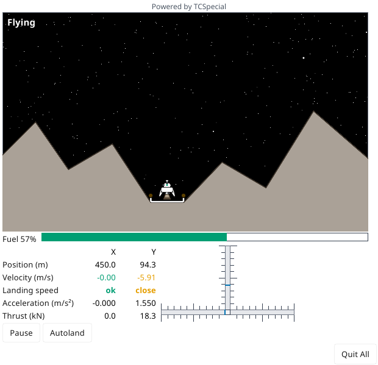
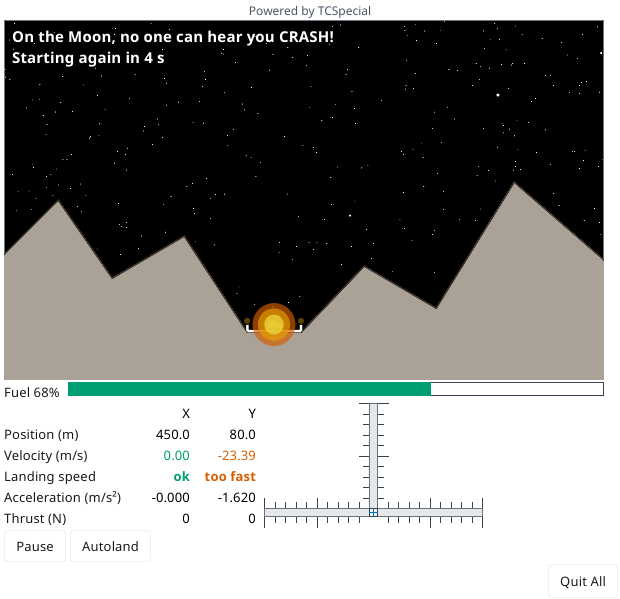
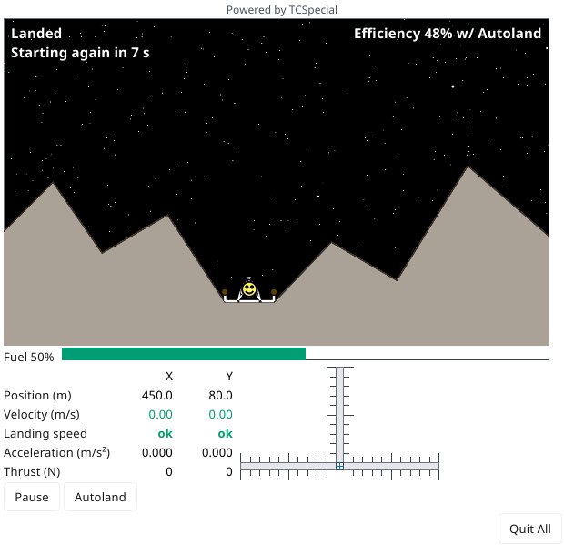
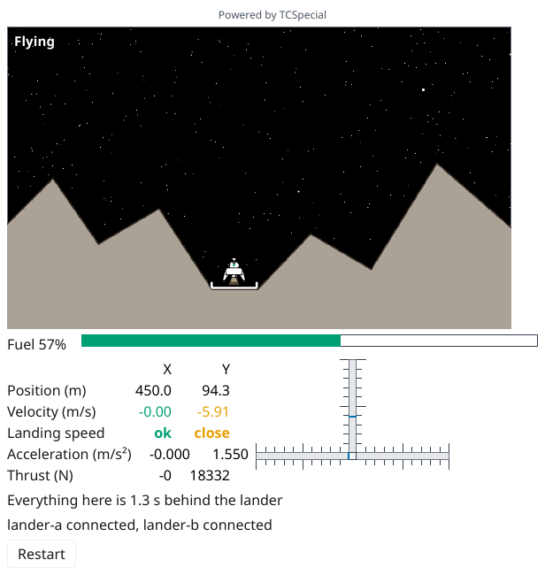
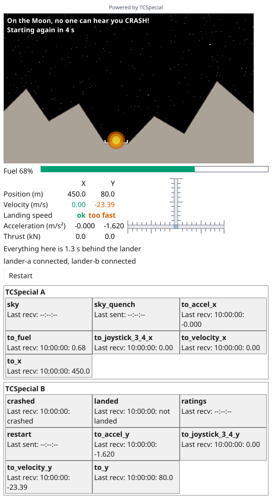

=========================
The Lander Example Design
=========================

.. contents:: Table of Contents
   :depth: 4
   :local:

.. note::

   The lander example is built as described here. It was written as a plan
   first, and made in the stages of "How it was made", each checked before
   the next; how to run it is in the tcspecial manual's "The lander
   example" and in ``examples/README.md``.

What it is
==========

A lunar landing in two dimensions, flown by hand. tcs-sim draws the lunar
landscape and the lander over it, and below them a joystick; whoever runs
the example flies the lander down onto a landing pad with the joystick,
against the Moon's gravity and with fuel that runs out.

Two tcspecials fly it, called A and B: A has the X axis and B the Y axis.
Each reads its axis of the joystick and drives its axis's thrust, and
sends its axis's position, velocity and acceleration, and the joystick's
value, to the ground. On the ground, Yamcs takes both, and a window of the
example's own, reading Yamcs, draws the landscape and the lander again,
smaller, with a joystick that only shows what was sent. Everything between
the vehicles and Yamcs, both ways, takes as long as it would between the
Moon and the Earth.

The scene
=========

The display
-----------

The display is the world: 1000 m wide and 600 m high, with X increasing to
the right and Y upward. tcs-sim's window and the ground's both draw it
whole, the ground's smaller.

The landing pad
---------------

The pad is a level line twice as wide as the lander, 90 m. Its centre is
within the middle 50% of the display's width, and its height within the
lowest 20% of the display's height. It is drawn as a level line with a
short upright mark at each end, so that it is told from the terrain by its
shape and not by its colour alone.

The terrain
-----------

The terrain is a connected set of straight lines from the left edge of the
display to the pad's left end, and from the pad's right end to the right
edge. Each line goes from left to right, so none overlaps another, and its
slope is no steeper than 70 degrees either way. No point of it is below the
bottom of the display or higher than 60% of the display's height. Below the
lines, the display is filled 50% grey with a little brown, ``#857a6c``.

The landscape is made at random for each run, from a seed. The ground
station takes the seed as ``--seed N``, or chooses one and says which, so
that any landscape can be had again. It makes the pad and the terrain from
the seed, keeping every rule above, and writes them into that run's copy of
the simulator file, which tcs-sim and the ground's window both read: the
landscape is made in one place, and the two draw the same one. The
vehicles do not need it.

The lander
----------

The lander is a simple figure of a lunar lander, drawn for this example
and copied from no other: a body on two splayed legs with feet, about a
thirteenth of the display's height, 45 m, and about as wide as it is tall;
its outline is what meets the ground. It starts at the
upper left of the display, wholly in view.

Flying it
=========

The joystick
------------

The joystick, in tcs-sim's window beside the X and Y values, is a T: a
square, the neutral part, with a rectangle joined to its left, its right
and its top. The lander's engine is on its bottom, pushing it up, and
nothing on its top pushes it down, so there is no rectangle below the
square. A press in the square, dragged out of it, moves the axes; each
axis reads on its own, from the pointer's place along it, so a drag
outward on a diagonal moves both.

* X is 0 at the square's left side and falls linearly to -100 at the left
  end of the left rectangle; it stays at -100 further left, and comes back
  to 0 the same way when the pointer comes back. At the square's right side
  it rises in the same way to 100 at the right end of the right rectangle.
* Y is 0 at the square's top and rises linearly to 100 at the top of the
  upper rectangle, held there beyond it; below the square it stays 0.

The square is the joystick's dead zone. The rectangles, as thick as the
square, are hatched along their outsides a tenth of their travel apart. At
rest a plus is drawn across the square. While the button is held two lines
track the pointer instead: a vertical one across the left and right
rectangles, from the left end of the left one to the right end of the
right one, and a horizontal one across the top rectangle, from halfway up
the square to the rectangle's far end. When the button is let go, the plus
comes back, and both axes read 0 until the next press in the square is
dragged out of it.

Thrust, mass and fuel
---------------------

Each axis's value, from -100 to 100, is a thrust along that axis, positive
values pushing the lander towards positive X or Y and negative values
towards negative X or Y. The vehicle reads the value as a ratio, from -1
to 1, and drives the lander's throttle on that axis with it:

.. code-block:: text

   F = throttle * (full thrust on that axis)

where each axis's full thrust is a setting, chosen as the acceleration a
full push is to give with a full tank, times the full mass. The lander's mass
is its dry mass and the fuel left, so the same push accelerates it more as
the fuel burns. The fuel flows as

.. code-block:: text

   flow = (|Fx| + |Fy|) / (Isp * g0)

with the tank holding about 60 seconds of full thrust on one axis. When it
is empty, there is no thrust. Gravity is the Moon's, 1.62 m/s\ :sup:`2`,
in the direction of negative Y, on the whole of the lander's mass.

Touchdown
---------

The lander touches down the moment any part of its outline first meets a
line of the terrain or the pad. It has landed if both its feet are on the pad,
nothing of it touches the terrain, and it is moving no faster than twice
the Apollo lunar module's touchdown limits: 6.1 m/s downward and 2.44 m/s
sideways, doubled so that more visitors land. Anything else that touches has crashed. A lander that leaves the
display flies on out of sight, and has crashed only if it drops below the
display's bottom line, which goes on indefinitely to the left and right.

A landing does not end the flight. The landed lander stands still on the
pad, with a smiling face drawn over it, burning fuel if its throttles are
open, until thrust up greater than its weight lifts it off; then it flies
on, the face gone, and may land again or crash. After a crash the lander
stays down until Restart or until a pause has run, and then starts again
at the upper left with a full tank; a landed lander that stays on the pad
for its pad wait, 10 s, starts again the same way. Autoland flies each
flight that starts by itself, unless a hand flew any of the flight before
it.

The vehicles
============

``lander-a`` (X) and ``lander-b`` (Y) are two configurations, each in
both spellings, each with its own ports and state file so that the two can
run at once; ``tcs-conflict`` checks the pair. Each has:

* payloads that read its axis of the joystick, and its axis's position,
  velocity and acceleration;
* one driven payload, its axis's thrust;
* ``to_value`` nodes for the readings;
* the joystick's reading passed through to the thrust, so that the pilot
  is in the loop and nothing aboard needs floating point;
* a ``gateway_yamcs`` gateway, which takes the four values to the ground;
  lander-b's takes the ``landed`` and ``crashed`` signals too, each the
  text ``1`` or ``0``, typed ``string(1)`` so that Yamcs shows that text
  rather than its bytes, and the lander's ratings (see "The ratings, sent
  down").

``lander-a`` also sends the fuel left, and ``lander-b`` whether the lander
has landed or crashed. Each logs to its own directory under
``/tmp/telemetry``.

They are ``examples/lander-a/`` and ``examples/lander-b/``. Their simulator
file is ``examples/lander-common/lander-sim.yaml``, which each directory
links as its own ``-sim.yaml``; in it each payload says whose it is with
``configuration``, so that a tool reading the file with one configuration
takes that one's payloads alone.

The link to the ground
======================

What passes between each vehicle and Yamcs is delayed by the time light
takes between the Moon and the Earth, about 1.28 seconds: 1.3 seconds, a
setting of the ground station. The delay is both ways: telemetry down, and
anything sent up, such as the connecting message and any command added
later, is held as long. Between each tcspecial's gateway and Yamcs the
ground station puts a relay that holds each datagram that long before
passing it on. A round trip is then about 2.6 seconds, so every timeout in
the connecting exchange between Yamcs and a vehicle has to be longer than
that.

What the ground shows is therefore 1.3 seconds behind tcs-sim's window;
the pilot's loop, from the joystick to the thrust, is aboard and is not
delayed.

The windows
===========

tcs-sim's window
----------------

For a world that has a two-dimensional body, tcs-sim's window shows, in a
pane at the left of its payload panels:

* the landscape and the lander, drawn to scale, positive X to the right and
  positive Y upward, under a black sky with stars, which lander-a also
  sends down (see "The sky, sent down"), the lander
  white with thin black lines so that it shows against the sky and the
  ground, with the smiling face after a landing;
* "Landed", or on a crash "On the Moon, no one can hear you CRASH!", in
  words, and the fuel left, in words and as a
  bar; standing on the pad, under "Landed", "Starting again in N s", the
  whole seconds of the pad wait left, so that a visitor knows how long
  there is to read the rating or to lift off again; and after a crash,
  under its words, the same, the seconds of the pause left;
* below them, the X and Y position, velocity, "Landing speed",
  acceleration and thrust. "Landing speed" says how each axis's speed
  stands against its touchdown limit -- across either way against
  ``landing_drift``, down against ``landing_speed`` -- as "ok" within
  three quarters of it, "close" within it, and "too fast" past it, in
  bold, in Okabe-Ito's bluish green, orange and vermillion; the velocity
  is shown in the same colour, always beside those words. The values are
  each named and with its unit, the thrust in newtons: the throttle the
  lander burns at times the axis's full thrust, nought with the tank
  empty. From a crash until the lander starts again they stand at what
  it crashed with: the lander reports the velocity and acceleration it
  hit with while it is down, and the thrust stands as it was last seen
  flying. Those are the last values sent down, so the ground's window
  shows the same, a light time later;
* beside those, the joystick;
* below them, Pause, which halts the simulated world and resumes it, and
  Autoland, which tries to land the lander by flying it through the
  joystick, a landing not being certain.

Here is the pane flown by hand, low over the pad and coming down at
"close" to the limit, the joystick's lines showing where it is held:

         speed ok across and close down, and the joystick held part way up.

   Flying by hand, coming down close to the limit.

The same hand, cutting the engine once low, hits at 23 m/s, and the
readouts stand at what it hit with while the pause counts down:

         words "On the Moon, no one can hear you CRASH!" and "Starting
         again in 4 s", and Landing speed too fast down.

   Crashed, too fast, starting again in a few seconds.

And Autoland's landing, three seconds into the pad wait, with its rating:

         words "Landed" and "Starting again in 7 s", and "Efficiency 48%
         w/ Autoland" at the top right.

   Landed by Autoland, rated, starting again in 7 s.

The pictures here and the ground station's below are made by ``make
screenshots-lander`` from each window's own code, drawn in memory, with
the lander example's lander flown against its own physical model.

The pad has a flashing light on top of each of its end marks in
tcs-sim's window, the lander's own view. The ground's window draws the pad
without them, so that nothing flashing there draws the eye from what has
come down.

The ground's window
-------------------

The ground station's window reads the values from Yamcs several times a
second and shows:

* the landscape, from the run's simulator file, and the lander at the
  position sent down, smaller than tcs-sim's;
* the stars of tcs-sim's sky, as they are sent down: none at first, each
  appearing as its record arrives (see "The sky, sent down");
* the six values sent down, with "Landing speed" under the velocity, as
  tcs-sim's pane has it, and the thrust under the accelerations, worked
  out from the joystick's values as tcs-sim works it out from the
  throttles, and standing from a crash at what it was before it, as
  tcs-sim's does; and the fuel left;
* at the top right of the landscape, over the sky, the lander's latest
  landing ratings as they come down, the latest first: the time of day
  each was rated and the rating as tcs-sim's pane said it, *w/ Autoland*
  where Autoland helped (see "The ratings, sent down");
* a joystick like tcs-sim's, its two lines at the X and Y values the
  joystick sent down, or its plus when they are nought; the pointer does
  nothing there;
* "Landed", or "On the Moon, no one can hear you CRASH!", when the values
  sent down say so; and under either the seconds left before the lander
  starts again, its pad wait or its pause, counted from when the landed or
  crashed signal came down;
* a Restart button, which sends a command up through lander-b's gateway to
  a simulated payload, ``restart``, joined to the lander's ``restart``
  input: each press a new count, the lander starting again at each, a light
  time after the press.

The Rust ground station, lander-station, shows the same flights as tcs-sim
does, a light time later, the joystick's lines at what was sent down:

         speed close down, the note "Everything here is 1.3 s behind the
         lander", both vehicles connected, and Restart.

   lander-station, the lander coming down close to the limit.

         and "Starting again in 4 s".

   lander-station after the crash, counting down to the start again.

The lander always starts again by itself: after a crash once its pause
has run, and after a landing once its pad wait has, unless it lifts off
first. Nothing on the ground turns that off.

The sky, sent down
------------------

The ground's sky is tcs-sim's, sent down rather than worked out again:
the one place the stars are made is tcs-sim's ``physical::sky``, which its
pane draws and its lander sends. The lander's ``sky`` output is records, a
kind of terminal of its own, one for each star. lander-a's simulated
payload ``sky`` sends them four to a packet, every 50 ms, round and round,
and the vehicle passes them down through its gateway, as bytes, to Yamcs's
``sky`` parameter. Each record is 16 bytes, most significant byte first:

* the sky's generation, how many stars it has, and the star's number, from
  nought, two bytes each;
* its radius, in tenths of a pixel of a scene 600 pixels wide, and its
  brightness, from nought to 255, a byte each;
* its place across and up, in centimetres, four bytes each.

No record is split between two packets, so a packet lost costs only the
stars it carried. The ground reads Yamcs for the latest packet several
times a second, so it misses some, besides those UDP loses on the way;
each comes round again on a later pass. The sky fills in over a few
seconds, and where packets are lost it is thinner for a while: less to
look at, and nothing else.

Once the ground has every star of a generation, it answers each further
packet of that generation with a quench: the generation, two bytes, sent
up through lander-a's second gateway, ``gateway_sky``, to the simulated
payload ``sky_quench``, joined to the lander's ``sky_quench`` input.
While that input holds the sky's generation, nothing is sent. A quench
lost on the way is answered again by the next packet, so the sending
stops a round trip after the sky is whole. The quench has a gateway of
its own because a gateway passes what the ground sends to every payload
it feeds, and lander-a's first gateway once fed ``autorestart``, which
would have read a quench as an order. A sky made again would have a new generation, sent
afresh and gathered afresh; tcs-sim makes its sky once a run, as
generation 1.

The ratings, sent down
----------------------

tcs-sim's window rates each landing (see the requirement for its rating
in docs/tcs-sim-design.rst) and gives the rating to the lander as it
shows it: it drives the lander's ``rating`` input to the rating,
``rating_autoland`` to whether Autoland helped, and then ``rated`` to a
new count, which takes the two, stamped with the time of day, into the
lander's latest 20 ratings. The lander's ``ratings`` output sends them
as records of 16 bytes, the latest first, four to a packet every fifth
of a second, round and round as the sky goes: when it was rated, in
milliseconds since the Unix epoch, eight bytes; the rating, in tenths of
a percent, two bytes; one where Autoland helped and nought where not, a
byte; and five bytes of nought. The simulated payload ``ratings`` sends
them to lander-b, whose gateway passes them down, as bytes, to Yamcs's
``ratings`` parameter, and the ground's window lists them. A packet
missed is had on a later pass, and the ground keeps each rating by when
it was rated, so a rating comes once however often it arrives.

How it was made
===============

In this order, each stage checked before the next:

1. **One world for two tcspecials.** tcs-sim takes more than one
   configuration, and one simulator file whose payloads say which
   configuration each belongs to, with one world and one window for both.
2. **Physical.** In ``tcsprotocol`` for the format and in tcs-sim for the
   simulation, as ``body`` and ``engine`` are:

   * ``lander``, the craft and the ground it lands on in one component,
     since a component sees only what is held at its inputs and the ground
     has to see the lander move, and the tank has to be filled again when
     it starts again: dry mass, fuel, specific impulse, full thrust on each
     axis, the Moon's gravity, its start, the display's size, the ground,
     the pad, its outline, the touchdown limits and the pause, read and held
     to the landscape's rules; the throttle on each axis, from -1 to 1, as
     inputs; the X and Y position and velocity, the fuel left, and landed
     and crashed, as outputs. The thrust, mass and fuel are as described
     above, extending what ``body`` and ``engine`` do on one axis.
   * ``joystick_3_4``, the three-armed joystick: two inputs, which tcs-sim's
     window drives as a simulated
     payload drives an input, and two outputs, X and Y from -1 to 1, which
     simulated payloads report.
   * a unit, metres per second squared, for the acceleration: a type in
     ``tcsprotocol/xtce/types.xtce`` and the unit table. It changes the
     interface digest every configuration states, so it comes last, and
     with it the lander's two accelerations as outputs.

3. **tcs-sim's window**, as described above.
4. **The vehicles**, ``lander-a`` and ``lander-b``, as described above.
5. **The ground station**, ``examples/lander/lander_yamcs.py``: it makes the
   landscape from the seed and writes it into the run's simulator file;
   starts Yamcs with an instance for each vehicle, a delaying relay on
   each of their links, tcs-sim with both configurations, and both
   tcspecials; and opens its window.
6. **The rest of an example**:

   * each vehicle's diagram, ``lander-a.svg`` and ``lander-b.svg``, naming
     every node, and its XTCE, ``lander-a.xtce`` and ``lander-b.xtce``,
     from ``make xtce``;
   * tests: the landscape's rules kept for many seeds; thrust against mass,
     the fuel running out, landing and crashing at the limits and leaving the
     display; the joystick's mapping; the delay; the pair of vehicles, with
     ``tcs-conflict``;
   * ``make run-lander``, and ``lander`` in tcsx's lists of examples run
     by their own ground station and through Yamcs;
   * a section in ``examples/README.md``, "The lander example" in the
     tcspecial manual with its figure, the pair in ``make check``'s
     comparison of spellings, and the new components and unit in the tcs-sim
     manual;
   * the packaging, so that tcspecial-examples carries every new kind of
     file, and so that the container has the example.

7. **Commanding it, and its sky.** Once it was flying:

   * Restart, a simulated payload ``restart`` on ``lander-b`` joined to
     the lander's ``restart`` input, and Disable and Enable Autorestart,
     ``autorestart`` on ``lander-a``, joined to its ``autorestart`` input,
     each commanded from the MOC's window through its vehicle's gateway;
   * the sky, made once in tcs-sim's ``physical::sky``, drawn by its pane
     and sent down as the lander's ``sky`` records through ``lander-a``,
     and quenched through ``lander-a``'s ``gateway_sky``, as in "The sky,
     sent down";
   * the joystick a T, with no arm below its middle, since nothing pushes
     the lander down, and the bottom engine, once lit, at no less than a
     tenth of its full thrust;
   * a lander that leaves the display flying on, crashing only below the
     display's bottom line.

8. **Flying on after a landing.** A landed lander stands on the pad until
   thrust greater than its weight lifts it off. With autorestart, then
   switched by the ground, it starts again after its pad wait, 10 s, longer than a crash's pause, so
   that whoever is at the joystick has time to lift off and land again,
   Autoland staying off; a lift-off ends the wait, and the next landing
   begins a new one. Every flight autorestart starts is flown by
   Autoland, so that a booth nobody is at keeps flying.
9. **Always starting again.** Disable and Enable Autorestart went, from
   both ground stations, with the ``autorestart`` payload and gateway on
   ``lander-a`` and the lander's ``autorestart`` input: the lander now
   always starts again by itself, after its pause or its pad wait.
