================
TCSpecial Manual
================
.. contents:: Table of Contents
   :depth: 4
   :local:

Introduction
============

.. warning::
   TCSpecial is very early software and is subject to rapid change. Until
   1.0, any change to its API changes the minor version number (0.1 to
   0.2), so a release that changes only the patch number never breaks code
   built against it. Feedback is welcome, even at this stage: open an issue
   at https://github.com/vomlehn/tcspecial/issues.

.. note::
   TCSpecial has been designed for spacecraft and ground communication with high
   latency communication links. It is just as applicable for other environments,
   such as submersibles, drones, etc. Simply translate "spacecraft" to your
   device type.

TCSpecial is **telemetry and control, special**, and it is flight software. It
connects the devices aboard a vehicle -- sensors, actuators, and whatever else
arrives on an I\ :superscript:`2`\ C bus, a SPI link, a serial line, a CAN bus,
a set of discrete lines, a sensor buffer, a channel to another processor core,
a socket or a device file -- to the places their data has to reach. Some of
those places are on the ground: a network link carries telemetry to the mission
operations center, the **MOC**, and commands back. Others are aboard: software
that takes what a device produces, computes something from it, remembers what
it needs to remember, and sends the result on to the original device, to a
different device, or to the MOC. Others again keep what they are given -- a log
node records what reaches it, however many sources send to it, so that what
happened can be reconstructed later rather than only watched as it goes past.

Everything in that picture is a **node**, and what joins one node to another is
a **link**. Neither is written in the software. Both are read from a
configuration file at startup, which is the whole of the architecture: the
program is a set of node types and a machine for moving data along declared
links, and what a particular vehicle does is a file.

**C/C++, Rust and Python are all supported.** A program that runs aboard --
the program of an app node, or a payload that is a program rather than a
device -- is talked to through file descriptors it inherits, which a program
in any of the three already knows how to read and write, so it may be written
in C, C++, Rust or Python. On the ground, a station is built on ``tcslib`` in
Rust, on ``tcslib-c`` in C or C++ -- the same library behind one header,
``tcslib-c/include/tcs.h`` -- or on its Python spelling under ``python/``.
Every interface offered to C is offered to C++ as well: a C header can be
included from C++ as it stands, and nothing in it is C that C++ will not
compile.

**cFS and F´.** Work is under way on using TCSpecial, its telemetry log tcslog
and its packet compiler tcs-xtce with the two flight software frameworks most
missions are built on, NASA's core Flight System and JPL's F´. What each
project brings to them, what has to change to fit, and in what order, is in
``third-party.rst``, beside this manual.

.. note::
   Integration with cFS and F´ is a work in progress. A vehicle can answer to
   either -- see `The fprime example`_, `The F´ bridge`_ and `The cfs
   example`_ -- and the rest of what ``third-party.rst`` describes is not
   built yet; nothing else in this manual depends on it.

What that buys
--------------

The reasons are given in the order TCSpecial ranks them. Where two designs
compete, the earlier item wins, and this list is what an argument about them
should cite.

**Reliability.** The whole of what a vehicle will do is one artifact, and it is
checked before any of it runs. Every link must name nodes that exist; a node
that computes a mean must have its inputs bound, all of them; a set of discrete
lines driven as outputs may not also be read as inputs. ``tcsverify`` performs
those checks on the ground, against the same code that will perform them again
aboard, so a configuration that does not make sense is refused on a desk rather
than discovered in flight. What did fly is not a matter of memory either: the
beacon carries a digest of the configuration the spacecraft read, so the ground
can say which file is running. And a node can be reached only along a link
somebody declared -- there is no ambient path by which data arrives somewhere
nobody intended.

**Ease of use.** One file says what the system does, and it says it in the
words of the person who built the vehicle: a bus and an address, a chip and
three line numbers, an interval, a setpoint. Reading the file tells you what is
connected to what, which is the question actually asked of a telemetry system
at three in the morning. There is no code to read to find out where a sensor's
readings go.

**Maintainability.** A node knows nothing about its neighbours. It is handed
bytes and it produces bytes, and the links are somebody else's business, so a
type of interface is one module with one job and a test of its own. Adding a
type does not touch the machinery that moves data, and changing what a vehicle
does does not touch either.

**Flexibility and extensibility.** A new interface is a new node type; a new
computation is a new function or a program of its own. Neither disturbs the
graph. Rearranging a vehicle -- another sensor, a second heater circuit, the
same readings sent somewhere new -- is an edit to a configuration file, not a
build.

The vocabulary
--------------

These words are used precisely throughout, and some of them replaced older ones
that were used loosely.

node
    Anything the configuration can name and a link can join: a device, a
    gateway, or a compute element. The generic term.

device
    A node that is real hardware, reached over one of the interfaces. These
    were called *payloads*, which said what they were for rather than what they
    are, and said nothing at all about a device being driven rather than read.

device file
    A node reached as an entry in the filesystem -- ``/dev/urandom``, a named
    pipe, a file a program writes. The word *device* was used for this as well
    as for hardware, which made "device" ambiguous in exactly the places it had
    to be exact.

MOC
    The mission operations center, on the ground. Earlier text calls this the
    OC.

gateway
    The node the vehicle reaches what it answers to through -- the ground,
    over the radio, as a ``gateway_radio`` node, a Yamcs ground station, as a
    ``gateway_yamcs``, an F´ flight computer, as a ``gateway_fprime``, or a cFS
    flight computer's software bus, as a ``gateway_cfs`` -- written in the
    ``gateways`` section: a link carrying
    telemetry down and commands up. It was called ``moc`` while the
    ground was the only thing at the other end, and a configuration that still
    says ``moc``, ``moc-in``, ``moc-out``, ``tee-moc``, ``null-moc``,
    ``app_moc_veh`` or ``app-moc-arg`` is refused, naming the line and the
    word to write instead.

compute element
    A node that transforms what it is given. It may keep state between
    arrivals, which is what makes a control loop possible: an average over
    time, a comparison against a setpoint, a filter that remembers.

value
    A number on a link, in a unit: four bytes of a signed count of the
    unit's steps, most significant byte first -- micro-kelvin for a
    temperature, micro-volts for a voltage, millimetres for a length. A
    reading is a value in one unit from the conversion that made it to the
    computation, the log and the ground, so that comparing two readings is a
    comparison and not a conversion. The unit is not on the link: the
    configuration says it, a conversion stating it and a vote taking its
    inputs'. A step is finer than any part here resolves, so the number is
    exact rather than rounded in practice, and each unit reaches what its
    step allows -- 2147.483647 K either way for a temperature, 2147 km for an
    altitude -- with a number outside that refused where the value is made,
    naming the number. Where a value becomes text -- the lines a program reads and
    writes, or the value typed into a command -- it is converted at that
    boundary and nowhere else.

decision
    What a thermostat sends a device: 1 to assert and 0 to unassert, as the
    type its ``type-out`` names -- a ``boolean``, one byte, or the whole
    number a set of GPIO lines takes. It is not a value, and it is asserted
    on every sample rather than only when it changes.

group
    Devices that share one sampling interval, so that a set of sensors is read
    as close to simultaneously as the hardware allows rather than each on a
    clock of its own.

log node
    A node that records what reaches it rather than passing it on, built on the
    same ``tcslog`` the telemetry log uses. Any number of sources may link into
    one, so a flight's housekeeping is one log with the records interleaved as
    they happened. Its directory and its record format are configured, and
    every source must produce records that format can hold -- which is settled
    when the configuration is loaded, so a log never has to refuse a record in
    flight.

link
    A directed connection from one node to one or more destinations. A link
    with several destinations is how one reading reaches both the ground and an
    on-board computation; it is the "T" such an arrangement is usually drawn
    as. It is written as an attribute of the node it leaves rather than in a
    section of its own, so a node and what leaves it are read and written
    together, and noted on the node it arrives at as well, so that a node's
    entry says it is connected both ways.

terminal
    Where a link is attached: a node's **data source** is where data leaves it
    and a **data sink** is where data arrives. A terminal has a name, and the
    name says whose data it is and whether it arrives or leaves, not what is
    at the other end of it: ``payload-`` is the payload's own data on its way
    to the ground, ``gateway-`` is what the ground sends on its way to a
    payload, and ``-in`` arrives where ``-out`` leaves. So every ``-out`` is a
    data source and every ``-in`` a data sink. There are four of them, two per
    stream:

    ``world-out`` is where a payload's readings leave and ``world-in`` is
    where they arrive; ``moc-out`` is where what the ground sends leaves and
    ``moc-in`` is where it arrives. A payload has ``moc-in`` and
    ``world-out``; a gateway link has ``world-in`` and ``moc-out``; a
    ``null-gateway`` has ``moc-in`` alone and a ``null-payload``
    ``world-in`` alone; a ``tee-gateway`` has ``moc-in``, ``moc-out``
    and ``world-out``, and a ``tee-payload`` ``world-in``, ``world-out``
    and ``moc-out``; an ``app_all_veh`` has all four; and a ``ping`` node
    has a payload's pair, ``moc-in`` and ``world-out``. With no vehicle
    node in the way, a payload's ``world-out`` connects to a gateway link's
    ``world-in``.

    A link is written as an attribute of the node it leaves, named after the
    data source it leaves by, one line each: the node the line reaches and the
    name it arrives there by, separated by a dot.

    .. code-block:: yaml

       - type compute:
           - compute: k_fore
             world-out:
               - gateway.k_fore
               - mean_temp.in0

    A link leaving a type with two data sources -- a tee, an ``app_all_veh``
    -- is written under the one it leaves by, which says which. One line needs
    no list: ``world-out: gateway.k_fore``.

    A data sink takes one data source; a data source may reach several sinks;
    and a gateway link's sink takes as many as the configuration gives it, every
    payload's telemetry arriving at the ground on its own socket.

    The node at the arriving end lists, under each data sink, the names a
    line may arrive there by -- ``world-in: [k_fore]`` on the gateway, and a
    vote's world-in is its inputs, ``world-in: [in0, in1, in2]``. A line to a
    name its far end does not list is refused where the file is read, saying
    which names it does list. A name is one word with no dot in it, and may be
    listed with nothing arriving at it yet. tcsgui names a line it draws after
    the node it leaves, and adds the name to the list for you.

    Each terminal may be linked to one other: a ``world-out`` to a
    ``world-in``, a ``world-in`` to a ``world-out``, a ``moc-out`` to
    a ``moc-in``, a ``moc-in`` to a ``moc-out``. Anything else would
    carry one stream into the other. In tcsgui the terminals are drawn as small
    boxes in a node's corners, each with an arrow saying which way its data
    goes: the payload's own data along the top pointing right, towards the
    ground, and what the ground sends along the bottom pointing left, towards
    the payloads -- the canvas having the payloads on the left, the vehicle in
    the middle and the gateway on the right. A link is made in three clicks:
    one of them, which takes a line in hand; the node the line is to reach,
    anywhere on it; and, in the menu that node shows, the input the line is to
    arrive at. Inputs that cannot take the line are in the menu greyed, saying
    why -- ``(fed by to_k1)``, ``(joined already)``. Escape, a right click or a
    click on bare sheet puts the line down. A line already drawn is picked up
    by clicking the terminal at either end of it: the next node clicked offers
    to move that end there, and the node it was picked up from, or the Delete
    key, offers to take it out. A click of either button on a line selects
    it, and the Delete key then takes it out; a right click also opens its
    menu, whose Delete does the same. A node or a physics component is
    selected by a click the same way, and a right click on a node opens its
    menu, Edit and Delete; Delete asks before the node goes. A click anywhere
    else on the sheet selects nothing. A subdiagram's box offers the nodes its file
    exports at that terminal; inside the subdiagram, its page has an edge in
    a margin either side, labelled *outside*, the left one left of the
    Physics pane, and clicking an edge terminal
    and then a node, or a node's terminal and then the edge, offers to show
    that node outside there or to hide it, and a new line to each node
    outside that can take it -- which shows the node outside as well. A
    subdiagram is opened by **Open** in its box's menu, in a window like the
    main one, with the same panes, lists, Physics pane and edits.
    A node with no terminal of that stream offers nothing, and a gateway link has none on its right at all: the payload data it receives arrives at the
    ``world-in`` in its upper left, and what it sends leaves by the
    ``moc-out`` in its lower left.

    A line's names are not written beside it in tcsgui. Resting the pointer
    on a line shows a tip: the node it leaves, the node it reaches and the
    input there where it names one, and under them whatever comment the
    file has for it. A physics line's tip names the component's terminal,
    which tells a line into a thermal mass's ``heat`` from one into its
    ``heater_1``, both entering the one box. The **View** menu zooms the
    sheet: **Zoom to the drawing** fits every node and component in the
    window, **Zoom to the selection** fits the node, line or component
    selected, **Actual size** draws it at its own size, and **Fit the
    width**, which is how a window starts, draws it as wide as the window
    and no wider than its own size.

``null-gateway`` and ``null-payload`` nodes
    Vehicle nodes that take one stream and drop it: a ``null-gateway`` takes
    what the ground sends at its ``moc-in``, and a ``null-payload`` takes a
    payload's data at its ``world-in``. Neither has a data source, so nothing
    can be linked out of one. For a stream that has to go somewhere and has
    nowhere to go yet. They take no attributes.

``tee-gateway`` and ``tee-payload`` nodes
    Vehicle nodes that take one stream and send each datum on both ways. A
    ``tee-gateway`` takes what the ground sends at its ``moc-in`` and sends
    it on by its ``moc-out``, as it was going, and again by its
    ``world-out``, as payload data. A ``tee-payload`` takes a payload's data
    at its ``world-in`` and sends it on by its ``world-out`` and again by
    its ``moc-out``, as gateway data. A link cannot carry one stream into
    the other, so a tee is how what the ground sends reaches a ``world-in`` --
    the ground's own, to see what it sent, or a log's -- and how a payload's
    reading reaches a ``moc-in``. Each data source may reach as many sinks
    as any other, so every link out of a tee gets a copy. A link out of one
    names the source it leaves by, there being two:

    .. code-block:: yaml

       - type tee-gateway:
           - compute: echo
             moc-out: [heater]
             world-out: [gateway]

    They take no attributes.

``ping`` node
    A vehicle node that answers the ground. Link a gateway link's
    ``moc-out`` to it and its ``world-out`` back to the gateway link. Each
    ping the ground sends, ``ping #<count> <time>``, comes back with a space and
    the vehicle's time on the end. Each time is seconds since the UNIX epoch
    with nine digits after the point, such as ``1760900000.000000001``, and the
    count starts at one. A message that is not a ping is refused and logged
    aboard, not answered. A ping node takes no attributes, and it cannot be
    stopped or started from the ground: both commands are answered
    ``InvalidCommand``.

command binding
    A statement that a named command from the MOC sets a named attribute of a
    node. It is how a setpoint reaches a control loop in flight.

.. note::
   **What runs today.** The architecture above is what TCSpecial is being
   built into, and this manual describes it as the thing to configure against.
   What is in flight-ready shape at the time of writing is narrower: a node may
   be a device or a gateway link, and the links the software builds are the
   pair that joins one device to one gateway link in each direction. Compute
   elements, links with several destinations, groups with a shared interval,
   discrete lines driven as outputs are specified in ``design.rst`` and are being
   implemented in that order. Command bindings run: the ground sets a bound
   attribute of a node with a ``SET_NODE``. Where this manual
   describes something not yet running it says so in a note like this one, and
   the rule this project has always followed applies: the description stands,
   and a note records what is so today.

Assumptions
===========

Order of delivery
   A packet sent between the vehicle and the ground may be dropped, but
   the radio link delivers those that arrive in the order they were sent,
   and TCSpecial relies on it to. Nothing puts packets back in order.

Reliable datagrams
   Communication between components on the vehicle, and between
   components within the MOC, uses reliable datagrams: nothing there is
   lost, repeated or delivered out of order. Only the radio loses or
   repeats a packet.

Every configuration can be retrieved
   The MOC can retrieve every configuration the vehicle has ever run, by
   the MD5 checksum that names it. The checksum a beacon carries
   identifies the configuration tcspecial is running, and a ground station
   reads the vehicle's data and commands it with that configuration, so a
   station that hears a checksum it does not have at hand fetches the
   configuration it names rather than reading with another.

Guarding the assumptions
   Should either assumption about delivery fail in flight, the receiving end still drops
   anything older than what it has already taken: a command older than
   one tcspecial has already taken is answered ``Stale`` and not acted on,
   and a beacon older than one the ground has already heard counts for
   nothing. `What is assumed
   <https://vomlehn.github.io/tcspecial/docs/design.html#what-is-assumed>`__,
   in the design, says what else tcspecial and the ground rest on.

Limitations
===========

Platform
   TCSpecial runs only on Linux. Seven of its interface types use Linux's
   own kernel interfaces, and much of the rest needs POSIX processes,
   ``poll`` and Unix file descriptors. `Platforms and Porting
   <https://vomlehn.github.io/tcspecial/docs/design.html#platforms-and-porting>`__,
   in the design, says which parts are Linux-only and how they might be
   carried to a real-time operating system.

Number of nodes
   A node's id is its position among the names of all the configuration's nodes
   -- the gateways, vehicle and payloads sections, in the top file and in the
   files it includes, sorted by name -- counting from nought, and it is 32 bits.
   A node's telemetry port is a base plus its id, so a base of *B* leaves room
   for ids up to 65535 - *B*, counting every node, not only payloads. A
   configuration whose ports would pass 65535, or that puts two sources on the
   same address and port, is refused when the file is read.

Times
   Times are 64-bit counts of microseconds since the UNIX epoch, which run
   to the year 586524; all ones means the clock failed. The beacon interval,
   ``beacon.default_interval``, and the interval until the MOC connects,
   ``beacon.reset_interval``, are at most 2\ :sup:`64` - 1 microseconds,
   about 585,000 years, the longest tcspecial can time; the reset interval
   is no longer than the beacon interval.

Command sequence numbers
   A ground client numbers its commands from 1 in 32 bits. After
   4294967295 commands the number wraps to 0 and starts again, so a client
   that sends more than that reuses numbers.

Counters
   The beacon's sequence number is 32 bits and wraps, and the ground takes
   a sequence that goes backwards as a restart: at one beacon every 5
   seconds, that happens after about 680 years. Nothing else counts
   starts: there is no generation number.

Data sizes
   Aboard, one read delivers at most 4096 bytes, so ``max_length`` is at
   most 4096.

Configuration File Formats
==========================
A configuration file may be written in YAML or XML. Both describe the same
settings and are read into the same values, so the choice is one of local
preference and tooling rather than of capability.

The format is taken from the file's extension, which is a configuration's
own rather than its language's:

.. code-block:: text

   .ytcs           YAML
   .xtcs           XML
   anything else   refused

A file whose extension is neither is refused, naming the file and what a
configuration file is called. Configurations were once named ``.yaml``,
``.yml`` or ``.xml``; one still named so is refused with the name to give it,
``vehicle.yaml`` being told to become ``vehicle.ytcs``. A payload simulator
file is not a tcspecial configuration and keeps its language's extension,
``.yaml``.

JSON was read as well, and was what a file with no extension or an
unfamiliar one was assumed to be, which made a misspelled extension not an
error but a file parsed as the wrong language. Nothing was written in it
that was not also written in YAML.

(The links carry packets stated in XTCE: the fixed commands in
``tcslibgs/xtce/fixed.xtce``, the beacon in ``tcslibgs/xtce/beacon.xtce``
and the rest in ``tcslibgs/xtce/link.xtce``. Those are not configuration
files and are unaffected; a configuration names
the second, as its ``interface``: see `Which interface it is written for`_.)

Which Files There Are
=====================
Two configuration files, and neither of them has a name of its own. Any name
will do so long as it ends in ``.ytcs`` or ``.xtcs``, which is what says how to
read it; the names used throughout this manual are the shipped examples' and
are suggestions, nothing more.

the configuration
    Everything tcspecial is configured with. Its ``tcspecial`` section is the
    command interpreter's own settings -- the ports it takes commands on, where
    beacons go and how often, and where the telemetry log goes -- and its
    ``gateways``, ``vehicle`` and ``payloads`` sections say which nodes there
    are, what each of them does and how the lines between them run. Named on the
    command line of every program that reads it, which is tcspecial, tcsmoc,
    tcssim and tcsverify.

the simulator configuration file
    How a simulated payload behaves: how often it produces a packet, how it
    divides one into segments, and what in the physics model it is joined
    to if it is. Read only by tcssim, which takes it from ``PAYLOAD_SIM_YAML``, and by
    tcsmoc, which shows it and acts on none of it. There is nothing in it
    about the payloads themselves.

A configuration may be written as several files. The one named on the command
line is the top file, and its ``include`` list names the others, each read in
the top file's spelling and taken in as if it were written there. Each is a
subdiagram, with a name of its own and its file's path under it:

.. code-block:: yaml

   include:
     - subdiagram: thermostat-common
       path: ../thermostat-common/thermostat

In XML it is one element with the two as attributes, ``<include
name="thermostat-common" path="../thermostat-common/thermostat"/>``. The name
is the subdiagram's, the name tcsgui draws its box under, and is no node's
and no other subdiagram's, with no dot or slash in it. An include written as a
bare path, as includes once were, is refused, saying how to write it now.

An include's path is relative to the top file's directory: it is the file's path from
there, without the extension, ``zone`` for ``zone.ytcs`` beside the top file
and ``../thermostat-common/thermostat`` for ``thermostat.ytcs`` in a directory
beside the top file's. Nothing in it is expanded, so an include that is
absolute, that begins with ``~`` or that has a ``$`` in it is refused, saying
so, rather than looked for as a file of that name; so is an empty one, and one
with a part that is empty or ``.``. An included file has no ``tcspecial``
section and includes no others, no file is included twice, and no two files
have a node of one name, since a node is known by its name in every file:
a line in one file may run to a node in another. Only to one the other file
exports, though. An included file's ``exports`` section says, for each of
the four terminals, which of its nodes a line from another file may reach
there, and a line that crosses into or out of the file anywhere else is
refused, saying which list to add the node to:

.. code-block:: yaml

   exports:
     world-out: [consensus_temp, gpio-out-tmass1, gpio-out-tmass2, to_k1, to_k2, to_k3]

In XML each name is an element of its own, ``<world-out>to_k1</world-out>``,
inside ``<exports>``. A top file has nothing around it and may not have the
section. tcsgui draws an included file as a box whose corner terminals are
its exports, and writes the section back as it read it. The digest takes in each
include, name and path, as it is written, so a set of files digests alike from
wherever it is read. Two examples that fly one vehicle include it from a directory of their
own: see `The thermostat-yamcs example`_.

tcspecial once read a configuration of its own as well, named by
``TCSPECIAL_CONFIG_PATH``, which said where commands are taken, where beacons
go and where the log is written. Every configuration must state those in its ``tcspecial`` section, so
there is nothing left for a second file to answer and no second file to
disagree with the one being flown.

The Payload Configuration
=========================
The payloads are a section of the tcspecial configuration file: a
description, the ``tcspecial`` section, an optional section of groups, and the
data handlers themselves. A group is a rate and nothing else: the payloads in
it are read together, every ``interval`` of the group, and each payload states
the rest of what it is for itself.

.. code-block:: text

   description    free text

   tcspecial                       optional
     ...          the command interpreter's own settings, of which
                  beacon.send and beacon.recv are read

   payload_groups                  optional
     name         the name payloads refer to
     interval     how often the group is read, as a length of time

   payloads
     type <type>  one for each type of payload there is, holding its
                  payloads
       payload    the handler's name, which commands address it by and the
                  panels show
       group      the group it is read with, if any
       ...        any of the attributes below

The shipped examples each carry a ``tcspecial`` section, first in the file, so
one file says what the set is and where its command interpreter belongs.
``beacon.send`` and ``beacon.recv`` are read from it, since where a set's
beacons go is the set's own business; the rest is not read yet, tcspecial being placed by the
file ``TCSPECIAL_CONFIG_PATH`` names. It is all checked when the file is
loaded -- a section that could never place a command interpreter is refused
where it is read.

What follows is the attributes every payload has, whatever it is, and then one
section per type of payload for the attributes only that type has. A payload's
type is the ``type`` it is written under -- ``- type i2c:`` in YAML, ``<type
name="i2c">`` in XML -- and the payload is then held to that type's attributes
and no others: a device file stating a ``port``, or a network payload stating a
``path``, is refused.

Supported and experimental interfaces
-------------------------------------
Nine types of payload are supported: ``network``, ``device-file``,
``serial``, ``i2c``, ``spi``, ``can``, and the three kinds of discrete
lines, ``gpio_in``, ``gpio_out`` and ``gpio_inout``.

CAN and the discrete lines were experimental until each was flown against the kernel's
dummy device for it, which is what supported means for them: tcspecial's
node code is run against a CAN bus of the kernel's ``vcan`` and a chip of its
``gpio-sim``, the far end of each played through the kernel and not by
tcssim, by ``tcspecial/tests/kernel-dummies.rs``. Each test checks that the
device's data reaches the ground and that the ground's commands reach the
device. Each type has an example that the test flies, in ``examples/can`` and
``examples/gpio``.
The devices need root to make, so the tests do not make them: see `Making the
Kernel's Dummy Devices`_. A test whose device is not there skips, saying which
device and the command that makes it, so ``cargo test`` passes on a host that
has not been set up and proves nothing about these types there. What a
dummy device cannot show is a real controller, chip or sensor: a bus's bitrate
and errors, a line's electrical behaviour, a driver's own channels.

Some of what follows is still marked **experimental, not yet supported**:
RS-485 on a serial line, and the ``iio``, ``rpmsg`` and ``hdlc`` types of
payload. Each is written, parses, reaches a handler and has tests of its
rules; none has been run against the hardware it describes or a dummy device
the kernel makes. ``iio`` has such a dummy device, ``iio_dummy``, and an
example and
a test written to fly it, but a stock distribution kernel such as Ubuntu's
builds the module without the buffer tcspecial reads, so the test has not
run: the type is promoted once it has passed against a kernel that has the
buffer (see `An IIO Payload`_). The others stay experimental because the
kernel has no dummy device for them, so there is nothing to fly them against
short of the hardware: an rpmsg channel needs a remote processor and its
firmware, a synchronous HDLC line needs a card, and RS-485's direction
control is the driver of a real UART, which a pseudo-terminal refuses.

Read them as a statement of what the configuration will be rather than as a
feature to rely on. They may change in ways the supported types will not.

Attributes Every Payload Has
----------------------------
.. code-block:: text

   payload        the handler's name, which commands address it by and the
                  panels show: payload: temp_1 in YAML, <payload
                  name="temp_1"> in XML
   group          the group it is read with, if any. Optional: a payload in
                  no group states its own rate, or is read on every pass --
                  see `How a Payload's Data Is Read`_
   type           not an attribute but the type it is written under, as
                  - type network: or <type name="network">, one of
                  network | device-file | serial | i2c | spi | can |
                  gpio_in | gpio_out | gpio_inout, or one of the
                  experimental iio | rpmsg | hdlc

How a payload is driven
^^^^^^^^^^^^^^^^^^^^^^^

**One attribute says it.** A payload that states a ``trigger`` is asked, and
one that states none is read; nothing else decides it, and nothing decides it
for a file that leaves it out.

.. code-block:: text

   trigger        what to send to make it answer, as one or more parts: text
                  as a quoted C string, bytes in hexadecimal in square
                  brackets. The payload is asked, as often as its group is
                  read or as its trigger_interval says

A payload with a ``trigger`` is asked, so the trigger is the question and the
group, or the payload's own ``trigger_interval``, is the clock.

A payload with no ``trigger`` sends on its own, or holds a value to be read,
so there is nothing to send it. A simulated one that sends is driven at the
rate its simulator configuration gives it, which is how fast tcssim
produces data rather than how fast the payload would.

A payload's name -- ``payload: temp_1`` -- belongs to a handler and never to a
group: it is what tells one handler of a group from another, and what every
command about a handler names it by. There is no number beside it -- a handler
used to state a ``dh_id`` as well, which was a second identity for one payload
to keep consistent by hand. An OC address and an OC port are given together or
not at all, and a handler needs them before it can be started.

The two types of payload
------------------------
A payload either sends of its own accord or answers a request, and which it is
decides where its timing is written down.

**periodic** -- the payload sends and tcspecial reads. It states no
``trigger`` and no interval of its own. Nothing here says when it sends: how
fast a simulated one produces data is a property of the simulation, so that
figure is in the simulator configuration.

**triggered** -- tcspecial sends a request and the payload answers. It states
the ``trigger`` to send, because tcspecial does the sending and what to send
comes from the payload's interface document, and how often the trigger goes
out is the ``interval`` of the payload group it is in, or, in no group, its
own ``trigger_interval``. Its entry in the simulator configuration states no
interval at all, packet or segment: such a payload sends when it is asked, so
a rate there would govern nothing.

So each type states its timing in one place and the other type's place is
empty, which is what lets a file be read without deciding anything: the rate a
payload is asked at is in the tcspecial configuration, and the rate a payload
sends at is the simulator configuration's ``packet_interval``. Every one of
them is a length of time, as `Lengths of Time`_ says.

In a graph, a ``trigger`` is also what allows anything to be sent to a payload
at all. What is written to a payload that is read is the question it answers,
and the trigger is the bytes of that question -- so a payload that states none
is one the configuration describes as only read, and a link delivering into it
is refused, naming both ends. The usual cause is a link drawn to the wrong
node, which nothing else in a configuration would reveal. A payload that is
written and never read is a different thing and takes no trigger: a heater, a
valve or a latch is driven rather than asked, and a trigger on one would be
bytes written before a read that never happens.

**The trigger itself** is bytes, not text, since an interface document asks
for what it asks for. It is written as one or more **parts**, one after
another, each in one of two notations, and the trigger is the bytes the parts
make together.

**Bytes** are written in hexadecimal inside square brackets, each one or two
digits in either case, with a space between one byte and the next -- ``5``
and ``05`` are the same byte::

   trigger: '[55]'
   trigger: '[55 AA 0D]'
   trigger: '[d]'

There is no ``x`` inside the brackets, ``0x`` included: everything between
them is hexadecimal, so a prefix saying so would be saying it for a notation
that has no alternative. A run of digits is not split into bytes -- ``[55AA]``
is refused rather than read as two, so that how many bytes a value means
never depends on counting its digits.

**Text** is written as a string in C's notation, **quotes and all**, which is
what its escapes need -- ``\\`` ``\"`` ``\'`` ``\n`` ``\r`` ``\t`` ``\0``
``\a`` ``\b`` ``\f`` ``\v`` and ``\xNN``::

   trigger: '"READ\r"'
   trigger: '"\x02ARM\x03"'

And the two together, with a space between parts or none::

   trigger: '"AT" [0D 0A]'
   trigger: '[02] "ARM" [03]'

Which notation a part is in follows from its first character and nothing
else: a quote opens text and a bracket opens bytes. ``52`` is a plausible byte
and a plausible pair of digits, so something has to say which, and the mark is
it. A trigger written bare, as ``55`` or ``0x55`` -- which is how a single byte
was written once -- is refused, and told the brackets it wants: ``[55]``.

The marks are therefore part of the **value** rather than part of the way the
file is written, which is why a YAML trigger is written inside the format's
own quotes -- ``'"READ\r"'``, ``'[55]'`` -- and an XML one as
``<trigger>&quot;READ\r&quot;</trigger>`` or ``<trigger>[55]</trigger>``.

An escape C does not have is refused rather than passed through, a quote or a
bracket that opens and does not close is refused, and a trigger of no bytes at
all is refused: a payload that answers requests has to be asked something.
Writing the escapes yourself is also how an XML configuration states a
trigger that a YAML one states with the format's own escapes.

What a payload starts in
^^^^^^^^^^^^^^^^^^^^^^^^

.. code-block:: text

   init           what to write to the payload as the vehicle opens it, in
                  the notation a trigger is written in. Optional

A payload the vehicle drives is in whatever state its hardware came up in
until the vehicle first decides something about it, which may be a while: a
thermostat decides when its group has been read, and a heater circuit that
came up on is warming the zone until then. ``init`` is what it is set to
instead, written as the node is opened -- as the vehicle starts, and again
whenever the ground starts the node after stopping it:

.. code-block:: yaml

   - type gpio_out:
       - payload: heaters_1
         path: /dev/gpiochip0
         lines: "4"
         init: '"0"'

It is not only for what is driven. A sensor whose register has to be set
before it reads sensibly states that register's write here, and is then read
as any other:

.. code-block:: yaml

   - type i2c:
       - payload: temp_1
         path: /dev/i2c-1
         address: "0x48"
         init: '"\x01\x60"'

A write that fails is a node that did not open: the vehicle does not start,
or a ``START_NODE`` is answered with the failure, saying which node and that
the init would not go. A payload whose starting state nobody knows is the
thing ``init`` exists to prevent, so it is not flown without one.

``init`` is refused where nothing can be written as the node opens: lines that
are watched rather than driven, a sensor's sample buffer (``iio``), a link to
the ground, and a ``udp`` or ``unix_dgram`` payload that is read and has no
``trigger``. That last is the payload that speaks first: the vehicle learns
where it is from what arrives, and as the node opens nothing has. Give it a
trigger and it is reached at its address, init and all.

tcssim takes an init as something received. A simulated payload that is asked
answers it as it would any request, which a real part would not: the vehicle
then reads one reading more than it asked for, on the pass after the node
opened.

How a Payload's Data Is Read
----------------------------

This is how a configuration -- a graph of nodes -- gets data out of its
payloads. Three things decide it: whether the payload sends on its own or has
to be asked, whether it is in a payload group, and, for one that is asked, how
long it takes to answer.

**Three ways data arrives.**

*Asked.* The payload answers when it is sent something. The configuration
states that something as the payload's ``trigger``, and tcspecial sends it.
A sensor behind a command protocol -- ``READ\r`` on a serial line, a register
number on an I\ :superscript:`2`\ C bus -- is asked.

*Read without asking.* The payload produces data by itself: datagrams on a
socket, bytes on a serial line, frames on a CAN bus, samples in an IIO buffer,
edges on a GPIO line. It states no trigger, and tcspecial takes what has
arrived. On I\ :superscript:`2`\ C and SPI, where nothing moves unless the bus
is clocked, a read is itself the bus transaction, so a payload there with no
trigger is read rather than asked.

Two types cannot be asked at all, and a ``trigger`` on one of them is refused
with the configuration: a set of discrete lines is read or driven and not
both, and an IIO device's sample buffer is read and never written -- what such
a device is configured with is in sysfs, not in the character device. Refused
on the ground rather than at the first read, because a vehicle that came up
and asked a question it cannot ask would have a sensor reporting nothing and
nothing saying why.

A ``read_size`` larger than one read of the interface carries is refused the
same way, naming both numbers. A CAN frame carries eight bytes, or sixty-four
on an FD bus, and an rpmsg message carries what the channel's
``max_message_bytes`` says -- 496 unless the file says otherwise. The rest is
refused rather than split over two frames: a reading assembled out of two
frames half arrives when one of them is lost, and nothing in the file says how
to put the halves back together.

*A program.* An ``app_pl`` is a program that writes its readings when it
chooses and is never asked; an ``app_all_pl`` answers whatever arrives on its
gateway interface, so the data that arrives is the question. Neither states a
trigger.

**When tcspecial reads.** The main loop works in passes.

* A payload **in a group** is read when the group is due, every ``interval``
  of the group, and every payload in the group is read in the same pass, one
  after another, so readings that will be compared are taken as close
  together as the hardware allows. Every group is due as the vehicle starts.
  The next time is counted from when the group was due, not from when the
  reads finished, so a group does not drift.
* A payload **in no group** is polled, and may state how often:

  * ``trigger_interval``, for one that is asked, is a rate, counted from when
    it was due as a group's interval is, so it does not drift. On a part that
    originates nothing -- I\ :superscript:`2`\ C, SPI, a device file -- it
    times the whole exchange: ask, wait any ``read_delay``, read. On a part
    that sends -- a socket, a line, a bus of peers -- it times the trigger
    alone, and the part is read on every pass, its answers being taken as
    they arrive.
  * ``poll_interval``, for one that is not asked, is a floor rather than a
    rate: the least time between one read and the next, counted from the
    read. Only a part that originates nothing states one. A part that sends
    and is not asked is read as its data arrives, and a ``poll_interval`` on
    one is refused: nothing aboard decides when its data exists.
  * One that states neither is read on every pass, and a pass is then made at
    least every 20 ms.
* Between passes the loop waits until the next group or payload is due, so a
  configuration in which every payload has a group or a rate wakes only when
  something is.
* A read never waits. tcspecial asks whether there is anything to read first,
  and a payload with nothing is a read of no bytes -- no reading, and nothing
  delivered.

**What a trigger does.** A payload that states a ``trigger`` is sent it every
time it is read, in one of two orders:

* **No** ``read_delay``: read, then ask. A pass takes whatever the last ask
  produced and sends the trigger again, so each reading answers the
  *previous* pass's question. The first pass reads before anything has been
  asked.
* **With** ``read_delay``: ask, wait, then read. A pass sends the trigger,
  waits the delay -- what the part takes to answer, such as a conversion time
  -- and reads the answer to the question it just asked. The whole pass waits
  with it, so keep the delay as short as the part allows.

**The attributes.**

.. list-table:: What decides when a payload is read
   :header-rows: 1
   :widths: 20 45 35

   * - Attribute
     - Means
     - Allowed
   * - ``group``
     - Read when the group is due, every ``interval`` of the group
     - Any payload except a program
   * - ``trigger``
     - The bytes that ask the payload to answer
     - A payload that is read, other than GPIO and a program
   * - ``read_delay``
     - How long to wait between asking and reading
     - Only with ``trigger``
   * - ``trigger_interval``
     - How often a payload in no group is asked: a rate
     - Only with ``trigger``, and only in no group
   * - ``poll_interval``
     - The least time between reads of a payload nothing asks: a floor
     - Only without ``trigger``, only in no group, and only on a part that originates nothing: I\ :superscript:`2`\ C, SPI or a device file
   * - ``state_interval``
     - How often a GPIO input's levels are reported
     - GPIO inputs

A payload in a group states neither ``trigger_interval`` nor
``poll_interval`` -- the group's ``interval`` is its rate -- and the two are
never stated together. A payload that is read and has a link *into* it
must state a ``trigger``: what is written to it is the question it answers.
A payload that is only written -- a heater, a valve -- states none.

A payload in no group that states neither is read on every pass: an asked
one is asked on every pass, and an I\ :superscript:`2`\ C or SPI one is a bus
transaction on every pass. Give such a payload a group or a rate.

**The payload types compared.**

.. list-table:: How each type of payload's data reaches tcspecial
   :header-rows: 1
   :widths: 18 32 22 28

   * - Type
     - Sends without being asked
     - Can be asked
     - One read takes
   * - ``network`` (UDP)
     - Yes: datagrams
     - Yes: a datagram
     - One datagram
   * - ``network`` (TCP, Unix)
     - Yes: bytes
     - Yes: bytes
     - What has arrived
   * - ``serial``
     - Yes: bytes on the line
     - Yes: bytes
     - What has arrived, up to where a read of a line ends
   * - ``hdlc``
     - Yes: frames
     - Yes: a frame
     - One frame
   * - ``can``
     - Yes: frames
     - Yes: a frame
     - One frame
   * - ``rpmsg``
     - Yes: messages from the other core
     - Yes: a message
     - One message
   * - ``iio``
     - Yes: samples, at the device's own sampling rate
     - No: the buffer is read; what the device is configured with is in sysfs
     - What is in the buffer
   * - ``device-file``
     - What the file or device gives
     - Yes: bytes
     - What the file gives
   * - ``i2c``
     - No: the bus is clocked by tcspecial
     - Yes: a write, often a register number
     - ``read_size`` bytes, one bus transaction
   * - ``spi``
     - No: the bus is clocked by tcspecial
     - Yes: bytes clocked out
     - ``read_size`` bytes, one transfer
   * - ``gpio_in``
     - Yes: edges on watched lines, and levels every ``state_interval``
     - No: a datum at ``world-in`` asks for the levels now
     - One event per edge, or a report of every watched line
   * - ``gpio_out``
     - Only what it was driven to, passed on when it changes
     - No
     - The decision that changed the lines
   * - ``gpio_inout``
     - What it was driven to, passed on when it changes, and the last value
       it was told, every ``state_interval``
     - No
     - One decision
   * - ``app_pl``
     - Yes: whatever the program writes
     - No
     - One packet
   * - ``app_all_pl``
     - When gateway data arrives
     - By the data that arrives
     - One packet

.. list-table:: Which way to read a payload
   :header-rows: 1
   :widths: 40 60

   * - The payload
     - Configure it
   * - Sends on its own, as fast as it likes
     - No trigger, no group: read on every pass, which takes whatever has arrived
   * - Sends on its own; its readings are compared with others'
     - No trigger, in a group with the others: read together when the group is due
   * - Answers a request, quickly
     - ``trigger``, in a group: asked each interval, each reading answering the last interval's ask
   * - Answers a request, at a rate of its own
     - ``trigger`` and ``trigger_interval``, in no group: asked every ``trigger_interval``, and, on a part that sends, its answers taken on every pass
   * - A bus register or a device file, read at a rate of its own
     - ``poll_interval``, in no group: read at most every ``poll_interval``
   * - Answers a request after a known delay
     - ``trigger`` and ``read_delay``, in a group: asked, waited for and read in one pass
   * - A bus sensor that holds its last value (I\ :superscript:`2`\ C, SPI)
     - No trigger, in a group: each read is a bus transaction that returns the value
   * - Only written to -- a heater, a valve
     - No trigger, no group: it is driven, never read
   * - A program
     - ``app_pl`` to send of its own accord, ``app_all_pl`` to answer what the MOC sends

Lengths of Time
---------------

Every length of time a configuration states is a number, whitespace, and a
unit:

.. table:: The units
   :widths: auto

   =======  ============  ===============================
   Unit     What it is    Written
   =======  ============  ===============================
   ``us``   microseconds  ``250 us``
   ``ms``   milliseconds  ``500 ms``
   ``s``    seconds       ``3 s``, ``1.5 s``
   ``min``  minutes       ``15 min``
   ``h``    hours         ``6 h``
   ``d``    days          ``1 d``, ``0.5 d``
   ``w``    weeks         ``1 w``
   =======  ============  ===============================

The whitespace is required, and one or more characters of it will do: a tab
reads as a space does, and ``500  ms`` is ``500 ms``. It is what makes the two
halves two things rather than one string to be taken apart -- a value is read
by splitting it, not by knowing every unit there is and looking for one at the
end -- and it leaves the number free to grow a notation of its own without the
unit having to be told from the digits.

The number is decimal, whole or a fraction, and underscores among the digits
mean nothing: ``1_000 ms``, ``1.5 s`` and ``1500 ms`` are one length of time
written three ways. What is kept is whole microseconds, rounded to the
nearest. There is no hexadecimal and none is planned, and no sign or
exponent.

Minutes are ``min`` and never ``m``: a single ``m`` is one letter from ``ms``
and a thousand-fold apart from it, and a slip of a finger would have made a
reading taken sixty thousand times less often with nothing in the file to say
so. ``m`` is refused and tells you which of the two to write. So are a month
and a year -- ``mon``, ``mo``, ``month``, ``y``, ``yr``, ``year`` -- which are
not lengths of time at all: a month needs a calendar and a timezone that
nothing aboard carries, and a span of about that size is written exactly, as
``30 d``. ``µs`` is refused in favour of ``us``, this being a grammar of ASCII.

Nought is refused in every unit, and so is a fraction that rounds to it: a
schedule asking to be run every nought seconds is asking to be run again
before it has finished. Where a configuration does mean "as fast as that
can be done" it says so in a word: a simulated payload's ``packet_interval``
and ``segment_interval`` take ``continuous``, and nought is refused there as
everywhere else. A word rather than ``0 s`` because nought is the one value a
file arrives at by accident -- an interval worked out to nothing, a field
cleared to a zero -- and the fastest thing this software does is not something
to ask for by accident.

A **timeout** takes all of that and one word besides -- ``none``, a read that
does not time out at all -- and that word is the whole of the difference
between the two. Which an attribute takes is written down beside the
attribute, in the node description tree, as its ``kind``: ``interval`` or
``timeout``.

.. code-block:: yaml

   payload_groups:
     - name: every_half_second
       interval: "500 ms"

   payloads:
     - type network:
         # Sends on its own: nothing here about timing. A TCP payload is a
         # stream, so it says where a packet ends: twelve bytes at a time.
         - payload: auto-send
           protocol: tcp
           address: 127.0.0.1
           port: 5000
           max_length: 12
           read_timeout: none

         # Answers a request: the trigger is the question, and the group it
         # is in is how often the question is asked.
         - payload: triggered-send
           protocol: tcp
           address: 127.0.0.1
           port: 5001
           max_length: 12
           read_timeout: none
           group: every_half_second
           trigger: '"READ\r"'      # text, so a C string

A file that gives one payload two clocks is refused rather than run: a
payload in a group that states a ``trigger_interval`` as well, or a payload
that states both a ``trigger`` and a ``poll_interval``, has not said which
rate it is read at, and either guess would operate it in a way nobody asked
for.

A datagram payload -- ``udp`` or ``unix_dgram`` -- may be triggered. Its
trigger goes to the address the node states, and the answer comes back to the
handler's own socket, so the payload is asked before it has said anything.

Tcspecial counts the triggers it sends apart from the data it carries, which
``QUERY_NODE`` reports: a node whose asks climb while nothing arrives is
one whose payload is not answering. The triggers that would not go are counted
apart again, since a payload that has gone away and a handler that has stopped
asking are different things -- and a handler goes on asking through either.

A datagram payload that is asked or driven is read only from the address its
node states, host and port exactly, or the path. A datagram from anywhere else
is turned away rather than taken as the payload's reading, and counted as
``strangers`` in what ``QUERY_NODE`` reports. A count that climbs is something
else on the network sending to that node -- or the payload itself, answering
from another address than the one its node states, a host with several
answering from the wrong one, which is fixed by binding the payload to the
address its node states.

A datagram payload that speaks first is learnt from what arrives, so the
first sender the handler hears is taken for it, whoever that is. Its node
says where it sends from with ``sends_from``, and is then read from there
alone, strangers counted as above:

.. code-block:: yaml

   - type network:
       - payload: sounder_feed
         protocol: udp
         address: 0.0.0.0
         port: 7000
         sends_from: 10.0.0.7:7001

``sends_from`` is a host and a port over ``udp`` -- an IP address, not a name
-- and a path over ``unix_dgram``, and never the node's own address, which is
where the handler waits. It is refused on a stream or a raw socket, which are
connected and so know their other end already, and on a datagram payload that
is asked or only driven, which is reached at its address and read only from
there. Without it, a payload that restarts from a new port is heard again at
once; with it, the payload must send from the address it names. tcssim sends
from there when it simulates the payload, and a simulator file that names a
``payload_address`` or ``payload_port`` for it as well is refused.

A Network Payload
-----------------
Keyword ``type network``. A socket, which the transport decides the shape of.

.. code-block:: text

   protocol       tcp | udp | unix_stream | unix_dgram | raw
   address        where this payload is reached: a host, as 127.0.0.1 -- or,
                  over unix_stream or unix_dgram, the path of the socket
   port           the port that goes with the address. Every protocol but
                  raw states one; a Unix-domain socket is named by its path
                  and does nothing with it
   ip_protocol    with raw, and only then: the IP protocol number the
                  payload's datagrams carry, 1 to 254
   sends_from     with udp or unix_dgram, on a payload that speaks first:
                  where it sends from, and so the one address it is read
                  from. Optional

Which end waits and which reaches out follows from the transport, and for a
datagram from which end speaks first. A stream is connected, so the handler
reaches out to the address. A datagram payload that is read and has no
``trigger`` speaks first, so its handler waits at the address and learns
where the payload is from the first packet that arrives. Any other datagram
payload -- one that is asked, or one that is only written, as a heater or a
valve is -- is spoken to first, so it is the payload that waits at the
address, and the handler sends there from a socket of its own, which is where
an answer comes back to.

A ``tcp`` or ``unix_stream`` socket is a stream of bytes with no packets of
its own, as a serial line is, so a node on one says where one of its packets
ends: ``max_length``, and ``read_timeout``, ``terminators`` or
``length_prefix``, exactly as a line says it -- see `A Serial Payload`_. What
arrives is held until the packet is done, and is then sent on as one, so a
record split across two segments is not sent as two halves:

.. code-block:: yaml

   - type network:
       - payload: logger
         protocol: tcp
         address: 10.0.0.9
         port: 7000
         max_length: 512
         terminators: '"\r\n"'
         read_timeout: 1 s

A datagram is a packet already, so a ``udp``, ``unix_dgram`` or ``raw`` node
that gives these attributes is refused.

``raw`` is for a payload that speaks IP and nothing above it: no UDP header
and no ports, the ``ip_protocol`` number being what says which datagrams are
its. It takes an ``address`` and an ``ip_protocol`` and refuses a ``port``.
253 and 254 are the numbers set aside for experiments; the rest are IANA's.
tcspecial opens a raw socket of that protocol, connected to the address, so it
hears only that payload and sends only to it, and a datagram read is handed
on without its IP header. A raw socket needs ``CAP_NET_RAW``, which tcspecial
must be given (``setcap cap_net_raw+ep``); without it, the node is refused as
it opens, saying so. tcssim does not simulate a raw payload -- on one host
every raw socket of a protocol hears every datagram of it, its own included --
and refuses a simulator file that asks it to.

.. code-block:: yaml

   - type network:
       - payload: sounder
         protocol: raw
         ip_protocol: 253
         address: 10.0.0.7

A Device File Payload
---------------------
Keyword ``type device-file``. A file in the filesystem, opened and read as
the data comes.

.. code-block:: text

   path           the device the handler opens

Nothing else: a plain device has no terms to be set and no address to be
reached at. A device cannot be triggered -- tcspecial opens it and reads it,
and there is nothing to write a request to.

The simulator plays a device file with a file of text. It makes a
regular file at ``path`` and adds a packet of lorem ipsum to it every packet
interval, at the pace and with the faults its simulator file gives, until the
text runs out, about 2900 bytes of it. tcspecial reads what has been added
each time it looks, so the data comes for a while and then stops. The file
is removed when the simulator stops, whether by its ``Quit All`` button or by
a signal (see `The tcssim window`_); a file left by one killed outright holds
a prefix of the text, and the next start replaces it. Where something else is
already at ``path`` -- a real device, or a file the simulator did not write --
the simulator leaves it alone and says so, rather than writing over it.
A device-file payload is a real device under every ``--simulate`` mode,
whether or not tcssim's file of text is what it opens: see `Simulated, Dummy
or Real Devices: --simulate`_.

Three other types are reached through a device file too and are not devices in
this sense: a serial line, a bus and a SPI peripheral each have terms of their
own, which is why each has a type of its own below.

A CAN Payload
-------------
Keyword ``type can``. **Supported**, as flown against the kernel's virtual
bus: see `Supported and experimental interfaces`_. A payload on a CAN bus,
which is not a device file at all: a CAN controller is a network interface,
and a payload on it is addressed by the identifier its frames carry.

.. code-block:: text

   interface      the controller: can0, or vcan0 for the kernel's virtual bus
   can_id         the identifier this payload's frames carry, decimal or 0x
   can_fd         true | false, default false -- CAN FD frames rather than
                  classic CAN, which is also what lets a packet be longer
                  than eight bytes
   loopback       true | false, default true -- whether the controller gives
                  frames to other sockets on this host, which is what lets
                  tcssim simulate the payload

Both halves of where it is are required. Several payloads commonly share one
bus and differ only in the identifier, which is the arrangement an
I\ :superscript:`2`\ C payload has, so two payloads may name one ``interface``
and may not share a ``can_id``: two handlers filtering on one identifier would
each read the other's frames.

A frame is its own length and carries eight bytes, or sixty-four as CAN FD,
and CAN does not fragment -- so a ``read_size`` larger than a frame is
refused where the file is read rather than discovered a frame at a time. The
simulator's segment settings still apply: a simulated payload's packet may
go as several frames, each a segment.

A CAN payload may be triggered, unlike a payload on an
I\ :superscript:`2`\ C bus. The handler sends its trigger with the same
identifier, and the socket does not receive its own frames, so a handler never
reads back the trigger it just sent.

The simulator joins the same bus as another member of it, so both ends are
real -- the one type whose dummy device is as faithful as a socket.
What it cannot do is make the bus: a virtual one needs

.. code-block:: console

   $ sudo ip link add dev vcan0 type vcan
   $ sudo ip link set dev vcan0 up

and tcssim says exactly that if the interface is not there, as it does for the
I\ :superscript:`2`\ C stub module. ``bin/mkvcan`` runs both, after removing any
virtual bus left from a previous run, so

.. code-block:: console

   $ make mkvcan

is the shorter way to the same place. Either needs root -- the script asks for
it through sudo -- and neither survives a reboot, so the bus is something a
session makes again. ``make rmvcan`` removes the buses and leaves the driver
loaded, which is both the undoing of ``make mkvcan`` and the first thing it
does itself.

The second command is the one that gets forgotten, and a bus made without it
is worse than no bus at all: a socket binds to an interface that is down
without complaint, and the send then fails with ``ENETDOWN``. So the tests
take a bus that is down as no bus and skip, rather than fail in a way that
reads as a bug in the endpoint. Note that a virtual bus has no carrier and so
reports its operational state as ``UNKNOWN`` whether it is up or not, the way
the loopback interface does -- the ``UP`` to look for is the flag ``ip link``
prints in the angle brackets:

.. code-block:: console

   $ ip -brief link show type vcan
   vcan0            UNKNOWN        <NOARP,UP,LOWER_UP>

``tcspecial/tests/kernel-dummies.rs`` flies `The can example`_ on such a
bus, playing the motor itself with a socket of its own rather than with
tcssim: a frame it puts on the bus reaches the ground, and a command the
ground sends reaches it as a frame. ``sudo bin/mk-kernel-dummies can``
makes the bus; see `Making the Kernel's Dummy Devices`_.

A GPIO Payload
--------------
Keywords ``type gpio_in``, ``type gpio_out`` and ``type gpio_inout``.
**Supported**, as flown against the kernel's simulated chip: see `Supported
and experimental interfaces`_. A set of discrete lines -- a deployment switch,
an arming line, a payload's own "alive" line -- watched for changes; a set of
circuits driven -- a heater, a valve, a latch; or a set driven whose state
the ground is told on a beat.

The type says which, and so which terminals the node has:

.. code-block:: text

   gpio_in      lines watched. What they say is world data, out of
                world-out to the ground; a datum arriving at world-in asks
                for what the lines are now
   gpio_out     lines driven. What arrives at moc-in -- a thermostat's
                decision, a command from the ground -- is what they are
                driven to, and a value that changes them goes on out of
                moc-out, to whatever they drive
   gpio_inout   lines driven as a gpio_out's are, and reported: every
                state_interval the last value they were told goes out of
                world-out, towards the ground. A heater a thermostat
                switches, whose state the ground follows. Its links out
                say which terminal they leave by

A file that still says ``type gpio``, or ``direction``, is refused and told
the three types: one ``gpio`` with a direction was what there was, and it
drew driven lines with a payload's terminals, a sink for moc data and a
source for world data, when what goes through them is moc data both ways.

.. code-block:: text

   path           the chip: /dev/gpiochip0
   lines          the offsets, separated by commas or spaces, decimal or 0x.
                  Required
   edge           rising | falling | both | none, default both. Watched
                  lines only
   bias           none | pull_up | pull_down, default none. Watched lines
                  only
   debounce       how long a line must be steady before a change counts,
                  as a length of time: 50 us. Default none, applied by the
                  kernel, watched lines only
   state_interval how often to report what the watched lines are, or what
                  a gpio_inout's lines were last told. Required of a
                  gpio_in and a gpio_inout
   init           what driven lines start at, as a trigger is written:
                  '"0"'. gpio_out and gpio_inout only
   sim_address    where tcssim answers for the lines over UDP when they
                  are simulated, a loopback address and port:
                  127.0.0.1:5204. Optional; used under --simulate=some or
                  all instead of the chip, and not under none

**How lines are watched.** A ``gpio_in`` reports what its lines are every
``state_interval``, which it has to state: one unsigned whole number, the
narrowest of ``u8``, ``u16``, ``u32`` and ``u64`` with a bit for each line, bit
0 the first line the node lists. The first report is due as the node opens,
and a datum arriving at ``world-in`` asks for one at once, whatever the datum
says. A line that changes and changes back within one interval goes unseen;
the interval is how fine the configuration looks. There are no edges: a file
that states ``edge`` is refused and told to take it out.

The watching terms are refused outright on a ``gpio_out`` rather than
ignored: a bias, a debounce or a report of a line nothing reads is a file
saying something it does not mean, and the usual cause is a set of lines
turned into a ``gpio_out`` with its other words left as they were. A
``gpio_inout`` takes ``state_interval`` alone of them, for its report.

This is the one type whose payload data is made rather than carried: a line
has no bytes, it is high or low, and a set of lines is that one number. It
states no ``read_size``, its width being its lines', and one that states one
is refused.

Two payloads may watch one chip and may not watch one line: the kernel gives a
line to one request at a time, so the second handler's start would fail.

Driven lines are driven by one unsigned whole number, a bit for each line:
the narrowest of ``u8``, ``u16``, ``u32`` and ``u64`` with room for them, bit 0
the first line the node lists, so lines ``3,4,5`` are the low three bits of a
``u8``. A thermostat driving a one-line switch states ``type-out: "u8"`` and
sends 1 or 0. A number of another width, or with a bit set where the node has
no line, is refused rather than guessed at: the thing on the other end is a
heater. The lines are set together, in one call, which is also how the kernel
counts them, by their place in the request. What a ``gpio_inout`` reports is
the same number.

The same value arrives over and over, and that is deliberate. A thermostat
asserts its decision on every sample rather than only when it changes, so the
lines are held at what the vehicle last decided and a decision that went
missing is corrected on the next sample instead of standing until the
temperature crosses the other threshold. What goes on out of ``moc-out`` is
the transitions only, as a log and a ground link are sent them, so a reader
still sees when the heaters actually switched.

A GPIO payload cannot be triggered: watched lines report on their
``state_interval`` and are asked by what arrives at ``world-in``, and driven
lines are set by what arrives at ``moc-in``.

The simulator moves lines through the kernel's ``gpio-sim``, which it finds
rather than makes: loading the module and making a chip need root, and tcssim
says so if there is none. ``bin/mkgpio`` makes one and prints the node it
became, which is numbered as chips appear and so has to be read off the run
rather than assumed; ``bin/rmgpio`` takes it away again. The packet and segment sizes mean nothing to a
simulated set of discretes, and neither do the faults -- there are no bytes to
drop or corrupt; what it does is pull each of its watched lines the other
way every packet interval, and watch its driven lines for what the vehicle
drives them to.

A node that gives ``sim_address`` needs no chip in a simulated run: tcspecial
drives and watches its lines over UDP at that address, and tcssim answers
there, by the same rules. One datagram is one state of the lines, an ASCII
``1`` or ``0`` for each in the order of ``lines``, lowest first -- ``10`` for
lines 4 and 5 with 4 asserted -- both ways: what the vehicle drives its lines
to, and what watched lines are, which tcssim sends whenever they change.
tcspecial says hello with an empty datagram, so that tcssim knows where to
answer, and keeps the last state tcssim sent as what the lines are.
Everything else -- reports, ``state_interval``, what is passed on by
``moc-out`` -- is as it is on a chip. Under ``none``, the
flight setting, the chip is opened.

``tcspecial/tests/kernel-dummies.rs`` flies `The gpio example`_ on such a
chip, pulling and reading its lines itself rather than through tcssim: the
switch's line reaches the ground in its reports as bit 0 of a ``u8``, and the
``u8`` 1 or 0 from the ground is what the lamp's line becomes. ``sudo
bin/mk-kernel-dummies gpio`` makes the chip and gives it, and its lines'
pulls, to the user who ran it; see `Making the Kernel's Dummy Devices`_.

An HDLC Payload
---------------
Keyword ``type hdlc``. **Experimental, not yet supported.** A synchronous
serial line -- bits carried on a clock, framed as HDLC -- which Linux drives as
a network interface rather than as a device file.

.. code-block:: text

   interface      the interface the card presents: hdlc0
   standard       v35 | v24 | x21 | x21d -- how the port is wired. Required
   clock_type     external | internal | tx_internal | tx_from_rx -- whose
                  clock the bits are on. Required
   clock_rate     bits per second. Required where this end generates the
                  clock, and refused where the far end does
   encoding       nrz | nrzi | fm_mark | fm_space | manchester, default nrz
   frame_check    none | crc16_pr0 | crc16_pr1 | crc16_pr0_ccitt |
                  crc16_pr1_ccitt | crc32_pr0_ccitt | crc32_pr1_ccitt,
                  default none
   loopback       true | false, default false -- for proving a card with no
                  line attached

An ``interface`` and not a ``path``, which is the first thing to know about
this type. Linux calls the mechanism **generic HDLC**: a card presents a
network interface, the terms of the line are set with one ioctl on it, and the
data is frames on that interface. The attributes above are the kernel's own
two structures, from ``linux/hdlc/ioctl.h``: ``standard``, ``clock_type``,
``clock_rate`` and ``loopback`` are the port's wiring, and ``encoding`` and
``frame_check`` are what the bits mean once the port is clocked. The kernel
calls that last one a line's ``parity``; it is a frame check, and this calls
it one.

The rate belongs to whoever generates the clock. With ``internal`` or
``tx_internal`` this end drives it, so ``clock_rate`` is required; with
``external`` or ``tx_from_rx`` the far end drives it, and stating a rate is
refused -- a number this end cannot set is a number it has no business saying.

Both halves are read back after they are set, and a line that reports
something else is refused. A card may take the call and keep less than it was
given, and a line whose frame check is not the one the configuration asked for
is a line checking nothing while the file says it checks every frame.

A frame is its own length, so there is no stream rule: a read hands over one
frame's payload and a write puts one payload into one frame, as on a CAN bus.
An HDLC payload may be triggered, both ends being peers on the line.

One interface is one payload. A raw HDLC frame carries no address, so there is
nothing to tell two payloads on one line apart -- which is what makes this
different from a CAN interface, where the identifier does exactly that.

Bringing the interface up is the platform's business, as it is for a CAN
controller: ``ip link set dev hdlc0 up``, from whatever starts the vehicle.

**The kernel has no dummy device.** Every other experimental type has something
in the kernel to be run against -- ``vcan`` for a CAN bus, ``i2c-stub`` for a
bus device, ``gpio-sim`` for discrete lines, ``iio_dummy`` for a sensor -- and
generic HDLC has none: the line itself needs a card, a ``wanxl``, a
``pci200syn``, a ``pc300too`` or a FarSync. A node that gives ``sim_address``,
a loopback address and port, is reached there over UDP instead under
``--simulate=some`` or ``all``, and tcssim sends its frames there; one that
does not is hardware, and tcssim refuses to simulate it. See `Simulated, Dummy
or Real Devices: --simulate`_.

An rpmsg Payload
----------------
Keyword ``type rpmsg``. **Experimental, not yet supported.** Software on
another core of the same package -- a real-time core beside the Linux one --
reached over an rpmsg channel, which Linux presents as a character device
carrying whole messages both ways.

.. code-block:: text

   path              the channel: /dev/rpmsg0
   service           the name the remote announced the channel with. Required
   max_message_bytes the greatest a message may be, where the transport is
                     not the usual one. Default 496, which is what 512-byte
                     buffers leave after the rpmsg header

The service name is required because a node's number is not an identity: it
is assigned as channels announce themselves, so ``/dev/rpmsg0`` is whichever
came first and may be another core's channel after a change in boot order.
tcspecial reads ``/sys/class/rpmsg/<node>/name`` and refuses a node that is
not the channel the file asked for. Where the kernel publishes no name --
and a simulated channel has none to publish -- nothing is refused.

A read hands over one whole message, so there is no stream rule. rpmsg does
not fragment, so a ``read_size`` larger than one message is refused where
the file is read.

An rpmsg payload may be triggered: the channel carries both directions, so the
handler writes a request and the remote answers.

The simulator plays the channel with a pseudo-terminal. What a pty is
not is a message boundary -- the rpmsg driver hands over one message per read
where a pty hands over whatever bytes are there -- which shows only where a
payload writes faster than the handler reads.

An IIO Payload
--------------
Keyword ``type iio``. **Experimental, not yet supported**, until its test has
run against a kernel whose dummy sensor has a buffer: see `Supported and
experimental interfaces`_. A sensor's buffered samples, read from a character
device: what a thermistor, an accelerometer or an ADC looks like on Linux.

.. code-block:: text

   path           the buffer: /dev/iio:device0

That is the whole of it: an IIO payload has no terms of its own. Which
channels are enabled and how fast the device samples are set through ``sysfs``
by whoever brought the sensor up -- a handler that wrote there would be
reconfiguring a sensor other programs may be reading -- so a payload says
neither. It said both once, as ``channels`` and ``sample_rate``, recorded and
never applied; a file that still states one is refused by name and told why.

A read hands over whole sample sets, as many as are ready, so there is no
stream rule: nothing has to say where a read ends.

An IIO payload cannot be triggered. A buffer is a stream out of the sensor --
there is nothing on that descriptor to write -- so a file asking for one is
refused, as a datagram payload asking for one is.

The simulator plays the buffer with a pseudo-terminal, as it does for a
serial line: the path the handler was told to open leads to it while the
payload runs. What it does not simulate is the ``sysfs`` half, the
channels and the buffer -- which the handler does not touch either.

A pty carries the bytes but is not a buffer, and the kernel offers something
that is: ``iio_dummy``, a sensor with no sensor in it, whose buffer a software
trigger fills on a timer. There is no simulator side to that one -- a buffer is
a stream out of the device and an IIO payload cannot be triggered, so the dummy
*is* the payload and tcspecial reads it, which makes the dummy device more
faithful than the simulated one. ``bin/mkiio`` makes one and prints the node to
name in a configuration, and ``bin/rmiio`` takes it away; a host's own sensors
sit in the same numbering and are left alone, which is why the scripts go by
name and not by number.

``tcspecial/tests/kernel-dummies.rs`` is written to fly `The iio example`_
on the dummy, checking that what reaches the ground is the kernel's samples,
in whole sample sets. The dummy has a buffer only where the kernel was built
with ``CONFIG_IIO_SIMPLE_DUMMY_BUFFER``, which a stock distribution kernel's
is not -- Ubuntu's is not -- and without one there is no
``/dev/iio:deviceN`` to read; ``sudo bin/mk-kernel-dummies iio`` says so
before making anything, and the test says so where it skips. That test is
what promotes the type, once it has passed.

A Serial Payload
----------------
Keyword ``type serial``. A line, with terms that say how it is driven. A
payload states them beside everything else it states, or takes them from its
``payload_groups`` group the way it takes the rest.

.. code-block:: text

   path           the serial port
   datarate       bits per second
   byte_length    5 | 6 | 7 | 8
   stop_bits      1 | 1.5 | 2
   parity         none | even | odd | mark | space, default none
   stream         where a read ends; see below

Start-stop framing, each byte delimited by its own start and stop bits, which
is what ``termios`` drives and what every one of these terms is. A line whose
bits are carried on a clock is not one of these: Linux drives such a line as a
network interface rather than as a device file, and it is an `An HDLC
Payload`_ here.

What a line may say is what the Linux driver for one can be told, and nothing
else. ``stop_bits`` is required -- a stop bit is what start-stop framing uses
in place of a clock, so a line without one is not this type -- and a clocked
line's words are refused on it by name.

Two things are worth knowing before setting a parity. A line is read back
after it is set, and a parity the port did not take is an error rather than a
handler quietly checking nothing. And a simulated line is a pseudo-terminal,
which will not take a parity at all -- it rejects ``even`` outright and drops
the others silently -- so a payload meant to be run against tcssim states
``parity: none``, which is what a payload link commonly runs anyway.

**RS-485: a two-wire bus** -- experimental, not yet supported

A start-stop line may be a half-duplex RS-485 bus rather than a point-to-point
RS-232 or RS-422 line. One pair of wires carries several transmitters, so a
transmitter has to stop driving the pair the instant it has finished; the
turnaround is a few bit times, too quick for a program, so Linux does it in
the UART driver and is told through an ioctl.

.. code-block:: text

   rs485             true | false, default false -- asynchronous lines only
   rs485_rts_on_send true | false -- the level of RTS while sending.
                     Required of a line that states rs485: true
   rs485_delay_before_send
                     how long to hold the bus before the first bit, as a
                     length of time in whole milliseconds: 2 ms. Default
                     none
   rs485_delay_after_send
                     and after the last

Which level of RTS drives the transceiver is a property of the board rather
than of the protocol -- the signal commonly reaches the transceiver's enable
pin through an inverter -- so a line that states ``rs485: true`` must state it,
and a line that got it the wrong way round would transmit exactly when it
should be listening. The delays default to nought, which is right where the
transceivers are quick enough, and a delay longer than a second is refused as
microseconds mistaken for milliseconds. Linux holds the delays in whole
milliseconds, so a delay that is not one -- ``500 us``, ``1.5 ms`` -- is
refused rather than rounded: a fraction would be dropped on the way to the
port, and ``500 us`` would be no delay at all.

The turnaround details are refused on a line that does not state
``rs485: true``, and all of it is refused on a synchronous line: the kernel's
RS-485 support is part of its start-stop drivers, where a synchronous line is
driven through generic HDLC instead.

Unlike the synchronous terms above, these are applied rather than recorded,
and the line is read back after being set: a driver that does not support the
mode may take the call and clear the flag, and a line left in
point-to-point mode on a two-wire bus transmits into other transmitters. A
line that will not take what the file asked for is refused rather than
started.

A simulated line is a pseudo-terminal, which has no transceiver and no RTS
and would refuse the mode. On a simulated line tcspecial leaves the
RS-485 terms unapplied, and says so as it starts; tcssim, at the far end,
receives and sends the bus's bytes as on any line. So a set that states
``rs485`` runs against tcssim as it is, and what goes unexercised is only the
turnaround and its delays, which are the transceiver's. Parity is another
matter: a pseudo-terminal takes no parity but ``none``, so a set meant to be
run against tcssim states ``parity: none``.

**Where a read ends**

A line delivers bytes with no frame boundaries of its own, so a node on one
says where one read of it ends. The vehicle holds what has arrived until the
read is done, and the read is then one datum: a whole sentence, a whole
record, never half of one.

.. code-block:: text

   max_length     the most one read may hold, in bytes; always required,
                  and at most 4096, which is the most a datum carries
   read_timeout   how long after its first byte a read ends with what has
                  arrived, or the word none for a read that does not time out
   terminators    byte sequences that each end a read: a list, each written
                  as a trigger is -- '"\r\n"', '[03]'

   length_prefix  what a read's first bytes say its length is: u8 for one
                  byte, u16be or u16le for two with the more or the less
                  significant first

A read ends on whichever comes first: a terminator, which is the read's last
bytes; ``max_length`` bytes; or ``read_timeout``. Whatever arrived after a
terminator is the start of the next read.

A **terminator** is a run of bytes, written in the notation a trigger is --
parts one after another, each a C string in quotes or bytes in brackets: see
`The two types of payload`_ -- so a line whose records end in a carriage
return and a line feed says so, and a read ends only when both have arrived,
in that order. A node may give several, as a list, and a read ends where the
first of them to arrive whole ends:

.. code-block:: yaml

   terminators:
     - '"\r\n"'
     - '[03]'

and in XML, one element for each:

.. code-block:: xml

   <terminators>"\r\n"</terminators>
   <terminators>[03]</terminators>

One terminator may be written on its own, ``terminators: '[0A]'``, as a list
of one. Several written as one value with commas between them are refused:
each is an entry of its own. A terminator longer than ``max_length`` is
refused too, since no read could hold it.

A node gives a timeout, terminators, a length prefix, or a timeout beside
either of the others. One that gives none of them is refused, because it
would describe a read with no way to end but filling it -- which is a real
intent, but one a node states by giving ``read_timeout: none``: a fixed
number of bytes at a time.

A **length prefix** is for a payload that starts each frame with its length.
The length counts the bytes after the prefix, and the read ends when they
have all arrived; it is delivered whole, prefix and all, as a read ended by a
terminator keeps its terminator. So with ``length_prefix: u8`` the bytes
``03 41 42 43`` are one read of four bytes.

.. code-block:: yaml

   - type serial:
       - payload: imu
         path: /dev/ttyS2
         datarate: 115200
         byte_length: 8
         stop_bits: 1
         max_length: 260
         length_prefix: u16be
         read_timeout: 50 ms

A prefixed line says ``read_timeout`` too, if only as ``none``. A byte lost on
the line puts every later prefix in the wrong place, and nothing in the bytes
says so; the timeout is what ends a frame that never finishes, so that the
next byte is read as a prefix again and the reads come back into step. On a
prefixed line, then, the timeout does not deliver what has arrived: a frame
shorter than its own prefix says is broken, and is let go. Set the timeout
longer than a whole frame takes to arrive. A frame whose prefix gives more
than ``max_length`` holds is let go too, as it arrives, and the frame after it
is read from its own prefix. tcspecial logs a warning for each, naming the
node.

A length prefix and terminators are not given together: a terminator's byte
can appear anywhere in the body of a frame whose length was given, and would
end the read in the middle of it.

A pass never waits on a line, so a timeout is noticed by the first pass after
it: a read that ends by its timeout is late by as much as the interval its
group is read at.

A **stream socket** -- a network node whose protocol is ``tcp`` or
``unix_stream`` -- is a stream of bytes as a line is, so it says where one of
its packets ends by the same attributes, and must: without them a pass would
take whatever bytes happened to be waiting. See `A Network Payload`_.

Nothing else has a rule for where a read ends. A master on a bus clocks
exactly as many bytes as it asks for, so a transfer is already bounded; a
datagram -- ``udp``, ``unix_dgram``, ``raw`` -- is already a packet, and a
node on one that gives the attributes is refused.

An I\ :superscript:`2`\ C Payload
---------------------------------
Keyword ``type i2c``. A device on a bus, which is why it gives two things to
be found by: the bus and the address on it. Two payloads commonly sit on the
same bus and differ only in which device the master addresses.

.. code-block:: text

   path           the bus
   payload_address the address of the device on it

   ten_bit        true | false, ten address bits rather than seven
   pec            true | false, an SMBus packet error check on each transfer
   retries        how many times the master tries a transfer
   timeout        a whole number with a unit: 50 ms, 2 s. Rounded up to a
                  multiple of 10 ms by the kernel

With seven-bit addressing the usable addresses are 0x08 through 0x77: the
specification reserves 0x00 through 0x07 and 0x78 through 0x7F, so no device
can answer to one of those. With ten-bit addressing the whole range 0x000
through 0x3FF is usable.

There is no parity or byte length. I\ :superscript:`2`\ C fixes the framing at
eight data bits, most significant first, followed by an acknowledge bit.

Such a payload cannot be triggered by tcssim: the master's own
read is the request, and a second master on the bus cannot see it.

The dummy device for it is the kernel's ``i2c-stub``, an adapter whose
chips are a bank of registers in memory: tcssim writes the bank and tcspecial
reads it. The simulator finds that adapter rather than making one -- loading a
module needs root -- and says how to make one if there is none.
``bin/mki2c`` makes it. There is a script per type -- ``bin/mki2c``,
``bin/mkgpio``, ``bin/mkiio`` and ``bin/mkvcan`` -- because a host that needs
one commonly does not need the others, and each has an ``rm`` beside it that
undoes exactly what it did. Where all of them are wanted,

.. code-block:: console

   $ make mkstubs

runs the four, and ``make rmstubs`` runs the four that undo them: the stub
module unloaded, and the simulated chip and dummy sensor this tree made taken
down while another program's is left alone. It prints the bus to name in a configuration, which is
numbered as adapters appear and so is not the same from one run to the next.
The stub's chips are fixed when the module is loaded, which is why their
addresses are the script's arguments rather than something a configuration can
choose afterwards: ``./bin/mki2c 0x50 0x51`` reloads it with chips there, up
to ten of them. Given none, it makes the thermostat's two, at ``0x48`` and
``0x49``.

A SPI Payload
-------------
Keyword ``type spi``. A peripheral on a clocked, full-duplex link.

.. code-block:: text

   path           the device node, which names the bus and the chip select
                  together

   max_speed      the greatest clock rate the peripheral accepts, in Hz
   spi_mode       0 | 1 | 2 | 3, the clock polarity and phase. Named for
                  the bus, because ``mode`` on its own says nothing about
                  which of a payload's modes is meant
   bits_per_word  commonly 8, though a controller may support other widths
   bit_order      msb | lsb
   cs_active      low | high

The mode must match the peripheral; a mismatch fails the way a wrong data rate
fails on a serial line.

There is no parity and there are no stop bits. SPI is clocked and full duplex,
and a transfer is delimited by the chip select rather than by framing bits.

Temperature Sensors on a Thermal Mass
-------------------------------------
Keywords ``type i2c_tmass`` and ``type spi_tmass``. A temperature sensor
fixed to a thermal mass: on an I2C bus, or a SPI peripheral. In flight each
is the device on its bus, and says what an ``i2c`` or a ``spi`` node says,
read the same way; what the type adds is what it is, and one attribute:

.. code-block:: text

   sim_address    a loopback address and port: 127.0.0.1:5201. Under
                  --simulate=some or all tcspecial reaches the sensor there
                  over UDP instead of opening its bus, and tcssim answers
                  with the temperature of the thermal mass the simulator
                  file joins it to; under none, the flight setting, the bus
                  is opened. Its old name, stand_in, is refused, naming
                  sim_address

In the simulator file each is listed under its own type and joined to the
thermal mass's ``temperature`` by ``connects``:

.. code-block:: yaml

   payloads:
     - type i2c_tmass:
         - payload: temp_1
           address: "0x48"
           path: "/dev/i2c-1"
           read_size: "2"
           sim_address: "127.0.0.1:5201"

A build has each as a Cargo feature of its own, which brings in its bus's:
``--features i2c_tmass`` builds the I2C bus with it.

Making the Kernel's Dummy Devices
---------------------------------
The CAN and GPIO types are supported because each is flown against the
kernel's dummy device for it: a virtual CAN bus, ``vcan0``, and a
chip of ``gpio-sim`` with eight lines. The experimental IIO type has a test
written the same way, against a sensor of ``iio_dummy`` whose buffer an
``hrtimer`` trigger fills a hundred times a second, where the kernel's
``iio_dummy`` has a buffer. Making any of them needs root, so neither the
tests nor tcssim do; one command does, run once with sudo from the account
that runs the tests:

.. code-block:: console

   $ sudo bin/mk-kernel-dummies
   $ make kernel-dummies-test

With no arguments the first makes the CAN bus and the GPIO chip; named
types are made alone, and ``sudo bin/mk-kernel-dummies iio`` makes the
IIO sensor, or ``can gpio iio`` all three. It checks that the kernel has
every module the types asked for need -- ``vcan`` and ``can-raw``;
``gpio-sim``; ``industrialio-configfs``, ``iio-trig-hrtimer`` and an
``iio_dummy`` with its buffer -- and refuses, making nothing, where it lacks
one, naming the type and what is missing. It runs ``bin/mkvcan``,
``bin/mkgpio`` and ``bin/mkiio``, which give what they make -- the chip and
its lines' pulls, the sensor's buffer -- to the user who ran sudo, since the
kernel makes them root's and the tests are run as the user; a raw CAN socket
is anyone's to open, so the bus needs nothing. The GPIO chip and the sensor
are numbered as devices appear, and the scripts print the numbers they got.

The second runs ``tcspecial/tests/kernel-dummies.rs`` alone, saying which tests
flew and which skipped. ``cargo test`` runs the same tests; one whose device is
not there, or not this user's to use, passes having tested nothing, and says so
-- which device, and the command that makes it -- where ``--nocapture`` shows
it. The tests bind no fixed port, so they run beside anything else; they do use
the devices, and ``make simulated-devices-test`` uses the same bus and chip, so
the two are not run at once.

``sudo bin/rm-kernel-dummies`` takes away whichever were made. Nothing either
does survives a reboot, so the first is run again after one.

What the Configuration Will Not Let Pass
----------------------------------------
These mistakes are refused rather than ignored, because each of them
otherwise produces a payload that looks configured and is not:

* A **repeated name**. A name picks out one payload: tcspecial keeps its
  handlers by name, so a repeat has one silently replace the other, and a
  simulator configuration is joined to the payloads by name, so it would drive
  two payloads from one entry. The rule reaches no further than the file --
  two sets may name their payloads and their groups alike, and the shipped
  examples do.
* An **attribute of another type** -- a device file payload stating
  ``address``, ``port`` or ``protocol``, or a network payload stating
  ``path``. Each type is located by its own attributes, and the refusal says
  which: ``"random-device" is a device-file node, so port does not locate it:
  it is located by path``.
* A **term of a link on a type that is not on one**: a ``datarate`` or a
  ``spi_mode`` or a set of ``lines`` on a network or device file payload. Each
  type
  that *is* on a link refuses what belongs to another type as its own terms are
  read, and those two types have no terms of their own to read -- so a term
  written on one of them used to be taken in and dropped, which is a payload
  that looks configured and is not. A network payload's ``protocol`` is its
  own type's and is not a term of somebody else's link.
* A **word that is not an attribute**. A misspelled ``read_size`` is a
  payload read in pieces nobody chose, and ignoring the word says nothing
  about it. A word written with hyphens where the attribute has underscores,
  or the other way round, is told its one spelling: ``read-size`` is answered
  *it is spelled read_size*. A word the configuration used to have and no
  longer does, such as ``packet_size`` or ``packet_interval`` on a payload,
  is refused the same way: nothing reads it now, and a file that states it
  has said something about the payload that nothing would act on.
* A **misspelled section**, for the same reason: ``payload`` is not
  ``payloads``, and a file whose only section is misspelled describes no
  payloads at all.
* **Two clocks on one payload**. A payload in a group is read when its group
  is, so one that states a ``trigger_interval`` as well has said two rates;
  a payload with a ``trigger`` is read when it has been asked, so one that
  states a ``poll_interval`` as well has said two ways of being read. Either
  guess would run something nobody asked for, and the refusal says which
  rate the payload has: ``"both" states poll_interval and a trigger: a node
  that is asked is read when it has been asked, so say trigger_interval``.
* **A number a value could not carry**. An ``offset`` on a conversion is a
  number in the conversion's unit, and a ``setpoint`` or a ``half_band`` on a
  thermostat one in the unit of what the thermostat reads; a value carries
  what its unit's step allows, 2147.483647 K either way for a temperature. A
  setpoint of 3000 K is a thermostat whose readings can never reach it, so the
  heaters would be driven on and held there for the whole flight; an offset
  outside the range is every reading of that part outside it. A ``scale`` is
  not held to this -- it is units per count, not a value, and what it may be
  depends on counts no file states.
* **A link whose two ends carry different types**. Every terminal of a node
  carries one type -- one of ``tcslibgs/xtce/types.xtce``'s, ``u8`` to
  ``i64``, ``boolean``, a value type such as ``kelvin`` or
  ``metre_per_second``, ``string`` or ``bytes``, or a structure of them --
  and a link is refused unless the types at its two ends are the same.
  ``to_kelvin`` sends ``kelvin``; ``to_value`` and ``process`` send their
  ``type-out``; a ``vote`` takes and sends what it ``carries``; a
  ``thermostat`` takes its ``type-in`` and sends its ``type-out``; a
  conversion takes the whole number its ``type-in`` names; a device sends
  its ``world-out-type`` and is driven with its ``moc-in-type``, ``bytes``
  where it states neither; and a set of GPIO lines carries the narrowest
  unsigned whole number with a bit per line. Nothing is worked out from what
  feeds a node, so a vote over a temperature and a voltage is refused at the
  link that brings the voltage, naming both types. A null node, a log and a
  gateway node take any type. See "Typed links" in the design.
* **Two nodes wanting the same thing**. Two at one address cannot both be
  started; two on one device file, serial line or SPI peripheral is worse,
  each taking part of the one stream and reporting it as though it were the
  whole. Every node that is opened is compared with every other -- the
  payloads and the gateway node -- since a port is a port whatever claims it,
  and ``localhost``, ``127.0.0.1`` and ``::1`` count as one host. A Unix
  socket collides by its path, its port meaning nothing, and so does a device
  file opened twice. The exceptions are the things that are shared by design:
  several devices on one I\ :superscript:`2`\ C bus is what a bus is for, so
  what is claimed there is the bus and the address together; a CAN interface
  is shared and an identifier on it is not; and a GPIO chip is shared while a
  line of it is claimed, the kernel giving a line to one request at a time.
  The node named is the one whose claim came second, the first being the one
  that stands. An app node is not compared, having no interface to claim: it
  is reached by running the program it names.

The rule is over the nodes a file produced rather than the words that
produced them, so it applies to every type of payload alike.

An Example
----------
This is the thermostat example as it would be aboard, without its
``tcspecial`` section: three sensors of one place, two on an I\ :superscript:`2`\ C
bus and one on SPI, read together as a group, and two sets of heater lines
driven by what the vehicle decides. It is ``tests/manual/thermostat.ytcs``;
the shipped ``examples/thermostat`` has the same sensors, which on a desk
tcssim plays on the kernel's dummy I\ :superscript:`2`\ C bus and, for
``temp_3``, over UDP (see `The thermostat example`_). Each payload is named for what it is,
which is what a panel in the MOC shows.

.. code-block:: yaml

   payload_groups:
     - name: "zone_temps"
       interval: "100 ms"

   payloads:
     - type gpio_out:
         - payload: heaters_1
           lines: "3,4,5"
           path: "/dev/gpiochip0"
           moc-in: [thermostat]

         - payload: heaters_2
           lines: "6,7,8"
           path: "/dev/gpiochip0"
           moc-in: [thermostat]

     - type i2c:
         - payload: temp_1
           address: "0x48"
           group: "zone_temps"
           path: "/dev/i2c-1"
           read_size: "2"
           world-out-type: "i16"
           world-out:
             - temp1.temp_1

         - payload: temp_2
           address: "0x49"
           group: "zone_temps"
           path: "/dev/i2c-1"
           read_size: "2"
           world-out-type: "i16"
           world-out:
             - temp2.temp_2

     - type spi:
         - payload: temp_3
           format: "u24_be"
           group: "zone_temps"
           max_speed: "1000000"
           path: "/dev/spidev0.0"
           read_size: "3"
           spi_mode: "0"
           world-out-type: "u32"
           world-out:
             - temp3.temp_3

The same configuration in the other spelling is
``tests/manual/thermostat.xtcs``, which a test holds to saying the same
thing. What the nodes above feed -- the conversions, the vote and the
thermostat -- is in the ``vehicle`` section; see `The thermostat example`_.

Not Yet Read
------------
These have been described for this project and are not yet accepted by any
parser. A file giving one is refused rather than quietly running without it.

.. code-block:: text

   max_interbyte_interval  a read ended by a gap between bytes
   bidirectional           whether a handler carries data both ways; every
                           handler does at present

Starting and stopping a payload
===============================
In tcsmoc each panel has a button per command: ``Enable`` sends
``START_NODE`` and ``Disable`` sends ``STOP_NODE``. Both are pressable
whatever the node is doing -- tcspecial takes a ``START_NODE`` for one already
running and a ``STOP_NODE`` for one already stopped without harm -- and the
status beside the name says which of the two has taken effect.

In tcssim a payload that is sending offers ``Disable``, which stops it, and
one that is not offers ``Enable``, which starts it: one button, labelled with
what pressing it will do, since a simulated payload is either sending or not
and there is nothing else to ask of it. The words are tcsmoc's, so that a
payload disabled in one window is disabled in the other rather than silent in
one and disabled in the other; they were the payload's own, ``Send`` and
``Silent``, which left the reader of two windows translating.

A heater, or any part the vehicle drives, sends nothing, so in tcssim the
same button is its power. Disabled -- as every payload starts, unless tcssim
is given ``--sending`` -- it is unpowered, or failed, and stays off whatever
the vehicle, or a thermostat tcssim plays, decides: it gives the
simulated world no heat. What it is sent meanwhile is kept, the latest
replacing the one before, and ``Enable`` applies that latest at once, since
the vehicle sends a decision only when it changes. Nothing aboard changes:
the ground sees a disabled heater only through the temperature.

tcsmoc had one button that way too. It said ``Receive`` or ``Discard``
according to the status, which meant a press could not be made until the
handler was in the state that offered it -- and when a panel looks wrong,
what the spacecraft says to the command is the thing worth finding out.

Seeing what was read
====================
Each payload's panel has a ``Configuration`` button for it, in both windows
and spelled the same way in each. It shows every
parameter read for that payload: what the tcspecial configuration said about
the payload and how it is reached, and what the simulator configuration said
about how tcssim simulates it, each under the name of the file it came
from.

It shows nothing but what the files said. What a payload has actually done is
on the panel itself, and only the attributes of that payload's own type appear
-- a device has no protocol and a bus no port -- along with only the faults
that were asked for. Where a file stated nothing, the line says what the
program will use instead rather than passing it off as a statement: a handler
with no OC address is shown as one that cannot be started.

In tcsmoc the simulator half is shown when that file can be read. The MOC
simulates nothing, so a simulator configuration that is missing or written for
different payloads costs it that half and nothing else; the panel says so in
place of the settings.

The shipped examples
====================
What is shipped is the examples, under ``examples``, and one fixture:
``tests/manual/thermostat.ytcs``, which the programs fall back to when nothing
names a file. Each example is a configuration in both spellings -- ``.ytcs``
and ``.xtcs``, which a test holds to describing the same thing -- and the
simulator file beside it, which is YAML alone. The YAML is the one to read: it
carries the comments. See `The Examples`_, which says what each one is for.

Which spelling a run reads is the last letter of the MOC's target, ``runmocy``
or ``runmocx``; every other target takes the file named in
``TCSPECIAL_CONFIG_FILE``.

The Examples
============
The ``examples`` directory holds one directory per example, each a
configuration in both formats -- ``<name>.ytcs`` and ``<name>.xtcs``, which a
test holds to describing the same configuration -- and the simulator
configuration beside it, ``<name>-sim.yaml``. Every example is checked by
``tcsverify`` on every test run and must pass with no errors and no warnings,
so an example is always a configuration that can be copied.

Every node has a *device id*: its position among the names of all the
configuration's nodes, sorted, counting from nought -- whatever section or
type each is written under, and across the top file and the files it
includes. Where a node is written in a file makes no difference to it. The
ids say which port each node's data reaches the ground on.

A gateway node is the ground's end of the vehicle's data. tcspecial sends what
each node drawn into a gateway node produces as UDP datagrams to the address in
the gateway node's ``ground_base``, at its port plus the source node's device
id, so each source arrives on a port of its own. Ground software does not open
those ports itself: it gets the data from the gateway node with a function
call, ``tcslib::gateway::GatewayReceiver::receive``, which works the ports out
from the same configuration and says which node each datum came from. A loop
that does not keep each datum takes it with ``GatewayReceiver::receive_into``,
into a buffer of ``tcslib::gateway::DATUM_BYTES`` it made before it started, and
allocates nothing. What it does with the data then -- process it, display it,
log it -- is its own business. A gateway node that the ground sends commands or
other data through also states the ``address`` and ``port`` tcspecial binds to
receive them.

tcsmoc runs a configuration as a ground station for that data: one
panel per source, filled through ``tcslib::gateway``, with tcspecial started on
the same file and tcssim where the simulator file simulates anything. Both
it and tcspecial digest the configuration files they read, and tcspecial
sends its digest in every beacon. If tcspecial's digest is not the one tcsmoc
computed -- the vehicle is serving a different configuration, so its sources
may not send where the panels say -- tcsmoc says so and asks whether to
continue anyway, in front of its panels, which are greyed and take no presses
until it is answered; Quit stops tcspecial and tcssim and exits.

It also commands the vehicle, on the two links the ``tcspecial`` section
states. Connect brings the link up and sends a ``CONNECT``, which is how the
two ends compare what they read and how they are *matched*: see `Matching
the configurations`_. Until they are, tcspecial sends nothing down but its
beacons and its answers, and tcsmoc sends nothing but ``CONNECT``, ``ARM
Restart`` and ``Initiate restart``. Ping says the link reaches the vehicle,
which is a different fact from the beacon's. Each panel's Enable and Disable
start and stop that panel's node -- any node, so a computation and a log are
each something to stop as much as a sensor is -- and a Disable is answered
once the node has stopped and given up what it held, so its device, bus
address or socket is free.

Each panel's Configuration popup says what the configuration lets the ground
set on that node, with a field to set it with: the attribute comes filled in
from the binding, so the ordinary case of one binding needs nothing typed but
the value. A node no binding names says so rather than offering a field.

Query, on the Command menu, asks every node what it has moved. Each panel
then says whether its node is running -- which is what the query is for, and
the one thing the panels cannot know from what arrives -- and the counts go
in that panel's Configuration popup beside the rest of what is known about
it: bytes taken and given, the reads and deliveries behind them, the
failures, the triggers sent, the deliveries dropped because the node was
stopped, and when it last moved anything. They are what the node has moved
since the vehicle started, not since it was last enabled, so a payload
stopped and started again has moved what it moved before.

A command names a node by the device id its panel shows, which is the node's
position among the names of the configuration's nodes. That is why nothing is
sent until ``CONNECT`` has agreed: the same id means a different node in a
different configuration, and a command sent under that misunderstanding would
stop something nobody chose. Until then, and for a vehicle whose answer
disagreed, the controls say so rather than sending.

A payload that nothing in the configuration touches -- no line to it or from
it, and no command binding naming it -- reports over the ``tcspecial``
section's ``payload_telemetry`` instead, from ``source_base`` plus its device
id to ``dest_base`` plus the same id. A node with lines goes where its lines
say and nowhere else.

In the diagrams, blue lines carry data toward the ground and orange lines
carry it toward the vehicle; a dotted orange line is a command binding; a
dashed blue line is a payload's ``payload_telemetry`` link; and a heavy grey
arrow is the function call that gets data from a gateway node. The dashed box
in the middle of each diagram is what runs inside tcspecial, and the one on
the right is the ground.

``make help`` in the ``examples`` directory lists the targets that run them.

The minimal example
-------------------
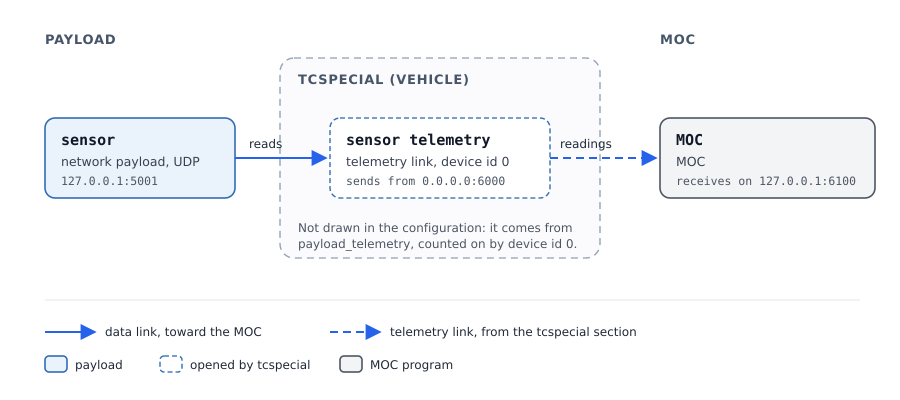
         tcspecial sends to the ground over the sensor's telemetry link.
   :width: 100%

   ``examples/minimal``: one payload, and its telemetry going to the ground.

The smallest configuration that does something. It has one payload,
``sensor``, a UDP socket at ``127.0.0.1:5001``, and no other node: no line is
drawn from the sensor at all. tcspecial binds the sensor's address and reads
whatever arrives there, and sends each reading to the ground over the
sensor's telemetry link -- from ``0.0.0.0:6000`` to ``127.0.0.1:6100``, the
two ``payload_telemetry`` bases plus device id 0.

The comments in its ``tcspecial`` section say which end of each link is which,
and they are worth reading before writing a configuration of your own.
Payload commands are not used by a simple payload such as this one: what it is
configured with is in the configuration file and is not changed while
tcspecial is running.

The simulator configuration has the sensor send one packet a second.
``make -C examples run-simple`` runs tcspecial on the example.

The thermostat example
----------------------
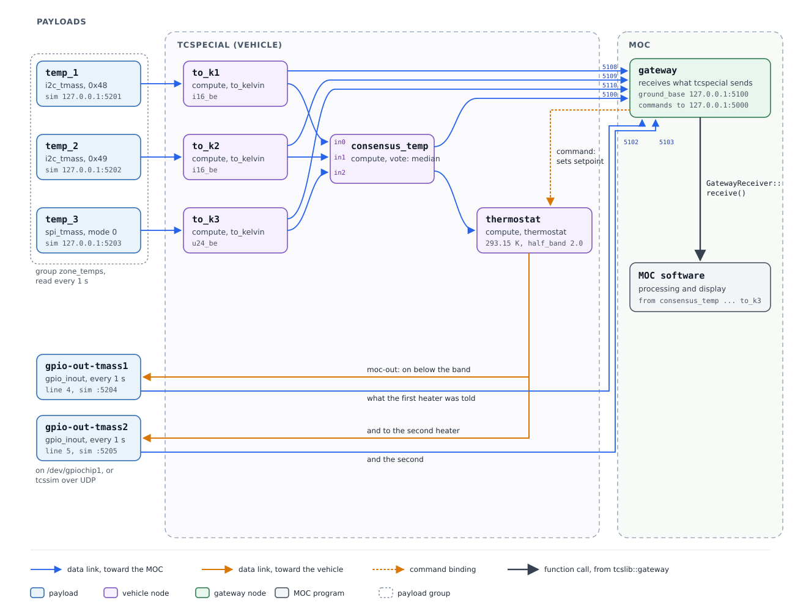
         converted to kelvin, voted on and sent to the ground, with a
         thermostat driving two heaters, each through a GPIO line whose
         switch reports what it was told to the ground. Two sensors are on
         an I2C bus and one on SPI, and each line is one of the kernel's
         dummy chip, which tcssim watches.
   :width: 100%

   ``examples/thermostat``: a trio of sensors, a vote, a thermostat, its two
   heaters, and the lines that say what the heaters are doing.

The worked example of computing aboard, and of surviving a part that fails.
Three temperature sensors -- ``temp_1``, ``temp_2`` and ``temp_3`` -- are read
together once a second as the group ``zone_temps``, which is what a
group is for: readings that will be compared are taken as close together as
the hardware allows.

The sensors are temperature sensors on the zone, as a vehicle would carry
them: ``temp_1`` and ``temp_2`` on an I\ :superscript:`2`\ C bus, of type
``i2c_tmass``, and ``temp_3`` a SPI peripheral, of type ``spi_tmass`` -- see
`Temperature Sensors on a Thermal Mass`_. They are in
``examples/thermostat-common/thermostat.ytcs``, which the example includes,
with the rest of the vehicle. The heaters' switches are GPIO lines 4 and 5 of
``/dev/gpiochip1``. On a desk every one of them is a simulated device, reached
over UDP at its ``sim_address``: the sensors at ``127.0.0.1:5201`` to
``5203``, where tcssim answers with the zone's temperature, and the switches
at ``5204`` and ``5205``, where tcssim takes what the vehicle drives them to
-- see `A GPIO Payload`_. So the example needs no dummy device, no root and no
hardware. Flown, the buses and the chip are opened. The thermostat-yamcs
example has the same sensors and switches as this, at the same addresses, so
it and this are not run at once.

The three are sensors of *one place*, separated only because two parts cannot
occupy one point. ``temp_3`` is a different part, reporting three unsigned
bytes on a scale of its own where the first two report two signed bytes on
theirs, so that no one part number can take the whole trio out.

Each reading is converted to kelvin by its own ``to_kelvin`` node,
``to_k1``, ``to_k2`` or ``to_k3``, and each converted reading goes two ways:
to the ground through the gateway node -- at its ``ground_base``,
``127.0.0.1:5100``, plus each source's device id, so ``to_k1``, ``to_k2`` and
``to_k3``, ids 8 to 10, arrive on ports 5108 to 5110 -- and into
``consensus_temp`` as the input ``in0``, ``in1`` or ``in2``.

``consensus_temp`` is a ``vote``: one temperature out of the three by the
algorithm it names, ``median``, which takes the middle reading. A mean would be the wrong
arithmetic twice over -- it carries a bad reading into the answer in proportion
to how wrong it is, and waiting for all three turns one dead sensor into no
answer at all. The vote keeps the last reading from each input and produces a
value on every arrival once two of the three have reported, so a sensor that
stops reporting -- or never starts -- is outvoted by the two that are working.
A vote may also say how old a reading may be, ``age: "2 s"``: one older is
left out, and a vote left with fewer than two current readings produces
nothing and reports it on each arrival rather than acting on one sensor's
word. Fed 296.0, 296.1 and 270.0 -- two sensors warm and one stuck
cold -- it says 296 and the heaters stay off, where a mean would have said
287.4 and switched them on because one sensor had failed.

The voted temperature goes to the ground, on port 5100, and to ``thermostat``:
a thermostat holding the zone at its ``setpoint``, 293.15 K, with a
``half_band`` of 2.0, so the heaters switch two degrees either side of it and
the setpoint is in the middle of its own band. Its decision drives two
heaters, each switched by a GPIO line of its own,
``gpio-out-tmass1`` on line 4 and ``gpio-out-tmass2`` on line 5, which go on
and off together. Two of them, because one failing must not leave the zone
with no way to be warmed: either alone holds the band while the orbit is
warm, and both together hold it in the cold too. They are separate nodes so
that the ground can stop one and leave the other warming the zone.

The decision is not sent to the ground by the thermostat. Each heater's switch
is a ``gpio_inout``, which drives its line as a ``gpio_out`` does and reports:
every second -- ``state_interval: "1 s"`` -- it sends the last value it was
told, ``1`` or ``0``, to the ground, ``gpio-out-tmass1`` on port 5102 and
``gpio-out-tmass2`` on 5103. So the ground hears every second what each
heater was told, and a report lost on the way is made good by the next. What
it hears is what the switch was told and not what the heater did: a heater
that has failed takes what it is told and does nothing, and shows only in the
temperature. Disabled from the ground, like any node, a switch neither drives
nor reports.

The decision is asserted on every sample rather than only when it changes, so
the heaters are held at what the vehicle last decided and a decision that went
missing is corrected on the next sample.

No payload here has a telemetry link of its own: the sensors' readings reach
the ground through their conversions, and the heaters' switches are drawn
into the gateway node. Tcssim counts each decision the vehicle drives the
switches to, and switches the heater each is joined to -- ``connects:
zone.heater_1`` -- by it.

The command binding on the gateway node says the ground may set the
thermostat's setpoint, and the running vehicle applies it: a ``SET_NODE``
naming that node and that attribute is taken on the node command link, the
value reaches the thermostat between stages of a pass, and the next pass
decides by it. An attribute no binding mentions is refused, which is the
point of writing the bindings down, and the refusal says why: tcsmoc shows
the reason the vehicle sends -- ``no command binding says the ground may set
"thermostat.half-band": it is spelled half_band`` -- beside the status.

The simulator file beside it, ``thermostat-sim.yaml``, is a link to
``examples/thermostat-common/thermostat-sim.yaml``, which thermostat-yamcs,
the same vehicle with Yamcs as its ground station, links to too. Its world
holds the vehicle's physics model: a zone with two heaters of its own.
Each sensor reports the zone's temperature, from a place of its own on it, so
that what the three report is one temperature rather than three streams of
noise, which is what the model is for; tcssim switches each heater while the
vehicle has its switch on. So the loop closes through tcspecial: see
**The Simulator Configuration** below. Naming the ``thermostat`` node in the file's
``tcssim`` section closes it in tcssim alone instead, with no tcspecial
running.

The heaters are four watts each, and the zone's surroundings are 288.15 K,
just inside the plot's lower red, two half bands and a kelvin below the
setpoint; they swing half a kelvin either side over a ninety minute orbit
and wander a quarter of a kelvin. The zone starts at 292.15 K, a kelvin below
the setpoint and inside the band, every run alike. Either
heater alone settles the zone ten kelvin above its surroundings, above the
band, so one heater holds it and the thermostat cycles whichever are
working. So a heater disabled in tcssim's window -- an unpowered or failed
heater, see `Starting and stopping a payload`_ -- shows in the temperature:
its switch goes on reporting what it is told, while the other heater, on
twice as long, holds the band; with both disabled, the zone falls
out of the band to its surroundings. ``make -C examples run-thermostat``
starts every payload disabled, so press ``Enable`` on each, and ``Disable`` on a heater to take
it away. A run of the model with its sensors' errors, three orbits from each
of three seeds -- tcssim's tests
``the_thermostat_example_holds_the_zone_with_both_heaters`` and
``the_thermostat_example_holds_the_zone_with_a_heater_disabled`` -- has, with
both heaters, the zone never more than two half bands from the setpoint and
within one about three quarters of the time, the heaters on a quarter of the
time and switching together some seventy-five times an orbit; with one
disabled, the zone never more than two half bands from the setpoint, the
working heater on about half the time and the disabled one never heating;
and with neither, the zone falling from the band to its surroundings, as
cold as 287.1 K in the first orbit.

``make -C examples run-thermostat`` runs it, on a host with the kernel's
simulated chip.

The battery example
-------------------
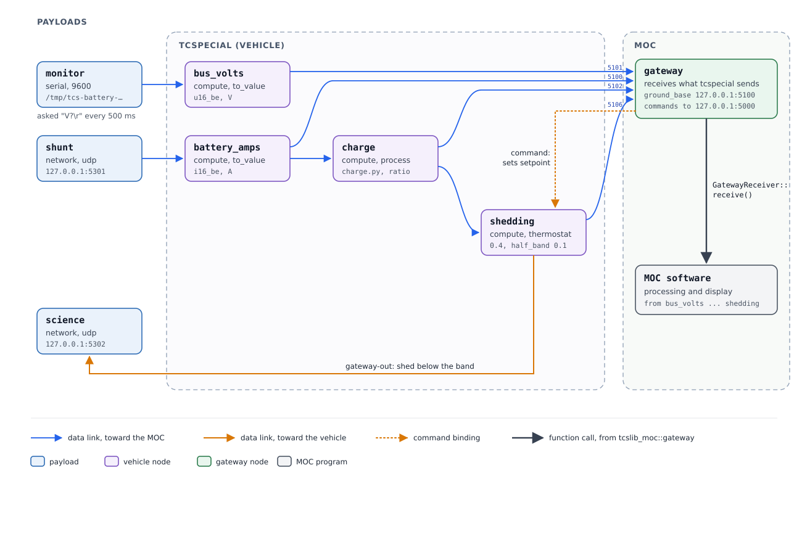
         on a UDP socket, their readings made volts and amperes, the
         amperes counted into a state of charge by a program, and a
         thermostat shedding the science load when the charge runs low.
         Everything goes to the ground and to a log.
   :width: 100%

   ``examples/battery``: a power bus through an orbit, its charge counted
   aboard and its science load shed in eclipse.

A spacecraft's power system, and the example of a payload that is asked, of
a computation that is a program, and of physics with events in it.

``monitor`` is a power monitor on a serial line, ``/tmp/tcs-battery-monitor``.
It answers only when asked: its ``trigger``, ``"V?\r"``, goes out every
``trigger_interval``, 500 ms, and it answers two bytes, millivolts, which
``bus_volts`` -- a ``to_value`` node in volts -- makes the bus's voltage.
``shunt``, the shunt in the battery's lead, is the far end of a UDP socket
and sends the battery's current twice a second of its own accord, in
milliamperes, which ``battery_amps`` makes a value in amperes: more than
nought charging, less discharging.

Nothing aboard measures how full the battery is, so ``charge`` works it out:
a ``process`` node running ``examples/battery/charge.py``, which counts the
current coulomb by coulomb and answers the fraction of its capacity the
battery holds, as a ``ratio``. A program and not a built-in, because how a
battery's charge is estimated is a mission's business. A count drifts and
starts from a guess, so the program sets itself to full whenever the current
falls to nought, which on this bus happens only when the battery is full and
what would charge it is shunted.

``shedding`` is a thermostat on the charge, around 0.4 with a half band of
0.1: below three tenths it is asserted, and its decision, driven to
``science``, sheds the science instrument; above half it is unasserted and
the instrument comes back. The band is wide so that an eclipse sheds the load
once rather than at every reading near the edge. Every value and decision goes
to the ground, on ports 5100 to 5102 and 5106, and the ground may set the
setpoint through the command binding.

The physics model, in the world of ``battery-sim.yaml``, is the power system as its parts:
a ``sun``, a ``solar_array`` of seven amperes, two ``load`` components of two
amperes each -- ``avionics``, never shed, and ``science`` -- a ``bus`` and a
``battery``, joined under ``connections``. The orbit is six minutes, four
tenths of it in shadow, and the battery a fifth of an ampere-hour, so that a
run on a desk sees a whole orbit in the time it takes to watch: the battery
charges at three amperes and fills, its current falling to nought; the eclipse
comes and it discharges at four; the charge falls below three tenths and the
science load is shed, halving the drain; and the sun returns, the battery
recovers, and the load comes back above half. Each change -- into shadow and
out, full, empty -- is an event of the model's, foreseen and met at its
moment: see **How the world moves** below.

``make -C examples run-battery`` runs it, on any desk: tcssim makes a
pseudo-terminal for the power monitor at its path, and sockets for the rest.

The descent example
-------------------
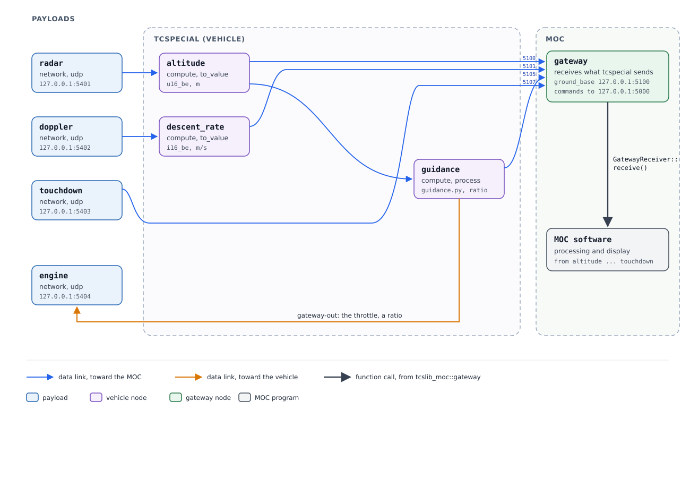
         flown down by a guidance program, whose throttle drives the
         engine; a Doppler velocimeter made metres a second; and a touchdown
         switch. Everything goes to the ground and to a log.
   :width: 100%

   ``examples/descent``: a lander flown down from five hundred metres by a
   program, and a switch that says when it is down.

A lander's terminal descent over the Moon, and the example of a computation
that drives a device with a value, and of a device that speaks the moment
something happens.

``radar``, a radar altimeter at the far end of a UDP socket, sends the
altitude ten times a second, in centimetres, which ``altitude`` -- a
``to_value`` node in metres -- makes a value. ``guidance`` is a ``process``
node running ``examples/descent/guidance.py``, which works out the rate of
descent from the altitudes by an alpha-beta filter, flies a rate in proportion
to the altitude -- six hundredths of it a second, between twenty and one --
and answers the throttle that holds the lander's weight and closes the gap
between the rate it has and the rate it wants, as a ``ratio``. Its answers go
by its ``moc-out`` link to ``engine``, the engine's throttle, which is
driven with a value: four bytes of millionths, read by tcssim as the
ratio guidance answered. Half a metre up guidance cuts the engine for good,
and the lander drops the rest.

``doppler``, a Doppler velocimeter, sends the velocity five times a second,
which ``descent_rate`` makes metres a second, for the ground.
Guidance does not take it: a process takes the one type its ``type-in``
states, and guidance's is ``metre``. ``touchdown`` is a switch on a landing leg, sending ``1`` on
the ground and ``0`` off it, straight to the ground.

The physics model, in the world of ``descent-sim.yaml``, is an ``engine`` of four and a
half kilonewtons with a hundred kilograms of fuel, and a ``body`` of a tonne
and a half, five hundred metres up and falling at twenty metres a second in
the Moon's gravity, the engine's force and the fuel it burns joined to it. The
body falls by the rocket equation in closed form, and the moment it reaches
the ground -- which no closed form gives -- is found ahead of time and met
exactly. tcssim's touchdown switch waits on the model for that moment
rather than for its next turn to send, so the vehicle hears of the landing
when it happens. A run lands in about seventy-five seconds, at a metre and a
half a second, with a third of the fuel left.

``make -C examples run-descent`` runs it, on any desk. The lander does not
start falling until a simulated payload is started -- the run begins when
one first
asks the model anything -- so enable ``engine`` and ``radar`` in tcssim first,
and the rest after.

The simple-app example
----------------------
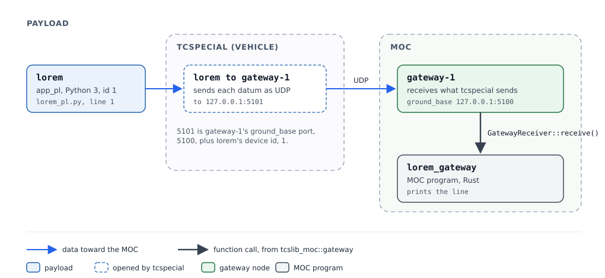
         a line of text one word per packet through the gateway node gateway-1
         to the ground station program lorem_gateway.
   :width: 100%

   ``examples/simple-app``: a payload that is a program, and a ground station
   that prints what it sends.

A payload need not be a device. ``lorem`` is an ``app_pl`` node: a program,
``lorem_pl.py``, written in Python 3, that tcspecial starts from the
configuration with the argument
``1`` and talks to over the file interfaces an app node is run with. It sends
the first line of the lorem ipsum text one word per packet, then a packet
holding the line terminator.

tcspecial sends the words to the gateway node on the ground, ``gateway-1``, at
its ``ground_base``, ``127.0.0.1:5100``, plus ``lorem``'s device id, 1: port
5101. The ground is ``lorem_gateway``, the example's second program. It gets
the words from ``gateway-1`` with
``tcslib::gateway::GatewayReceiver::receive_into``, into a buffer it made
before it started listening, prints each with one space
between them, and stops at the end of the line. ``gateway-1`` states no
``address`` or ``port``, because nothing goes back up to the vehicle.

Before its first word, ``lorem_gateway`` sends a ``CONNECT`` of its own,
carrying the configuration's checksum, and sends it again each second until
the vehicle answers with that checksum: a vehicle sends nothing down until it
has taken one, and a station that only listens cannot count on another
station's having sent it. It sends from the configuration's ``tcs_cmd.send``,
so tcsmoc cannot be run on the same configuration beside it. ``-v`` says when
it is matched; a vehicle answering with another configuration's checksum is
said whatever the flag. ``ping_gateway.py`` does the same as soon as it has
started the vehicle, and ``--pings`` waits for the match before its first
ping. Through ``tcslib::listening`` in Rust and ``tcslib.listening`` in
Python, either of which a station of your own that only listens can use.

Both programs are beside the configuration: the payload is a Python 3 script
that uses only the standard library, and the ground station is a Rust crate.
``make -C examples run-simple-app`` checks that ``python3`` is installed -- 3.6
or later -- builds the vehicle and the ground station, runs them together,
prints the line, and stops. ``make -C examples check-python3`` makes the check
on its own.

The beacon example
------------------
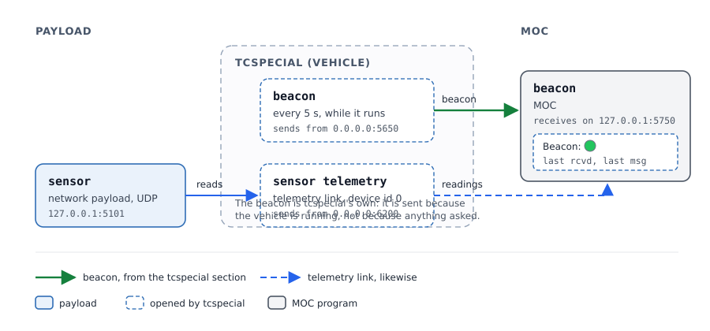
         the ground station beacon, which shows it on the beacon panel
         -- an indicator, the time the last one arrived, and what it said.
   :width: 100%

   ``examples/beacon``: a beacon, and a window watching it.

What a ground station knows about a spacecraft without asking it anything.
tcspecial sends a beacon from ``beacon.send`` to ``beacon.recv`` for as long
as it runs, over a socket of its own and whether or not anything has connected
to it -- every ``beacon.reset_interval`` until a MOC connects, and every
``beacon.default_interval`` after -- so this example commands nothing, and
still says whether the vehicle is alive, which build it is, and whether the
configuration it is serving is the one the ground read. Since nothing here
connects, its beacons go every ``beacon.reset_interval`` throughout.

The ports are the example's own, a hundred above the other examples', so the
watcher can be left running while another example is looked at. Its one
payload, ``sensor``, is there because a configuration describes a vehicle and
a vehicle with nothing aboard is not one; its readings reach the ground over
``payload_telemetry`` and have nothing to do with the beacon.

It is also the example of how a ground program is put together, because almost
none of it is the program's own:

* ``tcslib::beacon`` binds the socket, reads each datagram, counts the beacons
  that did not arrive, compares the digest each one carries with the ground's
  own, and says how stale the last one is as a stage: Unheard, Heard, Aging or Waiting.
  There is no toolkit in it, so a ground station with no screen -- a logger, a
  test -- uses exactly this.
* ``tcsui`` holds the panel, as markup other windows import, and works out
  what to show on it: which colour the indicator is, and the two lines beside
  it.
* ``beacon``, the program in the example, reads the configuration to
  find where the beacons are, starts the loop on a thread of its own, and puts
  each pass in the window.

A beacon is a line of text, at most 106 bytes and with no newline at the
end: six fields with a colon between each -- the name ``tcspecial``, the
version as ``major.minor.patch``, the configuration's MD5 digest as 32
lower-case hex digits, the beacon's number in decimal, the restart flag,
written ``restart`` from every start of tcspecial -- the first included --
and from its taking a restart, until it takes a ``CONNECT`` carrying its
configuration's checksum, and ``normal`` otherwise, and the interface's
digest, also as 32 hex digits:

.. code-block:: text

   tcspecial:0.1.0:36999e46a4bf436854442d8f97a2248d:42:normal:0123...cdef

It is text so that it can be read as it is, in a packet capture, a log or
with any UDP listener, with nothing to decode it. Its layout is stated in
XTCE, in ``tcslibgs/xtce/beacon.xtce``, as six text fields -- each but the
last ended by its colon -- and nothing else, so a ground system that reads
XTCE can read it too. That is what goes on the wire; what the window shows on
its ``Last msg:`` line is written for the window, as ``tcspecial v0.1.0 md5``
and the digest. tcspecial writes each beacon, and ``tcslib::beacon`` reads it,
with ``tcslibgs::Beacon``, which the Python in ``python/tcslibgs/beacon.py``
says again, held to it by the same examples in their tests. The example's test
writes the beacon it sends the same way. A beacon is read strictly: anything
with a field out of its form, a seventh field, a trailing colon or newline, or
more than 106 bytes, is not a beacon.

tcsmoc shows that same panel from that same library, in a row beside its
command link. That is the point of their being apart: what a beacon means is
one thing wherever it is shown, and an operator who has read one window has
read the other.

After the indicator, on the panel's ``Status:`` row, is the stage the
indicator is at, in a word -- Unheard, Heard, Aging or Waiting, as the table
under `Beaconing`_ gives them -- which changes as the stage does.

Under the panel is a button that starts and stops tcspecial, so that the
indicator can be watched coming on with the first beacon and going out after
the last. The window opens with it saying **Start tcspecial**, because
tcspecial is not running. Pressed, it starts tcspecial on the same
configuration and says **Stop tcspecial**; pressed again, it stops tcspecial
with ``kill()`` and says **Start tcspecial**, which is where it began. Closing
the window stops tcspecial too, and a tcspecial that stops by itself puts the
button back to **Start tcspecial**.

``make -C examples run-beacon`` builds both programs and opens the window. The
watcher opens a window, so it wants a display.

The ping example
----------------
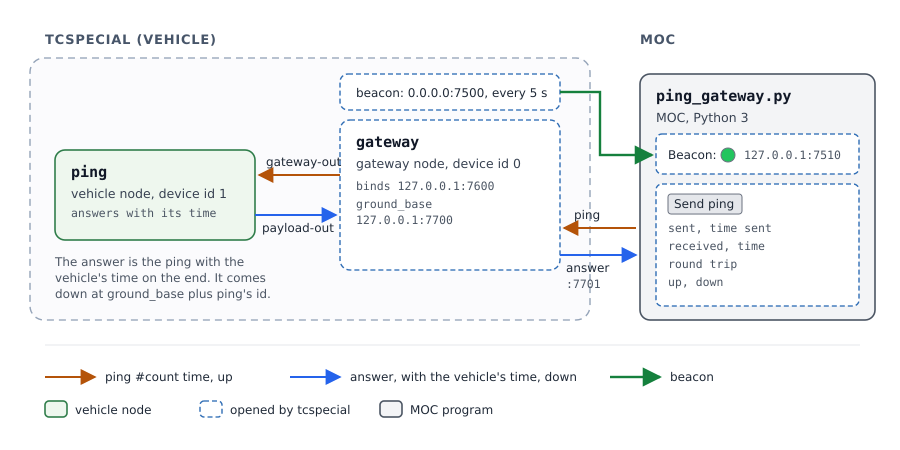
         the gateway node, which hands it to the ping node by its moc-out
         link; the ping node answers with the vehicle's time on the end, and the
         answer comes back down through the gateway node to the ground, beside
         the beacon panel.
   :width: 100%

   ``examples/ping``: a ping, answered by the vehicle and timed by the ground.

The one exchange that shows how long the link takes each way, and how far the
two ends' clocks are apart. The ground station sends ``ping #<count> <time>``
up to the gateway node, which binds ``address:port`` aboard and hands it by its
``moc-out`` link to the ``ping`` node. The ``ping`` node answers with the
ping, a space, and the vehicle's time, and sends that by its ``world-out``
link back to the gateway node and so down to the ground, at ``ground_base`` plus
its device id. Each time is seconds since the UNIX epoch to the nanosecond:
``1760900000.000000001``. What a ping and its answer say is
``tcslibgs::node::vehicle::ping``.

The ground station is a Python 3 program, ``ping_gateway.py``, that uses nothing
outside the standard library to read the XML spelling of its configuration --
its window is tkinter -- and PyYAML to read the YAML one. A beacon is text and
needs nothing to read; the interface digest it is compared with is worked
out with tcs-xtce's Python runtime, which is taken from the tcs-xtce
checkout beside this tree, ``../tcs-xtce``. It shows the beacon
panel, the last ping sent and when, the last answer received and when, and
three times:

* **Round trip**: the ground sending the ping to the ground receiving the
  answer, on the ground's clock at both ends.
* **MOC to tcspecial**: the ground sending it to the vehicle having it.
* **tcspecial to MOC**: the vehicle having it to the ground receiving the
  answer.

The last two are each read across two clocks, so each includes how far apart
those clocks are, and either may come out negative; their sum is the round
trip whatever the offset, which is how to tell a clock that is out from a link
that is slow.

The window is in two boxes on white, ``Beacon`` and one titled with the node
being pinged, each with a flat border. Both are laid out alike: a label on the
left of each row and every value starting at one place after the labels. In
the second, ``Sent:`` and ``Received:`` each show a message and its time on one
row, and ``Round trip:``, ``MOC to tcspecial:`` and ``tcspecial to MOC:`` the
three times, with a line about the times under them and the ``Send ping``
button centred at the bottom. Every field and button is in 12-point plain
type. Before there is anything to show, each field shows the shape of what
will be there -- ``<none>``, ``--:--:--.---------``, ``--.------ ms`` -- as the
beacon box does. tcsmoc's ping window shows the same rows, laid out as its
own. ``Send ping`` is the default button: Enter or Space presses it.

Pressing ``Send ping`` clears the time received and the three
times until that ping's own answer arrives -- an answer is matched to its ping
by the count. An answer to an earlier ping is still shown as the last thing
received, and changes none of the times.

The ground station is built the way the ``beacon`` program is, from two halves and a
little of its own, and the halves are the same ones in Python:
``python/tcslib/beacon.py`` is ``tcslib::beacon``, ``python/tcsui/beacon_panel.py``
is ``tcsui``'s panel, and ``python/tcslibgs`` holds the ping format and what a
ground station reads out of a configuration. It reads the XML spelling, the
standard library having no YAML, and asks ``tcsverify --digest`` for the
digest it compares each beacon's with rather than working it out a second
time. The rules are then written twice, in Rust and in Python, and the
example's tests hold them to one another: the Python's own tests use the Rust
tests' examples, one test checks that the Python reads the same ports from
``ping.xtcs`` as the Rust does from ``ping.ytcs``, and one plays the vehicle with
the Rust -- the ping answered by the function the ``ping`` node answers with,
the beacon packed as tcspecial packs it -- against the ground station.
``cargo test`` runs them all.

The ground station starts the vehicle itself -- tcspecial from the build, on
the same configuration -- and kills it when it exits, however it exits: if the
ground station is killed or crashes, the kernel kills tcspecial. So a vehicle
is running exactly while its ground station is. ``--no-vehicle`` starts none,
for a tcspecial run in another terminal.

Every example program -- ``beacon``, ``ping_gateway.py`` and ``lorem_gateway``
-- takes ``--yaml`` or ``--xml``, but not both, saying which of its example's
two configuration files to read: they say the same thing. With neither,
``beacon`` and ``lorem_gateway`` read the YAML and ``ping_gateway.py`` the XML.
A file named on the command line beside one of the two has to be the spelling it
asks for, and the vehicle the program starts reads the same file.

``make -C examples run-ping`` checks for Python 3 and tkinter, builds the
vehicle and tcsverify, and runs the ground station, which starts the vehicle
and stops it when the window is closed. With no display, ``python3
examples/ping/ping_gateway.py --pings 3`` starts the vehicle, sends three pings,
prints each answer and its times, and stops both. Every port the example uses is in
the seven thousands, which no other example uses.

tcsmoc pings it too. ``make runmocy TCSPECIAL_CONFIG_FILE=examples/ping/ping``
runs the MOC on the example, and a configuration with a ``ping`` node the
ground can reach both ways -- a gateway node binding an address and port with a
link to it, and its link back down -- gives the MOC a ``Ping node`` button
beside ``Command``. It opens the same panel, in a window of its own: the
button, the ping sent and the answer, and the three times. Both ground stations
keep them by the same rules, ``tcslib::ping`` in Rust and
``examples/ping-common/ping_ground.py`` in Python. ``examples/ping-common``
holds what the ping example shares with ping-yamcs, the ping link, the
window and the ``ping`` node, in ``ping-common/ping.ytcs`` and its XML,
which both configurations include, and is not an example itself.

The ping-yamcs example
----------------------
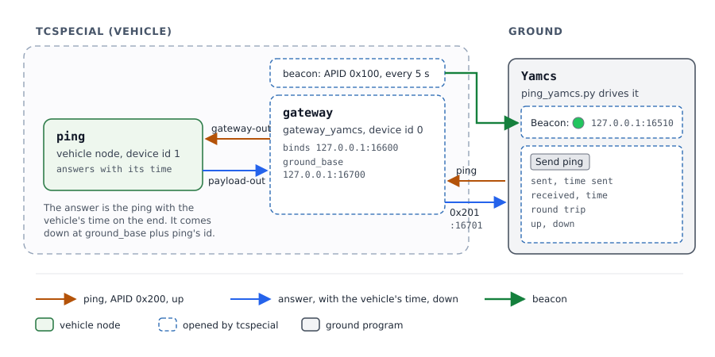
         as a CCSDS telecommand up to the gateway_yamcs node, which takes the
         header off and hands it to the ping node; the answer goes back down
         through the gateway node, which puts a header on it, to Yamcs, beside
         the beacon, also with a header, and ping_yamcs.py's window shows
         both.
   :width: 100%

   ``examples/ping-yamcs``: the ping example with Yamcs between the ground
   station and the vehicle, over CCSDS packets.

The ping example with Yamcs (https://yamcs.org) at the ground end. The
vehicle is the same -- a ``ping`` node that answers each ping with its time
on the end -- and so are the three times. What differs is the configuration's
gateway, ``yamcs``, which puts a CCSDS primary header on every packet to and
from the ground: see `What the vehicle answers to`_. The beacon is
telemetry of APID ``0x100``; CONNECT and its answer are on ``tcs_cmd.apid``,
``0x101``; a ping goes up as a telecommand of the gateway node's
``apid_base``, ``0x200``, and its answer comes down as telemetry of
``apid_base`` plus the ping node's device id, ``0x201``.

``examples/ping-yamcs/ping_yamcs.py`` runs it, given a Yamcs release unpacked
somewhere (``bin/yamcsd`` under it):

.. code-block:: sh

   make -C examples run-ping-yamcs YAMCS_HOME=~/yamcs-5.14.0
   python3 examples/ping-yamcs/ping_yamcs.py --yamcs ~/yamcs-5.14.0 --pings 3

It writes a Yamcs configuration from the tcspecial one into a run directory,
``/tmp/ping-yamcs`` unless ``--run-dir`` says, so that the ports and APIDs
are stated once. The mission database is tcspecial's own XTCE,
``tcslibgs/xtce``, as it is, and ``tcs-ccsds.xtce``, generated from the
configuration by ``python/tcslibgs/yamcs.py`` with a container or a command
for every APID it counts: the CCSDS header, what follows it on each APID,
and CONNECT and the ping, behind a header. Yamcs's links, one on each port,
are generated alongside: see `What the vehicle answers to`_. Nothing in it
is written by hand per APID, so a node added to the configuration -- a
payload nothing touches, or another source drawn into the gateway node --
has its container in Yamcs the next time the example runs. The ping and its
answer are laid out by the ping node's interface document,
``tcslibgs/xtce/ping.xtce``: a ping goes up as the document's command,
``/TcsYamcs/Ping``, its text split into the arguments ``Count``,
``SentSeconds`` and ``SentNanoseconds`` by the code tcs-xtce generates from
the document, ``python/tcslibgs/ping_packet.py``, and its answer comes down
as the document's parameters, ``/TcsYamcs/ReplyCount``,
``/TcsYamcs/ReplySentSeconds`` and the rest, which are put together again
into the answer's text. Yamcs shows both, in its command history and its
parameters, as the text they are. It starts
Yamcs on that, and tcspecial on the configuration, each stopped when it
exits, however it exits -- the kernel is told to kill both if it is killed;
has Yamcs send CONNECT until the vehicle answers with the configuration's
checksum; and then sends pings through Yamcs and reads the answers back,
over Yamcs's REST API.

Its window is the ping example's, the beacon panel and the ping panel, with
``Send ping`` sending each ping through Yamcs. The beacon panel is given the
beacon's own bytes, which ``tcs-ccsds.xtce`` keeps whole as the
``BeaconBody`` parameter, so that it checks the configuration's checksum and
the beacon's number, and ages the indicator, as the ping example's does from
its socket. With ``--pings`` there is no window, and it prints the first
beacon and each exchange:

.. code-block:: text

   connected: the vehicle is running this configuration
   beacon: tcspecial v0.1.0 md5 27bf79b237069fc4c5d13325e1ac0bb6
   sent: ping #1 1793562467.079578927
   received: ping #1 1793562467.079578927 1793562467.091478556
   times: round trip 11.421073 ms, up 11.899629 ms, down -0.478556 ms

Yamcs's web interface, at ``http://localhost:16090``, shows every packet and
parameter meanwhile. An answer's arrival time is when Yamcs acquired it,
which Yamcs gives to the millisecond, so the two halves of a short round trip
can come out a fraction of a millisecond either side of nought.

Yamcs sends its commands from a port the system chooses and takes the
answers on the same socket, so the configuration's ``tcs_cmd.send`` is
``127.0.0.1:0``: commands from any port of this host, each answer going back
to the port its command came from.

Starting Yamcs, its REST API, CONNECT and the beacon through Yamcs are
``python/tcslib/yamcs_ground.py``'s, which `The thermostat-yamcs example`_
shares, as it shares the Yamcs templates beside it.

The thermostat-yamcs example
----------------------------
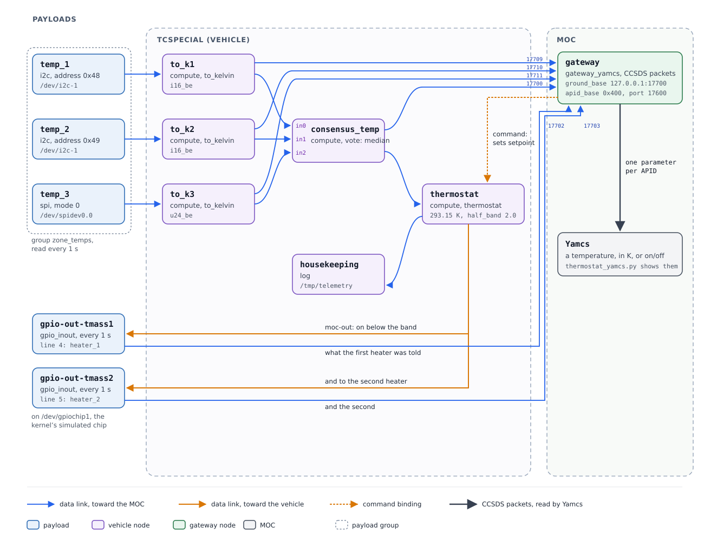
         conversions, vote, thermostat and heaters, with a gateway_yamcs
         node that sends each conversion's, the vote's and each heater
         switch's data down to Yamcs as CCSDS telemetry, one APID each,
         where each is a temperature in kelvin or a switch on or off.
   :width: 100%

   ``examples/thermostat-yamcs``: the thermostat example with Yamcs
   between the ground station and the vehicle, over CCSDS packets.

The thermostat example with Yamcs at the ground end, as ping-yamcs is the
ping example with it. The vehicle is the thermostat's, and so is the
simulator file, with the physics model tcssim joins its simulated payloads
to: each
example's is a link to ``examples/thermostat-common/thermostat-sim.yaml``,
so that each is found beside its configuration by name. The vehicle is
written once, in ``examples/thermostat-common/thermostat.ytcs`` and its
XML, which both configurations include: the three sensors, the
conversions, the vote, the thermostat and its log, the heaters' switches,
the ``zone_temps`` group and the setpoint's binding. Each example's own file
has its ``tcspecial`` section and its gateway node, called ``gateway`` in
both. The two cannot run at once, their sensors and their heaters being
the same, so they answer whether tcssim is ready at one address. What differs is the
gateway, ``yamcs``: the beacon is telemetry of APID ``0x110``, CONNECT and
its answer are on ``0x111``, and each source drawn into the gateway node
comes down as telemetry of its ``apid_base``, ``0x400``, plus the source's
device id -- ``consensus_temp`` on ``0x400``, ``gpio-out-tmass1`` and
``gpio-out-tmass2`` on ``0x402`` and ``0x403``, and ``to_k1`` to ``to_k3`` on
``0x408`` to ``0x40a``.

The mission database gives each of them a parameter of the type the
configuration says its data are (see `What the vehicle answers to`_): the
conversions and the vote are temperatures in kelvin, and each heater's
switch, which reports what it was told, is a decision, on or off. Nothing is
added to the configuration for it: the type is what tcsmoc's plot window and
the F´ bridge already read there.
Yamcs's web interface, at ``http://localhost:17090``, shows them so.

Beside them is one parameter the vehicle does not send:
``world_ambient_temp``, the simulated world's ambient temperature, the
``ambient_temp`` under ``world:`` in the simulator file. It is a local
parameter, in kelvin, with no packet to read it from; ``thermostat_yamcs.py``
reads the figure with ``tcsverify --ambient``, which finds the simulator file
beside the configuration as tcssim does, and sets it in Yamcs once the vehicle
has answered CONNECT. So Yamcs has the zone's surroundings beside the zone,
and the configuration's diagram has nothing called ambient. A simulator file
whose world states no ambient temperature gives the run none, and the
program says so.

``examples/thermostat-yamcs/thermostat_yamcs.py`` runs it, given a Yamcs
release unpacked somewhere:

.. code-block:: sh

   make -C examples run-thermostat-yamcs YAMCS_HOME=~/yamcs-5.14.0
   python3 examples/thermostat-yamcs/thermostat_yamcs.py \
       --yamcs ~/yamcs-5.14.0 --seconds 120

It starts Yamcs, tcssim, with every payload sending from the start, and
tcspecial once tcssim is ready, each killed with it; has Yamcs send CONNECT
until the vehicle answers with the configuration's checksum; and reads the
parameters back over Yamcs's REST API. Its window shows the beacon above
the zone's temperature, each reading, and each heater's switch, on or off.
With ``--seconds`` there is no window, and it prints what arrives, and a line
each time a heater's switch changes, of these forms:

.. code-block:: text

   connected: the vehicle is running this configuration
   read: consensus_temp <T> K, to_k1 <T> K, to_k2 <T> K, to_k3 <T> K,
   world ambient 288.150 K, gpio-out-tmass1 off, gpio-out-tmass2 off
   switched: gpio-out-tmass1 off -> on; consensus_temp <T> K, ...

tcssim draws a window of its own, so it wants a display. Its own ports are
in the seventeen thousands, apart from the thermostat example's, but its
sensors and its heaters' switches are thermostat-common's, simulated at the
thermostat example's ports -- 5201 to 5203 for the sensors, 5204 and 5205
for the switches -- so the two are not run at once.
Because tcssim is given ``--sending``, both heaters start enabled; press
``Disable`` on a heater's switch in tcssim's window to take it away, and its
line goes low and stays low, which Yamcs shows, while the zone falls behind
in the cold part of the orbit.

The tees example
----------------
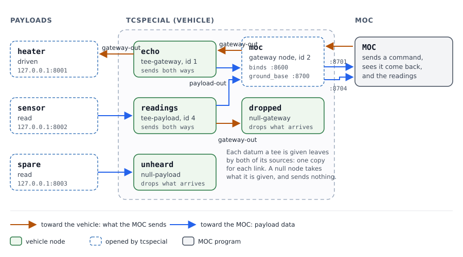
         ground and on to echo, a tee-gateway, which sends it to the heater and
         back down to the ground; the sensor's readings go to readings, a
         tee-payload, which sends them down to the ground and on to dropped,
         a null-gateway; the spare payload's data goes to unheard, a
         null-payload.
   :width: 100%

   ``examples/tees``: a command copied back to the ground, a reading copied
   aboard, and data dropped.

The four nodes that do nothing to what passes, each taking one stream. What
the ground sends goes up to the gateway node ``moc``, which binds
``127.0.0.1:8600`` aboard, and leaves it for ``echo``, a ``tee-gateway``. The
tee sends each command on by its ``moc-out`` to the ``heater``, as it was
going, and again by its ``world-out`` back to ``moc`` -- so the ground sees
what the vehicle was told, arriving at ``ground_base`` plus ``echo``'s device
id, ``127.0.0.1:8701``. The ``sensor``'s readings go to ``readings``, a
``tee-payload``, which sends each down to the ground at ``127.0.0.1:8704`` and
again by its ``moc-out`` to ``dropped``, a ``null-gateway``, standing where
something aboard that took readings as commands would be. The ``spare``
payload's data goes to ``unheard``, a ``null-payload``: nobody wants it yet.

A link cannot carry one stream into the other, so the tees are what the
copies cross by. Each tee has two data sources, so each link out of one is
written under the source it leaves by.

``make -C examples run-tees`` runs tcsmoc on the example, which starts
tcspecial and tcssim. ``tcspecial/tests/tees.rs`` flies it, with its sockets
moved to ports nothing holds: a command sent up reaches the heater and comes
back down, and a reading reaches the ground. Every port the example uses is in
the eight thousands, which no other example uses.

The fprime example
------------------
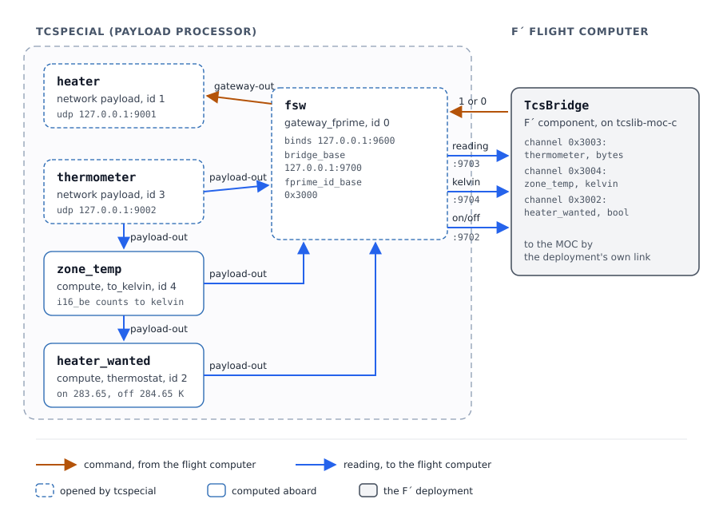
         gateway_fprime node, and to zone_temp, a to_kelvin compute node
         whose temperatures go to fsw too and to heater_wanted, a thermostat
         compute node whose decisions go to fsw, and all three on to the F´
         deployment's TcsBridge component at bridge_base plus the sender's
         device id; a command from the bridge goes up to fsw and on to the
         heater.
   :width: 100%

   ``examples/fprime``: a vehicle that answers to an F´ flight computer.

The vehicle answers to an F´ flight computer rather than to the ground, so the
``tcspecial`` section says ``gateway: "fprime"`` and the one gateway node,
``fsw``, is a ``gateway_fprime``. Its far end is a component of the F´
deployment, ``TcsBridge``, built on tcslib-c: as far as tcspecial can tell it is
a ground station, so every link is the radio's, UDP in the radio's protocol,
and everything in the ``tcspecial`` section is written as it is for a radio.

What differs is the gateway node. Where a gateway node says where the ground
station is as ``ground_base``, a ``gateway_fprime`` node says where the bridge
is as ``bridge_base``, counted on the same way: the ``thermometer``, device id
3, reports to ``127.0.0.1:9703``. It also states ``fprime_id_base``, the first
of the F´ IDs the bridge gives what arrives, counted on by the same device id
-- the thermometer's readings are F´ channel ``0x3003`` -- which the bridge's
model is made from and nothing aboard reads. A command the bridge sends up to
``fsw``, which binds ``127.0.0.1:9600``, leaves it by its ``moc-out`` for
the ``heater``.

The thermometer's readings go to ``zone_temp`` too, a ``to_kelvin`` compute
node that makes each a temperature, and that goes to ``fsw`` as well: device
id 4, ``127.0.0.1:9704``, channel ``0x3004``. In the simulator file the
thermometer reports a zone of the physics model, in the encoding ``zone_temp``
reads back, and tcssim's heater switches a heater warming it, so that what the
flight computer sends the heater shows in the temperature it reads.

``zone_temp``'s temperatures go on to ``heater_wanted``, a ``thermostat``
compute node -- on below 283.65 K, off above 284.65 K -- whose decisions go
to ``fsw``: device id 2, ``127.0.0.1:9702``, channel ``0x3002``. It is
advice and drives nothing, the heater being the flight computer's to drive,
and it shows the bridge a node that sends decisions.

``make -C examples run-fprime`` runs tcsmoc on the example, which starts
tcspecial and tcssim; tcsmoc plays the bridge's part, the two speaking the one
protocol. ``tcspecial/tests/fprime.rs`` flies it, with its sockets moved to
ports nothing holds: a reading reaches the bridge as it is and as a
temperature, and a command from the bridge reaches the heater. Every port the example uses is in the nine
thousands, which no other example uses.

The F´ bridge
^^^^^^^^^^^^^

The bridge itself is in ``fprime/``: ``TcsBridge``, an F´ component built on
tcslib-c, and ``BridgeTest``, an F´ deployment it is tested in. F´'s own tools
build them, not cargo, from an F´ checkout (v4.4.1 or later) and a Python
environment holding F´'s tools, ``fprime-util`` among them:

.. code-block:: console

   $ make fprime-build FPRIME_FRAMEWORK=$HOME/fprime FPRIME_VENV=$HOME/fprime-venv
   $ make fprime-test FPRIME_FRAMEWORK=$HOME/fprime FPRIME_VENV=$HOME/fprime-venv

Left out, the two are looked for in ``fprime-scratch``, beside the checkout,
as ``fprime`` and ``venv``; ``FPRIME_SCRATCH`` names another such directory.
Beside the checkout means beside the main checkout, which git finds, so a
worktree of the tree looks in the same place (``beside.mk``).
``make help`` in ``fprime/`` says the rest.

Which channels the bridge has is the configuration's, and is never written by
hand. ``fprime-build`` writes the bridge's model from ``FPRIME_CONFIG``, the
fprime example unless told otherwise, with

.. code-block:: console

   $ tcsverify --fprime-model=fprime/Tcs/TcsBridge/model examples/fprime/fprime.ytcs

which checks the configuration first and writes nothing from one with errors.
Each node drawn into the ``gateway_fprime`` node is a channel named after it,
at ``fprime_id_base`` plus its device id -- ``thermometer``, ``0x3003`` --
of the type the configuration says its data are. A node that sends values, a
compute node whose function is ``to_kelvin``, ``to_value``, ``vote`` or
``process``, has an ``F64`` channel in that node's unit, formatted with it --
``zone_temp``, ``0x3004``, in kelvin --
and a datum from it that is not a value goes to no channel, is counted in
``DataNotValues`` and is said in a ``NotAValue`` event. A node that sends
decisions, a compute node whose function is ``thermostat``, has a ``bool``
channel, true for on -- ``heater_wanted``, ``0x3002`` -- and a datum from it
that is not ``1`` or ``0`` goes to no channel, is counted in
``DataNotDecisions`` and is said in a ``NotADecision`` event. A thermostat
sends the ground only a change of decision, so its channel shows what was
last decided while the bridge was matched. Every other node's
channel holds a datum's length and its first 64 bytes, a GPIO payload's
lines read for their levels among them, their records as they came. A node
drawn into it
must be
named as F´ names things, with letters, digits and underscores, and every
program that checks a configuration refuses one that is not, as it refuses
two ``gateway_fprime`` nodes whose F´ IDs overlap. The bridge's own channels
follow every device id: ``BeaconStage``, ``RestartFlag``,
``ListeningMatched``, ``CommandingMatched``, ``PacketsReceived``,
``PacketsProcessed``, ``PacketsMalformed``, ``PacketsMismatched``,
``DataCutShort``, ``DataNotValues`` and ``DataNotDecisions``.

The bridge is built for that configuration and runs on no other: given
another, it says so in a ``ModelDiffers`` event and does nothing. It sends
CONNECT itself, once for each beacon heard while it is unmatched, and says
``Matched`` when the vehicle answers with the configuration's checksum, or
``ConfigurationDiffers`` when it does not. Its commands are ``PING``, and
``START_NODE``, ``STOP_NODE`` and ``QUERY_NODE``, each given a node's name;
each is answered as tcspecial answers it, with an event saying what tcspecial
said. ``RESTART_ARM`` and ``RESTART`` take a key and a target, the checksum
of the configuration to restart onto as tcsverify prints it, or nothing for
this one's; the vehicle's answer is a ``RestartAnswered`` event, and after a
restart the bridge connects to the start that comes back by itself, saying
``Matched`` again. ``SEND_DATA`` sends its text up to the gateway node, which leaves it
by its ``moc-out`` links -- ``SEND_DATA 1`` turns the example's heater on,
and ``SEND_DATA 0`` off -- and is said in a ``DataSent`` event; it goes only
while the bridge is matched for commanding, and is refused before, as every
command but CONNECT and the restarts is. What the vehicle's beacon says is
the ``BeaconSaid`` event, each time it changes.

In a deployment of your own, give the instance the base ID the model states,
and the configuration it was built for as it is set up:

.. code-block:: text

   instance tcsBridge: Tcs.TcsBridge base id Tcs.TcsBridge.ID_BASE \
     queue size 10 stack size 2 * 1024 * 1024 priority 30

and ``tcsBridge.configure("<configuration>")`` before the tasks start, with
its ``schedIn`` on a rate group: each tick takes what has arrived and writes
the channels. ``fprime/BridgeTest`` is a deployment that does all of that.

``fprime-test`` starts tcssim on the fprime example with every payload sending
(``tcssim --sending``), waits for it, starts tcspecial and F´'s ground system,
and runs the tests in ``fprime/BridgeTest/test``, which start ``BridgeTest``
and hold it to connecting and matching, hearing beacons, a simulated reading
arriving as the thermometer's channel and as ``zone_temp``'s temperature, a
``PING`` answered, a node stopped and
started again, ``SEND_DATA 1`` warming the zone until ``zone_temp`` climbs
and ``heater_wanted`` says off,
an unknown node refused unsent, a restart onto a configuration the vehicle
does not hold refused, a plain restart taken and the start that comes back
matched again, and stopping cleanly. tcssim's
window is open while it runs. What a run leaves -- each program's log, and
F´'s ground system's -- is in ``fprime/build-test``. F´'s ground system
listens on TCP port 50000.

The cfs example
---------------
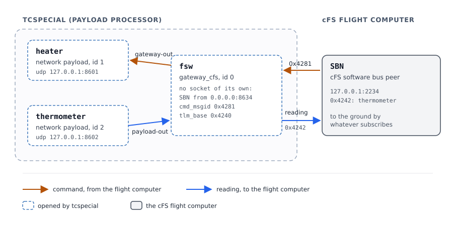
         node, and are published on the cFS software bus as fsw's tlm_base
         plus the thermometer's device id; a command the bus publishes as
         fsw's cmd_msgid goes to fsw and on to the heater.
   :width: 100%

   ``examples/cfs``: a vehicle that answers to a cFS flight computer.

The vehicle answers to a cFS flight computer rather than to the ground, so the
``tcspecial`` section says ``gateway: "cfs"`` and the one gateway node,
``fsw``, is a ``gateway_cfs``. tcspecial joins the computer's software bus as
one more peer of its Software Bus Network, SBN, over SBN's UDP protocol
module, and nothing has to be built into the cFS side for it: the mission adds
tcspecial to its SBN table and allots it a block of message IDs.

Everything the vehicle takes and sends crosses that one link, as cFS packets
told apart by message ID, so the ``tcspecial`` section has no sockets for
commands, beacons or telemetry. It states the peer once, under ``sbn``, and a
message ID or a base where a radio's configuration has a socket:

.. code-block:: yaml

   tcspecial:
     gateway: "cfs"
     sbn:
       release: "v7.0.1"
       ident: "3b339a5e0f686cef822a5d6ea95004222ab7af33"
       spacecraft_id: "0x42"
       processor_id: "2"
       local: "0.0.0.0:8634"
       peer: "127.0.0.1:2234"
       peer_processor_id: "1"
       max_message: "32768"
     msgid_range: { first: "0x4200", last: "0x42FF" }
     tcs_cmd: { cmd_msgid: "0x4280", response_msgid: "0x4200" }
     payload_command: { cmd_base: "0x4290", response_base: "0x4210" }
     payload_telemetry: { tlm_base: "0x4220" }
     beacon: { default_interval: "5 s", reset_interval: "1 s",
               tlm_msgid: "0x4201" }
     cfe_time: { epoch: "1980-01-01T00:00:00", scale: "tai",
                 leap_seconds: "37" }

- ``sbn.release`` is the SBN release the cFS side was built from, and must be
  one this build speaks -- v7.0.1 -- because the release decides the layout
  of every message. ``sbn.ident`` is the 40-digit hash SBN prints in its
  start-up event on the cFS side: tcspecial puts it in every subscription,
  and SBN refuses a subscription that carries another, so a wrong one is a
  link that connects and carries nothing. For SBN v7.0.1 checked out by git
  it is ``3b339a5e0f686cef822a5d6ea95004222ab7af33``, which the example
  gives. git fills the hash in as it checks SBN out; an SBN built from an
  archive or a copy instead has no hash in it, and cannot be matched: build
  the cFS side from a git checkout of SBN.
- ``sbn.local`` is where tcspecial binds and ``sbn.peer`` where the cFS side's
  SBN listens; ``spacecraft_id``, ``processor_id`` and ``peer_processor_id``
  are the numbers SBN tells peers apart by, and tcspecial's processor ID may
  not be the peer's. ``sbn.max_message`` is the cFS build's
  ``CFE_MISSION_SB_MAX_SB_MSG_SIZE``: a node that could produce more than
  that, with a cFS packet's sixteen bytes of headers, is refused.
- ``msgid_range`` is the block the mission allotted tcspecial. Every message
  ID the configuration states, or counts to from a base, must lie in it, be
  used once, and be a command's (``0x80`` set) where tcspecial takes it and
  telemetry's (``0x80`` clear) where it publishes it; tcsverify says which
  one is not, and why. The cFS side must accept every ID in the block:
  cFE refuses one above ``CFE_PLATFORM_SB_HIGHEST_VALID_MSGID``, which is
  ``0x1FFF`` unless the build raises it, so for ``0x4200`` to ``0x42FF`` it
  must be raised to at least ``0x42FF``. Otherwise SBN cannot subscribe for
  tcspecial, nothing tcspecial publishes is delivered, and only an event on
  the cFS side says why.
- Commands about the spacecraft are published for tcspecial as
  ``tcs_cmd.cmd_msgid`` and answered as ``tcs_cmd.response_msgid``. A command
  about node *k* is published as ``payload_command.cmd_base`` plus *k* and
  answered as ``response_base`` plus *k*. A payload nothing in the drawing
  touches is published as ``payload_telemetry.tlm_base`` plus its id, and the
  beacon as ``beacon.tlm_msgid``.
- ``cfe_time`` copies how the cFS build counts time -- its epoch, and ``tai``
  or ``utc`` -- with ``leap_seconds``, TAI less UTC, where the scale is TAI.
  Every telemetry packet is stamped in it.

.. warning::
   The cFS side's SBN table must list tcspecial with the same spacecraft ID,
   processor ID and address that ``sbn.spacecraft_id``, ``sbn.processor_id``
   and ``sbn.local`` give it, and must be the side at ``sbn.peer`` with
   ``sbn.peer_processor_id``. Nothing on this side can check that table: a
   mismatch is a vehicle that announces itself to a bus that does not answer,
   or whose every datagram is refused as from a stranger, with nothing in
   tcsverify's report to say so. Check the two against each other whenever
   either changes.

The gateway node says where what is drawn into it is published, ``tlm_base``,
counted on by each source's device id: the ``thermometer``, device id 2, is
published as ``0x4242``. It has no address and no port, and one written on it
is refused: it is reached through the peer. A command the bus publishes as its
``cmd_msgid``, ``0x4281``, is taken by ``fsw`` and leaves it by its
``moc-out`` for the ``heater``; ``cmd_msgid`` is required where a line or
a command binding leaves the node.

Each tcspecial packet is wrapped in a cFS packet as it goes -- the CCSDS
primary header, cFS's extended header, and for a command a function code (the
tcspecial command code) and a checksum, for telemetry a time -- and nothing in
the configuration says how. A command whose checksum is wrong, whose function
code is not its code, or that is not one whole cFS command is not answered,
not acted on, and is logged and counted as malformed. The cFS side must be
built with ``MISSION_INCLUDE_CCSDSEXT_HEADER`` and ``MISSION_MSGID_V2``, the
two cFE settings the framing and the message IDs are read by.

tcspecial speaks first: it announces itself to ``sbn.peer`` once a second
until it is answered, sends SBN's protocol version and its subscriptions once
it is, and publishes only what the peer has subscribed to and only once the
peer's protocol version has been checked. It sends a heartbeat after five
seconds of sending nothing, and a peer silent for ten seconds is disconnected
and announced to again. A peer of another protocol version, or one whose
subscriptions carry another ident, is refused and disconnected, and the
refusal is logged with what was expected and what arrived each time it
connects again.

``make -C examples run-cfs`` runs tcsmoc on the example as
``run-fprime`` does on its own. tcssim simulates the cFS side as well as
the payloads: it binds ``sbn.peer`` and is the software bus, with the
vehicle and tcsmoc both its peers, so tcsmoc's beacon light, its panels and
its commands work as they do for a vehicle on the radio. tcsmoc joins as
processor 3, one more than the larger of ``processor_id`` and
``peer_processor_id``, and needs nothing more in the file. Everything built
on tcslib -- the C/C++ library included -- does the same with no change to
the station.

Two things follow. tcssim simulates the cFS side whenever it runs on a
configuration that answers to cFS, so it is not run beside a real cFS, which
would be holding ``sbn.peer`` itself; tcssim says so and stops if it finds
the address taken. And a ground station can join only the simulated cFS
side: SBN on a
real cFS never sends one peer what another published, so behind a real cFS
the vehicle is commanded from that cFS's own ground system, under the
message IDs above.

``tcspecial/tests/cfs.rs`` flies the example against a test that plays
the cFS side's SBN: tcspecial subscribes, the beacon and a reading are
published, a CONNECT and a node command are answered under their answer IDs,
a command whose checksum is wrong is not, and a command for ``fsw`` reaches
the heater. ``tcspecial/tests/cfs_ground.rs`` commands it from tcslib
through the simulated cFS side. The payloads' ports are in the eighty-six
hundreds,
which no other example uses.

``make cfs-test`` flies the example against a real cFS. It builds cFS with
SBN v7.0.1 and its UDP module in ``CFS_SCRATCH`` (by default
``cfs-scratch``, beside the checkout, as ``fprime-scratch`` is) from a cFS
checkout, ``CFS_PRISTINE``, and a git
checkout of SBN, ``SBN_SRC``, and installs nothing; the first build fetches
the cFS checkout's submodules at the commits it pins. It then starts that
cFS and tcspecial, and ``tcspecial/tests/cfs_flight.rs`` commands the vehicle
from the cFS's own ground, through CI_LAB and TO_LAB: the beacon, a CONNECT,
a reading, a command for ``fsw`` and a node command each cross SBN. It binds
fixed ports -- 2234, 8634, 8601, 8602, 1234 and 1235 -- and holds the lock
``TCS_PORTS_LOCK`` names while it runs, so that it does not meet another run
on them. ``cfs/defs`` is what that cFS is configured with, and shows what a
mission's own needs: tcspecial in its SBN peer table, the extended header,
the version 2 mapping with cFE's own topics mapped onto it, and a highest
message ID above the block allotted tcspecial.

The can example
---------------
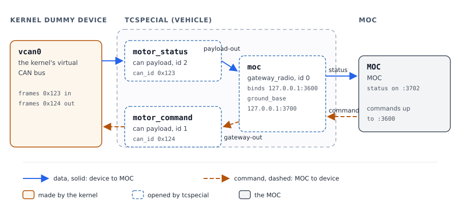
         bus vcan0 are read by motor_status and go to ground, a gateway_radio
         node, and down to the MOC; a command the MOC sends up to ground
         leaves it for motor_command, which puts it on the bus as a frame
         carrying 0x124.
   :width: 100%

   ``examples/can``: a motor controller on a CAN bus.

A motor controller on the CAN bus ``vcan0``, which sends its status in frames
carrying the identifier ``0x123`` and takes commands in frames carrying
``0x124``. Two identifiers make two payloads: each opens a socket of its own
on the bus, filtered to its identifier, so ``motor_status`` hears the status
frames and nothing else, and ``motor_command`` hears nothing it has not sent.
Each status frame's data goes by ``motor_status``'s ``world-out`` to the
gateway node ``moc`` and down to the MOC at ``ground_base`` plus its
device id, ``127.0.0.1:3702``. What the ground sends up to ``moc``, which
binds ``127.0.0.1:3600``, leaves it by its ``moc-out`` for
``motor_command`` and goes out as one frame, so a command is at most eight
bytes.

``vcan0`` is the kernel's virtual bus, which ``sudo bin/mk-kernel-dummies``
makes; on a vehicle the interface is the controller's, such as ``can0``, and
nothing else changes. ``make -C examples run-can`` runs tcsmoc on the example,
with tcssim on the bus as the motor. ``tcspecial/tests/kernel-dummies.rs``
flies it with the test as the motor. Every port the example uses is in the
thirty-two to thirty-seven hundreds, ending in 00 or 10, which no other
example uses.

The gpio example
----------------
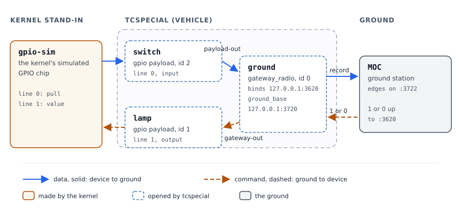
         switch as a record and goes to ground, a gateway_radio node, and down
         to the MOC; a 1 or 0 the MOC sends up to ground leaves it for lamp,
         which drives line 1 to it.
   :width: 100%

   ``examples/gpio``: a switch read, and a lamp driven.

Two lines of one chip, each a payload of its own because one is read and the
other driven, and a payload's lines all go one way. ``switch`` watches line 0
and twice a second reports it, as the ``u8`` the line is bit 0 of, by its
``world-out`` to ``moc`` and down to the MOC at ``127.0.0.1:3722``. ``lamp``
drives line 1: what the ground sends up to ``127.0.0.1:3620`` leaves ``moc``
by its ``moc-out`` for it, the ``u8`` 1 lighting the lamp and 0 putting it
out.

The chip is one of the kernel's ``gpio-sim``, which ``sudo
bin/mk-kernel-dummies`` makes. The configuration names ``/dev/gpiochip1``,
which is what that chip is on a host with one chip of its own; the number is
given as chips appear, so a host with another number writes the one the
script printed. ``make -C examples run-gpio`` runs tcsmoc on the example,
with tcssim pulling the switch's line every second and counting the lamp's
changes. ``tcspecial/tests/kernel-dummies.rs`` flies it, pulling and
reading the lines itself. Every port is in the thirty-two to thirty-seven
hundreds, ending in 20 or 30.

The iio example
---------------
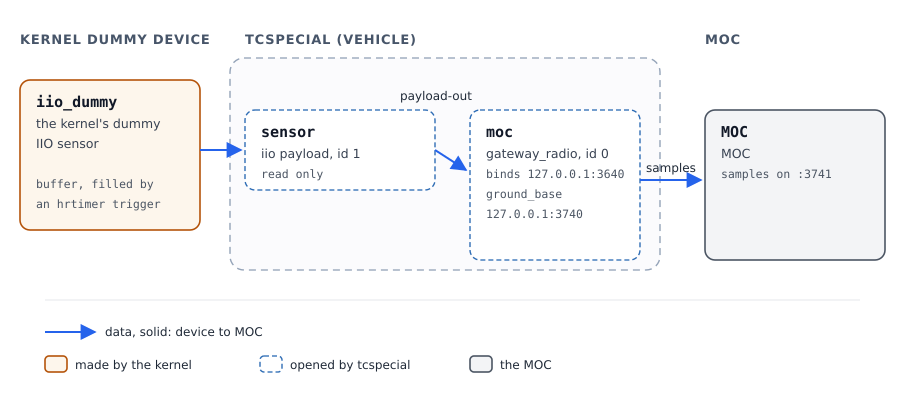
         software trigger, is read by sensor, and its sample sets go to
         ground, a gateway_radio node, and down to the MOC.
   :width: 100%

   ``examples/iio``: a sensor's sample buffer.

A sensor's buffer, which hands over whole sample sets as they are taken.
``sensor`` reads it and each read's sets go by its ``world-out`` to
``moc`` and down to the MOC at ``127.0.0.1:3741``. Nothing goes up: a
buffer is read and never written, so ``moc`` has no ``moc-out``. Which
channels are in a set and how often one is taken are the sensor's settings,
made in ``sysfs`` by whoever brings it up, and nothing in the configuration.

The ``iio`` type is experimental, and this example is what its test flies:
see `An IIO Payload`_. The sensor is one of the kernel's ``iio_dummy``, which
``sudo bin/mk-kernel-dummies iio`` makes where the kernel's has a buffer,
its buffer filled by a timer, so the dummy device
is the whole payload and tcssim makes nothing. The configuration names
``/dev/iio:device1``, which is what the dummy is on a host with one sensor of
its own; write the number the script printed. ``make -C examples run-iio``
runs tcsmoc on the example, and ``tcspecial/tests/kernel-dummies.rs`` is
written to fly it, checking that what arrives is whole sample sets. Every port
is in the thirty-two to thirty-seven hundreds, ending in 40 or 50.

The Simulator Configuration
===========================
What simulating a payload takes, which is not a property of the payload: how
often it produces a packet, and how it divides one into segments. Only tcssim
acts on it; tcsmoc reads it too, to show what the tcssim it started is
simulating, and does without it if it is not there.

Every setting but ``simulate`` is optional, and **a setting written empty is a
setting not stated**: ``packet_interval: ""`` and no ``packet_interval`` at all mean
the same thing, so a file somebody has half filled in still loads. tcsgui
writes only the settings that hold a value, and a file it begins names each
payload under its type and nothing else. A value that is there and wrong is
still refused, naming it.

.. code-block:: text

   simulated_payload_groups        optional
     group                the name payloads refer to, naming the entry
     simulate             true or false, for every payload in the group
     enable               true for every payload in the group to start
                          enabled; a payload's own overrides it
     ...                  any of the settings below

   simulated_payloads              a list of types
     type <type>          the type of payload, as the tcspecial
                          configuration writes it, holding the list of
                          the simulated payloads of that type
       payload            the payload this one simulates, naming the
                          entry
       simulate           true for tcssim to simulate it, false for the
                          real device: required, here or in its group
       enable             true for it to start enabled, as though its
                          panel's Enable button had been pressed; left out,
                          or false, it starts disabled. In XML,
                          <enable value="true"/>
       protocol           which transport, for a network payload
       payload_address    the socket the payload answers from, if this file
                          cares to say
       payload_port       which port it answers from, likewise
       group              the group to take unstated settings from, if any
       ...                any of the settings below

The simulated payloads are grouped by type, as a configuration's nodes are:
each entry of ``simulated_payloads`` is ``type`` and a type, holding the
payloads of that type, each named by ``payload``. A group is named by
``group`` and says no type, a payload's being the one it is written under. In
XML, ``<simulated_payloads>`` holds ``<type name="...">`` elements of
``<payload name="...">`` elements, and ``<simulated_payload_groups>`` holds
``<group name="...">`` elements. Nothing in the file is in an order that
means anything: the types, the payloads of one and the groups may be written
in any order. A file in the shape before this one, each payload with
``name:`` and ``type:`` of its own, is refused at the line of its first
entry; ``tools/convert-format.py`` rewrites it, keeping its comments.

**Simulated or real: simulate**

Every payload the file names says whether it is simulated, with ``simulate``:
``true`` has tcssim simulate it, and ``false`` leaves it to the real
device, for which tcssim makes nothing. It is said once -- in the payload, or
in the group it names -- and never in both, even where the two would agree: a
payload does not override its group's. A payload the file does not name is
real too.

.. code-block:: yaml

   simulated_payload_groups:
     - group: zone_temps
       packet_interval: 100 ms
       simulate: true          # temp_1, temp_2 and temp_3 are simulated

   simulated_payloads:
     - type network:
         - payload: heaters_1
           simulate: false     # the real heater
         - payload: temp_1
           group: zone_temps

Before it simulates anything, tcssim compares each payload's ``simulate``
with what is at the payload's endpoint, by the same rules tcspecial judges a
payload by (see `Simulated, Dummy or Real Devices: --simulate`_), and will
not start on a disagreement: ``simulate: true`` where the configuration
points at real hardware, or ``simulate: false`` where it points at a
simulated or dummy device. A simulated device tcssim makes itself, a
pseudo-terminal or a socket, is not there yet, and that is no disagreement;
a dummy device, which the scripts in ``bin/`` make, has to be. A payload the
file does not name whose endpoint is a simulated or dummy device all the
same is refused too: tcssim controls and shows every simulated payload, so
each one is named. A ``network`` or ``device-file`` payload is a real device
either way and is not compared: ``simulate: true`` has tcssim answer at its
far end, and ``false`` leaves it to whatever is there.

Each simulated payload has the same panel, whatever simulates it: its
button, which has it take part or not, and what it sent and what reached it.
Where the kernel makes a dummy device, tcssim watches it -- the
lines of a ``gpio-sim`` chip, the registers of an ``i2c-stub`` chip -- and
counts what the vehicle does to it. Two things cannot be seen: a read of an
``i2c-stub`` chip, which changes nothing, and the samples an ``iio_dummy``
sensor's kernel trigger makes. A payload that is only driven, such as a
heater, sends nothing, counts what the vehicle sends it, and takes no packet
interval. Switched off, a payload sends nothing, answers nothing and acts on
nothing -- a heater warms no mass -- and still counts what reaches it.

**What it simulates**

Two things describe the payload rather than the simulation, and are required
for that reason. The two files are joined by handler name and by nothing else
-- and a name is what a set copied from another one keeps -- so a simulator
configuration written for one set parses happily against another set's
payloads, and the run that follows looks like a payload that never sends.
Stating the type here makes that pairing an error instead.

.. code-block:: text

   type                   the type the payload is written under, in the
                          tcspecial configuration's own word: network,
                          device-file, serial, i2c, spi, i2c_tmass,
                          spi_tmass, can, iio, rpmsg, gpio or hdlc. Must be
                          the type that configuration
                          writes it under
   protocol               which transport, for a network payload, and refused
                          for any other type. Must be what that configuration
                          says
   payload_address        the socket the simulated payload answers from: a
                          host for a UDP payload, a path for a Unix datagram
                          one. Optional, only for those two types, and not
                          for a triggered one, which waits at the address the
                          tcspecial configuration gives
   payload_port           the port it answers from. Optional, and refused for
                          a Unix datagram payload, which answers from a path

Where the payload *is* is not stated here at all: the simulator takes it from
the tcspecial configuration, which decides it. Writing ``payload_interface``
here -- or ``address`` or ``port``, which that file spelled them before -- is
refused with the place they belong; they are the likeliest thing to be carried
across from the other file.

What this file may say about an address is the other end of the same link: the
socket the simulated payload answers from.

.. code-block:: yaml

   simulated_payloads:
     - type network:
         - payload: auto-send
           packet_interval: 1 s
           payload_address: 127.0.0.1   # the socket this payload answers
           payload_port: 7000           # from, not the one the handler
           protocol: udp                # waits at

Nothing in the link needs it -- a handler learns where its payload is from the
first packet it gets -- but something outside the simulation may: a rule on a
firewall, or a capture being read afterwards. Only a datagram payload that
is not asked has an address of its own to bind; a stream payload, and a
datagram payload that is asked, is the end that waits, so it binds the
address the tcspecial configuration gives it. A Unix datagram
payload answers from a path, so it takes an address and no port. Neither end
may be the other: a payload told to bind its handler's own socket is refused
rather than left to fail at the bind. Stating neither gets what every
simulator configuration asked for before this existed -- any interface and a
port the system chooses.

A word that is not a setting is refused here too -- in a payload, in a group,
and in the file's own sections. A misspelled setting that was ignored would
have the simulator do something other than what the file asked for and say
nothing: a payload asked through a misspelling to drop a tenth of its packets
drops none, and looks exactly like one that was never asked.

Neither the type nor the transport is taken from this file: the tcspecial
configuration decides both, and a disagreement about either is an error naming
the payload and what each file says of it. A group may carry them, like any
other setting -- though payloads that share a rate need not share a transport,
which is why the thermostat's simulator file leaves them with the payloads.

**Settings**

.. code-block:: text

   packet_interval        how long between packets, as a length of time --
                          1 s, 500 ms, 0.25 s -- or ``continuous`` for as fast
                          as the payload can be driven. Periodic payloads
                          only: a triggered one sends when it is asked, and
                          stating an interval for one is an error
   segment_interval       how long between the segments of one packet,
                          likewise, ``continuous`` included; defaults to the
                          packet interval
   segment_size           bytes in one segment; defaults to the whole packet,
                          whose size the tcspecial configuration gives

**The physics model**

Every simulated payload above sends bytes from a random number generator,
which exercises a link and no control loop at all: three sensors sending noise
never agree, so a vote over them says nothing and a thermostat downstream of
it cannot be seen working.

A physics model gives them something to agree about. It is the vehicle's
physical parts -- a zone, the heaters that warm it -- each simulated alone and
joined to the others. Join the sensors to what they measure and the heaters'
switches to the heaters, and what the vehicle reads becomes a consequence of
what the vehicle drove.

The model is in the simulator file's ``world`` section, beside the simulated
payloads joined to it, so that one file says the whole of what tcssim simulates
and a payload's ``connects`` names a terminal the same file says is there. Two
examples that fly one vehicle share it by sharing the whole simulator file, a
link to it beside each configuration. The world is YAML only: a simulator file
written in XML has none.

.. code-block:: text

   world                  in the simulator file. Optional
     ambient_temp         the temperature every thermal mass's surroundings
                          are about: "288.15 K". Required where there is a
                          thermal_mass
     physics
       components         the components, grouped by type
       connections        how they are joined, each from an output to an
                          input

The model holds the components it is made of, under ``components``, and the
connections between them, under ``connections``, as a configuration holds
nodes and links. The components are grouped by type, as
a configuration's nodes are: each entry of ``components`` is ``type`` and a
type, holding the components of that type, each named by ``component``.
Nothing in the model is in an order that means anything -- not the types,
the components of one, or the connections -- and tcssim runs it the same
however it is written: two events due at one moment come in the order of
their components' names, and the outputs an input sums are added in the order
of theirs. The shapes a model had before are refused, each told where it goes
now: a simulator file still naming a model in a file of its own,
``physics: zone-physics.yaml``; such a file given as a simulator file; a
``physics`` section at the top of a simulator file, not under ``world``; a
zone stating its own ``environment``, which is the world's ``ambient_temp``;
a component with ``name:`` and ``type:`` of its own; and a simulator file
still declaring masses itself.

Where tcsgui drew each component is kept last in the simulator file, in a
``tcsgui`` section of its own, as a configuration keeps its nodes' places:

.. code-block:: yaml

   tcsgui:
     nodes:
       - { node: zone, x: -193, y: 280 }
     pages:
       thermostat-common: [zone]

tcssim ignores it. A component it does not name is laid out down tcsgui's
Physics pane by name, so the section is never needed, and it is written as
components are moved there. Each component is drawn on the page it was placed
from: one placed on a subdiagram's page is listed under that subdiagram's name
in ``pages``, and one listed nowhere is drawn on the top page. A component
is placed from the physics list
as a node is from its own list: click its type, and it is put down the
pane where the others are, or drag the type onto the Physics pane, and it
is put where it is let go. In tcsgui a component is moved, edited, deleted
and joined as a node is: drag it, right click it for Edit and Delete, and
draw a line from its output or input terminal to another component, for a
connection, or to a payload, to set that payload's ``connects``. A line
drawn the other way, from a payload's terminal to a component, sets it too:
from a ``moc`` terminal, what drives the payload, it offers the component's
inputs -- a heater's ``on``, a zone's ``heater_1`` -- and from a ``world``
terminal, what it reports, the component's outputs -- a zone's
``temperature``. Where a line could mean more than one terminal -- a
heater's heat, current and heating, to a sensor -- tcsgui asks which.

Each component is one simple part, of one of these types:

.. code-block:: text

   heater                 a resistance on a supply, switched on and off
     component            the name connections and payloads use
     power                what it gives out while on, at its nominal
                          voltage: "60 W"
     voltage              its supply's nominal voltage: "28 V"
     ripple               how much its supply varies: a standard deviation,
                          as a fraction of nominal, written bare. Optional
     ripple_time          how slowly it varies, as a length of time. With
                          ripple and refused without it

   thermal_mass           one body at one temperature, in surroundings
                          about the world's ambient_temp
     component            the name connections and payloads use
     time_constant        how fast it loses the difference, as a length
                          of time
     capacity             how much heat it takes to warm it a kelvin:
                          "20 J/K"
     swing                how far its surroundings swing either side of
                          ambient_temp, as a sine wave: "3 K". Optional
     period               how long one swing takes. With swing and refused
                          without it
     wander               how far its surroundings wander at random: a
                          standard deviation, "0.5 K". Optional
     wander_time          how slowly they wander, as a length of time. With
                          wander and refused without it
     start                where it starts: "292.15 K". Optional; left out,
                          it starts at ambient_temp
     heater_1_power       what its first heater of its own gives while on:
                          "4 W". Wanted where heater_1 is joined
     heater_2_power       and its second's, wanted where heater_2 is

   sun                    sunlight and shadow, through an orbit
     component            the name connections and payloads use
     period               how long one orbit takes: "90 min"
     eclipse              how much of it is in shadow, as a fraction,
                          written bare: "0.35"
     start                how far round the orbit it starts, from the start
                          of its sunlight, as a fraction. Optional

   solar_array            panels turning light into current
     component            the name connections and payloads use
     current              what it gives in full sunlight: "7 A"

   load                   something on the bus that draws a current
     component            the name connections and payloads use
     current              what it draws while it is on: "2 A"

   bus                    where the sources' currents and the loads' meet
     component            the name connections and payloads use

   battery                a store of charge on the bus
     component            the name connections and payloads use
     capacity             how much it holds full: "10 Ah"
     empty                its open-circuit voltage empty: "24 V"
     full                 its open-circuit voltage full, more than empty:
                          "33.2 V"
     resistance           its internal resistance: "0.05 ohm"
     charge               how full it starts, as a fraction: "0.6"

   engine                 a throttled engine and its fuel
     component            the name connections and payloads use
     thrust               its thrust at full throttle: "4500 N"
     isp                  its specific impulse, as a length of time:
                          "311 s"
     fuel                 the fuel it starts with: "100 kg"

   body                   a mass falling under gravity, pushed and burning
     component            the name connections and payloads use
     mass                 its mass at the start, fuel and all: "1500 kg"
     gravity              the gravity it falls in: "1.62 m/s2"
     altitude             how high it starts: "500 m"
     velocity             how fast it starts, up more than nought:
                          "-20 m/s"

Every figure is written with its unit, and one without it, or in another
unit, is refused, saying what to write: a bare ``60`` could be watts or
kelvin a second. A fraction, which has no unit, is written bare. A
``thermal_zone``, which is what a ``thermal_mass`` was called before, is
refused, told the name it has now.

Each type has fixed terminals, the places it is joined at, each an input or an
output, carrying a value in one unit or a decision:

.. code-block:: text

   heater         on            in    a decision: whether it is on
                  heat          out   W, nought while off
                  current       out   A, nought while off
   thermal_mass   heat          in    W, the sum of everything joined to it
                  temperature   out   K
                  heater_1      in    a decision: its first heater of its
                                      own, adding heater_1_power while on
                  heater_2      in    a decision: its second, adding
                                      heater_2_power while on
   sun            light         out   a ratio: one lit, nought in shadow
   solar_array    light         in    a ratio
                  current       out   A, its full-sun current times light
   load           shed          in    a decision: shed while asserted, and
                                      never shed where nothing is joined
                  current       out   A, nought while shed
   bus            supply        in    A, the sum of the sources joined to it
                  demand        in    A, the sum of the loads joined to it
                  current       out   A, supply less demand
   battery        offered       in    A, what the bus has left over
                  voltage       out   V
                  current       out   A, what flows in: nought into a full
                                      battery, whose charge is shunted
                  charge        out   a ratio, the fraction it holds
   engine         throttle      in    a ratio, held within nought and one
                  force         out   N, nothing once its fuel is gone
                  flow          out   kg/s, the fuel it burns
   body           force         in    N, the sum of the forces on it
                  flow          in    kg/s, the sum of the mass it loses
                  altitude      out   m
                  velocity      out   m/s, up more than nought
                  contact       out   a decision: asserted on the ground

A terminal is written as the component's name and its own, joined by a dot:
``zone.temperature``. A connection goes from an output to an input of the
same kind, and one joining two outputs, two inputs, or a value in one unit to
an input in another, is refused, naming both. An input takes one output, or
the sum of every output joined to it where its type says so, as a zone's
``heat`` does.

A heater's heat goes as the square of its supply voltage, and its current as
the voltage. A battery's charge moves in a straight line with its current,
and its voltage runs straight from ``empty`` to ``full`` with its charge, plus
what its resistance drops; full, a charging current is shunted, and empty, it
is held there with its voltage below ``empty`` showing it. The sun is lit or
dark, changing all at once twice an orbit. An engine's thrust is its throttle
times its full thrust, and it burns that over its specific impulse in fuel
until there is none, when it stops. A body falls by the rocket equation with
gravity, which has a closed form while its force and its flow are held, and is
set down when it reaches the ground, a moment found ahead of time and met
exactly; it stays down until a force beating its weight lifts it. A zone cools towards its surroundings with its time constant and
is warmed by the heat joined to it, its capacity turning watts into kelvin a
second; with a fifty second constant, twenty joules a kelvin and a hundred
and twenty watts, it would settle three hundred kelvin above its
surroundings. It starts at the world's ambient temperature with the heaters off, because a
vehicle coming up cold is the case a thermostat exists for, unless it states
``start``, and then there.

A simulated payload is joined to one terminal by a setting of its own, which
like every other setting may be stated on a group instead:

.. code-block:: text

   connects               the terminal it is joined to: zone.temperature,
                          heater_1.on. Joined to an output, it reports it;
                          joined to an input, it drives it. A GPIO payload
                          that watches lines names a decision for each line,
                          in the order of its lines: heater_1.heating,
                          heater_2.heating
   offset                 how far the place a reporting payload is on sits
                          from what its terminal says, in the terminal's
                          unit: "+0.2 K". Optional

A payload joined to an output reports a value in the encoding of the conversion
its readings go to, and a decision -- a lander's contact with the ground -- as
the text ``1`` or ``0``: at once when it changes, waiting on the model for the
moment rather than for its next turn, and again every packet interval. A
payload joined to an input drives it with what the vehicle sends: a whole
number -- a set of lines, or a thermostat's decision as the ``u8`` a switch
takes, a thermal mass's heater being on where it is not nought -- or a value,
four bytes of its unit's steps, which has to come
from a node sending that unit -- an engine's throttle from a ``process``
answering a ``ratio``. An input is driven by one payload, and not by one and a
connection too: two would each switch it over the other. A heater's ``on`` that
nothing drives is refused, being a part nothing can switch, and so is a
component nothing is joined to, which is most likely a misspelled ``connects``.
A GPIO payload that watches lines is pulled rather than signalled: each of its
lines is held high while its terminal's decision is on, and looked at every
packet interval -- a line sensing a heater, pulled to the heater's ``heating``,
which is on only while the heater is really heating, so a heater disabled in
tcssim reads low whatever it is told. One terminal for each line is required,
and a list of terminals anywhere else is refused. The settings that joined a
payload to a thermal mass -- ``reads``, ``heats``, ``output``, ``input``,
``rate`` -- are refused, told what says it now.

A sensor sends the bytes the conversion its readings go to -- ``to_kelvin``
or ``to_value`` -- will read back as what it reports. The format, the scale
and the offset are taken from that node, not stated here -- a scale written
in two files is a scale that can disagree with itself -- so a sensor whose
readings reach no conversion, or two, or one in another unit than its
terminal, is refused.

A simulated heater sends nothing: being driven is the whole of what it is
for. Its packet interval is how often it looks for what the vehicle decided,
which is the one thing pacing still means for a payload that sends nothing,
and it wants to be shorter than the sample interval: the vehicle cannot see
the band crossed until its next sample and the heaters cannot hear about it
until they next look, so the zone overshoots by their heat over the sum of
the two.

A simulated heater has to be a payload the simulator can be driven through:
a socket, or a set of discrete lines, which tcssim watches as the vehicle
drives them.

A simulator file with a model, and its payloads joined to it:

.. code-block:: yaml

   world:
     ambient_temp: "283.15 K"         # ten kelvin below the setpoint
     physics:
       components:
         - type heater:
             - component: heater_1
               power: "60 W"          # three kelvin a second on the zone
               voltage: "28 V"
             - component: heater_2
               power: "60 W"
               voltage: "28 V"
         - type thermal_mass:
             - component: zone
               capacity: "20 J/K"
               time_constant: "50 s"  # a fifth of a kelvin a second at it
       connections:
         - { from: heater_1.heat, to: zone.heat }
         - { from: heater_2.heat, to: zone.heat }

   simulated_payload_groups:
     - group: zone_temps
       connects: zone.temperature
       packet_interval: 100 ms

   simulated_payloads:
     - type network:
         - payload: heaters_1
           connects: heater_1.on
           packet_interval: 20 ms   # how often it looks for a decision
           protocol: udp
         - payload: heaters_2
           connects: heater_2.on
           packet_interval: 20 ms
           protocol: udp
         - { payload: temp_1, group: zone_temps, protocol: udp }
         - { payload: temp_2, group: zone_temps, offset: "+0.2 K",
             protocol: udp }
         - { payload: temp_3, group: zone_temps, offset: "-0.3 K",
             protocol: udp }

**How the world moves**

tcssim makes one world of the model, which every simulated payload joined to it
shares, and nothing ticks: the world is brought up to a moment only when a
simulated payload reads or drives it, and a world nobody asks about costs
nothing. Between two moments each component is advanced by its closed form, so
what a sensor reads does not depend on how often it is read. Where a
component's behaviour would change inside an interval -- a battery reaching
full, the sun going into shadow, a lander reaching the ground -- it foresees
the moment as an event, and the world stops there, lets it happen, and goes on,
the events waiting in order of when they fall. Simulated time keeps pace with
the wall clock, which the vehicle runs on, from when the run begins: the first
time a running simulated payload asks the world anything. Until then the world
waits, so a lander is still where it starts when its radar is enabled.

**Physically realistic noise**

A simulated sensor reports the zone exactly, and three of them agree to the
count, which real ones never do. Real readings go wrong in two places, and
the difference matters to a loop: what goes wrong at a sensor is that
sensor's alone, and a vote over three can outvote it; what goes wrong in the
zone every sensor sees, and no vote removes it. Each of these is a datasheet
or mission figure, and each is off unless it is stated.

At a sensor, as settings of a payload that reports, or of its group, each in
the unit of the terminal it reports:

.. code-block:: text

   noise                  the random error on each reading: a standard
                          deviation, "0.03 K"
   accuracy               the most its calibration is off by, "0.5 K". A
                          fixed error is drawn once a run, normally
                          distributed with a third of this as its standard
                          deviation and never past it
   drift                  how far its error wanders, slowly: a standard
                          deviation, "0.05 K"
   drift_time             how slowly it wanders, as a length of time. With
                          drift and refused without it
   lag                    its own time constant, as a length of time: a
                          sensor is a small body of its own and follows the
                          one it is on that far behind

A sensor's errors are refused on a simulated payload that drives. At a heater,
its ``ripple`` and ``ripple_time``; in the zone, its ``swing``, ``period``,
``wander`` and ``wander_time``: what the world does is the model's, and what a
simulated sensor gets wrong is the simulator file's.

Everything that wanders -- a sensor's drift, the environment, a supply -- is
an Ornstein-Uhlenbeck process: a departure drawn back towards nought, whose
size is its standard deviation once settled and whose time is how long it
remembers. Each is stepped by its exact transition, so how much it wanders
does not depend on how often anything reads it, and each starts where a
settled one would be. The swing is part of the zone's equation, which still
has a closed form, so it is as exact as the rest. A lag follows the body's
temperature as if it changed at a steady rate between two readings.

The random draws come from a generator for each component and each sensor,
seeded from the run's seed and its name, so a run with the same seed varies
the same way. The seed is a setting of the ``tcssim`` section; without one,
tcssim chooses it and says which it chose, so a run worth repeating can be:

.. code-block:: yaml

   tcssim:
     ready: "127.0.0.1:7907"
     seed: 12345

The thermostat example states all of these, with figures of the kind a
datasheet and a low orbit give: two sensors of one part accurate to half a
kelvin, with three hundredths of noise and four seconds of lag, and a better
one; an environment swinging half a kelvin over ninety minutes and
wandering a quarter of a kelvin; a start inside the band; places a fifth and three tenths of a kelvin off the middle;
and supplies varying by two percent.

**Simulating the thermostat**

tcssim can simulate thermostat nodes as well, so that the loop closes
in the simulator alone, with no tcspecial running. Name the node in the
``tcssim`` section -- or several, separated by commas, for a vehicle with a
thermostat for each of several zones:

.. code-block:: yaml

   tcssim:
     ready: "127.0.0.1:7907"
     thermostat: thermostat

tcssim then takes each node's ``setpoint`` and ``half_band`` from the
tcspecial configuration, and simulates each alone. Its sensors are the
simulated payloads reporting the world whose data reaches the node, and its
heaters the simulated payloads driving it that data from the node reaches. A
name left blank between commas, or written twice, is refused, and so are two
nodes that switch one heater, which would each undo the other. Each reads
each sensor's bytes as they leave the simulated sensor -- a dropped reading
never
arrives, and a truncated or corrupted one arrives as the vehicle would see
it -- as the conversion the sensor feeds reads them, and decides on the
median of each sensor's latest reading: more than the half band over the
setpoint, off; more than it under, on; between the two, what it last
decided. The decision is asserted to each of its heaters on every reading,
as the node does aboard.

Never name a thermostat with tcspecial running: its own thermostat switches
the same heaters, and the two would fight.

**Fault injection**

A payload that always works exercises only the path where everything works.
These settings have a simulated payload misbehave on purpose, so that a
handler's counting, framing, timeouts and reconnection can be made to happen
rather than waited for. Each defaults to no fault, so a file that mentions
none asks for a payload that works -- which is what every simulator
configuration written before these existed asks for.

.. code-block:: text

   drop_percent           packets in a hundred that are never sent. A dropped
                          packet is not counted as sent either, which is what
                          tells it from one lost on the way
   corrupt_percent        packets in a hundred with one byte altered. Never
                          left as it was: a corruption that changed nothing
                          would be a fault that did not happen
   truncate_percent       packets in a hundred sent short. Always shorter than
                          the packet size and never empty; a packet of one
                          byte cannot be shortened and goes whole
   jitter                 how late a packet may be, as a length of time,
                          chosen afresh for each one. Waited out inside the
                          interval rather than added to it, so the rate is
                          unchanged and the packet arrives late within it. A
                          length of time and nothing else: leave it out for
                          no jitter
   silent_after           packets after which the payload sends no more,
                          leaving its link open; 0 is never. What a wedged
                          instrument looks like from the handler's end
   close_after            packets after which the payload hangs up and then
                          listens again, so the handler has to reconnect;
                          0 is never. Streams only -- tcp and unix_stream
   ignore_trigger_percent requests in a hundred a triggered payload leaves
                          unanswered, which is what a handler's response
                          timeout exists for. Triggered payloads only

The percentages are nought to a hundred; a larger number is an error naming
the setting and the value. A fault the payload could not have is an error too:
``close_after`` for anything but a stream, and ``ignore_trigger_percent`` for a
payload that sends on its own. Faults belong in this file alone -- the
tcspecial configuration describes what a payload is meant to do, and tcspecial
reads it. A payload that starts with any fault set says so in one line of log,
so a run is not left to be guessed at afterwards.

.. code-block:: yaml

   simulated_payloads:
     - type network:
         - payload: auto-send
           drop_percent: 10        # one packet in ten never arrives
           jitter: 50 ms           # and the rest are up to 50 ms late
           packet_interval: 500 ms
           protocol: udp

The two files are joined by name. Every data handler needs a simulated payload
naming it, and a name here that no handler has is an error rather than a line
with no effect, because a typo is otherwise indistinguishable from a payload
meant to be left out.

A simulated triggered payload sends one packet for each request it is sent and
nothing otherwise. The segment settings still apply to it -- how a payload
divides an answer is its own business however it was prompted -- but the packet
interval does not, and is refused. Two types cannot be asked at all and are
refused outright: a device, which tcspecial opens and reads directly, and a
device on a bus, where the master's own read is the request and a second master
cannot see it.

This is the shipped ``examples/thermostat/thermostat-sim.yaml``, a link to
``examples/thermostat-common/thermostat-sim.yaml``, which the thermostat
example shares with thermostat-yamcs, its world shortened here:

.. code-block:: yaml

   description: Simulator settings for the payloads of thermostat.ytcs and
     thermostat-yamcs.ytcs

   world:
     ambient_temp: "288.15 K"
     physics:
       components:
         - type thermal_mass:
             - component: zone
               capacity: "20 J/K"
               heater_1_power: "4 W"
               heater_2_power: "4 W"
               start: "292.15 K"
               time_constant: "50 s"

   simulated_payload_groups:
     - group: zone_temps
       connects: zone.temperature
       drift: 0.05 K
       drift_time: 30 min
       packet_interval: 1 s
       simulate: true

   simulated_payloads:
     - type gpio_inout:
         - payload: gpio-out-tmass1
           connects: zone.heater_1
           simulate: true

         - payload: gpio-out-tmass2
           connects: zone.heater_2
           simulate: true

     - type i2c_tmass:
         - payload: temp_1
           accuracy: 0.5 K
           group: zone_temps
           lag: 4 s
           noise: 0.03 K

         - payload: temp_2
           accuracy: 0.5 K
           group: zone_temps
           lag: 4 s
           noise: 0.03 K
           offset: +0.2 K

     - type spi_tmass:
         - payload: temp_3
           accuracy: 0.25 K
           group: zone_temps
           lag: 6 s
           noise: 0.02 K
           offset: -0.3 K

Installing
==========

Everything installs under one prefix, ``/opt/tcs``, which the filesystem
hierarchy standard gives an add-on package of its own, with its host
configuration in ``/etc/opt/tcs`` and its variable data in ``/var/opt/tcs``.
tcslog, tcslog-tools and tcs-xtce install under the same prefix, so a
machine with all of them has one ``bin``, one ``lib`` and one ``include`` to
be told of.

The packages
------------

There are three, because three kinds of machine take them:

``tcspecial``
   What flies. ``bin/tcspecial`` and ``bin/tcsverify``; the
   five test app programs, in ``libexec`` because tcspecial runs them rather
   than a person -- a configuration names one as ``executable:
   /opt/tcs/libexec/app_pl``; the manual and design in
   ``share/doc/tcspecial``; the example configurations in
   ``share/examples/tcspecial``; and empty ``/etc/opt/tcs/tcspecial`` and
   ``/var/opt/tcs/tcspecial`` for a vehicle's configuration and its state
   and telemetry. No ``segsend``: a vehicle that keeps a log puts its own
   in ``/opt/tcs/bin``, beside tcspecial (see `Where the logs' segments
   go`_).
``tcspecial-ground``
   What a ground station is built on. ``lib/libtcs.so.1`` and ``lib/libtcs.a``
   with ``include/tcs.h`` and ``lib/pkgconfig/tcs.pc``; the Python
   packages ``tcslibgs``, ``tcslib`` and ``tcsui`` in
   ``lib/python3/site-packages``; and ``bin/tcsgui`` with its descriptions
   and schemas in ``share/tcsgui``.
``tcspecial-test``
   ``bin/tcsmoc`` and ``bin/tcssim``, which never fly, and ``bin/segsend``,
   the test one, which deletes each segment it is given. It depends on
   ``tcspecial``, because an installed tcsmoc starts the tcspecial and the
   tcssim installed beside it. The test ``segsend`` is here rather than in
   ``tcspecial`` because a vehicle that flew it would throw its telemetry
   away, and because a package that owned ``/opt/tcs/bin/segsend`` would
   overwrite a mission's own on every upgrade.

``make deb`` builds them as ``.deb`` files and ``make rpm`` as RPMs, both
into ``build/packages``; ``make packages`` builds both. Each is cut from
``make stage``, which installs each package into a directory of its own
under ``build/stage``. Then, as root:

.. code-block:: console

   # apt install ./build/packages/tcspecial_0.1.0-1_amd64.deb
   # dnf install ./build/packages/tcspecial-0.1.0-1.x86_64.rpm

A package also installs what makes ``/opt/tcs`` usable without being told
of it, each file named after the package so that no two own one:
``/etc/profile.d/<package>.sh``, which puts ``/opt/tcs/bin`` on ``PATH`` --
and, for the ground package, ``/opt/tcs/lib/pkgconfig`` on
``PKG_CONFIG_PATH``; ``/etc/ld.so.conf.d/tcspecial-ground.conf``, which puts
``/opt/tcs/lib`` on the loader's path; a ``tcspecial-ground.pth`` in the
system python3's own directory -- ``/usr/lib/python3/dist-packages`` on
Debian, ``/usr/lib/python3.<minor>/site-packages`` on Fedora, which has no
directory every python3 reads -- which puts the Python on python3's path;
and ``/usr/lib/systemd/system/tcspecial.service`` (see `Running tcspecial
under a supervisor`_).

Each .deb also carries what Debian expects of every package, outside
``/opt/tcs`` as the files above are: ``/usr/share/doc/<package>/copyright``,
in Debian's machine-readable format, and ``changelog.Debian.gz``, both made
as the package is built, from ``LICENSE-MIT`` and the version; and
lintian's overrides, in ``/usr/share/lintian/overrides/<package>``. The
ground package also has a trigger that has dpkg run ``ldconfig`` once
``libtcs.so.1`` is installed or removed. The RPMs say the same in their own
``License``, ``%changelog``, ``%post`` and ``%postun``. ``libtcs.so.1`` is
not executable in the .deb, as Debian wants a shared library to be, and is
in the RPM, where rpm reads what a library provides only from an executable
file; otherwise the two hold the same files under ``/opt/tcs``.

``make lint-packages`` checks the packages ``make packages`` built with
lintian and rpmlint, and the shell scripts they run or install with
shellcheck: the profile.d hooks and the links scripts as the stage has
them, the .debs' maintainer scripts and the packaging scripts. It skips, in
a line, any of the three that is not installed, and fails on any finding
that is not overridden. What is overridden is intended, and says why: for
lintian in ``packaging/deb/<package>/lintian-overrides``, which each .deb
carries, and for rpmlint in ``packaging/rpm/rpmlint.toml``, which is not
shipped.

``make install``
----------------

Building, installing and packaging from a checkout need two more checkouts
beside this one: `tcs-helpers <https://github.com/vomlehn/tcs-helpers>`__,
the packaging scripts and make rules the TCS projects share, and
`tcs-xtce <https://github.com/vomlehn/tcs-xtce>`__, whose Python package
generates the link's codecs and holds the runtime the Python ground
packages use. ``make tcs-helpers`` and ``make tcs-xtce`` check that they
are there and at the versions this tree needs, and the targets that use
them do so first:

.. code-block:: console

   $ cd ..
   $ git clone https://github.com/vomlehn/tcs-helpers.git
   $ git clone https://github.com/vomlehn/tcs-xtce.git
   $ make -C tcs-xtce python/tcs_xtce/generated.py

``make install`` builds the packages, as whoever ran it, and installs those
of the kind this system takes with its usual installer, under sudo: apt-get
on Debian and Ubuntu, dnf on Fedora and Red Hat's, zypper on SUSE's, read
from ``/etc/os-release``. ``DRY_RUN=1`` has the installer show what it
would do and change nothing. ``make uninstall`` removes the packages the
same way, leaving the configuration and the state, which are the mission's.

``make install-files`` copies the files into place instead, under
``PREFIX``, ``/opt/tcs`` unless it is given another, from a build ``make
install-build`` made, so that nothing is built as root. ``DESTDIR`` is put
in front of every path, for staging, and is not part of any path a program
looks in. ``HOOKS=1`` installs the files outside the prefix as well, which
a developer's copy leaves alone unless asked. ``make install-tcspecial``,
``install-tcspecial-ground`` and ``install-tcspecial-test`` copy one
package. ``make uninstall-files``, with the same variables, takes away what
was copied.

.. code-block:: console

   $ make install DRY_RUN=1
   $ make install
   $ make install-build
   $ sudo make install-files HOOKS=1
   $ sudo ldconfig
   $ make install-files PREFIX=$HOME/tcs

Everything ``make install-files`` installs, and so everything in the
packages, is
stripped: the programs and ``libtcs.so.1`` with ``strip --strip-unneeded``,
which leaves what they need to be run and linked with, and ``libtcs.a``
with ``strip --strip-debug``, which keeps the symbols a program linked with
it needs. That takes a fifth to a quarter off what each package installs:
the flight package installs about 9 MB stripped and 12 MB not.
``STRIP=0`` keeps everything as cargo built it, for a build that is to be
debugged:

.. code-block:: console

   $ make packages STRIP=0

Programs everywhere, not only in a login shell
----------------------------------------------

The packages' ``/etc/profile.d`` scripts put ``/opt/tcs/bin`` on ``PATH``,
but only a login shell reads them: ``sudo``, ``cron``, a systemd unit and
other minimal environments do not see it, and find the programs only by
their full path. So each package ships ``/opt/tcs/sbin/<package>-links``,
which links that package's programs into ``/usr/local/bin`` -- on every
path, ``sudo``'s ``secure_path`` included, and the administrator's own,
which is where the filesystem hierarchy standard lets an administrator link
an ``/opt`` package's programs. Installing a package never does it; it is
the administrator's choice:

.. code-block:: console

   # /opt/tcs/sbin/tcspecial-links
   # /opt/tcs/sbin/tcspecial-ground-links
   # /opt/tcs/sbin/tcspecial-test-links
   # /opt/tcs/sbin/tcspecial-links --dir /opt/bin

Each links only its own package's programs, named in it when it was
installed, never everything in ``/opt/tcs/bin``, which every TCS package
shares. A name already taken in the directory -- a file, or a link to
somewhere else -- is left alone and said, and the script exits 1 once it has
linked the rest. A directory that is not there is not made. To undo it:

.. code-block:: console

   # /opt/tcs/sbin/tcspecial-links --remove

which takes away only links to the package's own programs. Removing a
package does this itself, in ``/usr/local/bin`` and ``/opt/bin``, so no
link is left pointing at nothing. After a ``make install-files``, ``make
links`` and ``make unlinks`` run every package's script, with ``LINKDIR`` for
another directory.

The Python alone
----------------

``python/pyproject.toml`` makes ``tcslibgs``, ``tcslib`` and ``tcsui`` one
distribution, ``tcspecial-ground``:

.. code-block:: console

   $ pip install ./python
   $ pip install './python[yaml]'

The extra brings PyYAML, which a station reading a YAML configuration
needs. ``tcsui`` needs tkinter, which pip cannot install: ``python3-tk`` on
Debian, ``python3-tkinter`` on Fedora. The XTCE documents the interface
digest is taken over, and the part of tcs-xtce that takes it, are inside
``tcslibgs``, so an installed station needs nothing from the source tree.

The Rust programs alone
-----------------------

Each program's crate installs with cargo, into the prefix's ``bin``:

.. code-block:: console

   $ cargo install --path tcspecial --root /opt/tcs
   $ cargo install --path tcsverify --root /opt/tcs
   $ cargo install --path tcsgui --root /opt/tcs

cargo installs programs and nothing else, so tcsgui installed this way has
no descriptions or schemas until ``make install-data`` puts them in
``/opt/tcs/share/tcsgui``, and an app program installed this way is in
``bin`` rather than ``libexec``. The library crates -- ``tcslibgs``,
``tcslib`` and the rest -- are taken by a Rust ground station as path or git
dependencies, and are not installed.

A C or C++ ground station
-------------------------

With ``/opt/tcs/lib/pkgconfig`` on ``PKG_CONFIG_PATH`` -- the ground
package's profile script puts it there -- a station includes
``<tcs.h>`` and is built with what ``tcs.pc`` says:

.. code-block:: console

   $ cc  station.c   $(pkg-config --cflags --libs tcs)
   $ c++ station.cpp $(pkg-config --cflags --libs tcs)

That links with ``libtcs.so.1``, which the loader finds through the ground
package's ``ld.so.conf.d`` file. The ``1`` is libtcs's ABI version, which is
not the package's: it goes up only when a station built against the old
``tcs.h`` would not work with the new library, so an upgrade that keeps it
needs no station rebuilt. See tcslib-c's README. A station linked with ``libtcs.a`` instead
names it and what it needs besides:

.. code-block:: console

   $ cc station.c $(pkg-config --cflags tcs) /opt/tcs/lib/libtcs.a \
       $(pkg-config --static --libs-only-l tcs | sed 's/-ltcs//')

Running tcspecial under a supervisor
------------------------------------

tcspecial relies on a supervisor to start it again whenever it exits: a
restart that cannot run itself again, and a crash, both end the process.
The ``tcspecial`` package's systemd unit is that supervisor. It runs
``/opt/tcs/bin/tcspecial /etc/opt/tcs/tcspecial/tcspecial.ytcs`` in
``/var/opt/tcs/tcspecial``, with no ``--simulate`` and so the flight
setting, and starts it again a second after it exits, however often it
does. It is installed and not enabled, and does nothing until a
configuration is at that path: no package ships one, because a vehicle that
flew an example in place of its own would be flying the wrong payloads.
So, as root:

.. code-block:: console

   # cp vehicle.ytcs /etc/opt/tcs/tcspecial/tcspecial.ytcs
   # tcsverify --types=$(tcspecial --types) /etc/opt/tcs/tcspecial/tcspecial.ytcs
   # systemctl enable --now tcspecial

The configuration's ``state_file`` and ``log.directory`` belong under
``/var/opt/tcs/tcspecial``, on storage that survives a power cycle. An XML
configuration is named with ``systemctl edit tcspecial``, in a drop-in
that sets ``ExecStart`` and ``ConditionPathExists`` to the ``.xtcs`` file.

Running the Programs
====================
The Makefile names a configuration once and gives it to every program that needs
it, which is the point: tcsmoc builds its panels from the tcspecial
configuration and hands that same file to the tcspecial and tcssim it starts,
so a program
reading a different one would serve or simulate payloads the panels do not
describe.

``TCSPECIAL_CONFIG_FILE`` is the configuration, named without a suffix:
``$(TCSPECIAL_CONFIG_FILE).ytcs`` is the tcspecial configuration, which
reaches every program as a command line argument. It defaults to
``tests/manual/thermostat``. ``TCSPECIAL_SIM_FILE`` is the simulator
configuration, which reaches tcssim through the environment -- and tcsmoc
too, which it inherits the same way: tcsmoc acts on none of it, and reads it
only so a panel can show what the tcssim it started is simulating. It
defaults to the file beside the configuration, ``$(TCSPECIAL_CONFIG_FILE)-sim.yaml``,
as the examples and the thermostat fixture name theirs.

The fixture lives under ``tests/manual`` because running it is something a
person does at a terminal: it opens sockets and device nodes, so it does not
belong in a test that runs on every build.

The two windows open at opposite edges of the display -- tcsmoc at the top and
tcssim at the bottom -- because they are read together and would otherwise
land on top of each other. It is a request to the window system: X11 honours
it, Wayland may ignore it, and a tiling window manager will do as it likes.

Everything at once
------------------
``make runmocy`` runs tcsmoc, which starts a tcspecial and a tcssim of its own:

.. code-block:: console

   $ make runmocy
   $ make runmocy TCSPECIAL_CONFIG_FILE=examples/minimal/minimal
   $ make runmocy TCSPECIAL_CONFIG_FILE=examples/thermostat/thermostat

The last letter is the spelling of the tcspecial configuration it reads:
``runmocy`` the YAML and ``runmocx`` the XML. Both take the same
``TCSPECIAL_CONFIG_FILE``, and add the suffix themselves, so the two are one
configuration read two ways rather than two configurations. The simulator configuration is not
spelled by it: only tcssim reads that one, and tcsmoc merely passes it on.

Both files are named because tcsmoc passes the tcspecial configuration on to
its children and never reads the simulator configuration, which reaches tcssim
by being in tcsmoc's environment. Naming only one of a pair is how the two
files come to describe different sets, which is reported rather than run:
every data handler must have a simulated payload naming it.

If a tcspecial is already running, tcsmoc attaches to it instead of starting a
second -- it asks by PING -- and leaves it running when the window is closed.
One it starts itself is started on the address it will send commands to, so
that half of the question never arises.
Starting a second never worked: the command interpreter's address can be bound
once. What it is serving, though, is the configuration it was started with: one
left over from an earlier configuration goes on serving that one's nodes,
and a payload the new file plainly contains is then answered ``NotFound``.
Stopping it and letting tcsmoc start a fresh one is the fix; tcspecial's log
says which handlers it does serve.

Run out of the source tree, tcsmoc starts its tcspecial and tcssim with
``cargo run``, which builds each first, so a child is never older than the
source. An installed tcsmoc -- one with no cargo build directory beside it,
such as ``/opt/tcs/bin/tcsmoc`` -- starts the ``tcspecial`` and ``tcssim``
in its own directory instead, so a ground station needs neither cargo nor
the source to run one; see `Installing`_. Where either is not there it
starts neither, and says which program is missing, where it looked, and
which package puts it there: ``tcspecial`` for tcspecial, ``tcspecial-test``
for tcssim. It never looks for them anywhere else, as a program found on
``PATH`` could be another install's, at another version.

One program at a time
---------------------
Useful when a program is to be run under a debugger, or restarted without
disturbing the others, or watched with its own logging.

.. code-block:: console

   $ make run TCSPECIAL_CONFIG_FILE=tests/manual/thermostat
   $ make runsim TCSPECIAL_CONFIG_FILE=tests/manual/thermostat
   $ make runmocy TCSPECIAL_CONFIG_FILE=tests/manual/thermostat

``make run`` passes only the tcspecial configuration: tcspecial does not
simulate anything. ``make runsim`` passes both, because tcssim run on its own
needs the payloads as well as the simulator configuration -- and one variable
names both, so they cannot be given for different sets. Started in that order,
tcsmoc finds the tcspecial already running and attaches to it.

``make runmocy`` runs tcsmoc on the YAML spelling of the set and
``make runmocx`` on the XML:

.. code-block:: console

   $ make runmocx TCSPECIAL_CONFIG_FILE=tests/manual/thermostat

One target per spelling rather than one target and a variable, so that a
spelling is asked for the way everything else here is asked for -- by name,
with nothing to remember about which variable selects it. The two are
otherwise the same target. A set is transcribed by hand into the other format,
so running the one you have not run lately is how the transcription gets
exercised; the simulator configuration is YAML in both cases, there being only
one of it, and ``make runverifyy`` and ``make runverifyx`` check the two
spellings the same way.

Checking a set without running it
---------------------------------
``tcsverify`` reads a configuration and says what is wrong with it, without
opening a socket or a device node. It takes one file, two or three, the
tcspecial configuration first, and ``-h`` or ``--help`` prints how:

.. code-block:: console

   $ cargo run --bin tcsverify -- examples/minimal/minimal.ytcs
   $ cargo run --bin tcsverify -- examples/minimal/minimal.ytcs \
       examples/minimal/minimal-sim.yaml
   $ cargo run --bin tcsverify -- examples/minimal/minimal.xtcs \
       examples/minimal/minimal-sim.yaml

Either spelling of the configuration will do -- the last line reads the XML of
the same set -- and the simulator configuration is named in full rather than
worked out from the first file's name.

Three files are both spellings of one configuration and its simulator file:
an XML file and a YAML file, in either order, and then the simulator file.

.. code-block:: console

   $ cargo run --bin tcsverify -- examples/thermostat/thermostat.xtcs \
       examples/thermostat/thermostat.ytcs \
       examples/thermostat/thermostat-sim.yaml

Each spelling is checked with the simulator file, the first named first, and
then the two are compared: every section, every attribute and every value, as
the programs read them -- which is what a configuration's digest is taken over,
so two spellings this finds no difference between are two that tcspecial and
tcsmoc agree on. Files a configuration includes are compared with it, each
with its own spelling. A difference is reported at the line of the second
spelling it is on, in whichever of its files that is, saying what each says:
the thermostat is in the file the thermostat example includes.

.. code-block:: console

   examples/thermostat/../thermostat-common/thermostat.ytcs:72: error: nodes / thermostat / attributes / setpoint: examples/thermostat/thermostat.xtcs says "290" and examples/thermostat/thermostat.ytcs says "293.15"

The order anything is written in is not compared: nothing in a configuration
is in an order that means anything, and a node's device id comes from its
name, not from where the file writes it. A list is compared as the set it is,
so one entry missing is one difference. A file that cannot be read is not
compared, and says so.

A good set prints nothing. A bad one prints a line per problem, each naming
the file, the line and what is wrong there:

.. code-block:: console

   $ cargo run --bin tcsverify -- /tmp/draft.ytcs
   /tmp/draft.ytcs:33: error: "both" states poll_interval and a trigger: a node that is asked is read when it has been asked, so say trigger_interval
   /tmp/draft.ytcs:23: warning: "udp-steady": read_size must be more than nought -- a read of no bytes is not a read, and a node that is not read says nothing about it
   /tmp/draft.ytcs:29: warning: "random-device" is a device-file node, so port does not locate it: it is located by path

Each line says which kind it is. An **error** is a configuration that says
something wrong -- two nodes of one name, a link to a node that is not there,
a node whose type does not exist (the message lists the types each section
takes). A **warning** is about one node's own attributes, or a node nothing
is linked to: an attribute not in yet, and one that is there and wrong, as
both warnings above are. The first is the state every configuration is in
while it is being drawn, and a reader of either has the same thing to do --
open that node and look at its words -- so warnings do not fail the run.

It exits 0 when it printed no errors, 1 when it printed one -- a difference between
two spellings is one -- and 2 when the command line is none of those shapes,
including three files that are not one XML and one YAML configuration and a
simulator file -- which a script can tell apart from a bad file. ``--help``
exits 0. A configuration with warnings and no errors exits 0, and the vehicle
will still refuse it: the flight software requires every attribute a node
needs, and so does tcsgui before it will generate code from one.

Every program that runs a set refuses the first thing wrong with it and stops,
which is what a program that cannot run without it should do and is not what a
person fixing the file wants: a set with three mistakes in it is three runs of
tcsmoc, each reporting one of them. This asks the same rules -- the library's,
the ones those programs use -- for all of their answers at once.

It prints everything it finds, in the order it finds it. Two options change
that::

   $ cargo run --bin tcsverify -- --error-limit=unlimited example.ytcs
   $ cargo run --bin tcsverify -- --warnings=off --error-limit=1 example.ytcs

``--digest`` asks for each configuration's digest as well, one line per file
and before the problems::

   $ cargo run --bin tcsverify -- --digest examples/thermostat/thermostat.ytcs
   examples/thermostat/thermostat.ytcs: md5 bd9fd88e7cf85dbd02d6cb834f0b9eaf

That is the digest tcspecial prints as it starts and puts in every beacon, and
the MOC compares with its own: two ends whose digests agree have read one
configuration, and the one case this was written for is a tcspecial left
running from an earlier file and attached to rather than replaced. So the
answer to "is the vehicle flying what is on my desk" is this line and the
beacon's.

With two files it is the digest of the first, and with three the digests of
the first two: a payload simulator file has none. It does not fly, so there is
nothing at the other end to compare one with, and it is not a configuration to
be digested.

``--types=`` checks a configuration for a tcspecial built with only the
payload types it names, separated by commas, and reports each node of another
type as that tcspecial would refuse it. It takes what ``tcspecial --types``
prints, so a configuration can be held to the binary that will fly::

   $ cargo run --bin tcsverify -- --types=$(tcspecial --types) \
       examples/thermostat/thermostat.ytcs

Without it, every type is taken to be built. See `Building tcspecial for a
vehicle`_.

The digest is of what a file **says** and not of its bytes, so ``md5sum`` of
the same file answers something else. Comments, indentation, the order of the
sections and the order of a node's attributes are spelling; the two spellings
of one configuration -- the YAML and the XML -- have the same digest, which is
what makes a MOC reading one of them and a vehicle reading the other able to
agree. A configuration with problems in it still has a digest, it having said
something; one that cannot be read at all has none, and a run asked for a
digest it could not take says so and fails.

``--error-limit=<n>`` stops as soon as ``n`` errors have been printed, the
``n``\ th being the last line: any whole number, ``0`` included, or
``unlimited``, the default. In a half-built configuration most of the later
errors are one unfinished node said another way, and a limit keeps the first of
them on the screen.

``--warnings=<what>`` says what is done with warnings. ``on``, the default,
prints them and does not count them against the limit, so they are printed for
as far as the run got. ``off`` prints none. ``errors`` prints them and counts
them against the limit as errors are -- for the limit only: they still do not
fail the run.

The exit status is about what was printed: 1 if an error was, 0 if none was.
So a run that stopped before it reached an error passes, as
``--error-limit=0`` always does, having been asked for none of the reasons. A
value either option does not take is a command line of none of the shapes, and
exits 2.

Both files of the set are checked, and the second against the first: every
payload simulated, every simulated payload a payload, and every setting one
that payload can have. And none simulated that the simulator would not stand
in for: a payload that is a program, which tcspecial runs itself. That is the question tcssim
and tcsmoc ask before a simulator is started, so a set tcsverify passes is one
they start. A tcspecial configuration with problems of its own is
not joined to -- there would be nothing to join to, and a join against half of
a set reports the other half as unsimulated -- and tcsverify says so rather
than leaving it unsaid.

What the programs take without the Makefile
-------------------------------------------
.. code-block:: console

   $ cargo run --bin tcspecial -- --simulate=all tests/manual/thermostat.ytcs
   $ PAYLOAD_SIM_YAML=examples/thermostat/thermostat-sim.yaml \
       cargo run --bin tcssim -- --simulate=all tests/manual/thermostat.ytcs
   $ PAYLOAD_SIM_YAML=examples/thermostat/thermostat-sim.yaml \
       cargo run --bin tcsmoc -- --simulate=all tests/manual/thermostat.ytcs

Every tcspecial configuration above may end in ``.xtcs`` instead, and the same
commands then run the same set in the other format:

.. code-block:: console

   $ cargo run --bin tcspecial -- --simulate=all tests/manual/thermostat.xtcs
   $ PAYLOAD_SIM_YAML=examples/thermostat/thermostat-sim.yaml \
       cargo run --bin tcssim -- --simulate=all tests/manual/thermostat.xtcs
   $ PAYLOAD_SIM_YAML=examples/thermostat/thermostat-sim.yaml \
       cargo run --bin tcsmoc -- --simulate=all tests/manual/thermostat.xtcs

The extension is what says how to read a file -- see `Configuration File
Formats`_ -- and it is read rather than guessed at, so a name ending in
neither is refused rather than parsed as whichever the program tried first.
The simulator configuration is YAML in these examples because
``PAYLOAD_SIM_YAML`` names a file whose extension says the same thing: a
simulator configuration may be XML as well, and the variable's name is older
than that.

An argument naming the configuration file beats any environment variable
naming one.
Failing an argument, tcspecial reads ``PAYLOAD_CONFIG_PATH`` and tcssim reads
``SIM_PAYLOAD_CONFIG_PATH``; failing that, every program reads
``tests/manual/thermostat.ytcs``. Tcsmoc has no variable of its own, because the programs it
starts inherit its environment: a variable naming tcsmoc's file would name
theirs as well.

The configuration file is the only argument tcspecial takes. Where it serves
commands is in ``tcspecial.ytcs``:

.. code-block:: yaml

   tcs_cmd:
     recv: "0.0.0.0:4000"           # commands about the spacecraft
     send: "127.0.0.1:4100"         # the MOC's own end of that link
   payload_command:
     source_base: "127.0.0.1:4300"  # a payload's commands come from here
     dest_base: "0.0.0.0:4200"      # and are taken here, plus its own id

Two links, because what the ground needs in a hurry must never be queued
behind what it asked for at leisure: a restart waiting behind a payload's
statistics is a spacecraft that cannot be rescued while it is busy. ``PING``,
``RESTART_ARM``, ``RESTART`` and ``CONFIGURE`` go to ``tcs_cmd.recv``;
``START_NODE``, ``STOP_NODE``, ``SET_NODE``, ``QUERY_NODE`` and
``QUERY_NODE_SAMPLE`` go to ``payload_command.dest_base``, one socket for
every node, the node's id being in the command.
``CONNECT`` goes to ``tcs_cmd.recv`` with the rest of the spacecraft's own:
it asks whether there is a connection to the vehicle at all, and a ground
station without one has nothing to ask a payload. One table in the library
says which is which, so the two ends cannot disagree about it.

Both are required, and they must differ -- one socket cannot be two links.
Nothing else may bind either of them: a payload given port 4000 is refused
where its file is read, since it would take the commanding with it.

The two links are waited on together, so a node command that takes its time
holds up nothing on the other one. tcspecial says where both are as it starts,
as the sockets were bound:

.. code-block:: console

   commands: spacecraft on 0.0.0.0:4000, nodes on 0.0.0.0:4200

A command sent to the wrong one of the two is refused rather than served: it
means one end is not reading the configuration the other is, and that is the
last fault to hide on the link the spacecraft is restarted over.

A spacecraft command is also taken only from where the configuration says the
MOC sends them -- ``tcs_cmd.send``, which the MOC binds for that link -- and
anything else arriving there is ignored, with nothing sent back to the sender.
The other three links are checked the same way: the MOC takes a response only
from the socket its command went to, a beacon only from ``beacon.send``, and a
payload's telemetry only from ``payload_telemetry.source_base`` counted on by
that payload's id. Where the configuration names every interface --
``0.0.0.0``, which the vehicle's side usually is -- the port is all there is to
compare against, the address a datagram carries then being whichever interface
it came in on.

Each ignored datagram says so on the console, naming where it came from and
where the configuration expected it from:

.. code-block:: console

   a command came from 127.0.0.1:53124 and not from 127.0.0.1:4100, which is where the configuration says the MOC sends from -- ignored

Which is the message to look for when a link is deaf: it tells a link nothing
is sending on from a link whose two ends have been given different files.

The MOC opens both when it connects, and says so:

.. code-block:: console

   Connected to 127.0.0.1:4000, payload commands to 127.0.0.1:4001

The address box is the host and the spacecraft's command port, as before;
payload commands go to the same host on the port ``tcspecial.ytcs`` states,
so moving the link moves both by typing one address. The MOC sends each
command on the link it belongs on, and asks ``CONNECT`` of the spacecraft's:
what comes back is what that end read, and ``Last Response`` says whether it
is what this MOC read.

Where its beacons come from, where they are received, and how often belong to
the configuration -- its ground station being what listens for its beacons -- and are
stated in the ``tcspecial`` section of the set's own payload configuration
file:

.. code-block:: yaml

   tcspecial:
     beacon:
       default_interval: 5 s
       recv: "127.0.0.1:5650"
       reset_interval: 1 s
       send: "0.0.0.0:5550"

What the vehicle answers to
---------------------------

The section's ``gateway`` says what commands the vehicle and takes its
telemetry, and every configuration states it:

.. code-block:: yaml

   tcspecial:
     gateway: "radio"

``radio`` is the ground, over UDP through the vehicle's radio. ``yamcs`` is a
Yamcs ground station, over the same UDP links, every packet carrying a CCSDS
primary header: see below, and `The ping-yamcs example`_. ``fprime`` is an
F´ flight computer, through a bridge component in its deployment, over the
same links in the same protocol: see `The fprime example`_. ``cfs`` is a cFS
flight computer's software bus, which tcspecial joins as a peer of its SBN,
every link carried over that one peer as message IDs rather than sockets: see
`The cfs example`_, which says what such a section states. An attribute of
the other kind's links -- a ``tcs_cmd.recv`` in a configuration that answers
to cFS, an ``sbn`` in one that answers to the radio -- is refused by name,
saying what that kind states instead.
A configuration that says nothing is refused too, rather than given ``radio``:
what a vehicle answers to is a fact about the mission, and the kind decides
how every link below is written.

The gateway nodes are written in the ``gateways`` section: a radio's under
``- type gateway_radio:``, a Yamcs station's under ``- type gateway_yamcs:``,
an F´ bridge's under ``- type gateway_fprime:``, a cFS software bus's under
``- type gateway_cfs:``, each one ``- gateway:`` and its name. Every
node there is of the kind ``tcspecial.gateway`` names, and one of another kind is refused,
naming both, because a vehicle answers to one: commands, beacons and data all go
the one way.

Nothing in the configuration says how what crosses a gateway is framed: the
node type does. ``gateway_radio`` and ``gateway_fprime`` both carry
tcspecial's packets as they are, one to a datagram, the F´ bridge speaking
the radio's own protocol; ``gateway_cfs`` wraps each in the cFS packet the
cFS software bus carries, and strips it from each it takes, refusing and
counting as malformed what is not framed so.

``gateway_yamcs`` puts a six-octet CCSDS Space Packet primary header, with no
secondary header, on every packet the vehicle sends the ground, and takes one
off every packet it takes, refusing and counting what is not framed so --
with the wrong packet type, the wrong APID, a secondary header, a segment, or
a length field that is not the packet's. The ground's packets are
telecommands and the vehicle's telemetry, each unsegmented, each sender
counting its own sequence per APID. Each link states its APID:

.. code-block:: yaml

   tcspecial:
     gateway: "yamcs"
     beacon:
       apid: "0x100"       # the beacon
     payload_telemetry:
       apid_base: "0x300"  # each untouched payload's telemetry, plus its id
     tcs_cmd:
       apid: "0x101"       # commands, and their answers
   gateways:
     - type gateway_yamcs:
         - gateway: gateway
           apid_base: "0x200"

A gateway node's uplink takes telecommands of its ``apid_base``, and each
source sends through it as telemetry of ``apid_base`` plus its device id. A
payload nothing in the drawing touches, which reports over
``payload_telemetry``, is framed too: its telemetry goes as telemetry of
``payload_telemetry.apid_base`` plus its device id, to ``dest_base`` plus the
same id. An APID is counted as a port is, so a ground station finds a
payload's APID where it finds its port. ``beacon.apid``, ``tcs_cmd.apid`` and
``payload_telemetry.apid_base`` are required in a yamcs configuration and
refused in any other, as ``apid_base`` is on any node but a ``gateway_yamcs``.
Each APID, counted ones included, is 0 to ``0x7FF``, and no two links may
share one: the beacon, the commands, each gateway node's uplink and each of
its sources, and each untouched payload. The one exception is a gateway
node's uplink and the downlink of the node of device id 0 through it, one
telecommands and the other telemetry. A configuration that breaks either rule
is refused where it is read, naming the two links and what to change.

A command link's sender may be written with port ``0`` -- ``tcs_cmd.send:
"127.0.0.1:0"`` -- to take commands from any port of that host, each answer
still going back to the port its command came from. Yamcs needs it, sending
its commands from a port the system chooses.

A Yamcs ground station needs a container in its mission database for every
APID the vehicle sends down, a command for every APID it sends up, and a
link on every port. ``python/tcslibgs/yamcs.py`` works all of them out of
the configuration, as ``tcslibgs`` counts the APIDs, so none is written by
hand and a node added to the configuration is in Yamcs's mission database
as soon as it is regenerated:

* the beacon's container, ``BeaconPacket``, and the answers',
  ``AnswerPacket``, restricted to ``beacon.apid`` and ``tcs_cmd.apid``, and
  ``Connect`` on ``tcs_cmd.apid``;
* a command for each ``gateway_yamcs`` node, on its ``apid_base``: the
  command of the nodes' interface document, where every node its data goes
  to has the same one (see below); otherwise named after the node, carrying
  its ``Data`` argument whole, ``DataBits`` saying how many bits it is;
* for each source drawn into a ``gateway_yamcs`` node, and each payload
  nothing touches, a container ``<node>Packet`` on its APID, holding the
  fields of its interface document's container, where its type has one,
  and otherwise a parameter named after the node of the type the
  configuration says its data are, as tcsmoc's plot window and the F´
  bridge read it: a compute node's value a float in its unit (``K``,
  ``V``, ...), read from its four bytes through a calibrator, with the unit
  in a ``UnitSet``; a thermostat's decision a boolean, read from its ``1``
  or ``0``; a GPIO payload's lines read for their levels with no edges a
  record for each line, in the order of its offsets --
  ``<node>_line<offset>_time``, ``_offset``, and ``<node>_line<offset>``,
  the level, a boolean from its 32-bit word; and any other node's data
  binary, what follows the header, whole. (A source drawn into two such nodes gets one for each, named
  ``<node>_to_<gateway>``);
* a link on the command link, on the beacon, to each ``gateway_yamcs``
  node's ``address`` and ``port``, and on each port a source's data arrives
  at.

What does not depend on the configuration -- the header, the beacon's and
the answers' layouts, which it takes from ``tcslibgs/xtce``, and CONNECT --
is ``python/tcslibgs/yamcs.xtce``, to which the generated parts are added.
A node whose name XTCE does not allow, or that is a name the mission
database already has, is refused, naming the node, as is an APID used twice.

A node type may have an *interface document*: XTCE that states what a node
of the type takes from the ground and gives back. The ``ping`` type has
one, ``tcslibgs/xtce/ping.xtce``, which lays a ping out field by field --
the prefix ``ping #``, the count ended by a space, the seconds ended by a
point and nine digits of nanoseconds -- and its answer as the same, a
space, and the vehicle's time. The document goes with the type, not with a
configuration, so nothing in a configuration names it; it is the ground's,
like every XTCE document, and the vehicle answers pings as it always has.
Its command (``Ping``, with ``Count``, ``SentSeconds`` and
``SentNanoseconds``) and its container's parameters (``ReplyCount``,
``ReplySentSeconds`` and the rest) are copied into the mission database
under the document's names, the command behind the header. Only what the
copy says the same is copied: strings, integers and binary values of a
fixed size or ended by a character, and entries one after another; a
document that says more is refused, naming what. Yamcs's web interface
then shows a ping and its answer as text.

The mission database is written as the fixed part is, two spaces to a
level, and no line of it wider than 80 columns: an element whose start tag
would be wider has one attribute on each line, each under the first.
``examples/ping-yamcs/ping_yamcs.py`` writes a Yamcs instance with it: see
`The ping-yamcs example`_.

Configurations kept on board
----------------------------

A vehicle may keep configurations of its own, beside the one on its
command line, and a restart may name any of them, by its checksum:

.. code-block:: yaml

   tcspecial:
     configurations: "/var/lib/tcspecial/configurations"
     configurations_kept: "2"
     load_trials: "3"

``configurations`` is the directory they are kept in, each in a directory
named by its checksum, its tree. In it, the top file is named by the
checksum too, ``<checksum>.ytcs`` or ``<checksum>.xtcs``, and each file it
includes is where its include name, read from the top file's directory,
puts it. An include may climb out of that directory with ``..``, so the top
file is kept as far down its tree as its includes climb: one directory
named ``top`` for each ``..`` the furthest of them goes above it. The
thermostat example, which includes ``../thermostat-common/thermostat``, is
kept as

.. code-block:: text

   <checksum>/top/<checksum>.ytcs
   <checksum>/thermostat-common/thermostat.ytcs

and one whose includes are all beside it as ``<checksum>/<checksum>.ytcs``
with its includes beside that. The checksum takes in the include names as
they are written, so it says the shape of the tree as well as what is in
it. Left out, the vehicle keeps none, and a restart may name only the
configuration it runs. A part of an include name must not begin with a
dot, unless it is ``..``, and its last part must not be the checksum.
A checksum is computed again each time its configuration is loaded, and
one whose checksum is not its name -- cut short as it was written, or
damaged -- is not loaded, nor is one whose top file is not as far down
its tree as its includes climb, which would read a file from outside it.

To put one there, on the ground or at first provisioning, check and keep it
with tcsverify:

.. code-block:: text

   $ tcsverify --keep=/var/lib/tcspecial/configurations vehicle.ytcs
   vehicle.ytcs: md5 0123456789abcdef0123456789abcdef, kept as
   /var/lib/tcspecial/configurations/0123456789abcdef0123456789abcdef/0123456789abcdef0123456789abcdef.ytcs

It keeps nothing that has an error, writes nothing for a checksum already
kept, and makes the files it writes read-only. Making the directory
read-only, or immutable, once every configuration is in it is the
provisioner's to do. In flight, which configurations the vehicle holds
is managed from the ground, outside tcspecial: tcspecial transfers no
files.

Every start loads the first of these that passes its checks, and says in
its startup summary and its log which it loaded and why: the configuration
the state file names -- the one the last restart named, or the one the
start before ran; else the *confirmed* one, the last one a matching
``Connect`` was taken on; else the one on its command line. A state file
that is missing or damaged names nothing, and the start loads the one on
its command line. A configuration whose starts keep ending before a
matching ``Connect`` -- it crashes, or fails its checks -- is given up after
``load_trials`` of them, three where it is not said, for the confirmed one.
``state_file``, ``configurations`` and ``load_trials`` are always the
command line's configuration's, whichever configuration runs.
``configurations_kept``, two where it is not said, is the fewest the
vehicle is to keep, which nothing removes below; nothing in flight removes
configurations yet.

Which interface it is written for
---------------------------------

The section's ``interface`` says which commands the configuration is written
for, and every configuration states it:

.. code-block:: yaml

   tcspecial:
     interface: "c4d65b8e01d6d67e37dac523e739f09a"

It is the digest of the ``tcslibgs/xtce/link.xtce`` a build was made from --
the layouts of every command but CONNECT, RESTART_ARM and RESTART -- as 32
lower-case hex digits. A build speaks only the interface it was made from, so
tcsverify, tcspecial, tcsmoc and the libraries all refuse a configuration
whose ``interface`` is not their build's, saying both digests: a vehicle
reading commands with other layouts than the ground's would be doing whatever
each command happened to mean to it.

To find the value, ask the build that is to fly it:

.. code-block:: text

   $ tcsverify --interface-digest
   c4d65b8e01d6d67e37dac523e739f09a

The same digest is the last field of every beacon that build's tcspecial
sends, so a person with only a packet capture can read it there too.

To write it into a configuration, rather than copy it by hand, give the
configuration to the build that is to fly it:

.. code-block:: text

   $ tcsverify --set-interface vehicle.ytcs vehicle.xtcs
   vehicle.ytcs: interface set to c4d65b8e01d6d67e37dac523e739f09a, from 0123...
   vehicle.xtcs: interface is c4d65b8e01d6d67e37dac523e739f09a already

It changes that one value -- or adds the attribute where the section has
none -- and leaves every other byte of the file as it was, comments and
layout included; a file that is right already is not written. After a
change to ``tcslibgs/xtce/link.xtce``, ``make set-interfaces`` does it to
every configuration shipped in the tree. The
configuration's checksum covers ``interface``, so a vehicle and a ground
station whose checksums match are reading the same interface as well.

Every digest you will see on the link stands for ``link.xtce``: the
beacon's last field is its digest, and the checksums in the beacon, in
CONNECT and its answer, and in RESTART_ARM and RESTART are configuration
checksums, which cover ``interface``. None covers
``tcslibgs/xtce/fixed.xtce``, where the fixed commands are laid out, or
``tcslibgs/xtce/beacon.xtce``, where the beacon is. Each is the same in
every build, so there is nothing to compare, and a test in ``tcslibgs``
fails if either is ever changed. Nor does any cover
``tcslibgs/xtce/ping.xtce``, the ping node's interface document, which is
the ping node's and not tcspecial's: a test in ``tcslibgs`` holds it to the
code that writes and reads a ping instead.

Where the links are
-------------------

Five of the section's attributes are a host and a port written together, as
``address:port``, and most of them sit in a subsection with the rest of what
they are about:

.. code-block:: yaml

   tcspecial:
     tcs_cmd:
       recv: 0.0.0.0:4000
       send: 127.0.0.1:4100
     payload_command:
       source_base: 127.0.0.1:4300
       dest_base: 0.0.0.0:4200
     payload_telemetry:
       source_base: 0.0.0.0:6000
       dest_base: 127.0.0.1:6100

``tcs_cmd`` is the spacecraft command link, which is one conversation and two
sockets. ``tcs_cmd.recv`` is tcspecial's own: it receives commands about the
spacecraft there and sends its responses from there, a response going back out
of the socket its command arrived on. ``tcs_cmd.send`` is the MOC's own, which
it sends those commands from and receives the responses on. Both ends are in
one file because both ends read this file, and two places to say one thing is
one place for them to disagree.

``payload_command`` is where each payload is commanded, and it has two bases
for the same reason ``payload_telemetry`` does: the link has two ends. A
payload's socket on each side is that side's base plus **the payload's own
id**, so a set of four payloads based at 4300 and 4200 is commanded from 4300
to 4303 on the ground and takes those commands on 4200 to 4203 aboard.

Simple payloads -- a device or a socket that tcspecial reads or drives -- do
not use payload commands. What a simple payload is configured with is in the
tcspecial configuration file, and it is not changed while tcspecial is
running. At present only applications, the payloads and vehicle nodes that are
programs of their own, use the ``payload_command`` values.

Both ends come out of the file, including the host: this is the one link the
address box does not move. Every payload command link is written down at both
ends so that tcspecial can refuse a payload command that came from anywhere
else, which is the same rule the other three links are held to.

It was one socket for all of them, ``payload_interface``, which worked and
left two things undone. Nothing said which socket the ground sent from, so
tcspecial could not be told what a payload command should come from; and one
socket meant one queue, so a command about a slow payload was ahead of a
command about a quick one.

``payload_telemetry`` is where each payload's own data link is, and it has two
bases because the link has two ends. Every payload has a UDP interface for
exchanging data with the ground; tcspecial binds its end at
``payload_telemetry.source_base`` plus **the payload's own id** -- the position
its name has among the names of the configuration's nodes, counting from
nought -- and the MOC binds
its end at ``payload_telemetry.dest_base`` plus the same id. So a set of four
payloads based at 6000 and 6100 has tcspecial at 6000 to 6003 and the ground at
6100 to 6103.

Both ends come out of the one file both ends read, so neither has to be told
the other's: tcspecial sends a payload's telemetry to the end the MOC binds,
from its first datagram, and the MOC sends nothing on that link at all.

It did have to be told. The ground's end used to be whatever port the system
chose, so nothing said where it was, and the MOC taught tcspecial by saying
hello -- an empty datagram to every payload, once a second, because Enable and
Disable rebind the handler's socket and what it had learnt went with it. A
ground station that said hello once was silently cut off by the next Enable.
Naming the ground's end ended that, and with it the only traffic the MOC sent
on its own.

That is why a payload entry states no address for its ground link. It used to
state ``oc_address`` and ``oc_port``, which for forty payloads was forty
chances to repeat a port -- and a repeated port is two payloads whose data
arrives interleaved, each reporting part of the other's stream as though it
were the whole. One base and one arithmetic rule cannot be written
inconsistently. A base so high that the payloads counted from it would pass
65535 is refused by name while somebody is reading the file.

An address and a port are one attribute apiece for the same sort of reason:
two things only ever used together are one fact about a configuration, and
writing them apart invites a file that states one and not the other. Each is
split at its last colon, so whatever a host is called the port is the part
after it. None of them states a protocol and none can: every link here is UDP,
and an attribute for it would be one that could say something untrue.

All three are required of every command interpreter configuration, with no
defaults: beacons are how the ground knows the spacecraft is alive, and a
configuration that has not been asked where to send them has not answered.
``tcspecial.ytcs`` states them too, and a set's section wins over it; the
file's are what place a set whose configuration states no section at all.

``beacon.send`` is where beacons come from: tcspecial makes the socket it
sends them on out of it, binding that address and port, so every beacon leaves
from there. ``beacon.recv`` is where they are received: tcsmoc makes the socket
it receives them on out of it, binding that address and port, and it is where
tcspecial sends. Both are an address and a port, like the links above, and both
ends read both of them out of the same file -- which is how the two come to
name one pair.

Beacons went to a multicast group, with a second attribute naming the local
interface to join it on. That bought something real: any number of ground
stations could listen without being named, which a unicast beacon cannot offer,
a port being bindable once. It cost two things to get right -- a group address
that is nobody's, and an interface attribute whose being wrong lost every
beacon in silence, there being nothing to report when a datagram is simply not
joined for. One stated sender and one stated listener is what a configuration
can say plainly, and what a firewall rule or a capture filter can be written
against beforehand. A mission that needs more than one ground station listening
sends to a relay that fans the beacons out, which is a thing somebody
configured rather than a thing the network did silently.

``0.0.0.0:5550`` and ``127.0.0.1:5650`` are what the shipped files state, both
programs being run on one machine; a real ground link names the interface
facing it on each end.

Tcsmoc reads both addresses from the configuration tcspecial reads, the same
way, so moving a beacon moves both ends of it -- and so does moving a command
link, which both ends read from the same ``tcs_cmd`` and ``payload_command``.

Tcspecial says both as it starts, on the terminal:

.. code-block:: console

   5000 ms beacon: 0.0.0.0:5550 to 127.0.0.1:5650

``-q`` or ``--quiet`` leaves that startup summary unsaid -- the file, the
nodes, the build and digest, the log, the beacon and the command addresses --
and logs warnings and worse rather than information. It is for a program that
starts tcspecial to show something else: the examples' ground stations start
it quiet unless they are given ``-v`` themselves. What stops a start is said
either way.

.. code-block:: console

   $ tcspecial --quiet examples/ping/ping.xtcs

A beacon address tcspecial cannot bind, or a ``beacon.recv`` that names no
address, stops it before it starts, saying which setting to change: a vehicle
flying without beacons is one the ground cannot tell from a dead one.

Where the logs' segments go
---------------------------

A log -- the telemetry log under ``log.directory``, or a ``log`` node -- is
written in segment files, and each one that fills is handed to a program
called ``segsend``, beside tcspecial's own executable, with the segment's file
name as its one argument. By then the name has ``.segsend`` on the end, which
takes the file out of the log. tcspecial runs one ``segsend`` at a time, in
the order the segments filled, and does not wait for it in the main loop.

The ``segsend`` that ``cargo build --workspace`` builds, and the
``tcspecial-test`` package installs, deletes the file it is
given, which is for testing. A mission puts its own program in its place --
one that sends the file to the ground -- and that program must deal with the
file before it ends: tcspecial hands each segment over once. A segment left
with ``.segsend`` on its name when tcspecial stopped is handed over again at
the next start.

A configuration that keeps a log does not start without a ``segsend`` there:

.. code-block:: console

   filled log segments: /opt/tcs/bin/segsend

``RUST_LOG`` sets the logging, which the Makefile leaves at ``info``; it
overrides the quieter default as well.

.. code-block:: console

   $ make runmocy RUST_LOG=debug
   $ RUST_LOG=tcspecial::ci=trace \
       cargo run --bin tcspecial -- --simulate=all tests/manual/thermostat.ytcs

Simulated, Dummy or Real Devices: ``--simulate``
------------------------------------------------
Nothing in a configuration says whether a payload is a real device, a dummy
device the kernel makes under a real device's name or a simulated device
tcssim makes, and ``/dev/i2c-7`` can be the kernel's I2C stub on one host
and a real bus on the next. So each run says which kind of run it is, with
``--simulate``, given to tcspecial, tcssim and tcsmoc alike:

``--simulate=none``
    Every payload must be a real device. This is the flight setting, and it
    is what a program started without the flag gets.
``--simulate=some``
    At least one payload is a simulated or dummy device and at least one is
    a real device: a configuration being debugged against part of its
    hardware.
``--simulate=all``
    Every payload is a simulated or dummy device, so that nothing exercises
    hardware at all.

tcspecial decides for itself what each payload is, from what is at the end
of its endpoint, before it opens anything, and says so as it starts:

.. code-block:: console

   simulation mode: all
     temp_1: hardware: /dev/i2c-1 is a real adapter (Synopsys DesignWare I2C adapter)
     line: a simulated device: /tmp/ttyS0 resolves to a pseudo-terminal, /dev/pts/3

A run whose payloads the mode does not allow is refused there, each payload
named with what it reaches, what is there, and what would satisfy the mode.

A payload is a dummy device when its endpoint is one the scripts in ``bin/``
have the kernel make: an I2C bus whose adapter is the kernel's ``i2c-stub``,
a GPIO chip of ``gpio-sim``, a virtual CAN interface, an IIO sensor of
``iio_dummy``. It is a simulated device when its endpoint is one tcssim
makes: a path that leads to a pseudo-terminal, which is what tcssim makes
for a serial, SPI, rpmsg or IIO payload, or a loopback ``sim_address``,
below. A synchronous HDLC line with no ``sim_address`` is always hardware,
and anything that cannot be told -- nothing at the path -- is taken for
hardware.

A ``network`` or ``device-file`` payload is a real device under every mode,
and the mode does not count it: a socket or a file is the same node whether
tcssim answers at its far end or something else does, so there is nothing
to tell apart. tcssim answers there when the simulator file says
``simulate: true`` for it. A run whose only payloads are of these types
satisfies ``none`` and ``all`` alike, and ``some`` never.

Four types have nothing in the operating system to simulate them
faithfully: an HDLC line has no virtual interface at all, and a
pseudo-terminal carries a SPI peripheral's, an rpmsg channel's or an IIO
sensor's bytes without its clock, its channel or its sysfs. Two more, the
temperature sensors ``i2c_tmass`` and ``spi_tmass``, are simulated as the
thermal mass they are fixed to. And the three GPIO types, whose dummy chip
needs root to make, may be simulated without it: tcssim answers for their
lines over UDP, see `A GPIO Payload`_. A node of one of those types may give
``sim_address``, a loopback address and port. Under ``--simulate=some`` or
``all`` tcspecial reaches it there over UDP instead of opening the device,
and tcssim answers there, a simulated device; under ``none`` the device is
opened, so the configuration that flies is the one that was tested. The
attribute was once called ``stand_in``, which is refused, naming
``sim_address``:

.. code-block:: yaml

   payloads:
     - type hdlc:
         - payload: link
           interface: hdlc0
           standard: v35
           clock_type: external
           sim_address: "127.0.0.1:7950"

The Makefiles' run targets give every program ``--simulate=$(SIMULATE)``,
which is ``all`` unless the command line says otherwise:

.. code-block:: console

   $ make runmocy SIMULATE=some

Waiting for the simulator
^^^^^^^^^^^^^^^^^^^^^^^^^
A simulated device has to exist before tcspecial looks for it, so in a run
with simulated devices tcssim is started first, and tcspecial only once
tcssim has said it has made them all. tcssim makes every simulated device as
it starts; a panel's button
decides only whether that payload sends.

tcssim says whether it is ready at the UDP address its simulator file gives
in a ``tcssim`` section, which every simulator file needs:

.. code-block:: yaml

   tcssim:
     ready: "127.0.0.1:7903"

Use an address no other run uses: a tcssim left running holds it, and a second
one started on the same address is refused, naming it. tcssim does not start
under ``--simulate=none``, there being nothing for it to do.

tcsmoc does the waiting itself. Under ``some`` or ``all`` it asks at that
address first; a simulator already running on the same configuration,
simulator file and mode is used and left running, one set up for anything
else is refused, saying what differs, and otherwise tcsmoc starts tcssim and
waits for it. The simulator file is compared as the configuration is, by a
digest of what it says rather than of its bytes: of its settings and of its
world, in one order, so that a comment or another order is the same file and
a figure changed in the model is not. Under ``none`` it
starts tcspecial alone. For a run started by hand, ``tcssim --wait`` is the
waiting:

.. code-block:: console

   $ tcssim --simulate=all x.ytcs &
   $ tcssim --wait --simulate=all x.ytcs && tcspecial --simulate=all x.ytcs

``--wait`` waits thirty seconds, or as many as ``--wait=<seconds>`` says, and
exits with a failure saying what it last heard: nothing, which is a tcssim
not running or an address that is wrong, or a simulator still starting, or one
that failed or is set up for another run. A ground station of its own waits
through ``tcslib::simulator::wait``, or ``tcslib.simulator.wait`` in Python.

Each payload starts silent, until its panel's button is pressed, unless the
simulator file says ``enable: true`` of it or of its group, and then it starts
sending as though the button had been pressed. ``tcssim --sending`` starts
every one sending, for a test with nobody at the window: the F´ bridge's is
one (see `The F´ bridge`_).

Every simulated device at once
^^^^^^^^^^^^^^^^^^^^^^^^^^^^^^
``make simulated-devices-test`` runs tcspecial against tcssim with a payload
of each type tcssim simulates, and checks that each one's data reaches the
ground:

.. code-block:: console

   $ make simulated-devices-test
   ...
     ok   text: 50 datagrams, 800 bytes, part of tcssim's text
     ok   line: 50 datagrams, 800 bytes
     ok   bus: 50 datagrams, 800 bytes
     ...
     left out can: no virtual CAN bus is up; make mkvcan makes one, as root

It writes its configuration into ``tests/simulated-devices/run``, where the
simulated devices' paths are: a device file, a serial line, a serial line that
is an RS-485 bus, a SPI peripheral, an rpmsg channel and an IIO buffer, each a
file or pseudo-terminal tcssim makes, and an HDLC line reached at its
``sim_address``. A CAN payload is added where a virtual CAN bus is up, and a
GPIO payload where a ``gpio-sim`` chip is there for the user running it; the
test makes neither, since both need root, and says which it left out. It starts
tcssim with ``--sending``, waits for it, starts tcspecial, connects as a ground
station does, and listens for ten seconds. Then it stops tcssim with a signal,
as a harness does, and checks that every simulated device is gone. tcssim's
window opens for the length of the test, so a display is needed.

Its ports are 47000 to 47999, and it holds ``tcs-ports.lock``, beside the
main checkout (``TCS_PORTS_LOCK``, from ``beside.mk``), while it runs, so that it never runs at the same time as another
test that starts tcspecial and tcssim and holds the same lock.

Building tcspecial for a vehicle
--------------------------------

A tcspecial contains the payload types it was built with, and no others.
Each type is a Cargo feature named as a configuration writes the type --
``device-file``, ``serial``, ``i2c``, ``spi``, ``i2c_tmass``, ``spi_tmass``,
``can``, ``iio``, ``rpmsg``, ``gpio_in``, ``gpio_out``, ``gpio_inout`` and
``hdlc``, and ``raw`` for raw network sockets, a sensor's feature bringing its
bus's with it -- and a build
with the defaults has all of them, which is what ``cargo build --workspace``
and the tests make. A build for a vehicle names the types it flies:

.. code-block:: console

   $ cargo build -p tcspecial --release --no-default-features \
       --features serial,i2c

Build it with ``-p tcspecial`` and nothing else beside it: Cargo turns on,
for everything built in one command, every feature anything in that command
asks for.

The network type over UDP, TCP and Unix-domain sockets is in every build,
because the link to the ground is UDP, and so is every node that reaches no
interface: computations, logs, tees, null nodes, the ping node and the app
nodes. ``i2c``, ``spi``, their sensors, ``can``, ``iio``, ``rpmsg``, the
three kinds of discrete lines and ``hdlc`` are Linux interfaces, and asking for one when building for another operating
system stops the build, saying which.

A build says what it contains:

.. code-block:: console

   $ tcspecial --types
   serial,i2c

and says it again as it starts, as ``payload types built:``. A configuration
with a node of a type the build lacks is refused before anything is opened:

.. code-block:: console

   "heaters_1" is a gpio node, and the tcspecial it is for is built without
   gpio: build tcspecial with --features gpio, or take the node out of the
   configuration

``tcsverify --types=`` asks the same question on the ground, without the
vehicle; see `Checking a set without running it`_.

Watching tcspecial work
-----------------------

A tcspecial built with the ``visual`` feature can show what it is doing. Never
build a tcspecial that flies this way: the feature is for a vehicle on a desk.

.. code-block:: console

   $ cargo build -p tcspecial --features visual
   $ target/debug/tcspecial --visual --simulate=all \
       examples/simple-app/simple-app.ytcs

The window draws the configuration as tcsgui does -- the three working panes,
every node where the editor puts it, every link along its route, and the
simulator file's physics in the Physics pane to their left, the simulator file
being the one tcssim would read for the configuration, ``PAYLOAD_SIM_YAML`` or
the one beside it, read for the drawing and nothing else -- and lights
a link each time data is sent over it: a wide line, a shade lighter than the
link's own colour, appears under it and goes a quarter of a second later. A
link carrying a reading every second blinks once a second.

A configuration that includes other files opens a window for each of them as
well, drawn as tcsgui draws that subdiagram's page, with its edge in the
margins and its own physics; on the top page, each is a box. A link that
crosses a subdiagram's edge blinks on both pages.

Nothing in the windows can be pressed. Close any of them to stop tcspecial,
which stops as it does on an interrupt; if tcspecial stops first, the windows
close.

The window is for a run with simulated or dummy devices, so ``--visual`` wants
``--simulate=some`` or ``--simulate=all`` beside it. Under
``--simulate=none``, which is the flight setting and what a run without
``--simulate`` gets, it is refused before anything is read: a window there
would be a window opened in flight.

A tcspecial built without the feature refuses ``--visual``, saying how to
build one that has it.

Testing
=======
Testing is done with two programs, and a third that checks the files they
read:

* tcsmoc - Simulates an operations center/mission control application. It
  communicates to TCSpecial via UDP datagrams.

* tcssim - Simulates payloads using various types of communication protocols
  and errors.

* tcsverify - Checks a configuration and prints what is wrong with it, without
  running any of it: see `Checking a set without running it`_.

tcsmoc
------

The tcsmoc window
^^^^^^^^^^^^^^^^^
Across the top, from the left:

the ``tcspecial link`` box
  The address of the command interpreter and one button, which reads
  ``Connect`` while the link is down and ``Disconnect`` while it is up. The
  status beside it says which, and is green when connected. Editing the
  address and pressing ``Connect`` is how the MOC is pointed at a different
  tcspecial; the MOC opens the link itself at startup, so the status normally
  reads connected before anything is pressed.

the beacon box
  The indicator, whose colours are listed under `Beaconing`_, the time the
  last beacon arrived, and what it said:

  .. code-block:: text

     Beacon
       Status:     (indicator)
       Last rcvd:  02:02:02
       Last msg:   tcspecial v0.1.0 md5 36999e46a4bf436854442d8f97a2248d

  The message wraps at its spaces where the window is too narrow for it on
  one line, as it is beside the command link.

  Each beacon also carries its own number, counted from one by the
  spacecraft, and the MOC says on the console what the numbers say about the
  beacons between them:

  .. code-block:: console

     2 beacons did not arrive: #9 came after #6
     the beacons start again at #1, so tcspecial has restarted

  A beacon says only that the spacecraft is alive, so without the number a
  beacon that was lost on the way reads exactly like one that was never sent.
  The radio delivers in order, so a number lower than the last one heard
  means tcspecial has started again and is counting from one; the same
  number as the last is the radio delivering a beacon twice, and counts for
  nothing. Whether the restart was one the ground commanded is not said:
  every start sets the restart flag, and the checksum in the beacon says
  which configuration the start is running.

  To the right of the indicator is a field that reads ``Restarted—connect``
  while the last beacon's restart flag said ``restart``, and is empty while
  it said ``normal``. The flag is set at every start of tcspecial -- the
  first, an ``Initiate restart``, a crash its supervisor restarted, a power
  cycle -- and from the moment it takes an ``Initiate restart``, until it
  takes a ``Connect`` carrying the checksum of the configuration it is
  running. So the field shows whenever the vehicle has not been matched,
  and is telling the operator what to do next: press ``Connect``, with the
  configuration whose checksum the beacons carry, which clears it. A
  ``Connect`` carrying another checksum leaves it set. While the flag is set
  the message line also ends ``, RESTARTED, NOT YET MATCHED``, which is how
  the window writes it. The
  ``beacon`` example's window has the panel without this field, since it
  sends no commands and so cannot connect.

  A datagram that reaches the beacon address from anywhere but where the
  configuration says beacons come from is not a beacon, and is ignored. That
  is a warning, which every program that shows the indicator says on its
  console whether or not it was asked to talk -- the ``beacon`` and ``ping``
  examples included, which are otherwise quiet without ``-v`` -- because it
  is the one explanation of an indicator going red while the spacecraft is
  beaconing:

  .. code-block:: console

     a beacon came from 127.0.0.1:53124 and not from 127.0.0.1:5550, which is where the configuration says they come from -- ignored

  It is said again only when a datagram comes from a different address than
  the last one warned of, not for every datagram, so that something sending
  steadily does not bury everything else.

  ``Last msg`` reads ``<none>`` until a beacon arrives. ``v`` is the software
  flying and ``md5`` the digest of the configuration file tcspecial read, so
  the line says what is up there without anything having to connect first.
  The answer to a ``CONNECT`` says the same two in the same words: see `What each end read`_. A datagram the MOC cannot read is shown as
  what arrived, cut short, rather than left off the line: something else
  sending to the group is worth seeing beside a green indicator.

the ``Command`` menu
  The commands below.

``Last Response``
  What the last command answered, under the two boxes. The first thing it says
  in a session is whether tcspecial read the same configuration this MOC did:
  see `What each end read`_.

  Under it, when the last command went out and when its answer came back,
  and how many packets have come from the vehicle:

  .. code-block:: text

     Last Response: START_DH OK
     Last sent: 14:22:31   Last rcvd: 14:22:31   Packets: 12 received = 10 processed + 0 malformed + 2 mismatched

  The ground's own clock, and the window's own commands -- what was pressed.
  A response that is slow to come and one that never comes read alike until
  those two times are beside it.

  The packets are everything that has arrived from the vehicle since the
  window started, data and answers alike, each counted once: *processed*,
  read and shown; *malformed*, not readable with this configuration's
  definitions; or *mismatched*, dropped because the two ends may not have
  been using the same configuration -- data that arrived while the window
  was not matched, or was waiting when the match began, and answers to
  anything but the command waited for. The last three add up to the first.
  See `Matching the configurations`_.

Below that is one panel per data handler, filled across the window before
another row is started under it, and a ``Quit`` button at the foot of the
window, which stops the tcspecial and tcssim the MOC started.

Each panel shows its handler's name and number, its status, how it is
reached, and its packet size; then two readings and one count. The number is
the payload's device id, its place among the names of the configuration's
nodes, counted from nought -- ``auto-send (dev id 0)`` -- and nothing in the
file states it. Both windows count the same way, so a payload is the same
number in each. The status is ``Active``,
``Stopped``, ``Stale`` or ``Unknown``, and where each comes from is under
`Beaconing`_: the spacecraft's answer to the last ``Enable`` or ``Disable``,
``Stale`` for an answer given before contact was lost, and ``Unknown`` for a
handler nobody can speak for.

``Last recv``
  When the MOC last received anything from that source, on the port its data
  arrives at. The MOC's own clock, and read for whether anything is still
  coming: see `When data last arrived`_.

``From payload``
  What arrived, as the ground received it.

``Recv``
  How many packets have arrived from that payload, counted from the moment
  the MOC started: ``3 recv``.

All three are the ground's end of it, counted and timed by the end that
received them. The spacecraft's account of what it last sent and last
received, and its count of the bytes it sent to its payload, were shown beside
them and are gone: a panel is watched for what reached the ground, and the
claim about it cost a third of the panel to say nearly the same thing. The
count was the spacecraft's too, and the wrong half of its statistics -- the
bytes its handler had read from the ground, a direction nobody sends in, so
the line read ``0 bytes`` beside a payload that was sending steadily. The
panels refresh themselves about once a second; nothing has to be pressed to
see traffic, and nothing is asked of the spacecraft to show it.

Each panel has three buttons. ``Enable`` and ``Disable`` are described under
`Starting and stopping a payload`_; ``Configuration`` shows what the files
said about that handler: see `Seeing what was read`_.

When data last arrived
^^^^^^^^^^^^^^^^^^^^^^
``Last recv`` on each panel is when that source's data last arrived, and the
panel says nothing more about whether that was recent enough. Nothing in a
configuration states how often a node's data should arrive -- a node produces
when something reaches it, and a thermostat that sends only when its decision
changes may be silent for hours -- so an indicator that judged it would mean
nothing, and one that never changed would be worse than none.

The MOC asks nothing to keep the panels current. Each source's data arrives on
a port of its own, where the ground times it, so the panels are repainted from
what has arrived without a command going out. What only the spacecraft can say
-- a node's own counters, and whether it is running -- is what ``Query all``
is for.

The plot window
^^^^^^^^^^^^^^^
Where a value or a switch reaches the ground -- a node drawn into a gateway
node that sends values, which is anything with a unit: a ``to_kelvin`` or
``to_value`` conversion, a ``vote``, a ``process``'s answers; or a
``thermostat``, which sends decisions -- tcsmoc opens a second window beside
its own, ``tcsmoc: plot``, and its ``Plot`` button opens it again once
closed.

Values in one unit share a panel, so that two temperatures are read off one
axis and a voltage is never read off a current's: the descent example has
three, metres, metres a second and a ratio, and the thermostat example one,
kelvin, with its three sensors and their vote. Each panel is scaled to what
it shows -- its lowest and highest reading in the span, and the setpoint of
any thermostat reading values in its unit, drawn as a dark rule labelled
``setpoint`` -- rounded out to ticks one, two or five of a power of ten
apart. Over each panel its legend names the unit and each value, with its
latest reading, beside its colour. Each reading is a dot on its line, where
and when it arrived, so that a reading is told from the line drawn between
two; where readings crowd into one column of the screen, one dot stands for
them.

Behind a panel a thermostat reads, its band is drawn, whether or not its
decision reaches the ground: the band is what the values are held to, said by
the configuration. With setpoint S and
``half_band`` H, the panel is left white from S - H to S + H, where the
thermostat holds the reading; it is pale yellow, and said ``high`` and
``low``, for a further H either side; and pale red, said ``too high`` and
``too low``, beyond that to the panel's edges. Each edge is a thin line, and
the legend names the band and its thermostat, as ``band 291.15–295.15 K
(thermostat)`` in the thermostat example. The panel's scale always takes in
S - 2H to S + 2H, so the yellow is always there to be seen, and the red is
too wherever the readings, or the rounding out to a tick, reach past it.
Where more than one thermostat reads the unit -- staged heating, with a first
stage and a second set lower that comes on only when the first cannot hold
the zone -- the band drawn is that of the thermostat with the highest
setpoint, the first stage, which is the one that states the comfort band;
every thermostat's setpoint is still drawn as its rule.

In a run that simulates, the panel in kelvin also has the simulated world's
ambient temperature, the ``ambient_temp`` under ``world:`` in the simulator
file, drawn as a dashed rule and labelled at its right end, as ``ambient
288.15 K (simulated world)`` in the thermostat example: what the zone drifts
towards when nothing heats it. It is read from the file, not sent by the
vehicle, and so is not drawn in tcsgui's diagram. A flight run, with
``--simulate=none``, has no simulated world and draws none.

The buttons at the top choose the span: the last ``10 s``, ``1 min`` or
``10 min``, which fill from the left and then scroll, the newest at the right
edge; or the ``Whole run``, from the first reading at the left edge to now
at the right. tcsmoc keeps each value's last six thousand readings, ten
minutes of one every tenth of a second, and for the whole run four thousand
more, which it thins as the run grows by letting every other one go, so that
it holds the whole run, more coarsely the longer it is, in the same room. A
value silent for more than two and a half seconds has its line broken there
rather than drawn across the silence, however coarsely it is held. Where
many readings fall in one column of the screen, their lowest and highest are
drawn, so that a spike is never thinned away.

Under the panels, as wide as them so that a change lines up with the values
above it, is a strip for each switch -- a ``thermostat`` node drawn into a
gateway node, named with what it drives, such as ``thermostat →
gpio-out-tmass1, gpio-out-tmass2``; each line of a ``gpio_in`` drawn into
one, named with its line, such as ``switch line 0`` in the gpio example; and
each ``gpio_inout`` drawn into one, by its name, such as ``gpio-out-tmass1``
in the thermostat example, what that heater's switch was told -- green with
``on`` written in it while it is on or high, grey while it is off or low, and
its last state said beside it. With two thermostats each
driving a heater there are two strips, one under the other, so which heater
is on, or both, is read straight off them. Nothing of a switch is
drawn on the panels, which keeps the strips apart from the values and the
band. A thermostat tells the ground only when its decision changes, so a
switch is drawn from each change to the next, and before the first is heard
it is not drawn at all, its state said as ``not heard`` rather than guessed
as off.
A thermostat's strip is its decision and not what a heater does: a heater
disabled in tcssim takes the decision and does nothing. A line sensing the
heater is what it does, and its strip stays off; which is why the thermostat
example sends its heaters' lines down rather than its thermostat's decision.

The colours are Okabe and Ito's, which readers with each common kind of colour
blindness tell apart: blue, bluish green, reddish purple, sky blue and black
for the values, and bluish green for a switch on, which is never taken for a
value because a switch is a strip of its own under the panels. The
band's yellow and red are their yellow and vermillion paled toward white,
light enough that every line keeps its contrast against them. None is alone:
the legend names each value beside its colour with its latest reading, the
setpoint's and the ambient's rules are labelled, each region of the band is
said in words and the legend names the band, and each switch's state is in
words beside its strip and on it.

A triggered payload on the console
^^^^^^^^^^^^^^^^^^^^^^^^^^^^^^^^^^
A payload that answers requests sends nothing until tcspecial asks it to, so
when such a panel shows no data the question is what the MOC sent and what came
back -- and a panel shows neither. For those payloads, and only those, tcsmoc
says both on the terminal it was started from.

At startup, once per triggered payload, the whole of what it will be addressed
by and asked with:

.. code-block:: console

   triggered payload triggered-send: TCP localhost:5003, trigger 0x67 6F 0A every 1000 ms, OC 127.0.0.1:6003, status Stopped

Then one line for every command sent about it. A press of its button:

.. code-block:: console

   triggered payload triggered-send: Enable pressed: sending START_DH as a Network handler
   triggered payload triggered-send: START_DH answered Success, so the panel now says Active

and one from ``Query all``, carrying the status each answer came back with
and the trigger count:

.. code-block:: console

   triggered payload triggered-send: QUERY_DH Success: 5 triggers sent, 0 bytes to the ground, 0 from it; QUERY_DH_SAMPLE Success

That one is said when it changes and not again until it changes once more:
what is worth reading is the answer where something moved. A payload that is
not transmitting therefore says this once and then nothing.

``NotFound`` there is worth knowing: the panel shows zeroes either way, but it
means the tcspecial being talked to has no such handler, which usually means it
was started from a different configuration -- most often one left running from
an earlier payload set, which tcsmoc attaches to rather than replacing. The
trigger count is the one number that says the asking is happening at all; it
appears in no other counter, because a trigger is a write with no read behind
it.

What each end read
^^^^^^^^^^^^^^^^^^
When a link comes up, tcsmoc sends its software version and an MD5 of the
payload configuration it read, and tcspecial answers with its own. Each
prints what it read on the terminal it was
started from before it makes the socket, so they are there to read even
when the link never comes up -- the MOC's first, then tcspecial's, then what
the answer said:

.. code-block:: console

   tcsmoc v0.1.0 md5 36999e46a4bf436854442d8f97a2248d
   tcspecial v0.1.0 md5 36999e46a4bf436854442d8f97a2248d
   CONNECT answer: tcspecial v0.1.0 md5 36999e46a4bf436854442d8f97a2248d

The first two lines are written the same way by the two programs, each naming
itself, so two ends reading one payload set print the same version and
digest -- which is what makes a difference in any
part of it worth reading. The third says what came back over
the link.

``Last Response`` says whether the two agree:

.. code-block:: text

   tcspecial agrees: v0.1.0 md5 36999e46a4bf436854442d8f97a2248d

The verdict is reached on the software version and the digest. They are the
same payload
set if the digests match: the digest is of what a file says rather than of its
bytes, so the YAML and the XML of one set digest alike, and so do two files
differing only in comments, spacing or order -- of their sections, types,
nodes, attributes, links, groups or bindings. Nothing in a configuration is in
an order that means anything: the digest takes everything in one canonical
order, by name, and device ids are counted in that same order, so a node's id
is its position among the names of all the nodes. In a set written as several
files, the names its
include list gives them count too; the top file's own name does not.

A difference means the two ends are not serving the same set. The usual cause
is a tcspecial left running from an earlier one, which tcsmoc attaches to
rather than replacing; stopping it and letting tcsmoc start a fresh one is the
fix.

Matching the configurations
^^^^^^^^^^^^^^^^^^^^^^^^^^^
Neither end acts on what the other made with a different configuration. The
digest is the configuration's *checksum*, and the two ends are matched once
the vehicle has taken a ``CONNECT`` carrying the checksum of the
configuration it runs.

On the vehicle, every start of tcspecial begins unmatched, with the restart
flag set in its beacons. Until a ``CONNECT`` carrying its configuration's
checksum, it sends the ground nothing but beacons and command answers --
what its nodes produce still goes to its logs -- and it acts on no command
but ``CONNECT``, ``RESTART_ARM`` and ``RESTART``. Every other command, a
``PING`` among them, is answered ``Unmatched`` and not acted on. A
``CONNECT`` carrying another checksum is answered with the vehicle's own,
and changes nothing else. A matching one clears the flag, sends a beacon at
once, slows the beacons to ``beacon.default_interval``, opens the downlink
and the other commands, and drops every command already waiting on the node
command link unread, since all of it was sent before the match. Taking a
restart ends the match at once, and no ``CONNECT`` matches again until the
start that comes back.

On the ground, tcsmoc -- and any station built on tcslib or the C/C++
library -- is *matched for listening* while the last beacon it has heard is
recent (the indicator says the vehicle is heard from), has the flag clear and
carries the checksum of the configuration this station read. A clear flag
says some station's ``CONNECT`` matched the vehicle, so a station that only
listens is matched as surely as one that commands. It reads the vehicle's
data only while matched for listening: everything else is dropped and
counted, and as a match begins whatever was already waiting is dropped and
counted too. It is *matched for commanding* once, besides, its own
``Connect`` has been answered with its checksum; until then every command but
``Connect``, ``ARM Restart`` and ``Initiate restart`` is refused before it
is sent. tcsmoc says why in an error pop-up in front of the panels, headed
*Not sent: the match between the ground's and the vehicle's configurations
is still in progress*, and in ``Last Response``::

   Ping not sent: the configurations are not yet matched. Check that the checksum in the vehicle's beacon is this station's configuration's, and Connect

The pop-up goes on to name the checksum the vehicle's last beacon carried
and this station's own, so that the two can be compared: where they differ,
the vehicle is running another configuration, and tcsmoc has to be run with
that one to command it. ``OK`` closes it. With the link down, a press says
to press ``Connect`` instead, as it always has.

``ARM Restart`` and ``Initiate restart`` are never refused, being how a
vehicle that will not match is restarted onto a configuration that will.
Pressed with the link up before a ``CONNECT`` has been answered, though,
they ask first, in an advisory pop-up headed *No CONNECT has been answered
yet* that names the same two checksums: ``Go on`` sends the command as it
would have gone, and ``Cancel`` sends nothing. Every pop-up's text can be
selected and copied, and its ``Copy`` button copies all of it.

A beacon with the flag set, one carrying another checksum, or the beacons
going overdue ends both, and the next ``Connect`` after the beacons say the
vehicle is matched again makes the station matched for commanding once more.
So after an outage, or a restart, press ``Connect`` before commanding.

Commands
^^^^^^^^
From the ``Command`` menu. Three of the seven items send a command:

Ping
  Sends a PING and waits for the answer. ``Last Response`` says that one was
  sent, then what came back -- ``PING OK at 14:22:31``, the time the
  spacecraft made the answer, which every response carries -- and if nothing
  came back within the client's timeout it says when it stopped waiting.

Restart target
  The row under ``Command`` says which configuration ``ARM Restart`` and
  ``Initiate restart`` restart onto. Left empty, it is the configuration
  this tcsmoc read: a plain restart, onto what the vehicle is running. Type
  a configuration file's path to restart onto that configuration: tcsmoc
  checks it with tcsverify's checks, refuses it with the problems found if
  any, and otherwise takes its checksum. Or type the checksum itself, as 32
  lower-case hex digits, for a configuration the vehicle holds that is not
  on this desk. Beside the field is what it comes to -- the checksum, and
  the file where there is one -- before anything is sent, and each answer
  says it again.

ARM Restart
  Arms a restart onto the restart target, whose checksum it carries. A
  vehicle that does not hold the configuration an arm names refuses it
  ``NotFound`` and arms nothing. ``Initiate restart`` goes onto the target
  the arm was given: change the target after arming, and it is refused
  unsent until ``ARM Restart`` is pressed again for the new one. An arm
  lasts 20
  minutes from when the vehicle takes it unless the ``tcspecial`` section's
  ``restart_arm_valid`` says otherwise, as a length of time --
  ``restart_arm_valid: "45 min"`` -- and a restart after that is refused until
  the vehicle is armed again. Long enough to arm, see what the
  vehicle is doing and decide, over a link with minutes of latency; short
  enough that an arm left behind does not stand ready for the next restart
  anybody sends.

Initiate restart
  Restarts the spacecraft software, which only a restart armed with the same
  key and the same configuration's checksum within the time an arm lasts
  does. The arm is used up by it; a restart with the wrong key or another
  checksum is refused and leaves the arm standing, and one naming a
  configuration the vehicle can no longer load is refused ``NotFound`` and
  restarts nothing. After a restart onto another configuration than this
  tcsmoc's, ``Last Response`` says which checksum the vehicle will run, and
  that tcsmoc must be run with that configuration to ``Connect`` to it:
  this tcsmoc does not load another configuration itself. tcspecial
  answers, stops as it does when it is told to -- the pass finished, the
  links closed, the log flushed -- and runs itself again in the same process,
  loading the configuration the restart named: see `Configurations kept on
  board`_. Another configuration is flown this way. It keeps the descriptors it was started with, such as a socket or pipe
  a supervisor handed it, and closes everything it opened itself. On a system
  where it cannot do that -- one with neither ``/proc/self/fd`` nor
  ``/dev/fd`` to say what it was started with -- it says so on its error
  output and exits, so run tcspecial under a supervisor that starts it again
  when it exits.

  The beacons are how the ground learns the restart happened. The moment
  the restart is taken tcspecial sets the restart flag in its beacons,
  which then say ``restart`` where they said ``normal`` -- the Beacon box's
  field beside the indicator reads ``Restarted—connect``, and the message
  line ends ``, RESTARTED, NOT YET MATCHED`` -- stops sending anything down
  but beacons and answers, and sends one beacon at once and the rest every
  ``beacon.reset_interval``. The tcspecial that comes back reads the file
  the ``tcspecial`` section's ``state_file`` names, which says whether the
  start was commanded; its beacons start again at #1 with the flag still
  set, as every start's do. Nothing counts starts: there is no generation
  number, and the beacons' number going back is what says a start. Every
  start beacons
  every ``beacon.reset_interval`` until it takes a ``Connect`` carrying its
  configuration's checksum. When it does it clears the flag, sends a beacon
  at once, and from then on beacons every ``beacon.default_interval``. A
  ``Connect`` taken after the restart is initiated and before the old
  tcspecial has gone neither clears the flag nor slows the beacons: the
  restart is still under way. It is refused, and ``Last Response`` says
  so; the first beacon of the tcspecial that comes back takes the link
  down, and ``Connect`` is pressed then.

  A tcspecial that starts again for any other reason -- it crashed and its
  supervisor started it, or the vehicle lost power -- also starts its
  beacons again at #1 with the flag set, and runs with the configuration it
  had. The beacons do not say which kind of start
  it was: the checksum they carry says which configuration it is running,
  and the startup summary on tcspecial's error output says whether the
  start was commanded.

  A station that has sent a restart holds nothing back: every button goes
  on working as it did. The vehicle is what refuses a command that follows
  a restart. From the moment it takes one, and in the tcspecial that comes
  back until a ``Connect`` carrying its checksum, it answers every command
  but ``Connect``, ``Arm restart`` and ``Initiate restart`` ``Unmatched``
  and does nothing with it, since the command may have been built with a
  configuration it is no longer running. The beacons, not the answer to the
  restart, which may never arrive, say what became of it: a beacon saying
  ``restart`` where the last said ``normal``, or one whose number has gone
  back, says it was taken; beacons that go on counting up at the usual
  interval and still say ``normal`` say it never arrived, and the restart
  can be sent again. A restart sent again after the first was taken is
  refused ``NotArmed`` and restarts nothing.

  The first flagged beacon ends the station's match, so from then on the
  station itself refuses every command but the three, unsent, until it is
  matched again. Any beacon whose number has gone back takes the command
  link down: the status beside the address reads ``Disconnected``, what the
  last ``Connect`` agreed is forgotten, and the next thing to press is
  ``Connect``, which every start needs before anything else is sent.
  ``Last Response`` says ``tcspecial has started again: press Connect``. It
  does not say whether the start that came back is the one the restart
  asked for. Should the new tcspecial's first beacons all be lost, so that
  no number is seen to go back, the link stays up while the beacons' flag
  says the vehicle is not matched: press ``Disconnect`` and then
  ``Connect``, which sends the ``Connect`` the new tcspecial is waiting for.

  A command carries its sequence number and nothing that counts starts,
  and so does its answer: there is no generation number. A start of the
  vehicle is noticed from its beacons, which carry the restart flag and so
  end the station's match: from then on the station refuses every command
  but ``Connect``, ``Arm restart`` and ``Initiate restart``, unsent, until
  it is matched again, which a ``Connect`` answered with its checksum, and
  a beacon with the flag clear, make it. See `Matching the
  configurations`_.

  A command older than one the vehicle has already taken -- sent by a
  station whose count has gone back, or overtaken on the way should the
  link ever deliver out of order -- is answered ``Stale`` and not acted on:
  the later command is the one that counts. A station that has been started
  again may find its commands answered ``Stale`` until it connects, since
  the answer to Connect tells it where to go on counting from.

  Any command whose answer does not come can be sent again: a second one
  changes nothing the first did not. The exception is the restart itself:
  look at the beacons before sending it again for want of an answer, since
  they say whether it was taken. A restart sent again that reaches the
  tcspecial that came back is refused ``NotArmed`` there, since that start
  holds no arm, and restarts nothing.

The remaining four -- ``Query``, ``Query DH``, ``Start DH`` and ``Stop DH`` --
answer in ``Last Response`` and send nothing. Starting and stopping a handler
is done from its own panel, and the panels show what a query would ask for
without anyone asking.

Beaconing
^^^^^^^^^
TCSpecial sends a beacon every ``beacon.reset_interval`` from when it starts,
or from when a restart is initiated, until it takes a ``Connect`` carrying
its configuration's checksum, and every
``beacon.default_interval`` after that (see Initiate restart, above), from the
address the payload set's ``tcspecial`` section names to the address beside it,
or ``tcspecial.ytcs``'s pair for a set with no section. Tcsmoc binds that same
receiving address, having read the same files. Tcsmoc displays the
following beacon colors:

steady grey
  No beacon message has been received yet. The indicator is grey only then:
  once a beacon has arrived it is never grey again.

steady white
  A beacon message was received, and the system time has since changed
  backwards, so how long ago it arrived cannot be said

steady green
  A beacon message has been received within the expected time

blinking green
  One or more beacon messages has not been received within the expected time
  but this is within the acceptable number of lost messages

blinking yellow
  The number of lost beacon messages indicate a possible issue. The yellow is
  a golden one, ``#ffe100``: pure yellow is so nearly as light as white that
  its blink could hardly be seen.

blinking red
  The number of lost beacon messages indicates a likely issue.

A blinking indicator alternates between its colour and white, half a second of
each.

Which colour the indicator shows is decided by how many beacons have gone
missing since the last one arrived. A beacon is missed once the
configuration's ``beacon.default_interval`` has passed without it, so the
count goes up by one each interval, and a new beacon puts it back to nought:

================  ===============  =======
Beacons missed    Indicator        Stage
================  ===============  =======
none heard yet    steady grey      Unheard
0 or 1            steady green     Heard
2 or 3            blinking green   Heard
4 to 7            blinking yellow  Aging
8 or more         blinking red     Waiting
================  ===============  =======

The stage is what is true of the spacecraft, and the indicator is one way of
saying it: Unheard before any beacon has arrived, Heard while the spacecraft
is being heard from, Aging once enough beacons are missing that contact is not
claimed, and Waiting once nothing is being heard and the ground is waiting for
the spacecraft to be heard from again.

One beacon may be missed with the indicator still steady, because one lost
datagram is a network and not a spacecraft. For a five-second interval the
indicator is steady for ten seconds, blinks green for ten more, is yellow for
twenty and red after that. The interval is the one the configuration states,
which is the vehicle's too: nothing changes it while tcspecial runs. The
station stops being matched when the indicator turns yellow, four intervals
after the last beacon, and reads none of the vehicle's data until a beacon
comes again.

Beside the indicator is the time the last beacon arrived, shown the way every
other time in the window is. It is the time the beacon reached the MOC rather
than the time the spacecraft stamped on it: the line is read to find out
whether beacons are still coming, and a spacecraft whose clock had stopped
would otherwise look as though its beacons had.

Until a beacon has arrived the line shows ``--:--:--``, as a panel does for a
direction that has carried nothing. Once one has, the time stays: a pass that
finds nothing ages the colour beside it and leaves the time alone, because the
beacon did arrive when it arrived.

Panels start at ``Unknown``: a MOC that has just come up has been told
nothing, and the tcspecial it attached to may have been running handlers for
hours. They are filled in when the first beacon is received -- the MOC then
asks the spacecraft what each handler is doing -- and until it arrives the
data indicator is what says whether a payload is delivering.

The indicator leaving green is also what the payload panels go by. A panel's
status is what the spacecraft answered the last ``Enable`` or ``Disable``, and
that answer is worth as much as the ground's hearing from the spacecraft: a
handler may since have stopped, or gone with a process that restarted. So when
the indicator leaves green -- which is contact being lost -- every panel's
status becomes ``Stale``, whether or not the command link is up: it is the
last status known, and a disconnected MOC cannot find out either. It happens
once, as contact is lost, and not before the first beacon, when there was no
contact to lose.

When the indicator is green again, the MOC asks the spacecraft what each
handler is doing, and the panels say what it answers: ``Active`` for one that
is running, ``Stopped`` for one that is not, and ``Unknown`` for a handler
this tcspecial has not got -- which is what an operator sees when the MOC has
attached to a tcspecial left running for another payload set.

That asking happens at three moments and no others: the first beacon, the end
of an outage, and a ``Connect`` the vehicle agrees to while the spacecraft is
being heard from. The last is there because the first beacon usually arrives
before anybody has pressed ``Connect``, when nothing can be asked; the
``Connect`` is then when the asking is owed, and ``Last Response`` says what
the ``Connect`` found and what the asking found after it. It is not a poll --
nothing is asked while contact simply holds -- and a payload whose last press
was ``Disable`` is left out of it: the
operator said to stop that one, so there is nothing to ask. ``Query all`` asks
about every payload whenever it is pressed.

If the link is down when contact returns, or the vehicle has not agreed which
configuration it is flying, nothing is asked and nothing is said: the panels
keep what they show -- ``Unknown`` before the first answer, ``Stale`` after an
outage -- until the next time contact is made or somebody presses
``Query all``.

Nothing else changes a panel's status. The once-a-second refresh shows what has
arrived and leaves the status to the commands and to the beacon.

tcssim
------

The tcssim window
^^^^^^^^^^^^^^^^^
One panel per simulated payload, in a grid, and a ``Quit All`` button at the
foot of the window. Nothing in the window names a payload or fixes how many
there are: the two configuration files decide that, so a payload added to or
removed from them adds or removes a panel.

SIGHUP, SIGINT and SIGTERM do what ``Quit All`` does: every payload stops and
its simulated device is cleared, and then tcssim exits with the status a shell
gives a program the signal ended, 128 more than the signal's number -- 130 for
SIGINT. A second signal, for a stop that is taking too long, ends tcssim at
once with status 1 and clears nothing.

Each panel shows, from the top:

the name, the number and the status
  The number is the payload's place in the payload configuration, as tcsmoc's
  panels show it, so the two windows name the same payload the same way. The
  status is red while the payload is not sending and black while it is.

how the payload is reached
  The same description tcsmoc's panels carry for the handler at the other end
  of the link.

``Pkt`` and ``Seg``
  The packet size, from the tcspecial configuration, and the segment size,
  from the simulator configuration.

``Pkt Int`` and ``Seg Int``
  The interval between packets and between the segments of one packet, both
  from the simulator configuration.

Those four can be changed while a payload is running, and take effect on the
next packet: that is what the simulator is for, and it is quicker than editing
a file and starting again. Nothing is written back to the files, so the next
run starts from what they say.

A segment is a piece of a packet, so the segment size may not be larger than
the packet size. Equal is the ordinary case -- a packet sent in one segment.
Make them disagree and a message says so at once, naming both sizes and
either way out of it, and the button that starts the payload is taken away
until they agree again; the edit that fixes them takes the message back. The
sizes are checked when the files are read as well, so a set whose simulator
configuration states a segment larger than the packet it is given says so
before anything is touched.

Below them are the two buttons -- one to start and stop the payload, described
under `Starting and stopping a payload`_, and ``Configuration``, described
under `Seeing what was read`_ -- and then three lines:

``Sent``
  When the last packet went, and the first few bytes of it. A part the
  vehicle drives sends nothing, and this line says what it is doing instead,
  in words: ``heater_1: heating``, ``heater_1: off``, or ``heater_1:
  disabled, so off`` -- see `Starting and stopping a payload`_.

``Recv``
  When the last packet arrived, and the first few bytes of it -- for a payload
  that answers requests. A payload that sends of its own accord is never
  spoken to, so this line is left blank for it rather than showing
  ``--:--:--`` for the whole run. The line stays so that every panel is the
  same shape; it is the two items on it that go.

  Tcsmoc's panels do the same thing in the other direction: a handler whose
  payload sends of its own accord is never asked anything, so its ``Last
  sent`` line is blank.

``Pkts``
  How many packets have gone and arrived since the payload started. The
  arrived half is there for a payload that answers requests, as the ``Recv``
  line is and for the same reason: a payload that sends of its own accord is
  never spoken to, so a count of what arrived could only ever read nought.

The times and bytes are the simulator's own account of what it did, where
tcsmoc's panels show the same transfers as the spacecraft reported them. Two
panels disagreeing about one transfer is worth knowing about, which is why
both are shown the same way.

Crates Used
===========
These are the crates the workspace's ``Cargo.toml`` files name directly --
every one of the nineteen manifests, the root and each crate under it. The
crates they depend on in turn are not listed: ``cargo tree`` shows the whole
graph, and ``Cargo.lock`` says which version of each is built.

Every one is fetched from `crates.io <https://crates.io>`_, the Rust package
registry, which is where ``cargo build`` downloads it from. Each name below
links to its page there, the version links to its documentation on
`docs.rs <https://docs.rs>`_, and the last column to the repository its source
is developed in.

*Asked* is the version the manifests ask for -- ``1.18`` admits any 1.x from
1.18 on -- and *locked* is the one ``Cargo.lock`` builds. Two figures under
*asked* are two crates asking differently, which Cargo settles on one version
that satisfies both.

.. list-table::
   :header-rows: 1
   :widths: 18 10 14 22 26 10

   * - Crate
     - Asked
     - Locked
     - Used by
     - What for
     - Source
   * - `env_logger <https://crates.io/crates/env_logger>`__
     - 0.10
     - `0.10.2 <https://docs.rs/env_logger/0.10.2>`__
     - tcspecial
     - Prints tcspecial's log, at the level ``RUST_LOG`` sets.
     - `repository <https://github.com/rust-cli/env_logger>`__
   * - `i-slint-backend-testing <https://crates.io/crates/i-slint-backend-testing>`__
     - 1.18
     - `1.18.1 <https://docs.rs/i-slint-backend-testing/1.18.1>`__
     - tcsgui, tcsmoc, tcssim, examples/beacon (tests only)
     - Runs the windows with no display, so their tests can press buttons.
     - `repository <https://github.com/slint-ui/slint>`__
   * - `libc <https://crates.io/crates/libc>`__
     - 0.2
     - `0.2.190 <https://docs.rs/libc/0.2.190>`__
     - tcsapp, tcsgui, tcslib, tcslibgs, tcsmoc, tcspecial, tcssim
     - The operating system's own calls: terminals and their settings, pseudo-terminals, device controls.
     - `repository <https://github.com/rust-lang/libc>`__
   * - `log <https://crates.io/crates/log>`__
     - 0.4
     - `0.4.34 <https://docs.rs/log/0.4.34>`__
     - tcspecial
     - The logging calls tcspecial makes, which ``env_logger`` prints.
     - `repository <https://github.com/rust-lang/log>`__
   * - `md5 <https://crates.io/crates/md5>`__
     - 0.8
     - `0.8.1 <https://docs.rs/md5/0.8.1>`__
     - tcslibgs
     - The digest of a configuration, which both ends compare.
     - `repository <https://github.com/stainless-steel/md5>`__
   * - `nix <https://crates.io/crates/nix>`__
     - 0.27
     - `0.27.1 <https://docs.rs/nix/0.27.1>`__
     - tcspecial
     - Waiting on several descriptors at once, and file controls.
     - `repository <https://github.com/nix-rust/nix>`__
   * - `path-clean <https://crates.io/crates/path-clean>`__
     - 1.0
     - `1.0.1 <https://docs.rs/path-clean/1.0.1>`__
     - tcsgui
     - Where a name with ``..`` in it leads, for the files Save as writes.
     - `repository <https://github.com/danreeves/path-clean>`__
   * - `quick-xml <https://crates.io/crates/quick-xml>`__
     - 0.42
     - `0.42.0 <https://docs.rs/quick-xml/0.42.0>`__
     - tcsgui, tcslibgs
     - Reads configuration files written in XML.
     - `repository <https://github.com/tafia/quick-xml>`__
   * - `rand <https://crates.io/crates/rand>`__
     - 0.8
     - `0.8.8 <https://docs.rs/rand/0.8.8>`__
     - tcssim
     - What a simulated payload sends, and the faults it is told to make.
     - `repository <https://github.com/rust-random/rand>`__
   * - `rfd <https://crates.io/crates/rfd>`__
     - 0.17
     - `0.17.2 <https://docs.rs/rfd/0.17.2>`__
     - tcsgui
     - The desktop's own Save dialog, for Save as, through the XDG desktop portal.
     - `repository <https://github.com/PolyMeilex/rfd>`__
   * - `serde <https://crates.io/crates/serde>`__
     - 1.0
     - `1.0.229 <https://docs.rs/serde/1.0.229>`__
     - tcsgui, tcslib, tcslibgs, tcsmoc, tcspecial, tcssim
     - Turns the configuration, the commands and the telemetry into Rust types and back.
     - `repository <https://github.com/serde-rs/serde>`__
   * - `serde_json <https://crates.io/crates/serde_json>`__
     - 1.0
     - `1.0.151 <https://docs.rs/serde_json/1.0.151>`__
     - tcsgui (tests only), tcslibgs, tcsverify
     - The value tree a configuration's digest is taken over and its two spellings are compared as, and the schema tests. Nothing on the link is JSON.
     - `repository <https://github.com/serde-rs/json>`__
   * - `serde_norway <https://crates.io/crates/serde_norway>`__
     - 0.9.42
     - `0.9.42 <https://docs.rs/serde_norway/0.9.42>`__
     - tcsgui, tcslibgs
     - Reads configuration files written in YAML, and the editor's undo
       history, which it keeps on disk.
     - `repository <https://github.com/cafkafk/serde-yaml>`__
   * - `similar <https://crates.io/crates/similar>`__
     - 3.2
     - `3.2.1 <https://docs.rs/similar/3.2.1>`__
     - tcsgui
     - The line diffs a save is merged from, so a file changes only where it was edited.
     - `repository <https://github.com/mitsuhiko/similar>`__
   * - `slint <https://crates.io/crates/slint>`__
     - 1.3, 1.18
     - `1.18.1 <https://docs.rs/slint/1.18.1>`__
     - tcsgui, tcsmoc, tcssim, tcsui, examples/beacon, and tcspecial built
       with ``visual``
     - The toolkit every window is drawn with.
     - `repository <https://github.com/slint-ui/slint>`__
   * - `slint-build <https://crates.io/crates/slint-build>`__
     - 1.3, 1.18
     - `1.18.1 <https://docs.rs/slint-build/1.18.1>`__
     - tcsgui, tcsmoc, tcssim, examples/beacon, and tcspecial built with
       ``visual`` (build scripts)
     - Compiles the ``.slint`` files that describe the windows.
     - `repository <https://github.com/slint-ui/slint>`__
   * - `socket2 <https://crates.io/crates/socket2>`__
     - 0.6.2
     - `0.6.5 <https://docs.rs/socket2/0.6.5>`__
     - tcspecial
     - Sets a socket up before it is bound, which the standard library cannot.
     - `repository <https://github.com/rust-lang/socket2>`__
   * - `tcs-xtce <https://crates.io/crates/tcs-xtce>`__
     - =0.4.0
     - `0.4.0 <https://docs.rs/tcs-xtce/0.4.0>`__
     - tcslibgs
     - The runtime the generated link packet code calls to pack and unpack the commands and answers, and the interface digest. Its generator and Python runtime are taken from a checkout of it beside this tree, ``../tcs-xtce``, at the same version.
     - `repository <https://github.com/vomlehn/tcs-xtce>`__
   * - `tcslog <https://crates.io/crates/tcslog>`__
     - 0.3.1
     - `0.3.1 <https://docs.rs/tcslog/0.3.1>`__
     - tcspecial
     - The vehicle's telemetry log: segment files, and recovering them after a power loss.
     - `repository <https://github.com/vomlehn/tcslog>`__
   * - `tempfile <https://crates.io/crates/tempfile>`__
     - 3, 3.27.0
     - `3.27.0 <https://docs.rs/tempfile/3.27.0>`__
     - most crates, including examples/simple-app (tests only)
     - Scratch files and directories for tests, removed afterwards.
     - `repository <https://github.com/Stebalien/tempfile>`__
   * - `thiserror <https://crates.io/crates/thiserror>`__
     - 1.0
     - `1.0.69 <https://docs.rs/thiserror/1.0.69>`__
     - tcslib, tcslibgs, tcspecial
     - Writes the error types and their messages.
     - `repository <https://github.com/dtolnay/thiserror>`__

``tcslog`` and ``tcs-xtce`` are this project's own: ``tcslog`` is the
telemetry log, kept as a crate of its own so that it can be used and tested
apart from tcspecial, and ``tcs-xtce`` is the packet compiler, a project of
its own.

To see where everything in the build comes from, its dependencies included::

   $ cargo tree --workspace
   $ cargo metadata --format-version 1

License
=======
TCSpecial -- the flight software, the libraries, the ground programs and the
examples -- is licensed under either of the Apache License, Version 2.0
(``LICENSE-APACHE``, or http://www.apache.org/licenses/LICENSE-2.0) or the MIT
license (``LICENSE-MIT``, or http://opensource.org/licenses/MIT), at your
option. Every crate says so as ``MIT OR Apache-2.0``.

Unless you explicitly state otherwise, any contribution intentionally submitted
for inclusion in the work by you, as defined in the Apache-2.0 license, shall be
dual licensed as above, without any additional terms or conditions.

The crates TCSpecial is built with are under licenses of their own: see
`Crates Used`_.

See Also
========

`tcs-xtce manual <https://vomlehn.github.io/tcs-xtce/docs/manual.html>`__
    tcs-xtce turns an XTCE description of telemetry and command packets
    into Rust, C, C++ and Python code that encodes and decodes them. The
    manual says how to generate that code and use it.

`Tcslog manual <https://vomlehn.github.io/tcslog/docs/manual.html>`__
    Tcslog is flight software that stores telemetry on board a vehicle that
    is often out of contact. The manual says how to write a log, read it
    back, and what each outcome of reading means.

`TCSpecial design <https://vomlehn.github.io/tcspecial/docs/design.html>`__
    How TCSpecial's flight software, libraries and ground programs are
    built, and why.

`Third-party integration`__
    The plan for making the tcs projects work with NASA's core Flight
    System (cFS) and JPL's F´ (F Prime). Work in progress.

.. __: https://vomlehn.github.io/tcspecial/docs/third-party.html
