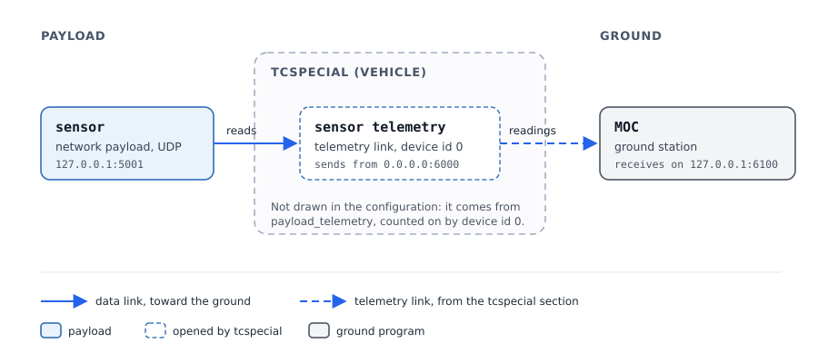
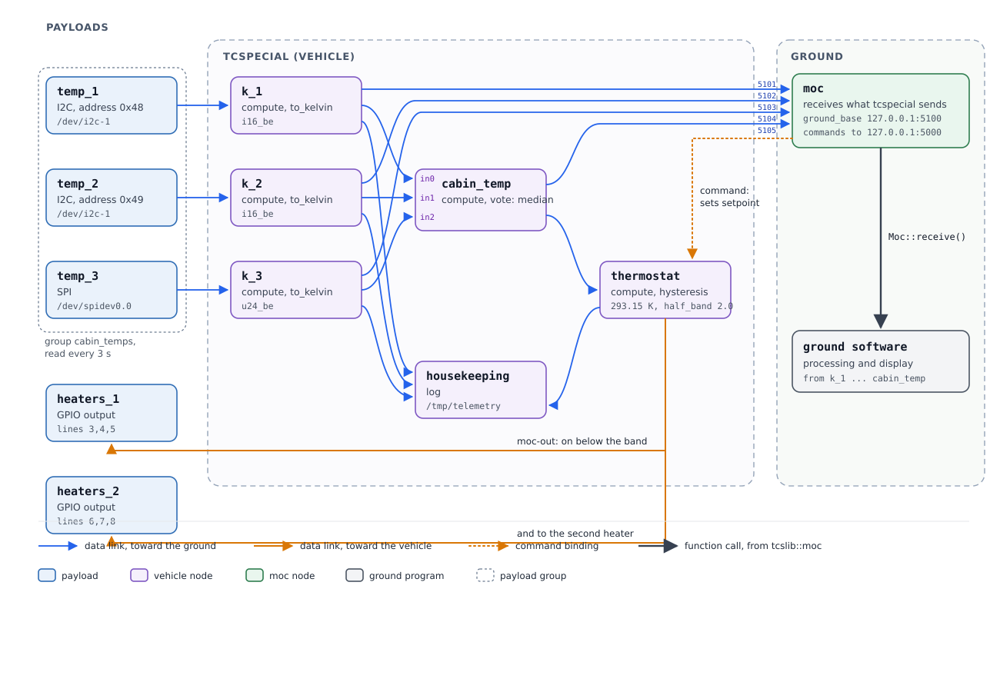
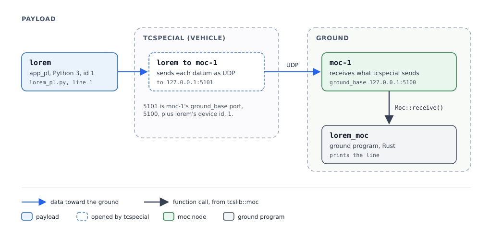
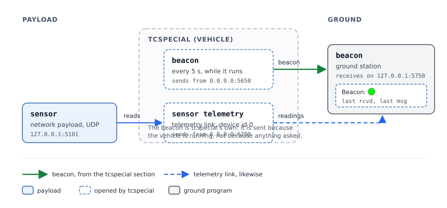

================
TCSpecial Manual
================
.. contents:: Table of Contents
   :depth: 4
   :local:

Introduction
============

.. note::
   TCSpecial has been designed for spacecraft and ground communication with high
   latency communication links. It is just as applicable for other environments,
   such as submersibles, drones, etc. Simply translate "spacecraft" to your
   device type.

TCSpecial is **telemetry and control, special**. It connects the devices aboard
a vehicle -- sensors, actuators, and whatever else arrives on an
I\ :superscript:`2`\ C bus, a SPI link, a serial line, a CAN bus, a set of
discrete lines, a sensor buffer, a channel to another processor core, a socket
or a device file -- to the places their data has to reach. Some of those places
are on the ground: a network link carries telemetry to the mission operations
center, the **MOC**, and commands back. Others are aboard: software that takes
what a device produces, computes something from it, remembers what it needs to
remember, and sends the result on to the original device, to a different
device, or to the MOC. Others again keep what they are given -- a log node
records what reaches it, however many sources send to it, so that what happened
can be reconstructed later rather than only watched as it goes past.

Everything in that picture is a **node**, and what joins one node to another is
a **link**. Neither is written in the software. Both are read from a
configuration file at startup, which is the whole of the architecture: the
program is a set of node types and a machine for moving data along declared
links, and what a particular vehicle does is a file.

What that buys
--------------

The reasons are given in the order TCSpecial ranks them. Where two designs
compete, the earlier item wins, and this list is what an argument about them
should cite.

**Reliability.** The whole of what a vehicle will do is one artifact, and it is
checked before any of it runs. Every link must name nodes that exist; a node
that computes a mean must have its inputs bound, all of them; a set of discrete
lines driven as outputs may not also be read as inputs. ``tcsverify`` performs
those checks on the ground, against the same code that will perform them again
aboard, so a configuration that does not make sense is refused on a desk rather
than discovered in flight. What did fly is not a matter of memory either: the
beacon carries a digest of the configuration the spacecraft read, so the ground
can say which file is running. And a node can be reached only along a link
somebody declared -- there is no ambient path by which data arrives somewhere
nobody intended.

**Ease of use.** One file says what the system does, and it says it in the
words of the person who built the vehicle: a bus and an address, a chip and
three line numbers, an interval, a setpoint. Reading the file tells you what is
connected to what, which is the question actually asked of a telemetry system
at three in the morning. There is no code to read to find out where a sensor's
readings go.

**Maintainability.** A node knows nothing about its neighbours. It is handed
bytes and it produces bytes, and the links are somebody else's business, so a
type of interface is one module with one job and a test of its own. Adding a
type does not touch the machinery that moves data, and changing what a vehicle
does does not touch either.

**Flexibility and extensibility.** A new interface is a new node type; a new
computation is a new function or a program of its own. Neither disturbs the
graph. Rearranging a vehicle -- another sensor, a second heater circuit, the
same readings sent somewhere new -- is an edit to a configuration file, not a
build.

The vocabulary
--------------

These words are used precisely throughout, and some of them replaced older ones
that were used loosely.

node
    Anything the configuration can name and a link can join: a device, a MOC
    link, or a compute element. The generic term.

device
    A node that is real hardware, reached over one of the interfaces. These
    were called *payloads*, which said what they were for rather than what they
    are, and said nothing at all about a device being driven rather than read.

device file
    A node reached as an entry in the filesystem -- ``/dev/urandom``, a named
    pipe, a file a program writes. The word *device* was used for this as well
    as for hardware, which made "device" ambiguous in exactly the places it had
    to be exact.

MOC
    The mission operations center, on the ground. A MOC node is a network link
    carrying telemetry down and commands up. Earlier text calls this the OC.

compute element
    A node that transforms what it is given. It may keep state between
    arrivals, which is what makes a control loop possible: an average over
    time, a comparison against a setpoint, a filter that remembers.

value
    A number on a link: four bytes of a signed count of micro-kelvin, least
    significant byte first. A temperature is a value in kelvins from the
    conversion that made it to the computation, the log and the ground, so
    that comparing two readings is a comparison and not a conversion. The unit
    is finer than any sensor here resolves, so the number is exact rather than
    rounded in practice, and the range it reaches is 2147.483647 K either way
    -- a temperature outside that is refused where the value is made, naming
    the number. Where a value becomes text -- the lines a program reads and
    writes, or the value typed into a command -- it is converted at that
    boundary and nowhere else.

decision
    What a computation sends a device: the text ``1`` or ``0``, one byte. It is
    not a value, a heater's line not being a number, and it is asserted on
    every sample rather than only when it changes.

group
    Devices that share one sampling interval, so that a set of sensors is read
    as close to simultaneously as the hardware allows rather than each on a
    clock of its own.

log node
    A node that records what reaches it rather than passing it on, built on the
    same ``tcslog`` the telemetry log uses. Any number of sources may link into
    one, so a flight's housekeeping is one log with the records interleaved as
    they happened. Its directory and its record format are configured, and
    every source must produce records that format can hold -- which is settled
    when the configuration is loaded, so a log never has to refuse a record in
    flight.

link
    A directed connection from one node to one or more destinations. A link
    with several destinations is how one reading reaches both the ground and an
    on-board computation; it is the "T" such an arrangement is usually drawn
    as. It is written as an attribute of the node it leaves rather than in a
    section of its own, so a node and what leaves it are read and written
    together, and noted on the node it arrives at as well, so that a node's
    entry says it is connected both ways.

terminal
    Where a link is attached: a node's **data source** is where data leaves it
    and a **data sink** is where data arrives. A terminal has a name, and the
    name says whose data it is and whether it arrives or leaves, not what is
    at the other end of it: ``payload-`` is the payload's own data on its way
    to the ground, ``moc-`` is what the ground sends on its way to a payload,
    and ``-in`` arrives where ``-out`` leaves. So every ``-out`` is a data
    source and every ``-in`` a data sink. There are four of them, two per
    stream:

    ``payload-out`` is where a payload's readings leave and ``payload-in`` is
    where they arrive; ``moc-out`` is where what the ground sends leaves and
    ``moc-in`` is where it arrives. A payload has ``moc-in`` and
    ``payload-out``; a MOC link has ``payload-in`` and ``moc-out``; a ``null``
    node has all four. With no vehicle node in the way, a payload's ``payload-out``
    connects to a MOC link's ``payload-in``.

    A link is written as an attribute of the node it leaves, named after the
    data source it leaves by, with one entry per line:

    .. code-block:: yaml

       - name: k_fore
         type: compute
         payload-out:
           - target: moc
           - target: mean_temp
             input: in0

    An entry's ``target`` is the node the line goes to; its ``input`` is which
    of that node's inputs it feeds, or which of its data sinks it arrives at,
    where either has to be said -- ``node`` alone will do wherever the type has
    one data sink, which is every type but ``null``. The short spelling is read
    as well, the destination written as ``node`` or ``node.terminal``, alone or
    in a list: ``payload-out: k_fore``, or ``payload-out: [moc, mean_temp.in0]``.

    A data sink takes one data source; a data source may reach several sinks;
    and a MOC link's sink takes as many as the configuration gives it, every
    payload's telemetry arriving at the ground on its own socket.

    The node at the arriving end says so under the data sink the line arrives
    at: ``payload-in: true``, and ``false`` for a sink nothing arrives at.
    It is a record and not the link -- the link is the attribute on the node it
    leaves, and that is the one the software reads -- so a file may leave these
    out and still be complete. Which node a line comes from is not repeated
    here: that is written on the node it leaves, and at a sink several lines
    arrive at, one name would read as the only one. A flag that disagrees with
    the links is refused where the file is read. tcsgui writes them.

    Each terminal may be linked to one other: a ``payload-out`` to a
    ``payload-in``, a ``payload-in`` to a ``payload-out``, a ``moc-out`` to a
    ``moc-in``, a ``moc-in`` to a ``moc-out``. Anything else would carry
    one stream into the other. In tcsgui the terminals are drawn as small boxes
    in a node's corners, each with an arrow saying which way its data goes: the
    payload's own data along the top pointing right, towards the ground, and
    what the ground sends along the bottom pointing left, towards the
    payloads -- the canvas having the payloads on the left, the vehicle in the
    middle and the MOC on the right. A link is made by dragging from one of
    them onto the node the line is to reach: anywhere on that node will do,
    and the line is drawn to whichever of its terminals the stream arrives at.
    A node with no terminal of that stream takes nothing, and a MOC link has
    none on its right at all: the payload data it receives arrives at the
    ``payload-in`` in its upper left, and what it sends leaves by the
    ``moc-out`` in its lower left.

``null`` node
    A vehicle node that carries both streams through and does nothing to what
    passes. It is the one type with all four terminals.

command binding
    A statement that a named command from the MOC sets a named attribute of a
    node. It is how a setpoint reaches a control loop in flight.

.. note::
   **What runs today.** The architecture above is what TCSpecial is being
   built into, and this manual describes it as the thing to configure against.
   What is in flight-ready shape at the time of writing is narrower: a node may
   be a device or a MOC link, and the links the software builds are the pair
   that joins one device to one MOC link in each direction. Compute elements,
   links with several destinations, groups with a shared interval, discrete
   lines driven as outputs are specified in ``design.rst`` and are being
   implemented in that order. Command bindings run: the ground sets a bound
   attribute of a node with a ``SET_NODE``. Where this manual
   describes something not yet running it says so in a note like this one, and
   the rule this project has always followed applies: the description stands,
   and a note records what is so today.

Configuration File Formats
==========================
A configuration file may be written in YAML or XML. Both describe the same
settings and are read into the same values, so the choice is one of local
preference and tooling rather than of capability.

The format is taken from the file's extension:

.. code-block:: text

   .yaml, .yml     YAML
   .xml            XML
   anything else   refused

A file whose extension is none of those is refused, naming the file and what a
configuration file is called. JSON was read as well, and was what a file with
no extension or an unfamiliar one was assumed to be, which made a misspelled
extension not an error but a file parsed as the wrong language. Nothing was
written in it that was not also written in YAML.

(The command link carries JSON between the ground and the spacecraft. That is
not a configuration file and is unaffected.)

Which Files There Are
=====================
Two configuration files, and neither of them has a name of its own. Any name
will do so long as it ends in ``.yaml`` or ``.xml``, which is what says how to
read it; the names used throughout this manual are the shipped examples' and
are suggestions, nothing more.

the configuration
    Everything tcspecial is configured with. Its ``tcspecial`` section is the
    command interpreter's own settings -- the ports it takes commands on,
    where beacons go and how often, and where the telemetry log goes -- and
    its ``moc``, ``vehicle`` and ``payloads`` sections say which nodes there
    are, what each of them does and how the lines between them run. Named on
    the command line of every program that reads it, which is tcspecial,
    tcsmoc, tcssim and tcsverify.

the simulator configuration file
    How a simulated payload behaves: how often it produces a packet, how it
    divides one into segments, and what thermal mass it is attached to if it
    is. Read only by tcssim, which takes it from ``PAYLOAD_SIM_YAML``, and by
    tcsmoc, which shows it and acts on none of it. There is nothing in it
    about the payloads themselves.

tcspecial once read a configuration of its own as well, named by
``TCSPECIAL_CONFIG_PATH``, which said where commands are taken, where beacons
go and where the log is written. Every configuration must state those in its ``tcspecial`` section, so
there is nothing left for a second file to answer and no second file to
disagree with the one being flown.

The Payload Configuration
=========================
The payloads are a section of the tcspecial configuration file: a
description, the ``tcspecial`` section, an optional section of groups, and the
data handlers themselves. A handler takes every attribute it does not state
from the group it names, so a group holds what several handlers share.

.. code-block:: text

   description    free text

   tcspecial                       optional
     ...          the command interpreter's own settings, of which
                  beacon.send and beacon.recv are read

   payload_groups                  optional
     name         the name payloads refer to
     ...          any of the attributes below

   payloads
     name         the handler's name, which commands address it by and the
                  panels show
     group        the group to take unstated attributes from, if any
     ...          any of the attributes below

The shipped examples each carry a ``tcspecial`` section, first in the file, so
one file says what the set is and where its command interpreter belongs.
``beacon.send`` and ``beacon.recv`` are read from it, since where a set's
beacons go is the set's own business; the rest is not read yet, tcspecial being placed by the
file ``TCSPECIAL_CONFIG_PATH`` names. It is all checked when the file is
loaded -- a section that could never place a command interpreter is refused
where it is read.

What follows is the attributes every payload has, whatever it is, and then one
section per type of payload for the attributes only that type has. A payload
states its type in ``type`` and is then held to that type's attributes and no
others: a device stating a ``payload_interface``, or a network payload stating
a ``path``, is refused.

About the experimental interfaces
---------------------------------
Some of what follows is marked **experimental, not yet supported**. Each of
those is written, parses, reaches a handler and has tests; none has been run
against the hardware it describes, and none is shipped in an example. What
is marked that way is: RS-485 on a serial line, and the ``can``, ``iio``,
``rpmsg``, ``gpio`` and ``hdlc`` types of payload.

One of those is further out than the others. Every experimental type but
``hdlc`` has something in the kernel to be run against -- a virtual CAN bus, an
I\ :superscript:`2`\ C stub, a simulated GPIO chip, a dummy sensor -- so each
has been exercised against something. A synchronous line has none, and needs a
card; what is written for it is held to the kernel's structures by tests and to
nothing else.

Read them as a statement of what the configuration will be rather than as a
feature to rely on. They may change in ways the five supported types --
``network``, ``device-file``, ``serial``, ``i2c`` and ``spi`` -- will not.

Attributes Every Payload Has
----------------------------
.. code-block:: text

   name           the handler's name, which commands address it by and the
                  panels show
   group          the group to take unstated attributes from, if any.
                  Optional, though a payload that is asked needs one: the
                  group is where the rate it is asked at lives
   type           network | device | serial | i2c | spi, or one of the
                  experimental can | iio | rpmsg | gpio
   packet_size    bytes in one packet

How a payload is driven
^^^^^^^^^^^^^^^^^^^^^^^

**Exactly one of these two, and never both.** Which one a payload states is
what says how it is driven; there is no other attribute that says it, and
nothing decides it for a file that says neither.

.. code-block:: text

   trigger             what to send to make it answer: one byte in
                       hexadecimal, or text as a quoted C string. The payload
                       is asked, and how often it is asked is the interval of
                       the payload group it is in

   packet_interval     how long between packets, as a length of time. The
                       payload sends of its own accord, at that rate, and
                       nothing asks it

A payload with a ``trigger`` is asked, so the trigger is the question and the
group is the clock: a payload that is asked and is in no group has no rate,
and is refused saying so -- a trigger with nothing to send it at is a payload
nothing would ever ask.

A payload with a ``packet_interval`` sends on its own, so there is nothing
to send it and nothing to keep time for it. A simulated one is driven at the
rate its simulator configuration gives it, which is how fast a stand-in
produces data rather than how fast the payload would.

``name`` belongs to a handler and never to a group: it is what tells one
handler of a group from another, and what every command about a handler names
it by. There is no number beside it -- a handler used to state a ``dh_id`` as
well, which was a second identity for one payload to keep consistent by hand.
An OC address and an OC port are given together or not at all, and a handler
needs them before it can be started.

The two types of payload
------------------------
A payload either sends of its own accord or answers a request, and which it is
decides where its timing is written down.

**periodic** -- the payload sends and tcspecial reads. It states no
``trigger`` and no interval of its own. Nothing here says when it sends: how
fast a simulated one produces data is a property of the simulation, so that
figure is in the simulator configuration.

**triggered** -- tcspecial sends a request and the payload answers. It states
the ``trigger`` to send, because tcspecial does the sending and what to send
comes from the payload's interface document, and how often the trigger goes
out is the ``packet_interval`` of the payload group it is in -- so a
triggered payload in no group is refused. Its entry in the simulator
configuration states no interval at all, packet or segment: such a payload
sends when it is asked, so a rate there would govern nothing.

So each type states its timing in one place and the other type's place is
empty, which is what lets a file be read without deciding anything: the rate a
payload is asked at is its group's ``packet_interval``, and the rate a
payload sends at is the simulator configuration's ``packet_interval``. A
configuration spells the group's rate ``interval``; every one of them is a
length of time, as `Lengths of Time`_ says.

In a graph, a ``trigger`` is also what allows anything to be sent to a payload
at all. What is written to a payload that is read is the question it answers,
and the trigger is the bytes of that question -- so a payload that states none
is one the configuration describes as only read, and a link delivering into it
is refused, naming both ends. The usual cause is a link drawn to the wrong
node, which nothing else in a configuration would reveal. A payload that is
written and never read is a different thing and takes no trigger: a heater, a
valve or a latch is driven rather than asked, and a trigger on one would be
bytes written before a read that never happens.

**The trigger itself** is bytes, not text, since an interface document asks
for what it asks for. One byte is written as one or two hexadecimal digits, in
either case -- ``5`` and ``05`` are the same byte::

   trigger: 55
   trigger: 0D
   trigger: d

There is no ``x`` anywhere in it, ``0x`` included. A trigger written without
quotes is hexadecimal and nothing else, so a prefix saying "this is
hexadecimal" would be saying it for a notation that has no alternative. A file
that writes one is told what to write instead rather than having ``0x55`` read
as something.

A trigger of **more than one byte** is text, below: there is one notation for
several bytes, and the quote at the front of it says which notation is being
read before anything is counted. ``55AA`` was two bytes and ``55 AA`` was the
same two written another way, which made a value's length decide how many
bytes it meant; ``'"\x55\xAA"'`` says it once.

A trigger that is text is written as a string in C's notation, **quotes and
all**, which is what its escapes need -- ``\\`` ``\"`` ``\'`` ``\n`` ``\r``
``\t`` ``\0`` ``\a`` ``\b`` ``\f`` ``\v`` and ``\xNN``::

   trigger: '"READ\r"'
   trigger: '"\x02ARM\x03"'

Which of the two a value is in follows from its first character and nothing
else: a quote opens a C string, and anything else is one byte in hexadecimal.
``52`` is a plausible byte and a plausible pair of digits, so something has to
say which, and the quote is it.

The quotes are therefore part of the **value** rather than part of the way the
file is written, which is why a YAML trigger of text is written inside the
format's own quotes -- ``'"READ\r"'`` -- and an XML one as
``<trigger>&quot;READ\r&quot;</trigger>``. A value whose quotes belong to the
format alone, such as ``"55"``, arrives here as ``55`` and is read as the one
byte it is.

An escape C does not have is refused rather than passed through, a string that
opens and does not close is refused, and a trigger of no bytes at all is
refused: a payload that answers requests has to be asked something. Writing
the escapes yourself is also how an XML configuration states a trigger that a
YAML one states with the format's own escapes.

How a Payload's Data Is Read
----------------------------

This is how a configuration -- a graph of nodes -- gets data out of its
payloads. Three things decide it: whether the payload sends on its own or has
to be asked, whether it is in a payload group, and, for one that is asked, how
long it takes to answer.

**Three ways data arrives.**

*Asked.* The payload answers when it is sent something. The configuration
states that something as the payload's ``trigger``, and tcspecial sends it.
A sensor behind a command protocol -- ``READ\r`` on a serial line, a register
number on an I\ :superscript:`2`\ C bus -- is asked.

*Read without asking.* The payload produces data by itself: datagrams on a
socket, bytes on a serial line, frames on a CAN bus, samples in an IIO buffer,
edges on a GPIO line. It states no trigger, and tcspecial takes what has
arrived. On I\ :superscript:`2`\ C and SPI, where nothing moves unless the bus
is clocked, a read is itself the bus transaction, so a payload there with no
trigger is read rather than asked.

Two types cannot be asked at all, and a ``trigger`` on one of them is refused
with the configuration: a set of discrete lines is read or driven and not
both, and an IIO device's sample buffer is read and never written -- what such
a device is configured with is in sysfs, not in the character device. Refused
on the ground rather than at the first read, because a vehicle that came up
and asked a question it cannot ask would have a sensor reporting nothing and
nothing saying why.

A ``read_size`` larger than one read of the interface carries is refused the
same way, naming both numbers. A CAN frame carries eight bytes, or sixty-four
on an FD bus, and an rpmsg message carries what the channel's
``max_message_bytes`` says -- 496 unless the file says otherwise. The rest is
refused rather than split over two frames: a reading assembled out of two
frames half arrives when one of them is lost, and nothing in the file says how
to put the halves back together.

*A program.* An ``app_pl`` is a program that writes its readings when it
chooses and is never asked; an ``app_all_pl`` answers whatever arrives on its
MOC interface, so the data that arrives is the question. Neither states a
trigger.

**When tcspecial reads.** The main loop works in passes.

* A payload **in a group** is read when the group is due, every ``interval``
  of the group, and every payload in the group is read in the same pass, one
  after another, so readings that will be compared are taken as close
  together as the hardware allows. Every group is due as the vehicle starts.
  The next time is counted from when the group was due, not from when the
  reads finished, so a group does not drift.
* A payload **in no group** is polled, and may state how often:

  * ``trigger_interval``, for one that is asked, is a rate, counted from when
    it was due as a group's interval is, so it does not drift. On a part that
    originates nothing -- I\ :superscript:`2`\ C, SPI, a device file -- it
    times the whole exchange: ask, wait any ``read_delay``, read. On a part
    that sends -- a socket, a line, a bus of peers -- it times the trigger
    alone, and the part is read on every pass, its answers being taken as
    they arrive.
  * ``poll_interval``, for one that is not asked, is a floor rather than a
    rate: the least time between one read and the next, counted from the
    read. Only a part that originates nothing states one. A part that sends
    and is not asked is read as its data arrives, and a ``poll_interval`` on
    one is refused: nothing aboard decides when its data exists.
  * One that states neither is read on every pass, and a pass is then made at
    least every 20 ms.
* Between passes the loop waits until the next group or payload is due, so a
  configuration in which every payload has a group or a rate wakes only when
  something is.
* A read never waits. tcspecial asks whether there is anything to read first,
  and a payload with nothing is a read of no bytes -- no reading, and nothing
  delivered.

**What a trigger does.** A payload that states a ``trigger`` is sent it every
time it is read, in one of two orders:

* **No** ``read_delay``: read, then ask. A pass takes whatever the last ask
  produced and sends the trigger again, so each reading answers the
  *previous* pass's question. The first pass reads before anything has been
  asked.
* **With** ``read_delay``: ask, wait, then read. A pass sends the trigger,
  waits the delay -- what the part takes to answer, such as a conversion time
  -- and reads the answer to the question it just asked. The whole pass waits
  with it, so keep the delay as short as the part allows.

**The attributes.**

.. list-table:: What decides when a payload is read
   :header-rows: 1
   :widths: 20 45 35

   * - Attribute
     - Means
     - Allowed
   * - ``group``
     - Read when the group is due, every ``interval`` of the group
     - Any payload except a program
   * - ``trigger``
     - The bytes that ask the payload to answer
     - A payload that is read, other than GPIO and a program
   * - ``read_delay``
     - How long to wait between asking and reading
     - Only with ``trigger``
   * - ``trigger_interval``
     - How often a payload in no group is asked: a rate
     - Only with ``trigger``, and only in no group
   * - ``poll_interval``
     - The least time between reads of a payload nothing asks: a floor
     - Only without ``trigger``, only in no group, and only on a part that originates nothing: I\ :superscript:`2`\ C, SPI or a device file
   * - ``state_interval``
     - How often a GPIO input's levels are reported, beside its edges
     - GPIO inputs

A payload in a group states neither ``trigger_interval`` nor
``poll_interval`` -- the group's ``interval`` is its rate -- and the two are
never stated together. A payload that is read and has a link *into* it
must state a ``trigger``: what is written to it is the question it answers.
A payload that is only written -- a heater, a valve -- states none.

A payload in no group that states neither is read on every pass: an asked
one is asked on every pass, and an I\ :superscript:`2`\ C or SPI one is a bus
transaction on every pass. Give such a payload a group or a rate.

**The payload types compared.**

.. list-table:: How each type of payload's data reaches tcspecial
   :header-rows: 1
   :widths: 18 32 22 28

   * - Type
     - Sends without being asked
     - Can be asked
     - One read takes
   * - ``network`` (UDP)
     - Yes: datagrams
     - Yes: a datagram
     - One datagram
   * - ``network`` (TCP, Unix)
     - Yes: bytes
     - Yes: bytes
     - What has arrived
   * - ``serial``
     - Yes: bytes on the line
     - Yes: bytes
     - What has arrived, up to where a read of a line ends
   * - ``hdlc``
     - Yes: frames
     - Yes: a frame
     - One frame
   * - ``can``
     - Yes: frames
     - Yes: a frame
     - One frame
   * - ``rpmsg``
     - Yes: messages from the other core
     - Yes: a message
     - One message
   * - ``iio``
     - Yes: samples, at the device's own sampling rate
     - No: the buffer is read; what the device is configured with is in sysfs
     - What is in the buffer
   * - ``device-file``
     - What the file or device gives
     - Yes: bytes
     - What the file gives
   * - ``i2c``
     - No: the bus is clocked by tcspecial
     - Yes: a write, often a register number
     - ``read_size`` bytes, one bus transaction
   * - ``spi``
     - No: the bus is clocked by tcspecial
     - Yes: bytes clocked out
     - ``read_size`` bytes, one transfer
   * - ``gpio``
     - Yes: edges on input lines, and levels every ``state_interval``
     - No
     - One event per edge
   * - ``app_pl``
     - Yes: whatever the program writes
     - No
     - One packet
   * - ``app_all_pl``
     - When MOC data arrives
     - By the data that arrives
     - One packet

.. list-table:: Which way to read a payload
   :header-rows: 1
   :widths: 40 60

   * - The payload
     - Configure it
   * - Sends on its own, as fast as it likes
     - No trigger, no group: read on every pass, which takes whatever has arrived
   * - Sends on its own; its readings are compared with others'
     - No trigger, in a group with the others: read together when the group is due
   * - Answers a request, quickly
     - ``trigger``, in a group: asked each interval, each reading answering the last interval's ask
   * - Answers a request, at a rate of its own
     - ``trigger`` and ``trigger_interval``, in no group: asked every ``trigger_interval``, and, on a part that sends, its answers taken on every pass
   * - A bus register or a device file, read at a rate of its own
     - ``poll_interval``, in no group: read at most every ``poll_interval``
   * - Answers a request after a known delay
     - ``trigger`` and ``read_delay``, in a group: asked, waited for and read in one pass
   * - A bus sensor that holds its last value (I\ :superscript:`2`\ C, SPI)
     - No trigger, in a group: each read is a bus transaction that returns the value
   * - Only written to -- a heater, a valve
     - No trigger, no group: it is driven, never read
   * - A program
     - ``app_pl`` to send of its own accord, ``app_all_pl`` to answer what the MOC sends

Lengths of Time
---------------

Every length of time a configuration states is a number, whitespace, and a
unit:

.. table:: The units
   :widths: auto

   =======  ============  ===============================
   Unit     What it is    Written
   =======  ============  ===============================
   ``us``   microseconds  ``250 us``
   ``ms``   milliseconds  ``500 ms``
   ``s``    seconds       ``3 s``, ``1.5 s``
   ``min``  minutes       ``15 min``
   ``h``    hours         ``6 h``
   ``d``    days          ``1 d``, ``0.5 d``
   ``w``    weeks         ``1 w``
   =======  ============  ===============================

The whitespace is required, and one or more characters of it will do: a tab
reads as a space does, and ``500  ms`` is ``500 ms``. It is what makes the two
halves two things rather than one string to be taken apart -- a value is read
by splitting it, not by knowing every unit there is and looking for one at the
end -- and it leaves the number free to grow a notation of its own without the
unit having to be told from the digits.

The number is decimal, whole or a fraction, and underscores among the digits
mean nothing: ``1_000 ms``, ``1.5 s`` and ``1500 ms`` are one length of time
written three ways. What is kept is whole microseconds, rounded to the
nearest. There is no hexadecimal and none is planned, and no sign or
exponent.

Minutes are ``min`` and never ``m``: a single ``m`` is one letter from ``ms``
and a thousand-fold apart from it, and a slip of a finger would have made a
reading taken sixty thousand times less often with nothing in the file to say
so. ``m`` is refused and tells you which of the two to write. So are a month
and a year -- ``mon``, ``mo``, ``month``, ``y``, ``yr``, ``year`` -- which are
not lengths of time at all: a month needs a calendar and a timezone that
nothing aboard carries, and a span of about that size is written exactly, as
``30 d``. ``µs`` is refused in favour of ``us``, this being a grammar of ASCII.

Nought is refused in every unit, and so is a fraction that rounds to it: a
schedule asking to be run every nought seconds is asking to be run again
before it has finished. Where a configuration does mean "as fast as that
can be done" it says so in a word: a simulated payload's ``packet_interval``
and ``segment_interval`` take ``continuous``, and nought is refused there as
everywhere else. A word rather than ``0 s`` because nought is the one value a
file arrives at by accident -- an interval worked out to nothing, a field
cleared to a zero -- and the fastest thing this software does is not something
to ask for by accident.

A **timeout** takes all of that and one word besides -- ``none``, a read that
does not time out at all -- and that word is the whole of the difference
between the two. Which an attribute takes is written down beside the
attribute, in the node description tree, as its ``kind``: ``interval`` or
``timeout``.

.. code-block:: yaml

   payload_groups:
     - name: every_half_second
       packet_interval: "500 ms"

   payloads:
     # Sends on its own: nothing here about timing.
     - name: auto-send
       type: network
       protocol: tcp
       payload_interface: localhost:5000
       packet_size: 12

     # Answers a request: the trigger is the question, and the group it is in
     # is how often the question is asked.
     - name: triggered-send
       type: network
       protocol: tcp
       payload_interface: localhost:5001
       packet_size: 12
       group: every_half_second
       trigger: '"READ\r"'      # five bytes, so a C string

A file that states both is refused rather than run: a payload carrying a
trigger and an interval of its own has not said whether it answers or sends,
and either guess would operate it in a way nobody asked for. So is a payload
with a trigger and no group -- a question nothing sends is a payload nothing
would ever ask.

A datagram payload -- ``udp`` or ``unix_dgram`` -- cannot be triggered. Its
handler learns where to send from the payload's first packet, so there is
nowhere to send a request until the payload has spoken, which a triggered
payload does not do.

Tcspecial counts the triggers it sends apart from the data it carries, which
``QUERY_NODE`` reports: a node whose asks climb while nothing arrives is
one whose payload is not answering. The triggers that would not go are counted
apart again, since a payload that has gone away and a handler that has stopped
asking are different things -- and a handler goes on asking through either.

A Network Payload
-----------------
Keyword ``type: network``. A socket, which the transport decides the shape of.

.. code-block:: text

   protocol       tcp | udp | unix_stream | unix_dgram
   payload_interface
                  where this payload is reached: the host and the port with a
                  colon between them, as localhost:5000 -- or the path of a
                  Unix-domain socket, which has no port and so is written
                  alone

Which end waits and which reaches out follows from the transport, and so does
whether a handler can trigger the payload at all: a stream is connected, so
the handler reaches out and may ask the payload for data, while a datagram
handler waits to be spoken to and learns where its payload is from the first
packet that arrives.

A Device File Payload
---------------------
Keyword ``type: device-file``. A file in the filesystem, opened and read as
the data comes.

.. code-block:: text

   path           the device the handler opens

Nothing else: a plain device has no terms to be set and no address to be
reached at. A device cannot be triggered -- tcspecial opens it and reads it,
and there is nothing to write a request to.

Three other types are reached through a device file too and are not devices in
this sense: a serial line, a bus and a SPI peripheral each have terms of their
own, which is why each has a type of its own below.

A CAN Payload
-------------
Keyword ``type: can``. **Experimental, not yet supported.** A payload on a CAN
bus, which is not a device file at all: a CAN controller is a network
interface, and a payload on it is addressed by the identifier its frames carry.

.. code-block:: text

   interface      the controller: can0, or vcan0 for the kernel's virtual bus
   can_id         the identifier this payload's frames carry, decimal or 0x
   can_fd         true | false, default false -- CAN FD frames rather than
                  classic CAN, which is also what lets a packet be longer
                  than eight bytes
   loopback       true | false, default true -- whether the controller gives
                  frames to other sockets on this host, which is what lets
                  tcssim stand in for the payload

Both halves of where it is are required. Several payloads commonly share one
bus and differ only in the identifier, which is the arrangement an
I\ :superscript:`2`\ C payload has, so two payloads may name one ``interface``
and may not share a ``can_id``: two handlers filtering on one identifier would
each read the other's frames.

A frame is its own length and carries eight bytes, or sixty-four as CAN FD,
and CAN does not fragment -- so a ``packet_size`` larger than a frame is
refused where the file is read rather than discovered a frame at a time. The
segment settings still apply: a packet may go as several frames, each a
segment.

A CAN payload may be triggered, unlike a payload on an
I\ :superscript:`2`\ C bus. The handler sends its trigger with the same
identifier, and the socket does not receive its own frames, so a handler never
reads back the trigger it just sent.

The simulator joins the same bus as another member of it, so both ends are
real -- the only experimental type whose stand-in is as faithful as a socket.
What it cannot do is make the bus: a virtual one needs

.. code-block:: console

   $ sudo ip link add dev vcan0 type vcan
   $ sudo ip link set dev vcan0 up

and tcssim says exactly that if the interface is not there, as it does for the
I\ :superscript:`2`\ C stub module. ``bin/mkvcan`` runs both, after removing any
virtual bus left from a previous run, so

.. code-block:: console

   $ make mkvcan

is the shorter way to the same place. Either needs root -- the script asks for
it through sudo -- and neither survives a reboot, so the bus is something a
session makes again. ``make rmvcan`` removes the buses and leaves the driver
loaded, which is both the undoing of ``make mkvcan`` and the first thing it
does itself.

The second command is the one that gets forgotten, and a bus made without it
is worse than no bus at all: a socket binds to an interface that is down
without complaint, and the send then fails with ``ENETDOWN``. So the tests
take a bus that is down as no bus and skip, rather than fail in a way that
reads as a bug in the endpoint. Note that a virtual bus has no carrier and so
reports its operational state as ``UNKNOWN`` whether it is up or not, the way
the loopback interface does -- the ``UP`` to look for is the flag ``ip link``
prints in the angle brackets:

.. code-block:: console

   $ ip -brief link show type vcan
   vcan0            UNKNOWN        <NOARP,UP,LOWER_UP>

A GPIO Payload
--------------
Keyword ``type: gpio``. **Experimental, not yet supported.** A set of discrete
lines -- a deployment switch, an arming line, a payload's own "alive" line --
watched for changes, or a set of circuits driven: a heater, a valve, a latch.

.. code-block:: text

   path           the chip: /dev/gpiochip0
   lines          the offsets, separated by commas or spaces, decimal
                  or 0x. Required
   direction      input | output, default input
   edge           rising | falling | both | none, default both. Inputs only
   bias           none | pull_up | pull_down, default none. Inputs only
   debounce       how long a line must be steady before a change counts,
                  as a length of time: 50 us. Default none, applied by the
                  kernel, inputs only
   state_interval how often to report what the lines are. Default none,
                  inputs only

**How lines are watched.** Two different questions, and a set of lines may ask
either or both:

.. code-block:: text

   edge             when a line changes, say so
   state_interval   every so often, say what the lines are

So there are four ways to write it, and each is what it looks like:

.. code-block:: text

   lines: 3, 4                            changes, both edges (the default)
   lines: 3, 4   edge: rising             changes, one edge
   lines: 3, 4   state_interval: 5 s      what they are, every five seconds
   lines: 3, 4   state_interval: 5 s      both: changes as they happen, and
                                          what they are every five seconds

   lines: 3, 4   edge: none               refused: nothing would be sent

Edges are what a record is made of, so they are the default and a file that
says nothing about watching gets them. The report exists for two things edges
cannot do: a line that has not changed since the vehicle started tells the
ground nothing about itself, and the kernel's queue of events is finite, so a
burst can leave the ground holding a value that is wrong. A report every so
often ends both: after one interval at most, what the ground has is what the
lines are.

Asking for neither takes saying ``edge: none`` with no ``state_interval``, and
that is refused -- lines watched for no changes and reported at no interval
would send nothing at all.

The direction is not something a set of lines can be both of: a line
requested as an input is one the kernel will not write, and one requested as
an output produces no edges to read. So it is stated, and stating it is what
lets a file be refused for driving something it said it would watch. The
watching terms are refused outright on an output rather than ignored: an
edge, a debounce or a report of a line nothing reads is a file saying
something it does not mean, and the usual cause is a set of lines whose
direction was changed and whose other words were left as they were.

This is the one type whose payload data is made rather than carried. A line
has no bytes: it is high or low, and what the ground wants is when it changed.
So each change becomes a record of sixteen bytes -- eight of time in
microseconds since the epoch, four of line offset, four of the value it became
-- and a ``packet_size`` must be a whole number of those, a packet that was
part of a record being a reading nobody could use.

A report makes the same record, one per line: this line, this value, this
time. The ground reads the two alike, which is the point of their being the
same record; the only difference is that a change carries the time of the
change and a report carries the time it was looked at.

Two payloads may watch one chip and may not watch one line: the kernel gives a
line to one request at a time, so the second handler's start would fail.

Driven lines are driven together, to the same state. What arrives is a
**decision** -- the text ``1`` to assert and ``0`` to unassert, which is what
the hysteresis compute element emits -- and anything else is refused rather
than taken for one of them: the thing on the other end is a
heater, and a datum that cannot be read is not guessed at. The lines are a
set and not a pattern because there is nothing in the file to say which line
is which, and because three heater circuits switched one at a time would be
three thermal states of a vehicle on the way to the one that was asked for.
The kernel counts them by their place in the request, so lines ``3,4,5``
named in that order are the low three bits of the call that drives them.

The same value arrives over and over, and that is deliberate. A thermostat
asserts its decision on every sample rather than only when it changes, so the
lines are held at what the vehicle last decided and a decision that went
missing is corrected on the next sample instead of standing until the
temperature crosses the other threshold. Only the devices are told again: a
log and a ground link are sent the transitions, so a reader still sees when
the heaters actually switched.

A GPIO payload cannot be triggered, and a read and a write are not both open
to it: an input refuses a write, because driving one would be commanding a
payload rather than reading it, and an output refuses a read, because
reporting a line this node itself drove would be reporting its own voice.
Each refusal says which direction does allow it.

The simulator moves lines through the kernel's ``gpio-sim``, which it finds
rather than makes: loading the module and making a chip need root, and tcssim
says so if there is none. ``bin/mkgpio`` makes one and prints the node it
became, which is numbered as chips appear and so has to be read off the run
rather than assumed; ``bin/rmgpio`` takes it away again. The packet and segment sizes mean nothing to a
simulated set of discretes, and neither do the faults -- there are no bytes to
drop or corrupt; what it does is pull each of its lines the other way every
packet interval.

An HDLC Payload
---------------
Keyword ``type: hdlc``. **Experimental, not yet supported.** A synchronous
serial line -- bits carried on a clock, framed as HDLC -- which Linux drives as
a network interface rather than as a device file.

.. code-block:: text

   interface      the interface the card presents: hdlc0
   standard       v35 | v24 | x21 | x21d -- how the port is wired. Required
   clock_type     external | internal | tx_internal | tx_from_rx -- whose
                  clock the bits are on. Required
   clock_rate     bits per second. Required where this end generates the
                  clock, and refused where the far end does
   encoding       nrz | nrzi | fm_mark | fm_space | manchester, default nrz
   frame_check    none | crc16_pr0 | crc16_pr1 | crc16_pr0_ccitt |
                  crc16_pr1_ccitt | crc32_pr0_ccitt | crc32_pr1_ccitt,
                  default none
   loopback       true | false, default false -- for proving a card with no
                  line attached

An ``interface`` and not a ``path``, which is the first thing to know about
this type. Linux calls the mechanism **generic HDLC**: a card presents a
network interface, the terms of the line are set with one ioctl on it, and the
data is frames on that interface. The attributes above are the kernel's own
two structures, from ``linux/hdlc/ioctl.h``: ``standard``, ``clock_type``,
``clock_rate`` and ``loopback`` are the port's wiring, and ``encoding`` and
``frame_check`` are what the bits mean once the port is clocked. The kernel
calls that last one a line's ``parity``; it is a frame check, and this calls
it one.

The rate belongs to whoever generates the clock. With ``internal`` or
``tx_internal`` this end drives it, so ``clock_rate`` is required; with
``external`` or ``tx_from_rx`` the far end drives it, and stating a rate is
refused -- a number this end cannot set is a number it has no business saying.

Both halves are read back after they are set, and a line that reports
something else is refused. A card may take the call and keep less than it was
given, and a line whose frame check is not the one the configuration asked for
is a line checking nothing while the file says it checks every frame.

A frame is its own length, so there is no stream rule: a read hands over one
frame's payload and a write puts one payload into one frame, as on a CAN bus.
An HDLC payload may be triggered, both ends being peers on the line.

One interface is one payload. A raw HDLC frame carries no address, so there is
nothing to tell two payloads on one line apart -- which is what makes this
different from a CAN interface, where the identifier does exactly that.

Bringing the interface up is the platform's business, as it is for a CAN
controller: ``ip link set dev hdlc0 up``, from whatever starts the vehicle.

**There is no stand-in.** Every other experimental type has something in the
kernel to be run against -- ``vcan`` for a CAN bus, ``i2c-stub`` for a bus
device, ``gpio-sim`` for discrete lines, ``iio_dummy`` for a sensor -- and
generic HDLC has none. This type needs a card: a ``wanxl``, a ``pci200syn``, a
``pc300too`` or a FarSync. tcssim says so rather than pretending, and refuses
a set with one of these in it.

An rpmsg Payload
----------------
Keyword ``type: rpmsg``. **Experimental, not yet supported.** Software on
another core of the same package -- a real-time core beside the Linux one --
reached over an rpmsg channel, which Linux presents as a character device
carrying whole messages both ways.

.. code-block:: text

   path              the channel: /dev/rpmsg0
   service           the name the remote announced the channel with. Required
   max_message_bytes the greatest a message may be, where the transport is
                     not the usual one. Default 496, which is what 512-byte
                     buffers leave after the rpmsg header

The service name is required because a node's number is not an identity: it
is assigned as channels announce themselves, so ``/dev/rpmsg0`` is whichever
came first and may be another core's channel after a change in boot order.
tcspecial reads ``/sys/class/rpmsg/<node>/name`` and refuses a node that is
not the channel the file asked for. Where the kernel publishes no name --
and a simulated channel has none to publish -- nothing is refused.

A read hands over one whole message, so there is no stream rule. rpmsg does
not fragment, so a ``packet_size`` larger than one message is refused where
the file is read.

An rpmsg payload may be triggered: the channel carries both directions, so the
handler writes a request and the remote answers.

The simulator stands in for the channel with a pseudo-terminal. What a pty is
not is a message boundary -- the rpmsg driver hands over one message per read
where a pty hands over whatever bytes are there -- which shows only where a
payload writes faster than the handler reads.

An IIO Payload
--------------
Keyword ``type: iio``. **Experimental, not yet supported.** A sensor's buffered
samples, read from a character device: what a thermistor, an accelerometer or
an ADC looks like on Linux.

.. code-block:: text

   path           the buffer: /dev/iio:device0

That is the whole of it: an IIO payload has no terms of its own. Which
channels are enabled and how fast the device samples are set through ``sysfs``
by whoever brought the sensor up -- a handler that wrote there would be
reconfiguring a sensor other programs may be reading -- so a payload says
neither. It said both once, as ``channels`` and ``sample_rate``, recorded and
never applied; a file that still states one is refused by name and told why.

A read hands over whole sample sets, as many as are ready, so there is no
stream rule: nothing has to say where a read ends.

An IIO payload cannot be triggered. A buffer is a stream out of the sensor --
there is nothing on that descriptor to write -- so a file asking for one is
refused, as a datagram payload asking for one is.

The simulator stands in for the buffer with a pseudo-terminal, as it does for
a serial line: the path the handler was told to open leads to it while the
payload runs. What it does not stand in for is the ``sysfs`` half, the
channels and the buffer -- which the handler does not touch either.

A pty carries the bytes but is not a buffer, and the kernel offers something
that is: ``iio_dummy``, a sensor with no sensor in it, whose buffer a software
trigger fills on a timer. There is no simulator side to that one -- a buffer
is a stream out of the device and an IIO payload cannot be triggered, so the
dummy *is* the payload and tcspecial reads it, which makes it the more
faithful of the two stand-ins. ``bin/mkiio`` makes one, prints the node and
the channel count to name in a configuration, and ``bin/rmiio`` takes it away;
a host's own sensors sit in the same numbering and are left alone, which is
why the scripts go by name and not by number.

A Serial Payload
----------------
Keyword ``type: serial``. A line, with terms that say how it is driven. A
payload states them beside everything else it states, or takes them from its
``payload_groups`` group the way it takes the rest.

.. code-block:: text

   path           the serial port
   datarate       bits per second
   byte_length    5 | 6 | 7 | 8
   stop_bits      1 | 1.5 | 2
   parity         none | even | odd | mark | space, default none
   stream         where a read ends; see below

Start-stop framing, each byte delimited by its own start and stop bits, which
is what ``termios`` drives and what every one of these terms is. A line whose
bits are carried on a clock is not one of these: Linux drives such a line as a
network interface rather than as a device file, and it is an `An HDLC
Payload`_ here.

What a line may say is what the Linux driver for one can be told, and nothing
else. ``stop_bits`` is required -- a stop bit is what start-stop framing uses
in place of a clock, so a line without one is not this type -- and a clocked
line's words are refused on it by name.

Two things are worth knowing before setting a parity. A line is read back
after it is set, and a parity the port did not take is an error rather than a
handler quietly checking nothing. And a simulated line is a pseudo-terminal,
which will not take a parity at all -- it rejects ``even`` outright and drops
the others silently -- so a payload meant to be run against tcssim states
``parity: none``, which is what a payload link commonly runs anyway.

**RS-485: a two-wire bus** -- experimental, not yet supported

A start-stop line may be a half-duplex RS-485 bus rather than a point-to-point
RS-232 or RS-422 line. One pair of wires carries several transmitters, so a
transmitter has to stop driving the pair the instant it has finished; the
turnaround is a few bit times, too quick for a program, so Linux does it in
the UART driver and is told through an ioctl.

.. code-block:: text

   rs485             true | false, default false -- asynchronous lines only
   rs485_rts_on_send true | false -- the level of RTS while sending.
                     Required of a line that states rs485: true
   rs485_delay_before_send
                     how long to hold the bus before the first bit, as a
                     length of time: 2 ms. Default none
   rs485_delay_after_send
                     and after the last

Which level of RTS drives the transceiver is a property of the board rather
than of the protocol -- the signal commonly reaches the transceiver's enable
pin through an inverter -- so a line that states ``rs485: true`` must state it,
and a line that got it the wrong way round would transmit exactly when it
should be listening. The delays default to nought, which is right where the
transceivers are quick enough, and a delay longer than a second is refused as
microseconds mistaken for milliseconds.

The turnaround details are refused on a line that does not state
``rs485: true``, and all of it is refused on a synchronous line: the kernel's
RS-485 support is part of its start-stop drivers, where a synchronous line is
driven through generic HDLC instead.

Unlike the synchronous terms above, these are applied rather than recorded,
and the line is read back after being set: a driver that does not support the
mode may take the call and clear the flag, and a line left in
point-to-point mode on a two-wire bus transmits into other transmitters. A
line that will not take what the file asked for is refused rather than
started. A simulated line is a pseudo-terminal, which will not take it at all,
so a set meant to be run against tcssim does not state ``rs485`` -- as it
states ``parity: none`` for the same type of reason.

**Where a read ends**

A line delivers bytes with no frame boundaries of its own, so a node on one
says where one read of it ends. The vehicle holds what has arrived until the
read is done, and the read is then one datum: a whole sentence, a whole
record, never half of one.

.. code-block:: text

   max_length     the most one read may hold, in bytes; always required,
                  and at most 4096, which is the most a datum carries
   read_timeout   how long after its first byte a read ends with what has
                  arrived, or the word none for a read that does not time out
   terminators    bytes that each end a read, as a comma-separated list:
                  "0x0D, 0x0A"

A read ends on whichever comes first: a terminator, which is the read's last
byte; ``max_length`` bytes; or ``read_timeout``. Whatever arrived after a
terminator is the start of the next read.

A node gives a timeout, terminators, or both. One that gives neither is
refused, because it would describe a read with no way to end but filling it
-- which is a real intent, but one a node states by giving
``read_timeout: none``: a fixed number of bytes at a time.

A pass never waits on a line, so a timeout is noticed by the first pass after
it: a read that ends by its timeout is late by as much as the interval its
group is read at.

Only a line has a rule for where a read ends. A master on a bus clocks exactly
as many bytes as it asks for, so a transfer is already bounded; a network
node's datagram is already a frame.

An I\ :superscript:`2`\ C Payload
---------------------------------
Keyword ``type: i2c``. A device on a bus, which is why it gives two things to
be found by: the bus and the address on it. Two payloads commonly sit on the
same bus and differ only in which device the master addresses.

.. code-block:: text

   path           the bus
   payload_address the address of the device on it

   ten_bit        true | false, ten address bits rather than seven
   pec            true | false, an SMBus packet error check on each transfer
   retries        how many times the master tries a transfer
   timeout        a whole number with a unit: 50 ms, 2 s. Rounded up to a
                  multiple of 10 ms by the kernel

With seven-bit addressing the usable addresses are 0x08 through 0x77: the
specification reserves 0x00 through 0x07 and 0x78 through 0x7F, so no device
can answer to one of those. With ten-bit addressing the whole range 0x000
through 0x3FF is usable.

There is no parity or byte length. I\ :superscript:`2`\ C fixes the framing at
eight data bits, most significant first, followed by an acknowledge bit.

Such a payload cannot be triggered by a simulated stand-in: the master's own
read is the request, and a second master on the bus cannot see it.

What stands in for the device is the kernel's ``i2c-stub``, an adapter whose
chips are a bank of registers in memory: tcssim writes the bank and tcspecial
reads it. The simulator finds that adapter rather than making one -- loading a
module needs root -- and says how to make one if there is none.
``bin/mki2c`` makes it. There is a script per type -- ``bin/mki2c``,
``bin/mkgpio``, ``bin/mkiio`` and ``bin/mkvcan`` -- because a host that needs
one commonly does not need the others, and each has an ``rm`` beside it that
undoes exactly what it did. Where all of them are wanted,

.. code-block:: console

   $ make mkstubs

runs the four, and ``make rmstubs`` runs the four that undo them: the stub
module unloaded, and the simulated chip and dummy sensor this tree made taken
down while another program's is left alone. It prints the bus to name in a configuration, which is
numbered as adapters appear and so is not the same from one run to the next.
The stub's chips are fixed when the module is loaded, which is why the address
is the script's argument rather than something a configuration can choose
afterwards: ``./bin/mki2c 0x50`` reloads it with a chip there.

A SPI Payload
-------------
Keyword ``type: spi``. A peripheral on a clocked, full-duplex link.

.. code-block:: text

   path           the device node, which names the bus and the chip select
                  together

   max_speed      the greatest clock rate the peripheral accepts, in Hz
   spi_mode       0 | 1 | 2 | 3, the clock polarity and phase. Named for
                  the bus, because ``mode`` on its own says nothing about
                  which of a payload's modes is meant
   bits_per_word  commonly 8, though a controller may support other widths
   bit_order      msb | lsb
   cs_active      low | high

The mode must match the peripheral; a mismatch fails the way a wrong data rate
fails on a serial line.

There is no parity and there are no stop bits. SPI is clocked and full duplex,
and a transfer is delimited by the chip select rather than by framing bits.

What the Configuration Will Not Let Pass
----------------------------------------
These mistakes are refused rather than ignored, because each of them
otherwise produces a payload that looks configured and is not:

* A **repeated name**. A name picks out one payload: tcspecial keeps its
  handlers by name, so a repeat has one silently replace the other, and a
  simulator configuration is joined to the payloads by name, so it would drive
  two payloads from one entry. The rule reaches no further than the file --
  two sets may name their payloads and their groups alike, and the shipped
  examples do.
* An **attribute of another type** -- a device file payload stating
  ``protocol``, ``payload_address`` or ``payload_interface``, or a network
  payload stating ``path`` or ``payload_address``. The check is
  made after the group has been laid under the payload, since an attribute
  inherited from a group reaches the payload just as one it states itself
  does: a payload of one type joining a group written for another is what this
  catches, and the error names the group when the group is where the attribute
  came from.
* A **term of a link on a type that is not on one**: a ``datarate`` or a
  ``spi_mode`` or a set of ``lines`` on a network or device file payload. Each
  type
  that *is* on a link refuses what belongs to another type as its own terms are
  read, and those two types have no terms of their own to read -- so a term
  written on one of them used to be taken in and dropped, which is a payload
  that looks configured and is not. A network payload's ``protocol`` is its
  own type's and is not a term of somebody else's link.
* A **word that is not an attribute**. A misspelled ``packet_size`` is a
  payload with nowhere to send its data, and ignoring the word says nothing
  about it.
* A **misspelled section**, for the same reason: ``payload`` is not
  ``payloads``, and a file whose only section is misspelled describes no
  payloads at all.
* **A trigger and a packet interval on one payload**. A payload says how it
  is driven by stating one or the other, so one with both has said that it is
  asked and that it sends on its own, and either guess would run something
  nobody asked for. The interval belongs to the payload group -- that is where
  the rate a payload is asked at is kept -- and the error says so, as it does
  for a payload that sends on its own and whose rate belongs in the simulator
  configuration. This was ignored for a while, which was the silence the rule
  exists to prevent: a file stating an interval has said something about the
  payload's timing, and reading it as though it had not is reading a different
  file than the one that was written.
* **A temperature a value could not carry**. A ``setpoint`` or a
  ``half_band`` on a thermostat, or an ``offset`` on a conversion, is a
  temperature in kelvin, and a value carries 2147.483647 K either way. A
  setpoint of 3000 K is a thermostat whose readings can never reach it, so the
  heaters would be driven on and held there for the whole flight; an offset
  outside the range is every reading of that part outside it. A ``scale`` is
  not held to this -- it is kelvin per count, not a temperature, and what it
  may be depends on counts no file states.
* **Two nodes wanting the same thing**. Two at one address cannot both be
  started; two on one device file, serial line or SPI peripheral is worse,
  each taking part of the one stream and reporting it as though it were the
  whole. Every node that is opened is compared with every other -- the
  payloads and the ``moc`` node -- since a port is a port whatever claims it,
  and ``localhost``, ``127.0.0.1`` and ``::1`` count as one host. A Unix
  socket collides by its path, its port meaning nothing, and so does a device
  file opened twice. The exceptions are the things that are shared by design:
  several devices on one I\ :superscript:`2`\ C bus is what a bus is for, so
  what is claimed there is the bus and the address together; a CAN interface
  is shared and an identifier on it is not; and a GPIO chip is shared while a
  line of it is claimed, the kernel giving a line to one request at a time.
  The node named is the one whose claim came second, the first being the one
  that stands. An app node is not compared, having no interface to claim: it
  is reached by running the program it names.

The rule is over the nodes a file produced rather than the words that
produced them, so it applies to every type of payload alike.

An Example
----------
This is the shipped ``examples/thermostat/thermostat.yaml``, without its
``tcspecial`` section: three sensors of one place, two on an I\ :superscript:`2`\ C
bus and one on SPI, read together as a group, and two sets of heater lines
driven by what the vehicle decides. Each payload is named for what it is,
which is what a panel in the MOC shows.

.. code-block:: yaml

   payload_groups:
     - name: "cabin_temps"
       interval: "100 ms"

   payloads:
     - name: temp_1
       type: i2c
       address: "0x48"
       group: "cabin_temps"
       path: "/dev/i2c-1"
       read_size: "2"
       payload-out:
         - target: k_1

     - name: temp_2
       type: i2c
       address: "0x49"
       group: "cabin_temps"
       path: "/dev/i2c-1"
       read_size: "2"
       payload-out:
         - target: k_2

     - name: temp_3
       type: spi
       group: "cabin_temps"
       max_speed: "1000000"
       path: "/dev/spidev0.0"
       read_size: "3"
       spi_mode: "0"
       payload-out:
         - target: k_3

     - name: heaters_1
       type: gpio
       direction: "output"
       lines: "3,4,5"
       path: "/dev/gpiochip0"
       moc-in: true

     - name: heaters_2
       type: gpio
       direction: "output"
       lines: "6,7,8"
       path: "/dev/gpiochip0"
       moc-in: true

The same configuration in the other spelling is
``examples/thermostat/thermostat.xml``, which a test holds to saying the same
thing. What the nodes above feed -- the conversions, the vote and the
thermostat -- is in the ``vehicle`` section; see `The thermostat example`_.

Not Yet Read
------------
These have been described for this project and are not yet accepted by any
parser. A file giving one is refused rather than quietly running without it.

.. code-block:: text

   length-prefixed framing a read whose length is in its first one or two
                           bytes
   max_interbyte_interval  a read ended by a gap between bytes
   bidirectional           whether a handler carries data both ways; every
                           handler does at present

Starting and stopping a payload
===============================
In tcsmoc each panel has a button per command: ``Enable`` sends
``START_NODE`` and ``Disable`` sends ``STOP_NODE``. Both are pressable
whatever the node is doing -- tcspecial takes a ``START_NODE`` for one already
running and a ``STOP_NODE`` for one already stopped without harm -- and the
status beside the name says which of the two has taken effect.

In tcssim a payload that is sending offers ``Disable``, which stops it, and
one that is not offers ``Enable``, which starts it: one button, labelled with
what pressing it will do, since a simulated payload is either sending or not
and there is nothing else to ask of it. The words are tcsmoc's, so that a
payload disabled in one window is disabled in the other rather than silent in
one and disabled in the other; they were the payload's own, ``Send`` and
``Silent``, which left the reader of two windows translating.

tcsmoc had one button that way too. It said ``Receive`` or ``Discard``
according to the status, which meant a press could not be made until the
handler was in the state that offered it -- and when a panel looks wrong,
what the spacecraft says to the command is the thing worth finding out.

Seeing what was read
====================
Each payload's panel has a ``Configuration`` button for it, in both windows
and spelled the same way in each. It shows every
parameter read for that payload: what the tcspecial configuration said about
the payload and how it is reached, and what the simulator configuration said
about how a stand-in for it behaves, each under the name of the file it came
from.

It shows nothing but what the files said. What a payload has actually done is
on the panel itself, and only the attributes of that payload's own type appear
-- a device has no protocol and a bus no port -- along with only the faults
that were asked for. Where a file stated nothing, the line says what the
program will use instead rather than passing it off as a statement: a handler
with no OC address is shown as one that cannot be started.

In tcsmoc the simulator half is shown when that file can be read. The MOC
simulates nothing, so a simulator configuration that is missing or written for
different payloads costs it that half and nothing else; the panel says so in
place of the settings.

The shipped examples
====================
What is shipped is the examples, under ``examples``, and one fixture:
``tests/manual/thermostat.yaml``, which the programs fall back to when nothing
names a file. Each example is a configuration in both spellings -- ``.yaml``
and ``.xml``, which a test holds to describing the same thing -- and the
simulator file beside it, which is YAML alone. The YAML is the one to read: it
carries the comments. See `The Examples`_, which says what each one is for.

Which spelling a run reads is the last letter of the MOC's target, ``runmocy``
or ``runmocx``; every other target takes the file named in
``TCSPECIAL_CONFIG_FILE``.

The Examples
============
The ``examples`` directory holds one directory per example, each a
configuration in both formats -- ``<name>.yaml`` and ``<name>.xml``, which a
test holds to describing the same configuration -- and the simulator
configuration beside it, ``<name>-sim.yaml``. Every example is checked by
``tcsverify`` on every test run and must pass with no errors and no warnings,
so an example is always a configuration that can be copied.

Every node has a *device id*: its position among the configuration's nodes,
counting from nought, in the order the file writes them -- whatever the
sections are, and in the XML spelling however they interleave -- the top file
first and then the files it includes. The ids say which port each node's data
reaches the ground on.

A ``moc`` node is the ground's end of the vehicle's data. tcspecial sends what
each node drawn into a ``moc`` node produces as UDP datagrams to the address in
the ``moc`` node's ``ground_base``, at its port plus the source node's device
id, so each source arrives on a port of its own. Ground software does not open
those ports itself: it gets the data from the ``moc`` node with a function
call, ``tcslib::moc::Moc::receive``, which works the ports out from the same
configuration and says which node each datum came from. What it does with the
data then -- process it, display it, log it -- is its own business. A ``moc``
node that the ground sends commands or other data through also states the
``address`` and ``port`` tcspecial binds to receive them.

tcsmoc runs a configuration as a ground station for that data: one
panel per source, filled through ``tcslib::moc``, with tcspecial started on
the same file and tcssim where the simulator file simulates anything. Both
it and tcspecial digest the configuration files they read, and tcspecial
sends its digest in every beacon. If tcspecial's digest is not the one tcsmoc
computed -- the vehicle is serving a different configuration, so its sources
may not send where the panels say -- tcsmoc says so and asks whether to
continue anyway; Quit stops tcspecial and tcssim and exits.

It also commands the vehicle, on the two links the ``tcspecial`` section
states. Connect brings the link up and sends a ``CONNECT``, which is how the
two ends compare what they read; Ping says the link reaches the vehicle,
which is a different fact from the beacon's. Each panel's Enable and Disable
start and stop that panel's node -- any node, so a computation and a log are
each something to stop as much as a sensor is -- and a Disable is answered
once the node has stopped and given up what it held, so its device, bus
address or socket is free.

Each panel's Configuration popup says what the configuration lets the ground
set on that node, with a field to set it with: the attribute comes filled in
from the binding, so the ordinary case of one binding needs nothing typed but
the value. A node no binding names says so rather than offering a field.

Query, on the Command menu, asks every node what it has moved. Each panel
then says whether its node is running -- which is what the query is for, and
the one thing the panels cannot know from what arrives -- and the counts go
in that panel's Configuration popup beside the rest of what is known about
it: bytes taken and given, the reads and deliveries behind them, the
failures, the triggers sent, the deliveries dropped because the node was
stopped, and when it last moved anything. They are what the node has moved
since the vehicle started, not since it was last enabled, so a payload
stopped and started again has moved what it moved before.

A command names a node by the device id its panel shows, which is the node's
position in the configuration. That is why nothing is sent until ``CONNECT``
has agreed: the same id means a different node in a different configuration,
and a command sent under that misunderstanding would stop something nobody
chose. Until then, and for a vehicle whose answer disagreed, the controls say
so rather than sending.

A payload that nothing in the configuration touches -- no line to it or from
it, and no command binding naming it -- reports over the ``tcspecial``
section's ``payload_telemetry`` instead, from ``source_base`` plus its device
id to ``dest_base`` plus the same id. A node with lines goes where its lines
say and nowhere else.

In the diagrams, blue lines carry data toward the ground and orange lines
carry it toward the vehicle; a dotted orange line is a command binding; a
dashed blue line is a payload's ``payload_telemetry`` link; and a heavy grey
arrow is the function call that gets data from a ``moc`` node. The dashed box
in the middle of each diagram is what runs inside tcspecial, and the one on
the right is the ground.

``make help`` in the ``examples`` directory lists the targets that run them.

The minimal example
-------------------

         tcspecial sends to the ground over the sensor's telemetry link.
   :width: 100%

   ``examples/minimal``: one payload, and its telemetry going to the ground.

The smallest configuration that does something. It has one payload,
``sensor``, a UDP socket at ``127.0.0.1:5001``, and no other node: no line is
drawn from the sensor at all. tcspecial binds the sensor's address and reads
whatever arrives there, and sends each reading to the ground over the
sensor's telemetry link -- from ``0.0.0.0:6000`` to ``127.0.0.1:6100``, the
two ``payload_telemetry`` bases plus device id 0.

The comments in its ``tcspecial`` section say which end of each link is which,
and they are worth reading before writing a configuration of your own.
Payload commands are not used by a simple payload such as this one: what it is
configured with is in the configuration file and is not changed while
tcspecial is running.

The simulator configuration has the sensor send one packet a second.
``make -C examples run-simple`` runs tcspecial on the example.

The thermostat example
----------------------

         converted to kelvin, voted on, logged and sent to the ground, with a
         hysteresis thermostat driving two sets of GPIO heaters.
   :width: 100%

   ``examples/thermostat``: a trio of sensors, a vote, a thermostat and its
   two heaters.

The worked example of computing aboard, and of surviving a part that fails.
Three temperature sensors -- ``temp_1`` and ``temp_2`` on
I\ :superscript:`2`\ C, ``temp_3`` on SPI -- are read together ten times a
second as the group ``cabin_temps``, which is what a group is for: readings
that will be compared are taken as close together as the hardware allows.

The three are sensors of *one place*, separated only because two parts cannot
occupy one point. ``temp_3`` is a different part on a different bus, reporting
three unsigned bytes on a scale of its own where the first two report two
signed bytes on theirs, so that no one bus and no one part number can take the
whole trio out.

Each reading is converted to kelvin by its own ``to_kelvin`` node, ``k_1``,
``k_2`` or ``k_3``, and each converted reading goes three ways: to the ground
through the ``moc`` node -- at its ``ground_base``, ``127.0.0.1:5100``, plus
each source's device id, so ``k_1``, ``k_2`` and ``k_3``, ids 1 to 3, arrive on
ports 5101 to 5103 -- into ``cabin_temp`` as the input ``in0``, ``in1`` or
``in2``, and into the log ``housekeeping``.

``cabin_temp`` is a ``vote``: one temperature out of the three by the algorithm
it names, ``median``, which takes the middle reading. A mean would be the wrong
arithmetic twice over -- it carries a bad reading into the answer in proportion
to how wrong it is, and waiting for all three turns one dead sensor into no
answer at all. The vote keeps the last reading from each input and produces a
value on every arrival, so a sensor that stops reporting is outvoted by the two
that are working. Fed 296.0, 296.1 and 270.0 -- two sensors warm and one stuck
cold -- it says 296 and the heaters stay off, where a mean would have said
287.4 and switched them on because one sensor had failed.

The voted temperature goes to the ground, on port 5104, and to ``thermostat``:
a hysteresis holding the cabin at its ``setpoint``, 293.15 K, with a
``half_band`` of 2.0, so the heaters switch two degrees either side of it and
the setpoint is in the middle of its own band. Its decision is logged, sent to
the ground on port 5105, and drives two heaters -- ``heaters_1`` on GPIO lines
3, 4 and 5, ``heaters_2`` on lines 6, 7 and 8. Two of them, each three circuits
driven together, because one failing must not leave the cabin with no way to be
warmed: either alone holds the band, and both together hold it twice as fast.
They are separate nodes rather than six lines on one so that the ground can
stop one and leave the other holding the temperature.

The decision is asserted on every sample rather than only when it changes, so
the heaters are held at what the vehicle last decided and a decision that went
missing is corrected on the next sample. What is logged and sent to the ground
is the transitions alone.

Every payload here has lines, so none has a telemetry link of its own: the
sensors' readings reach the ground through their conversions, and the heaters
are driven and never read.

The command binding on the ``moc`` node says the ground may set the
thermostat's setpoint, and the running vehicle applies it: a ``SET_NODE``
naming that node and that attribute is taken on the node command link, the
value reaches the thermostat between stages of a pass, and the next pass
decides by it. An attribute no binding mentions is refused, which is the
point of writing the bindings down.

The simulator file beside it declares a thermal mass, ``cabin``, and attaches
the three sensors to it, so that what they report is one temperature rather
than three streams of noise, which is what a thermal mass is for: see **The
Simulator Configuration** below. Its heaters are not
attached to the mass, discrete lines being a kind the simulator drives rather
than being driven through, so what it shows is the vehicle's half of the loop.

The sensors and heaters are hardware, so ``make -C examples run-thermostat``
needs ``/dev/i2c-1``, ``/dev/spidev0.0`` and ``/dev/gpiochip0``; ``make
mkstubs`` provides stand-ins for some of them where there is no hardware.

The simple-app example
----------------------

         a line of text one word per packet through the moc node moc-1 to the
         ground station program lorem_moc.
   :width: 100%

   ``examples/simple-app``: a payload that is a program, and a ground station
   that prints what it sends.

A payload need not be a device. ``lorem`` is an ``app_pl`` node: a program,
``lorem_pl.py``, written in Python 3, that tcspecial starts from the
configuration with the argument
``1`` and talks to over the file interfaces an app node is run with. It sends
the first line of the lorem ipsum text one word per packet, then a packet
holding the line terminator.

tcspecial sends the words to the ``moc`` node on the ground, ``moc-1``, at its
``ground_base``, ``127.0.0.1:5100``, plus ``lorem``'s device id, 1: port 5101.
The ground is ``lorem_moc``, the example's second program. It gets the words
from ``moc-1`` with ``tcslib::moc::Moc::receive``, prints each with one space
between them, and stops at the end of the line. ``moc-1`` states no
``address`` or ``port``, because nothing goes back up to the vehicle.

Both programs are beside the configuration: the payload is a Python 3 script
that uses only the standard library, and the ground station is a Rust crate.
``make -C examples run-simple-app`` checks that ``python3`` is installed -- 3.6
or later -- builds the vehicle and the ground station, runs them together,
prints the line, and stops. ``make -C examples check-python3`` makes the check
on its own.

The beacon example
------------------

         the ground station beacon_watch, which shows it on the beacon panel
         -- a light, the time the last one arrived, and what it said.
   :width: 100%

   ``examples/beacon``: a beacon, and a window watching it.

What a ground station knows about a spacecraft without asking it anything.
tcspecial sends a beacon from ``beacon.send`` to ``beacon.recv`` every
``beacon.interval`` for as long as it runs, over a socket of its own and
whether or not anything has connected to it -- so this example commands
nothing, and still says whether the vehicle is alive, which build it is, and
whether the configuration it is serving is the one the ground read.

The ports are the example's own, a hundred above the other examples', so the
watcher can be left running while another example is looked at. Its one
payload, ``sensor``, is there because a configuration describes a vehicle and
a vehicle with nothing aboard is not one; its readings reach the ground over
``payload_telemetry`` and have nothing to do with the beacon.

It is also the example of how a ground program is put together, because almost
none of it is the program's own:

* ``tcslib::beacon`` binds the socket, reads each datagram, counts the beacons
  that did not arrive, compares the digest each one carries with the ground's
  own, and says how stale the last one is as a stage: heard, ageing, silent.
  There is no toolkit in it, so a ground station with no screen -- a logger, a
  test -- uses exactly this.
* ``tcsui`` holds the panel, as markup other windows import, and works out
  what to show on it: which colour the light is, and the two lines beside it.
* ``beacon_watch``, the program in the example, reads the configuration to
  find where the beacons are, starts the loop on a thread of its own, and puts
  each pass in the window.

tcsmoc shows that same panel from that same library, in a row beside its
command link. That is the point of their being apart: what a beacon means is
one thing wherever it is shown, and an operator who has read one window has
read the other.

``make -C examples run-beacon`` builds both ends, runs the vehicle in the
background and the watcher in front of it, and stops the vehicle when the
window is closed. The watcher opens a window, so it wants a display.

The Simulator Configuration
===========================
What simulating a payload takes, which is not a property of the payload: how
often it produces a packet, and how it divides one into segments. Only tcssim
acts on it; tcsmoc reads it too, to show what the tcssim it started is
simulating, and does without it if it is not there.

Every setting is optional, and **a setting written empty is a setting not
stated**: ``packet_interval: ""`` and no ``packet_interval`` at all mean
the same thing. That is what lets tcsgui write one of these files as a form --
every payload of the configuration, every setting of a payload, blank until
somebody fills one in -- and have the file load all the same. A value that is
there and wrong is still refused, naming it.

.. code-block:: text

   simulated_payload_groups        optional
     name                 the name payloads refer to
     ...                  any of the settings below

   simulated_payloads
     name                 the payload this one stands in for
     type                 the type of payload it is, as the tcspecial
                          configuration says
     protocol             which transport, for a network payload
     payload_address      the socket the payload answers from, if this file
                          cares to say
     payload_port         which port it answers from, likewise
     group                the group to take unstated settings from, if any
     ...                  any of the settings below

**What it stands in for**

Two of the attributes describe the payload rather than the simulation, and are
required for that reason. The two files are joined by handler name and by
nothing else -- and a name is what a set copied from another one keeps -- so a
simulator configuration written for one set parses happily against another
set's payloads, and the run that follows looks like a payload that never
sends. Stating the type here makes that pairing an error instead.

.. code-block:: text

   type                   the type of payload this stands in for, in the
                          tcspecial configuration's own word: network,
                          device, serial, i2c, spi, can, iio, rpmsg or
                          gpio. Must be what that configuration says
   protocol               which transport, for a network payload, and refused
                          for any other type. Must be what that configuration
                          says
   payload_address        the socket the simulated payload answers from: a
                          host for a UDP payload, a path for a Unix datagram
                          one. Optional, and only for those two types
   payload_port           the port it answers from. Optional, and refused for
                          a Unix datagram payload, which answers from a path

Where the payload *is* is not stated here at all: the simulator takes it from
the tcspecial configuration, which decides it. Writing ``payload_interface``
here -- or ``address`` or ``port``, which that file spelled them before -- is
refused with the place they belong; they are the likeliest thing to be carried
across from the other file.

What this file may say about an address is the other end of the same link: the
socket the simulated payload answers from.

.. code-block:: yaml

   simulated_payloads:
     - name: auto-send
       type: network
       protocol: udp
       payload_address: 127.0.0.1   # the socket this payload answers from,
       payload_port: 7000           # not the one the handler waits at
       packet_interval: 1 s

Nothing in the link needs it -- a handler learns where its payload is from the
first packet it gets -- but something outside the simulation may: a rule on a
firewall, or a capture being read afterwards. Only a datagram payload has an
address of its own to bind; a stream payload is the end that waits, so it
binds the address the tcspecial configuration gives it. A Unix datagram
payload answers from a path, so it takes an address and no port. Neither end
may be the other: a payload told to bind its handler's own socket is refused
rather than left to fail at the bind. Stating neither gets what every
simulator configuration asked for before this existed -- any interface and a
port the system chooses.

A word that is not a setting is refused here too -- in a payload, in a group,
and in the file's own sections. A misspelled setting that was ignored would
have the simulator do something other than what the file asked for and say
nothing: a payload asked through a misspelling to drop a tenth of its packets
drops none, and looks exactly like one that was never asked.

Neither the type nor the transport is taken from this file: the tcspecial
configuration decides both, and a disagreement about either is an error naming
the payload and what each file says of it. A group may carry them, like any
other setting -- though payloads that share a rate need not share a transport,
which is why the thermostat's simulator file leaves them with the payloads.

**Settings**

.. code-block:: text

   packet_interval        how long between packets, as a length of time --
                          1 s, 500 ms, 0.25 s -- or ``continuous`` for as fast
                          as the payload can be driven. Periodic payloads
                          only: a triggered one sends when it is asked, and
                          stating an interval for one is an error
   segment_interval       how long between the segments of one packet,
                          likewise, ``continuous`` included; defaults to the
                          packet interval
   segment_size           bytes in one segment; defaults to the whole packet,
                          whose size the tcspecial configuration gives

**Thermal masses**

Every simulated payload above sends bytes from a random number generator,
which exercises a link and no control loop at all: three sensors sending noise
never agree, so a vote over them says nothing and a thermostat downstream of
it cannot be seen working.

A thermal mass gives them something to agree about. Declare one, attach the
sensors that report it and the heaters that warm it, and what the vehicle
reads becomes a consequence of what the vehicle drove.

.. code-block:: text

   thermal_mass            optional
     name                 the name payloads attach to
     environment          the temperature around it, in kelvin
     time_constant        how fast it loses the difference, as a length
                          of time

Each mass cools towards its environment with that time constant and is warmed
by the heaters that are on. It starts at its environment with the heaters off,
because a vehicle coming up cold is the case a thermostat exists for. A mass
nothing is attached to is refused: it would be a state nothing reads and
nothing changes.

The attachments are settings of a payload, and like every other setting they
may be stated on a group instead:

.. code-block:: text

   reads                  the mass this payload reports
   heats                  the mass this payload warms
   rate                   what it adds while it is on, in kelvin a second.
                          With ``heats`` and refused without it

A sensor sends the bytes the ``to_kelvin`` node its readings go to will read
back as the temperature. The format, the scale and the offset are taken from
that node, not stated here -- a scale written in two files is a scale that can
disagree with itself -- so a sensor whose readings reach no conversion, or
two, is refused.

A heater sends nothing: being driven is the whole of what it is for. Its
packet interval is how often it looks for what the vehicle decided, which is
the one thing pacing still means for a payload that sends nothing, and it
wants to be shorter than the sample interval: the vehicle cannot see the band
crossed until its next sample and the heaters cannot hear about it until they
next look, so the mass overshoots by their rate over the sum of the two.

A heater has to be a payload the simulator can be driven through, which today
means a socket. The thermostat example's heaters are discrete lines, which the
simulator drives rather than being driven through, so that file attaches its
sensors to a mass and its heaters to nothing.

.. code-block:: yaml

   thermal_mass:
     - name: cabin
       environment: "283.15"      # ten kelvin below the setpoint
       time_constant: "50 s"      # a fifth of a kelvin a second at it

   simulated_payload_groups:
     - name: cabin_temps
       packet_interval: 100 ms
       reads: cabin

   simulated_payloads:
     - { name: temp_1, type: network, protocol: udp, group: cabin_temps }
     - { name: temp_2, type: network, protocol: udp, group: cabin_temps }
     - { name: temp_3, type: network, protocol: udp, group: cabin_temps }
     - name: heaters_1
       type: network
       protocol: udp
       heats: cabin
       rate: "3.0"
       packet_interval: 20 ms     # how often it looks for a decision
     - name: heaters_2
       type: network
       protocol: udp
       heats: cabin
       rate: "3.0"
       packet_interval: 20 ms

**Fault injection**

A payload that always works exercises only the path where everything works.
These settings have a simulated payload misbehave on purpose, so that a
handler's counting, framing, timeouts and reconnection can be made to happen
rather than waited for. Each defaults to no fault, so a file that mentions
none asks for a payload that works -- which is what every simulator
configuration written before these existed asks for.

.. code-block:: text

   drop_percent           packets in a hundred that are never sent. A dropped
                          packet is not counted as sent either, which is what
                          tells it from one lost on the way
   corrupt_percent        packets in a hundred with one byte altered. Never
                          left as it was: a corruption that changed nothing
                          would be a fault that did not happen
   truncate_percent       packets in a hundred sent short. Always shorter than
                          the packet size and never empty; a packet of one
                          byte cannot be shortened and goes whole
   jitter                 how late a packet may be, as a length of time,
                          chosen afresh for each one. Waited out inside the
                          interval rather than added to it, so the rate is
                          unchanged and the packet arrives late within it. A
                          length of time and nothing else: leave it out for
                          no jitter
   silent_after           packets after which the payload sends no more,
                          leaving its link open; 0 is never. What a wedged
                          instrument looks like from the handler's end
   close_after            packets after which the payload hangs up and then
                          listens again, so the handler has to reconnect;
                          0 is never. Streams only -- tcp and unix_stream
   ignore_trigger_percent requests in a hundred a triggered payload leaves
                          unanswered, which is what a handler's response
                          timeout exists for. Triggered payloads only

The percentages are nought to a hundred; a larger number is an error naming
the setting and the value. A fault the payload could not have is an error too:
``close_after`` for anything but a stream, and ``ignore_trigger_percent`` for a
payload that sends on its own. Faults belong in this file alone -- the
tcspecial configuration describes what a payload is meant to do, and tcspecial
reads it. A payload that starts with any fault set says so in one line of log,
so a run is not left to be guessed at afterwards.

.. code-block:: yaml

   simulated_payloads:
     - name: auto-send
       type: network
       protocol: udp
       packet_interval: 500 ms
       drop_percent: 10        # one packet in ten never arrives
       jitter: 50 ms            # and the rest are up to 50 ms late

The two files are joined by name. Every data handler needs a simulated payload
naming it, and a name here that no handler has is an error rather than a line
with no effect, because a typo is otherwise indistinguishable from a payload
meant to be left out.

A simulated triggered payload sends one packet for each request it is sent and
nothing otherwise. The segment settings still apply to it -- how a payload
divides an answer is its own business however it was prompted -- but the packet
interval does not, and is refused. Two types cannot be asked at all and are
refused outright: a device, which tcspecial opens and reads directly, and a
device on a bus, where the master's own read is the request and a second master
cannot see it.

This is the shipped ``examples/thermostat/thermostat-sim.yaml``.

.. code-block:: yaml

   description: Simulator settings for the payloads of thermostat.yaml

   thermal_mass:
     - name: cabin
       environment: "283.15"
       time_constant: "50 s"

   simulated_payload_groups:
     - name: cabin_temps
       packet_interval: 100 ms
       reads: cabin

   simulated_payloads:
     - name: temp_1
       type: i2c
       group: cabin_temps

     - name: temp_2
       type: i2c
       group: cabin_temps

     - name: temp_3
       type: spi
       group: cabin_temps

     - name: udp-fast
       type: network
       protocol: udp
       packet_interval: 500 ms

Running the Programs
====================
The Makefile names a configuration once and gives it to every program that needs
it, which is the point: tcsmoc builds its panels from the tcspecial
configuration and hands that same file to the tcspecial and tcssim it starts,
so a program
reading a different one would serve or simulate payloads the panels do not
describe.

``TCSPECIAL_CONFIG_FILE`` is the set, named without a suffix:
``$(TCSPECIAL_CONFIG_FILE).yaml`` is the tcspecial configuration, which
reaches every program as a command line argument, and
``$(TCSPECIAL_CONFIG_FILE)sim.yaml`` the simulator configuration,
which reaches tcssim through the environment -- and tcsmoc too, which it
inherits the same way: tcsmoc acts on none of it, and reads it only so a panel
can show what the tcssim it started is simulating. It defaults to
``tests/manual/tcspecial2``.

The sets live under ``tests/manual`` because running one is something a person
does at a terminal: each opens sockets or device nodes, so none of them belongs
in a test that runs on every build.

The two windows open at opposite edges of the display -- tcsmoc at the top and
tcssim at the bottom -- because they are read together and would otherwise
land on top of each other. It is a request to the window system: X11 honours
it, Wayland may ignore it, and a tiling window manager will do as it likes.

Everything at once
------------------
``make runmocy`` runs tcsmoc, which starts a tcspecial and a tcssim of its own:

.. code-block:: console

   $ make runmocy
   $ make runmocy TCSPECIAL_CONFIG_FILE=tests/manual/thermostat
   $ make runmocy TCSPECIAL_CONFIG_FILE=tests/manual/tcspecial2
   $ make runmocy TCSPECIAL_CONFIG_FILE=tests/manual/tcspecial4

The last letter is the spelling of the tcspecial configuration it reads:
``runmocy`` the YAML and ``runmocx`` the XML. Both take the same
``TCSPECIAL_CONFIG_FILE``, and add the suffix themselves, so the two are one
configuration read two ways rather than two configurations. The simulator configuration is not
spelled by it: only tcssim reads that one, and tcsmoc merely passes it on.

Both files are named because tcsmoc passes the tcspecial configuration on to
its children and never reads the simulator configuration, which reaches tcssim
by being in tcsmoc's environment. Naming only one of a pair is how the two
files come to describe different sets, which is reported rather than run:
every data handler must have a simulated payload naming it.

If a tcspecial is already running, tcsmoc attaches to it instead of starting a
second -- it asks by PING -- and leaves it running when the window is closed.
One it starts itself is started on the address it will send commands to, so
that half of the question never arises.
Starting a second never worked: the command interpreter's address can be bound
once. What it is serving, though, is the configuration it was started with: one
left over from an earlier configuration goes on serving that one's nodes,
and a payload the new file plainly contains is then answered ``NotFound``.
Stopping it and letting tcsmoc start a fresh one is the fix; tcspecial's log
says which handlers it does serve.

One program at a time
---------------------
Useful when a program is to be run under a debugger, or restarted without
disturbing the others, or watched with its own logging.

.. code-block:: console

   $ make run TCSPECIAL_CONFIG_FILE=tests/manual/thermostat
   $ make runsim TCSPECIAL_CONFIG_FILE=tests/manual/thermostat
   $ make runmocy TCSPECIAL_CONFIG_FILE=tests/manual/thermostat

``make run`` passes only the tcspecial configuration: tcspecial does not
simulate anything. ``make runsim`` passes both, because tcssim run on its own
needs the payloads as well as the simulator configuration -- and one variable
names both, so they cannot be given for different sets. Started in that order,
tcsmoc finds the tcspecial already running and attaches to it.

``make runmocy`` runs tcsmoc on the YAML spelling of the set and
``make runmocx`` on the XML:

.. code-block:: console

   $ make runmocx TCSPECIAL_CONFIG_FILE=tests/manual/thermostat

One target per spelling rather than one target and a variable, so that a
spelling is asked for the way everything else here is asked for -- by name,
with nothing to remember about which variable selects it. The two are
otherwise the same target. A set is transcribed by hand into the other format,
so running the one you have not run lately is how the transcription gets
exercised; the simulator configuration is YAML in both cases, there being only
one of it, and ``make runverifyy`` and ``make runverifyx`` check the two
spellings the same way.

Checking a set without running it
---------------------------------
``tcsverify`` reads a configuration and says what is wrong with it, without
opening a socket or a device node. It takes one file, two or three, the
tcspecial configuration first, and ``-h`` or ``--help`` prints how:

.. code-block:: console

   $ cargo run --bin tcsverify -- tests/manual/tcspecial2.yaml
   $ cargo run --bin tcsverify -- tests/manual/tcspecial2.yaml tests/manual/tcspecial2sim.yaml
   $ cargo run --bin tcsverify -- tests/manual/tcspecial2.xml tests/manual/tcspecial2sim.yaml

Either spelling of the configuration will do -- the last line reads the XML of
the same set -- and the simulator configuration is named in full rather than
worked out from the first file's name.

Three files are both spellings of one configuration and its simulator file:
an XML file and a YAML file, in either order, and then the simulator file.

.. code-block:: console

   $ cargo run --bin tcsverify -- examples/thermostat/thermostat.xml \
       examples/thermostat/thermostat.yaml examples/thermostat/thermostat-sim.yaml

Each spelling is checked with the simulator file, the first named first, and
then the two are compared: every section, every attribute and every value, as
the programs read them -- which is what a configuration's digest is taken over,
so two spellings this finds no difference between are two that tcspecial and
tcsmoc agree on. A difference is reported at the line of the second file it is
on, saying what each file says:

.. code-block:: console

   examples/thermostat/thermostat.yaml:87: error: nodes / thermostat / attributes / setpoint: examples/thermostat/thermostat.xml says "290" and examples/thermostat/thermostat.yaml says "293.15"

The order nodes are written in is compared too, a node's place in the file
being its device id. A file that cannot be read is not compared, and says so.

A good set prints nothing. A bad one prints a line per problem, each naming
the file, the line and what is wrong there:

.. code-block:: console

   $ cargo run --bin tcsverify -- /tmp/draft.yaml
   /tmp/draft.yaml:61: error: payload "udp-steady": packet_size must be greater than zero
   /tmp/draft.yaml:68: error: payload "random-device" is a device-file payload, so port does not apply to it

Each line says which kind it is. An **error** is a configuration that says
something wrong -- two nodes of one name, a link to a node that is not there.
A **warning** is one that has not finished saying it: a node whose attributes
are not all in yet, a node nothing is linked to. That is the state every
configuration is in while it is being drawn, so warnings do not fail the run.

It exits 0 when it printed no errors, 1 when it printed one -- a difference between
two spellings is one -- and 2 when the command line is none of those shapes,
including three files that are not one XML and one YAML configuration and a
simulator file -- which a script can tell apart from a bad file. ``--help``
exits 0. A configuration with warnings and no errors exits 0, and the vehicle
will still refuse it: the flight software requires every attribute a node
needs, and so does tcsgui before it will generate code from one.

Every program that runs a set refuses the first thing wrong with it and stops,
which is what a program that cannot run without it should do and is not what a
person fixing the file wants: a set with three mistakes in it is three runs of
tcsmoc, each reporting one of them. This asks the same rules -- the library's,
the ones those programs use -- for all of their answers at once.

It prints everything it finds, in the order it finds it. Two options change
that::

   $ cargo run --bin tcsverify -- --error-limit=unlimited example.yaml
   $ cargo run --bin tcsverify -- --warnings=off --error-limit=1 example.yaml

``--digest`` asks for each configuration's digest as well, one line per file
and before the problems::

   $ cargo run --bin tcsverify -- --digest examples/thermostat/thermostat.yaml
   examples/thermostat/thermostat.yaml: md5 292a329b534cb88156e1a52870469c4a

That is the digest tcspecial prints as it starts and puts in every beacon, and
the MOC compares with its own: two ends whose digests agree have read one
configuration, and the one case this was written for is a tcspecial left
running from an earlier file and attached to rather than replaced. So the
answer to "is the vehicle flying what is on my desk" is this line and the
beacon's.

With two files it is the digest of the first, and with three the digests of
the first two: a payload simulator file has none. It does not fly, so there is
nothing at the other end to compare one with, and it is not a configuration to
be digested.

The digest is of what a file **says** and not of its bytes, so ``md5sum`` of
the same file answers something else. Comments, indentation, the order of the
sections and the order of a node's attributes are spelling; the two spellings
of one configuration -- the YAML and the XML -- have the same digest, which is
what makes a MOC reading one of them and a vehicle reading the other able to
agree. A configuration with problems in it still has a digest, it having said
something; one that cannot be read at all has none, and a run asked for a
digest it could not take says so and fails.

``--error-limit=<n>`` stops as soon as ``n`` errors have been printed, the
``n``\ th being the last line: any whole number, ``0`` included, or
``unlimited``, the default. In a half-built configuration most of the later
errors are one unfinished node said another way, and a limit keeps the first of
them on the screen.

``--warnings=<what>`` says what is done with warnings. ``on``, the default,
prints them and does not count them against the limit, so they are printed for
as far as the run got. ``off`` prints none. ``errors`` prints them and counts
them against the limit as errors are -- for the limit only: they still do not
fail the run.

The exit status is about what was printed: 1 if an error was, 0 if none was.
So a run that stopped before it reached an error passes, as
``--error-limit=0`` always does, having been asked for none of the reasons. A
value either option does not take is a command line of none of the shapes, and
exits 2.

Both files of the set are checked, and the second against the first: every
payload simulated, every simulated payload a payload, and every setting one
that payload can have. A tcspecial configuration with problems of its own is
not joined to -- there would be nothing to join to, and a join against half of
a set reports the other half as unsimulated -- and tcsverify says so rather
than leaving it unsaid.

What the programs take without the Makefile
-------------------------------------------
.. code-block:: console

   $ cargo run --bin tcspecial -- tests/manual/thermostat.yaml
   $ PAYLOAD_SIM_YAML=examples/thermostat/thermostat-sim.yaml \
       cargo run --bin tcssim -- tests/manual/thermostat.yaml
   $ PAYLOAD_SIM_YAML=examples/thermostat/thermostat-sim.yaml \
       cargo run --bin tcsmoc -- tests/manual/thermostat.yaml

Every tcspecial configuration above may end in ``.xml`` instead, and the same
commands then run the same set in the other format:

.. code-block:: console

   $ cargo run --bin tcspecial -- tests/manual/thermostat.xml
   $ PAYLOAD_SIM_YAML=examples/thermostat/thermostat-sim.yaml \
       cargo run --bin tcssim -- tests/manual/thermostat.xml
   $ PAYLOAD_SIM_YAML=examples/thermostat/thermostat-sim.yaml \
       cargo run --bin tcsmoc -- tests/manual/thermostat.xml

The extension is what says how to read a file -- see `Configuration File
Formats`_ -- and it is read rather than guessed at, so a name ending in
neither is refused rather than parsed as whichever the program tried first.
The simulator configuration is YAML in these examples because
``PAYLOAD_SIM_YAML`` names a file whose extension says the same thing: a
simulator configuration may be XML as well, and the variable's name is older
than that.

An argument naming the configuration file beats any environment variable
naming one.
Failing an argument, tcspecial reads ``PAYLOAD_CONFIG_PATH`` and tcssim reads
``SIM_PAYLOAD_CONFIG_PATH``; failing that, every program reads
``tests/manual/thermostat.yaml``. Tcsmoc has no variable of its own, because the programs it
starts inherit its environment: a variable naming tcsmoc's file would name
theirs as well.

The configuration file is the only argument tcspecial takes. Where it serves
commands is in ``tcspecial.yaml``:

.. code-block:: yaml

   tcs_cmd:
     recv: "0.0.0.0:4000"           # commands about the spacecraft
     send: "127.0.0.1:4100"         # the MOC's own end of that link
   payload_command:
     source_base: "127.0.0.1:4300"  # a payload's commands come from here
     dest_base: "0.0.0.0:4200"      # and are taken here, plus its own id

Two links, because what the ground needs in a hurry must never be queued
behind what it asked for at leisure: a restart waiting behind a payload's
statistics is a spacecraft that cannot be rescued while it is busy. ``PING``,
``RESTART_ARM``, ``RESTART`` and ``CONFIGURE`` go to ``tcs_cmd.recv``;
``START_DH``, ``STOP_DH``, ``QUERY_DH``, ``QUERY_DH_SAMPLE`` and
``CONFIGURE_DH`` go to that payload's own socket under ``payload_command``.
``CONNECT`` goes to ``tcs_cmd.recv`` with the rest of the spacecraft's own:
it asks whether there is a connection to the vehicle at all, and a ground
station without one has nothing to ask a payload. One table in the library
says which is which, so the two ends cannot disagree about it.

Both are required, and they must differ -- one socket cannot be two links.
Nothing else may bind either of them: a payload given port 4000 is refused
where its file is read, since it would take the commanding with it.

Each link has a loop and a thread of its own, so a payload command that takes
its time waits for nothing on the other one. tcspecial says where both are as
it starts:

.. code-block:: console

   Commands are taken on 0.0.0.0:4000 and payload commands on 0.0.0.0:4001 as tcspecial/src/tcspecial.yaml asked, and beacons go from 0.0.0.0:5550 to 127.0.0.1:5650

A command sent to the wrong one of the two is refused rather than served: it
means one end is not reading the configuration the other is, and that is the
last fault to hide on the link the spacecraft is restarted over.

A spacecraft command is also taken only from where the configuration says the
MOC sends them -- ``tcs_cmd.send``, which the MOC binds for that link -- and
anything else arriving there is ignored, with nothing sent back to the sender.
The other three links are checked the same way: the MOC takes a response only
from the socket its command went to, a beacon only from ``beacon.send``, and a
payload's telemetry only from ``payload_telemetry.source_base`` counted on by
that payload's id. Where the configuration names every interface --
``0.0.0.0``, which the vehicle's side usually is -- the port is all there is to
compare against, the address a datagram carries then being whichever interface
it came in on.

Each ignored datagram says so on the console, naming where it came from and
where the configuration expected it from:

.. code-block:: console

   a command came from 127.0.0.1:53124 and not from 127.0.0.1:4100, which is where the configuration says the MOC sends from -- ignored

Which is the message to look for when a link is deaf: it tells a link nothing
is sending on from a link whose two ends have been given different files.

The MOC opens both when it connects, and says so:

.. code-block:: console

   Connected to 127.0.0.1:4000, payload commands to 127.0.0.1:4001

The address box is the host and the spacecraft's command port, as before;
payload commands go to the same host on the port ``tcspecial.yaml`` states,
so moving the link moves both by typing one address. The MOC sends each
command on the link it belongs on, and asks ``CONNECT`` of the spacecraft's:
what comes back is what that end read, and ``Last Response`` says whether it
is what this MOC read.

Where its beacons come from, where they are received, and how often belong to
the configuration -- its ground station being what listens for its beacons -- and are
stated in the ``tcspecial`` section of the set's own payload configuration
file:

.. code-block:: yaml

   tcspecial:
     beacon:
       interval: 5 s
       send: "0.0.0.0:5550"
       recv: "127.0.0.1:5650"

Where the links are
-------------------

Five of the section's attributes are a host and a port written together, as
``address:port``, and most of them sit in a subsection with the rest of what
they are about:

.. code-block:: yaml

   tcspecial:
     tcs_cmd:
       recv: 0.0.0.0:4000
       send: 127.0.0.1:4100
     payload_command:
       source_base: 127.0.0.1:4300
       dest_base: 0.0.0.0:4200
     payload_telemetry:
       source_base: 0.0.0.0:6000
       dest_base: 127.0.0.1:6100

``tcs_cmd`` is the spacecraft command link, which is one conversation and two
sockets. ``tcs_cmd.recv`` is tcspecial's own: it receives commands about the
spacecraft there and sends its responses from there, a response going back out
of the socket its command arrived on. ``tcs_cmd.send`` is the MOC's own, which
it sends those commands from and receives the responses on. Both ends are in
one file because both ends read this file, and two places to say one thing is
one place for them to disagree.

``payload_command`` is where each payload is commanded, and it has two bases
for the same reason ``payload_telemetry`` does: the link has two ends. A
payload's socket on each side is that side's base plus **the payload's own
id**, so a set of four payloads based at 4300 and 4200 is commanded from 4300
to 4303 on the ground and takes those commands on 4200 to 4203 aboard.

Simple payloads -- a device or a socket that tcspecial reads or drives -- do
not use payload commands. What a simple payload is configured with is in the
tcspecial configuration file, and it is not changed while tcspecial is
running. At present only applications, the payloads and vehicle nodes that are
programs of their own, use the ``payload_command`` values.

Both ends come out of the file, including the host: this is the one link the
address box does not move. Every payload command link is written down at both
ends so that tcspecial can refuse a payload command that came from anywhere
else, which is the same rule the other three links are held to.

It was one socket for all of them, ``payload_interface``, which worked and
left two things undone. Nothing said which socket the ground sent from, so
tcspecial could not be told what a payload command should come from; and one
socket meant one queue, so a command about a slow payload was ahead of a
command about a quick one.

``payload_telemetry`` is where each payload's own data link is, and it has two
bases because the link has two ends. Every payload has a UDP interface for
exchanging data with the ground; tcspecial binds its end at
``payload_telemetry.source_base`` plus **the payload's own id** -- the position
the payload has in the configuration, counting from nought -- and the MOC binds
its end at ``payload_telemetry.dest_base`` plus the same id. So a set of four
payloads based at 6000 and 6100 has tcspecial at 6000 to 6003 and the ground at
6100 to 6103.

Both ends come out of the one file both ends read, so neither has to be told
the other's: tcspecial sends a payload's telemetry to the end the MOC binds,
from its first datagram, and the MOC sends nothing on that link at all.

It did have to be told. The ground's end used to be whatever port the system
chose, so nothing said where it was, and the MOC taught tcspecial by saying
hello -- an empty datagram to every payload, once a second, because Enable and
Disable rebind the handler's socket and what it had learnt went with it. A
ground station that said hello once was silently cut off by the next Enable.
Naming the ground's end ended that, and with it the only traffic the MOC sent
on its own.

That is why a payload entry states no address for its ground link. It used to
state ``oc_address`` and ``oc_port``, which for forty payloads was forty
chances to repeat a port -- and a repeated port is two payloads whose data
arrives interleaved, each reporting part of the other's stream as though it
were the whole. One base and one arithmetic rule cannot be written
inconsistently. A base so high that the payloads counted from it would pass
65535 is refused by name while somebody is reading the file.

An address and a port are one attribute apiece for the same sort of reason:
two things only ever used together are one fact about a configuration, and
writing them apart invites a file that states one and not the other. Each is
split at its last colon, so whatever a host is called the port is the part
after it. None of them states a protocol and none can: every link here is UDP,
and an attribute for it would be one that could say something untrue.

All three are required of every command interpreter configuration, with no
defaults: beacons are how the ground knows the spacecraft is alive, and a
configuration that has not been asked where to send them has not answered.
``tcspecial.yaml`` states them too, and a set's section wins over it; the
file's are what place a set whose configuration states no section at all.

``beacon.send`` is where beacons come from: tcspecial makes the socket it
sends them on out of it, binding that address and port, so every beacon leaves
from there. ``beacon.recv`` is where they are received: tcsmoc makes the socket
it receives them on out of it, binding that address and port, and it is where
tcspecial sends. Both are an address and a port, like the links above, and both
ends read both of them out of the same file -- which is how the two come to
name one pair.

Beacons went to a multicast group, with a second attribute naming the local
interface to join it on. That bought something real: any number of ground
stations could listen without being named, which a unicast beacon cannot offer,
a port being bindable once. It cost two things to get right -- a group address
that is nobody's, and an interface attribute whose being wrong lost every
beacon in silence, there being nothing to report when a datagram is simply not
joined for. One stated sender and one stated listener is what a configuration
can say plainly, and what a firewall rule or a capture filter can be written
against beforehand. A mission that needs more than one ground station listening
sends to a relay that fans the beacons out, which is a thing somebody
configured rather than a thing the network did silently.

``0.0.0.0:5550`` and ``127.0.0.1:5650`` are what the shipped files state, both
programs being run on one machine; a real ground link names the interface
facing it on each end.

Tcsmoc reads both addresses from the same two files, the same way, so moving a
beacon moves both ends of it. The command address is the one
that can still drift: the two ends agree about it by reading the same default,
so a file that moves it leaves the MOC sending where nothing is bound, and no
error on either end reports that.

Tcspecial says both as it starts, on the terminal and whatever ``RUST_LOG`` is
set to:

.. code-block:: console

   Commands are taken on 0.0.0.0:4000 and payload commands on 0.0.0.0:4001 as tcspecial/src/tcspecial.yaml asked, and beacons go from 0.0.0.0:5550 to 127.0.0.1:5650

Every beacon carries a configuration version, 2.0, which goes out as three
bytes and prints as 2.0.0. It is the software's: it says which build is
reading the configuration, not anything the file states.

``RUST_LOG`` sets the logging, which the Makefile leaves at ``info``.

.. code-block:: console

   $ make runmocy RUST_LOG=debug
   $ RUST_LOG=tcspecial::ci=trace \
       cargo run --bin tcspecial -- tests/manual/thermostat.yaml

Testing
=======
Testing is done with two programs, and a third that checks the files they
read:

* tcsmoc - Simulates an operations center/mission control application. It
  communicates to TCSpecial via UDP datagrams.

* tcssim - Simulates payloads using various types of communication protocols
  and errors.

* tcsverify - Checks a configuration and prints what is wrong with it, without
  running any of it: see `Checking a set without running it`_.

tcsmoc
------

The tcsmoc window
^^^^^^^^^^^^^^^^^
Across the top, from the left:

the ``tcspecial link`` box
  The address of the command interpreter and one button, which reads
  ``Connect`` while the link is down and ``Disconnect`` while it is up. The
  status beside it says which, and is green when connected. Editing the
  address and pressing ``Connect`` is how the MOC is pointed at a different
  tcspecial; the MOC opens the link itself at startup, so the status normally
  reads connected before anything is pressed.

the beacon box
  The indicator, whose colours are listed under `Beaconing`_, the time the
  last beacon arrived, and what it said:

  .. code-block:: text

     Beacon:    (indicator)
     Last rcvd: 02:02:02
     Last msg:  tcspecial v0.1.0, config v2.0.0, md5 36999e46a4bf436854442d8f97a2248d

  Each beacon also carries its own number, counted from one by the
  spacecraft, and the MOC says on the console what the numbers say about the
  beacons between them:

  .. code-block:: console

     2 beacons did not arrive: #9 came after #6
     the beacons start again at #1, so tcspecial has restarted

  A beacon says only that the spacecraft is alive, so without the number a
  beacon that was lost on the way reads exactly like one that was never sent.

  ``Last msg`` reads ``<none>`` until a beacon arrives. ``v`` is the software
  flying, ``config v`` its configuration version, and ``md5`` the digest of the configuration file tcspecial read, so the line says what is up
  there without anything having to connect first. The answer to a ``CONNECT``
  says the same three in the same words: see `What each end read`_. A datagram the MOC cannot read is shown as
  what arrived, cut short, rather than left off the line: something else
  sending to the group is worth seeing beside a green light.

the ``Command`` menu
  The commands below.

``Last Response``
  What the last command answered, under the two boxes. The first thing it says
  in a session is whether tcspecial read the same configuration this MOC did:
  see `What each end read`_.

  Under it, when the last command went out and when its answer came back:

  .. code-block:: text

     Last Response: START_DH OK
     Last sent: 14:22:31   Last rcvd: 14:22:31

  The ground's own clock, and the window's own commands -- what was pressed.
  A response that is slow to come and one that never comes read alike until
  those two times are beside it.

Below that is one panel per data handler, filled across the window before
another row is started under it, and a ``Quit`` button at the foot of the
window, which stops the tcspecial and tcssim the MOC started.

Each panel shows its handler's name and number, its status, how it is
reached, and its packet size; then two readings and one count. The number is
the payload's place in the payload configuration, counted from nought in the
order the file describes them -- ``auto-send (dev id 0)`` -- and nothing in
the file states it. Both windows count the same way, so a payload is the same
number in each. The status is ``Active``,
``Stopped`` or ``Unknown``, and where each comes from is under `Beaconing`_:
the spacecraft's answer to the last ``Enable`` or ``Disable``, and ``Unknown``
for a handler nobody can speak for -- which is what the panels say while no
beacons are arriving.

``Last recv``
  When the MOC last received anything from that payload, on the handler's OC
  address. The MOC's own clock, and read for whether anything is still
  coming. Beside it is the **data indicator**, below.

``From payload``
  What arrived, as the ground received it.

``Recv``
  How many packets have arrived from that payload, counted from the moment
  the MOC started: ``3 recv``.

All three are the ground's end of it, counted and timed by the end that
received them. The spacecraft's account of what it last sent and last
received, and its count of the bytes it sent to its payload, were shown beside
them and are gone: a panel is watched for what reached the ground, and the
claim about it cost a third of the panel to say nearly the same thing. The
count was the spacecraft's too, and the wrong half of its statistics -- the
bytes its handler had read from the ground, a direction nobody sends in, so
the line read ``0 bytes`` beside a payload that was sending steadily. The
panels refresh themselves about once a second; nothing has to be pressed to
see traffic, and nothing is asked of the spacecraft to show it.

Each panel has three buttons. ``Enable`` and ``Disable`` are described under
`Starting and stopping a payload`_; ``Configuration`` shows what the files
said about that handler: see `Seeing what was read`_.

The data indicator
^^^^^^^^^^^^^^^^^^
.. note::
   **Needs examination.** This is a first statement of the rule rather than a
   settled one; what is unsettled is at the end of this section.

Beside ``Last recv`` on each panel is a dot, shaped like the beacon's, saying
what the ground can say about that payload's data:

grey
  Nothing to judge by: as far as the ground knows the payload is not enabled,
  or the payload states no ``stale_interval``.

green
  Data has arrived from that payload within its interval.

yellow
  The payload is enabled and nothing has arrived from it for longer than its
  interval.

There is no red. A payload whose data has stopped may be a payload with
nothing to say, a payload somebody stopped, or a link that has failed, and
nothing on the ground can tell those apart; red is for a condition that is
dangerous, and this is one worth looking at.

How long to wait is the payload's own to say, in its entry or its group:

.. code-block:: yaml

   payloads:
     - name: auto-send
       type: network
       protocol: udp
       payload_interface: localhost:5000
       packet_size: 12
       stale_interval: "3000 ms"

The figure is read by the ground and by nothing aboard. A payload that states
none is never judged -- its dot stays grey -- because a figure nobody chose
would make a payload that speaks once an hour look late every minute of it.

Staleness is counted from the later of the last arrival and the moment the
ground came to believe the payload was running, so a payload just enabled has
its whole interval to produce something rather than going yellow the instant it
is switched on.

The MOC asks nothing to work any of this out. An enabled payload sends on its
own, and its data arrives on that payload's own telemetry socket where the
ground times it, so the panels are kept current without a command going out.
There used to be a poller that asked every payload what it was doing once a
second; for forty payloads that was eighty datagrams a second of housekeeping,
and the arrivals had already said most of what it learnt. What only the
spacecraft can say -- its own counters, and whether it has the handler at all
-- is what ``Query all`` is for.

Three things about this are still to be settled: what interval suits a payload
that answers requests, since its data arrives only when tcspecial asks it;
whether *enabled* should mean what the ground last commanded or what the
spacecraft last said, which matters for a MOC that has just attached to a
tcspecial already running; and whether a payload that states no interval should
really look like a payload nobody has enabled, both being grey.

A triggered payload on the console
^^^^^^^^^^^^^^^^^^^^^^^^^^^^^^^^^^
A payload that answers requests sends nothing until tcspecial asks it to, so
when such a panel shows no data the question is what the MOC sent and what came
back -- and a panel shows neither. For those payloads, and only those, tcsmoc
says both on the terminal it was started from.

At startup, once per triggered payload, the whole of what it will be addressed
by and asked with:

.. code-block:: console

   triggered payload triggered-send: TCP localhost:5003, trigger 0x67 6F 0A every 1000 ms, OC 127.0.0.1:6003, status Stopped

Then one line for every command sent about it. A press of its button:

.. code-block:: console

   triggered payload triggered-send: Enable pressed: sending START_DH as a Network handler
   triggered payload triggered-send: START_DH answered Success, so the panel now says Active

and one from ``Query all``, carrying the status each answer came back with
and the trigger count:

.. code-block:: console

   triggered payload triggered-send: QUERY_DH Success: 5 triggers sent, 0 bytes to the ground, 0 from it; QUERY_DH_SAMPLE Success

That one is said when it changes and not again until it changes once more:
what is worth reading is the answer where something moved. A payload that is
not transmitting therefore says this once and then nothing.

``NotFound`` there is worth knowing: the panel shows zeroes either way, but it
means the tcspecial being talked to has no such handler, which usually means it
was started from a different configuration -- most often one left running from
an earlier payload set, which tcsmoc attaches to rather than replacing. The
trigger count is the one number that says the asking is happening at all; it
appears in no other counter, because a trigger is a write with no read behind
it.

What each end read
^^^^^^^^^^^^^^^^^^
When a link comes up, tcsmoc sends its software version and an MD5 of the
payload configuration it read, and tcspecial answers with its own, and with
its configuration version. Each prints what it read on the terminal it was
started from before it makes the socket, so they are there to read even
when the link never comes up -- the MOC's first, then tcspecial's, then what
the answer said:

.. code-block:: console

   tcsmoc v0.1.0, config v2.0.0, md5 36999e46a4bf436854442d8f97a2248d
   tcspecial v0.1.0, config v2.0.0, md5 36999e46a4bf436854442d8f97a2248d
   CONNECT answer: tcspecial v0.1.0, config v2.0.0, md5 36999e46a4bf436854442d8f97a2248d

The first two lines are written the same way by the two programs, each naming
itself, so two ends reading one payload set print the same version,
configuration version and digest -- which is what makes a difference in any
part of it worth reading. The third says what came back over
the link.

``Last Response`` says whether the two agree:

.. code-block:: text

   tcspecial agrees: v0.1.0, config v2.0.0 md5: 36999e46a4bf436854442d8f97a2248d

The configuration version shown there is the one tcspecial sent. The MOC does
not send its own, so there is nothing to compare it with: what the verdict is
reached on is the software version and the digest. They are the same payload
set if the digests match: the digest is of what a file says rather than of its
bytes, so the YAML and the XML of one set digest alike, and so do two files
differing only in comments, spacing, the order of their sections or the order
of one payload's attributes. The order of the payloads does count -- ids follow
it -- so each payload is given a sequence number as the file is read, the
digest takes them in that order, and a file may not state a number of its own.
Both formats number them alike, which is what lets the YAML and the XML of
one set digest the same.

A difference means the two ends are not serving the same set. The usual cause
is a tcspecial left running from an earlier one, which tcsmoc attaches to
rather than replacing; stopping it and letting tcsmoc start a fresh one is the
fix.

Commands
^^^^^^^^
From the ``Command`` menu. Three of the seven items send a command:

Ping
  Sends a PING and waits for the answer. ``Last Response`` says that one was
  sent, then what came back -- ``PING OK at 14:22:31``, the time the
  spacecraft made the answer, which every response carries -- and if nothing
  came back within the client's timeout it says when it stopped waiting.

ARM Restart
  Arms a restart, which a restart will not happen without.

Restart
  Restarts the spacecraft software, which only an armed restart does.

The remaining four -- ``Query``, ``Query DH``, ``Start DH`` and ``Stop DH`` --
answer in ``Last Response`` and send nothing. Starting and stopping a handler
is done from its own panel, and the panels show what a query would ask for
without anyone asking.

Beaconing
^^^^^^^^^
TCSpecial sends a beacon at the interval its configuration states, from the
address the payload set's ``tcspecial`` section names to the address beside it,
or ``tcspecial.yaml``'s pair for a set with no section. Tcsmoc binds that same
receiving address, having read the same files. Tcsmoc displays the
following beacon colors:

steady grey
  Either no beacon message has been received yet or the system time has
  changed backwards

steady green
  A beacon message has been received within the expected time

blinking green
  One or more beacon messages has not been received within the expected time
  but this is within the acceptable number of lost messages

blinking yellow
  The number of lost beacon messages indicate a possible issue.

blinking red
  The number of lost beacon messages indicates a likely issue.

Beside the indicator is the time the last beacon arrived, shown the way every
other time in the window is. It is the time the beacon reached the MOC rather
than the time the spacecraft stamped on it: the line is read to find out
whether beacons are still coming, and a spacecraft whose clock had stopped
would otherwise look as though its beacons had.

Until a beacon has arrived the line shows ``--:--:--``, as a panel does for a
direction that has carried nothing. Once one has, the time stays: a pass that
finds nothing ages the colour beside it and leaves the time alone, because the
beacon did arrive when it arrived.

Panels start at ``Unknown``: a MOC that has just come up has been told
nothing, and the tcspecial it attached to may have been running handlers for
hours. The first beacon is what fills them in -- the MOC then asks the
spacecraft what each handler is doing -- and until it arrives the data
indicator is what says whether a payload is delivering.

The indicator leaving green is also what the payload panels go by. A panel's
status is what the spacecraft answered the last ``Enable`` or ``Disable``, and
that answer is worth as much as the ground's hearing from the spacecraft: a
handler may since have stopped, or gone with a process that restarted. So when
the indicator leaves green every panel's status becomes ``Unknown``, whether
or not the command link is up -- a disconnected MOC cannot find out either.

When the indicator is green again, the MOC asks the spacecraft what each
handler is doing, and the panels say what it answers: ``Active`` for one that
is running, ``Stopped`` for one that is not, and ``Unknown`` for a handler
this tcspecial has not got -- which is what an operator sees when the MOC has
attached to a tcspecial left running for another payload set.

That asking happens at two moments and no others: the first beacon, and the
end of an outage. It is not a poll -- nothing is asked while contact simply
holds -- and a payload whose last press was ``Disable`` is left out of it: the
operator said to stop that one, so there is nothing to ask. ``Query all`` asks
about every payload whenever it is pressed.

If the link is down when contact returns, nothing is asked and nothing is
owed: the panels keep saying ``Unknown`` until the next time contact is made
or somebody presses ``Query all``.

Nothing else changes a panel's status. The once-a-second refresh shows what has
arrived and leaves the status to the commands and to the beacon.

tcssim
------

The tcssim window
^^^^^^^^^^^^^^^^^
One panel per simulated payload, in a grid, and a ``Quit All`` button at the
foot of the window. Nothing in the window names a payload or fixes how many
there are: the two configuration files decide that, so a payload added to or
removed from them adds or removes a panel.

Each panel shows, from the top:

the name, the number and the status
  The number is the payload's place in the payload configuration, as tcsmoc's
  panels show it, so the two windows name the same payload the same way. The
  status is red while the payload is not sending and black while it is.

how the payload is reached
  The same description tcsmoc's panels carry for the handler at the other end
  of the link.

``Pkt`` and ``Seg``
  The packet size, from the tcspecial configuration, and the segment size,
  from the simulator configuration.

``Pkt Int`` and ``Seg Int``
  The interval between packets and between the segments of one packet, both
  from the simulator configuration.

Those four can be changed while a payload is running, and take effect on the
next packet: that is what the simulator is for, and it is quicker than editing
a file and starting again. Nothing is written back to the files, so the next
run starts from what they say.

A segment is a piece of a packet, so the segment size may not be larger than
the packet size. Equal is the ordinary case -- a packet sent in one segment.
Make them disagree and a message says so at once, naming both sizes and
either way out of it, and the button that starts the payload is taken away
until they agree again; the edit that fixes them takes the message back. The
sizes are checked when the files are read as well, so a set whose simulator
configuration states a segment larger than the packet it is given says so
before anything is touched.

Below them are the two buttons -- one to start and stop the payload, described
under `Starting and stopping a payload`_, and ``Configuration``, described
under `Seeing what was read`_ -- and then three lines:

``Sent``
  When the last packet went, and the first few bytes of it.

``Recv``
  When the last packet arrived, and the first few bytes of it -- for a payload
  that answers requests. A payload that sends of its own accord is never
  spoken to, so this line is left blank for it rather than showing
  ``--:--:--`` for the whole run. The line stays so that every panel is the
  same shape; it is the two items on it that go.

  Tcsmoc's panels do the same thing in the other direction: a handler whose
  payload sends of its own accord is never asked anything, so its ``Last
  sent`` line is blank.

``Pkts``
  How many packets have gone and arrived since the payload started. The
  arrived half is there for a payload that answers requests, as the ``Recv``
  line is and for the same reason: a payload that sends of its own accord is
  never spoken to, so a count of what arrived could only ever read nought.

The times and bytes are the simulator's own account of what it did, where
tcsmoc's panels show the same transfers as the spacecraft reported them. Two
panels disagreeing about one transfer is worth knowing about, which is why
both are shown the same way.
