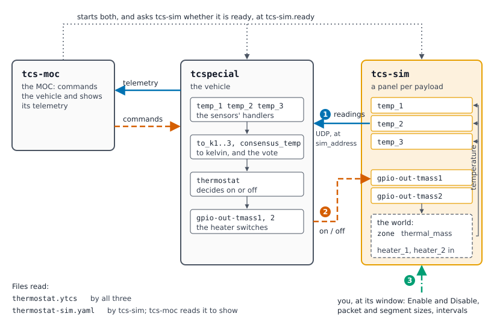

==============
tcs-sim Manual
==============

.. contents:: Contents
   :depth: 2
   :local:

Introduction
============

tcs-sim simulates a vehicle's payloads: for each one a configuration names, it
answers as the device would -- over UDP, or on a kernel dummy device -- with
the packets, timings and errors its simulator configuration asks for. It is
started with tcspecial and tcs-moc, as Running the Programs, in `the tcspecial
manual <tcspecial.html#running-the-programs>`__, describes, and tcspecial's
``--simulate`` says which payloads it stands in for.

         on the thermostat example. tcs-moc starts the other two and asks tcs-sim, at its
         tcs-sim.ready address, whether it is ready; it sends tcspecial
         commands and takes its telemetry. tcs-sim has a panel for each
         simulated payload: the sensors temp_1, temp_2 and temp_3, and the
         heater switches gpio-out-tmass1 and gpio-out-tmass2. Arrow 1: the
         sensors send readings to tcspecial over UDP at each payload's
         sim_address. Arrow 2: tcspecial's thermostat sends the switches on
         or off. Inside tcs-sim the switches drive the zone's heater inputs
         in the physics model's world, and the sensors read the zone's
         temperature. Arrow 3: the person at tcs-sim's window enables and
         disables payloads and changes their sizes and intervals.

   Where tcs-sim sits, in the thermostat example. tcspecial reaches each
   simulated payload where it would reach the device -- here its
   ``sim_address`` -- and cannot tell tcs-sim from the hardware. The sensors'
   readings (1) come from the simulator's world, which the heater switches
   tcspecial drives (2) warm, so what tcspecial reads follows from what it
   decided. The window (3) is how a person changes what tcs-sim does while it
   runs: see `Step by step`_.

The Simulator Configuration
===========================
What simulating a payload takes, which is not a property of the payload: how
often it produces a packet, and how it divides one into segments. Only tcs-sim
acts on it; tcs-moc reads it too, to show what the tcs-sim it started is
simulating, and does without it if it is not there.

Every setting but ``simulate`` is optional, and **a setting written empty is a
setting not stated**: ``packet_interval: ""`` and no ``packet_interval`` at all mean
the same thing, so a file somebody has half filled in still loads. tcs-gui
writes only the settings that hold a value, and a file it begins names each
payload under its type and nothing else. A value that is there and wrong is
still refused, naming it.

.. code-block:: text

   simulated_payload_groups        optional
     group                the name payloads refer to, naming the entry
     simulate             true or false, for every payload in the group
     enable               true for every payload in the group to start
                          enabled; a payload's own overrides it
     ...                  any of the settings below

   simulated_payloads              a list of types
     type <type>          the type of payload, as the tcspecial
                          configuration writes it, holding the list of
                          the simulated payloads of that type
       payload            the payload this one simulates, naming the
                          entry
       simulate           true for tcs-sim to simulate it, false for the
                          real device: required, here or in its group
       enable             true for it to start enabled, as though its
                          panel's Enable button had been pressed; left out,
                          or false, it starts disabled. In XML,
                          <enable value="true"/>
       protocol           which transport, for a network payload
       payload_address    the socket the payload answers from, if this file
                          cares to say
       payload_port       which port it answers from, likewise
       group              the group to take unstated settings from, if any
       ...                any of the settings below

The simulated payloads are grouped by type, as a configuration's nodes are:
each entry of ``simulated_payloads`` is ``type`` and a type, holding the
payloads of that type, each named by ``payload``. A group is named by
``group`` and says no type, a payload's being the one it is written under. In
XML, ``<simulated_payloads>`` holds ``<type name="...">`` elements of
``<payload name="...">`` elements, and ``<simulated_payload_groups>`` holds
``<group name="...">`` elements. Nothing in the file is in an order that
means anything: the types, the payloads of one and the groups may be written
in any order. A file in the shape before this one, each payload with
``name:`` and ``type:`` of its own, is refused at the line of its first
entry; ``tools/convert-format.py`` rewrites it, keeping its comments.

**Simulated or real: simulate**

Every payload the file names says whether it is simulated, with ``simulate``:
``true`` has tcs-sim simulate it, and ``false`` leaves it to the real
device, for which tcs-sim makes nothing. It is said once -- in the payload, or
in the group it names -- and never in both, even where the two would agree: a
payload does not override its group's. A payload the file does not name is
real too.

.. code-block:: yaml

   simulated_payload_groups:
     - group: zone_temps
       packet_interval: 100 ms
       simulate: true          # temp_1, temp_2 and temp_3 are simulated

   simulated_payloads:
     - type network:
         - payload: heaters_1
           simulate: false     # the real heater
         - payload: temp_1
           group: zone_temps

Before it simulates anything, tcs-sim compares each payload's ``simulate``
with what is at the payload's endpoint, by the same rules tcspecial judges a
payload by (see `Simulated, Dummy or Real Devices: --simulate <tcspecial.html#simulated-dummy-or-real-devices-simulate>`__), and will
not start on a disagreement: ``simulate: true`` where the configuration
points at real hardware, or ``simulate: false`` where it points at a
simulated or dummy device. A simulated device tcs-sim makes itself, a
pseudo-terminal or a socket, is not there yet, and that is no disagreement;
a dummy device, which the scripts in ``bin/`` make, has to be. A payload the
file does not name whose endpoint is a simulated or dummy device all the
same is refused too: tcs-sim controls and shows every simulated payload, so
each one is named. A ``network`` or ``device-file`` payload is a real device
either way and is not compared: ``simulate: true`` has tcs-sim answer at its
far end, and ``false`` leaves it to whatever is there.

Each simulated payload has the same panel, whatever simulates it: its
button, which has it take part or not, and what it sent and what reached it.
Where the kernel makes a dummy device, tcs-sim watches it -- the
lines of a ``gpio-sim`` chip, the registers of an ``i2c-stub`` chip -- and
counts what the vehicle does to it. Two things cannot be seen: a read of an
``i2c-stub`` chip, which changes nothing, and the samples an ``iio_dummy``
sensor's kernel trigger makes. A payload that is only driven, such as a
heater, sends nothing, counts what the vehicle sends it, and takes no packet
interval. Switched off, a payload sends nothing, answers nothing and acts on
nothing -- a heater warms no mass -- and still counts what reaches it.

**What it simulates**

Two things describe the payload rather than the simulation, and are required
for that reason. The two files are joined by handler name and by nothing else
-- and a name is what a set copied from another one keeps -- so a simulator
configuration written for one set parses happily against another set's
payloads, and the run that follows looks like a payload that never sends.
Stating the type here makes that pairing an error instead.

.. code-block:: text

   type                   the type the payload is written under, in the
                          tcspecial configuration's own word: network,
                          device-file, serial, i2c, spi, i2c_tmass,
                          spi_tmass, can, iio, rpmsg, gpio or hdlc. Must be
                          the type that configuration
                          writes it under
   protocol               which transport, for a network payload, and refused
                          for any other type. Must be what that configuration
                          says
   payload_address        the socket the simulated payload answers from: a
                          host for a UDP payload, a path for a Unix datagram
                          one. Optional, only for those two types, and not
                          for a triggered one, which waits at the address the
                          tcspecial configuration gives
   payload_port           the port it answers from. Optional, and refused for
                          a Unix datagram payload, which answers from a path

Where the payload *is* is not stated here at all: the simulator takes it from
the tcspecial configuration, which decides it. Writing ``payload_interface``
here -- or ``address`` or ``port``, which that file spelled them before -- is
refused with the place they belong; they are the likeliest thing to be carried
across from the other file.

What this file may say about an address is the other end of the same link: the
socket the simulated payload answers from.

.. code-block:: yaml

   simulated_payloads:
     - type network:
         - payload: auto-send
           packet_interval: 1 s
           payload_address: 127.0.0.1   # the socket this payload answers
           payload_port: 7000           # from, not the one the handler
           protocol: udp                # waits at

Nothing in the link needs it -- a handler learns where its payload is from the
first packet it gets -- but something outside the simulation may: a rule on a
firewall, or a capture being read afterwards. Only a datagram payload that
is not asked has an address of its own to bind; a stream payload, and a
datagram payload that is asked, is the end that waits, so it binds the
address the tcspecial configuration gives it. A Unix datagram
payload answers from a path, so it takes an address and no port. Neither end
may be the other: a payload told to bind its handler's own socket is refused
rather than left to fail at the bind. Stating neither gets what every
simulator configuration asked for before this existed -- any interface and a
port the system chooses.

A word that is not a setting is refused here too -- in a payload, in a group,
and in the file's own sections. A misspelled setting that was ignored would
have the simulator do something other than what the file asked for and say
nothing: a payload asked through a misspelling to drop a tenth of its packets
drops none, and looks exactly like one that was never asked.

Neither the type nor the transport is taken from this file: the tcspecial
configuration decides both, and a disagreement about either is an error naming
the payload and what each file says of it. A group may carry them, like any
other setting -- though payloads that share a rate need not share a transport,
which is why the thermostat's simulator file leaves them with the payloads.

**Settings**

.. code-block:: text

   packet_interval        how long between packets, as a length of time --
                          1 s, 500 ms, 0.25 s -- or ``continuous`` for as fast
                          as the payload can be driven. Periodic payloads
                          only: a triggered one sends when it is asked, and
                          stating an interval for one is an error
   segment_interval       how long between the segments of one packet,
                          likewise, ``continuous`` included; defaults to the
                          packet interval
   segment_size           bytes in one segment; defaults to the whole packet,
                          whose size the tcspecial configuration gives

**The physics model**

Every simulated payload above sends bytes from a random number generator,
which exercises a link and no control loop at all: three sensors sending noise
never agree, so a vote over them says nothing and a thermostat downstream of
it cannot be seen working.

A physics model gives them something to agree about. It is the vehicle's
physical parts -- a zone, the heaters that warm it -- each simulated alone and
joined to the others. Join the sensors to what they measure and the heaters'
switches to the heaters, and what the vehicle reads becomes a consequence of
what the vehicle drove.

The model is in the simulator file's ``world`` section, beside the simulated
payloads joined to it, so that one file says the whole of what tcs-sim simulates
and a payload's ``connects`` names a terminal the same file says is there. Two
examples that fly one vehicle share it by sharing the whole simulator file, a
link to it beside each configuration. The world is YAML only: a simulator file
written in XML has none.

.. code-block:: text

   world                  in the simulator file. Optional
     ambient_temp         the temperature every thermal mass's surroundings
                          are about: "288.15 K". Required where there is a
                          thermal_mass
     physics
       components         the components, grouped by type
       connections        how they are joined, each from an output to an
                          input

The model holds the components it is made of, under ``components``, and the
connections between them, under ``connections``, as a configuration holds
nodes and links. The components are grouped by type, as
a configuration's nodes are: each entry of ``components`` is ``type`` and a
type, holding the components of that type, each named by ``component``.
Nothing in the model is in an order that means anything -- not the types,
the components of one, or the connections -- and tcs-sim runs it the same
however it is written: two events due at one moment come in the order of
their components' names, and the outputs an input sums are added in the order
of theirs. The shapes a model had before are refused, each told where it goes
now: a simulator file still naming a model in a file of its own,
``physics: zone-physics.yaml``; such a file given as a simulator file; a
``physics`` section at the top of a simulator file, not under ``world``; a
zone stating its own ``environment``, which is the world's ``ambient_temp``;
a component with ``name:`` and ``type:`` of its own; and a simulator file
still declaring masses itself.

Where tcs-gui drew each component is kept last in the simulator file, in a
``tcs-gui`` section of its own, as a configuration keeps its nodes' places:

.. code-block:: yaml

   tcs-gui:
     nodes:
       - { node: zone, x: -193, y: 280 }
     pages:
       thermostat-common: [zone]

tcs-sim ignores it. A component it does not name is laid out down tcs-gui's
Physics pane by name, so the section is never needed, and it is written as
components are moved there. Each component is drawn on the page it was placed
from: one placed on a subdiagram's page is listed under that subdiagram's name
in ``pages``, and one listed nowhere is drawn on the top page. A component
is placed from the physics list
as a node is from its own list: click its type, and it is put down the
pane where the others are, or drag the type onto the Physics pane, and it
is put where it is let go. In tcs-gui a component is moved, edited, deleted
and joined as a node is: drag it, right click it for Edit and Delete, and
draw a line from its output or input terminal to another component, for a
connection, or to a payload, to set that payload's ``connects``. A line
drawn the other way, from a payload's terminal to a component, sets it too:
from a ``moc`` terminal, what drives the payload, it offers the component's
inputs -- a heater's ``on``, a zone's ``heater_1`` -- and from a ``world``
terminal, what it reports, the component's outputs -- a zone's
``temperature``. Where a line could mean more than one terminal -- a
heater's heat, current and heating, to a sensor -- tcs-gui asks which.

Each component is one simple part, of one of these types:

.. code-block:: text

   heater                 a resistance on a supply, switched on and off
     component            the name connections and payloads use
     power                what it gives out while on, at its nominal
                          voltage: "60 W"
     voltage              its supply's nominal voltage: "28 V"
     ripple               how much its supply varies: a standard deviation,
                          as a fraction of nominal, written bare. Optional
     ripple_time          how slowly it varies, as a length of time. With
                          ripple and refused without it

   thermal_mass           one body at one temperature, in surroundings
                          about the world's ambient_temp
     component            the name connections and payloads use
     time_constant        how fast it loses the difference, as a length
                          of time
     capacity             how much heat it takes to warm it a kelvin:
                          "20 J/K"
     swing                how far its surroundings swing either side of
                          ambient_temp, as a sine wave: "3 K". Optional
     period               how long one swing takes. With swing and refused
                          without it
     wander               how far its surroundings wander at random: a
                          standard deviation, "0.5 K". Optional
     wander_time          how slowly they wander, as a length of time. With
                          wander and refused without it
     start                where it starts: "292.15 K". Optional; left out,
                          it starts at ambient_temp
     heater_1_power       what its first heater of its own gives while on:
                          "4 W". Wanted where heater_1 is joined
     heater_2_power       and its second's, wanted where heater_2 is

   sun                    sunlight and shadow, through an orbit
     component            the name connections and payloads use
     period               how long one orbit takes: "90 min"
     eclipse              how much of it is in shadow, as a fraction,
                          written bare: "0.35"
     start                how far round the orbit it starts, from the start
                          of its sunlight, as a fraction. Optional

   solar_array            panels turning light into current
     component            the name connections and payloads use
     current              what it gives in full sunlight: "7 A"

   load                   something on the bus that draws a current
     component            the name connections and payloads use
     current              what it draws while it is on: "2 A"

   bus                    where the sources' currents and the loads' meet
     component            the name connections and payloads use

   battery                a store of charge on the bus
     component            the name connections and payloads use
     capacity             how much it holds full: "10 Ah"
     empty                its open-circuit voltage empty: "24 V"
     full                 its open-circuit voltage full, more than empty:
                          "33.2 V"
     resistance           its internal resistance: "0.05 ohm"
     charge               how full it starts, as a fraction: "0.6"

   engine                 a throttled engine and its fuel
     component            the name connections and payloads use
     thrust               its thrust at full throttle: "4500 N"
     isp                  its specific impulse, as a length of time:
                          "311 s"
     fuel                 the fuel it starts with: "100 kg"

   body                   a mass falling under gravity, pushed and burning
     component            the name connections and payloads use
     mass                 its mass at the start, fuel and all: "1500 kg"
     gravity              the gravity it falls in: "1.62 m/s2"
     altitude             how high it starts: "500 m"
     velocity             how fast it starts, up more than nought:
                          "-20 m/s"

Every figure is written with its unit, and one without it, or in another
unit, is refused, saying what to write: a bare ``60`` could be watts or
kelvin a second. A fraction, which has no unit, is written bare. A
``thermal_zone``, which is what a ``thermal_mass`` was called before, is
refused, told the name it has now.

Each type has fixed terminals, the places it is joined at, each an input or an
output, carrying a value in one unit or a decision:

.. code-block:: text

   heater         on            in    a decision: whether it is on
                  heat          out   W, nought while off
                  current       out   A, nought while off
   thermal_mass   heat          in    W, the sum of everything joined to it
                  temperature   out   K
                  heater_1      in    a decision: its first heater of its
                                      own, adding heater_1_power while on
                  heater_2      in    a decision: its second, adding
                                      heater_2_power while on
   sun            light         out   a ratio: one lit, nought in shadow
   solar_array    light         in    a ratio
                  current       out   A, its full-sun current times light
   load           shed          in    a decision: shed while asserted, and
                                      never shed where nothing is joined
                  current       out   A, nought while shed
   bus            supply        in    A, the sum of the sources joined to it
                  demand        in    A, the sum of the loads joined to it
                  current       out   A, supply less demand
   battery        offered       in    A, what the bus has left over
                  voltage       out   V
                  current       out   A, what flows in: nought into a full
                                      battery, whose charge is shunted
                  charge        out   a ratio, the fraction it holds
   engine         throttle      in    a ratio, held within nought and one
                  force         out   N, nothing once its fuel is gone
                  flow          out   kg/s, the fuel it burns
   body           force         in    N, the sum of the forces on it
                  flow          in    kg/s, the sum of the mass it loses
                  altitude      out   m
                  velocity      out   m/s, up more than nought
                  contact       out   a decision: asserted on the ground

A terminal is written as the component's name and its own, joined by a dot:
``zone.temperature``. A connection goes from an output to an input of the
same kind, and one joining two outputs, two inputs, or a value in one unit to
an input in another, is refused, naming both. An input takes one output, or
the sum of every output joined to it where its type says so, as a zone's
``heat`` does.

A heater's heat goes as the square of its supply voltage, and its current as
the voltage. A battery's charge moves in a straight line with its current,
and its voltage runs straight from ``empty`` to ``full`` with its charge, plus
what its resistance drops; full, a charging current is shunted, and empty, it
is held there with its voltage below ``empty`` showing it. The sun is lit or
dark, changing all at once twice an orbit. An engine's thrust is its throttle
times its full thrust, and it burns that over its specific impulse in fuel
until there is none, when it stops. A body falls by the rocket equation with
gravity, which has a closed form while its force and its flow are held, and is
set down when it reaches the ground, a moment found ahead of time and met
exactly; it stays down until a force beating its weight lifts it. A zone cools towards its surroundings with its time constant and
is warmed by the heat joined to it, its capacity turning watts into kelvin a
second; with a fifty second constant, twenty joules a kelvin and a hundred
and twenty watts, it would settle three hundred kelvin above its
surroundings. It starts at the world's ambient temperature with the heaters off, because a
vehicle coming up cold is the case a thermostat exists for, unless it states
``start``, and then there.

A simulated payload is joined to one terminal by a setting of its own, which
like every other setting may be stated on a group instead:

.. code-block:: text

   connects               the terminal it is joined to: zone.temperature,
                          heater_1.on. Joined to an output, it reports it;
                          joined to an input, it drives it. A GPIO payload
                          that watches lines names a decision for each line,
                          in the order of its lines: heater_1.heating,
                          heater_2.heating
   offset                 how far the place a reporting payload is on sits
                          from what its terminal says, in the terminal's
                          unit: "+0.2 K". Optional

A payload joined to an output reports a value in the encoding of the conversion
its readings go to, and a decision -- a lander's contact with the ground -- as
the text ``1`` or ``0``: at once when it changes, waiting on the model for the
moment rather than for its next turn, and again every packet interval. A
payload joined to an input drives it with what the vehicle sends: a whole
number -- a set of lines, or a thermostat's decision as the ``u8`` a switch
takes, a thermal mass's heater being on where it is not nought -- or a value,
four bytes of its unit's steps, which has to come
from a node sending that unit -- an engine's throttle from a ``process``
answering a ``ratio``. An input is driven by one payload, and not by one and a
connection too: two would each switch it over the other. A heater's ``on`` that
nothing drives is refused, being a part nothing can switch, and so is a
component nothing is joined to, which is most likely a misspelled ``connects``.
A GPIO payload that watches lines is pulled rather than signalled: each of its
lines is held high while its terminal's decision is on, and looked at every
packet interval -- a line sensing a heater, pulled to the heater's ``heating``,
which is on only while the heater is really heating, so a heater disabled in
tcs-sim reads low whatever it is told. One terminal for each line is required,
and a list of terminals anywhere else is refused. The settings that joined a
payload to a thermal mass -- ``reads``, ``heats``, ``output``, ``input``,
``rate`` -- are refused, told what says it now.

A sensor sends the bytes the conversion its readings go to -- ``to_kelvin``
or ``to_value`` -- will read back as what it reports. The format, the scale
and the offset are taken from that node, not stated here -- a scale written
in two files is a scale that can disagree with itself -- so a sensor whose
readings reach no conversion, or two, or one in another unit than its
terminal, is refused.

A simulated heater sends nothing: being driven is the whole of what it is
for. Its packet interval is how often it looks for what the vehicle decided,
which is the one thing pacing still means for a payload that sends nothing,
and it wants to be shorter than the sample interval: the vehicle cannot see
the band crossed until its next sample and the heaters cannot hear about it
until they next look, so the zone overshoots by their heat over the sum of
the two.

A simulated heater has to be a payload the simulator can be driven through:
a socket, or a set of discrete lines, which tcs-sim watches as the vehicle
drives them.

A simulator file with a model, and its payloads joined to it:

.. code-block:: yaml

   world:
     ambient_temp: "283.15 K"         # ten kelvin below the setpoint
     physics:
       components:
         - type heater:
             - component: heater_1
               power: "60 W"          # three kelvin a second on the zone
               voltage: "28 V"
             - component: heater_2
               power: "60 W"
               voltage: "28 V"
         - type thermal_mass:
             - component: zone
               capacity: "20 J/K"
               time_constant: "50 s"  # a fifth of a kelvin a second at it
       connections:
         - { from: heater_1.heat, to: zone.heat }
         - { from: heater_2.heat, to: zone.heat }

   simulated_payload_groups:
     - group: zone_temps
       connects: zone.temperature
       packet_interval: 100 ms

   simulated_payloads:
     - type network:
         - payload: heaters_1
           connects: heater_1.on
           packet_interval: 20 ms   # how often it looks for a decision
           protocol: udp
         - payload: heaters_2
           connects: heater_2.on
           packet_interval: 20 ms
           protocol: udp
         - { payload: temp_1, group: zone_temps, protocol: udp }
         - { payload: temp_2, group: zone_temps, offset: "+0.2 K",
             protocol: udp }
         - { payload: temp_3, group: zone_temps, offset: "-0.3 K",
             protocol: udp }

**How the world moves**

tcs-sim makes one world of the model, which every simulated payload joined to it
shares, and nothing ticks: the world is brought up to a moment only when a
simulated payload reads or drives it, and a world nobody asks about costs
nothing. Between two moments each component is advanced by its closed form, so
what a sensor reads does not depend on how often it is read. Where a
component's behaviour would change inside an interval -- a battery reaching
full, the sun going into shadow, a lander reaching the ground -- it foresees
the moment as an event, and the world stops there, lets it happen, and goes on,
the events waiting in order of when they fall. Simulated time keeps pace with
the wall clock, which the vehicle runs on, from when the run begins: the first
time a running simulated payload asks the world anything. Until then the world
waits, so a lander is still where it starts when its radar is enabled.

**Physically realistic noise**

A simulated sensor reports the zone exactly, and three of them agree to the
count, which real ones never do. Real readings go wrong in two places, and
the difference matters to a loop: what goes wrong at a sensor is that
sensor's alone, and a vote over three can outvote it; what goes wrong in the
zone every sensor sees, and no vote removes it. Each of these is a datasheet
or mission figure, and each is off unless it is stated.

At a sensor, as settings of a payload that reports, or of its group, each in
the unit of the terminal it reports:

.. code-block:: text

   noise                  the random error on each reading: a standard
                          deviation, "0.03 K"
   accuracy               the most its calibration is off by, "0.5 K". A
                          fixed error is drawn once a run, normally
                          distributed with a third of this as its standard
                          deviation and never past it
   drift                  how far its error wanders, slowly: a standard
                          deviation, "0.05 K"
   drift_time             how slowly it wanders, as a length of time. With
                          drift and refused without it
   lag                    its own time constant, as a length of time: a
                          sensor is a small body of its own and follows the
                          one it is on that far behind

A sensor's errors are refused on a simulated payload that drives. At a heater,
its ``ripple`` and ``ripple_time``; in the zone, its ``swing``, ``period``,
``wander`` and ``wander_time``: what the world does is the model's, and what a
simulated sensor gets wrong is the simulator file's.

Everything that wanders -- a sensor's drift, the environment, a supply -- is
an Ornstein-Uhlenbeck process: a departure drawn back towards nought, whose
size is its standard deviation once settled and whose time is how long it
remembers. Each is stepped by its exact transition, so how much it wanders
does not depend on how often anything reads it, and each starts where a
settled one would be. The swing is part of the zone's equation, which still
has a closed form, so it is as exact as the rest. A lag follows the body's
temperature as if it changed at a steady rate between two readings.

The random draws come from a generator for each component and each sensor,
seeded from the run's seed and its name, so a run with the same seed varies
the same way. The seed is a setting of the ``tcs-sim`` section; without one,
tcs-sim chooses it and says which it chose, so a run worth repeating can be:

.. code-block:: yaml

   tcs-sim:
     ready: "127.0.0.1:7907"
     seed: 12345

The thermostat example states all of these, with figures of the kind a
datasheet and a low orbit give: two sensors of one part accurate to half a
kelvin, with three hundredths of noise and four seconds of lag, and a better
one; an environment swinging half a kelvin over ninety minutes and
wandering a quarter of a kelvin; a start inside the band; places a fifth and three tenths of a kelvin off the middle;
and supplies varying by two percent.

**Simulating the thermostat**

tcs-sim can simulate thermostat nodes as well, so that the loop closes
in the simulator alone, with no tcspecial running. Name the node in the
``tcs-sim`` section -- or several, separated by commas, for a vehicle with a
thermostat for each of several zones:

.. code-block:: yaml

   tcs-sim:
     ready: "127.0.0.1:7907"
     thermostat: thermostat

tcs-sim then takes each node's ``setpoint`` and ``half_band`` from the
tcspecial configuration, and simulates each alone. Its sensors are the
simulated payloads reporting the world whose data reaches the node, and its
heaters the simulated payloads driving it that data from the node reaches. A
name left blank between commas, or written twice, is refused, and so are two
nodes that switch one heater, which would each undo the other. Each reads
each sensor's bytes as they leave the simulated sensor -- a dropped reading
never
arrives, and a truncated or corrupted one arrives as the vehicle would see
it -- as the conversion the sensor feeds reads them, and decides on the
median of each sensor's latest reading: more than the half band over the
setpoint, off; more than it under, on; between the two, what it last
decided. The decision is asserted to each of its heaters on every reading,
as the node does aboard.

Never name a thermostat with tcspecial running: its own thermostat switches
the same heaters, and the two would fight.

.. _fault injection:

**Fault injection**

A payload that always works exercises only the path where everything works.
These settings have a simulated payload misbehave on purpose, so that a
handler's counting, framing, timeouts and reconnection can be made to happen
rather than waited for. Each defaults to no fault, so a file that mentions
none asks for a payload that works -- which is what every simulator
configuration written before these existed asks for.

.. code-block:: text

   drop_percent           packets in a hundred that are never sent. A dropped
                          packet is not counted as sent either, which is what
                          tells it from one lost on the way
   corrupt_percent        packets in a hundred with one byte altered. Never
                          left as it was: a corruption that changed nothing
                          would be a fault that did not happen
   truncate_percent       packets in a hundred sent short. Always shorter than
                          the packet size and never empty; a packet of one
                          byte cannot be shortened and goes whole
   jitter                 how late a packet may be, as a length of time,
                          chosen afresh for each one. Waited out inside the
                          interval rather than added to it, so the rate is
                          unchanged and the packet arrives late within it. A
                          length of time and nothing else: leave it out for
                          no jitter
   silent_after           packets after which the payload sends no more,
                          leaving its link open; 0 is never. What a wedged
                          instrument looks like from the handler's end
   close_after            packets after which the payload hangs up and then
                          listens again, so the handler has to reconnect;
                          0 is never. Streams only -- tcp and unix_stream
   ignore_trigger_percent requests in a hundred a triggered payload leaves
                          unanswered, which is what a handler's response
                          timeout exists for. Triggered payloads only

The percentages are nought to a hundred; a larger number is an error naming
the setting and the value. A fault the payload could not have is an error too:
``close_after`` for anything but a stream, and ``ignore_trigger_percent`` for a
payload that sends on its own. Faults belong in this file alone -- the
tcspecial configuration describes what a payload is meant to do, and tcspecial
reads it. A payload that starts with any fault set says so in one line of log,
so a run is not left to be guessed at afterwards.

.. code-block:: yaml

   simulated_payloads:
     - type network:
         - payload: auto-send
           drop_percent: 10        # one packet in ten never arrives
           jitter: 50 ms           # and the rest are up to 50 ms late
           packet_interval: 500 ms
           protocol: udp

The two files are joined by name. Every data handler needs a simulated payload
naming it, and a name here that no handler has is an error rather than a line
with no effect, because a typo is otherwise indistinguishable from a payload
meant to be left out.

A simulated triggered payload sends one packet for each request it is sent and
nothing otherwise. The segment settings still apply to it -- how a payload
divides an answer is its own business however it was prompted -- but the packet
interval does not, and is refused. Two types cannot be asked at all and are
refused outright: a device, which tcspecial opens and reads directly, and a
device on a bus, where the master's own read is the request and a second master
cannot see it.

This is the shipped ``examples/thermostat/thermostat-sim.yaml``, a link to
``examples/thermostat-common/thermostat-sim.yaml``, which the thermostat
example shares with thermostat-yamcs, its world shortened here:

.. code-block:: yaml

   description: Simulator settings for the payloads of thermostat.ytcs and
     thermostat-yamcs.ytcs

   world:
     ambient_temp: "288.15 K"
     physics:
       components:
         - type thermal_mass:
             - component: zone
               capacity: "20 J/K"
               heater_1_power: "4 W"
               heater_2_power: "4 W"
               start: "292.15 K"
               time_constant: "50 s"

   simulated_payload_groups:
     - group: zone_temps
       connects: zone.temperature
       drift: 0.05 K
       drift_time: 30 min
       packet_interval: 1 s
       simulate: true

   simulated_payloads:
     - type gpio_inout:
         - payload: gpio-out-tmass1
           connects: zone.heater_1
           simulate: true

         - payload: gpio-out-tmass2
           connects: zone.heater_2
           simulate: true

     - type i2c_tmass:
         - payload: temp_1
           accuracy: 0.5 K
           group: zone_temps
           lag: 4 s
           noise: 0.03 K

         - payload: temp_2
           accuracy: 0.5 K
           group: zone_temps
           lag: 4 s
           noise: 0.03 K
           offset: +0.2 K

     - type spi_tmass:
         - payload: temp_3
           accuracy: 0.25 K
           group: zone_temps
           lag: 6 s
           noise: 0.02 K
           offset: -0.3 K

The tcs-sim window
==================
One panel per simulated payload, in a grid, and a ``Quit All`` button at the
foot of the window. Nothing in the window names a payload or fixes how many
there are: the two configuration files decide that, so a payload added to or
removed from them adds or removes a panel.

SIGHUP, SIGINT and SIGTERM do what ``Quit All`` does: every payload stops and
its simulated device is cleared, and then tcs-sim exits with the status a shell
gives a program the signal ended, 128 more than the signal's number -- 130 for
SIGINT. A second signal, for a stop that is taking too long, ends tcs-sim at
once with status 1 and clears nothing.

Each panel shows, from the top:

the name, the number and the status
  The number is the payload's place in the payload configuration, as tcs-moc's
  panels show it, so the two windows name the same payload the same way. The
  status says ``Running`` while the payload is sending and ``Stopped``
  while it is not, in black for the one and in bold red for the other.

how the payload is reached
  The same description tcs-moc's panels carry for the handler at the other end
  of the link.

``Pkt`` and ``Seg``
  The packet size, from the tcspecial configuration, and the segment size,
  from the simulator configuration.

``Pkt Int`` and ``Seg Int``
  The interval between packets and between the segments of one packet, both
  from the simulator configuration.

Those four can be changed while a payload is running, and take effect on the
next packet: that is what the simulator is for, and it is quicker than editing
a file and starting again. Nothing is written back to the files, so the next
run starts from what they say.

A segment is a piece of a packet, so the segment size may not be larger than
the packet size. Equal is the ordinary case -- a packet sent in one segment.
Make them disagree and a message says so at once, naming both sizes and
either way out of it, and the button that starts the payload is taken away
until they agree again; the edit that fixes them takes the message back.
Only starting is refused: a payload already running when its sizes stop
agreeing still offers ``Disable``, which stops it, rather than going on
sending them until they are put right. Nor does ``--sending`` or the
simulator configuration's ``enable`` start a payload whose files give sizes
that cannot be sent; tcs-sim says so as it starts, and the panel says why. The
sizes are checked when the files are read as well, so a set whose simulator
configuration states a segment larger than the packet it is given says so
before anything is touched.

Below them are the two buttons -- one to start and stop the payload, described
under `Starting and stopping a payload <tcspecial.html#starting-and-stopping-a-payload>`__, and ``Configuration``, described
under `Seeing what was read <tcspecial.html#seeing-what-was-read>`__ -- and then three lines:

``Sent``
  When the last packet went, and the first few bytes of it. A part the
  vehicle drives sends nothing, and this line says what it is doing instead,
  in words, naming the heater it switches in the physics model: ``heating``
  or ``off``, and ``disabled, so off`` while its panel has it disabled --
  see `Starting and stopping a payload
  <tcspecial.html#starting-and-stopping-a-payload>`__. A switch joined to a
  ``heater`` component's ``on`` is named by the component, as in
  ``heater_1: heating``; one joined to a thermal mass's own ``heater_1`` or
  ``heater_2``, as in the thermostat example, by the mass and the input, as
  in ``zone.heater_2: off``, so that a zone's two heaters' panels never say
  the same thing. A driven part that is not a heater says ``on`` where a
  heater says ``heating``, or ``at`` the value it is held at.

``Recv``
  When the last packet arrived, and the first few bytes of it -- for a payload
  that answers requests. A payload that sends of its own accord is never
  spoken to, so this line is left blank for it rather than showing
  ``--:--:--`` for the whole run. The line stays so that every panel is the
  same shape; it is the two items on it that go.

  Tcs-moc's panels do the same thing in the other direction: a handler whose
  payload sends of its own accord is never asked anything, so its ``Last
  sent`` line is blank.

``Pkts``
  How many packets have gone and arrived since the payload started. The
  arrived half is there for a payload that answers requests, as the ``Recv``
  line is and for the same reason: a payload that sends of its own accord is
  never spoken to, so a count of what arrived could only ever read nought.
  A part the vehicle drives sends nothing, so its count stays at nought;
  what the vehicle sends it is counted, but not shown.

The times and bytes are the simulator's own account of what it did, where
tcs-moc's panels show the same transfers as the spacecraft reported them. Two
panels disagreeing about one transfer is worth knowing about, which is why
both are shown the same way.

Step by step
------------
What the window shows as the commonest things are done with it, on the
thermostat example (``examples/thermostat``), whose five panels are the
three temperature sensors and the two heater switches of the figure in the
`Introduction`_. The times are the simulated run's: it starts at 10:00:00,
and each sensor sends a reading a second, its ``packet_interval``. The
pictures are made by ``make screenshots-tcs-sim`` from the program's own
window, drawn without opening it.

**Enabling a sensor**

#. .. figure:: shots/tcs-sim-open.png
      :alt: The tcs-sim window on the thermostat example: the heading
            Simulated Payloads, two rows of panels -- gpio-out-tmass1,
            gpio-out-tmass2 and temp_1, then temp_2 and temp_3 -- each
            Stopped, with an Enable button, and Quit All at the foot.

      The window as it opens. Every payload is ``Stopped`` -- its simulated
      device is made, so tcspecial finds it, but nothing goes over it -- and
      each panel offers ``Enable``. The heater switches' first line says what
      they are doing; the sensors' says ``Sent: --:--:--``, nothing having
      gone yet.

#. .. figure:: shots/tcs-sim-enable-2.png
      :alt: The temp_1 panel, now Running in black, its button reading
            Disable, its Sent line still --:--:-- and Pkts: 0 sent.

      ``Enable`` pressed on ``temp_1``. The status is ``Running`` and the
      button offers ``Disable``; no reading has gone yet.

#. .. figure:: shots/tcs-sim-enable-3.png
      :alt: The temp_1 panel three seconds later: Running, Sent: 10:00:03
            followed by two bytes, and Pkts: 3 sent.

      Three seconds on. ``Sent`` gives the time of the last reading and its
      bytes -- the zone's temperature as the sensor reads it, in the encoding
      tcspecial's conversion reads back -- and ``Pkts`` counts three.
      ``Pkt``, ``Seg``, ``Pkt Int`` and ``Seg Int`` can be changed here while
      it runs, and take effect on the next reading.

**Switching a heater**

#. .. figure:: shots/tcs-sim-heater-1.png
      :alt: The gpio-out-tmass1 panel: Stopped in bold red, an Enable
            button, and the line zone.heater_1: disabled, so off.

      The heater switch ``gpio-out-tmass1`` as it opens. It drives the
      zone's ``heater_1``, so its line names that heater --
      ``gpio-out-tmass2``'s says ``zone.heater_2`` -- and disabled -- its
      button is its power -- it is off whatever it is sent.

#. tcspecial's thermostat switches it on. Nothing changes on the panel or in
   the zone, so the panel is drawn as above: a disabled heater stays off.
   What it was sent is kept.

#. .. figure:: shots/tcs-sim-heater-2.png
      :alt: The same panel after Enable: Running in black, a Disable
            button, and the line zone.heater_1: heating.

      ``Enable`` pressed. The ``on`` it was sent is applied at once --
      ``zone.heater_1: heating`` -- rather than at the thermostat's next
      decision, which comes only when the decision changes.

#. .. figure:: shots/tcs-sim-heater-3.png
      :alt: The same panel after the vehicle has switched it off: Running,
            and the line zone.heater_1: off.

      The thermostat switches it off, and the line says
      ``zone.heater_1: off``. A heater sends nothing, so its ``Pkts`` stays
      at nought throughout.

**Sizes that cannot be sent**

#. .. figure:: shots/tcs-sim-sizes-1.png
      :alt: The temp_2 panel, Pkt 1 and Seg 2, its Enable button greyed
            out, and below the buttons a popup outlined in red: temp_2:
            these sizes cannot be sent. A segment of 2 bytes cannot be part
            of a packet of 1: a segment is a piece of a packet. Raise the
            packet size to 2 or more, or lower the segment size to 1 or
            less.

      ``Pkt`` stepped down from 2 to 1 on ``temp_2``, leaving its 2-byte
      segment larger than the packet. A popup under the buttons says so at
      once, naming both sizes and either way out, and ``Enable`` is greyed
      out.

#. .. figure:: shots/tcs-sim-sizes-2.png
      :alt: The temp_2 panel with Pkt and Seg both 2, no popup, and the
            Enable button pressable again.

      ``Pkt`` stepped back up to 2. The popup goes and ``Enable`` comes
      back. Nothing is written to the files either way.

#. .. figure:: shots/tcs-sim-sizes-3.png
      :alt: The temp_2 panel Running, Pkt 1 and Seg 2, the same popup
            under its buttons, and its Disable button pressable.

      ``Enable`` pressed, and ``Pkt`` stepped down to 1 again while it
      runs. The popup says the same, but ``Disable`` stays: only starting is
      refused, and a payload sending sizes that cannot be sent can always be
      stopped.

**A fault taking effect**

Faults are asked for in the simulator configuration, not in the window (see
`Fault injection`_ above). Here the thermostat example's file has one line
added to ``temp_3``'s entry:

.. code-block:: yaml

   simulated_payloads:
     - type spi_tmass:
         - payload: temp_3
           silent_after: 3
           accuracy: 0.25 K
           group: zone_temps
           lag: 6 s
           noise: 0.02 K
           offset: -0.3 K

``temp_2``, which has no fault, and ``temp_3`` are enabled together:

#. .. figure:: shots/tcs-sim-fault-1.png
      :alt: The temp_2 and temp_3 panels side by side, both Running, both
            Sent at 10:00:03 and both Pkts: 3 sent.

      Three seconds on, ``temp_2`` and ``temp_3`` have each sent three
      readings, and look alike.

#. .. figure:: shots/tcs-sim-fault-2.png
      :alt: The same two panels seven seconds later: temp_2 Sent at
            10:00:10 with Pkts: 10 sent; temp_3 still Running but still
            Sent at 10:00:03 with Pkts: 3 sent.

      Seven seconds later ``temp_2`` has sent ten, the last at 10:00:10.
      ``temp_3`` is still ``Running``, its link still open, but has sent
      nothing since its third: its ``Sent`` time has stopped, which is the
      sign a wedged instrument gives, and what tcspecial's handler for it
      sees is readings that have stopped coming.

#. .. figure:: shots/tcs-sim-fault-3.png
      :alt: temp_3's parameters popup scrolled to its foot: From the
            simulator configuration, packet_interval 1000 ms,
            segment_interval 1000 ms, segment_size 3 bytes, and under
            faults, silent_after 3 packets.

      ``temp_3``'s ``Configuration`` pressed, and its list scrolled to the
      foot with the mouse wheel: under ``faults``, at the end of what the
      simulator configuration said, is ``silent_after 3 packets``. The list
      is longer than the popup, and scrolls.

See Also
========

`TCS Design and Documentation <manual.html>`__
    Every TCS manual and design document, production and non-production
    software apart.

`The tcspecial manual <tcspecial.html>`__
    The flight software, its configuration files, the examples, installing and
    running the programs.

`The tcs-moc manual <tcs-moc.html>`__
    The simulated operations center, which starts tcs-sim and shows what it
    simulates.

`The tcs-gui manual <tcs-gui.html>`__
    The editor, which draws and edits a simulator configuration's components.

`The TCSpecial design <design.html>`__
    How TCSpecial works inside, and why.

