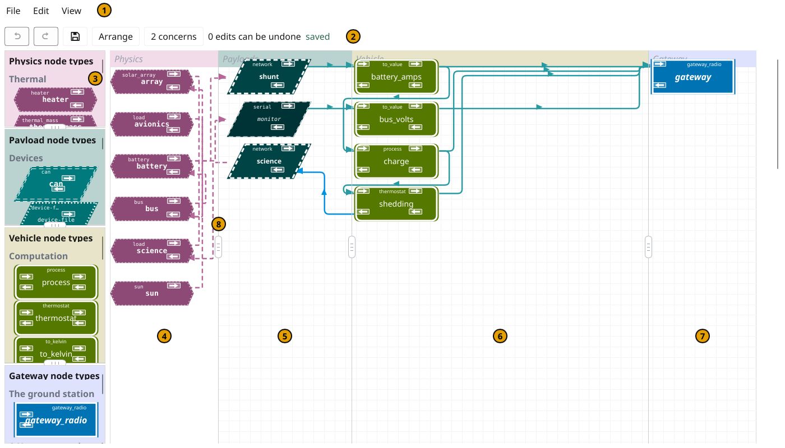
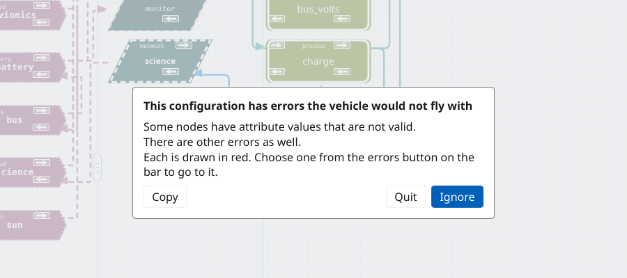
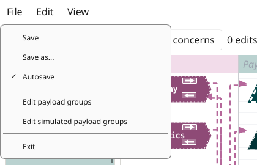
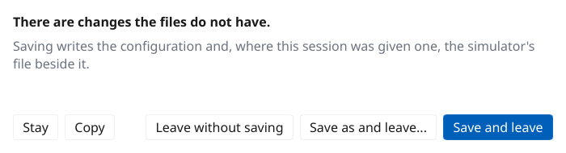
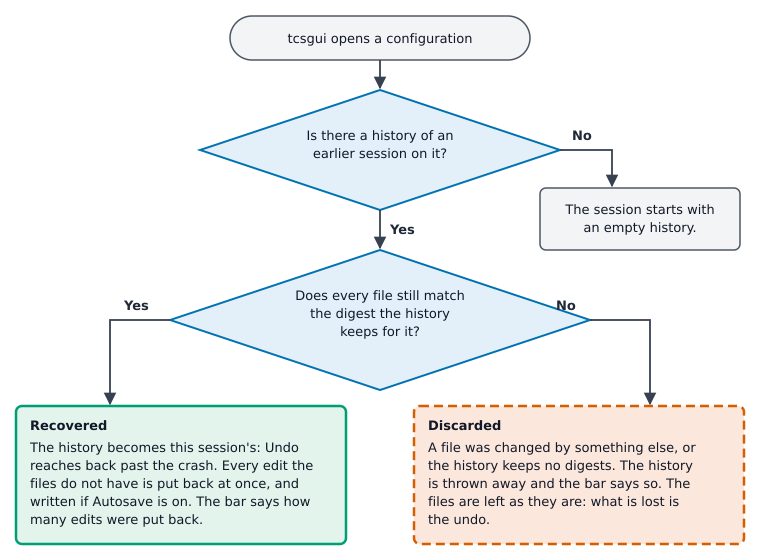

=============
tcsgui Manual
=============
.. contents:: Contents
   :depth: 2
   :local:

Introduction
============

tcsgui is TCSpecial's configuration editor. A configuration is a graph --
nodes, and the links that join them -- and tcsgui draws that graph, lets you
change it by drawing, and writes the result back to the same file tcspecial
will read aboard, in either of its spellings: YTCS, in YAML, or XTCS, in XML
(see Configuration File Formats in `the tcspecial manual
<tcspecial.html#configuration-file-formats>`__). It runs on the ground and
never flies.

It edits, in one session, everything a person draws a vehicle with: the top
configuration file, every file it includes, and, where you name one, the
simulator's own file, whose physics model tcsgui draws beside the
configuration. What the files mean -- node types, attributes, links, includes,
the ``tcspecial`` section -- is described in `the tcspecial manual
<tcspecial.html>`__; this manual says how tcsgui shows them and how to change
them. The simulator file is described in the `tcssim manual <tcssim.html>`__.

Two things about tcsgui are worth knowing before anything else.

**It writes as you go.** With Autosave on, which it is until you turn it off,
every edit is written to the files as it is made. There is a Save command all
the same, for the cases described under `Saving`_.

**It is lazy about what is entered and strict about what is.** A node may be
placed with nothing filled in, and an empty field is a question not yet
answered rather than a fault. A value that is filled in is held to the same
rules the flight software applies, in the same words. Requiring that
everything be entered is the business of ``tcsverify`` and of tcspecial
itself; see the `tcsverify manual <tcsverify.html>`__.

Starting tcsgui
===============

The command line
----------------

.. code-block:: text

   tcsgui [-r | --read-only] <configuration file> [<simulator file>]

The configuration file is required. Its extension says its format: ``.xtcs``
is XTCS, in XML, and anything else, normally ``.ytcs``, is YTCS, in YAML. The file need not
exist yet: a name that is not there is how a new configuration is begun, and
any directories missing from its path are made when it is first written.

The second file, if given, is the simulator's configuration. It is always
YAML, and its name must end in ``.yaml``; any other name, ``.yml`` included,
is refused before the window opens. Like the configuration, it need not exist
yet.

``-r``, ``--read-only`` and ``--readonly`` are three spellings of one flag,
and it may go anywhere on the line: see `Read-only sessions`_. Any other word
starting with a dash is refused, so that a mistyped flag is not taken for the
name of a configuration to create. More than two files are refused too.

Run with no file, or with a command line it does not take, tcsgui prints its
usage on the error output and exits with status 2. There is no ``--help``
option; running it with no arguments is how to see the usage.

What happens as it starts
-------------------------

Before any window opens, tcsgui reads its preferences (see `Where tcsgui
keeps things`_) and deletes the undo histories of sessions nobody is coming
back to -- any more than a week old, and any whose configuration is no longer
there -- saying on the error output how many it removed.

It then reads the files. **A file that is there and cannot be read ends
tcsgui**, with a message on the error output naming the file and saying why,
and exit status 1. That covers a file that does not parse, one that cannot be
opened, and a simulator file that parses but cannot be joined to the
configuration -- two entries of one name, or an entry naming a payload the
configuration does not have. tcsgui writes every edit as it is made, so a
session opened on a file it had not read would replace that file at the first
edit; such a file is put right in a text editor instead.

A configuration that does not exist yet opens with a ground station already
in it -- a ``gateway_radio`` node called ``gateway-1``, in the upper right of
the Gateway pane -- and with the ``tcspecial`` section's fields present and
empty, except the beacon interval, which starts at 1000 ms. All of that is
one edit, so one Undo takes it back.

Then the undo history of an earlier session is recovered if there is one:
see `Crash recovery`_.

From a checkout
---------------

The top-level Makefile runs tcsgui out of the source tree:

.. code-block:: console

   $ make runguiy TCSGUI_FILE=tests/manual/thermostat
   $ make runguix TCSGUI_FILE=tests/manual/thermostat
   $ make runsimguiy TCSGUI_FILE=tests/manual/thermostat

``runguiy`` opens the YAML spelling of ``TCSGUI_FILE`` and ``runguix`` the
XML; whatever extension the variable carries is replaced. ``runsimguiy`` and
``runsimguix`` open the simulator file beside it as well, named by
``TCSGUI_SIM``, which defaults to the configuration's stem with ``sim`` on
the end. ``TCSGUI_FILE`` defaults to ``example.ytcs``, the shipped example,
which tcsgui will rewrite as it is edited; ``git checkout example.ytcs`` puts
it back. ``make verify`` checks the file the same variable names.

The window
==========

The main window's title says what it is editing, ``TCSpecial
Configuration:`` and the configuration's absolute path, shortened in the
middle when it is too long for the title bar. A read-only session says
``(read-only)`` in the title.

Under the menu bar is a bar of buttons and messages, and under that, side by
side, the selection column on the left and the sheet on the right.

         markers. Along the top the menus File, Edit and View (1). Under
         them the bar: the Undo and Redo arrows, greyed, the Save button,
         Arrange, 2 concerns, 0 edits can be undone and saved (2). Down the
         left the selection column, its lists headed Physics node types,
         Payload node types, Vehicle node types and Gateway node types (3).
         The rest is the sheet, divided into the Physics pane, with the
         simulator's components such as battery and sun as hexagons (4);
         the Payloads pane, with shunt, monitor and science as
         parallelograms (5); the Vehicle pane, with battery_amps, bus_volts,
         charge and shedding as rounded rectangles (6); and the Gateway
         pane, with the gateway node as a plain rectangle (7). A divider
         between two panes has a handle halfway down (8). Lines join the
         nodes.

   The battery example as it opens, with its simulator file: (1) the
   menus, (2) the bar, (3) the selection column, (4) to (7) the Physics,
   Payloads, Vehicle and Gateway panes, (8) a divider's handle.

The sheet and its panes
-----------------------

The sheet is divided into working panes, each with its name in light grey
italic at its top: ``Payloads``, ``Vehicle`` and ``Gateway``, left to right.
What the vehicle carries -- devices, driven lines, programs it runs as
payloads -- goes in the Payloads pane; the vehicle's own graph --
computations, logs, tees, apps and subdiagram boxes -- in the Vehicle pane;
the link to the ground in the Gateway pane. A node stays in its own pane: a
drag that would carry it across a divider stops at the divider. A
configuration read from a file that draws a node in the wrong pane, or off
the grid, or on top of another, is shown with the node moved into place;
that is not an edit, and nothing is written until the node is moved by hand.

Left of the Payloads pane is a fourth, labelled ``Physics``, which holds the
simulator file's physics model: see `The simulator file`_. It is drawn
whether or not a simulator file was given.

Each pane is painted its own pale tint, but the pane is never told by its
tint alone: each carries its name, and each kind of node has an outline of
its own (see `How a configuration is drawn`_).

The dividers between the panes each carry a handle halfway down; drag it to
move the divider. A pane cannot be made narrower than a tenth of the working
width, and a divider stops against a node rather than passing over it. Where
the dividers are is a preference of yours, not part of the configuration, and
is kept in the preferences file.

The selection column
--------------------

Down the left of the window are the selection lists, one per pane and in the
same order: the physics list at the top, then the payloads, the vehicle's
nodes and the gateway's. Each list shows its types drawn as they will be
drawn on the sheet, under headings, in alphabetical order within each
heading. The lines between the lists can be dragged to share the column
differently, no list going below a tenth of it; where they are is kept in the
preferences file too.

The types offered come from the description tree (see `Where tcsgui keeps
things`_). A type the tree describes is offered as its descriptions -- the one
``compute`` type is offered as ``thermostat``, ``to_kelvin``, ``to_value``,
``vote`` and ``process``, each with its function already set -- and a type it
says nothing about is offered as itself. Without a tree at all, every type is
offered as itself.

The bar
-------

Left to right:

* where the window shows a subdiagram's page, that subdiagram's name;
* **Undo** and **Redo**, an arrow apiece with the name of the edit each would
  take back or put again, greyed when there is none;
* **Save**, drawn as a floppy disk;
* **Arrange**, which lays every node out afresh (see `Arranging`_). While
  any node of the page lies outside its own pane across, it is emphasised and
  says so in words: ``Arrange: 2 nodes are outside their panes``;
* **N errors**, present only while there are errors (see `Checking`_);
* **N concerns** and **N set aside**, each present only while it counts
  something;
* how many edits can be undone;
* the state of the files: ``saved``, what the last command did, or, in red
  and bold, what stopped the last write.

The menus
---------

**File**
    **Save**, **Save as...**, **Autosave** (a check box), **Edit payload
    groups**, **Edit simulated payload groups** (greyed when no simulator file
    was given), and **Exit**.

**Edit**
    **Edit tcspecial parameters** and **Arrange the nodes**.

**View**
    **Zoom to the drawing** fits every node and physics component in the
    view; **Zoom to the selection** fits the node, line or component selected,
    and is greyed while nothing is; **Actual size** draws the sheet at its own
    size; **Fit the width**, which is how a window starts, draws the sheet as
    wide as the window allows. A window narrower than the sheet draws the
    sheet smaller rather than cutting panes off. Only the drawing is scaled:
    positions written to the file are in the sheet's own pixels whatever the
    zoom.

While a question tcsgui asked at startup is waiting for an answer, the main
window is greyed and takes no presses, and the menus are disabled.

How a configuration is drawn
============================

Every node is drawn the same size, its name in the middle and its type along
the inside of its top -- for a compute node, its function instead, such as
``vote`` or ``to_kelvin``. Which pane a node belongs in is said by its
outline: a payload is a parallelogram, a node of the vehicle's own graph a
rectangle with rounded corners, and a gateway a plain rectangle. Within one
outline the types are told apart by the line around them -- single, doubled,
dashed, dotted -- its weight, and how the name is set. Every type also has a
colour of its own, but no two types differ by colour alone.

A node's **terminals** are small boxes in its corners, each with an arrow
showing which way its data goes. Along the top, the payload's own data on its
way to the ground: it arrives at ``world-in`` on the left and leaves by
``world-out`` on the right, the arrows pointing right. Along the bottom, what
the ground sends on its way to a payload: it arrives at ``moc-in`` on the
right and leaves by ``moc-out`` on the left, the arrows pointing left. A node
shows only the terminals its type has, so a payload has two, on its right,
and a gateway two, on its left.

A **line** is a link. It runs from a terminal to a terminal along a route
that turns square corners and goes around nodes, with an arrowhead at the
end it arrives at. The two streams' lines are drawn in different colours,
and are also told apart by the row of terminals they leave and reach: the
top row for the payload's own data, the bottom row for what the ground sends.
A line's names are not written beside it: rest the pointer on it and a tip
shows the node it leaves, the node it reaches and the input there where it
names one, and under them any comment the file has for the link.

A **subdiagram's box** is a little taller than a node, says under its name
how many nodes it holds and how many lines cross its edge, and has a mark in
the middle of its bottom edge that opens it.

A **physics component** is a hexagon pointed at both ends with a dotted
edge, narrower than any node, with its type along its top and its name in
the middle. It has at most two terminals, both on its right: an output at the
top and an input below it. The lines of the physics model are dashed, where a
configuration's links are solid.

**Red means something is wrong**, and nothing else on the sheet is red. A
node with something wrong with it has its body drawn red, its outline, name
and terminals left as they were, and it is also counted and named in words on
the bar's errors button. A node whose type this build does not know is drawn
as a small open square, which no real type is.

A selected node, component or line is outlined in dark grey; a selected line
is drawn over a wider line.

Nodes
=====

Placing a node
--------------

Click a type in its list and a node of that type is placed in its own pane,
as high up as it fits in view without covering anything, and the sheet
scrolls to it. Or press on the type and drag: the shape comes out of the list
under the pointer, and letting go over the sheet places the node there, on
the grid and in its own pane -- let go in another pane, it stops at its own
pane's edge. Let go anywhere off the sheet, it places nothing. Either way it
is one edit.

A new node is named after what was placed, a hyphen and the first number no
node has: ``i2c-1``, then ``i2c-2``, and ``i2c-1`` again if the first is
deleted. The number says the name is tcsgui's suggestion; rename it.

Selecting, moving and the node's menu
-------------------------------------

A press on a node selects it, and a press that moves more than a few pixels
drags it. A node moves in steps of five millimetres on the sheet, which keeps
terminals level with each other, and stays in its own pane. Because the
corners hold the terminals, a press on a corner takes a line rather than
moving the node.

A right click selects a node and opens its menu: **Edit**, which opens the
node's window, and **Delete**. A subdiagram's box has **Open** first. A click
anywhere else on the sheet selects nothing and closes any menu.

The Delete key, or Backspace, removes what is selected: a line at once, a
node after asking. The question names the node and the lines that go with it.
Every line to or from a deleted node goes too, and one Undo puts all of it
back. Cancel leaves everything, the history included, as it was.

A node's window
---------------

A node's window shows its name, as a field with a small ``x`` beside it that
clears it, the attributes its type declares, its comment, and what is wrong
with it, if anything. Where a simulator file was given and the node is a
payload, the simulator's settings for it follow under a heading of their own,
their labels in italic, because they are written to the other file. A field
the configuration requires is marked beside its name; while a field has the
focus, what the description tree says about it is shown at the foot of the
window. Several windows may be open at once, so two nodes can be compared side
by side, and each stays open until its **Close** button is pressed.

A value is taken when you are done with it -- on Enter, on leaving the field,
on Close, or when the window is closed -- not at each keystroke. A tick box
is taken at once. A cleared field leaves the attribute out of the file, which
is what an empty value means to the checking anyway.

Going on from the example under `Drawing a line`_:

#. .. figure:: shots/tcsgui-edit-1.png
      :alt: log-1, marked 1, outlined in dark grey as selected, and beside
            it a menu offering Edit and Delete.

      Right-click ``log-1`` (1). It is selected and its menu opens.

#. .. figure:: shots/tcsgui-edit-2.png
      :alt: log-1's window: the name log-1 in a field with an x beside it,
            the type log under it, the fields directory, marked with an
            asterisk and holding /tmp/telemetry, and format, marked and
            empty; a comment box; under About, Records what reaches it
            rather than passing it on; and a Close button.

      Choose **Edit**, and the node's window opens. ``directory`` and
      ``format`` are marked ``*``, the configuration requiring them. A
      directory has been typed and taken; ``format`` waits for an answer.

Renaming
--------

A node is renamed in its window's name field. The new name is refused, with
the reason under the field, if any other node in any file of the
configuration has it, if a physics component has it, if it is empty, or if it
has a dot or a slash in it, which a line reads as separators. A rename is one
edit and takes everything that names the node with it: its lines, its
simulator settings, the command bindings that name it and its showing at its
page's edge. A subdiagram's box is renamed the same way, which renames the
subdiagram; its file stays where its ``path`` says.

Arranging
---------

**Arrange**, on the bar or as **Edit -> Arrange the nodes**, lays out every
node of the page afresh, the way its data flows: payloads in a column down
their pane, the vehicle's nodes in columns by how many steps from a payload
each is, the ground in a column of its own, each node level with what feeds
it where there is room. It is one edit, so one Undo puts a hand-made layout
back, and nothing is recorded when there was nothing to move.

Lines
=====

Drawing a line
--------------

A line is drawn in three clicks:

1. Click a terminal. The line is now in hand: a dashed line follows the
   pointer, and a box along the bottom of the sheet says what to click next.
2. Click the node the line is to reach, anywhere on it. A menu headed with the
   node's name offers what the line can become there -- the terminal of the
   same stream at that end, or each of a node's named inputs, ``in0``,
   ``in1`` and so on.
3. Choose one.

A line may be drawn from either end, from the data source or from the sink
that wants feeding; the file says the same thing either way. Escape, a right
click, Cancel in the menu or a click on bare sheet puts the line down and
changes nothing.

What cannot be made is in the menu too, greyed and saying why in words:
``world-in (fed by to_k1)`` for an input something else already feeds,
``world-in (joined already)`` for a line the configuration has. A node with
nothing at all for the line offers no menu, and the line stays in hand while
the box on the sheet says so. tcsgui will not draw a line from a node to
itself, one that carries one stream into the other, one the configuration
already has, or a second line into an input that does not merge.

For example, to record the battery example's bus voltage in a log of its own:

#. .. figure:: shots/tcsgui-place-1.png
      :width: 100%
      :alt: The vehicle list scrolled down to the heading Ends of the
            graph, its log entry marked 1. On the sheet a new node, log-1,
            in the upper right of the Vehicle pane. The bar's Undo button
            reads add log "log-1", and a new button reads 2 errors.

      Click ``log`` in the vehicle list, under *Ends of the graph* (1). A
      node called ``log-1`` is placed as high in the Vehicle pane as it fits.
      Nothing is joined to it and nothing is filled in yet, which
      ``tcsverify`` reports, so the bar's errors button counts it (see
      `Errors`_).

#. .. figure:: shots/tcsgui-place-2.png
      :width: 100%
      :alt: log-1's upper left terminal marked 2, a short dashed line
            running from it towards bus_volts, and along the bottom of the
            sheet a box saying: A line from world-in is in hand: click a
            node to join it. Escape, or a click on bare sheet, puts it down.

      Click ``log-1``'s ``world-in`` terminal, in its upper left corner (2).
      The line is in hand: a dashed line follows the pointer, and the box at
      the foot of the sheet says what to do next.

#. .. figure:: shots/tcsgui-place-3.png
      :width: 100%
      :alt: bus_volts marked 3, and over it a menu headed bus_volts
            offering New line from world-out, and Cancel.

      Click ``bus_volts``, anywhere on it (3). Its menu offers what the line
      can be there: a new line from its ``world-out``.

#. .. figure:: shots/tcsgui-place-4.png
      :width: 100%
      :alt: A line now runs from bus_volts's upper right terminal to
            log-1's upper left, log-1 marked 4. The bar's Undo button reads
            link "bus_volts" to "log-1", the errors button 1 error, and the
            bar says 2 edits can be undone.

      Choose it. The line is drawn (4) and written, and Undo names it. One
      error is left: nothing of the log is filled in yet, which is done in
      its window, next.

Moving and removing a line
--------------------------

Click the terminal at one end of an existing line and that end comes off into
the hand. The next node clicked offers to move it to that node's terminal of
the same name, the far end staying put, as one edit; the menu also offers a
new line from the terminal instead. Clicked back on the node it came from,
the menu offers to take the line out, and so does the Delete key while it is
in hand. A terminal with several lines on it starts a new line, since nothing
says which of them was meant.

A line can also be selected by clicking it, and removed with Delete or
Backspace; a right click on it opens a menu whose one item is **Delete**.

Subdiagrams
===========

A configuration's included files are its subdiagrams. On the top page each is
a box, drawn in the Vehicle pane under the subdiagram's name, whose four
corner terminals are its edge: what of it the files around it may join, as
its ``exports`` section says (see `the tcspecial manual <tcspecial.html>`__).
The ``subdiagram`` entry, under **Pages** in the vehicle list, places a new
one, which tcsgui writes to a file of its own beside the top file, in the top
file's format, and names in the top file's ``include`` list.

**Open** in the box's menu, or the mark in the middle of its bottom edge,
opens its page in a window like the main one, with the same panes, lists,
bar, menus and edits. Opening one that is already open brings its window
forward. Every window shows the one document, so they never disagree, and
each is redrawn after every edit.

On a subdiagram's page, a margin either side labelled *outside* holds the
four edge terminals again: ``world-in`` and ``moc-out`` on the left,
``world-out`` and ``moc-in`` on the right. A line from another file runs to
the edge, and a node the file exports that nothing outside joins yet is drawn
joined to the edge by a line labelled *not joined outside*.

Lines are drawn across the edge with the same three clicks:

* on the top page, clicking a box with a line in hand offers a line to each
  node its file exports at that terminal, and a line taken from a box's
  terminal offers one from each exported node. A box that exports nothing
  there offers no menu, and the window says to open it and join a node to
  its edge;
* inside, clicking an edge terminal and then a node, or a node's terminal
  and then the edge terminal of the same name, offers to show that node
  outside there or to hide it again, and a new line to each node outside that
  can take it. Hiding is greyed, saying why, while a line from another file
  joins the node there. Showing, hiding and the line made with a showing are
  each one edit, and are written into the file's ``exports``.

tcsgui writes each node, group and command binding back to the file it was
read from.

The simulator file
==================

Given a simulator file, tcsgui edits it in the same session: one Save writes
both files, and one Undo takes back whichever the last edit touched. Without
one, the physics list is greyed and the Physics pane says to open a simulator
file.

**A payload's simulator settings** are in its own node window, under their
heading. A file tcsgui begins names each payload of the configuration under
its type and nothing else; a setting is written only when it holds a value.

**Simulator groups** are edited from **File -> Edit simulated payload
groups**, which can also make a group with **New** and remove one with
**Remove**.

**Physics components** are placed from the physics list, under ``Thermal``,
``Power`` and ``Motion``, as nodes are from theirs: click a type and it is
put down the Physics pane, or drag it there. A new component is named after
its type, an underscore and a free number -- ``heater_3`` -- and its window
opens at once, showing its type's settings and what the simulator's own
reader says is wrong with them, such as a figure without its unit. A
component the reader would refuse is drawn red.

A component is handled as a node is: dragged to move it, right-clicked for
**Edit** and **Delete**, renamed in its window. A line from its output or
input terminal to another component makes a physics connection; to a
payload, or a subdiagram's box, it sets that payload's ``connects``. A line
from a payload's terminal to a component does the same: from a ``moc``
terminal it offers the component's inputs, from a ``world`` terminal its
outputs. Where a line could mean more than one terminal tcsgui asks, offering
each, with Cancel; a join already made is offered greyed, saying so.
Deleting a component removes its connections and takes it out of every
payload's ``connects``, and one Undo puts all of it back. The world's
``ambient_temp``, and taking away a connection or a join, are done in the
simulator file by hand for now.

Each component is drawn on the page it was placed from. Where each was drawn
is kept in a ``tcsgui`` section at the end of the simulator file, which tcssim
ignores; see the `tcssim manual <tcssim.html>`__.

Groups and tcspecial parameters
===============================

**File -> Edit payload groups** opens a window for the configuration's
payload groups: choose a group, or make one with **New**, and set its name,
its interval, and which payloads are in it. Below those are the attributes
every payload of the group declares; a value typed there is written to every
payload in the group as one edit, and a field whose payloads disagree says
so. ``group`` and ``interval`` are never written to the members. Renaming a
group renames it on every node in it. **Remove this group** removes it.

**Edit -> Edit tcspecial parameters** opens the configuration's ``tcspecial``
section: where commands are taken, where beacons go, where the log is
written. Every attribute the section may have is offered, those that must be
stated first and marked. A parameter cleared is left out of the file.

Checking
========

tcsgui asks ``tcsverify`` about the files as it starts and after every edit,
so what it says about a configuration is what ``tcsverify``, tcspecial,
tcsmoc and tcssim say, in their words. There are three kinds of answer.

Errors
------

An **error** is something the vehicle would refuse: a value a rule refuses,
two nodes of one name, two lines into one input, a line to a node that is not
there. While there are any, the bar has a button saying how many --
``3 errors`` -- whose menu lists them one a line. The menu lists everything
``tcsverify`` says about the files, in its words, its warnings among them,
and each but a node's own fault starts with the file and line it is about:
so a node just placed, joined to nothing and with fields it requires left
empty, is listed until it is joined and filled in, although it is not drawn
red. Choosing one goes to it:

* a node's error shows the node in the middle of its page, selected, with its
  window open;
* a line's error shows the line in the middle of its page, lit by a wide pale
  line under it, so it stands out by its width;
* a name two nodes share, or a node with no name, is first given a name
  nothing has -- the one repair tcsgui makes by itself -- and then shown as a
  node's error is;
* a group's error opens the groups window on that group, and an error in the
  ``tcspecial`` section opens the parameters window.

The errors are worked out again after every edit and as a node's window
closes, so one put right leaves the menu, and the button goes with the last.

If the configuration has errors when it is opened, a question in front of the
main window says so -- whether some nodes have values that are not valid,
some links are not, or there are other errors -- with **Ignore**, which
leaves the errors standing and lets you work, and **Quit**. Ignoring is for
this session only and is not written anywhere. Either way every node is on
the sheet in its pane, so a configuration can be looked at before it is put
right.

         configuration has errors the vehicle would not fly with, saying
         Some nodes have attribute values that are not valid. There are
         other errors as well. Each is drawn in red. Choose one from the
         errors button on the bar to go to it. Buttons Copy, Quit and
         Ignore.

   The battery example opened with the shunt's port changed to 99999 in
   the file.

An error made while you work is also said once in a small window, headed
*Something is wrong with the configuration.*, that has to be acknowledged; it
is said again only if it goes away and comes back. Its **Copy** button puts
what it says on the clipboard.

Here, in the battery example, a port that cannot be one is typed into the
``shunt``'s window:

#. .. figure:: shots/tcsgui-error-1.png
      :alt: A window headed Something is wrong with the configuration.,
            saying in red: "shunt": port 99999 is not a port -- a port is 1
            to 65535, and 0 is "whichever one is free", which a
            configuration cannot mean. Under it, in grey, it says the node
            is drawn in red and nothing has been lost. Copy and OK buttons.

      The value is taken, and the window says what is wrong with it. Press
      **OK**.

#. .. figure:: shots/tcsgui-error-2.png
      :width: 100%
      :alt: The bar, its Undo button reading set port of "shunt" and a new
            button 2 errors; on the sheet the shunt, marked 2, is drawn red.

      The ``shunt`` is drawn red (2), and the bar has a ``2 errors``
      button: the port, and the simulator's file, which cannot simulate a
      payload on that port.

#. .. figure:: shots/tcsgui-error-3.png
      :width: 100%
      :alt: The 2 errors button pressed, marked 3, and under it a menu of
            two lines: the shunt's port, and an error from line 97 of
            battery-sim.yaml saying the shunt cannot be simulated.

      Press the button (3): its menu lists the errors.

#. .. figure:: shots/tcsgui-error-4.png
      :width: 100%
      :alt: The shunt's window: its name, its type network, the same
            sentence about port 99999 in red italic, and its fields --
            protocol udp, address 127.0.0.1, port 99999 and the rest --
            with, beside them under the heading simulated payload, the
            simulator's settings in italic.

      Choose the first. The ``shunt`` is selected in the middle of the
      sheet and its window opens, saying the same thing in red. Put the port
      right there, or press Undo (see `Undo and redo`_).

Concerns
--------

A **concern** is a shape that might be a mistake and might be meant: a
payload whose readings reach nothing, a vehicle node a stream arrives at and
nothing leaves, one something leaves and nothing arrives at. None of them
stops a configuration being read, and all are normal while a diagram is being
drawn, so they are counted rather than refused, and not at all while the
configuration has one node or none.

**N concerns** on the bar opens a list with a line a concern, each with
**Go to it**, which selects the node, scrolls to it and opens its window, and
**Set aside**. A concern set aside moves to the **N set aside** list, where
**Take up again** moves it back. Setting aside is an edit, so Undo takes it
back, and it is written in the configuration's ``tcsgui`` section, so that
whoever opens the file next sees the same decision. It is kept by node and
kind of concern: a concern that stops applying leaves both lists by itself.

What tcsgui refuses
-------------------

Some things are refused at once rather than counted, because they are slips
of the hand rather than decisions about the vehicle: the lines described under
`Drawing a line`_, a rename to a name that is taken or cannot be a name, a
node dragged out of its pane. A refused rename says why under the name field,
and the window will not close until the name is put right or cleared.

Saving
======

Autosave
--------

With **File -> Autosave** checked, every edit is written as it is made. With
it unchecked, edits are written by Save and by the way out of the program, and
not before -- for trying a change and keeping it only if it works. The undo
history is written after every edit either way, which is what lets an
unsaved edit survive a crash (see `Crash recovery`_). Checking Autosave again
writes at once whatever was waiting.

The setting is kept as ``<autosave>`` in ``$HOME/.tcsgui/preferences.xml``,
``true`` or ``false``, and is on by default.

         it, then Edit payload groups and Edit simulated payload groups,
         then Exit.

   The File menu, with Autosave on.

Save and Save as
----------------

**Save**, on the bar or in the File menu, writes every file of the session
now. With Autosave on it is for retrying a write that failed once whatever
stopped it has been put right, and for rewriting a set of files a failure left
half new.

**Save as...** asks, in the desktop's own Save dialog, for a new name for the
top file, and writes every file of the session there: each included file
placed relative to the new top file as it was to the old, so the include
paths still find them, and the simulator file beside the new top file under
its own name. Before writing over files that are already there it lists them
in a **Replace files** window, with **Cancel** and **Replace**, and writes
nothing until answered. The session carries on in the new files, with its
undo history; the old files' history is thrown away.

What is written
---------------

A save changes only the lines an edit changed, in every file it writes.
Comments, blank lines, the order of keys and the quoting of values stay as the
file had them, and a save with no edit leaves every file as it was, byte for
byte. One change is unavoidable: XML cannot hold two hyphens in a row inside
a comment, so a run of hyphens in a comment written to an XML file becomes
one.

A configuration kept in both spellings -- ``vehicle.ytcs`` beside
``vehicle.xtcs`` -- is written in both, and so is each included file that has
both. tcsgui never makes the second spelling of a file that has only one.

Where each node was drawn is written in a ``tcsgui`` section at the end of
each file, with the concerns set aside; tcspecial ignores the section. tcsgui
also writes into each configuration a reference to its schema -- in XML an
``xsi:noNamespaceSchemaLocation`` attribute, in YAML a
``# yaml-language-server: $schema=`` comment -- so that another editor can
check the file's shape. See `Schemas beside the tree
<tcsgui-design.html#schemas-beside-the-tree>`__.

When a write fails
------------------

A failed write is said twice: in red and bold on the bar, where it stays
until a write succeeds, and in a small window headed *Something did not
work.*, which says the session is still open and nothing has been lost. Put
the cause right and press Save, or use Save as if the files cannot be written
where they are. The window appears once for each thing that goes wrong, not
once for each edit that fails the same way.

Leaving
-------

**File -> Exit** leaves at once when the files have everything. When they do
not, a window says *There are changes the files do not have.* and offers:

* **Save and leave**, which leaves only if the save succeeds;
* **Save as and leave...**, for files that cannot be written where they are;
* **Leave without saving**;
* **Stay**.

and **Copy**, which puts what the window says on the clipboard.

         that saving writes the configuration and, where this session was
         given one, the simulator's file beside it. Buttons Stay, Copy,
         Leave without saving, Save as and leave... and Save and leave.

   File -> Exit with Autosave off and an edit not yet saved.

**Leave without saving** lets the edits go: the files keep what they last
had, and the history goes with the session, as it does on any tidy exit, so
the edits are lost.

However else tcsgui ends -- by Exit, or by its windows being closed -- it
then tries once more to write whatever the files do not have, and says on the
error output whether it did. If that last write fails, the error output says
where the session's history is, since it is then the only copy of the work.

Undo, redo and crash recovery
=============================

Undo and redo
-------------

Every change to the configuration or the simulator file is an edit, and
**Undo** and **Redo** on the bar take it back and put it again, each naming
the edit it would act on. A gesture is one edit however much it changes:
deleting a node with its lines, arranging a page, writing a value to every
payload of a group. Selecting, opening windows, moving a divider and zooming
are not edits. Undo also covers placing the ground station a new
configuration starts with.

Going on from the example under `Errors`_:

#. .. figure:: shots/tcsgui-undo-1.png
      :width: 100%
      :alt: The bar: an Undo button reading set port of "shunt", a greyed
            Redo arrow, 2 errors, and 1 edits can be undone; the shunt
            below, red and selected.

      The last edit set the shunt's port, and the Undo button says so.

#. .. figure:: shots/tcsgui-undo-2.png
      :width: 100%
      :alt: The bar: a greyed Undo arrow, a Redo button reading set port
            of "shunt", no errors button, and 0 edits can be undone; the
            shunt below no longer red.

      Press it. The port is put back and written, the errors go, and
      **Redo** offers to set it again.

The history
-----------

The undo history is kept on the disk, not beside the configuration but in
your state directory: ``$XDG_STATE_HOME/tcsgui`` where ``XDG_STATE_HOME`` is
set to an absolute path, ``~/.local/state/tcsgui`` otherwise. Each
configuration's history is a YAML file named for the configuration's stem and
a digest of its absolute path, such as ``graph-3f91c2d4e5f60718.yaml``, and it
says inside which configuration it belongs to. With it is kept how far into
the history the files go, and an MD5 digest of each file as tcsgui last wrote
or read it.

It is written after every edit, and deleted when tcsgui exits cleanly having
written everything. It is kept after a crash, a kill or a machine going down,
and after an exit whose last write failed. Histories more than a week old,
and those whose configuration is no longer there, are deleted when tcsgui
next starts.

Crash recovery
--------------

When tcsgui opens a configuration that has a history -- which means the last
session on it did not end cleanly -- it holds the history to the files: each
must still match the digest the history holds for it.

* If they all match, the history becomes this session's, so Undo reaches back
  past the crash, and every edit it holds that the files do not -- made with
  Autosave off, or whose write failed -- is put back at once, without asking,
  and written if Autosave is on. The bar says how many edits were put back.
* If any file has been changed by something else since, the history no
  longer describes it, so it is discarded and the bar says so. The files are
  left as they are; what is lost is the undo.

A history written by an older tcsgui that kept no digests is discarded the
same way.

         an earlier session on it? No: the session starts with an empty
         history. Yes: does every file still match the digest the history
         keeps for it? Yes, in a box with a solid border headed Recovered:
         the history becomes this session's, Undo reaches back past the
         crash, every edit the files do not have is put back at once and
         written if Autosave is on, and the bar says how many. No, in a box
         with a dashed border headed Discarded: a file was changed by
         something else, or the history keeps no digests; the history is
         thrown away and the bar says so, and the files are left as they
         are.

   What tcsgui does with an earlier session's history as it opens a
   configuration.

         edits can be undone, and in green: 2 edits not saved when tcsgui
         last stopped put back, and saved.

   The battery example opened after a session that changed ``bus_volts``
   twice with Autosave off and then stopped without saving. Both edits are
   back, written, and can be undone.

Read-only sessions
==================

``tcsgui --read-only thermostat.ytcs`` shows a configuration and changes
nothing. The controls that would change something are greyed rather than
hidden -- Undo, Redo, Save, Save as, Autosave, Arrange, the nodes' Edit and
Delete -- and nodes stay where they are when dragged. What the files arrived
with is still checked and said as the session starts. Nothing is written: not
the configuration, not the simulator file, not a history, and no other
session's history is recovered, pruned or deleted.

Where tcsgui keeps things
=========================

Preferences
    ``$HOME/.tcsgui/preferences.xml``: the shares of the panes and of the
    selection lists, and ``autosave``. The directory and file are made the
    first time tcsgui runs, the file with the defaults and comments saying
    what each element is. It is rewritten whenever a divider is moved or
    Autosave is changed. A file that is missing, unreadable or hand-edited
    into nonsense leaves the defaults in place and says so on the error
    output; tcsgui still starts. A ``config.xml`` in the same directory,
    the file's earlier name, is read when ``preferences.xml`` is absent.
    tcspecial's visual window reads the same file, so it divides its panes
    where your editor does, but never writes it.

Undo histories
    ``$XDG_STATE_HOME/tcsgui`` or ``~/.local/state/tcsgui``: see `The
    history`_.

Node descriptions and schemas
    What node types there are, which terminals each has and what each may be
    told comes from a tree of descriptions, one YAML or XML file per entry in
    the lists, under ``nodes``; beside it, under ``schema``, are a JSON Schema
    and an XML Schema for the descriptions themselves. tcsgui uses the first
    of these directories that
    exists: ``$TCSGUI_DATA``; ``$XDG_DATA_HOME/tcsgui``, or
    ``~/.local/share/tcsgui`` where that is not set; ``share/tcsgui`` one
    level up from the directory tcsgui's own executable is in;
    ``/usr/local/share/tcsgui``; ``/usr/share/tcsgui``; and ``tcsgui/share``
    and ``share`` under the working directory, which is what finds a
    checkout's own. A description file that cannot be read is reported on
    the error output and the rest of the tree is still used. See `The
    description tree <tcsgui-design.html#the-description-tree>`__.

In the configuration itself
    The ``tcsgui`` section at the end of each file: where each node was
    drawn and which concerns were set aside. In the simulator file: where
    each physics component was drawn and on which page.

Installed, tcsgui is ``bin/tcsgui`` with its descriptions in
``share/tcsgui`` under the same prefix, ``/opt/tcs`` by default, and the
XTCS, YTCS and simulator schemas in ``share/tcspecial/schema``, which is
what ``make install-data`` puts there. ``cargo install --path tcsgui``
installs only the program, so the data needs ``make install-data`` as well;
see `the tcspecial manual <tcspecial.html>`__.

See Also
========

* `The TCSpecial manual <manual.html>`__, the summary that leads to each
  program's manual.
* `The tcspecial manual <tcspecial.html>`__: the flight software and the
  configuration files tcsgui edits.
* `The tcssim manual <tcssim.html>`__: the simulator and its file, including
  the physics model drawn in the Physics pane.
* `The tcsverify manual <tcsverify.html>`__: the checks tcsgui reports.
* `The tcsmoc manual <tcsmoc.html>`__: the ground station a configuration is
  run against.
* `The design <design.html>`__, in particular `What is checked before
  anything runs <tcspecial-design.html#what-is-checked-before-anything-runs>`__, `The
  undo history <tcsgui-design.html#the-undo-history>`__ and `The editor is lazy
  <tcsgui-design.html#the-editor-is-lazy>`__, for why tcsgui works as it does.
