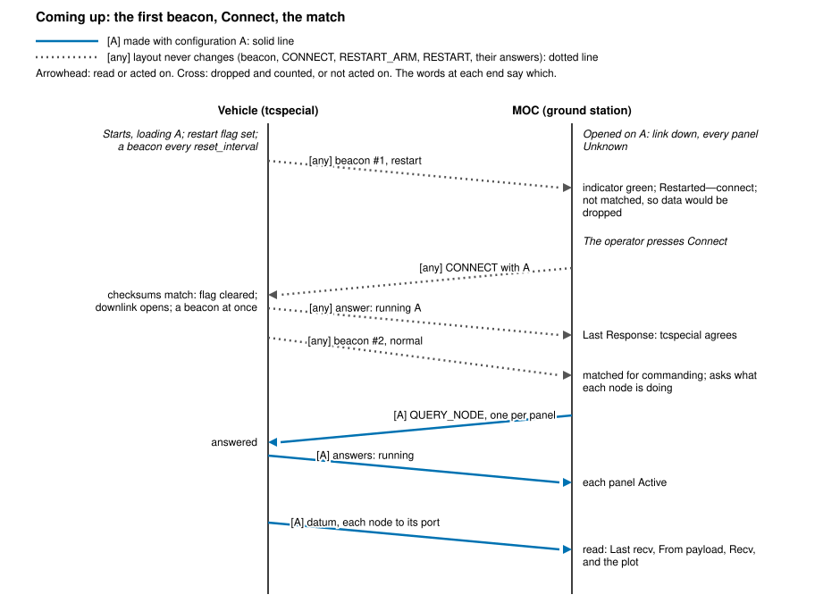
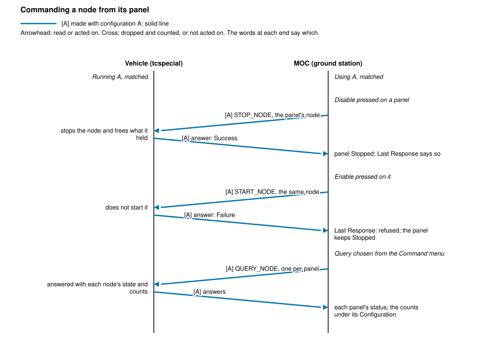
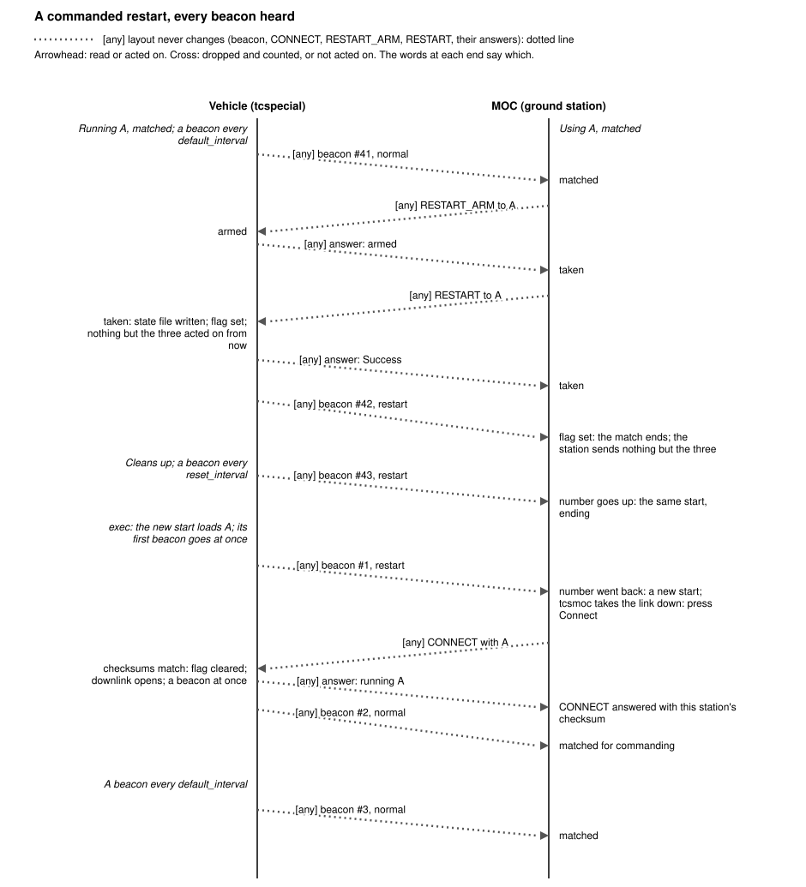
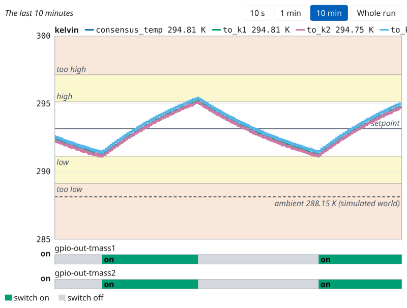
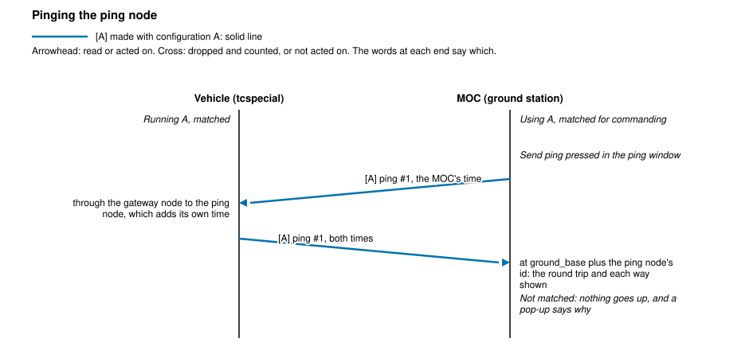

=============
tcsmoc Manual
=============

.. contents:: Contents
   :depth: 2
   :local:

Introduction
============

tcsmoc simulates a mission operations center: it reads the same tcspecial
configuration the vehicle flies, receives what the vehicle sends the ground,
shows it panel by panel, and sends the vehicle commands, over UDP datagrams.
It is how a configuration is tried on a desk, against tcspecial running the
vehicle and tcssim simulating its payloads. How to start the three together
is in Running the Programs, in `the tcspecial manual
<tcspecial.html#running-the-programs>`__.

The tcsmoc window
=================
Across the top, from the left:

the ``tcspecial link`` box
  The address of the command interpreter and one button, which reads
  ``Connect`` while the link is down and ``Disconnect`` while it is up. The
  status beside it says which, and is green when connected. Editing the
  address and pressing ``Connect`` is how the MOC is pointed at a different
  tcspecial. The address it opens with is the one the configuration's
  ``tcspecial`` section gives the command interpreter, ``tcs_cmd``'s
  ``recv``. The link is down until ``Connect`` is pressed: the window opens
  reading ``Disconnected``, and says to press it.

the beacon box
  The indicator, whose colours are listed under `Beaconing`_, the time the
  last beacon arrived, and what it said:

  .. code-block:: text

     Beacon
       Status:     (indicator)
       Last rcvd:  02:02:02
       Last msg:   tcspecial v0.1.0 md5 36999e46a4bf436854442d8f97a2248d

  The message wraps at its spaces where the window is too narrow for it on
  one line, as it is beside the command link.

  Each beacon also carries its own number, counted from one by the
  spacecraft, and the MOC says on the console what the numbers say about the
  beacons between them:

  .. code-block:: console

     2 beacons did not arrive: #9 came after #6
     the beacons start again at #1, so tcspecial has restarted

  A beacon says only that the spacecraft is alive, so without the number a
  beacon that was lost on the way reads exactly like one that was never sent.
  The radio delivers in order, so a number lower than the last one heard
  means tcspecial has started again and is counting from one; the same
  number as the last is the radio delivering a beacon twice, and counts for
  nothing. Whether the restart was one the ground commanded is not said:
  every start sets the restart flag, and the checksum in the beacon says
  which configuration the start is running.

  To the right of the indicator is a field that reads ``Restarted—connect``
  while the last beacon's restart flag said ``restart``, and is empty while
  it said ``normal``. The flag is set at every start of tcspecial -- the
  first, an ``Initiate restart``, a crash its supervisor restarted, a power
  cycle -- and from the moment it takes an ``Initiate restart``, until it
  takes a ``Connect`` carrying the checksum of the configuration it is
  running. So the field shows whenever the vehicle has not been matched,
  and is telling the operator what to do next: press ``Connect``, with the
  configuration whose checksum the beacons carry, which clears it. A
  ``Connect`` carrying another checksum leaves it set. While the flag is set
  the message line also ends ``, RESTARTED, NOT YET MATCHED``, which is how
  the window writes it. The
  ``beacon`` example's window has the panel without this field, since it
  sends no commands and so cannot connect.

  A datagram that reaches the beacon address from anywhere but where the
  configuration says beacons come from is not a beacon, and is ignored. That
  is a warning, which every program that shows the indicator says on its
  console whether or not it was asked to talk -- the ``beacon`` and ``ping``
  examples included, which are otherwise quiet without ``-v`` -- because it
  is the one explanation of an indicator going red while the spacecraft is
  beaconing:

  .. code-block:: console

     a beacon came from 127.0.0.1:53124 and not from 127.0.0.1:5550, which is where the configuration says they come from -- ignored

  It is said again only when a datagram comes from a different address than
  the last one warned of, not for every datagram, so that something sending
  steadily does not bury everything else.

  ``Last msg`` reads ``<none>`` until a beacon arrives. ``v`` is the software
  flying and ``md5`` the digest of the configuration file tcspecial read, so
  the line says what is up there without anything having to connect first.
  The answer to a ``CONNECT`` says the same two in the same words: see `What each end read`_. A datagram the MOC cannot read is shown as
  what arrived, cut short, rather than left off the line: something else
  sending to the group is worth seeing beside a green indicator.

the ``Command`` menu
  The commands below.

``Last Response``
  What the last command answered, under the two boxes. Until ``Connect`` is
  pressed it says to press it; the first thing it says after that is
  whether tcspecial read the same configuration this MOC did: see `What
  each end read`_.

  Under it, when the last command went out and when its answer came back,
  and how many packets have come from the vehicle:

  .. code-block:: text

     Last Response: START_DH OK
     Last sent: 14:22:31   Last rcvd: 14:22:31   Packets: 12 received = 10 processed + 0 malformed + 2 mismatched

  The ground's own clock, and the window's own commands -- what was pressed.
  A response that is slow to come and one that never comes read alike until
  those two times are beside it.

  The packets are everything that has arrived from the vehicle since the
  window started, data and answers alike, each counted once: *processed*,
  read and shown; *malformed*, not readable with this configuration's
  definitions; or *mismatched*, dropped because the two ends may not have
  been using the same configuration -- data that arrived while the window
  was not matched, or was waiting when the match began, and answers to
  anything but the command waited for. The last three add up to the first.
  See `Matching the configurations`_.

Below that is one panel per data handler, filled across the window before
another row is started under it, and a ``Quit`` button at the foot of the
window, which stops the tcspecial and tcssim the MOC started.

Each panel shows its handler's name and number, its status, how it is
reached, and its packet size; then two readings and one count. The number is
the payload's device id, its place among the names of the configuration's
nodes, counted from nought -- ``auto-send (dev id 0)`` -- and nothing in the
file states it. Both windows count the same way, so a payload is the same
number in each. The status is ``Active``,
``Stopped``, ``Stale`` or ``Unknown``, and where each comes from is under
`Beaconing`_: the spacecraft's answer to the last ``Enable`` or ``Disable``,
``Stale`` for an answer given before contact was lost, and ``Unknown`` for a
handler nobody can speak for.

``Last recv``
  When the MOC last received anything from that source, on the port its data
  arrives at. The MOC's own clock, and read for whether anything is still
  coming: see `When data last arrived`_.

``From payload``
  What arrived, as the ground received it.

``Recv``
  How many packets have arrived from that payload, counted from the moment
  the MOC started: ``3 recv``.

All three are the ground's end of it, counted and timed by the end that
received them. The spacecraft's account of what it last sent and last
received, and its count of the bytes it sent to its payload, were shown beside
them and are gone: a panel is watched for what reached the ground, and the
claim about it cost a third of the panel to say nearly the same thing. The
count was the spacecraft's too, and the wrong half of its statistics -- the
bytes its handler had read from the ground, a direction nobody sends in, so
the line read ``0 bytes`` beside a payload that was sending steadily. The
panels refresh themselves about once a second; nothing has to be pressed to
see traffic, and nothing is asked of the spacecraft to show it.

Each panel has three buttons. ``Enable`` and ``Disable`` are described under
`Starting and stopping a payload <tcspecial.html#starting-and-stopping-a-payload>`__; ``Configuration`` shows what the files
said about that handler: see `Seeing what was read <tcspecial.html#seeing-what-was-read>`__.

Step by step
============
What the window shows as the things an operator does most go on, picture by
picture: coming up and connecting, commanding a node, losing the vehicle and
hearing it again, and restarting it. Where what goes up to the vehicle and
what comes down matters, a diagram of the exchange comes first: the vehicle's
side on the left, the MOC's on the right, time going down the page. A message
made with the configuration the two ends share, called A, is drawn as a solid
line and tagged ``[A]``; a beacon, a ``CONNECT``, ``RESTART_ARM``,
``RESTART`` and their answers, whose layout never changes, as a dotted line
tagged ``[any]``. The words at the end a message reaches say what that end
does with it.

The pictures are the window itself on the thermostat example, drawn by
tcsmoc's own code from what a vehicle would send it, and shrunk to fit the
page; ``make screenshots-tcsmoc`` in the top directory makes them again. The
window opens wider than the page, three panels to a row, and a line longer
than the window, such as ``Last Response`` listing six nodes, ends where the
window does.

Coming up and connecting
------------------------

         restart flag set and sends beacon 1; the MOC is not matched. The
         operator presses Connect, which sends CONNECT with A. The vehicle
         clears its flag, answers that it is running A and sends beacon 2,
         normal, at once. The MOC is then matched for commanding and sends
         one QUERY_NODE per panel; the answers make each panel Active, and
         from then each node's data is read into its panel and the plot.

   What goes up and comes down between a vehicle that has just started and
   a MOC that connects to it.

1. The window has just opened. No beacon has been heard, so the indicator is
   grey and ``Last msg`` says ``<none>``; the link is down, and ``Last
   Response`` says to press ``Connect``. Every panel says ``Unknown``:
   nobody has asked the vehicle anything.

   .. figure:: shots/tcsmoc-opened.png
      :alt: The tcsmoc window just opened: the tcspecial link box reads
            Status: Disconnected beside a Connect button, the beacon
            indicator is grey with Last rcvd --:--:-- and Last msg <none>,
            Last Response says "Each panel is a node. Press Connect to
            command them", and the three panels shown each say Unknown,
            with Last recv --:--:-- and Recv: 0 recv.

      Opened, before anything is heard.

2. The vehicle's first beacon arrives. Every start of tcspecial sends its
   beacons with the restart flag set, so the field beside the indicator
   reads ``Restarted—connect`` and the message ends ``, RESTARTED, NOT YET
   MATCHED``. The indicator is green: the vehicle is being heard from. The
   window is not matched yet, and nothing but beacons and answers comes
   down.

   .. figure:: shots/tcsmoc-first-beacon.png
      :alt: The top of the window after the first beacon: a green
            indicator, the field beside it reading Restarted—connect, Last
            rcvd a time of day, and Last msg "tcspecial v0.1.0 md5
            9327ee80..., RESTARTED, NOT YET MATCHED". The link still says
            Disconnected.

      The first beacon, with the restart flag set.

3. ``Connect`` brings the link up and sends a ``CONNECT`` carrying this
   window's checksum. The vehicle answers with what it is running, and
   ``Last Response`` says ``tcspecial agrees``. The button now reads
   ``Disconnect``. The beacon box still says ``Restarted—connect``: it
   shows the last beacon, which was sent before the ``CONNECT`` arrived.

   .. figure:: shots/tcsmoc-connected.png
      :alt: The top of the window after Connect: Status: Connected in green
            beside a Disconnect button, Last Response "tcspecial agrees:
            v0.1.0 md5 9327ee80...", and the beacon box still reading
            Restarted—connect.

      Connected; the vehicle agrees.

4. The vehicle, matched, clears its flag and beacons at once. That beacon
   matches the window, which asks the vehicle what each node is doing: one
   ``QUERY_NODE`` per panel. ``Last Response`` lists the answers, in place
   of what the ``CONNECT`` said, and each panel takes its own --
   ``Active`` here, in green. The field beside the indicator is empty.

   .. figure:: shots/tcsmoc-matched.png
      :alt: The window matched: the field beside the green indicator is
            empty, the message has no RESTARTED, Last Response begins
            "consensus_temp: Active; gpio-out-tmass1: Active;
            gpio-out-tmass2: Active", and each panel says Active.

      Matched; every node asked about.

5. Data arrives, each node's on a port of its own, and the panels are
   repainted from it once a second: ``Last recv`` is when it came, ``From
   payload`` what it was -- a temperature, in kelvin, for ``consensus_temp``
   and the three conversions, and the byte each heater's switch reports,
   ``01`` for on -- and ``Recv`` how many have come. The line under ``Last
   Response`` counts every packet from the vehicle, answers included, and
   says what became of them. The plot window, `The plot window`_, draws the
   same values over time.

   .. figure:: shots/tcsmoc-data.png
      :alt: The window with data: each panel shows Last recv with a time,
            From payload with 294.8125 K for consensus_temp and 01 for each
            heater's switch, and Recv: 5 recv. The line under Last Response
            counts the packets received, every one processed and none
            malformed or mismatched.

      Data in the panels.

Commanding a node
-----------------

         STOP_NODE for its node; the vehicle stops it and answers Success,
         and the panel says Stopped. Enable sends START_NODE; the vehicle
         does not start the node and answers Failure, which Last Response
         shows, and the panel keeps Stopped. Query, from the Command menu,
         sends one QUERY_NODE per panel, and the answers set each panel's
         status and the counts its Configuration shows.

   What a panel's buttons and the ``Command`` menu's ``Query`` send, and
   what comes back.

1. The ``Command`` button opens the menu of the commands that are not about
   one node: see `Commands`_. ``Query`` asks the vehicle about every
   panel's node at once.

   .. figure:: shots/tcsmoc-command-menu.png
      :alt: The Command menu open below the Command button, listing Ping,
            ARM Restart, Initiate restart, Query, Query DH, Start DH and
            Stop DH.

      The ``Command`` menu.

2. A panel's ``Configuration`` shows what the configuration says of its
   node and, once a ``Query`` has been answered, what the node has moved
   since the vehicle started, as the vehicle counts it. The list is wider
   and longer than the pop-up, which scrolls; a click outside closes it.

   .. figure:: shots/tcsmoc-configuration.png
      :alt: The consensus_temp parameters pop-up over its panel: its device
            id and where the ground receives it, then "what it has moved
            since the vehicle started" with taken, reads failed, given 2400
            bytes, refused, dropped, asked and strangers, cut off at the
            pop-up's right edge, and under it "No command binding names
            this node, so nothing on it may be set from the ground."

      What ``Configuration`` shows after a ``Query``.

3. ``Disable`` on ``to_k3``'s panel sends ``STOP_NODE`` for its device id.
   The vehicle answers ``Success``, ``Last Response`` says so, naming the
   node by id and name, and the panel says ``Stopped``, in grey.

   .. figure:: shots/tcsmoc-disabled.png
      :alt: The window after Disable on to_k3: Last Response reads
            "STOP_NODE #10 (to_k3): Success" and to_k3's panel says Stopped
            where the other five say Active.

      A node stopped.

4. ``Enable`` sends ``START_NODE``. A vehicle that does not start the node
   says so by the status it answers with, here ``Failure``: ``Last
   Response`` says the command was refused and with what, and the panel
   keeps ``Stopped``, since nothing changed aboard. A panel's status changes
   only with an answer that says it did.

   .. figure:: shots/tcsmoc-refused.png
      :alt: The window after an Enable the vehicle refused: Last Response
            reads "START_NODE #10 (to_k3) was refused: Failure" and to_k3's
            panel still says Stopped.

      A start refused.

When the vehicle goes quiet
---------------------------
The beacons are what say the vehicle is there. When they stop, the
indicator ages as `Beaconing`_ says, and the window acts on it. The
thermostat example beacons every five seconds once matched.

1. Two beacons late, ten seconds after the last, the indicator blinks green
   and white. One lost datagram is a network and not a spacecraft, so
   nothing else changes: the panels keep what the vehicle last said.

   .. figure:: shots/tcsmoc-late.png
      :alt: The window with the indicator green, caught in the lit half of
            a blink; the panels still say Active and Last rcvd is the time
            of the last beacon.

      Late: blinking green.

2. Four late, twenty seconds after the last, the indicator blinks yellow.
   Contact is lost: every panel's status becomes ``Stale``, the last thing
   known and no more, and the window is no longer matched, so it reads none
   of the vehicle's data and refuses its own commands unsent. The link
   stays up.

   .. figure:: shots/tcsmoc-aging.png
      :alt: The window with a yellow indicator and every panel's status
            reading Stale; the link still reads Status: Connected.

      Contact lost: yellow, and every status ``Stale``.

3. Eight late, forty seconds after the last, the indicator blinks red. A
   command pressed now -- here ``Ping``, from the ``Command`` menu -- is
   not sent: a pop-up in front of the greyed window says why and names the
   checksum in the vehicle's last beacon beside this window's own. They are
   the same here, the vehicle having gone quiet rather than changed what it
   runs. ``OK`` closes it.

   .. figure:: shots/tcsmoc-unmatched.png
      :alt: The window greyed behind a pop-up headed "Not sent: the match
            between the ground's and the vehicle's configurations is still
            in progress", which says "Ping not sent: the configurations are
            not yet matched" and names the same md5 checksum for the
            vehicle's beacon and this station's configuration, with Copy
            and OK buttons. The indicator behind it is red.

      Waiting: red, and a command refused unsent.

4. The beacons come back: the indicator is green again and the window is
   matched for listening, so data is read once more. The panels stay
   ``Stale`` and commands are still refused, because what matched the
   window for commanding was a ``CONNECT`` answered before the outage. The
   link is still up -- its button reads ``Disconnect`` -- so the way back is
   ``Disconnect`` and then ``Connect``.

   .. figure:: shots/tcsmoc-heard-again.png
      :alt: The window with a green indicator again, Status: Connected, and
            every panel still reading Stale.

      Heard again, not yet commanding.

5. After ``Disconnect`` and ``Connect`` the vehicle agrees, the window is
   matched for commanding again, and it asks about every node: ``Last
   Response`` gives what the ``CONNECT`` found and then what the asking
   found, and the panels say what the vehicle answered.

   .. figure:: shots/tcsmoc-reconnected.png
      :alt: The window after Disconnect and Connect: Last Response begins
            "tcspecial agrees: v0.1.0 md5 9327ee80...; consensus_temp:
            Active; gpio-out-tmass1: Active" and every panel says Active.

      Connected again.

Restarting the vehicle
----------------------

         vehicle runs A, matched, beaconing; the station arms and sends
         RESTART. The vehicle sets its restart flag, answers Success and
         sends beacon 42 with the flag set, which ends the station's match.
         After the exec the new start's beacon 1 goes at once with the flag
         set; the number going back says a new start, and tcsmoc takes its
         link down. CONNECT with A matches again, and beacon 2 comes normal.

   A restart onto the configuration the vehicle runs, as the design draws
   it: see `The restart and the beacon, in time
   <tcspecial-design.html#the-restart-and-the-beacon-in-time>`__.

1. With the restart target left empty -- this window's own configuration,
   whose checksum is beside the field -- ``ARM Restart`` from the
   ``Command`` menu arms the vehicle, and ``Last Response`` says onto what.

   .. figure:: shots/tcsmoc-armed.png
      :alt: The top of the window after ARM Restart: the Restart target
            field is empty, the text beside it reads "md5 9327ee80..., this
            window's configuration", and Last Response reads "ARM Restart
            onto md5 9327ee80..., this window's configuration: Success".

      Armed.

2. ``Initiate restart`` is answered ``Success``, and ``Last Response`` says
   the window is waiting for a beacon of the next start. The vehicle's next
   beacon carries the restart flag, which ends the window's match: the
   field beside the indicator reads ``Restarted—connect`` again.

   .. figure:: shots/tcsmoc-restarting.png
      :alt: The top of the window after Initiate restart: Last Response
            reads "Initiate restart: Success -- waiting for a beacon of the
            next start", the link still reads Connected, and the beacon box
            reads Restarted—connect, its message ending RESTARTED, NOT YET
            MATCHED.

      Restarting.

3. The new start's first beacon is numbered one. A number gone back is a
   new start, so the window takes the link down and says what to press
   next. ``Connect`` then goes as it did in `Coming up and connecting`_.

   .. figure:: shots/tcsmoc-restarted.png
      :alt: The top of the window after the new start's first beacon:
            Status: Disconnected beside a Connect button, Last sent and
            Last rcvd back to --:--:--, Restarted—connect beside the
            indicator, and Last Response "tcspecial has started again:
            press Connect".

      Started again: press ``Connect``.

When data last arrived
======================
``Last recv`` on each panel is when that source's data last arrived, and the
panel says nothing more about whether that was recent enough. Nothing in a
configuration states how often a node's data should arrive -- a node produces
when something reaches it, and a thermostat that sends only when its decision
changes may be silent for hours -- so an indicator that judged it would mean
nothing, and one that never changed would be worse than none.

The MOC asks nothing to keep the panels current. Each source's data arrives on
a port of its own, where the ground times it, so the panels are repainted from
what has arrived without a command going out. What only the spacecraft can say
-- a node's own counters, and whether it is running -- is what ``Query``,
in the ``Command`` menu, is for.

The plot window
===============
Where a value or a switch reaches the ground -- a node drawn into a gateway
node that sends values, which is anything with a unit: a ``to_kelvin`` or
``to_value`` conversion, a ``vote``, a ``process``'s answers; or a
``thermostat``, which sends decisions -- tcsmoc opens a second window beside
its own, ``tcsmoc: plot``, and its ``Plot`` button opens it again once
closed.

         example, the 10 min button chosen. One panel, in kelvin, scaled
         285 to 300: its legend names consensus_temp, to_k1 and to_k2 with
         their latest readings, about 294.8 K, beside their colours, and is
         cut off at to_k3 and the band; the four temperatures run close
         together as two slow rises and falls between about 291 and 295 K.
         Behind them the band: white from 291.15 to 295.15 K around a dark
         rule labelled setpoint, pale yellow regions labelled high and low,
         pale red ones labelled too high and too low, and a dashed rule
         labelled ambient 288.15 K (simulated world). Under the panel, two
         strips, gpio-out-tmass1 and gpio-out-tmass2, each green and
         labelled on while the temperature rises and grey while it falls,
         and on said beside each as its state.

   The thermostat example's plot window, as it opens, showing the last ten
   minutes. At this width the legend has no room for its fourth value or
   the band's name, which run off its right edge.

Values in one unit share a panel, so that two temperatures are read off one
axis and a voltage is never read off a current's: the descent example has
three, metres, metres a second and a ratio, and the thermostat example one,
kelvin, with its three sensors and their vote. Each panel is scaled to what
it shows -- its lowest and highest reading in the span, and the setpoint of
any thermostat reading values in its unit, drawn as a dark rule labelled
``setpoint`` -- rounded out to ticks one, two or five of a power of ten
apart. Over each panel its legend names the unit and each value, with its
latest reading, beside its colour. Each reading is a dot on its line, where
and when it arrived, so that a reading is told from the line drawn between
two; where readings crowd into one column of the screen, one dot stands for
them.

Behind a panel a thermostat reads, its band is drawn, whether or not its
decision reaches the ground: the band is what the values are held to, said by
the configuration. With setpoint S and
``half_band`` H, the panel is left white from S - H to S + H, where the
thermostat holds the reading; it is pale yellow, and said ``high`` and
``low``, for a further H either side; and pale red, said ``too high`` and
``too low``, beyond that to the panel's edges. Each edge is a thin line, and
the legend names the band and its thermostat, as ``band 291.15–295.15 K
(thermostat)`` in the thermostat example. The panel's scale always takes in
S - 2H to S + 2H, so the yellow is always there to be seen, and the red is
too wherever the readings, or the rounding out to a tick, reach past it.
Where more than one thermostat reads the unit -- staged heating, with a first
stage and a second set lower that comes on only when the first cannot hold
the zone -- the band drawn is that of the thermostat with the highest
setpoint, the first stage, which is the one that states the comfort band;
every thermostat's setpoint is still drawn as its rule.

In a run that simulates, the panel in kelvin also has the simulated world's
ambient temperature, the ``ambient_temp`` under ``world:`` in the simulator
file, drawn as a dashed rule and labelled at its right end, as ``ambient
288.15 K (simulated world)`` in the thermostat example: what the zone drifts
towards when nothing heats it. It is read from the file, not sent by the
vehicle, and so is not drawn in tcsgui's diagram. A flight run, with
``--simulate=none``, has no simulated world and draws none.

The buttons at the top choose the span: the last ``10 s``, ``1 min`` or
``10 min``, which fill from the left and then scroll, the newest at the right
edge; or the ``Whole run``, from the first reading at the left edge to now
at the right. tcsmoc keeps each value's last six thousand readings, ten
minutes of one every tenth of a second, and for the whole run four thousand
more, which it thins as the run grows by letting every other one go, so that
it holds the whole run, more coarsely the longer it is, in the same room. A
value silent for more than two and a half seconds has its line broken there
rather than drawn across the silence, however coarsely it is held. Where
many readings fall in one column of the screen, their lowest and highest are
drawn, so that a spike is never thinned away.

Under the panels, as wide as them so that a change lines up with the values
above it, is a strip for each switch -- a ``thermostat`` node drawn into a
gateway node, named with what it drives, such as ``thermostat →
gpio-out-tmass1, gpio-out-tmass2``; each line of a ``gpio_in`` drawn into
one, named with its line, such as ``switch line 0`` in the gpio example; and
each ``gpio_inout`` drawn into one, by its name, such as ``gpio-out-tmass1``
in the thermostat example, what that heater's switch was told -- green with
``on`` written in it while it is on or high, grey while it is off or low, and
its last state said beside it. With two thermostats each
driving a heater there are two strips, one under the other, so which heater
is on, or both, is read straight off them. Nothing of a switch is
drawn on the panels, which keeps the strips apart from the values and the
band. A thermostat tells the ground only when its decision changes, so a
switch is drawn from each change to the next, and before the first is heard
it is not drawn at all, its state said as ``not heard`` rather than guessed
as off.
A thermostat's strip is its decision and not what a heater does: a heater
disabled in tcssim takes the decision and does nothing. A line sensing the
heater is what it does, and its strip stays off; which is why the thermostat
example sends its heaters' lines down rather than its thermostat's decision.

The colours are Okabe and Ito's, which readers with each common kind of colour
blindness tell apart: blue, bluish green, reddish purple, sky blue and black
for the values, and bluish green for a switch on, which is never taken for a
value because a switch is a strip of its own under the panels. The
band's yellow and red are their yellow and vermillion paled toward white,
light enough that every line keeps its contrast against them. None is alone:
the legend names each value beside its colour with its latest reading, the
setpoint's and the ambient's rules are labelled, each region of the band is
said in words and the legend names the band, and each switch's state is in
words beside its strip and on it.

The ping window
===============
Where the configuration has a ping node the ground can reach both ways, as
the ping example does, the row of the ``Command`` button has a ``Ping
node`` button too. It opens a window of its own, ``tcsmoc: ping``, whose
``Send ping`` -- or Enter or Space, from the moment it opens -- sends the
node a ping carrying the MOC's time. The ping goes up through the gateway
node, the ping node adds its own time, and the answer comes down to the
ground's port for that node, ``ground_base`` plus its device id; the window
shows what went and what came back, each with its time, the round trip, and
each way.

         the MOC's time up through the gateway node to the ping node, which
         adds its own time and sends it back down to the ground's port for
         it; the window shows the round trip and each way. Not matched,
         nothing goes up and a pop-up says why.

   A ping, up and back.

1. The ping example's window, matched with the vehicle: ``Ping node`` is
   beside ``Command``, where the thermostat example's window has ``Plot``.

   .. figure:: shots/tcsmoc-ping-node.png
      :alt: The top of the ping example's window, connected, with a green
            indicator, and a Ping node button beside the Command button.

      The ``Ping node`` button.

2. The ping window once a ping has been answered: ``Sent`` is the ping,
   numbered and carrying the MOC's time; ``Received`` the answer, which
   carries the ping node's time as well; and under ``Times`` the round trip
   and its two halves, ``MOC to tcspecial`` and ``tcspecial to MOC``.

   .. figure:: shots/tcsmoc-ping-answered.png
      :alt: The tcsmoc: ping window, titled Pinging ping. Sent: "ping #1"
            and two numbers, the MOC's time, with its time of day; Received:
            the same with the ping node's time added, and its time of day;
            Times: the round trip, a few milliseconds, in large type, and
            under it MOC to tcspecial and tcspecial to MOC, which add up to
            it; "Times are UTC. Each one-way time spans two clocks; the two
            add up to the round trip."; and a Send ping button.

      A ping answered.

A ping is not a command: it goes to the gateway node and not to the command
interpreter, and ``Ping`` in the ``Command`` menu, which asks whether the
command link reaches the vehicle, is another thing. It is held back as a
command is, though. Before the window is matched for commanding nothing is
sent: the ping window says why where the ping would have been, and the
pop-up a refused command brings comes up in the main window.

A triggered payload on the console
==================================
A payload that answers requests sends nothing until tcspecial asks it to, so
when such a panel shows no data the question is what the MOC sent and what came
back -- and a panel shows neither. For those payloads, and only those, tcsmoc
says both on the terminal it was started from.

At startup, once per triggered payload, the whole of what it will be addressed
by and asked with:

.. code-block:: console

   triggered payload triggered-send: TCP localhost:5003, trigger 0x67 6F 0A every 1000 ms, OC 127.0.0.1:6003, status Stopped

Then one line for every command sent about it. A press of its button:

.. code-block:: console

   triggered payload triggered-send: Enable pressed: sending START_DH as a Network handler
   triggered payload triggered-send: START_DH answered Success, so the panel now says Active

and one from ``Query``, carrying the status each answer came back with
and the trigger count:

.. code-block:: console

   triggered payload triggered-send: QUERY_DH Success: 5 triggers sent, 0 bytes to the ground, 0 from it; QUERY_DH_SAMPLE Success

That one is said when it changes and not again until it changes once more:
what is worth reading is the answer where something moved. A payload that is
not transmitting therefore says this once and then nothing.

``NotFound`` there is worth knowing: the panel shows zeroes either way, but it
means the tcspecial being talked to has no such handler, which usually means it
was started from a different configuration -- most often one left running from
an earlier payload set, which tcsmoc attaches to rather than replacing. The
trigger count is the one number that says the asking is happening at all; it
appears in no other counter, because a trigger is a write with no read behind
it.

What each end read
==================
When a link comes up, tcsmoc sends its software version and an MD5 of the
payload configuration it read, and tcspecial answers with its own. Each
prints what it read on the terminal it was
started from before it makes the socket, so they are there to read even
when the link never comes up -- the MOC's first, then tcspecial's, then what
the answer said:

.. code-block:: console

   tcsmoc v0.1.0 md5 36999e46a4bf436854442d8f97a2248d
   tcspecial v0.1.0 md5 36999e46a4bf436854442d8f97a2248d
   CONNECT answer: tcspecial v0.1.0 md5 36999e46a4bf436854442d8f97a2248d

The first two lines are written the same way by the two programs, each naming
itself, so two ends reading one payload set print the same version and
digest -- which is what makes a difference in any
part of it worth reading. The third says what came back over
the link.

``Last Response`` says whether the two agree:

.. code-block:: text

   tcspecial agrees: v0.1.0 md5 36999e46a4bf436854442d8f97a2248d

The verdict is reached on the software version and the digest. They are the
same payload
set if the digests match: the digest is of what a file says rather than of its
bytes, so the YAML and the XML of one set digest alike, and so do two files
differing only in comments, spacing or order -- of their sections, types,
nodes, attributes, links, groups or bindings. Nothing in a configuration is in
an order that means anything: the digest takes everything in one canonical
order, by name, and device ids are counted in that same order, so a node's id
is its position among the names of all the nodes. In a set written as several
files, the names its
include list gives them count too; the top file's own name does not.

A difference means the two ends are not serving the same set. The usual cause
is a tcspecial left running from an earlier one, which tcsmoc attaches to
rather than replacing; stopping it and letting tcsmoc start a fresh one is the
fix.

Matching the configurations
===========================
Neither end acts on what the other made with a different configuration. The
digest is the configuration's *checksum*, and the two ends are matched once
the vehicle has taken a ``CONNECT`` carrying the checksum of the
configuration it runs.

On the vehicle, every start of tcspecial begins unmatched, with the restart
flag set in its beacons. Until a ``CONNECT`` carrying its configuration's
checksum, it sends the ground nothing but beacons and command answers --
what its nodes produce still goes to its logs -- and it acts on no command
but ``CONNECT``, ``RESTART_ARM`` and ``RESTART``. Every other command, a
``PING`` among them, is answered ``Unmatched`` and not acted on. A
``CONNECT`` carrying another checksum is answered with the vehicle's own,
and changes nothing else. A matching one clears the flag, sends a beacon at
once, slows the beacons to ``beacon.default_interval``, opens the downlink
and the other commands, and drops every command already waiting on the node
command link unread, since all of it was sent before the match. Taking a
restart ends the match at once, and no ``CONNECT`` matches again until the
start that comes back.

On the ground, tcsmoc -- and any station built on tcslib or the C/C++
library -- is *matched for listening* while the last beacon it has heard is
recent (the indicator says the vehicle is heard from), has the flag clear and
carries the checksum of the configuration this station read. A clear flag
says some station's ``CONNECT`` matched the vehicle, so a station that only
listens is matched as surely as one that commands. It reads the vehicle's
data only while matched for listening: everything else is dropped and
counted, and as a match begins whatever was already waiting is dropped and
counted too. It is *matched for commanding* once, besides, its own
``Connect`` has been answered with its checksum; until then every command but
``Connect``, ``ARM Restart`` and ``Initiate restart`` is refused before it
is sent. tcsmoc says why in an error pop-up in front of the panels, headed
*Not sent: the match between the ground's and the vehicle's configurations
is still in progress*, and in ``Last Response``::

   Ping not sent: the configurations are not yet matched. Check that the checksum in the vehicle's beacon is this station's configuration's, and Connect

The pop-up goes on to name the checksum the vehicle's last beacon carried
and this station's own, so that the two can be compared: where they differ,
the vehicle is running another configuration, and tcsmoc has to be run with
that one to command it. ``OK`` closes it. With the link down, a press says
to press ``Connect`` instead, as it always has.

``ARM Restart`` and ``Initiate restart`` are never refused, being how a
vehicle that will not match is restarted onto a configuration that will.
Pressed with the link up before a ``CONNECT`` has been answered, though,
they ask first, in an advisory pop-up headed *No CONNECT has been answered
yet* that names the same two checksums: ``Go on`` sends the command as it
would have gone, and ``Cancel`` sends nothing. Every pop-up's text can be
selected and copied, and its ``Copy`` button copies all of it.

A beacon with the flag set, one carrying another checksum, or the beacons
going overdue ends both, and the next ``Connect`` after the beacons say the
vehicle is matched again makes the station matched for commanding once more.
So after a restart, which takes the link down, press ``Connect`` before
commanding; and after an outage, which leaves the link up and its button
reading ``Disconnect``, press ``Disconnect`` and then ``Connect``. See `When
the vehicle goes quiet`_.

Commands
========
From the ``Command`` menu, whose seven items are ``Ping``, ``ARM Restart``,
``Initiate restart``, ``Query``, ``Query DH``, ``Start DH`` and ``Stop DH``.
The first four send a command; the restart target, in the row under the
``Command`` button, says what the two restarts restart onto.

Ping
  Sends a PING and waits for the answer. ``Last Response`` says what came
  back -- ``PING OK at 14:22:31``, the time the spacecraft made the answer,
  which every response carries -- or, where nothing came back within the
  client's timeout, ``PING failed`` and why.

Restart target
  The row under ``Command`` says which configuration ``ARM Restart`` and
  ``Initiate restart`` restart onto. Left empty, it is the configuration
  this tcsmoc read: a plain restart, onto what the vehicle is running. Type
  a configuration file's path to restart onto that configuration: tcsmoc
  checks it with tcsverify's checks, refuses it with the problems found if
  any, and otherwise takes its checksum. Or type the checksum itself, as 32
  lower-case hex digits, for a configuration the vehicle holds that is not
  on this desk. Beside the field is what it comes to -- the checksum, and
  the file where there is one -- before anything is sent, and each answer
  says it again.

ARM Restart
  Arms a restart onto the restart target, whose checksum it carries. A
  vehicle that does not hold the configuration an arm names refuses it
  ``NotFound`` and arms nothing. ``Initiate restart`` goes onto the target
  the arm was given: change the target after arming, and it is refused
  unsent until ``ARM Restart`` is pressed again for the new one. An arm
  lasts 20
  minutes from when the vehicle takes it unless the ``tcspecial`` section's
  ``restart_arm_valid`` says otherwise, as a length of time --
  ``restart_arm_valid: "45 min"`` -- and a restart after that is refused until
  the vehicle is armed again. Long enough to arm, see what the
  vehicle is doing and decide, over a link with minutes of latency; short
  enough that an arm left behind does not stand ready for the next restart
  anybody sends.

Initiate restart
  Restarts the spacecraft software, which only a restart armed with the same
  key and the same configuration's checksum within the time an arm lasts
  does. The arm is used up by it; a restart with the wrong key or another
  checksum is refused and leaves the arm standing, and one naming a
  configuration the vehicle can no longer load is refused ``NotFound`` and
  restarts nothing. After a restart onto another configuration than this
  tcsmoc's, ``Last Response`` says which checksum the vehicle will run, and
  that tcsmoc must be run with that configuration to ``Connect`` to it:
  this tcsmoc does not load another configuration itself. tcspecial
  answers, stops as it does when it is told to -- the pass finished, the
  links closed, the log flushed -- and runs itself again in the same process,
  loading the configuration the restart named: see `Configurations kept on
  board <tcspecial.html#configurations-kept-on-board>`__. Another configuration is flown this way. It keeps the descriptors it was started with, such as a socket or pipe
  a supervisor handed it, and closes everything it opened itself. On a system
  where it cannot do that -- one with neither ``/proc/self/fd`` nor
  ``/dev/fd`` to say what it was started with -- it says so on its error
  output and exits, so run tcspecial under a supervisor that starts it again
  when it exits.

  The beacons are how the ground learns the restart happened. The moment
  the restart is taken tcspecial sets the restart flag in its beacons,
  which then say ``restart`` where they said ``normal`` -- the Beacon box's
  field beside the indicator reads ``Restarted—connect``, and the message
  line ends ``, RESTARTED, NOT YET MATCHED`` -- stops sending anything down
  but beacons and answers, and sends one beacon at once and the rest every
  ``beacon.reset_interval``. The tcspecial that comes back reads the file
  the ``tcspecial`` section's ``state_file`` names, which says whether the
  start was commanded; its beacons start again at #1 with the flag still
  set, as every start's do. Nothing counts starts: there is no generation
  number, and the beacons' number going back is what says a start. Every
  start beacons
  every ``beacon.reset_interval`` until it takes a ``Connect`` carrying its
  configuration's checksum. When it does it clears the flag, sends a beacon
  at once, and from then on beacons every ``beacon.default_interval``. A
  ``Connect`` taken after the restart is initiated and before the old
  tcspecial has gone neither clears the flag nor slows the beacons: the
  restart is still under way. It is refused, and ``Last Response`` says
  so; the first beacon of the tcspecial that comes back takes the link
  down, and ``Connect`` is pressed then.

  A tcspecial that starts again for any other reason -- it crashed and its
  supervisor started it, or the vehicle lost power -- also starts its
  beacons again at #1 with the flag set, and runs with the configuration it
  had. The beacons do not say which kind of start
  it was: the checksum they carry says which configuration it is running,
  and the startup summary on tcspecial's error output says whether the
  start was commanded.

  A station that has sent a restart holds nothing back: every button goes
  on working as it did. The vehicle is what refuses a command that follows
  a restart. From the moment it takes one, and in the tcspecial that comes
  back until a ``Connect`` carrying its checksum, it answers every command
  but ``Connect``, ``Arm restart`` and ``Initiate restart`` ``Unmatched``
  and does nothing with it, since the command may have been built with a
  configuration it is no longer running. The beacons, not the answer to the
  restart, which may never arrive, say what became of it: a beacon saying
  ``restart`` where the last said ``normal``, or one whose number has gone
  back, says it was taken; beacons that go on counting up at the usual
  interval and still say ``normal`` say it never arrived, and the restart
  can be sent again. A restart sent again after the first was taken is
  refused ``NotArmed`` and restarts nothing.

  The first flagged beacon ends the station's match, so from then on the
  station itself refuses every command but the three, unsent, until it is
  matched again. Any beacon whose number has gone back takes the command
  link down: the status beside the address reads ``Disconnected``, what the
  last ``Connect`` agreed is forgotten, and the next thing to press is
  ``Connect``, which every start needs before anything else is sent.
  ``Last Response`` says ``tcspecial has started again: press Connect``. It
  does not say whether the start that came back is the one the restart
  asked for. Should the new tcspecial's first beacons all be lost, so that
  no number is seen to go back, the link stays up while the beacons' flag
  says the vehicle is not matched: press ``Disconnect`` and then
  ``Connect``, which sends the ``Connect`` the new tcspecial is waiting for.

  A command carries its sequence number and nothing that counts starts,
  and so does its answer: there is no generation number. A start of the
  vehicle is noticed from its beacons, which carry the restart flag and so
  end the station's match: from then on the station refuses every command
  but ``Connect``, ``Arm restart`` and ``Initiate restart``, unsent, until
  it is matched again, which a ``Connect`` answered with its checksum, and
  a beacon with the flag clear, make it. See `Matching the
  configurations`_.

  A command older than one the vehicle has already taken -- sent by a
  station whose count has gone back, or overtaken on the way should the
  link ever deliver out of order -- is answered ``Stale`` and not acted on:
  the later command is the one that counts. A station that has been started
  again may find its commands answered ``Stale`` until it connects, since
  the answer to Connect tells it where to go on counting from.

  Any command whose answer does not come can be sent again: a second one
  changes nothing the first did not. The exception is the restart itself:
  look at the beacons before sending it again for want of an answer, since
  they say whether it was taken. A restart sent again that reaches the
  tcspecial that came back is refused ``NotArmed`` there, since that start
  holds no arm, and restarts nothing.

Query
  Sends one ``QUERY_NODE`` for each panel's node. Each panel takes the
  status its answer gives -- ``Active``, ``Stopped``, or ``Unknown`` for a
  node the vehicle has not got -- and its ``Configuration`` the counts of
  what the node has moved; ``Last Response`` lists the answers. Refused
  unsent, as the others are, while the window is not matched for
  commanding.

The remaining three -- ``Query DH``, ``Start DH`` and ``Stop DH`` -- send
nothing, and ``Last Response`` says why: a graph has nodes, which each
panel's buttons start, stop and set.

Beaconing
=========
TCSpecial sends a beacon every ``beacon.reset_interval`` from when it starts,
or from when a restart is initiated, until it takes a ``Connect`` carrying
its configuration's checksum, and every
``beacon.default_interval`` after that (see Initiate restart, above), from the
address the payload set's ``tcspecial`` section names to the address beside it,
or ``tcspecial.ytcs``'s pair for a set with no section. Tcsmoc binds that same
receiving address, having read the same files. Tcsmoc displays the
following beacon colors:

steady grey
  No beacon message has been received yet. The indicator is grey only then:
  once a beacon has arrived it is never grey again.

steady white
  A beacon message was received, and the system time has since changed
  backwards, so how long ago it arrived cannot be said

steady green
  A beacon message has been received within the expected time

blinking green
  One or more beacon messages has not been received within the expected time
  but this is within the acceptable number of lost messages

blinking yellow
  The number of lost beacon messages indicate a possible issue. The yellow is
  a golden one, ``#ffe100``: pure yellow is so nearly as light as white that
  its blink could hardly be seen.

blinking red
  The number of lost beacon messages indicates a likely issue.

A blinking indicator alternates between its colour and white, half a second of
each.

Which colour the indicator shows is decided by how many beacons have gone
missing since the last one arrived. A beacon is missed once the
configuration's ``beacon.default_interval`` has passed without it, so the
count goes up by one each interval, and a new beacon puts it back to nought:

================  ===============  =======
Beacons missed    Indicator        Stage
================  ===============  =======
none heard yet    steady grey      Unheard
0 or 1            steady green     Heard
2 or 3            blinking green   Heard
4 to 7            blinking yellow  Aging
8 or more         blinking red     Waiting
================  ===============  =======

The stage is what is true of the spacecraft, and the indicator is one way of
saying it: Unheard before any beacon has arrived, Heard while the spacecraft
is being heard from, Aging once enough beacons are missing that contact is not
claimed, and Waiting once nothing is being heard and the ground is waiting for
the spacecraft to be heard from again.

One beacon may be missed with the indicator still steady, because one lost
datagram is a network and not a spacecraft. For a five-second interval the
indicator is steady for ten seconds, blinks green for ten more, is yellow for
twenty and red after that. The interval is the one the configuration states,
which is the vehicle's too: nothing changes it while tcspecial runs. The
station stops being matched when the indicator turns yellow, four intervals
after the last beacon, and reads none of the vehicle's data until a beacon
comes again.

Beside the indicator is the time the last beacon arrived, shown the way every
other time in the window is. It is the time the beacon reached the MOC rather
than the time the spacecraft stamped on it: the line is read to find out
whether beacons are still coming, and a spacecraft whose clock had stopped
would otherwise look as though its beacons had.

Until a beacon has arrived the line shows ``--:--:--``, as a panel does for a
direction that has carried nothing. Once one has, the time stays: a pass that
finds nothing ages the colour beside it and leaves the time alone, because the
beacon did arrive when it arrived.

Panels start at ``Unknown``: a MOC that has just come up has been told
nothing, and the tcspecial it attached to may have been running handlers for
hours. They are filled in when the window is first matched for commanding
-- the MOC then asks the spacecraft what each handler is doing -- and until
then the panels' ``Last recv`` lines are what say whether a payload is
delivering.

The indicator leaving green is also what the payload panels go by. A panel's
status is what the spacecraft answered the last ``Enable`` or ``Disable``, and
that answer is worth as much as the ground's hearing from the spacecraft: a
handler may since have stopped, or gone with a process that restarted. So when
the indicator leaves green -- which is contact being lost -- every panel's
status becomes ``Stale``, whether or not the command link is up: it is the
last status known, and a disconnected MOC cannot find out either. It happens
once, as contact is lost, and not before the first beacon, when there was no
contact to lose.

When the window is matched for commanding again, the MOC asks the spacecraft
what each handler is doing, and the panels say what it answers: ``Active``
for one that is running, ``Stopped`` for one that is not, and ``Unknown`` for
a handler this tcspecial has not got -- which is what an operator sees when
the MOC has attached to a tcspecial left running for another payload set.

That asking happens at one moment and no other: as the window becomes matched
for commanding. That is a ``Connect`` the vehicle agrees to while its beacons
already say it is matched, and ``Last Response`` then says what the
``Connect`` found and what the asking found after it; or, where the beacons
still carry the restart flag when the ``Connect`` is answered, as they do
after every start, the beacon with the flag clear that the vehicle sends at
once on matching, and ``Last Response`` then says what the asking found.
Neither the first beacon nor the end of an outage asks by itself: the first
beacon of a start carries the restart flag, and an outage ends the match for
commanding, which only a ``Connect`` makes again -- ``Disconnect`` and then
``Connect``, the link having stayed up. It is not a poll -- nothing is asked
while contact simply holds -- and a payload whose last press was ``Disable``
is left out of it: the operator said to stop that one, so there is nothing
to ask. ``Query`` asks about every payload whenever it is chosen.

Until then nothing is asked and nothing is said: the panels keep what they
show -- ``Unknown`` before the first answer, ``Stale`` after an outage --
until the window is next matched for commanding. ``Query`` is refused unsent
before then, as every command but the three is.

Nothing else changes a panel's status. The once-a-second refresh shows what has
arrived and leaves the status to the commands and to the beacon.

See Also
========

`The TCSpecial manuals <manual.html>`__
    What each of TCSpecial's manuals covers.

`The tcspecial manual <tcspecial.html>`__
    The flight software, its configuration files, the examples, installing and
    running the programs.

`The tcssim manual <tcssim.html>`__
    The payload simulator tcsmoc starts and shows.

`The tcsverify manual <tcsverify.html>`__
    Checking a configuration without running it.

`The TCSpecial design <design.html>`__
    How TCSpecial works inside, and why.

