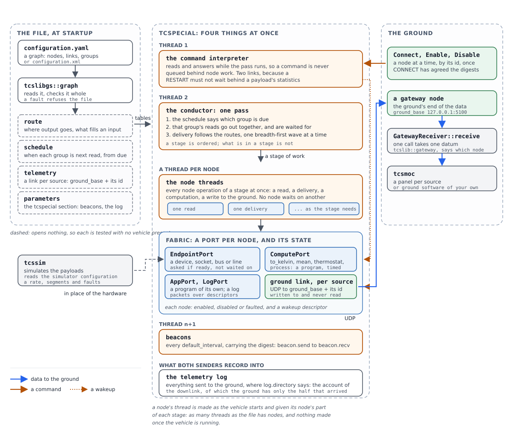
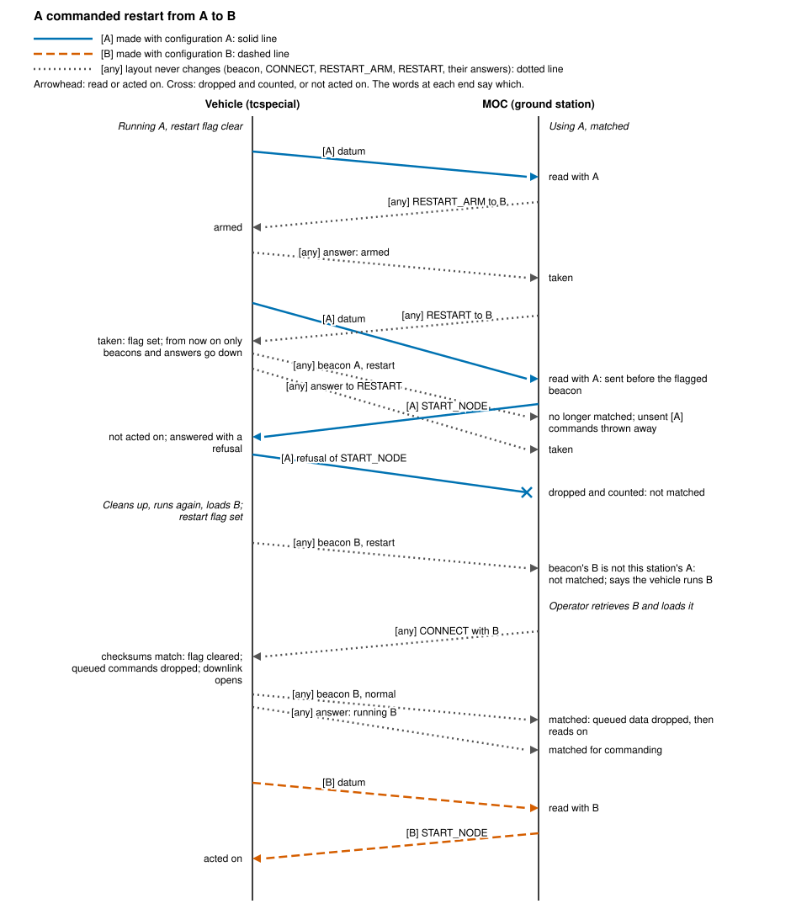
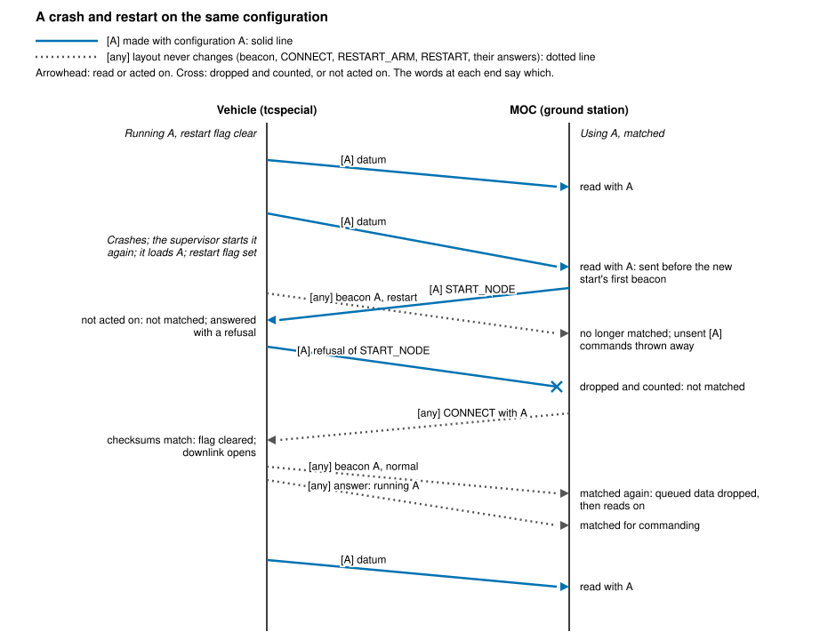
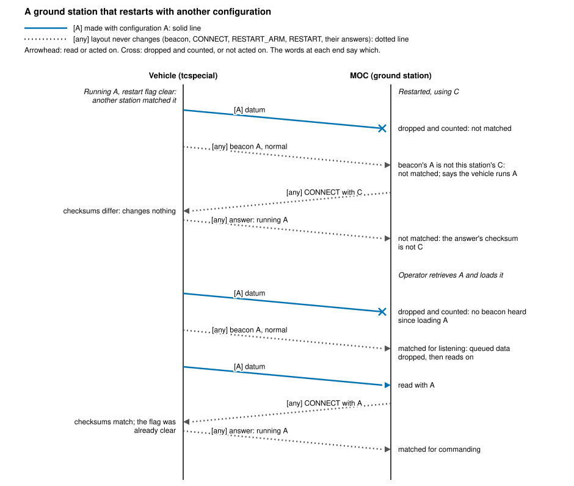
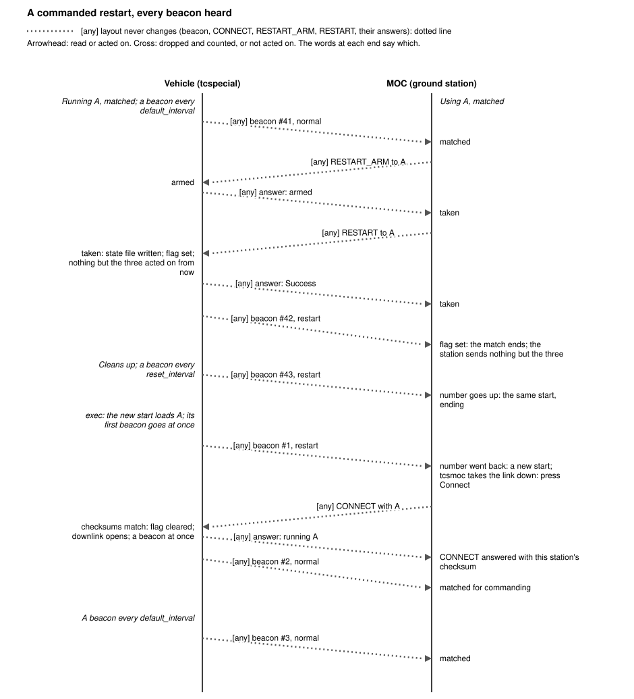
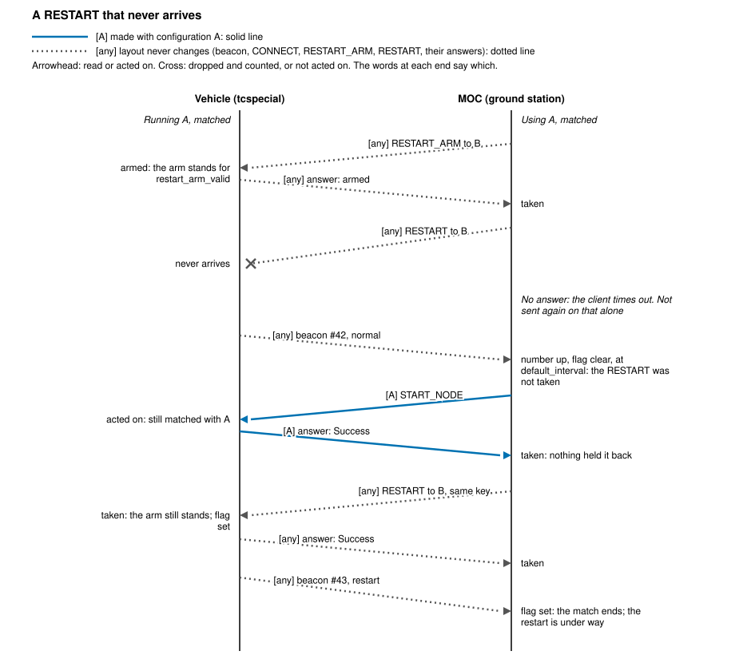
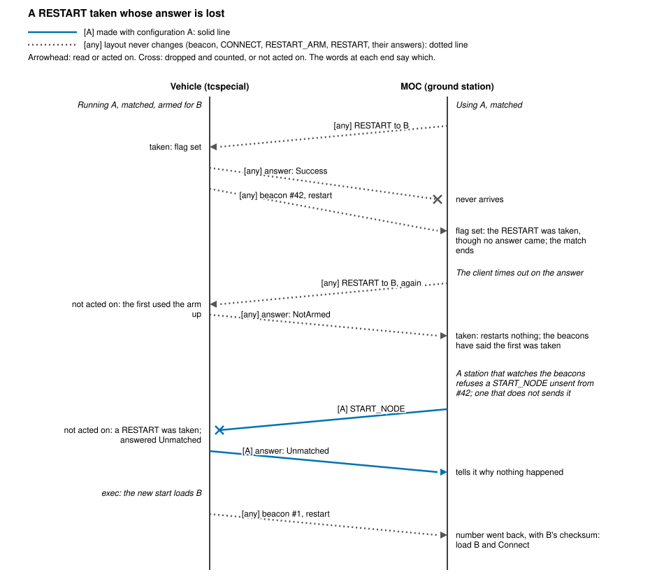
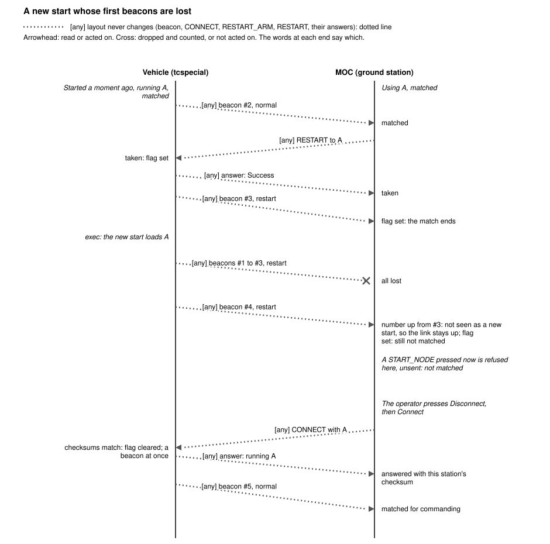

================
tcspecial Design
================
.. contents:: Table of Contents
   :depth: 4
   :local:

Introduction
============

.. note::
   TCSpecial has been designed for spacecraft and ground communication with high
   latency communication links. It is just as applicable for other environments,
   such as submersibles, drones, etc. Simply translate "spacecraft" to your
   device type.

What there is, in the order a reader meets it:

``tcspecial``
    The flight software. It serves the payloads its configuration file
    describes, takes commands from the ground, and sends beacons.

``tcslib-protocol``
    What both ends share: the configuration file formats and the rules about
    them, the command and telemetry messages, and the digest each end says it
    read. Every rule in this document is stated there once.

``tcslib-moc``
    What a control application on the ground is built on. A mission control
    system drives a client rather than speaking the protocol itself.

``tcs-moc``
    A simulated operations center, for testing: a window of panels, one per
    payload, that commands them and shows what they have moved.

``tcs-sim``
    Simulated payloads, for testing: it plays the far end of every link a
    configuration describes.

``tcs-verify``
    Reads a configuration and says what is wrong with it, running none of it.
    See the `tcs-verify design <tcs-verify-design.html>`__.

The ranked quality attributes
-----------------------------

Four attributes, in order. The order is the point: where two designs satisfy
the requirements differently, the earlier attribute decides, and an argument
about such a choice should cite this list rather than taste.

1. **Reliability.** The vehicle is not reachable for repair. A mechanism that
   can fail in a new way loses to a rigid one that cannot, and a fault found
   when a configuration is loaded beats the same fault found in flight.
2. **Ease of use.** An operator under time pressure must be able to read what
   the system does and say what it will do next. Clarity of the configuration
   and of what the programs report counts as a requirement, not a courtesy.
3. **Maintainability.** The software outlives the people who wrote it. One
   concern per module, a test per claim, and a written reason for anything that
   is not obvious.
4. **Flexibility and extensibility.** New interfaces, new computations and new
   vehicle arrangements must be reachable without disturbing what already
   flies -- but never at the cost of the three above.

Terminology
===========

These words are used in one sense each, here and in the code. Several of them
had been used in two, which is why they are written down: "device" in
particular had been both a type of endpoint and a protocol beside TCP and UDP.

endpoint
    One end of the path a data handler's data travels. A handler has two: the
    OC endpoint, where the ground's data arrives and leaves, and the payload
    endpoint, where the payload's does. An endpoint is of exactly one type, and
    the type decides what is needed to open it and what terms it is operated
    on.

endpoint type
    What an endpoint is made of, and so what locates it and what else must be
    said about it. Nine are supported -- ``network``, ``device-file``,
    ``serial``, ``i2c``, ``spi``, ``can``, and the discrete lines
    ``gpio_in``, ``gpio_out`` and ``gpio_inout`` -- and three more are
    experimental: ``iio``, ``rpmsg`` and ``hdlc``. A type is not a protocol --
    a network endpoint
    carries the protocol it runs over, and no other type is addressed that
    way.

device
    An endpoint that is a device file, opened and read as it comes. Not the
    general word for hardware: a serial line, an I2C device and a SPI
    peripheral are all reached through device files and are none of them a
    device endpoint, because each has terms of its own that a plain device has
    not. A device *file* is the thing in the filesystem; a device *endpoint* is
    one type among the nine.

bus
    A device that several devices are reached through, each by an address on
    it. I2C is the one in use. The bus is named by a device file and the device
    on it by an address, which is why an endpoint on a bus carries both.

payload
    What is at the far end of a payload endpoint: the instrument, recorder or
    radio whose data a handler carries. Also what tcs-sim simulates, and what
    the payload configuration describes.

data handler
    The pair of conduits between one payload endpoint and one OC endpoint,
    named by a ``name``, which is what every command addresses it by.
    "Handler" alone always means this.

conduit
    One direction of one data handler: a thread that reads one endpoint and
    writes the other. A handler has two, and they share each endpoint between
    them.

OC
    The Operations Center: the ground. The OC endpoint of every handler is a
    UDP address, and the OC's own address is learnt from what it sends rather
    than configured.

commander
    Whatever tcspecial answers to: what commands it, and what its telemetry
    goes to. The ground over a radio is one, a cFS flight computer on its
    software bus another, and an F´ flight computer through a bridge
    component the third. "MOC" was the word while the ground was the only
    one, and is still the word for the ground itself, which is one kind of
    commander.

gateway
    The node through which tcspecial reaches its commander, and the link it
    holds: ``gateway_radio``, ``gateway_yamcs``, ``gateway_cfs`` or
    ``gateway_fprime``. It was
    also the word for the commander itself, which left one word for both ends
    of a link. See `Gateways: what the vehicle answers to`_.

test harness
    Whatever sets up a test run and takes it down: it starts the simulator,
    waits for it to be ready, starts tcspecial, and stops what it started.
    Tcs-moc is one, besides being a ground station; with cFS or F´ as the
    commander, the harness is not the commander at all. See `Waiting for the
    Simulator`_.

link
    A configured pairing of two endpoints that data passes between. Used of
    the whole path, where "endpoint" is used of one end of it.

tcspecial configuration file
    The file tcspecial is configured by: the command interpreter's own
    settings in its ``tcspecial`` section, and the payload configuration
    section beside them. No name of its own -- any name ending ``.ytcs`` or
    ``.xtcs`` -- the shipped examples being ``examples/minimal/minimal.ytcs``
    and the rest.

payload configuration section
    The part of that file describing payloads: which data handlers there are,
    how tcspecial reaches each one, and how large its packets are. A section
    rather than a file, because what tcspecial serves and what tcspecial is
    are one configuration.

simulator configuration file
    The file describing how a simulated payload behaves: how often it produces
    a packet and how it divides one into segments. Properties of a simulation
    rather than of a payload, which is why they are not in the payload
    configuration.

simulated device
    What a payload endpoint reaches when tcs-sim plays the payload: a
    pseudo-terminal or a socket that tcs-sim makes and answers, or tcs-sim's UDP
    end at a node's ``sim_address``. See `How a Simulated or Dummy Device Is
    Recognised`_.

dummy device
    A device the kernel makes under a real device's name, with nothing behind
    it: an ``i2c-stub`` bus, a ``gpio-sim`` chip, an ``iio_dummy`` sensor, a
    ``vcan`` interface. tcs-sim drives a payload on one where the simulator
    file says to. See `How a Simulated or Dummy Device Is Recognised`_.

real device
    The payload itself: hardware. A ``network`` or ``device-file`` node is
    always a real device -- a socket or a file -- whatever answers at its far
    end.

simulation mode
    How many of a run's payloads may be simulated or dummy devices: ``none``,
    ``some`` or ``all``, given to each program as ``--simulate``. See
    `Simulation Modes`_.

The Node Architecture
=====================

What this supersedes
--------------------

TCSpecial began as a set of data handlers, each one a fixed pair: a payload
endpoint at one end, an OC endpoint at the other, and a conduit in each
direction between them. ``dh.rs`` says so in its own fields -- one
``ground_to_payload`` and one ``payload_to_ground`` -- and that is the whole of
the topology the software could express. It served while every payload's data
went to the ground and nowhere else.

It cannot express a control loop. Three sensors whose readings are averaged and
compared against a setpoint, with the comparison driving heaters, needs a
reading to reach two places at once, needs three readings to arrive at one
place, needs something aboard that remembers a setpoint, and needs a set of
discrete lines to be driven rather than read. None of those is a type of
endpoint; all of them are shapes of connection.

So the fixed pair is replaced by a graph the configuration describes. A data
handler is no longer a thing: what it did -- joining a device to the ground in
both directions -- is two links, and the software that moved its bytes is the
machinery that moves bytes along any link.

The four concepts
-----------------

Deliberately four, and no more. Each is a thing an engineer already thinks
about, which is the ease-of-use argument; each is checkable before anything
runs, which is the reliability one.

node
    Anything the configuration names. A node has a name unique across the
    configuration, a type, and the attributes its type requires. Three families
    of type:

    *devices* -- ``i2c``, ``spi``, ``serial``, ``hdlc``, ``can``,
    ``gpio_in``, ``gpio_out``, ``gpio_inout``, ``iio``, ``rpmsg``,
    ``network``, ``device-file`` -- which are the interfaces
    real
    hardware arrives on. Each is what used to be called a payload endpoint, and
    the attributes are unchanged: a bus and an address, a chip and a set of
    lines, a path.

    *gateway links* -- ``gateway_radio`` and ``gateway_fprime`` -- a network
    link carrying telemetry to the ground and commands back. This is what the OC
    endpoint was.

    *compute elements* -- ``compute`` -- software that transforms what arrives.

    *sinks* -- ``log`` -- somewhere data is kept rather than passed on. See
    `The logging node`_.

    *generic vehicle nodes* -- ``null-gateway``, ``null-payload``,
    ``tee-gateway``, ``tee-payload`` -- nodes that do nothing to what passes.
    Each takes one stream: a null node drops it, and a tee sends each datum on
    both ways, on its own stream and again on the other. See `Null nodes and
    tees`_.

    *link checks* -- ``ping`` -- a node that answers each ping the ground sends
    it with the vehicle's time. See `The ping node`_.

group
    A set of devices read on one interval, so that readings which will be
    compared with one another are taken as close to together as the hardware
    allows. A device in no group is read on its own interval, as every payload
    was.

    The interval belongs to the group and not to its members. A member may not
    state one: two sensors in a group with intervals of their own would be a
    configuration whose own description disagrees with itself, and it is
    refused.

link
    A directed connection from one node to one or more destinations. One
    destination is the ordinary case. Several is how a reading reaches the
    ground and an on-board computation at once -- the arrangement usually drawn
    as a "T" -- and it is a property of the link rather than a node of its own,
    because a node that only copied its input would be a type to implement,
    test, configure and get wrong for no gain.

    Within one stream, that is. A link carries one stream and may not carry it
    into the other, so a copy that has to cross -- what the ground sent, back
    to the ground as payload data; a reading, to something that takes the
    ground's data -- is what the ``tee-gateway`` and ``tee-payload`` nodes are
    for. The crossing is a node, drawn and named, rather than a link that
    could be drawn backwards by mistake: see `Terminals: where a link is
    attached`_.

    Where a destination takes more than one input, the link names which: a vote
    over three sensors is three links into three named inputs, and a
    configuration that leaves one unbound is refused rather than voting over
    two numbers and a zero.

    A link is written as an **attribute of the node it leaves**, named after
    the data source it leaves by, one line each: the node the line reaches and
    the name it arrives there by, separated by a dot.

    .. code-block:: yaml

       - type compute:
           - compute: k_fore
             function: "to_kelvin"
             world-out:
               - gateway.k_fore
               - mean_temp.in0
               - housekeeping.k_fore

    One line per entry is what makes several of them safe: nothing pairs by
    position, so a list one name short cannot deliver a reading to somebody
    else's input. One line needs no list -- ``world-out: gateway.k_fore``. The
    entry a link was once written as, ``- target: gateway`` with an
    ``input:`` beside it, is refused and told the line to write instead,
    because it names no name to arrive by.

    So there is no links section. A node and the links out of it are read,
    written and deleted together, which is where a reader of the file wants
    them: a list at the bottom has to be read against the nodes to make sense
    of either. It also settles a question the old shape left open -- which file
    of a configuration a link belongs in. A link is in the file its source node
    is in, once, however far it reaches.

    The node a link arrives at lists the names a line may arrive by, under the
    data sink each belongs to:

    .. code-block:: yaml

       - type compute:
           - compute: consensus_temp
             function: "vote"
             algorithm: "median"
             carries: kelvin
             world-out:
               - gateway.consensus_temp
               - thermostat.consensus_temp
             world-in: [in0, in1, in2]

    That is the node saying where it may be joined, on the node, so that a
    node's entry says what it is connected at both ends and a link is written
    to a name the node at its far end gave rather than to whatever the writer
    guessed. A line to a name its far end does not list is refused where the
    configuration is read, saying which names it does list; so is a name
    listed twice, one listed under a sink the node's type does not have, and a
    line from one source to two names of one node, which would be two copies
    of every datum. A name may be listed with nothing arriving at it: a list
    is where a node may be joined, and what must be joined is the rules'
    business -- a vote over an input nothing sends is refused as that.

    A name is one word, with no dot, comma or space in it, the dot being what
    parts it from its node in a line. The editor names a line it draws after
    the node it leaves -- ``gateway.k_fore`` -- which says at a glance where
    the line comes from, and writes a sink's names in name order, a sink's
    names being a set. A vote's world-in names are its inputs: there is no
    ``inputs`` attribute, and a file that says one is refused and told so.

    Which sink a line arrives at is the stream's own answer -- what leaves by
    ``world-out`` arrives at a ``world-in`` and nowhere else -- so a line to a
    name the node lists under its other sink is refused as the backwards line it
    is. ``tcslib_protocol::graph::mirror`` matches every line to its name as the
    configuration is read and then sets the names aside: the graph the vehicle
    flies is the sink each line arrives at, and for a vote the input, and
    nothing aboard reads the names. The editor keeps them, and writes them back
    as they were.

    In memory they are still a list, because every rule about a link is about
    both of its ends and a list is what a rule can be written against.

command binding
    A statement that a named command from the MOC sets a named attribute of a
    node. A setpoint arrives this way. The binding is in the configuration, so
    what the ground is able to change in flight is written down and checkable,
    rather than being whatever the compute element happens to accept.

The three sections
------------------

A configuration's nodes are written in three sections, and they are the three
working panes of the editor:

``gateways``
    the ground links: the other end of the link, which is not the vehicle at
    all.

``vehicle``
    what the vehicle itself runs -- computations, logs, pass-throughs, pages of
    their own.

``payloads``
    what it carries this flight: a device on a bus, a line it drives, a link to
    something aboard.

Which section a node belongs in is its type's own answer, and there is one
statement of it: ``tcslib_protocol::graph::section_of``. The editor's panes read
it and so does the file reader, so a file and a drawing cannot come to disagree
about what a node is.

Within a section the nodes are grouped by type, and a node says no type of its
own: it is of the type it is written under. Each node is named by the word for
its section -- ``gateway``, ``compute`` for any vehicle node, or ``payload``
-- with its name as the value:

.. code-block:: yaml

   payloads:
     - type i2c:
         - payload: temp_1
           address: "0x48"
           path: /dev/i2c-1
         - payload: temp_2
           address: "0x49"
           path: /dev/i2c-1

and in XML a ``<type name="...">`` element holding ``<gateway>``,
``<compute>`` or ``<payload>`` elements named by their ``name`` attribute:

.. code-block:: xml

   <payloads>
       <type name="i2c">
           <payload name="temp_1">
               <address>0x48</address>
               <path>/dev/i2c-1</path>
           </payload>
           <payload name="temp_2">
               <address>0x49</address>
               <path>/dev/i2c-1</path>
           </payload>
       </type>
   </payloads>

A type is written once in a section, so a section reads as a list of what
kinds of thing the vehicle has and how many of each, and changing a node's
type is moving it rather than editing a word on it. The order of the types,
of the nodes of a type and of a node's attributes means nothing (see `What
Each End Read`_); the editor writes all three by name.

Requirement
    A file in the shape before this -- each node an entry with a ``name`` and
    a ``type`` of its own, the ground links in a section called ``gateway``,
    the editor's positions as ``name:`` entries -- is refused as it is read,
    in either spelling, naming the line of the first such thing and showing
    how it is written now. ``tools/convert-format.py`` rewrites such a file,
    keeping its comments. The refusal is ``tcslib_protocol::graph::reshaped``'s.

Requirement
    A type written twice in one section, a type with no nodes under it, and a
    node that states a ``type`` of its own are each refused where the file is
    read, naming it.

Requirement
    A type written in the wrong section is refused where the file is read,
    naming the type, the section it is in and the one it belongs in. A payload
    written under ``vehicle`` is a file whose own arrangement contradicts the
    rule the editor enforces everywhere else, and a reader would have to be
    told which of the two to believe.

Requirement
    A section with nothing in it is not written. A configuration with no
    payloads yet is one somebody is partway through, and ``payloads:`` with
    nothing under it reads back as nothing anyway.

The sets of payloads that share a sampling interval are ``payload_groups``,
which is what the simulator's file calls them too: one vocabulary for the two
languages, so a reader who has learned one has learned the other.

Terminals: where a link is attached
-----------------------------------

A link joins one node's **data source** to another's **data sink**. Each end
has a name, and the name says two things about the data and nothing about what
is at the other end: whose it is, and whether it arrives here or leaves.
``payload-`` is a payload's own data, on its way to the ground; ``gateway-`` is
what the ground sends, on its way to a payload. ``-in`` is where it arrives and
``-out`` is where it leaves -- so **every ``-out`` is a data source and every
``-in`` a data sink**, which is the whole of the rule a reader has to remember.
There are four:

.. list-table::
   :header-rows: 1
   :widths: 20 20 20 40

   * - stream
     - leaves at
     - arrives at
     - what it carries
   * - groundward
     - ``world-out``
     - ``world-in``
     - a payload's readings, on their way to the ground
   * - vehicleward
     - ``moc-out``
     - ``moc-in``
     - what the ground sends back: a command, a trigger, a setpoint

So one stream is named twice -- ``world-out`` where it leaves a node and
``world-in`` where it arrives at the next -- and the two words are a sentence
about the same bytes read from either end. The names say nothing about the type
at the far end: with no vehicle node in the way, a payload's ``world-out``
connects to a gateway link's ``world-in``, and with one it connects to that
node's ``world-in`` instead and the node's own ``world-out`` carries it the
rest of the way.

A link end is written ``node.terminal``, and may be written as ``node`` alone
wherever the type has one terminal of the kind the end needs: ``{ from:
temp_fore, to: gateway }`` is unambiguous, because a payload has one data source
and a gateway link has one data sink. A type with two of either has to be told
which, which is why the links out of a tee name their terminals.

Which types have which:

payloads
    ``moc-in`` and ``world-out``. A payload receives what asks it for a
    reading -- a trigger, a command, a byte written to a line -- and sends what
    it read.

gateway links
    ``world-in`` and ``moc-out``. The ground is the other end of both.

``null-gateway``
    ``moc-in`` alone: what the ground sends arrives, and nothing leaves.

``null-payload``
    ``world-in`` alone: a payload's data arrives, and nothing leaves.

``tee-gateway``
    ``moc-in``, and both sources, ``moc-out`` and ``world-out``: what
    the ground sends arrives, and leaves both ways.

``tee-payload``
    ``world-in``, and both sources, ``world-out`` and ``moc-out``.

``app_all_veh``
    all four, a program with both interfaces: see `App nodes`_.

``ping``
    ``moc-in`` and ``world-out``, a payload's pair: what the ground sends
    arrives, and the answer leaves groundward, to arrive at a gateway link.

A computation's and a log's terminals are their own rules' business: a
computation's data sinks are the inputs it declares, and a log's are whatever
is written to it. Both are checked where the type is.

Requirement
    A data sink is either absent or linked to one data source. Two sources
    into one sink would be two streams interleaved on one link, arriving in
    whatever order they were sent, with nothing to say which was which.

Requirement
    A data source is either absent or linked to one data sink or several. One
    reading reaching the ground and an on-board computation at once is the
    ordinary case -- the arrangement drawn as a "T".

Requirement
    A gateway link's data sink takes as many sources as the configuration gives
    it. The exception to the rule above, and not one made to let the examples
    through: the ground is the one place that *can* tell interleaved streams
    apart, because each payload's telemetry arrives at its own socket --
    ``payload_telemetry.source_base`` plus the payload's id -- and the id is
    what says whose a datagram is. Every payload aboard reporting to one
    gateway node is the ordinary shape of a configuration.

Requirement
    A payload or a gateway link with no link on it at all is refused. Either a
    sink or a source will do: a payload that is only read has a source and no
    sink, one that is only driven -- a heater, a valve, a latch -- has a sink
    and no source, and both are configurations somebody means. Neither is a
    payload the configuration describes and nothing reads or drives.

Requirement
    Each terminal may be linked to one other terminal, and the pairing is four
    sentences: a ``world-out`` only to a ``world-in``, a ``world-in`` only
    to a ``world-out``, a ``moc-out`` only to a ``moc-in``, a
    ``moc-in`` only to a ``moc-out``. Which is one sentence twice over
    -- a stream leaves at one terminal and arrives at the other -- so the
    pairing is derived from the table above rather than written out again.

    The editor is held to it as a *gesture*: a line taken from a terminal is
    offered only the terminals that pair with it, and a node with none is
    offered nothing -- so a bad link cannot be drawn in the first place. The checking refuses a written-out configuration
    for the same reason, which is what a file edited by hand is still held to.
    What that rules out is a link that carries one stream into the other, and
    with it the circular link a drawing could otherwise be made to say.
    Loops within the vehicle are still possible -- a vehicle node may feed
    another and be fed by it -- and this rule is not what would stop one.

Requirement
    A link whose two ends carry opposite streams is refused. One end of it is
    drawn backwards, and nothing else in the configuration would show it: both
    nodes exist, both terminals exist, and in flight it is a payload that
    answers nothing.

Requirement
    A link end naming a terminal its node does not have is refused, and a
    terminal named at the wrong end of the link is refused as the mistake it is
    rather than as a name nothing knows. The name is right and the end is
    wrong, which is worth saying in those words.

Requirement
    A terminal is written into a file only where it says which. A node with one
    data source and one data sink needs neither name -- ``{ from: temp_fore,
    to: gateway }`` is unambiguous, and the schema reads an unnamed end as the
    only terminal of the kind that end needs -- so the editor writes a terminal
    only where the type has two of the kind, a tee's sources and an
    ``app_all_veh``'s four. A tool that wrote a name into every
    link of every file it saved would churn every configuration it opened for
    no gain.

Requirement
    A terminal is not a named input. ``in0`` is which *of several* ways into a
    computation and a vote is built on knowing; a terminal is which *way* the
    data is going, and a node that has one has only one of each kind. So a
    terminal is resolved where the routing table is built and never reaches a
    port -- a device's port refuses an input a device does not have, and a
    configuration that passed the ground check and stopped delivering when it
    flew would be the worst of both checks.

Typed links
-----------

.. note::
   **Partly built.** This section is the design the links between nodes
   are being moved to, agreed before any of it was written. Built so far:
   ``types.xtce``, the Rust generated from it, the unit table generated
   from it, and its place in the interface digest; and every terminal's
   type, stated as `Every terminal carries one type`_ says, with each link
   checked at both ends -- ``tcslib_protocol::graph::link_types`` -- and a
   device's reading laid out as its type's own as it is read; and every
   datum checked, as it is delivered, against the type the node it reaches
   takes (`Type and encoding`_); a thermostat's decision sent as its
   ``type-out``, a ``boolean`` or a whole number; GPIO lines driven and
   reported as one unsigned whole number, a bit outside them refused; and
   a thermal mass's heater on where what it is driven with is not nought.
   A ``gpio_in`` reports its lines' levels as that number every
   ``state_interval``, and has no edges. A ``process`` exchanges any type
   with a text form, and each packet an app writes is held to its
   terminal's type. The F´ bridge writes each source to a channel of its
   type, and the cFS bridge publishes each datum as its type lays it out.
   Each configuration's own XTCE states what each node sends the ground,
   and a command for each attribute a command binding sets, whose value a
   ``SET_NODE`` carries as the attribute's type; Yamcs's mission database
   takes its types from it. Where
   the rest of this section and the rest of this document disagree, the
   rest says what runs today, and `What typed links replace`_ lists the
   passages it will change.

What travels a link has been bytes, and what the bytes meant was each
node's own business: a conversion knew its sensor's two bytes were a signed
count, a vote knew four bytes were a value, a heater's line knew a ``1``
when it saw one. Nothing between them knew, so a link from a thermostat to a
vote was a configuration that loaded and then refused every datum it
carried, and the ground learnt what a source sent from the code that sent
it. A link now carries a *type*, stated in XTCE, and both nodes it joins
say what it is.

Types
~~~~~

Requirement
    Every type a link can carry is stated once, in
    ``tcslib-protocol/xtce/types.xtce``, and the Rust that holds and checks a
    datum of each is what tcs-xtce generates from it, committed beside the code
    generated from ``link.xtce``. No node type has a document of types of its
    own: what any terminal carries is one of these, or built from them.

The types are few, because what a vehicle's nodes hand each other is:

``u8``, ``u16``, ``u32``, ``u64``, ``i8``, ``i16``, ``i32``, ``i64``
    Whole numbers. A sensor's reading as it came off the part, a set of GPIO
    lines, what a thermostat drives a heater's switch with.

``boolean``
    True or false, where something wants to be told one and nothing else.

One value type for each unit
    ``kelvin``, ``volt``, ``ampere``, ``watt``, ``metre``,
    ``metre_per_second``, ``newton``, ``kilogram_per_second`` and
    ``ratio``, each named as one of its unit is: a value as it is today, a 32-bit signed count of the unit's
    step (see `Compute elements`_), stated as an integer encoding with the
    calibrator that makes it the unit and the unit's symbol in its unit set.

Bounded strings and bounded bytes
    Text and opaque data, each with the most it may hold, so that a datum of
    either is a buffer of known size and holding one allocates nothing.

Requirement
    ``types.xtce`` is the one table of units: the list in
    ``tcslib-protocol/src/unit.rs`` -- each unit's symbol, its name and its step
    -- is generated from it rather than written beside it. Adding a unit is
    adding a type to ``types.xtce``.

Requirement
    A *structure* is a list of named fields, each of one of the types above
    but a string or bytes, written in the configuration of a node whose data
    are several things at once -- an inertial unit's three axes, a power
    monitor's volts and amps -- as its fields, ``name: type``, separated by
    commas:

    .. code-block:: yaml

       - payload: imu
         world-out-type: "x: i16, y: i16, z: i16"

    It is a structure because the node says so and not because a type in
    ``types.xtce`` does, so a new part's layout needs no new build. A
    structure holds at most sixteen fields, each of a fixed width, so that a
    datum of one is of a size known before anything runs and where each field
    ends is known.

Every terminal carries one type
~~~~~~~~~~~~~~~~~~~~~~~~~~~~~~~

The type belongs to the terminal and not to the node, because a node's two
ends are often different things: a thermostat reads a temperature, is set a
temperature, and drives a switch with a number.

Requirement
    Each terminal of a node carries one type: its ``world-in``,
    ``world-out``, ``moc-in`` and ``moc-out``, each named input such as a
    vote's ``in0``, and each attribute a command can set. Which type is the
    node type's to say, either outright or by an attribute of the node:

    .. list-table::
       :header-rows: 1
       :widths: 22 39 39

       * - node type
         - takes
         - sends
       * - a device (``i2c``, ``spi``, their ``_tmass`` kinds, ``serial``,
           ``network``, ``can`` and the rest)
         - its ``moc-in-type``: what it is driven or asked with, ``bytes``
           where it states none
         - its ``world-out-type``: the whole number or structure it reads,
           ``bytes`` where it states none, its ``format`` saying how the
           part lays the number out where that is not the type's own way
       * - ``to_kelvin``, ``to_value``
         - the whole number its ``type-in`` names
         - the value type its ``type-out`` names; ``to_kelvin``'s is
           ``kelvin``
       * - ``vote``
         - what it ``carries``, at every input
         - what it ``carries``
       * - ``thermostat``
         - its ``type-in``, which its ``setpoint`` and ``half_band`` are in
         - its ``type-out``
       * - ``process``
         - its ``type-in``
         - its ``type-out``
       * - ``gpio_out``, ``gpio_inout``
         - the integer its lines need
         - the same integer, reported
       * - ``gpio_in``
         - anything, as a request for a report
         - the integer its lines need
       * - ``tee-payload``, ``tee-gateway``
         - what it ``carries``, ``bytes`` where it states none
         - the same, at both sources
       * - app nodes
         - ``world-in-type``, ``moc-in-type``, as it has those terminals
         - ``world-out-type``, ``moc-out-type``, likewise
       * - ``null-payload``, ``null-gateway``, ``log``
         - any type
         - nothing
       * - a gateway node
         - any type, at ``world-in``
         - at ``moc-out``, the type of whatever each link reaches

Requirement
    A computation turns what it decides into its own output type, and
    nothing between nodes does it for it. A thermostat decides on or off and
    sends its ``type-out``: ``1`` or ``0`` of the switch's integer where it
    drives a heater, true or false where it sends a ``boolean``. There is no
    node whose only work is to change one type into another.

A link's type is stated at both ends
~~~~~~~~~~~~~~~~~~~~~~~~~~~~~~~~~~~~

A link has no type of its own to state: it has the types its two terminals
carry, and the two must be the same.

Requirement
    A link is valid only where the type its source terminal sends is the
    type its sink terminal takes, the same type exactly. A ``u8`` is not a
    ``u16``, a ``boolean`` is not a ``u8`` that holds ``0`` or ``1``, and a
    value in kelvin is not one in volts. A link that joins two others is
    refused when the configuration is read, naming the link, its two nodes
    and the two types.

Requirement
    Nothing is inferred. A node that could take any type -- a vote, a tee, a
    thermostat, a program -- says which in its configuration, and the link
    into it is checked against what it said, not against what is upstream.
    So a link is judged by its two ends alone: the order links are written
    in cannot matter, a loop of nodes needs no rule of its own, and a
    refusal names one link.

Requirement
    A node that takes any type takes what it is given, and that is a
    statement of what it is rather than a type left out: a null node
    discards what arrives whatever it is, and a gateway node's ``world-in``
    takes every source drawn into it, each of its own type, each to a port
    of its own (`Terminals: where a link is attached`_). What reaches the
    ground from a source is the source's type.

The cost is a type written where it could have been worked out: a vote over
three conversions to kelvin says ``type: kelvin``, which its inputs already
said. It is written anyway, for the reason a function's parameters are: a
link drawn to the wrong vote is refused where it is drawn, rather than
changing what the vote is.

Type and encoding
~~~~~~~~~~~~~~~~~

Between two nodes a datum is encoded one way for each type, and that way
is the type's own: a whole number as wide as its type, most significant
byte first; a boolean as one byte, ``1`` or ``0``; a value as its four
bytes; a structure as its fields one after another; and a string or bytes
as their contents alone, the datum's length being theirs. So the vehicle
hands a vote four bytes that are a value in kelvin and nothing else, and
checks they are before it does.

Requirement
    Every datum delivered to a node is checked against the type the node
    takes there before the node is given it -- its width, a boolean's being
    1 or 0, a string's being UTF-8 -- and one that is not that type is
    refused, counted and said, the node never seeing it. The check
    allocates nothing for a datum that passes it.

Requirement
    A link compares types -- a whole number of so many bits, true or false,
    a value in a unit, a structure of named fields -- and not encodings. How a datum is written where it leaves tcspecial or arrives at it
    is the business of the node at that edge, and of nothing else.

Requirement
    The node at each edge chooses its encoding, from those its type knows,
    by an attribute as ``format`` does:

    * a device: the bytes its part sends or wants, which its ``format``
      says where they are not the type's own -- ``i16_le``, or ``u24_be``
      for a ``u32`` -- and which the vehicle lays out as the type's own as
      it reads them;
    * the gateway node: what the ground receives, as each source's
      parameter in the configuration's own XTCE says (see `The
      configuration's own XTCE`_);
    * an app node: the XTCE encoding of each terminal's type (see `App
      nodes`_);
    * a ``process``: a line of text (see `App nodes`_).

Requirement
    A datum that cannot be read as the type its edge expects is refused and
    counted, never guessed at: two bytes where a ``u32`` was due, a line a
    program wrote that is not a number, a ``u8`` from the ground with a bit
    set outside the lines it drives.

GPIO lines
~~~~~~~~~~

Requirement
    The lines of a GPIO node are one unsigned integer, the narrowest of
    ``u8``, ``u16``, ``u32`` and ``u64`` that holds as many bits as the node
    has lines. Bit 0 is the first line the node lists, bit 1 the next, and so
    on; a set of one line is a ``u8`` whose bit 0 is that line.

Requirement
    Only the bits the node has lines for may be set. A ``gpio_out`` or
    ``gpio_inout`` sent a number with any other bit set refuses it, counts
    it and leaves its lines as they were: the bit names no line, so driving
    from it would be guessing what was meant.

Requirement
    Nothing between nodes reads the integer as on or off. It travels as a
    number, to the switch, to the ground, to the simulator; the one place it
    is compared with nought is a heater in tcs-sim's ``thermal_mass``, which
    is on when the integer it is driven with is not nought.

Requirement
    A ``gpio_in`` sends the levels of its lines, as that integer, every
    ``state_interval``, and nothing else. It sends no record of an edge:
    what the ground and the vehicle want of a watched line is what it is,
    and a line that changes and changes back within one interval goes
    unseen, which is the interval's to decide. Its ``edge`` attribute and
    the sixteen-byte records it asked for are gone.

Programs at the edge
~~~~~~~~~~~~~~~~~~~~

Requirement
    A ``process`` still reads a line per arrival and answers a line, and
    each type has one way of being written as text: a value in decimal in
    its unit, as now; an integer in decimal; a ``boolean`` as ``1`` or
    ``0``; a structure as its fields, ``name=value``, separated by spaces --
    ``x=0.12 y=-0.40 z=9.81``. tcspecial converts at the pipe both ways, and
    an answer that is not its ``type-out`` written so is refused and counted.

Requirement
    An app node's packets are still four bytes of length and then the
    packet, and each packet is the XTCE encoding of the type its terminal
    carries -- the bytes the ground is sent for that type. A packet an app
    writes that does not decode as its terminal's type is refused and
    counted. ``tcsapp`` reads and writes a terminal's type through the code
    tcs-xtce generates from it, and a program in C, C++ or Python uses that
    language's.

Requirement
    Each terminal of an app carries one type, so an app that drives two
    things of different types is two app nodes. A packet that said which of
    several types it is would need a tag the program wrote and a link check
    that took any of several, and nothing yet needs that.

Requirement
    The F´ bridge writes each source to a channel of the source's type,
    from the type its terminal states rather than from what kind of node it
    is: an ``F64`` in its unit for a value, ``U8`` to ``U64`` and their
    signed kinds for an integer, a ``bool`` for a ``boolean``, and a
    ``Datum`` for the rest. The cFS bridge publishes each datum as its type
    lays it out, which is what a cFS app reading it decodes.

The configuration's own XTCE
~~~~~~~~~~~~~~~~~~~~~~~~~~~~

Requirement
    Each configuration has an XTCE document of its own, beside it, named
    for it -- ``examples/thermostat/thermostat.xtce`` -- which states what
    the vehicle sends the ground and takes from it. Each node whose data
    reaches the ground -- drawn into a gateway node, or a payload nothing
    touches, which reports over ``payload_telemetry`` -- is a parameter,
    named for the node, of the type its ``world-out`` sends, in a container
    of its own, ``<node>_packet``. The types it uses are copied into it from
    ``types.xtce``, a structure being an aggregate of them, so that a ground
    station is given one file. ``tcslib_protocol::graph::own_xtce`` writes it.

Requirement
    Each attribute a command binding sets is a command,
    ``set_<node>_<attribute>``, laid out as the ``SET_NODE`` that sets it
    is, the whole datagram: the opcode, the sequence the ground gives it,
    the node's device id and the attribute's name, each fixed, the value's
    length, fixed at its type's width, and the value, an argument of the
    attribute's type, copied from ``types.xtce`` as an argument type. A
    ``SET_NODE`` carries the value in that type's own encoding, so a ground
    station that reads XTCE sends a setting from this document alone.

Requirement
    It says nothing of framing. A gateway frames what it sends as its kind
    does -- a port of each source's own over a radio, a CCSDS header and an
    APID under Yamcs, a message ID on a bus -- and that is the ground
    station's to add.

Requirement
    A string or bytes, whose type gives it no width, is sent the ground after a
    count of its bytes, so that it reads the same however it is framed
    (``tcslib_protocol::link_type::Count``). Where the ground decodes what it is
    sent by XTCE -- under Yamcs -- the count is XTCE's, 32 bits, as
    ``types.xtce`` states it and the document copies: a string's own leading
    size, and ``bytes_length`` before bytes. Everywhere else -- over a radio,
    ``payload_telemetry``, to the F´ bridge, on a cFS bus -- it is in groups of
    seven bits, least significant first, each in a byte whose top bit says
    another follows (unsigned LEB128), in as few bytes as hold it: one byte for
    a datum below 128 bytes, two for any there is. A count in more bytes than it
    needs, or that does not say how many bytes follow it, is refused. A datum of
    a type with a width of its own is sent with no count, and between nodes
    nothing is counted. Ground programs that read through
    ``tcslib_moc::gateway::GatewayReceiver`` are given each datum without its
    count; Python reading a link itself takes it off with
    ``python/tcslib_protocol/count.py``.

Requirement
    ``tcs-verify --xtce`` writes it from the configuration and
    ``types.xtce``, and nobody writes it by hand: everything it says is said
    there already. It is committed beside the configuration, and ``make
    check`` fails when it is not what ``tcs-verify`` would write -- ``make
    xtce-check``, ``tcs-verify --xtce-check`` -- so that the ground's
    interface and the vehicle's configuration are reviewed together. ``make
    xtce`` writes every shipped configuration's again.

Requirement
    A ground station reads what each node sends from it, and works out nothing
    of its own: ``python/tcslib_protocol/form.py`` reads each node's form there,
    and Yamcs's mission database is built on it, each source's parameter type
    copied from it into the wrapper that adds Yamcs's framing (`Framing is a
    gateway's`_). So the rules for what each node sends are the Rust's alone.

Requirement
    It is the ground's, and it does not go on the vehicle (`What goes on the
    vehicle`_). It needs no digest of its own: what it says is fixed by the
    configuration, which the configuration's checksum covers, and by
    ``types.xtce``, which the interface digest covers.

Requirement
    ``types.xtce`` is part of the interface: the interface digest is of
    ``link.xtce`` and ``types.xtce`` together. A vehicle and a ground built
    from different statements of what a ``kelvin`` is are two interfaces, and
    refuse each other as two interfaces do.

The ping node's ``ping.xtce`` stays what it is, `A node type's interface
document`_: it states the fields inside the bounded string a ping and its
answer are, for ground stations that read XTCE, and the link carries the
string.

What typed links replace
~~~~~~~~~~~~~~~~~~~~~~~~

These passages describe the untyped links and change as typed links are
built:

* `Gateways: what the vehicle answers to`_, F´: a source's channel is chosen
  by the kind of node it is.
* The Yamcs mission database, written for the Yamcs gateway node: each
  source's type now comes from the configuration's own XTCE (`Framing is a
  gateway's`_).

Logs are left as they are. A log node takes any number of sources and
records their bytes, and how logging is to work is to be designed again;
until it is, a log node accepts any type, as a null node does.

What tcspecial itself is configured with
----------------------------------------

Four concepts describe what a vehicle carries and what is done with it. None of
them says where any of it goes, and one section does: ``tcspecial``, the same
section every configuration holds, and it is required of every one of them.

.. code-block:: yaml

   tcspecial:
     gateway: radio
     interface: "c7820f9bfe585feab72247ece0a2261d"
     tcs_cmd:
       recv: 0.0.0.0:4000
       send: 127.0.0.1:4100
     payload_command:
       source_base: 127.0.0.1:4300
       dest_base: 0.0.0.0:4200
     payload_telemetry:
       source_base: 0.0.0.0:6000
       dest_base: 127.0.0.1:6100
     beacon:
       default_interval: "5 s"
       reset_interval: "1 s"
       send: "0.0.0.0:5550"
       recv: "127.0.0.1:5650"
     log:
       directory: /var/log/tcspecial
       segment_size: 65536
     restart_arm_valid: "20 min"

Five of its eight entries are subsections, because each of them is one thing
with more than one attribute to it: the spacecraft command link has two ends,
the commands about nodes have two, a payload's telemetry has two, the beacon
has two and a timing, and the log has a place and a size. The other three,
``gateway``, ``interface`` and ``restart_arm_valid``, are one fact each and
are written as one. ``gateway`` is what the vehicle answers to -- see
`Gateways: what the vehicle answers to`_. ``interface`` is the interface the
configuration was written for, which every program refuses unless it is the
one its build speaks -- see `The configuration names its interface`_.
``state_file`` is beside them, and so are the attributes `Configurations
named by their checksum`_ adds. A prefix repeated
on two or three flat names -- ``beacon.send``, ``beacon.recv``, ``beacon.default_interval`` -- is a subsection
somebody declined to write, and the names under one are short for the same
reason: ``beacon.send`` says what ``beacon.send`` said, where the reader is
already looking at the beacon.

Twelve of the attributes above must be stated, and are required rather than
defaulted for one reason: a configuration that has not been asked the question
has not answered it. What the vehicle answers to, which interface its commands
are laid out by, where commands are taken and where beacons go are mission
facts, and a file that was silently given an answer to either is a vehicle
nobody can reach whose configuration looks complete. The two in ``log`` are the
exception, and so is ``log`` itself: no ``log.directory`` means the telemetry
log is not kept, which is a configuration somebody may mean -- a vehicle with
no writable storage -- and ``log.segment_size`` is a tuning choice with a
defensible answer, so it has one.

``restart_arm_valid`` is the third that may be left out: how long a
RESTART_ARM licenses a RESTART for, as a length of time -- ``20 min``,
``90 s``. Absent is twenty minutes,
``tcslib_protocol::commands::RESTART_ARM_VALID_DEFAULT``, the length an arm had
before it could be configured: long enough to arm, look at what the vehicle is
doing and decide over a link with minutes of latency, short enough that an arm
left behind by a session that ended does not stand ready for the next RESTART
anybody sends. A mission whose link is slower, or whose operators want the
window narrower, says so. Nought is refused, being an arm that lapses as it
is taken and a vehicle that can never be restarted.

``configurations``, ``configurations_kept`` and ``load_trials`` may be left
out too. ``configurations`` is the directory the vehicle keeps
configurations in, each under its checksum, and absent is a vehicle that
keeps none, which is a configuration somebody may mean as a vehicle with no
log is. ``configurations_kept`` is the fewest that removing one may leave
there, two where it says nothing: the one running and one to go back to.
``load_trials`` is how many starts of a configuration may end before a
matching CONNECT before it is given up, three where it says nothing, as
`Starting, and the restart flag`_ has it. Nought is refused for either
count, naming it. All three, and ``state_file``, are read from the
configuration on tcspecial's command line, whichever configuration runs:
see `Configurations named by their checksum`_.

Five of them are a host and a port written together, as ``address:port``: two
things only ever used together are one fact about a configuration, and writing
them apart invites a file that states one and not the other. Each is split at
its last colon, so whatever a host is called the port is the part after it, and
the address is kept as text -- what a name resolves to is the business of the
moment the socket is made.

``tcs_cmd`` is the spacecraft command link, which is one conversation and two
sockets. ``tcs_cmd.recv`` is tcspecial's own: it receives commands about the
spacecraft there and sends its responses to the MOC from there, a response
going back out of the socket its command arrived on. ``tcs_cmd.send`` is the
MOC's own, which it sends those commands from and receives the responses on.
Both ends in one file because both ends read this file: a configuration stating
only its own end would leave the other to be told separately, and two places to
say one thing is one place for them to disagree.

Separate command links because what the ground needs in a hurry must never be
queued behind what it asked for at leisure: a command about the spacecraft --
ping it, arm it, restart it -- is taken on ``tcs_cmd.recv``, and one about a
payload on that payload's own socket. On a space link these become virtual
channels, which is where the priority between them is really decided; here they
are sockets, which is what an IP network has to divide traffic with.

``payload_command`` is where the nodes are commanded, and it has two
addresses because the link has two ends: tcspecial takes node commands at
``dest_base``, and the ground sends them from ``source_base``. Unlike
``payload_telemetry``'s, each is the address itself, with nothing counted off
it: one link carries the commands about every node, and the node a command is
about is named in the command by its id (see `How a command names a node`_
and `How many links, and what the thread does with one`_).

Simple payloads -- a device or a socket that tcspecial reads or drives -- do
not use payload commands. What a simple payload is configured with is in the
tcspecial configuration file, and it is not changed while tcspecial is
running. At present only applications, the payloads and vehicle nodes that are
programs of their own, use the ``payload_command`` values.

The link was once one socket per payload, each at its base plus the
payload's id. A graph has many more nodes than payloads, though -- a
thermostat of four sensors is eleven nodes -- and a socket apiece spends ports
on computations and logs that nothing addresses from the ground, so one link
serves them all, and a command that takes its time is kept from delaying
another by the thread a node operation runs on, not by its socket. Before
that, ``payload_interface`` was one socket for all of them that said nothing
of where the ground sent from; ``source_base`` writes that end down, as every
other link in this section is written down at both ends.

``payload_telemetry`` is where each payload's own data link is, and it has two
bases because the link has two ends. tcspecial binds its end at
``payload_telemetry.source_base`` plus the payload's own id -- the position its
name has among the names of the configuration's nodes -- and the MOC binds its
end at ``payload_telemetry.dest_base`` plus the same id. Four payloads based at
6000 and 6100 are at 6000 to 6003 on the vehicle and 6100 to 6103 on the
ground.

Both ends come out of the one file both ends read, so neither has to be told
the other's: tcspecial sends a payload's telemetry to the end the MOC binds,
from the first datagram, and the MOC sends nothing at all.

It did have to be told. The ground's end was whatever port the system chose, so
nothing in the configuration said where it was; tcspecial's end learnt it from
whatever arrived there, and the MOC taught it by saying hello -- an empty
datagram, once a second, to every payload. Once a second because starting or
stopping a payload rebound that socket and the learnt peer went with it, so a
ground station that said hello once was silently cut off by the next Enable. Naming
the ground's end removed the hello, the silence after it, and the last traffic
the MOC sent without being asked.

That is why a payload states no address for its ground link. It used to state
``oc_address`` and ``oc_port``, which for forty payloads was forty chances to
repeat a port -- and a repeated port is two payloads whose data arrives
interleaved, each reporting part of the other's stream as though it were the
whole. One base and one arithmetic rule cannot be written inconsistently, and a
base so high that the payloads counted from it would pass 65535 is refused by
name while the file is being read rather than when the socket is made.

The protocol is not stated and cannot be. Every link in this section is UDP,
so an attribute for it would be an attribute that could say something untrue -- and a configuration able to describe a link the software
cannot make is worse than one that cannot describe it at all.

It is read by one struct wherever it is written. A second
statement of what the command interpreter needs would be two statements
drifting apart a flight at a time, and the first symptom would be a
configuration that verifies on the ground and starts something else aboard.

Only the top file of a configuration may state it. A configuration has one
command interpreter, so one of its files says what that is; an included file
that declared a section of its own is refused as the configuration is read,
rather than quietly ignored, because two sections would be two answers with the
winner decided by the order the files happened to be read in.

Gateways: what the vehicle answers to
-------------------------------------

**Specified and built.** ``tcspecial.gateway`` is read and required, and
``radio``, ``cfs`` and ``fprime`` are all accepted --
``tcslib_protocol::gateway`` is the one place that says which kinds are built,
which node type is which kind's, which are on a bus, and what each calls its far
end. The radio is the ``gateway_radio`` node; the F´ gateway is the
``gateway_fprime`` node, opened, counted and driven as the radio's is, and
``examples/fprime`` flies it. cFS is the ``gateway_cfs`` node, with every link
of the vehicle carried over one SBN peer (``tcspecial::runtime::bus``, on
``tcslib_protocol::sbn`` and ``tcslib_protocol::cfs``), and ``examples/cfs``
flies it against a test playing the cFS end. The bridge at the F´ end is built
too: its F´ model is written from the configuration by ``tcs-verify
--fprime-model``, and the ``TcsBridge`` component in ``fprime/`` is tested in an
F´ deployment against tcspecial and tcs-sim, data both ways, the node commands
and the restart -- see `F´: gateway_fprime`_. The ground's end of the bus is
built too: tcs-sim simulates the cFS end, and tcslib-moc's SBN transport,
``tcslib_moc::bus``, lets tcs-moc and every station on tcslib-moc command a
vehicle that answers to cFS through it (see `What crosses the bus`_).

The gateway nodes are written in the ``gateways`` section, linked through
``moc-in`` and ``moc-out``, with ``tee-gateway``, ``null-gateway`` and
``app_gateway_veh`` beside them. Each of those was named for the MOC while the
ground was the only thing a vehicle answered to: the section and the radio's
node type were ``moc``, the links ``moc-in`` and ``moc-out``, the others
``tee-moc``, ``null-moc`` and ``app_moc_veh``, and an app's argument for the
stream ``app-moc-arg``. The rename was held back to land with the ``payload``
rename and no longer is; the ``payload`` rename still is, so ``payloads:``,
``world-in`` and ``world-out`` keep their names. The section was then
``gateway``, and became ``gateways`` when the nodes were grouped by type; a
file in that older shape is refused as well, saying how the node it found
first is written now.

Requirement
    A file that still writes one of the old words -- the ``moc`` section, a
    node type ``moc``, ``tee-moc``, ``null-moc`` or ``app_moc_veh``, a key
    ``moc-in``, ``moc-out`` or ``app-moc-arg`` -- is refused as it is read,
    in either spelling, naming the file and the line and saying the word to
    write instead. Refused rather than read as the new word, because a reader
    that took both would leave every file free to say either for good, which
    is the one word for two things the rename was for. The list is
    ``tcslib_protocol::graph::renamed``'s, and it is the one statement of it.

tcspecial was written to answer to the ground. What it does well -- reach a
payload over any of the interfaces in `Payloads`_ from a configuration
alone, and check that configuration before it flies -- is what a flight
computer running cFS or F´ does not have: there, each instrument is an
application or a component written, built and tested for it. So tcspecial is
also to run as the payload processor beside such a computer, answering to it
rather than to the ground, and the computer answers to the ground in turn.
Whatever tcspecial answers to is its commander, reached through a gateway
node, and there are three kinds of gateway:

.. list-table::
   :header-rows: 1
   :widths: 18 27 27 28

   * - kind
     - what is at the far end
     - how it is reached
     - what the node states
   * - ``gateway_radio``
     - the ground, through the vehicle's radio
     - UDP
     - ``address``, ``port``, ``ground_base``
   * - ``gateway_yamcs``
     - a Yamcs ground station
     - UDP, every packet behind a CCSDS primary header
     - ``address``, ``port``, ``ground_base``, ``apid_base``
   * - ``gateway_cfs``
     - a cFS flight computer's software bus
     - as a peer of its Software Bus Network (SBN) application, over SBN's
       UDP protocol module
     - ``cmd_msgid``, ``tlm_base``
   * - ``gateway_fprime``
     - an F´ flight computer, through a bridge component in its deployment
     - UDP, in the radio's own protocol, the bridge playing the MOC
     - ``address``, ``port``, ``bridge_base``, ``fprime_id_base``

All four are in the ``gateways`` section, and all four have the terminals
the radio's has: ``world-in``, which takes as many sources as the
configuration gives it, and ``moc-out``.

One kind per configuration
~~~~~~~~~~~~~~~~~~~~~~~~~~

A vehicle answers to one gateway kind, and the ``tcspecial`` section says
which:

.. code-block:: yaml

   tcspecial:
     gateway: cfs

Requirement
    ``tcspecial.gateway`` is stated, as ``radio``, ``cfs`` or ``fprime``, and
    has no default. What the vehicle answers to is a mission fact, and a file
    given an answer it was never asked for is a vehicle that listens for
    commands where nobody sends them.

Requirement
    Every node in the ``gateways`` section is of the kind ``tcspecial.gateway``
    names, and one that is not is refused, naming the node, its type and the
    kind the configuration states.

One kind, because the gateway is not only where data goes. Commands about the
spacecraft, commands about a payload, a payload's own telemetry and the beacon
all go to whatever the vehicle answers to, and a configuration that could
send its data to cFS and take its commands from the ground by radio is one
whose operator has to ask which of two masters a command came from. Every
mixture is also a combination to check and to test, for a flexibility no
mission has asked for.

So the kind decides how the other links in ``tcspecial`` are written, as an
endpoint's type decides what locates it:

.. list-table::
   :header-rows: 1
   :widths: 22 39 39

   * - link
     - ``radio`` and ``fprime``: UDP sockets
     - ``cfs``: software bus message IDs
   * - ``tcs_cmd``
     - ``recv``, ``send``, as now
     - ``cmd_msgid``, ``response_msgid``
   * - ``payload_command``
     - ``source_base``, ``dest_base``, as now
     - ``cmd_base``, ``response_base``
   * - ``payload_telemetry``
     - ``source_base``, ``dest_base``, as now
     - ``tlm_base``
   * - ``beacon``
     - ``interval``, ``send``, ``recv``, as now
     - ``interval``, ``tlm_msgid``
   * - the gateway node's data
     - ``ground_base`` or ``bridge_base`` plus the source's device id
     - ``tlm_base`` plus the source's device id

Requirement
    A link in ``tcspecial`` states the attributes of the gateway kind and no
    others. A ``recv`` in a configuration that answers to cFS is refused by
    name rather than ignored: it is an address somebody expects to be
    listened on, and nothing will be.

Every base counts on by the same rule, the one ``payload_telemetry`` has now:
a base plus the node's own id. A message ID is a number, and counts as a port
does; ``tcslib_protocol::graph::telemetry`` stays the one place that counts, for
ports and message IDs alike.

The radio: ``gateway_radio``
~~~~~~~~~~~~~~~~~~~~~~~~~~~~

What was the ``moc`` node, renamed, and nothing else changed. Every requirement
on a gateway node in `What a device node says`_ and `Where the Addresses Are
<tcs-moc-design.html#where-the-addresses-are>`__ is a requirement on it, and its
link is UDP, which it will remain.

cFS: ``gateway_cfs``
~~~~~~~~~~~~~~~~~~~~

tcspecial is a process of its own on a payload processor, and cFS's software
bus is a set of calls inside the cFS process; nothing outside can call them.
What cFS already has for a bus that spans processors is SBN, the Software Bus
Network application: each cFS that runs it is a peer, and a message one peer
publishes reaches every peer that subscribed to it. tcspecial joins as one
more peer, and so needs no new code in the cFS build -- the mission adds a
peer to its SBN table, and allots tcspecial its message IDs.

What follows was checked against SBN v7.0.1 and cFE as they stood in
October 2026, by reading their source; where a rule rests on one of their
details, it says which.

The cost of joining as a peer is that tcspecial speaks SBN's own wire format,
which is SBN's to change and has changed between releases. That is answered
by naming what the far end was built from, and refusing anything else, at
both moments it can be seen.

The peer is one connection for everything the vehicle sends and takes, so it
is stated once, in ``tcspecial``:

.. code-block:: yaml

   tcspecial:
     gateway: cfs
     sbn:
       release: "v7.0.1"
       ident: "3b339a5e0f686cef822a5d6ea95004222ab7af33"
       spacecraft_id: "0x42"
       processor_id: "2"
       local: "0.0.0.0:2234"
       peer: "10.0.0.1:2234"
       peer_processor_id: "1"
       max_message: "32768"
     msgid_range: { first: "0x4200", last: "0x42FF" }
     tcs_cmd: { cmd_msgid: "0x4280", response_msgid: "0x4200" }
     payload_command: { cmd_base: "0x4290", response_base: "0x4210" }
     payload_telemetry: { tlm_base: "0x4220" }
     beacon: { default_interval: "5 s", reset_interval: "1 s",
               tlm_msgid: "0x4201" }

   gateways:
     - type gateway_cfs:
         - gateway: fsw
           cmd_msgid: "0x4281"
           tlm_base: "0x4240"
           world-in: [thermometer]

(The numbers are illustrative, and laid out for the message-ID mapping below;
the allotment is the mission's. ``beacon.reset_interval`` is required here as
everywhere: it times beacons, not a socket. ``examples/cfs`` is this
configuration whole.)

``payload_command``'s bases count by every node's id, not only a payload's:
the link is the one commands about a node arrive on, and a node command may
be about a computation or a log as well. A node command published under one
node's message ID that names another node is answered ``InvalidCommand`` and
not acted on, as a command on the wrong UDP link is: one end is not reading
the configuration the other is.

What SBN is, on the wire
^^^^^^^^^^^^^^^^^^^^^^^^

Every SBN message over UDP is one datagram: a 13-byte header -- the length of
what follows as four bytes, the message type as one, the sender's processor ID
as four and its spacecraft ID as four, all most significant byte first -- and
then the message. The types are a subscription (1), an unsubscription (2), an
application's message (3, a cFS packet, carried whole), and SBN's protocol
version (4, one byte); the UDP module adds a heartbeat (``0xA0``), an
announcement (``0xA1``) and a disconnect (``0xA2``) of its own, each carrying
nothing. A subscription and an unsubscription are laid out alike: the 48-byte
ident, a count of two bytes, and for each message ID four bytes of it and a byte
each of priority and reliability, which tcspecial sends as nought. (Each of
those numbers, and the layout, was read again from SBN v7.0.1's own source,
``sbn_types.h``, ``sbn_interfaces.h``, ``sbn_subs.c`` and the UDP module's
``sbn_udp_if.h`` and ``sbn_udp_if.c``, on 31 October 2026, after the gateway was
built, and each is what was built.) ``tcslib_protocol::sbn`` is the one
statement of all of it. A peer is connected by the first datagram that arrives
from it, sends a heartbeat when it has sent nothing for five seconds, and is
disconnected by ten seconds of silence. Each of those numbers is compiled into
SBN and none can be configured from this side.

Two facts in that shape decide requirements here:

* SBN on a cFS announces itself only to a peer whose spacecraft ID *and*
  processor ID both differ from its own. tcspecial is on the same spacecraft,
  so cFS will never speak first: the link exists when tcspecial starts it, and
  not otherwise.
* What SBN checks a peer by is not a release number. Its protocol version --
  ``SBN_PROTO_VER``, 11 in v7.0.1 -- is compared and a difference only
  logged. What is enforced is ``SBN_IDENT``: 48 bytes that open every
  subscription message, and a subscription whose bytes are not the receiver's
  own is refused. Those bytes are git's ``$Id$`` of ``sbn_types.h`` -- the
  hash of that one file as it was checked out -- so they differ between
  releases, and between a release and a mission's copy of it with that file
  changed. Written out they are ``$Id:``, a space, the 40-digit hash, a space
  and ``$``, and the C string's terminating nought: 48 bytes.
  For v7.0.1 checked out by git the hash is
  ``3b339a5e0f686cef822a5d6ea95004222ab7af33``. The file holds only
  ``$Id$``, which git fills in as it checks the file out (SBN's
  ``.gitattributes`` asks it to), so an SBN taken any other way -- a release
  archive, a copy -- is built with ``$Id$`` as it stands, which no
  ``sbn.ident`` can match: such a far end is rebuilt from a git checkout.

Requirement
    ``sbn.release`` names an SBN release this build of tcspecial speaks, and
    one it does not is refused where the file is read, naming the releases it
    does. The release decides the layout of every message.

Requirement
    ``sbn.ident`` is the hash in the far end's ``SBN_IDENT``, 40 hexadecimal
    digits, as SBN prints it in its start-up event, and tcspecial puts it into
    every subscription it sends. It is stated rather than known from the
    release because it is the far end's build that it has to match, and it
    has no default because a wrong one is a link that connects, heartbeats,
    and carries nothing: SBN refuses every subscription, so nothing tcspecial
    publishes is wanted and nothing it subscribes to is sent.

Requirement
    A peer whose protocol-version message is not the release's, or whose
    subscriptions carry another ident, is refused, and the refusal is logged
    with what was expected and what arrived, every time the peer tries again:
    a link that half works is the fault this is here to prevent, and SBN
    itself only logs the first of the two.

Requirement
    tcspecial announces itself to ``sbn.peer`` until it is answered, and once
    connected sends a heartbeat after five seconds without sending anything,
    as SBN does, so that the far end's ten seconds of silence never come. A peer silent for
    ten seconds is disconnected on this side too, and announced to again.

Requirement
    SBN's UDP protocol module is the one spoken. SBN has others -- TCP,
    SpaceWire, serial, DTN -- and each would be a second implementation to
    build, test and keep in step with SBN, for a link between two computers
    on one vehicle that UDP already serves.

Requirement
    ``sbn.local`` and ``sbn.peer`` are ``address:port``, as every other
    address in ``tcspecial`` is; ``spacecraft_id``, ``processor_id`` and
    ``peer_processor_id`` are the numbers SBN identifies peers by, and
    ``processor_id`` and ``peer_processor_id`` may not be equal. The far end's
    SBN table must list tcspecial with the same three, which nothing on this
    side can check, so the manual says so where these are described.

Requirement
    ``sbn.max_message`` is the cFS build's ``CFE_MISSION_SB_MAX_SB_MSG_SIZE``
    -- 32768 in cFE's example -- and has no default, because it is a
    compile-time setting of the far end. A source whose largest datum, with
    the packet's headers, would not fit is refused where the file is read,
    naming the node and both sizes, rather than cut short or dropped as it is
    sent: SBN drops a message longer than this on arrival, and says so only
    in an event on the cFS side.

What crosses the bus
^^^^^^^^^^^^^^^^^^^^

Requirement
    What crosses the bus is a cFS packet: the CCSDS primary header, cFS's
    extended header, and a secondary header -- for a command, a function code
    and a checksum; for telemetry, a time -- and then exactly what the UDP link
    carries in a datagram. A command's function code is its tcspecial command
    code, and its data is the command as tcspecial already encodes it; a
    response, a beacon and a datum are the data of a telemetry packet. Each
    command, response and the beacon is then still stated once, in
    ``tcslib-protocol``, and the gateway changes how it is carried and nothing
    about what it says.

Requirement
    The extended header is the one supported, as a cFS built with
    ``MISSION_INCLUDE_CCSDSEXT_HEADER`` frames every packet, and the
    primary-only header is not. A cFS built without it is a different packet
    on the wire, which each end would misread as the other's, so a mission
    running one cannot use tcspecial until it builds with the extended
    header. One header is one packing to build and test, and none to state
    wrongly: the configuration says nothing about it, because there is
    nothing it could choose.

In that header a a command's secondary header is followed by the four spare bytes cFE's
``CFE_MSG_CommandHeader_t`` pads itself with (``default_cfe_msg_hdr_priext.h``),
so that a command's data begins sixteen bytes in, where a cFS application
reads it; a telemetry packet's begins sixteen bytes in too, after its six
bytes of time. tcspecial writes the spare bytes as nought, the extended
header's EDS version as cFE's default, 1, and its system ID as
``sbn.spacecraft_id``, cut to sixteen bits as cFE cuts it.

Requirement
    A cFS function code is seven bits, so every tcspecial command code is below
    128. ``tcslib-protocol`` holds the codes to that where they are listed, in a
    test, rather than leaving it to be found by the first code that is not.

Requirement
    A command's checksum is checked as it arrives, as cFS's own applications
    check theirs, and a command whose checksum is wrong is answered as one
    that could not be read; every command and response tcspecial sends
    carries a correct one.

    As built, "answered as one that could not be read" is what the UDP links
    do with a datagram that is not a command: not answered, not acted on, and
    logged and counted as malformed. So is a command whose function code is
    not its command's code, and a packet that is not one whole command --
    another CCSDS version, no secondary header, a segment, a length its
    primary header does not say. Only what the peer has subscribed to is
    published, as SBN itself sends a peer only what it asked for, and nothing
    is published until the peer has been heard and its protocol version
    checked: tcspecial only answers, and publishes telemetry, so it never
    sends a command, and so carries the checksum only where it checks one.

Requirement
    At start tcspecial subscribes to its command message IDs --
    ``tcs_cmd.cmd_msgid``, each payload's ``payload_command.cmd_base`` plus
    its id, and each ``gateway_cfs`` node's ``cmd_msgid`` -- and to nothing
    else, and it publishes nothing outside ``msgid_range``.

Requirement
    ``msgid_range`` is the block of message IDs the mission allotted
    tcspecial, and every message ID the configuration states, or counts to
    from a base, lies inside it; one outside it is refused, naming the
    attribute, the ID and the range. No ID is used twice, and an ID stated
    as a command's is one the mapping reads as a command, and a telemetry
    ID one it reads as telemetry. tcspecial cannot see the message-ID
    header the cFS build was compiled with, so the range is the one fact the
    two can be held to, and a collision with another application's ID -- two
    kinds of packet arriving under one ID, each read as the other -- is
    refused on the ground rather than discovered in flight.

Requirement
    ``CONNECT`` and the beacon go over the bus as they go over the radio: the
    first on ``tcs_cmd``, the second published on ``beacon.tlm_msgid`` every
    ``beacon.default_interval``. What the cFS side does with the beacon --
    forward it to the ground, record it, watch it -- is the mission's, and
    the digest it carries is the same digest.

Requirement
    A ``gateway_cfs`` node that the bus sends through -- a command binding
    comes from it, or a line leaves it -- states ``cmd_msgid``, as a
    ``gateway_radio`` node states ``address`` and ``port``. What each node
    drawn into it produces is published at ``tlm_base`` plus the source's
    device id.

Requirement
    tcs-sim simulates the cFS end as an SBN peer, and tcslib-moc gains an SBN
    transport, so that tcs-moc can test a configuration that answers to cFS as
    it tests one that answers to the ground. A run against cFS's own Linux
    build, with SBN, is the test that the wire format is SBN's and not only
    ours.

    **Built** (2026-10-31). ``tcslib_moc::bus`` holds both ground-side ends.
    ``SimulatedCfs`` is the cFS end as tcs-sim runs it: it binds ``sbn.peer``,
    is processor ``sbn.peer_processor_id`` to the vehicle, subscribes to every
    message ID the vehicle publishes, and is a bus to the ground stations that
    join it -- what the vehicle publishes goes to each station that subscribed
    to it, and what a station publishes goes to the vehicle where the vehicle
    subscribed to it. Like SBN on a cFS it never speaks first. ``Ground`` is a
    station's one peer of it, kept on a thread of its own, which announces,
    sends heartbeats and refuses a far end of another protocol version or ident
    as the vehicle does, and turns the bus back into the loopback UDP links a
    station already speaks: tcslib-moc's ``command_links_of``, ``beacon::open``
    and ``GatewayReceiver::open`` use it themselves, so tcs-moc, the C/C++
    library and every other station are written the same for a radio and a bus,
    and the bus is spoken in one place, from ``tcslib_protocol::sbn`` and
    ``tcslib_protocol::cfs``. A station is processor
    ``tcslib_protocol::sbn::ground_processor_id``, one more than the larger of
    the two the configuration states. ``tcspecial/tests/cfs.rs`` still plays the
    cFS end byte by byte; ``tcspecial/tests/cfs_ground.rs`` commands the vehicle
    flying ``examples/cfs`` through the simulated cFS end from tcslib_moc, and
    ``make run-cfs`` in ``examples/`` runs tcs-moc on it.

    tcs-sim simulates the cFS end of every configuration that answers to cFS,
    whenever it runs, and so is not run beside a real cFS: the far end is one
    socket, and two programs cannot both be it. Whether it is simulated is not
    written in the simulator file, because nothing would read it but tcs-sim,
    and a run against a real cFS is a run without tcs-sim. A ``gateway_cfs``
    node, like the other gateway nodes, has no simulated device of its own in
    tcs-sim: it is the far end that is simulated, not the node, and the mode
    does not count it (``tcslib_protocol::simulate::counted``).

    Only the simulated cFS end takes a ground station as a peer. SBN on a real
    cFS passes nothing from one peer on to another: each peer's pipe is made
    with ``CFE_SB_PIPEOPTS_IGNOREMINE`` (``sbn_app.c``, v7.0.1), so what SBN
    itself published from one peer is never sent out to another, and a station
    joining a real cFS's SBN would be heard by nothing. The ground commands a
    vehicle behind a real cFS through that cFS's own ground system, as it
    commands the cFS.

    The run against cFS's own Linux build is built too. ``make cfs-test``
    builds cFS -- the cFS checkout's cFE, OSAL and PSP, with CI_LAB, TO_LAB
    and SBN v7.0.1 with its UDP module, SBN taken from a git checkout so
    that ``SBN_IDENT`` is git's -- for the machine it runs on, in a scratch
    directory (``cfs/Makefile``), with the extended header and the version 2
    mapping. It flies ``examples/cfs`` peered with that cFS's SBN, and
    ``tcspecial/tests/cfs_flight.rs`` commands the vehicle through CI_LAB
    and reads it through TO_LAB, so that the beacon, a CONNECT and its
    answer, a reading, a command to a ``gateway_cfs`` node and a node
    command each cross SBN itself. Run on 31 October 2026, SBN reported
    tcspecial's peer connected with a matching protocol version, and every
    one of those arrived; flown with another ``sbn.ident``, SBN refused the
    peer ("version number mismatch") and disconnected it, as tcspecial
    refused SBN.

Requirement
    A cFS that tcspecial is a peer of accepts every message ID in
    ``msgid_range``. cFE's software bus refuses a message ID above
    ``CFE_PLATFORM_SB_HIGHEST_VALID_MSGID`` (``cfe_sb_msg_id_util.c``), whose
    default, ``0x1FFF``, is below a subsystem such as the examples'
    ``0x42``: with it, SBN cannot subscribe on tcspecial's behalf and
    nothing tcspecial publishes is delivered, and the only sign is an event
    on the cFS side. So the manual says so where ``msgid_range`` is
    described, and the cFS that ``make cfs-test`` builds raises it to
    ``0xFFFF``. A cFS built with ``MISSION_MSGID_V2`` must also map cFE's
    own topics onto that mapping: cFE's default bases are version 1's, under
    which every cFE command reads as telemetry, and ``cfs/defs`` shows one
    mapping that keeps them clear of tcspecial's IDs. Neither is anything
    tcspecial can see or check.

Requirement
    A message ID is read and written by cFE's version 2 mapping, which a cFS
    built with ``MISSION_MSGID_V2`` uses, and by no other: the low seven bits
    are the low seven of the packet's APID, ``0x80`` is set for a command and
    clear for telemetry, and the high byte is the extended header's
    subsystem. The rest of the APID is zero in every packet tcspecial sends.
    One mapping is one packing to test, and it matches the extended header
    the vehicle is built with. A mission's allotment is then naturally one
    subsystem -- ``0x4200`` to ``0x42FF`` above being subsystem ``0x42``,
    its telemetry below ``0x4280`` and its commands from there.

Requirement
    A telemetry packet's time is tcspecial's own clock when the datum was
    taken -- the reading's time, not its arrival's -- in cFE's six bytes:
    seconds as four and 1/65536ths of a second as two, most significant
    first. It is counted from the epoch, and on the time scale, the cFS
    build was compiled with, which the configuration states:

    .. code-block:: yaml

       tcspecial:
         cfe_time:
           epoch: "1980-01-01T00:00:00"
           scale: tai
           leap_seconds: "37"

    ``epoch`` is a UTC date and time, ``scale`` is ``tai`` or ``utc``, and
    ``leap_seconds`` -- TAI less UTC -- is stated where the scale is TAI and
    refused where it is UTC. None has a default: each copies a compile-time
    setting of the far end -- ``CFE_MISSION_TIME_EPOCH_*``,
    ``CFE_MISSION_TIME_CFG_DEFAULT_TAI`` -- and a wrong one is every packet
    stamped wrong by the same amount, which nothing downstream can see.
    The leap-second count is fixed for as long as the configuration is, and
    a change is a new configuration; none has been added since 2017.

    As built, a datum carries no time of its own through the vehicle, so a
    reading is stamped as the pass that read it delivers it to its link to
    the bus -- the same pass, before anything else is read -- and an answer
    and a beacon as they are published.

Requirement
    Commands are carried tunnelled, as stated above, for now. A cFS ground
    system sees a tcspecial command as its function code and its bytes, and
    stating each command's parameters in XTCE, so that one can show them,
    is a later step.

F´: ``gateway_fprime``
~~~~~~~~~~~~~~~~~~~~~~

The F´ end is a component in the F´ deployment, ``TcsBridge``, built on
``tcslib-moc-c`` and so in C++ against the header every C and C++ ground station
uses. To tcspecial it is a MOC: it opens the same configuration, sends
``CONNECT`` and compares digests, takes beacons, sends commands and data and
receives data, all in the radio's own UDP protocol. To the rest of the deployment it
is a component like any other, with commands in and telemetry channels out,
and the deployment sends them to the ground with whatever it already uses.

.. code-block:: yaml

   tcspecial:
     gateway: fprime
     # tcs_cmd, payload_command, payload_telemetry and beacon as for the radio

   gateways:
     - type gateway_fprime:
         - gateway: fsw
           address: "0.0.0.0"
           port: "7600"
           bridge_base: "10.0.0.1:7700"
           fprime_id_base: "0x3000"
           world-in: [heater_wanted, thermometer, zone_temp]

A type of its own although the wire is the radio's, because what is at the far
end decides what the configuration has to say and what can be made from it.

Requirement
    A ``gateway_fprime`` node states ``bridge_base`` where a radio states
    ``ground_base``, with the same meaning and the same counting, and states
    ``address`` and ``port`` under the same rule a radio does.

Requirement
    ``fprime_id_base`` is where the F´ IDs of what tcspecial sends begin:
    each source drawn into the node is the channel at ``fprime_id_base`` plus
    its device id, named after the node. The bridge's F´ model -- its
    channels and their names -- is generated from the configuration, by the
    same code that counts ports, and never written by hand, so the F´
    dictionary and tcspecial cannot disagree about which channel is which.
    An ID the generated model would repeat is refused where the file is read.

Requirement
    The component lives in ``fprime/`` in this tree, is built with F´'s own
    tools rather than cargo, and is tested by an F´ deployment that runs it
    against tcs-sim, as tcs-moc is tested against it.

Requirement
    The bridge allocates nothing once the deployment is running, as a ground
    station's loop built on tcslib-moc does not: a datum is taken into a buffer
    made when the component was, and a channel is written from it.

**Built.** What follows is how, and the choices the requirements left open,
each made for reliability first.

The model is ``tcslib_protocol::graph::fprime``'s, and nothing else says any of
it. It counts from ``tcslib_protocol::graph::telemetry::of``, the function that
gives each source its port, so a channel's ID and its port are the one device id
counted on from two bases. Each source drawn into the node is the channel at
``fprime_id_base`` plus its device id, named after it; the bridge's own channels
-- the beacon's stage and restart flag, the two halves of the match, the four
counts of what has arrived, how many data were longer than a channel holds, and
how many from a node of values were not one -- follow every device id the
configuration has, so that drawing a new link never moves one. The component
instance's base ID is
``fprime_id_base``, so an ID within the component is the device id itself;
the deployment gives it as ``base id Tcs.TcsBridge.ID_BASE``, a constant of
the model, and the bridge refuses to run under any other.

``tcs-verify --fprime-model=<directory> <configuration>`` writes the model,
once the configuration has been checked and nothing found wrong with it, as
``TcsBridgeModel.fppi`` -- the constants and every channel, which
``TcsBridge.fpp`` includes -- and ``TcsBridgeModel.cpp``, which says which
channel a source's datum is written to, as what, and which device id a node's
name is.
In tcs-verify because a model is then made only from a configuration the
vehicle would load, with every rule about the file in the one place they are
checked; a step in the component's build would be a second reader of the
file. A model is of one bridge, so a configuration with two
``gateway_fprime`` nodes has none written, and is told to give each bridge a
configuration of its own.

Requirement
    What a model would get wrong is refused as the configuration is read,
    by ``Graph::check`` and so by tcs-verify, tcspecial and every program
    that checks through them, naming the node: a source drawn into a
    ``gateway_fprime`` node whose name is not an F´ name -- letters, digits
    and underscores, not starting with a digit -- or is the name of one of
    the bridge's own channels; an ID that would pass 32 bits, F´'s
    ``FwChanIdType``; and two ``gateway_fprime`` nodes whose IDs, from
    ``fprime_id_base`` to the last of the bridge's own, overlap, which would
    be two channels under one ID in one deployment. Refused rather than
    renamed: a name made F´'s by the model would be two names for one node,
    and one that might be another node's.

Requirement
    The bridge holds the configuration it opens to its model, by digest, and
    refuses to run on any other, saying so in an event: a bridge flying a
    configuration its channels were not written from would put one node's
    data under another's name.

The commands are one for each tcspecial command the bridge sends: ``PING``;
``START_NODE``, ``STOP_NODE`` and ``QUERY_NODE``, each naming a node by its
name, which the model turns into the device id; and ``RESTART_ARM`` and
``RESTART``. CONNECT is not a command: the bridge sends one for each
beacon heard while it is not matched for commanding, because nothing comes down until one is answered and a flight
computer has nobody at it to press a button. A node command naming a node
the configuration lacks is refused unsent. What tcspecial answers is the
command's response and an event.

``SEND_DATA`` is the one command that is not tcspecial's: it sends its text up
to the gateway node, as one datum, by tcslib-moc-c's ``tcs_uplink``, and the
node leaves it by its ``moc-out`` links for the nodes they reach -- in the
fprime example, ``1`` or ``0`` to the heater. Text, because what a gateway
node's links drive here is a line or a program, which take text, and because a
byte array is something nobody at F´'s ground system can type. It goes only
while the bridge is matched for commanding, as tcslib-moc-c holds every uplink
to (see `On the ground`_), and is refused, saying so, before. A gateway node
that binds no address and port aboard has no way up; the bridge runs on one, as
the far end of a bridge that only listens, and fails ``SEND_DATA`` alone, saying
why.

``RESTART_ARM`` and ``RESTART`` each take the key and the target: the
checksum of the configuration to restart onto, as tcs-verify prints it, or
nothing for this configuration's, a plain restart. They are plain commands
through ``tcs_client_restart_arm`` and ``tcs_client_restart``, answered with
what tcspecial answered -- ``NotFound`` for a configuration the vehicle does
not hold, ``NotArmed`` for a RESTART no arm matches -- in a
``RestartAnswered`` event. Nothing on the ground holds commands back after a
RESTART: the vehicle answers every command but CONNECT, RESTART_ARM and
RESTART ``Unmatched`` from the moment it takes one until the start that comes
back is matched, and the start that took it refuses a CONNECT too, as `What
the ground may send meanwhile`_ says. So offering them needs no tie between the beacon watch
and the client, each of which runs on a thread of its own here. The start
that comes back beacons with the restart flag set, which ends the bridge's
match, and the bridge connects to it as it connects to any start, on the next
beacon, and says ``Matched`` again: every CONNECT that agrees is said, since
one goes only while the bridge is not matched. A restart onto another
configuration leaves a bridge built for this one with a vehicle it will not
match, saying ``ConfigurationDiffers``: its model is this configuration's,
and a bridge for the other is built from that one's.

A source's channel is of the type the configuration says its data are, and the
configuration says one thing of a datum's type: what a compute node sends, by
its function, as ``tcslib_protocol::node::vehicle::compute::node_produces``
says. A node whose function makes a value -- ``to_kelvin``, ``to_value``,
``vote``, ``process`` -- sends values, four bytes of a signed count of its
unit's steps (see `Compute elements`_), in the unit
``tcslib_protocol::graph::units`` gives it, which tcs-moc asks too. Such a
source's channel is an ``F64`` in that unit, formatted with its symbol so that
F´'s ground system shows ``293.15 K``, read by tcslib-moc-c's ``tcs_value_in``
-- ``from_value``, the one statement of what a value is -- and a datum from it
that is not a value is written to no channel, counted in ``DataNotValues`` and
said in an event: four bytes made a number whatever they held would be a
temperature nobody measured. A source that states it sends a ``boolean`` -- a
``thermostat`` whose ``type-out`` is one -- sends decisions, the one byte 1 or
0, and its channel is a ``bool``, true for on, read by ``tcs_decision_on`` --
``from_decision``, the one statement of what a decision is -- and a datum from
it that is not one is written to no channel, counted in ``DataNotDecisions`` and
said in an event. A source that states a whole number -- a sensor's reading,
what a set of lines is, a thermostat's decision sent as what a switch takes --
has a channel of that type, ``U8`` to ``I64``, read by ``tcs_unsigned_in`` or
``tcs_signed_in``; a datum from it that is not one of its type's width is
written to no channel, counted in ``DataNotWholes`` and said in an event. Every
other source's channel is ``Tcs.Datum``: its length, and its first 64 bytes. A
longer one goes as its first 64 bytes with its whole length, is counted, and is
said in an event, so that nothing is cut short quietly.

A thermostat sends only a change of decision to anything but the lines it
drives (see `Compute elements`_), so a decision's channel says what was last
decided while the bridge was matched: one made before, the first of a start
among them, is not on it until the next change.

Three types and no more, because those are what the configuration
describes.
A sensor's ``format`` -- ``i16_be`` and the rest -- is written on the
``to_kelvin`` node that reads it, and says how that one reader takes the
bytes, not what the sensor sends: a sensor read by two conversions, or by
none, has two answers or none, and its counts are a number in nobody's unit
until the conversion has made them a temperature, which is the conversion's
own channel. A type for a sensor's bytes would be the model stating what the
configuration does not, and a second statement of what it does.

What a beacon says is longer than a channel's text may be in F´, so it is an
event, each time it changes.

Two threads: the component's own takes each command and each tick of a rate
group -- on a tick it takes what data has arrived, sends CONNECT if one is
due and writes the channels -- and a second waits on the beacon watch,
whose pass waits for a beacon, for ever before the first, and leaves what it
heard under a lock for the next tick. Each handle and buffer is made when the
component is configured, as the topology is set up, and nothing is allocated
after; as the deployment stops, the beacon watch's thread is woken from its
pass by ``tcs_beacons_wake`` -- which ends a pass from another thread, finding
nothing -- and joined, so that it is gone before the handles it uses are
freed, beacon or no beacon. Both threads are given the stack a Rust thread has, 2 MiB:
tcslib-moc-c's calls need more than F´'s usual 64 KiB.

The test is ``make fprime-test``: tcs-sim, waited for, simulating the fprime
example's payloads with every one sending from the start (``--sending``, there
being nobody at its window); tcspecial flying the example; F´'s ground system;
and ``BridgeTest``, a deployment of F´'s command and data handling and CCSDS
communications with the bridge on a rate group, started by the tests once F´'s
test API is listening. The tests, in ``fprime/BridgeTest/test``, see the bridge
only as F´ does: the bridge connects and is matched, and the beacon says the
configuration's checksum; beacons are heard; a simulated reading arrives as the
thermometer's channel, its two bytes, and the temperature made of it as
``zone_temp``'s, a number of kelvin, with no datum refused as not a value; a
PING is answered; a node is stopped and started again; ``1`` sent up drives the
heater, whose simulated device switches the heater warming the zone the
thermometer reads, so that ``zone_temp`` climbs and ``heater_wanted``'s decision
channel goes false, with no datum refused as not a decision, and ``0`` turns it
off; a node the configuration lacks is refused unsent; a restart onto a
configuration the vehicle does not hold is answered ``NotFound``; a plain
restart is armed and taken, the beacons carry the restart flag, and the bridge
is matched with the start that comes back and commands it; and the deployment
stops cleanly.

What a device node says
-----------------------

A node of an interface type says where it is, what the link is set up as, and
how it is read. The second of those -- a data rate, a bus address, a clock mode,
a set of line numbers -- is written once, in ``tcslib-protocol``, per type:
those rules are the ones that have been tested against real buses, and a second
statement of them would be two statements of every rule drifting apart one
flight at a time. A node's attributes are handed to those per-type rules, which
refuse in the same words wherever the node is written.

What locates a node depends on its type:

.. code-block:: text

   network, gateway_radio, gateway_fprime
                   address, port, and for network the protocol
   gateway_cfs     nothing: it is reached through the tcspecial section's
                   sbn peer, and states message IDs instead
   i2c             path (the bus) and address (the device on it)
   can             interface and can_id
   everything else path

And every interface type may say, beyond the terms of its own link:

.. code-block:: text

   group           which group reads it, which the schedule reads
   read_size       how many bytes one read asks for
   trigger         what to write to make it answer
   max_length      where one read of a line ends. A node's attributes are
   read_timeout    flat, so these are written beside the line's terms
   terminators     rather than nested
   length_prefix

Requirement
    An attribute nothing reads is refused, by name, for the type it is written
    on. A term belonging to another type is refused by that type's own rules;
    a term belonging to no type at all would otherwise vanish, and
    ``max_speeed`` ignored is a peripheral clocked at whatever the last
    program left the bus at, which looks exactly like a configured one.

Requirement
    An attribute that locates another type is refused. A port on a node
    reached through a device file is a file that looks configured and is not.

Requirement
    ``read_size`` bounds a read, and the buffer offered bounds it too: the
    smaller wins. A bus master clocks exactly as many bytes as it asks for, so
    a sensor that answers in two bytes read sixty-four at a time is a sensor
    clocked sixty-two bytes past the end of what it has to say.

Requirement
    A node with a ``trigger`` is a node that is asked, and there is no
    separate word for the mode: a trigger and nothing else is what makes a
    node triggered, so a second word could only disagree with it.

Requirement
    A trigger on an interface that cannot be asked is refused. A set of
    discrete lines is read or driven and not both, so a trigger written on one
    is bytes nothing would send; an IIO device's sample buffer is read and
    never written, what such a device is configured with being in sysfs and
    not in the character device, so a trigger there would be a question asked
    down a path that carries answers. Both are refused with the configuration
    rather than at the first read, because what the node would then do is
    nothing at all -- a vehicle that came up and asked a question it cannot
    ask would have a sensor reporting nothing and nothing saying why.

Requirement
    A ``read_size`` larger than one read of the interface carries is refused,
    and the message names both numbers. A CAN frame carries eight bytes, or
    sixty-four on an FD bus, and an rpmsg message carries what the channel's
    ``max_message_bytes`` says, 496 by default. A read asking for more than
    that is refused rather than split across two frames: a reading assembled
    out of two frames is a reading that half arrives when one of them is lost,
    and nothing in the configuration says how to put the halves back together.

Requirement
    A port of ``0`` is refused. It is the one number a socket would accept and
    a configuration cannot mean -- it asks the kernel for whichever port is
    free, so a configuration stating it describes a link nothing could be told
    where to find.

Requirement
    A gateway node needs no protocol and a ``network`` node does. A ground link
    is a datagram link, as the one tcspecial has always had is; a device
    reached over a socket could be any of the four, and guessing which is how a
    stream payload comes to be addressed as datagrams.

Requirement
    A gateway node is the ground's end of the vehicle's data, and states where
    the ground is as ``ground_base``, ``address:port``. What each node drawn
    into it produces is sent by tcspecial as UDP datagrams to that address, at
    that port plus the source node's device id -- its position among the names
    of all the configuration's nodes, in the canonical order (see `What Each End
    Read`_). So each source arrives on a port of its own and the ground tells
    them apart by the port, and the vehicle sends from the first reading without
    being spoken to. ``tcslib_protocol::graph::telemetry`` is the one place that
    counts the ports, for both ends; two sources landing on one port are
    refused.

Requirement
    The ground and the vehicle are held to one configuration. Both digest the
    configuration files they read with one function,
    ``tcslib_protocol::config_digest::digest_of_graph``: an MD5 over everything
    the vehicle and the ground act on -- the ``tcspecial`` section, the payload
    groups, the nodes with their attributes, the links and the command bindings
    -- across every included file, in the canonical order, the same for either
    spelling and whatever order the files wrote, and not the editor's layout or
    the description. tcspecial says its digest as it starts and sends it in a
    beacon every ``beacon.default_interval``, from ``beacon.send`` to
    ``beacon.recv``. tcs-moc compares the digest in each beacon with the one it
    computed itself; when they differ it says so on the beacon line and the
    console and asks the operator whether to continue anyway, quitting -- and
    stopping the tcspecial and tcs-sim it started -- if not.

Requirement
    Ground software gets a gateway node's data with a function call --
    ``tcslib_moc::gateway::GatewayReceiver::open`` names the node in the
    configuration, and ``GatewayReceiver::receive`` returns each datum with the
    name of the node that produced it -- rather than opening sockets of its own.
    One function between the configuration and the data is one place that counts
    ports, and it counts them as the vehicle does.

Requirement
    A ground station's loop allocates nothing once it runs: a beacon pass,
    a datum taken with ``GatewayReceiver::receive_into`` into a buffer of
    ``gateway::DATUM_BYTES`` made beforehand, a ping and the folding in of its
    answer, and a command sent each reuse room made when they were opened.
    A datum longer than the buffer is refused, saying how long it was,
    rather than cut short. What still allocates does so only where
    something happens -- a remark on the beacon pass where something
    changed, the answer to a command, a datum that is not an answer to a
    ping -- and says so where it does; ``GatewayReceiver::receive``, which hands
    each datum back to be kept, allocates it, and the ground programs here --
    tcs-moc and ``lorem_gateway`` -- use ``receive_into``.

Requirement
    A gateway node that the ground sends through -- a command binding comes
    from it, or a line leaves it -- states the ``address`` and ``port``
    tcspecial binds to receive what the ground sends. One that only receives
    the vehicle's data states neither. ``ground_base`` is refused on every
    other node.

Numbers, as a configuration writes them
---------------------------------------

Every integer in every file this program reads has one grammar, in
``tcslib_protocol::whole``: decimal, or hexadecimal with an ``0x`` prefix, with
underscores anywhere among the digits. ``1000``, ``1_000``, ``0x3e8`` and
``0X3E8`` are one number written four ways, and the underscores carry no
meaning beyond grouping digits for a reader.

Hexadecimal because half of these numbers are hardware's own: an I2C address
is ``0x48`` in every datasheet and ``72`` in none of them, and a configuration
that made somebody convert it by hand would be a configuration with a
transcription error in it. Underscores because a number long enough to be
miscounted is a number somebody will miscount, and they are the convention
Rust and most other languages already use, so nobody has to learn one here.

No sign. Every integer in these files counts something -- bytes, ports,
microseconds, retries -- and a negative count is not a value to refuse later
but a thing to refuse where it is read.

Requirement
    One grammar, in one place. These numbers were parsed in five places with
    three slightly different grammars -- one took hex, one did not, one took a
    sign nothing wanted -- which is three answers to "may I write this in
    hex", and which answer somebody got depended on which field they were
    filling in.

Requirement
    Two different complaints, because they have two different answers: a
    number that is not one at all, and a number too large for what it is
    counting. The second names the limit, since "65536 is not a port" is only
    useful beside "a port is 1 to 65535".

Every length of time in a configuration is a number, whitespace, and a unit,
and the units are these:

.. table:: The units of a length of time
   :widths: auto

   =======  ============  ==================================================
   Unit     What it is    Written
   =======  ============  ==================================================
   ``us``   microseconds  ``250 us``
   ``ms``   milliseconds  ``500 ms``
   ``s``    seconds       ``3 s``, ``1.5 s``
   ``min``  minutes       ``15 min``
   ``h``    hours         ``6 h``
   ``d``    days          ``1 d``, ``0.5 d``
   ``w``    weeks         ``1 w``
   =======  ============  ==================================================

The number is decimal, whole or a fraction, with underscores allowed among
the digits: ``1_000 ms``, ``1.5 s`` and ``1500 ms`` are one length of time
written three ways. The value is kept in whole microseconds, rounded to the
nearest, so a fraction finer than a microsecond is rounded rather than
silently truncated. There is no hexadecimal and none is planned, and no sign
and no exponent: a length is neither negative nor written for a machine to
read.

Requirement
    One or more whitespace characters stand between the number and the unit.
    A tab reads as a space does and a run of them reads as one, so ``500 ms``
    and ``500  ms`` are the same length of time, and ``500ms`` is refused --
    told to write the space rather than told that ``500ms`` is not a unit,
    which is a message about the wrong half of the value.

The separator is what makes the two halves two things. A value written
together has to be taken apart by a reader that knows every unit there is and
looks for one at the end, which is how the longest match and its surprises
arrive -- and it is what would stand in the way of the number ever growing a
notation of its own, hexadecimal being the obvious one. Nothing supports
hexadecimal today and nothing is planned to; the point is that the grammar no
longer forecloses it.

Every unit from a microsecond to a week, because a reading taken once a week
is written ``1 w`` and not ``604800 s``, and a number nobody can read at a
glance is a number nobody can check. The same argument covers the middle of
the range: ``15 min`` and ``6 h`` are how a schedule is discussed, and making
somebody write ``900 s`` and ``21600 s`` is making them do the arithmetic the
mistake hides in.

Nothing in the table is ambiguous, and that is the reason minutes are
``min``. A single ``m`` is one letter from ``ms`` and a thousand-fold apart
from it, so a slip of a finger would have made a reading taken sixty thousand
times less often with nothing in the file to say so. It is refused by name,
and so is anything else that could be read two ways:

``m``
    Say ``min`` for minutes or ``ms`` for milliseconds.

a month or a year -- ``mon``, ``mo``, ``month``, ``y``, ``yr``, ``year``
    Not lengths of time at all. A month needs a calendar, a reference date
    and a timezone, none of which a vehicle carries; a span of about that
    size is written exactly, as ``30 d`` or a number of days. These are
    refused so that nobody writes one and is answered by whatever a calendar
    would have said.

``µs``
    Say ``us``. This grammar is ASCII.

An interval of nought is refused in every unit -- it is no interval at all,
and a schedule asking for one is a schedule asking to be run again before it
has finished -- and so is a fraction that rounds to nought, which is the same
thing spelled differently. So is a length too long to count: a number that
overflowed rather than an interval anybody meant.

Where a configuration does mean "as fast as that can be done" it says so in
a word rather than in a length of time: a simulated payload's
``packet_interval`` and ``segment_interval`` take ``continuous``, and nought
is refused there as it is everywhere else.

Requirement
    A value that means "as fast as it can be driven" is a word and not
    nought. Nought is what a file arrives at by accident -- an interval
    computed to nothing, a field cleared to a zero, a setting carried over
    from a reader that counted milliseconds -- and what it would ask for here
    is the fastest thing this software does, which nobody asks for by
    accident. A file writing ``0 s`` is refused and told the word, and the word
    is read only where it means something: how often a packet is produced, and
    how often the segments of one are. A jitter of ``continuous`` is refused
    for the same reason from the other side, a packet not being able to be
    late continuously.

The unit is a word of its own, so nothing depends on which spelling ends with
which: ``1 w``, ``7 d`` and ``168 h`` are one interval, and ``ms`` is read as
``ms`` rather than as an ``m`` that happens to precede an ``s``.

A **timeout** takes everything in the table and one word besides: ``none``,
which is a read that does not time out at all. That word is the whole of the
difference between the two, and it is why an attribute says which of the two
it takes rather than leaving it to be guessed from the attribute's name --
see the ``kind`` of an attribute in the node description tree, which is
``interval`` or ``timeout``. A computation's ``timeout`` is an ``interval``
for that reason: a deadline that may be ``none`` is a program that may hang.

One reader for all of it, ``graph::parse_interval``, with the timeout's word
in front of it in ``endpoint_config::parse_timeout``. There were two
grammars, differing by two units and by the fraction, and a configuration
could say ``1.5 s`` in one place and not the other with nothing to say why.

So a timeout takes every unit in the table, including the ones no read would
sensibly use. A timeout of hours is a configuration that will look like a
hang, which is a thing to notice in review rather than a thing to spell
differently from every other length of time in the files.

The logging node
----------------

Keyword ``type log`` records what reaches it, built on ``tcslog`` -- the same
library the telemetry log already uses, so a log node is a generalisation of
something the software does rather than a new mechanism to trust. Two
attributes:

.. code-block:: text

   directory      where the log's segment files are written
   format         fixed: <n> | variable_simple | variable_ts_rc

It is the first node with no fixed number of inputs. Any number of sources may
link into one log, which is the point of it: a flight's housekeeping is one log
holding what several devices produced, and a reader of that log wants the
records interleaved as they happened rather than a file per sensor. A node with
named inputs, like a vote over three sensors, is the other case and is checked
the other way.

What "any number" does not mean is any *type*. A source is accepted only if its
records fit the format the log was opened with, and the three formats accept
different things:

``fixed: <n>``
    Every record holds exactly ``n`` bytes and no data header is written, which
    is the most compact log and the one whose length cannot change for the life
    of the log. A source is compatible only if every record it produces is
    exactly ``n`` bytes -- a device read in fixed-size packets, a computation
    with a fixed-width result. A source whose records vary is refused, naming
    the source, the log and the two lengths.

``variable_simple``
    Records of nought to ``tcslog::RecSize::MAX`` bytes, each with a four-byte
    length header. Any source whose largest record fits is compatible. Suited
    to data that already carries its own timestamp.

``variable_ts_rc``
    As ``variable_simple``, and the header also carries the time the record was
    written and its position in the session. The format to choose when the
    question asked of the log later will be *when*, which for a control loop it
    usually is.

The compatibility is settled when the configuration is loaded, not when a
record is written. A log that would have to refuse a record in flight is a log
that loses telemetry at the moment telemetry is worth most, so the arrangement
is refused on the ground instead: either every source fits the format or the
configuration does not load.

A log with no source links into it records nothing, and is named at load for the
same reason a node with no outbound link is -- a configuration that cannot do
anything is more likely a mistake than an intention.

Requirement
    A temperature a configuration states is held to the range a value
    carries, and the attributes that are temperatures are the ones held to it:
    a thermostat's ``setpoint`` and ``half_band``, and a conversion's
    ``offset``, which is what a count of nought converts to. A ``scale`` is
    not -- it is kelvin per count rather than a temperature, and what it may
    be depends on the part's counts, which no file states.

Requirement
    A fixed-length log takes only sources whose record length the
    configuration states, which means a device with a ``read_size``. A
    computation's length is its function's and not the file's -- four bytes
    from one built-in and one byte of a decision from another -- and it is
    deliberately not read off the function: a configuration that fitted a log
    only because of what a built-in happens to produce would be made valid or
    invalid by a change to tcspecial, which is not something a file can be
    checked against. A source whose length is not knowable is refused with that
    reason rather than with a number it does not have. The two variable formats
    take any source.

Requirement
    A log is never read, and no link may leave one. It is where data stops; a
    link out of a log would be a log read back into the vehicle that wrote it.

Requirement
    Segment files are named for the node: ``log-<node>-`` and the sequence
    ``tcslog`` gives them. Two logs may write into one directory -- a
    housekeeping log and a log of one noisy instrument, say -- and a reader of
    that directory has to be able to tell which files are which.

Requirement
    A log node may say ``segment_bytes`` and need not. The default is the
    telemetry log's, because a log node whose segment size differed from it for
    no stated reason would be two answers to one question; a segment smaller
    than one record is refused, being a log that would fill a file per record
    and then fail on the one that would not fit.

Requirement
    The directory must already exist. A log node is not the thing to be
    creating directories on a vehicle: a mistyped path created would become a
    log nobody is looking in, where a mistyped path refused is a configuration
    somebody fixes.

Requirement
    A record is not flushed as it is written. A log flushed per arrival is a
    write system call per reading, and the records are in the kernel's hands
    either way; what is flushed is a pass, and anything the log should be on
    the far side of.

Requirement
    A write that fails is reported and counted, not swallowed. The fabric
    attempts each destination of a link independently, so a log that cannot be
    written does not stop the ground getting its telemetry -- which is exactly
    why the failure must be visible: a silent one would be a log that stopped
    recording with everything else still working.

.. code-block:: yaml

   vehicle:
     - type compute:
         # Each a conversion, its function and its terms as above.
         - compute: k_aft
           world-out: [gateway, mean_temp.in1, housekeeping]
         - compute: k_bay
           world-out: [gateway, mean_temp.in2, housekeeping]
         - compute: k_fore
           world-out: [gateway, mean_temp.in0, housekeeping]
         - compute: thermostat
           moc-out: [heaters]
           world-out: [housekeeping]
     - type log:
         - compute: housekeeping
           directory: /var/log/tcspecial
           format: variable_ts_rc

That is the thermostat's three converted readings and what the comparison
decided, in one log, in the order they happened -- which is what reconstructing
the loop's behaviour afterwards requires, and what a log per sensor could not
give.

Null nodes and tees
-------------------

Four vehicle nodes that do nothing to what passes, each taking one stream.
They replace the ``null`` node, which took both streams and passed both on
through one queue: what arrived from the payload side and what arrived from
the ground left by every link it had, so a configuration that used both of its
streams sent commands to the ground and readings to the payloads, which nothing
in the file showed.

``null-gateway`` and ``null-payload``
    take one stream -- what the ground sends at a ``null-gateway``'s
    ``moc-in``, a payload's data at a ``null-payload``'s ``world-in`` --
    and drop it. For a stream that has to go somewhere and has nowhere to go
    yet. They have no data source.

``tee-gateway`` and ``tee-payload``
    take one stream and send each datum on both ways. A ``tee-gateway`` sends
    what arrives at its ``moc-in`` on by its ``moc-out``, as it was
    going, and again by its ``world-out``; a ``tee-payload`` sends what
    arrives at its ``world-in`` on by its ``world-out`` and again by its
    ``moc-out``.

.. code-block:: yaml

   gateways:
     - type gateway_radio:
         - { gateway: ground, address: 127.0.0.1, port: "5000",
             ground_base: "127.0.0.1:5100", moc-out: echo }
   payloads:
     - type gpio_out:
         - { payload: heater, lines: "4", path: /dev/gpiochip0 }
   vehicle:
     - type tee-gateway:
         # What the ground sends the heater, and back to the ground to be
         # seen.
         - compute: echo
           moc-out: [heater]
           world-out: [ground]

Requirement
    A tee delivers each datum that arrives at it to every link leaving each of
    its data sources, unchanged and in the order it arrived: one copy for each
    link, each link's copy on that link's stream. A data source with no link
    on it sends nothing, so a tee with one source linked is a pass-through.

Requirement
    A null node accepts every datum delivered to it and keeps none. Each is
    counted as delivered, because it was.

Requirement
    None of the four takes an attribute, and one written on any of them is
    refused naming it: what each does is fixed, and a word nothing reads is
    most likely left behind by a type that was changed.

Requirement
    A ``null`` node is refused as a type that does not exist, naming the types
    there are. Which of the four replaces one depends on which of its streams
    the configuration used, and that is a choice the file's author makes, not
    the reader.

The ping node
-------------

A node of ``type ping`` answers the ground. Each message the MOC sends it comes
back with the time the vehicle had it written on the end, so that the ground can
see how long a message takes to reach the vehicle and to come back, and how
far apart the two clocks are -- which a ping is the one exchange able to show.

.. code-block:: yaml

   gateways:
     - type gateway_radio:
         - { gateway: ground, address: 127.0.0.1, port: "5000",
             ground_base: "127.0.0.1:5100", moc-out: pinger }
   vehicle:
     - type ping:
         - { compute: pinger, world-out: ground }

The ground sends its pings to the gateway link's ``address`` and ``port``, and
the answers arrive at its ``ground_base`` plus the ping node's device id, as any
node's telemetry does.

Requirement
    A ping is ``ping #`` followed by the count, a space, and the time the MOC
    sent it: ``ping #1 1760900000.000000001``. The count is a decimal number
    with no leading nought, which is one for the first ping and one more for
    each after it. The time is the number of seconds since the UNIX epoch,
    with exactly nine digits after the point, so that it is written to the
    nanosecond.

Requirement
    The answer is the ping as it arrived, one space, and the vehicle's time,
    written as the ping's time is: ``ping #1 1760900000.000000001
    1760900000.250000000``. The vehicle's time is the time the ping was handed
    to the node, which is the vehicle's account of when it arrived.

Requirement
    Every number has a largest value -- a count and a whole number of seconds
    are each at most ``u64::MAX``, twenty digits -- so a ping is at most 57
    bytes and an answer at most 88. A ping is answered in a buffer of the
    second size, which holds the largest ping, the space and the largest time
    the vehicle could add: an answer is never cut short, and nothing is
    allocated per ping.

Requirement
    A message that is not a ping is refused and not answered, and the refusal
    is logged aboard naming the node and what was wrong. An answer to it would
    be a message the ground could not read as one, which tells it less.

Requirement
    A ping node has no attributes, and one written on it is refused when the
    configuration is checked: what it does is fixed by the format.

Requirement
    A ping node may be neither stopped nor started from the ground. A
    ``STOP_NODE`` or ``START_NODE`` about one is answered ``InvalidCommand`` and
    changes nothing. A ping node is how the ground learns that the link and
    the vehicle are alive, and a check that can be switched off is one that
    can be silenced by mistake, after which a vehicle that is well and one
    that is not look the same from the ground. It comes up enabled, as every
    node does, and so it stays.

What a ping and its answer say is ``tcslib_protocol::node::vehicle::ping``,
which a ground station writes pings and reads answers with: the format is stated
once, for both ends. The node is ``tcspecial::node::vehicle::ping``.

Compute elements
----------------

Two of them, and the difference is where the code lives.

What a computation reads and writes is a **value**: four bytes of a signed
count of its unit's steps, most significant byte first. A reading is a value
from the conversion that made it to the computation that uses it, to the log
that records it and to the link that carries it to the ground, in one unit
all the way, so that a comparison between two readings is a comparison and
not a conversion.

A value has a unit -- a temperature in kelvin, a bus in volts, an altitude in
metres -- and the unit is never on the link. The configuration says it, as it
says which nodes send values at all: each node states the value type it sends
and takes (see `Typed links`_) -- ``to_kelvin`` is in kelvin, ``to_value`` and
``process`` state their ``type-out``, a ``vote`` what it ``carries`` -- and
nothing is worked out from what feeds a node. ``tcslib_protocol::graph::units``
reads it, and everything that reads a value back asks it: the vehicle, decoding
what arrives at a vote or a thermostat, and the ground, showing a reading with
its unit. Not a byte is spent on it, and a link, a log or a configuration from
before there were units reads the same, a kelvin being counted as it always was.

Requirement
    Every node feeding a vote, a thermostat or a program sends values, and in
    one unit: a vote between a temperature and a voltage, or a thermostat
    reading a sensor's own bytes, is refused when the configuration is
    loaded, naming the nodes and the units.

Requirement
    Each unit has a step, chosen to be finer than anything a part measures
    while leaving the range a vehicle needs, and the table of them is
    ``tcslib_protocol::unit``, the one place it is stated:

    ============ ======= ============= ==================
    unit         symbol  step          range, either way
    ============ ======= ============= ==================
    kelvin       K       micro-kelvin  2147 K
    volt         V       micro-volt    2147 V
    ampere       A       micro-ampere  2147 A
    watt         W       milliwatt     2.1 MW
    metre        m       millimetre    2147 km
    metre/second m/s     micro-m/s     2147 m/s
    newton       N       millinewton   2.1 MN
    kg/second    kg/s    milligram/s   2147 kg/s
    ratio        ratio   millionth     2147
    ============ ======= ============= ==================

Decimal text was tried first and gave the number up a digit at a time: a
temperature written to four places is not the number the sensor's counts
converted to, every hop rounded it again, and a vote between three sensors was
being decided on the fourth decimal place of numbers that had each lost it.
What replaced it is a whole number of a unit finer than anything these sensors
resolve -- the parts the examples use report in sixteenths and hundredths of a
kelvin -- so nothing a part said is lost in the rounding, and the number on
the link is then *exact*. That is the property the arithmetic wants. Three
doubles of one temperature can differ in their last bit, and a comparison
between them turns on dust; three counts of micro-kelvin are equal or they are
not. Most significant byte first because everything this software puts on the
network is, unless the protocol it travels in says otherwise (see "Byte order
on the network"). A sensor's own bytes are that exception, and say which way
round they are.

Signed, although a temperature in kelvin is not. The arithmetic that produces
one is signed -- a conversion is ``counts * scale + offset``, and a wrong
scale produces a negative, which has to arrive as a negative to be seen for
what it is rather than as a temperature near 4295 K. And a difference of two
temperatures is a width, which a band is, and that is signed by nature.

The range is what it costs, and it is stated rather than worked around: a
signed count of micro-kelvin reaches 2147.483647 K either way, and each unit
reaches what its step allows. That is above anything these nodes are pointed
at and below a great deal that exists -- a thruster's throat is hotter -- so a
number outside it is refused, and refused where the value is made, which is
where the number is still in hand to name in the complaint. Not wrapped, which
would turn 2200 K into a zone 42 K below zero, and not pinned to the end of
the range, which would turn a runaway into a part that looks hot but
surviving: either is a thermostat acting confidently on a number nobody
produced. A quantity that must carry more wants a unit with a coarser step,
and that is a change to make deliberately.

The same range holds a number a *file* states, and that is checked where a file
is read: a setpoint of 3000 K is a thermostat whose readings can never reach it,
so the heaters would be driven on and held there for the whole flight, and an
offset of -2500 K is every reading of that part outside the range. A
conversion's offset is checked against its own unit; a thermostat's setpoint and
band against the unit of what it reads, which only the graph knows, so that is
where it is checked. On a desk each is one line to change, which is the argument
for the rule living with the other rules. The form of a value lives there too,
in ``tcslib-protocol``: the range and the representation are the same fact, and
half of a fact in each crate is two places for it to drift. It is also one thing
the vehicle writes and the ground reads back, so it belongs beside the protocol
the two already share -- a ground station that decodes a reading rather than
showing four bytes of hexadecimal has it to hand.

Four bytes carry one other consequence worth saying plainly. Every four bytes
are a value, there being no bit pattern of a 32-bit integer that is not a
count of steps, so a four-character word delivered where a reading was meant
would be read as a number -- where eight bytes of a double at least
refused a NaN. What catches a datum that is not a reading is its width, and
almost nothing a link can deliver here is four bytes long: a sensor's raw
bytes are two or three, a decision is one, a line of text is longer. The one
that is would not be caught, and nothing downstream could catch it either --
which is the argument for the conversions being the only nodes that make
values.

A **decision** is not a value and is still text: ``1`` or ``0``, one byte,
which is what a thermostat sends a heater. A device driven by a decision is
driven by the byte the configuration says that device wants, and a heater's
line is not a number. Where a value becomes text -- a program's pipe, a
command's value from the ground -- the conversion happens at that boundary and
nowhere else.

The rest of the cost is paid where data is shown rather than used. A log holds
four bytes per reading where it held six or seven characters, and a panel
showing the head of what arrived shows four bytes of hexadecimal where it
showed a number somebody could read. The log is read by a program that knows
the format; the panel is the one place a reader loses something, and it is a
reading nobody is deciding on.

A **built-in** names a function compiled into tcspecial: ``to_kelvin``,
``to_value``, ``vote``, ``thermostat`` and the rest of a catalogue that grows as
flights need it. These are the ones to prefer. They are written in Rust, tested
with the rest of the software, cannot fail to start, and cost nothing to call.

The ``thermostat`` was called ``hysteresis``, after how it switches rather
than what it is for, and ``thermostat`` is the word a reader looks for in
tcs-gui's list. It is the same computation wherever it switches: the battery
example's ``shedding`` is a thermostat on the charge.

Requirement
    A compute node whose ``function`` is ``hysteresis`` is refused as it is
    read, saying to write ``thermostat`` instead. Refused rather than read
    as the new word, so that a file says one word for one thing.

An **external process** names a program. tcspecial starts it, writes what
arrives on its standard input and reads results from its standard output. It
buys a computation that can be written in anything and changed without
rebuilding the flight software, which is why it is here; it costs a process to
supervise, and that is a new way to fail. Reliability outranks the flexibility,
so the arrangement is deliberately strict:

* the program is started when the configuration is loaded, not at the first
  datum, so a program that cannot be executed is a configuration fault found on
  the ground.
* every result has a deadline. A program that has not answered within its
  ``timeout`` is treated as having failed, not waited for.
* a failed or exited program does not silently swallow data. Its link is
  **refused**: what would have gone into it is dropped, counted, and reported
  in telemetry, so the ground sees a computation stop rather than seeing
  plausible numbers that are stale.
* restarting is declared, and the answer is yes or no. ``restart: false`` is
  what a node that says nothing means, because a heater driven by a
  computation that restarts under load is worse than a heater driven by
  nothing -- so coming back at all is something a configuration has to ask
  for, in the word ``true``.
* a built-in and an external process are interchangeable in the graph, so a
  computation can be proved as a program and later moved into the catalogue
  without the configuration changing shape.

A node that runs a program names it in ``executable`` -- the same word an app
node names its application with, a program being a program -- says how long it
may take, and says whether it may be restarted:

.. code-block:: yaml

   - type compute:
       - { compute: attitude, function: process,
           executable: /opt/flight/attitude, timeout: 500 ms, restart: false }

What the program sees is a line per arrival on its standard input and a line
per answer on its standard output:

.. code-block:: text

   in:  293.15          an arrival on a link that names no input
   in:  in1=293.15      an arrival on a link that names one
   out: 291.0           a result, which is passed on
   out:                 an empty line: nothing to send yet

Requirement
    The program is handed lines and answers in lines: what it is handed of
    the node's ``type-in``, and its answers of its ``type-out``, each
    written in that type's one text form (`Programs at the edge`_) -- a
    value in decimal in its unit, a whole number in decimal, a ``boolean`` as
    ``1`` or ``0``, a structure as ``name=value`` fields. tcspecial converts at
    the pipe in both directions: a line is what every language reads without
    a library, which is the point of this type of node existing at all, and a
    program that had to unpack a binary integer and scale it would not be
    writable in a shell. Nothing is lost by the trip -- a value is a whole
    number of its unit's steps, so the decimal places say all of it -- and a
    program's answer is held to its type, a value to the range a reading is
    held to, with the complaint naming the program. A string or bytes has no
    text form, and a ``process`` stating one is refused.

Requirement
    An empty line is the program saying "nothing to send yet", and is the same
    answer a built-in gives by handing back nothing. A computation over several
    inputs has to be able to say it: an external mean over three sensors
    answers on the third arrival and not before, and a program that answered
    something on every line would have to invent a value twice per pass.

Requirement
    A program that misses its deadline is put down, not left running. It still
    holds the datum it was given, so a second datum handed to it would be
    answered with the first one's result -- a control loop reading last pass's
    number as this pass's.

Requirement
    A datum that went into a program which then failed is refused, including
    when the program was started again. It went into a computation that died
    without answering, and saying otherwise would be inventing a result.

Requirement
    A restart happens at once, in the pass the program died in, rather than at
    the next datum. A vehicle is better off learning what became of the
    program -- that it is back, or that it is not coming back -- while
    something is still watching the pass that killed it.

Requirement
    A program is killed and waited for when its node goes. A child that is
    killed and not waited for is a zombie, and a vehicle that restarted a
    computation a few times would collect one per restart; a vehicle that
    stopped and left one running would leave the next start to find a program
    already holding whatever the last one held.

Requirement
    Standard error is left alone. Whatever the program complains about arrives
    wherever tcspecial's own complaints do, which is where somebody reading a
    vehicle's log is already looking.

Requirement
    A child inherits nothing but its two pipes and the standard error it
    shares. Everything this software opens, it opens close-on-exec, so a
    computation starts without the command socket, without the chip another
    node holds, and without the log's segment file -- none of which it has
    any business with, and one of which, a chip's line request, is given to a
    single owner at a time. Sweeping the descriptors closed in the child by
    hand was tried and taken out again: the descriptor the standard library
    reports a failed exec on is one such a sweep closes, and with it closed a
    program that cannot be run looks like a program that started.

Requirement
    A blocking receive that a signal interrupts is waited on again, not
    treated as a failure. This matters because of the node above: a computation
    exiting is enough to interrupt a receive elsewhere in the process, and the
    two command loops used to return on it -- which would have stopped the link
    a spacecraft is commanded over because a program on it had finished.

A **vote** turns several readings of one quantity -- a trio of sensors of one
place -- into the one value the rest of the configuration acts on, so that
the reading survives one sensor going wrong. ``median`` takes the middle
reading and ``closest_mean`` the mean of the two that agree best; either
leaves an outlier out, where a mean would carry it into the answer.

Requirement
    A vote is over at least three named inputs, each named once, and the
    links must bind exactly those: a vote whose third link was deleted is a
    configuration fault, not a vote over two.

Requirement
    It keeps the latest reading from each input and votes on every arrival,
    over the readings it has, once a majority of its inputs -- two of three
    -- have reported. Not before: one reading is that sensor's word taken on
    trust. And not after every input has: a sensor dead from power-up would
    then hold the vote, and every decision taken from it, at nothing for the
    whole flight, which is the single failure the trio exists to survive.

Requirement
    A vote may state an ``age``, a length of time: a reading older than that
    is not voted on. Once voting has begun, an arrival that leaves fewer than
    a majority of current readings produces nothing and is reported as a
    failure, saying how many are current, so that a decision downstream is
    not left acting on a quantity nobody is measuring without the ground
    hearing of it. Without ``age``, a reading stands until its input sends
    another.

App nodes
---------

The other way of putting a program of somebody's own into the graph, and the
one that does not pretend to be arithmetic. A compute node whose function is
``process`` runs a program on *values*: a line of text in, a line of text out,
one answer per arrival. An app node runs a program on *streams*: packets
arrive, packets leave, and how many of the second follow from the first is the
program's own business. Which is what a part of the telemetry and control
system looks like when it is not a calculation -- a protocol converter, a
recorder, something written in another language because that is where it
already exists.

Five node types, differing in which of two file interfaces the program is run
with and on which side of the graph the node stands. Three are the vehicle's
own, parts of the telemetry and control system itself:

``app_payload_veh``
    Reads payload data, writes gateway data. A sink for what travels groundward
    and a source of what travels vehicleward, which is the shape the ground link
    has: it takes readings and answers with commands.

``app_gateway_veh``
    The mirror of it. Reads gateway data, writes payload data, which is the
    shape a payload has: it is asked for something and answers with it.

``app_all_veh``
    Both, and so all four terminals. The one kind that can carry a stream
    *through* -- payload data in at the one interface and out at the other --
    and the one type that carries both, each kept apart, with something done to
    what passes.

And two are payloads: what the vehicle carries this flight, where what it
carries is a program the mission wrote rather than a device on a bus. A payload
sends readings and is sent what asks for them, so neither of these is run with
the payload interface -- payload data is what they *write*, and the interface
payload data is written on is the gateway one. Both are written in the
``payloads`` section, drawn on the payload pane, and read the way a sensor is
read.

``app_pl``
    Writes payload data and reads nothing. A payload that is never asked: it
    samples on a clock of its own, or reports when something happens, and what
    decides is in the program. The one node type in the whole configuration
    with no data sink at all, which is not an omission but the statement of
    what it is -- there is nothing to ask it with, so nothing may be linked
    into it.

``app_all_pl``
    Reads gateway data, writes payload data, which is a payload's own shape:
    asked for a reading, and answering with one. It states no ``trigger`` as a
    device on a bus does, and for the reason a trigger exists: the bytes that
    ask a sensor are written before a read because a sensor has no other way of
    being told, where a program is told by being given the packet.

The payload pair hold the same interface an ``app_gateway_veh`` holds and do the
same two things with it. What tells the node types apart is which side of the
graph each stands on -- which section of the file, which pane of the editor,
which family of ``tcspecial::node`` opens it -- and not anything the program
can see. Which is the right place for the difference to live: a program that
answers what it is asked is the same program whether the thing asking is the
ground or the vehicle's own graph.

The interfaces are files in the sense that matters: things read and written the
way a file is, which every language already has a library for. On a UNIX-like
system they are the program's own descriptors 0, 1 and 2, inherited when
tcspecial starts it -- the first two each one end of a socket pair, because
each of them is read *and* written, and the third for what went wrong. A
program that can read its standard input can take part.

Every interface carries packets rather than bytes: four bytes of length and
then that many bytes. The length is in the machine's own byte order, which is
what makes it four bytes and not a stated encoding -- both ends are processes
on one vehicle, started by one program, so there is no byte order to agree on.
A zero-length packet is a packet, and that is deliberate: a program with
nothing to say and a program that has said something empty are different
things, so reading answers with an ``Option`` and the interface ending is the
``None``.

An interface the app does not support is not opened for it at all: the
descriptor is closed in the child between the fork and the exec, so reaching
for it is ``EBADF`` -- for any program that leaves it closed. A Rust program is
not such a program, and the reason is worth writing down: its standard library
opens ``/dev/null`` over any of descriptors 0, 1 and 2 that it finds closed,
before ``main`` runs, guarding against this very hazard -- a closed standard
descriptor is the number the next ``open`` hands out, and then a write meant
for the terminal goes into somebody's file. So what a Rust app finds at an
interface it does not support is a descriptor that swallows what is written and
reads as having ended: no error, but no data either.

Which is why the refusal that matters is the one that needs no descriptor. An
app holds a type with nothing on it for the interface it has not got, so
reaching for it does not compile; the closed descriptor is the second line of
defence, and the third is that an app says at once when what it was handed is
not what its kind is run with -- a socket where it should have none, or none
where it needs one. Asked of what the descriptor *is* rather than of whether it
is open, for the reason above.

What a configuration says about one is where the application is, what to tell
it about each stream it handles, and what to do when it stops. ``executable``
is required and there is no default: an app node is the program it names. A
leading ``~`` in it is the home directory and ``$HOME`` is the value of the
environment variable ``HOME``, both expanded as a shell would expand them, and
that happens where the program is run rather than where the file is read --
the value is kept as written, so a ground tool is not answering a question
about its own workstation. A ``process`` computation names its program with
``executable`` as well, one program being much like another. Nothing else is
expanded: another variable would be a configuration that behaved differently on
two vehicles, and ``~somebody`` is refused rather than guessed at. ``restart`` is the same attribute a ``process``
computation takes, read in the same one place and ``false`` unless a
configuration says ``true``, because a part of the control system that restarts
under load is worse than one that stays stopped and says so. It is started when
the configuration is loaded rather than at the first datum, so a program that
cannot be executed is a fault found on the ground.

What it is told on its command line is a short, fixed list. The name of the
node it is comes first, for every kind: one program may be several nodes of one
configuration, and three processes that cannot say which of them each is are
three processes whose complaints an operator cannot act on. Then one argument
per stream the kind handles -- ``app-payload-arg`` for the kinds that handle
payload data, ``app-gateway-arg`` for the kinds that handle gateway data,
payload before gateway where a kind has both:

.. code-block:: yaml

   vehicle:
     - type app_all_veh:
         - compute: through
           executable: $HOME/libexec/tcs/through
           app-payload-arg: --readings
           app-gateway-arg: --commands

   payloads:
     - type app_pl:
         - payload: bay_2
           executable: ~/libexec/tcs/bay-2
           app-payload-arg: --bay-2

which are run as ``through --readings --commands`` and ``bay_2 --bay-2``, each
after its program's own path. Both attributes are required of the kinds that
take them, and refused of the kinds that do not. Required because the order is
the whole of what makes the list readable from the program end: a list whose
length depends on which attributes somebody wrote is a list a program has to
count before it can read, and it would count wrongly on the day a node's type
changed. Refused because an ``app-gateway-arg`` on a kind that handles no
gateway data is an argument written for a program that will not be given it.

The data never comes that way. What a node was given arrives on an interface,
and a command line carrying readings would be a node whose work was in neither
the configuration nor the program.

Where it all lives: ``tcsapp`` is the one statement of the protocol and holds
both ends of it -- what the program itself holds, and the starting of one with
the other end of each interface. ``tcslib_protocol::node::app`` is what a file
may say and what is wrong with what it says, which is what the editor and
``tcs-verify`` read; it sits beside the two node families rather than in one of
them, because the rule is one rule and the kind says which family a given app
belongs to. ``tcspecial::node::vehicle::app_payload_veh`` and its four
neighbours are the flight side, two of them under ``tcspecial::node::payload``
because two of the kinds are payloads. And ``app_payload_veh``,
``app_gateway_veh``, ``app_all_veh``, ``app_pl`` and ``app_all_pl`` are five
programs of their own, built as crates and not installed: they are what the
arrangement is tested with -- three of them answer what arrives, one carries
each stream through to the other interface, one reports without being asked, and
a test that a packet comes back out of the interface it was *not* going to is
how the streams are held apart.

Which stream a datum is on
~~~~~~~~~~~~~~~~~~~~~~~~~~

An app node is what made the fabric learn this, and the rule is worth stating
on its own because every node type is now part of it.

Most nodes need no opinion about which stream a datum belongs to. A device has
one source terminal, so where its readings go is the link's business and not
its own; a computation's result is one result however many ways the
configuration sends it -- a thermostat's answer goes to the heaters and to the
ground, and neither of those is the stream it is "on". Those say nothing, and
every link out of them is followed, which is what the fabric always did.

A node with more than one terminal at either end has to be told and has to say.
An ``app_all_veh`` is the one that does: it reads payload data on the one
interface and gateway data on the other, so each datum it produces belongs to
one of the two, and delivering a reading to the links leaving its
``moc-out`` would send telemetry out as a command. So the stream travels
with the bytes -- ``Taken`` carries it out of a node, ``Arriving`` carries it in
-- and ``Fabric`` follows only the links that carry it.

Which stream a link carries is settled once, where the routing table is built:
from the terminal either end names, and failing that from the only terminal the
type at either end has. A payload has one source and one sink, so a link from
one is groundward whether or not the word was written, which is why nearly
every link in every file needs none of this. ``route::stream_of`` is where
those three answers are, in that order.

Two consequences worth knowing. A delivery whose stream nothing settled takes
whatever comes, and a datum on no stream in particular goes everywhere its
node's links go: it is only a node that says which stream it produced on,
delivering to a link that says which stream it carries, that can be told apart
at all -- so every configuration that worked before works unchanged. And a tee
uses it: one stream arrives at a tee, and each datum leaves on no stream in
particular, so that it goes down every link the tee has, on both streams --
one copy for each link. A node that took both streams and passed both on that
way would hand the ground's commands to the ground and its readings to the
payloads, which is why the ``null`` node that did is gone and each of the four
that replaced it takes one stream. A configuration that needs both carried
through has ``app_all_veh``, whose two interfaces are two streams.

An app node is read like a device in no group: ``system::is_polled`` includes
it, so every pass asks it, and both interfaces of an ``app_all_veh`` are asked
turn and turn about so that a busy stream does not starve the other. Nothing
waits on it -- ``tcsapp``'s reads answer with what has arrived and keep the
packet that has half arrived until the rest of it comes -- because a vehicle
that waited on a program would stop reading its sensors while it waited.

The architecture
----------------

A vehicle is a graph of nodes and the links between them, and the
software that runs one is in two halves that never meet: what the file becomes,
which opens nothing, and what runs, which opens everything. The first half is
arithmetic over the configuration and can be exercised with no vehicle present;
the second is threads, descriptors and bytes.

         checks the file and four pieces that open nothing -- route, schedule,
         telemetry and parameters -- turn it into tables. Then system opens a
         port per node and holds them in a fabric. Four things run at once: the
         command interpreter on its own thread, the conductor running one pass,
         a thread for each node, given its part of every stage, and the beacons. Each node has a state and a wakeup descriptor, so a
         command that disables a node reaches it while it is waiting. On the
         ground, data arrives as UDP and is taken with
         tcslib_moc::gateway::GatewayReceiver::receive.
   :width: 100%

   What a configuration becomes, and what runs at once.

What the file becomes
~~~~~~~~~~~~~~~~~~~~~

``tcslib_protocol::graph`` reads the file and checks it whole: a fault refuses
the configuration rather than the node it is in, because a vehicle that started
with one node missing would be a vehicle flying a configuration nobody wrote.
What survives the check is turned into four tables, described under `Running a
graph`_: ``route`` says where each node's output goes and which link fills each
of its named inputs, ``schedule`` says when each group is next read,
``telemetry`` gives each source its own link to the ground -- a gateway node's
``ground_base`` counted on by that source's device id -- and ``parameters``
reads the ``tcspecial`` section for the beacons, the log and the two command
ports. None of the four opens anything, which is what lets each be tested
against a file on a workstation.

``system`` then opens one port per node and one per ground link, and holds them
in a ``fabric``. A port that will not open stops the start and names itself: a
vehicle half opened is a vehicle whose configuration nobody has run.

What runs at once
~~~~~~~~~~~~~~~~~

Four things run at the same time, and the division between them is what keeps
any one of them from holding up the others.

the command interpreter
    Its own thread, owning both command links -- the spacecraft's and the
    payloads' -- so that a command is read and answered while the pass is
    running. There are two links because what the ground needs in a hurry
    must never be queued behind what it asked for at leisure.

the conductor
    One thread, running one pass: it asks the schedule which group is due,
    hands each of that group's reads to its node's thread, waits for them all,
    and then walks the routes, one breadth-first wave at a time, each wave's
    deliveries handed out the same way.

the node threads
    One per node, made as the vehicle starts. Every operation of a stage -- a
    read, a delivery, a computation, a write to the ground -- runs on its
    node's thread at the same time as every other operation of that stage,
    and no node operation waits on another node.

the beacons
    Their own thread: a beacon every
    ``beacon.default_interval``, carrying the digest of the configuration, from
    ``beacon.send`` to ``beacon.recv``.

Requirement
    The beacon socket is bound and ``beacon.recv`` resolved before the beacon
    thread starts, and either failing stops tcspecial before it starts, naming
    the setting to change. Found on the thread, the failure ended the thread
    in silence and the vehicle flew on without beacons -- which the ground
    cannot tell from a vehicle that is not there. Once beacons are going,
    nothing ends them: a send that fails is reported once when the beacons
    stop going and once when they go again, so an hour without a route is two
    lines in the log rather than one per beacon.

Requirement
    Commands are read and answered on a thread of their own, and never on the
    thread that runs the pass. A command interpreter that took its turn inside
    a pass would answer at the rate of the slowest group in the configuration,
    and the one command that matters most -- stop that payload -- would be the
    one waiting on it.

Requirement
    What a command *changes* takes effect between stages, so that no node has
    its configuration altered in the middle of an operation. The exception is
    stopping a node, which takes effect at once: a payload the ground has
    disabled is a payload that must stop, not one that stops after the current
    read finishes.

Requirement
    Every node operation of a stage may run at the same time as every other.
    What is ordered is the stages: the reads of a due group go out together and
    are all collected before any delivery begins, and delivery follows the
    routes breadth first, a wave at a time. That is the order the graph's
    meaning rests on -- readings that will be compared are taken together, and
    the ground has a reading before an on-board computation over it begins --
    and it is the only ordering parallel execution may not take away.

Requirement
    Each node has a thread of its own, made when the node is first held, as
    the vehicle starts. A stage hands each of its operations to the thread of
    the node it is about, and ends when the last of them has finished. Not a
    thread made for each operation, and not a pool.

A thread made for each operation was the design, and it allocates: a
thread's stack, its handle and the closure it runs are all made when it is
started, and nothing a pass does may allocate -- memory is allocated as the
vehicle starts and not once it is running. A pool has a size, and nothing can
choose it correctly. A pool smaller than the stage serialises operations the
graph says may run together, which is the one ordering parallel execution may not take away --
and the figure that is too small depends on the configuration, so a number
chosen here would be wrong for some file somebody writes later. A pool larger
than the stage holds threads that do nothing. And a pool needs a queue
between the conductor and the workers, which is a second place for a stage to
stall and a place where one slow operation delays an operation it has nothing
to do with.

A stage never has more operations than there are nodes, since a node is held
by one thread at a time -- a group of three sensors is three reads, a wave
that gives one computation three arrivals is one operation that takes all
three in turn -- so a thread per node gives exactly the parallelism the file
describes, bounded by the file rather than by a figure nobody chose, and
nothing is made once the vehicle is running. A thread that the system will
not start is said once, and leaves its node's operations to the conductor,
done in turn: slower, and still the vehicle's work done.

Requirement
    A node operation that panics is a failure of that node, reported against
    it like any other, and the stage ends as it would have. A thread that died
    without saying it had finished would leave the conductor waiting for it
    for the rest of the flight.

Requirement
    A wave reads the results of the wave before it and writes its own
    somewhere else: each node has two banks of result buffers, and the waves
    take them in turn. A node whose result is on its way to its destinations
    can be given something itself in the same wave -- a diamond in the graph
    does that -- and one buffer would be written while it was read.

Requirement
    A port is held by one thread at a time. A node is a thing with a
    descriptor, a position in a stream and a buffer, so two threads inside one
    port would be two readers of one socket: the fabric hands a port to a
    thread for an operation and has it back before the stage ends.

Requirement
    A node's state -- enabled, disabled or faulted -- is its own, and is read
    without taking anything the pass holds across an operation. A pass that had
    to take a lock the command interpreter also takes would be a pass the
    command interpreter could stall, which is the thing the separate thread was
    for.

How a node is driven
~~~~~~~~~~~~~~~~~~~~

Two questions decide it, and between them they make four cases. The first is
about the interface: does the payload put data there by itself, or is the data
there only because the vehicle went and read it? The second is about the part:
does it have to be asked?

A **part that originates nothing** holds a value that the act of reading
refreshes -- a register on a bus, a device file, a peripheral on a clocked
link. Nothing arrives at the vehicle unless the vehicle reads, so a periodic
timer drives the reading:

* with no trigger, the action is the read itself, no oftener than
  ``poll_interval``;
* with a trigger, the action is the whole exchange: send the trigger, wait
  ``read_delay``, read what came back. Every ``trigger_interval``.

A **part that sends** puts data on the interface when it has some -- a socket,
a line, a channel, a set of discrete lines. The vehicle does not decide when:

* with no trigger, data arrives when it arrives and the vehicle takes it as it
  becomes readable. There is no rate to state and none to state it with;
* with a trigger, a periodic timer drives the trigger alone, every
  ``trigger_interval``, and the answer arrives when it arrives. There is no
  ``read_delay``, because nothing waits: the answer is taken on the pass it
  becomes readable on, like any other arrival.

Requirement
    A periodic timer drives the action, and the timer's period is what the
    configuration states. The clock runs from when an action was *due* and not
    from when it finished, so a pass that ran late does not push the next one
    later: a reading every three seconds stays every three seconds rather than
    drifting by the cost of the work. That is the rule for a group's interval
    and for ``trigger_interval``, which are rates somebody chose.

Requirement
    ``poll_interval`` is a floor and not a rate: the least time between
    issuing one read and issuing the next. It is not a cadence because the
    data is not on one -- nothing says how soon a descriptor will have
    something, so a vehicle that promised a reading every so often would be
    promising on the part's behalf. What the interval does is keep a
    descriptor with nothing on it from being read again immediately, which is
    a pass spent on a question already answered.

Requirement
    ``poll_interval`` is for a part the vehicle must read and is not asked:
    a register that sits unchanged until it is read, and a device file, where
    there is no telling how soon anything will be there. It says nothing
    about a part that is asked, which is read because it was asked.

Requirement
    ``read_delay`` is for a part that originates nothing and is asked. It is
    the time that part takes to answer, which its interface document states;
    a part that sends answers when it answers, and a vehicle that waited a
    stated time for it would be guessing at a link's latency.

Requirement
    ``trigger_interval`` is for any part that is asked, whichever kind of
    interface it has. What the timer does differs -- an exchange for one, a
    write for the other -- and how often the question goes out does not.

Requirement
    A part that sends and is not asked states no rate at all, and a
    configuration that gives it one is refused. Nothing in the vehicle decides
    when that data exists, so a number there would describe something nobody
    controls.

Requirement
    Which kind of interface a node has is the node's type, and the one table
    that says which is which is in the library. It is not a thing for a file
    to state: a payload that said it originated nothing while sitting on a
    socket would be a file disagreeing with the interface it names.

A payload that is spoken to first
~~~~~~~~~~~~~~~~~~~~~~~~~~~~~~~~~

A heater, a valve, a relay: a payload the vehicle writes to and never reads.
Or a sensor the vehicle asks: one whose trigger is the first word on the
link. The links and the trigger say which a payload is, and for every kind of
interface but the datagram sockets that changes nothing about how it is
opened. A device is opened whichever way it is used, and a TCP payload is
connected to.

A datagram socket is the exception, and the reason is the one that decided
the ordinary case. A UDP payload that is read and not asked is reached by
binding its address and waiting for it to speak, because a datagram connect
sends nothing and such a payload produces data because it is running; the
vehicle learns where its payload is from the first packet. A payload that is
never read has no first packet, and one that is asked has none until it has
been asked. So the vehicle would wait at the address for ever, and every
write would be refused for want of a peer -- the vehicle deciding to switch
the heaters on, or sending a trigger, and having nowhere to send it.

Requirement
    A datagram payload speaks first when it is read and not asked, and
    every other datagram payload is spoken to first. The rule is stated once,
    in the library, and the vehicle, the simulator and the configuration
    check all ask it, so that the two ends of a link and the check of it
    cannot disagree about which end waits.

Requirement
    For a UDP payload that is spoken to first, the ends swap roles: the
    vehicle sends to the address and port the node states, from a port of
    its own that nothing has to find, and the payload is the end that waits
    at the stated address. A payload that is asked answers to the vehicle's
    port, where its answers are read.

That is what the address already means. ``address`` and ``port`` say where the
vehicle reaches the payload, and for a payload that is spoken to first the
reading is the literal one.

Requirement
    What arrives on that socket does not change where it sends. A stranger
    that speaks to the vehicle's end of a heater link does not become the
    heater.

Requirement
    Nor is it read. A datagram from anywhere but the address the node
    states -- the exact host and port, or the exact path -- is turned away
    and counted, never handed on as the payload's reading: a reading nobody
    measured, voted on and acted on, is the failure nothing downstream could
    catch. A read turns away a bounded number before it gives up for the
    pass, so a flood costs a payload a pass and not the vehicle its loop. A
    payload that answers from another address than the one its node states
    -- a host with several, answering from the wrong one -- is turned away
    too, and the climbing count is what says to bind it to the address its
    node states.

A datagram payload that speaks first has no address in the file to read
from: the vehicle learns where it is from what arrives, and the first sender
it hears is taken for the payload. Locking onto that sender would be strict
and brittle at once -- a payload that restarts from a new port would be shut
out until the node was restarted -- so the file says it instead, where it can.

Requirement
    A ``udp`` or ``unix_dgram`` payload that speaks first may state
    ``sends_from``: a host and port over UDP, an IP address and not a name, or a
    path over a Unix datagram socket. With it, the payload is read from that
    address alone, others turned away and counted as for a payload reached at
    its address. Without it, the payload is learnt from what arrives, as before.
    It is refused on any other protocol, on any other kind of node, where it is
    the node's own address, and on a payload that is asked or only driven -- the
    first three having no use for it and the last being read only from its
    address already. The simulator's simulated device sends from it, and a
    simulator file that states ``payload_address`` or ``payload_port`` for that
    payload is refused, the address being said once.

A Unix datagram payload has the same shape and is reached the same way, with
one difference: the vehicle's end is bound to a name the kernel chooses in
the abstract namespace, where the UDP one binds a port of its own. A path for
the vehicle's end would be a thing for a file to state rather than for the
software to invent, and a name outside the filesystem is neither: it is
unique without anyone choosing it, a payload that is asked has somewhere to
answer to, and nothing of the vehicle's end is left in the filesystem to be
cleared up after a vehicle that was killed.

Requirement
    For a Unix datagram payload that is spoken to first, the ends swap roles as
    they do for UDP: the vehicle sends to the path the node states, from a
    socket bound to a name the kernel chooses in the abstract namespace, and the
    payload is the end that binds that path. The simulator's simulated device
    binds it, and the dead-socket rule applies to it like any other path this
    software binds.

Requirement
    The simulator simulates a datagram payload that is asked by waiting
    at the address the configuration gives and answering whoever asked. A
    simulator file that gives such a payload an address of its own --
    ``payload_address`` or ``payload_port`` -- is refused, the address being
    one nothing would read.

What a payload starts in
~~~~~~~~~~~~~~~~~~~~~~~~

A payload the vehicle drives is in whatever state its hardware came up in
until the vehicle first decides something about it, and that may be a while:
a thermostat decides when its group has been read, and a heater that came up
on warms the zone until then. A payload's ``init`` says what it starts in
instead.

Requirement
    ``init`` is bytes, written in the notation a ``trigger`` is -- parts one
    after another, each a C string in quotes or bytes in brackets -- and read
    by the same code, which
    says what is wrong with one in the words of the attribute it is in.

Requirement
    The init is written as the node is opened, before anything else is
    written to it or read from it: as the vehicle starts, and again whenever
    the ground starts the node after stopping it, opening being the same work
    by the same function both times.

Requirement
    A write of the init that fails is a node that did not open. The vehicle
    does not start, or the ``START_NODE`` is answered with the failure, and
    either way the message names the node and the init. A payload whose
    starting state nobody knows is what ``init`` exists to prevent, so it is
    not flown without one.

Requirement
    ``init`` is refused, where the configuration is read, wherever nothing
    can be written as the node opens: a set of discrete lines that is watched
    rather than driven, a sensor's sample buffer, a link to the ground, and a
    ``udp`` or ``unix_dgram`` payload that is read and not asked. The last is
    the payload that speaks first -- the vehicle learns where it is from what
    arrives -- and as the node opens nothing has, so the write would fail
    every time. A datagram payload that is spoken to first, being driven or
    asked, is reached where it is, and takes one.

Requirement
    It is not only for what is driven. A part that must have a register set
    before it reads sensibly states that write as its init, and is read as
    any other.

Holding a device at a decision
~~~~~~~~~~~~~~~~~~~~~~~~~~~~~~

A heater is not told a reading; it is told what to be. So the thing that
decides -- a thermostat -- and the thing that records what was decided want
opposite treatment, and treating them alike cost this project a failure mode
worth writing down.

The thermostat used to emit only when its decision *changed*. The argument was
about the record: a node re-sending the same command fills the telemetry log
with a decision nobody made and leaves a reader unable to see when the heaters
actually switched. True, and it was applied to the link as well, where it does
not hold. A heater's state then lived in one place -- the vehicle's last
decision -- and was asserted only on a change, with nothing reading back what
the heater was doing. One lost datagram stood for ever: the vehicle believing
it had switched the heaters off, the zone climbing past the top of the band,
and the thermostat deciding ``Off`` again, finding it had already said so, and
staying silent. The decision that would correct it is the one it thinks it has
already sent.

Requirement
    A computation that drives a device asserts its decision on every sample.
    What the device is held at is asked of the computation on every arrival
    that produced nothing new, so a lost datagram costs one sample rather than
    standing until something else changes.

Requirement
    A re-assertion reaches the devices and nothing else. A log or a ground
    link told the same decision ten times a second would bury the moment it
    changed, and a further computation would be made to compute again over a
    value that has not moved. What is recorded is the transitions, which is
    what the argument above was really asking for.

Requirement
    A re-assertion that is not sent to a node is not counted as anything. It
    is not a datum dropped -- it was never for that node -- and counting it as
    loss would make every counter on a log climb for ever.

Requirement
    A computation that produces measurements asserts nothing. A conversion and
    a vote answer that there is nothing to hold a device at, because a reading
    nobody took is not a reading, where a decision nobody has changed is still
    the decision.

Requirement
    A thermostat that has decided nothing holds nothing. Before the first
    reading, and for a reading in the band before any decision, nothing is
    sent at all: asserting ``Off`` because the vehicle had not yet looked
    would be a decision nobody made.

How often "every sample" is depends on what feeds it. The decision is asserted
once for every temperature that arrives, and a vote over a trio of sensors
produces one on every reading -- so a trio read ten times a second is thirty
assertions a second to each heater. That follows from the vote, not from the
thermostat, and it is the rate at which a lost decision is corrected.

What it is not is a substitute for reading the device back. Nothing here knows
what a heater is doing; it knows what it was last told. A payload that can be
read as well as driven would say more, and the discrete lines of the shipped
example can be: that is worth having and is not what this is.

What each command means
~~~~~~~~~~~~~~~~~~~~~~~

Ten commands. Which link each belongs on is ``CommandType::link``, the one table
both ends read; what follows is what a vehicle made of nodes does with each.

``PING``
    Answers. It says the interpreter is reading its socket, which is a
    different fact from the beacon's -- a beacon says the vehicle is alive,
    and a PING says this link reaches it.

``CONNECT``
    Answers with this build's version and the digest of the configuration
    being flown. Asked as the link comes up, and
    what licenses every command that carries a node id: see `How a
    command names a node`_.

``RESTART_ARM`` and ``RESTART``
    The process is what restarts: a vehicle that comes back loads the
    configuration the RESTART named by its checksum, so a RESTART is how
    another configuration is flown. The arm key is the interlock, and an
    unarmed RESTART is refused. See `Restarting`_ and `Configurations named
    by their checksum`_.

``START_NODE`` and ``STOP_NODE``
    Enable and disable a node. The unit is a node of the graph, so a
    computation, a log and a payload are each something the ground can stop.

``QUERY_NODE``
    What that node has moved, from the node's own counters, and whether it is
    running. Both, because they are read together: counts that have stopped
    going up mean one thing for a node the ground disabled and another for one
    that is running, and an operator who had to ask twice to tell those apart
    would be asking twice every time.

``QUERY_NODE_SAMPLE``
    The last datum that node moved each way, for an operator who wants to see
    the bytes rather than a count of them.

``SET_NODE``
    Sets an attribute of a node. A graph's ``commands`` section says which
    attribute of which node the ground may set, so this is the command that
    section was written for -- until there was one, the bindings were checked
    when the file was read and then applied by nothing.

    Which node, by its id; which attribute, by the name the section spells;
    and the value, a datum of the attribute's type in that type's own
    encoding, as ``types.xtce`` states it: a thermostat's setpoint is the
    value type its ``type-in`` is, four bytes of a count of the unit's
    steps, and not the text an operator typed
    (``tcslib_protocol::graph::settings``). A ground station turns what is typed
    into the type as it is typed -- tcs-moc does, and the C library's
    ``tcs_configuration_setting`` -- so text that is not a value of it is
    refused on the ground and never sent, and the vehicle holds the value
    to its type's width before anything reads it, as it holds every datum on
    a link. The attribute is text where the node is a number
    because a node has a position in the configuration and an attribute has no
    such number of its own -- a binding's position in the ``commands`` section
    would be one, and would carry the node with it -- and a command that says
    ``setpoint`` is one a log reads back.

    Each has a largest size: an attribute of 64 bytes, ``ATTRIBUTE_BYTES``, and
    a value of 256, ``VALUE_BYTES``, both in ``tcslib_protocol::commands``.
    Fixed, so that the vehicle reads a ``SET_NODE`` into room it holds and
    allocates nothing to take one.

Requirement
    Any node may be disabled, whatever its kind, but a ping node. A graph does
    not divide into payloads and the rest -- a computation that must stop and a
    sensor that must stop are the same request -- and a rule that admitted only
    some kinds would be a rule an operator has to remember in the middle of a
    fault. The one exception is the node the ground checks the vehicle with,
    which is refused both commands: see `The ping node`_.

Requirement
    Enabling a node opens what it needs again, and a node that cannot be
    opened is answered with the failure and left disabled rather than left in
    a state of its own. Disabling released the endpoint -- see `Disabling a
    node that is waiting`_ -- so enabling is the same work as starting it at
    startup, and it can fail the same ways: a device that is gone, an address
    already taken, a program that will not execute.

Requirement
    Enabling a node that is enabled, and disabling one that is disabled,
    answer success. A command that arrives twice, or whose answer was lost, is
    the ordinary case on a link with latency, and an operator who presses
    Disable twice has asked for a state, not an action.

Requirement
    A node comes up enabled. Every node of a checked configuration is opened
    when the vehicle starts and runs until it is stopped, because what a graph
    describes is a system that works as a whole: telemetry reaches the ground
    with no ground station having said anything, which is what a vehicle out
    of contact has to do. Coming up idle and being told which nodes to start
    would suit a set of payloads that are separately useful, and does not
    suit a graph whose links describe one machine.

Requirement
    A ``START_NODE`` carries no kind. A kind in the message, refused on a
    mismatch, would be a check against the two ends reading different
    configurations; the node id and the digest make that check beforehand and
    for every command, so it would be a second answer to a settled question.

Requirement
    Both carry one thing, the node id, and both are answered with the status
    and that same id. One body for the two: there is nothing to say about a
    node beyond which node it is.

Requirement
    Every node counts what it has moved: bytes taken and bytes given, the
    operations that produced them, the failures, and when it last moved
    anything. They are the node's own, and they survive a disable -- a node
    that was stopped and started again has moved what it moved before, and an
    operator asking what a payload has done wants the answer for the flight
    and not for the latest spell of it.

Requirement
    A read of nought bytes is counted as neither a read nor a failure. It is
    the ordinary answer from a device that is not due, and counting it would
    make a silent payload the busiest thing in the telemetry.

Requirement
    Triggers are counted apart from the deliveries, and the triggers that
    would not go apart from the ones that did. A trigger is a write with no
    read behind it, so without a count of its own it would appear in none at
    all -- and a payload that has stopped answering, one that has gone away,
    and a vehicle that has stopped asking are three states that one count
    could not tell apart.

Requirement
    Datagrams a node's socket turned away as a stranger's are counted, apart
    from everything else, as ``strangers``. Counted and not logged: each
    failure is a line in the log, and a sender flooding a port would be a
    log filling and a message made in the loop for each datagram, where a
    count is one number climbing. A count that moves at all is something on
    the vehicle's network talking to a node it has no business with.

Requirement
    Deliveries dropped because a node is disabled are counted apart from the
    ones it refused. They are different news: a refused delivery is a node
    that would not take what it was given, and a dropped one is the
    configuration working as the ground asked.

Requirement
    The counts are read without the pass stopping to be read. They are
    atomics the pass writes as it moves data and the command interpreter
    reads from its own thread, so a query is answered while a pass is running
    and neither waits for the other. A query that had to take something the
    pass holds would be a query that could stall the vehicle.

Requirement
    A node's samples are kept best effort. The path that moves payload data
    does not wait for a reader of the samples to finish: a lost sample costs
    one stale line on a display, where a blocked pass costs data.

Requirement
    A node that has moved nothing has no time, which is not the same as one
    that moved something long ago. The first has never spoken and the second
    has gone quiet, and a display that showed them alike would hide the
    difference an operator is looking for.

Requirement
    What a pass reports and what a node counts are different things.
    ``Moved`` says what one pass did, which is how the loop reports itself;
    a node's counters say what that node has done since the vehicle started.
    A ``QUERY_NODE`` answered from the pass's figures would answer about the
    last twenty milliseconds.

Requirement
    A ``SET_NODE`` is refused unless the configuration binds that attribute
    of that node to the ground. The ``commands`` section is what says a
    setpoint may be set from the ground, and a vehicle that took any attribute
    from a command would have no checked configuration at all: a bus address
    or a set of line numbers is what the file said.

Requirement
    A command binding whose attribute is longer than ``ATTRIBUTE_BYTES`` is
    refused where the configuration is read, since the ground could never
    name it. A ``SET_NODE`` whose attribute or value is longer than its
    largest is refused on the ground and not sent; one that arrives anyway is
    refused by the vehicle as it is read, rather than cut short.

Requirement
    An attribute no binding mentions and a value the node will not take are
    both ``InvalidParameter``. From the ground's side they are the same thing
    -- the configuration does not allow what was asked -- and what tells the
    two apart is the reason, which the answer carries as well as the
    vehicle's log: an operator told only the status would have to read a log
    aboard to find out which word to change.

Requirement
    The answer to a ``SET_NODE`` carries why it was refused, as text of at most
    ``REASON_BYTES``, 160, in ``tcslib_protocol::telemetry``: the attribute no
    binding names, with its spelling where that was what was wrong; what the
    node would not take; the id no node has. A longer reason is cut at a
    character and ends ``...``, the whole of it being in the log. Held in room
    of that size, so that the vehicle makes an answer without allocating, as it
    reads a command. Empty for a ``SET_NODE`` that was done, and read as empty
    from a vehicle that sends none.

Requirement
    Nothing is half applied. The value is read and checked before anything
    changes, so a command that is refused leaves the node running on what it
    had: a thermostat that took half of a setpoint would be a thermostat
    holding a temperature nobody chose.

Requirement
    A ``SET_NODE`` is applied between stages, like every other change a
    command makes. A node whose setpoint moved in the middle of a computation
    would be a node doing half of one thing and half of another, and the
    answer waits for it, so a success means the node is running on the new
    value.

Requirement
    A command about a disabled node is answered rather than ignored. A
    ``QUERY_NODE`` of a disabled node answers with its counters and says it
    is disabled; a ``SET_NODE`` of one is applied if the attribute is bound,
    since what it sets is the node's configuration rather than its traffic --
    so a payload the ground stopped can be reconfigured before it is started
    again.

How a command names a node
~~~~~~~~~~~~~~~~~~~~~~~~~~

By its node id: the node's position among the names of all the
configuration's nodes, counted across every node whatever its kind (see `What
Each End Read`_). It is not a number
invented for commands -- it is the one a node's link to the ground is already
counted by, a gateway node's ``ground_base`` plus that node's id -- so the id
in a command and the port its telemetry arrives on are the same number, worked
out in one place.

Requirement
    A command about a node names it by its node id, in a field of fixed
    length. A name is text of no particular length, and every message carrying
    one is a message whose construction and parsing have a length to get
    right; a number is a field like the sequence and the type beside it.

Requirement
    Node ids are given by one algorithm, in one place, from the canonical
    order. Two components that compute them separately
    would be two tables that can drift apart, and the drift would show as
    commands about the wrong node rather than as an error.

Requirement
    What makes the two ends' ids the same is the digest. It is computed over
    the configuration in the canonical order the ids are counted in -- see
    `What Each End Read`_ -- so two ends whose digests agree have read the
    same names and cannot disagree about which node an id names. Agreeing about the digest is what ``CONNECT`` establishes, and it
    is asked on the spacecraft's link before any node command is sent.

Requirement
    A ground station whose digest does not match the vehicle's does not send
    commands about nodes. The id it would send means a node of the
    configuration it read, which is not the one being flown, and a command
    acted on under that misunderstanding is a command that starts or stops
    something nobody chose.

Requirement
    An id the configuration does not have is refused, saying which id and how
    many nodes there are. A fixed-length field holds any number, so a command
    carrying one is a thing to answer rather than a thing to parse: the range
    check is the whole of what the vehicle can say about it.

Requirement
    An answer carries the id the command carried, so a response can be matched
    to its command without the name. The ground shows the name, which it has
    from the configuration it read -- the same file the id is counted from --
    so what an operator sees is a name and what the link carries is a number.

How many links, and what the thread does with one
~~~~~~~~~~~~~~~~~~~~~~~~~~~~~~~~~~~~~~~~~~~~~~~~~

Requirement
    Two links: one for the spacecraft and one for commands about nodes. What
    the ground needs in a hurry must never be queued behind what it asked for
    at leisure, and a ``RESTART`` waiting behind a node's statistics is a
    vehicle that cannot be rescued while it is busy.

Requirement
    One link for every node, and not one per node. A socket per node would
    do two things: say which node a command was about, and keep a command
    that takes time from delaying a command about another node. The node id
    does the first, and the thread a node operation runs on does the second.
    A graph also has many more nodes than payloads -- a thermostat of four
    sensors is eleven nodes -- so a socket apiece would spend ports on
    computations and logs that nothing addresses from the ground.

Requirement
    That link is bound at ``payload_command.dest_base`` with nothing added to
    it, and commands on it are taken from ``payload_command.source_base``.
    The base itself, with nothing counted off it: the node id is in the
    message.

Requirement
    Both links are waited on together, with the descriptor that stops the
    interpreter in the same poll set. The thread therefore wakes when there is
    a command or a shutdown and for nothing else. A thread per link with a
    read timeout would be a wakeup several times a second per link to ask a
    question whose answer is almost always no.

Requirement
    A command this vehicle does not implement is refused and not ignored. It
    is something the ground can see and work around, where a command that goes
    quiet is a link the ground cannot tell from a dead one. A refusal carries
    the telemetry type the command asked for, so the ground can pair it with
    what it sent.

Requirement
    The command interpreter does not do a node's work on its thread. It hands
    the work over and answers when the work is done, so that a ``START_NODE``
    opening a device does not stop the next command being read.

Requirement
    A pass waiting for the next group to come due is woken when work is handed
    to it. The wait between passes may be seconds, and a command answered when
    the next group happened to be read would be a ground station left
    wondering for most of an interval whether its command arrived.

Requirement
    A ``STOP_NODE`` is answered after the release, not before it. Stopping the
    node happens first and at once, so it stops whatever the pass is doing;
    the answer waits for the release, because a ground station that stopped a
    node to free a device is about to give that device to something else. An answer
    carries the sequence of the command it answers, so answers that overtake
    one another are still matched to what was asked.

Requirement
    An answer goes back to the address the command came from: a datagram's
    sender is the only statement of where the ground is, and a configuration that stated it as well would be a second
    answer that can disagree.

Requirement
    A command from anywhere but the address the configuration states is
    ignored. A command is a command to restart a vehicle or stop a payload;
    taking one from whoever sent it would be taking the ground's word from a
    stranger.

That two ends address the same node by the same id is checked before any
command and for every command: the ids two ends use are the same ids exactly
when their digests agree, and ``CONNECT`` is what establishes that.

The telemetry log
~~~~~~~~~~~~~~~~~

One log for everything the vehicle sends to the ground, where the
``tcspecial`` section's ``log.directory`` says and in segments of
``log.segment_size``. The beacons record into it, and so do the command
interpreter's answers. Each segment it fills is handed to ``segsend``: see
`Filled segments`_.

Requirement
    A ``log.directory`` that is not there, or is not a directory, stops
    tcspecial before it starts, naming the directory and saying to create it
    or to change the setting. tcspecial makes no directory of its own: one
    named wrongly would be a log kept where nobody looks.

Requirement
    Every sender records into one log. Beacons go from a thread of their own
    and answers from the command interpreter's, and a log only one of them
    could reach would hold part of what went to the ground -- which is the one
    thing a telemetry log exists to make reconstructable. The handle is shared
    and a handle on no log records nothing, so no sender has to ask whether
    logging is on.

Requirement
    The log is opened before anything records into it, and a directory that is
    not there stops the start. A vehicle that came up and discovered at the
    first beacon that it had nowhere to write would have lost the beacons it
    sent in between.

Requirement
    What is recorded is flushed when the vehicle stops. The log is the account
    of what was sent, and an account missing its last page is one nobody can
    rely on.

Requirement
    A ``log`` node is not this and this is not a ``log`` node. A log node
    records what is delivered to it, and the configuration's links decide what
    that is; this records what leaves the vehicle on the links no graph
    describes -- beacons go to ``beacon.recv`` and answers to whoever asked,
    and neither travels a link a node could be drawn into. The two use one
    library, ``tcslog``, which is why a log node was a generalisation of
    something the software already did rather than a mechanism of its own.

Filled segments
~~~~~~~~~~~~~~~

A segment that has filled is no longer the log's to keep, and a long flight
that kept them all would fill the directory it was given. Each one is handed,
by name, to a program called ``segsend``, which takes it from there:
downlinks it, compresses it, or -- the one built with tcspecial, which is for
testing -- deletes it. What a mission does with its segments is the
mission's own business, and a program of its own is where that can be written
without changing the flight software.

Requirement
    Every segment a log fills is handed to ``segsend``, the telemetry log's
    and every ``log`` node's alike, with the segment's file name as its one
    argument. So is every segment a log finds in its directory as it opens,
    which is what an earlier run was writing when it stopped.

Requirement
    ``segsend`` is the program of that name beside tcspecial's own
    executable, where a build puts both and where tcs-moc finds tcspecial. A
    configuration that keeps a log -- a ``log.directory``, or a ``log`` node --
    does not start without one there that this user may run, and is told
    where it was looked for. A vehicle that found out at its first full
    segment that it had nothing to hand it to would fill its log directory
    without a word. A configuration that keeps no log does not need one.

Requirement
    A segment leaves the log's name before it is handed over: ``.segsend``
    is put on the end of it, and it is that name ``segsend`` is given.
    ``tcslog`` requires that a filled segment leave its naming pattern, and a
    rename within a directory is cheap enough to do while the log is held. A
    segment renamed and not yet dealt with -- tcspecial stopped first, or
    ``segsend`` fell behind -- is found by its suffix at the next start and
    handed over then, before anything that fills after it.

Requirement
    ``segsend`` is run on one thread of its own, one segment at a time, in
    the order they filled, and waited for. Neither the pass nor the command
    interpreter waits for it. One at a time because the segments of every log
    go down one link, and two at once would be racing for it.

Requirement
    Handing a segment over allocates nothing. Its name is copied into a
    buffer of fixed size, the queue to the thread has its room made at the
    start, and ``segsend`` is started with ``posix_spawn`` from those
    buffers. A queue that is full leaves the segment renamed in the
    directory, said once until the queue has room again, for the next start
    to hand over.

Requirement
    A ``segsend`` that ends with a status other than nought is reported,
    with the segment it was given. What it did with the segment is its own
    to say; tcspecial does not hand it over again.

Disabling a node that is waiting
~~~~~~~~~~~~~~~~~~~~~~~~~~~~~~~~

Nothing in a pass waits for data to arrive. A descriptor is asked whether it is
ready and a node with nothing to say reads as nought bytes, so a device that is
silent costs a poll and not a pass -- see ``EndpointPort::ready_to_read``. What
remains are the waits that are part of an operation rather than a wait for one:
a ``process`` computation waits for its program's answer up to the deadline the
configuration gives it, and a write to a part that is not ready can wait on the
part.

Requirement
    Every wait a port makes has that node's wakeup descriptor in its poll set.
    Disabling a node writes to that descriptor, so the wait returns at once,
    the operation is abandoned and the node stops where it is. A disable that
    waited out a deadline would be a disable that arrives up to a timeout late,
    which on a part that has stopped answering is exactly when it is wanted.

Requirement
    An operation abandoned that way produces nothing and reports nothing. The
    node has been told to stop, so what is on its interface is the answer to a
    question that is no longer being asked, and a stop the ground asked for is
    not a fault to be counted.

Requirement
    The flag goes down before the descriptor is written. A wait woken before
    the state said disabled would look up, find the node enabled and wait
    again, and the disable would arrive a timeout later after all.

Requirement
    Enabling a node clears whatever a previous disable left in its descriptor.
    Otherwise the first wait the node makes after being started would return
    at once, and every wait after it, on the strength of a disable that has
    already been answered.

Requirement
    A disabled node releases what it held: the endpoint is closed and the
    device, bus address or socket is free. A node held open but idle looks from
    outside like a node that is running, and the port it keeps is a port
    nothing else may take.

Requirement
    A delivery to a disabled node is dropped and counted, not queued. A queue
    for a node nobody has re-enabled is a queue that grows without bound, and a
    reading delivered minutes later is a reading that describes a moment that
    has passed.

The mechanism is a descriptor in the poll set beside the endpoint's: stopping
a node writes one byte to it, so a thread waiting on a silent payload returns
at once and is joined. There is one per node, so stopping one node wakes that
node's wait and no other.

.. note::
   **What runs today.** One thread makes the whole pass, in order, with the
   beacons beside it on a thread of their own and the command interpreter on a
   third. It never blocks waiting for data -- that part of the design is
   already true -- and the only wait inside a pass is a ``process``
   computation's deadline.

   The command interpreter is there: two links, each taking commands only from
   the address the configuration states, answering PING, CONNECT, RESTART_ARM,
   RESTART and the five NODE commands, and recording every answer in the log
   beside the beacons. Each node has a state and a wakeup descriptor, and
   stopping a node takes effect at once -- it is not read, not asked, and
   deliveries to it are dropped and counted.

   A stopped node releases what it held: the port is dropped, which closes
   the device, frees the bus address or gives up the socket, and starting it
   again opens it with the same function that opened it at startup -- so it
   can fail the same ways, and a node that will not open is answered with the
   failure and left stopped. That work is the pass's and not the command
   interpreter's: the interpreter hands it over, the pass does it between
   stages, and the answer goes out when it is done, so a success means the
   device really is free.

   Every wait that is part of an operation has the node's wakeup descriptor
   in it: the delay between a trigger and the read that answers it, and a
   ``process`` computation's deadline. Disabling the node ends either one
   where it stands.

   A stage's node operations run at once, each on its node's own thread:
   the reads of a due group together, then each wave of deliveries together.

   SET_NODE is answered too, so the ``commands`` section finally does
   something: a setpoint set from the ground reaches the node between stages,
   and the next pass decides by it.

   Every node counts what it has moved, and QUERY_NODE and QUERY_NODE_SAMPLE
   answer with those counts and with the last datum each way. They are
   answered on the interpreter's own thread and hand nothing over: the counts
   are atomics and the samples are taken only if the lock is free.

   RESTART_ARM and RESTART are answered: see `Restarting`_.

Restarting
~~~~~~~~~~

A RESTART runs tcspecial again, in the process it is already running in.

Requirement
    A RESTART_ARM is taken, with its key, and answered ``Success``. A second
    arm with another key replaces the first, so the arm that counts is the
    one the operator gave last. One with the key of the arm already
    standing is a repeat and leaves that arm as it was, its time included: a
    repeat that started the arm's time again would leave the vehicle open to
    a RESTART for longer than anybody asked.

Requirement
    A RESTART is taken only with the key of an arm taken within
    ``restart_arm_valid`` -- twenty minutes where the configuration does not
    say -- and uses the arm up: one lost or repeated datagram
    must not be able to restart the flight software. Anything else is
    answered ``NotArmed``. A key that does not match leaves the arm standing,
    so an operator who mistyped it sends the RESTART again without arming
    again.

Requirement
    A RESTART is taken only once the state file says the next start is a
    commanded one -- see `The state file`_ -- so
    that the start it asks for says in its startup summary that it was
    commanded. Where that cannot be written the RESTART is answered
    ``Failure``, nothing restarts, and the arm stands: a vehicle that came
    back saying in its log that it had not been commanded would be telling
    whoever reads it that its RESTART had not taken. (The beacon's restart
    flag does not depend on it: every start sets the flag. See
    `Configurations named by their checksum`_.)

Requirement
    A RESTART that is taken is answered before anything stops, so the ground
    hears that it was taken before the links close under it. The vehicle then
    stops as it does on a signal -- the pass finished, the command links
    closed, the telemetry log flushed, every node released -- because a
    restart that left a log part way through a record would lose what the
    restart was meant to keep going.

Requirement
    Then every descriptor tcspecial opened is closed, and it ``exec``\ s its own
    executable with the arguments it was started with, keeping the
    descriptors it was started with and only those: the standard three and
    whatever a supervisor handed it. Which those were is asked as the process
    starts, before anything is opened, from ``/proc/self/fd`` or ``/dev/fd``.
    The process id stays the same, so a supervisor sees one process
    throughout, and the beacons start again at #1, which is how the ground
    tells a restart from a gap: see `The beacon across a restart`_.

Requirement
    A stop asked for while a restart is under way -- a SIGINT or a SIGTERM
    that arrives after the RESTART is taken and before the ``exec`` -- stops
    the vehicle: it is not lost with the process image that took it, and the
    vehicle does not restart instead. The state file already names the
    RESTART's target for the next start, as a commanded one, so whatever
    starts tcspecial next runs that target, as a restart would have.

The two signals are blocked in every thread from the first moment of
``main``, before any thread is made, and one thread of their own takes them
with ``sigtimedwait`` (``runtime::signals``). A handler could not do it: it
runs in whichever thread the kernel picks, and the flag it sets is in an
image the ``exec`` is about to replace. Before the ``exec`` the restart ends
that thread, so that nothing takes either signal from then on, and looks
whether one was taken or is pending: if so the process stops rather than
restarting. One that arrives after that look stays pending, blocked in every
thread, is carried pending through the ``exec``, and is the first thing the
new image's thread takes: before its loop is running, which ends the process
at once, as an unhandled stop signal would. Either way the vehicle stops.

Requirement
    Where that cannot be done -- neither directory could be read as the
    process started, or the ``exec`` fails -- tcspecial says why on its error
    output and exits. A restart that cannot keep what it was handed is not
    one, and a process that carried on after being told to restart would be
    flying something the ground believes has gone.

Running a graph
---------------

Four pieces, and the first three open nothing. That is on purpose: they are the
arithmetic of the graph, they can be tested against a configuration with no
vehicle present, and a fault in any of them would otherwise look like a fault
in a device.

routing
    The links, turned into a table once at startup: for each node, where its
    output goes, and which link fills each of its named inputs. A link is
    written the way a person wants to write one -- from a node to one or more
    destinations -- and that is not the shape running software wants, which is
    "this node has produced bytes, where do they go". Answering that by walking
    every link would be a scan per datum.

schedule
    When each group is next read. A group's clock runs from the time a read was
    *due* and not from the time it happened, so a pass that ran late does not
    push the next one later -- a reading every three seconds stays every three
    seconds rather than drifting by the cost of the work.

fabric
    What holds the nodes and moves the bytes, using the other two. Delivery is
    attempted per destination and the failures are counted rather than raised:
    a log that cannot be written must not stop the ground getting its
    telemetry, and a heater that will not take a command must not stop the next
    reading being taken. What must never happen is a failure nobody hears
    about, so every one is counted and named.

ports
    The piece that does open something: an endpoint, presented as a node the
    fabric can move bytes to and from. One type for every interface rather than
    one per interface -- every endpoint already answers the same two traits, and
    a port per type would be nine copies of one delegation with nine places to
    drift apart. A computation is a port of its own, holding what a function
    produced until the fabric takes it.

Requirement
    A delivery that produces a result carries on from there, in the same pass.
    Three sensors read on one interval must become three temperatures, an
    average, a decision and a command to the heaters before the pass is over;
    a fabric that stopped at the first delivery would leave a result sitting in
    a computation until something else happened to read it, and a control loop
    whose steps happen on different passes is a control loop whose delay
    depends on the shape of the graph.

Requirement
    A node is asked whether it has a result rather than simply read after a
    delivery. The two are different things: a sensor has a reading when its
    group is due and a delivery does not change that, while a computation has
    one *because* something arrived. Reading every destination instead would
    cost a device read per delivery, and would take a command off a gateway link
    and pass it on as though it were a result.

Requirement
    Delivery is breadth first. The three destinations of a "T" are all reached
    before any of their own destinations are, so the ground has a reading
    before an on-board computation over it begins -- the order an operator
    watching telemetry expects, and the order that loses least when a later
    step fails.

Requirement
    A result is passed on at most as far as there are nodes, and a cascade that
    goes further is stopped and reported as a cycle. A path through a graph
    with no cycle visits each node at most once. The links are checked for
    cycles before any of this runs, so this is the backstop for a check that
    was wrong rather than the rule itself -- and what it must not do is loop: a
    fabric going round a cycle is a vehicle that has stopped reading its
    sensors, with no telemetry to say why.

Requirement
    A computation that produces nothing produces no deliveries, and that is not
    a failure. A function waiting for the rest of its inputs and one that
    decided nothing needs to change give the same answer, and a relay
    commanded to the state it is already in every three seconds is a relay
    nobody could tell had stopped answering.

Requirement
    A result too large for the buffer it is asked for is reported and kept, not
    cut to fit. Half of a number is a different number, and keeping it leaves
    it there for a caller with room.

Requirement
    What a compute node may say is checked by the same code in both places,
    and it lives in the shared library rather than in the flight software.
    ``tcs-verify`` reads a configuration on a desk and cannot check what it
    cannot see: these rules used to sit beside the arithmetic, inside
    tcspecial, so a thermostat with no band or a program with no deadline
    passed the ground check in silence and was refused when the vehicle
    started. That is the wrong end of the trip. The arithmetic stays where it
    was; what moved is the reading of attributes.

Requirement
    A command from the ground has to get past two gates, in this order. The
    configuration must have a binding saying that this attribute of this node
    may be set -- an attribute no binding mentions cannot be set, which is what
    makes what the ground can change in flight something written down and
    checkable rather than whatever a computation happens to accept. The node
    must then accept the value, which is where a setpoint that is not of the
    attribute's type, or a band of nought, is refused. Which attributes a node
    takes, and as which type, is ``tcslib_protocol::graph::settings``'s, and a
    binding naming one the node does not take is refused where the configuration
    is read.

Requirement
    A device accepts no settings. A bus address or a set of line numbers is
    what the configuration said, and a vehicle whose hardware could be
    re-described from the ground in flight would have no checked configuration
    at all. What the ground changes is a parameter of a computation.

Requirement
    A refused command changes nothing. The value is read and checked before
    anything is written, so a thermostat whose new setpoint was rejected goes
    on running against the one it had rather than against half of a number.

Requirement
    A command does not act on its own. Setting a setpoint does not recompute
    the decision; the next reading does, one interval away at most. Acting
    immediately would switch the heaters on the strength of a number rather
    than of a temperature.

Requirement
    One pass is: every group that is due, read in full and in order; then the
    nodes in no group, polled; then the logs flushed. A group is read in full
    before anything else happens because that is what a group is for, and each
    reading is delivered as it is taken -- so a converted reading reaches the
    ground, the vote and the log before the next sensor is read, and the
    decision reaches the heaters inside the pass that read the sensors.

Requirement
    A pass asks a descriptor whether there is anything before reading it, with
    no waiting at all, and a node with nothing to say is a read of no bytes.
    Some endpoints are opened blocking -- a device file is opened as a file --
    so a read of one with nothing in it does not return, and a pass that
    blocked there would never end: the group that was due unfinished, every
    other group starved, and a stop unnoticed, a stop being noticed between
    passes.

Requirement
    A node is polled only if it is in no group, its output goes somewhere, and
    it produces by the clock rather than by arrival. Each of those rules out a
    read whose result would be discarded. The one that matters is a gateway
    link: what arrives on one is a command, which sets an attribute rather than
    travelling a link, so polling it would be taking commands off the socket
    and throwing them away. A ground link that does feed the graph says so with
    a link out of it, and is polled like anything else.

Requirement
    A vehicle starts only if every node opens, and the complaint lists every
    reason rather than the first. The configuration was checked on the ground,
    so a failure here is the hardware. Carrying on without one node sounds
    kinder and is not: a thermostat whose third sensor did not open would vote
    over two live readings and one that never arrives, which is a trio that
    has already spent the redundancy it exists for -- the next sensor to fail
    takes the decision with it -- and nothing in the telemetry would say that
    is why. An operator who wants to fly without a sensor changes the
    configuration, which is checkable, visible in the diagram and recorded in
    the beacon's digest.

Requirement
    The checks are run again before anything is opened, by the same code the
    ground tool runs. A configuration that reached a vehicle unchecked is the
    one case the ground tool cannot help with, and a bus opened on the strength
    of a file nobody checked is worse than a vehicle that will not start.

Requirement
    A stop takes effect between passes. A signal sets a flag and returns; the
    loop notices within one pause, finishes the pass it is making and flushes
    its logs. Stopping inside a pass would leave a log part way through a
    record and a heater in a state nothing decided. Both an interrupt and a
    termination are answered, those being the two ways a vehicle is stopped: a
    person at a console and a service manager.

Requirement
    A pass that delivered everything reports nothing. A vehicle reading three
    sensors every three seconds would otherwise fill its log with the news that
    it is working, and the refusals -- which are what somebody is looking for
    -- would be the hardest lines to find in it.

Requirement
    A command binding counts as a connection at both of its ends. A gateway link
    exists to carry commands as much as telemetry, and a computation whose
    setpoint is the only thing the ground sets is reached by its binding and by
    nothing else -- so a configuration judged by its links alone would call
    both of them unconnected and refuse something correct.

Requirement
    A node is opened for the direction the configuration uses it in, and the
    other direction is refused. The links say which: a node whose output goes
    somewhere is read, a node things are delivered to is written, and a node
    that is both is both. The refusal names which way the configuration has it,
    because the fault is in the file and not in the attempt.

Requirement
    A gateway link that a command binding arrives on is read as well as written,
    though no link leaves it. A command sets an attribute rather than
    travelling a link, so the ``commands`` section is the only statement that
    anything arrives from the ground -- and a ground link judged by its links
    alone would be opened as something only written, with a setpoint that never
    arrives and nothing saying so.

Requirement
    A node no link touches is refused. A device opened and never read holds its
    lines or claims its bus address and says nothing; the usual cause is a node
    whose links were deleted and whose declaration was left behind. The
    configuration checks say so on the ground, and the port says so again
    aboard.

Requirement
    A datum is delivered whole or refused. A write that moved some of the bytes
    is reported, naming how many moved, and a write that moved none of them is
    a failure and not a success of zero bytes. A reading cut in half is not a
    smaller reading, it is a different number, and the ground cannot tell a
    truncated record from a short one.

Requirement
    Nothing to read is not a failure. A read of no bytes is the ordinary answer
    from a device that is not due, which on most passes is most devices. A port
    that reported those would bury the real faults among them.

Requirement
    Both halves of an endpoint are kept whichever direction the graph uses.
    They are not independent -- a UDP writer learns where the far end is from
    what its reader received -- and a device that is only read today is one a
    command binding reaches tomorrow, which should be a configuration change
    and not a code change.

Requirement
    A link that names an input of a device is refused rather than delivered
    anyway. Only a computation has named inputs; a device has one way in and
    does not name it. Delivering it would make a file that says something it
    does not mean work by accident. A *terminal* is not one of those -- see
    `Terminals: where a link is attached`_ -- and never reaches a port: a
    device's ``moc-in`` is its one way in, spelled, and is resolved where
    the routing table is built.

Requirement
    A device that must be asked before it answers is asked after it is read,
    not before. Asked and read in the same breath, a device has had no time to
    answer, so what comes back is either nothing or the answer to the previous
    question arriving by luck -- and a control loop cannot tell those apart. A
    pass takes what the last question produced and then asks again, which costs
    the first pass after a start and makes every later reading one of a known
    age: one interval.

Requirement
    A question that could not be asked is reported even when the reading
    succeeded. The reading in hand is the last one that node will produce, so a
    pass that took one and could not ask for the next has not succeeded.

Configuration
-------------

One logical configuration, which may be written as several files.

The top file may carry an ``include`` list naming others; their contents are
merged into it. Each is a subdiagram, with a name of its own and its file's
path written under it, as a node is written with its attributes:

.. code-block:: yaml

   include:
     - subdiagram: thermostat-common
       path: ../thermostat-common/thermostat

and in XML ``<include name="thermostat-common"
path="../thermostat-common/thermostat"/>``. Nothing is discovered by scanning a directory: what is read is
what a file names, so the set of files that make up a configuration is itself
written down. The digest the beacon carries is taken over the whole set, so the
ground can say which configuration is flying rather than which top file is.

Requirement
    A subdiagram's name is its own: no node's and no other subdiagram's,
    and with no dot or slash in it, which a line reads as separating a
    node's name from an input's or a page's. A subdiagram is drawn as a node
    of the top page and joined like one, and a path is no name for it: it
    says where the file is, which changes when the file moves, and is full of
    slashes and dots. An include written as a bare path, as includes once
    were, is refused, saying how to write it now.

Requirement
    An include's path names a file by its path relative to the top file's
    directory, without an extension, the top file's being given it: ``zone``
    beside the top file, ``../common/zone`` in another directory. Each part
    of it is a name or ``..``. Nothing in it is expanded: an include that is
    empty, absolute, begins with ``~``, has a ``$`` in it, or has a part that
    is empty or ``.`` is refused, saying that includes are relative to the
    top file. The digest takes in each include, its name and its path, as
    it is written, so the same set of files digests the same from any
    working directory, and an
    expansion would make the digest depend on something that is not in the
    files.

Requirement
    One level: an included file has no ``tcspecial`` section and no
    ``include`` list of its own. A file is included once, the top file not
    at all, whatever path names it; and a node's name is its own in every
    file, so no two files have a node of one name and a link or a command
    binding in one file may name a node in another.

Requirement
    A line that crosses into or out of an included file reaches it only at
    a node the file exports at that terminal. An included file's
    ``exports`` section lists, under each of ``world-in``, ``world-out``,
    ``moc-in`` and ``moc-out``, the nodes of that file whose terminal of
    that name a line from another file may reach; a line crossing anywhere
    else is refused, saying which list to add the node to, and so is a list
    naming a node that is not in the file or a terminal its type has not
    got. A line to one of a computation's named inputs, a vote's ``in0``,
    reaches it at its ``world-in``, since a named input is which way in
    and not a terminal: no exports list could name it. A top file has
    nothing around it, and one with an ``exports`` section is refused as
    it is read.

An included file is a part of the vehicle somebody else may own, and its
``exports`` are its edge: what of it the files around it are allowed to join.
Stated in the file rather than worked out from the lines that happen to cross
it, because an edge is something a reader of the file can check, and a page
anything outside could reach into would have none -- one line drawn to the wrong
node across it is a line nothing would question. The links are written as they
always were, node to node, so nothing aboard reads the section and the flight
software runs the same graph whether a file exports or not; the check is
``tcslib_protocol::graph::Graph::check``'s, which tcspecial runs as it loads, so
a configuration that breaks it is refused before it flies.

``tcslib_protocol::graph::Graph::load`` is the reader, and the Python ground
reader, ``python/tcslib_protocol/configuration.py``, follows includes by the
same rules, so that the two count a node's device id among the same names. How
tcs-gui opens and writes an included file is in the `tcs-gui design
<tcs-gui-design.html#subdiagrams>`__.

A small vehicle needs no split and should not have one. Where a split earns its
place, the useful seam is who owns a file and how often it changes, not what
type of data is in it:

.. code-block:: text

   platform.ytcs   what hardware exists and how it is reached -- bus,
                   address, chip, lines, paths. Changes when the vehicle does.
   graph.ytcs      nodes, groups, links, command bindings. Changes when the
                   control strategy does.
   tuning.ytcs     setpoints, intervals, thresholds: the values the MOC may
                   also change in flight.

What is checked before anything runs
------------------------------------

The reliability argument for the whole design is that a graph is checkable, and
``tcs-verify`` performs these checks on the ground against the same code that
performs them again aboard. One command, on one file:

.. code-block:: console

   $ tcs-verify tests/manual/thermostat.ytcs
   $ make verify TCS_GUI_FILE=tests/manual/thermostat.ytcs

``TCS_GUI_FILE`` is the same variable the editor takes, so checking what was
just edited is the same name in both commands: ``make runguiy`` and ``make
runguix`` open it as YAML and as XML, one target per spelling as the
``runmocy`` and ``runmocx`` pair is, and ``make verify`` checks the file the
variable names.

It prints one line per problem -- the file, the line to look at, and what is
wrong -- and says nothing at all about a configuration it accepts. A
configuration made of several files has each problem reported in the file it
is in, which is not the file that was named on the command line.

These are the checks:

* every name a link mentions is a node that exists, and no two nodes share a
  name.
* every input of every destination is bound exactly once. None missing, none
  twice. A node that takes any number of them -- a log -- is exempt from the
  count and not from the rest: it must have at least one source, and every
  source must suit its format.
* no cycle, unless a node on it declares itself a loop and states what breaks
  the cycle -- a control loop is a cycle on purpose, and an accidental one is a
  configuration that would run forever on its own output.
* every node that is opened says what opening it takes, and says nothing its
  type does not know. A device on a bus needs the bus and the address, a
  network link the protocol and the address and the port, a set of discrete
  lines the chip and the lines. The rules are the ones that have been tested
  against real buses, reached rather than restated, so a node is refused here
  for exactly what the flight software would refuse it for -- and refused on a
  desk rather than when the vehicle tries to open it. This is also what lets
  the editor be lazy about what has been filled in: see `The editor is lazy
  <tcs-gui-design.html#the-editor-is-lazy>`__.
* the configuration says what tcspecial itself is configured with. The
  ``tcspecial`` section -- where commands are taken, where beacons go, where
  the telemetry log is written -- is required of every configuration, and
  required rather than defaulted for the reason the attributes inside it are:
  a configuration that has not been asked the question has not answered it. It
  is the one section every configuration holds and is read by the one
  struct, so one mistake is one complaint wherever it is written. Only the top
  file of a configuration may state one: a configuration has one command
  interpreter, and a second section would be two answers to one question with
  the winner decided by the order the files happened to be read in.
* a payload that is read is written to only if it says what asks it. What is
  written to a payload that is read is the question it answers, and the
  ``trigger`` is the bytes of that question -- so a payload stating none is one
  the configuration describes as only read, and a link delivering into it has
  nowhere to go. The usual cause is a link drawn to the wrong node, which
  nothing else in a configuration would reveal. A payload that is written and
  never read is exempt: a heater, a valve or a latch is driven rather than
  asked, and a trigger on one would be bytes written before a read that never
  happens.
* direction agrees with the type. A set of discrete lines driven as outputs is
  not also read; a sensor buffer is not written; a node with no outbound link
  produces data nobody reads and is named as such.
* every device in a group is readable on the group's interval, and no member
  states an interval of its own.
* every command binding names an attribute its node will accept, and a
  attribute no binding mentions cannot be set from the ground.
* every compute node names a computation that exists and says what that
  computation cannot run without -- a conversion's format, scale and offset, a
  thermostat's setpoint and band, a program's deadline -- and nothing else. An
  attribute belonging to another computation, or to none, is refused by name.
* every vote is over the inputs the links bind, and says which they are. A
  vote over three sensors whose third link was deleted has two inputs, each
  bound exactly once, and the declaration is what makes that a fault instead
  of a vote over two -- which a vote, needing at least three, refuses anyway.
* every external process has a timeout. Whether it can be *executed* is the
  vehicle's answer and not this tool's -- the program is on the vehicle -- so
  that one is found when the configuration is loaded aboard.
* every source of a log produces records the log's format can hold, which for
  ``fixed: <n>`` means a stated ``read_size`` of exactly ``n`` from every one
  of them. A source whose record length the configuration does not state --
  every computation -- can feed a variable-length log and not a fixed one.

How tcs-gui holds a configuration to these rules while it is being drawn --
what it reads, writes and checks, and why it asks for nothing to be entered
-- is in the `tcs-gui design <tcs-gui-design.html>`__.

Example: a zone thermostat
---------------------------

Three temperature sensors of one place, two on an I\ :superscript:`2`\ C bus
and one on a SPI link, each producing a different format. All three are read
together ten times a second. Each reading is converted to kelvin, and each
converted reading goes to two places: down to the MOC, and into a vote. The
vote takes the middle of the three and goes to the MOC as well, and into a
comparison against a setpoint the ground sets. More than two degrees above it,
two sets of heater lines are unasserted; more than two below, they are
asserted.

The trio is the point of the example. Three sensors of one place, separated
only because two parts cannot occupy one point, so that the temperature
survives one of them going wrong: the third is a different part on a different
bus with a format and a scale of its own, so no one bus and no one part number
can take the whole trio out, and the vote leaves the odd reading out of the
answer rather than averaging it in.

This is the shape of the shipped ``examples/thermostat`` as it would be
aboard, on I\ :superscript:`2`\ C, SPI and GPIO, which is
``tests/manual/thermostat``, whose conversions are ``temp1`` to ``temp3``
where the example's are ``to_k1`` to ``to_k3``; on a desk the example's
sensors and heaters' switches are reached over UDP at their ``sim_address``,
where tcs-sim answers for them. Left out for room
are its ``tcspecial`` section, which every configuration must have and without
which this would be refused, its log node, and the editor's layout; its
addresses are its own. What is here is checked as it stands, with a
``tcspecial`` section added back.

.. code-block:: yaml

   description: Zone thermostat

   payload_groups:
     - { name: zone_temps, interval: "100 ms" }

   gateways:
     - type gateway_radio:
         - { gateway: gateway, address: "10.0.0.1", port: "5000",
             ground_base: "10.0.0.2:5100",
             world-in: [ambient, temp1, temp2, temp3, thermostat] }

   vehicle:
     - type compute:
         - { compute: temp1, function: to_kelvin, type-in: i16,
             scale: "0.0625", offset: "273.15", world-in: [temp_1],
             world-out: [gateway.temp1, ambient.in0] }
         - { compute: temp2, function: to_kelvin, type-in: i16,
             scale: "0.0625", offset: "273.15", world-in: [temp_2],
             world-out: [gateway.temp2, ambient.in1] }
         - { compute: temp3, function: to_kelvin, type-in: u32,
             scale: "0.0078", offset: "255.37", world-in: [temp_3],
             world-out: [gateway.temp3, ambient.in2] }

         - { compute: thermostat, function: thermostat,
             setpoint: "293.15", half_band: "2.0", type-in: kelvin,
             type-out: u8, world-in: [ambient],
             world-out: [gateway.thermostat],
             moc-out: [heaters_1.thermostat, heaters_2.thermostat] }
         - { compute: ambient, function: vote, algorithm: median,
             carries: kelvin, world-in: [in0, in1, in2],
             world-out: [gateway.ambient, thermostat.ambient] }

   payloads:
     - type gpio_out:
         - { payload: heaters_1, path: "/dev/gpiochip0",
             lines: "3,4,5", moc-in: [thermostat] }
         - { payload: heaters_2, path: "/dev/gpiochip0",
             lines: "6,7,8", moc-in: [thermostat] }
     - type i2c:
         - { payload: temp_1, group: zone_temps, path: "/dev/i2c-1",
             address: "0x48", read_size: "2", world-out-type: i16,
             world-out: [temp1.temp_1] }
         - { payload: temp_2, group: zone_temps, path: "/dev/i2c-1",
             address: "0x49", read_size: "2", world-out-type: i16,
             world-out: [temp2.temp_2] }
     - type spi:
         - { payload: temp_3, group: zone_temps, path: "/dev/spidev0.0",
             max_speed: "1000000", spi_mode: "0", read_size: "3",
             format: u24_be, world-out-type: u32,
             world-out: [temp3.temp_3] }

   commands:
     - { from: gateway, sets: thermostat.setpoint }

A line is written once, on the node it leaves, under the terminal it leaves
by, as the node it reaches and the name it arrives by: ``world-out`` on each
sensor names the conversion it feeds, and the conversions name the vote's
input they bind. Each node lists, under its sinks, the names a line may arrive
at it by. The thermostat's decision leaves
by two terminals, which is the file saying two different things with it -- its
``world-out`` sends it to the ground as telemetry, and its ``moc-out``
drives the two heaters.

Several things in that file are refusals waiting to happen, which is the point.
Drop ``ambient.in2`` from ``temp3``'s links and the configuration is refused
for a vote whose declared inputs are not the ones that arrive, rather than
voting over two readings and calling it a trio. Give ``temp_2`` an interval of
its own and it is refused for disagreeing with the group that says when it is
read. Remove ``direction: output`` from ``heaters_1`` and it is refused for
being driven as an input -- lines with no direction are inputs, a set of
discretes being more often something read, so the omission reads as though it
were right and the flight software would refuse every decision for that node
for as long as it ran. None of those is discovered in flight.

What the cycle costs is also visible in the file rather than in the code. The
group interval paces the readings and everything downstream of them runs on
arrival rather than on a clock of its own, so a tenth of a second is a tenth of
a second of sensing -- and three readings a tenth of a second is three votes
and three decisions, the vote producing a value on every arrival so that a
sensor which stops reporting is outvoted rather than waited for. The decision
is asserted to the heaters each time; what reaches the ground and the log is
the transitions.

Features
========

* Centralized control

  * Statistics
    
    * Bytes transferred and I/O operations attempted and completed

    * Maintained on global and per payload basis

  * Memory allocation complete during initialization

* TCSpecial code is comprised of:
  
  * Running on spacecraft

    * tcspecial, the TCSpecial Flight Executive: process running on
      spacecraft

* Testing software is:

  * tcs-moc: Simple interface using tcslib-moc for visualizing tcspecial
    operation and doing testing.

  * tcs-sim: Simulated payloads

* There are two libraries and two configuration files -- the tcspecial
  configuration, which holds the payload configuration section, and the
  simulator configuration beside it:

    * tcslib-moc, the TCSpecial MOC Correspondent: ground software library
      providing simple integration with mission control software

    * tcslib-protocol, TCS Link Support: software library containing the
      commands, the telemetry, and the configuration languages -- what tcspecial
      and tcslib-moc share, and what the two GUIs share with them: every
      configuration file format is parsed here, including the simulator's, and a
      time or a sample of a transfer is formatted here so that both windows show
      it the same way

    * the configuration: the nodes tcspecial serves, tcs-moc watches and
      commands, and tcs-sim simulates the payloads of -- one file, named on
      each program's command line

    * the simulator file beside it: what simulating those payloads takes,
      which is not part of describing them

      * Network connections support Stream and datagram
    
      * Network and device
  
        * Support for <n> interfaces on Linux
  
        * Network devices are specified by node and server, like getaddrinfo(), along
          with the other getaddrinfo() hints.
  
        * Other devices are specified by a pathname.
  
        * Streams, both network streams, and devices, have a message length and
          a wait interval.

      * There are as many data handlers as are defined in this file.

* Radio interfaces

  * UDP standard

* Straight-forward extensibility for custom payload and uplink/downlink interfaces

* Extensible in any language: a node may be a program of its own, in whatever
  language the vehicle can execute, which tcspecial starts from the
  configuration and connects into the graph

  * App nodes: three on the vehicle's side (``app_payload_veh``,
    ``app_gateway_veh``, ``app_all_veh``) and two that are payloads (``app_pl``,
    ``app_all_pl``), each naming its ``executable``

  * The interface is file descriptors carrying length-prefixed packets, so a
    program links against nothing of tcspecial's -- ``tcsapp`` speaks it for
    Rust, and ``examples/simple-app`` has a payload in Python 3 with nothing
    outside its standard library

  * A ``process`` computation hands what arrives to any program a line at a
    time and takes back what it writes

  * A capability added this way needs no change to the flight software and no
    rebuild of it

* Written in Rust:

    * Provides a high degree of portability

    * Take advantage of Rust memory ownership features to eliminate many errors

    * Leverage the many features Rust has to produce clean, well documented code, with many modern features to make it easy to write code.

High-Level View of TCSpecial
----------------------------
Tcspecial fits into the ground and space portions of the command and telemetry
systems as follows:

**High-Level View of TCSpecial**

.. code-block:: text

          GROUND              :                   SPACE
   ===========================:==================================================
                              :
   +=======================+  :   +===========================+   +=============+
   ||  Ground Ops         ||  :   ||  Flight Software        ||   || Payload Bay||
   +=======================+  :   +===========================+   +=============+
   |  +---------+          |  :   |tcspecial (tcslib-protocol)|   |             |
   |  | Mission |          |  :   |  +---------------------+  |   |             |
   |  | Control |          |  :   |  | Command interpreter |  |   |             |
   |  | S/W     |          |  :   |  +---------------------+  |   |             |
   |  +---------+          |  :   |  | Beacon              |  |   |             |
   |       ^               |  :   |  +---------------------+  |   |             |
   |       |               |  :   |  | The graph           |  |   | +---------+ |
   |       v               |  :   |  |  gateway nodes      |  |   | |Payload 0| |
   |  +-----------------+  |  :   |  |  vehicle nodes:     |  |   | +---------+ |
   |  | tcslib-moc      |<------->|  |   compute, log,     |  |   | +---------+ |
   |  | tcslib-moc-c    |  |  :   |  |   tee, null, ping,  |  |   | |Payload 1| |
   |  |python/tcslib_moc|  |  :   |  |   apps              |  |   | +---------+ |
   |  |(tcslib-protocol)|  |  :   |  |  payload nodes  <------------->   .     | |
   |  +-----------------+  |  :   |  +---------------------+  |   | +---------+ |
   |  |  configuration  |  |  :   |  |  configuration      |  |   | |Payload n| |
   |  +-----------------+  |  :   |  +---------------------+  |   | +---------+ |
   +-----------------------+  :   +---------------------------+   +-------------+

On the ground, a mission's control software (such as YAMCS or MCT) is built on
tcslib-moc -- or on tcslib-moc-c from C and C++, or on the Python ``tcslib_moc``
-- to send commands, receive the vehicle's data and listen for its beacons.
These are shown as a single communications link, though they could be using
multiple frequencies or channels. Both ends read the same configuration, and a
beacon carries its digest, so each can tell when the other is reading another
one.

Over IP the link is several sockets, each saying by the port it is on what it
carries -- see `Where the Addresses Are
<tcs-moc-design.html#where-the-addresses-are>`__. Commands about the spacecraft
go to the command interpreter on one port and commands about a payload on
another; the command interpreter answers each. The beacon is sent on a link of
its own. What the ground sends into the graph arrives at a gateway node, and
what leaves the graph for the ground goes from each source to the gateway node's
``ground_base``, at a port of its own. On a space link the same division is by
virtual channel.

Inside tcspecial the payloads are nodes of a graph the configuration draws: a
payload node is the vehicle's end of an interface to one payload, a vehicle
node is something the vehicle itself does -- a computation, a log, a tee or a
null node, a ping, a program of its own -- and the links between them say
where each datum goes. Every node runs in the one process, so a reading
reaching two places is a link with two destinations rather than two programs
talking to each other. See `The four concepts`_.

The tcslib-protocol library contains definitions shared between the ground
portion of the software, tcslib-moc, and the space portion, tcspecial.

Commands and Telemetry
======================
Both command and telemetry messages are subject to loss between the sender
and the receiver. Thus, commands must be idempotent, generating the same
resulting state and the same telemetry response

The formats of command and telemetry messages are as given in `The link
without a header`_: an opcode, a sequence and what each carries, with no
header of any other protocol. A gateway that needs one, as the CCSDS Space
Packets of a cFS software bus, frames them: see `Framing is a gateway's`_.

Commands and Response Telemetry
-------------------------------
Commands cause generation of one or more telemetry responses. Every response
contains a success failure and may contain additional parameter values

Every response carries the same four fields before whatever else it says:
the opcode of the command it answers, that command's sequence, the status,
and the time the spacecraft made it. The tables below list what each type
adds to that.

What is done with a command or an answer the link loses, and why every
command is safe to send again, is in `Lost, late and repeated commands`_.

Requirement
    A timestamp is microseconds since the UNIX epoch: one number and one
    unit, wherever a time is carried -- a response's header, a handler's
    samples and statistics, a beacon. Two ends comparing times, or a log read
    long afterwards, then have nothing to agree about beyond the epoch.

Requirement
    **Byte order on the network.** Every number tcspecial or the ground puts
    on the network is most significant byte first, unless the protocol it
    travels in says otherwise. That covers every field of a command, an
    answer and the beacon, and the data tcspecial makes itself: a value's
    micro-kelvin and a GPIO node's event records. The exceptions are the ones
    a protocol or a part decides and the configuration states -- a sensor's
    ``format`` such as ``i16_le``, a stream's ``u16le`` length prefix -- and
    they are carried as they are. It is the CCSDS order, which a ground
    system reading the packets from their XTCE expects, and one order is one
    thing for the two ends to agree about.

Requirement
    A timestamp is eight bytes, most significant byte first, wherever it is
    carried: in an answer, and in the records a node makes.

Times and values were once least significant byte first, chosen because both
ends ran on little-endian machines. Once commands and answers became CCSDS
packets the link had an order of its own, and a field that went the other way
would be the one a reader had to know to turn round.

Requirement
    All ones -- ``FF FF FF FF FF FF FF FF`` -- is the one value that is not a
    time: it says the spacecraft could not tell what time it was. A clock
    nobody has set, one set to before the epoch, and one reading so far ahead
    that the count will not fit are all sent as that.

The ground is told the clock failed rather than given a number, because a
time nobody can vouch for looks exactly like a time somebody can. A telemetry
log full of 1970 reads as data from the epoch rather than as a clock that was
never set, and every interval worked out from it reads as fifty years. All
ones rather than nought for the same reason the other way round: nought is a
real time, the epoch itself, and a field of them is a time the ground might
believe.

Requirement
    Nothing computes an interval from a timestamp the clock failed on, and
    nothing computes one from a later time minus an earlier one that comes out
    negative. Both are "cannot say", and a display shows what it shows for a
    reading it has not got. A clock that moved is not a reason to call a
    payload's data current.

Requirement
    A time that cannot be shown is shown as ``--:--:--``, which is what a
    panel already shows for a transfer that has not happened.

Eight bytes because four will not do. Four bytes of microseconds run out
4294.967295 seconds after the epoch -- 1970-01-01 01:11:34 UTC -- so a
four-byte field would have overflowed before this software was first written.
Eight reach 586524-01-19 08:01:49 UTC, one microsecond short of which is the
last time that is not the clock fault.

Microseconds rather than the milliseconds this was: a payload that is
triggered and read a fraction of a millisecond later is two transfers a
millisecond clock stamps with one time, and the ground cannot then tell which
happened first. Microseconds are finer than any interval here is written in
and still leave the range above.

Before the milliseconds it was a pair, seconds and nanoseconds within the
second, which is two fields to carry, two to serialize and two to get wrong:
arithmetic had to borrow across the second, and nothing ever read the
nanoseconds.

PING
~~~~
Verify that TLSpecial is able to process commands.

+----------------+-------------------------------------------------------------+
| Name           | Parameters                                                  |
+================+============+===========+====================================+
| PING_CM        | Name       | Type      | Description                        |
|                +------------+-----------+------------------------------------+
|                | None                                                        |
+----------------+----------+-----------+--------------------------------------+
| PING_TM        | Parameters                                                  |
|                +------------+-----------+------------------------------------+
|                | None, beyond the four fields every response starts with     |
+----------------+-------------------------------------------------------------+

RESTART_ARM
~~~~~~~~~~~
Enable a restart of TCSpecial for as long as the ``tcspecial`` section's
``restart_arm_valid`` says, and for twenty minutes where it says nothing.

+----------------+-------------------------------------------------------------+
| Name           | Parameters                                                  |
+================+============+===========+====================================+
| RESTART_ARM_CM | Name       | Type      | Description                        |
|                +------------+-----------+------------------------------------+
|                | arm_key    | ArmKey    | Value that must match the RESTART  |
|                |            |           | command key                        |
|                +------------+-----------+------------------------------------+
|                | target     | Checksum  | The configuration to restart onto: |
|                |            |           | one the vehicle does not hold is   |
|                |            |           | refused ``NotFound``               |
+----------------+------------+-----------+------------------------------------+
| RESTART_ARM_TM | Parameters                                                  |
|                +------------+-----------+------------------------------------+
|                | Name       | Type      |  Description                       |
|                +------------+-----------+------------------------------------+
|                | None                                                        |
+----------------+------------+-----------+------------------------------------+

RESTART
~~~~~~~
Restart TCSpecial if the time is within ``restart_arm_valid`` -- twenty
minutes where it is not stated -- of the last RESTART_ARM command and arm_key
and target match the values from the last RESTART_ARM command. Otherwise it
is answered ``NotArmed``. A target the vehicle no longer holds, or that would
not load, is answered ``NotFound``, and nothing restarts. See `Restarting`_
for what a restart does. The layouts of the three on the link are in `The
fixed commands`_.

+----------------+-------------------------------------------------------------+
| Name           | Parameters                                                  |
+================+============+===========+====================================+
| RESTART_CM     | Name       | Type      | Description                        |
|                +------------+-----------+------------------------------------+
|                | arm_key    | ArmKey    | Value that must match the          |
|                |            |           | RESTART_ARM command key            |
|                +------------+-----------+------------------------------------+
|                | target     | Checksum  | Value that must match the          |
|                |            |           | RESTART_ARM command's target       |
+----------------+------------+-----------+------------------------------------+
| RESTART_TM     | Parameters                                                  |
|                +------------+-----------+------------------------------------+
|                | Name       | Type      |  Description                       |
|                +------------+-----------+------------------------------------+
|                | None                                                        |
+----------------+------------+-----------+------------------------------------+

**The rest of these need work done, but do list the applicatable commands**

There is no command that changes the beacon interval. It was CONFIG, opcode
0x20 and answer kind 0xA0, neither of which is used now. The intervals are
the configuration's, ``beacon.default_interval`` and
``beacon.reset_interval``, so every station reading the same configuration
knows them, which a station that only listens could not if a command it did
not see had changed them. A mission that wants the vehicle to beacon at
another interval flies a configuration that says so.

Asynchronous Telemetry
----------------------
Beacon

The beacon answers no command and has a form of its own: a line of text, six
fields with a colon between each, and no newline at the end. Its layout is
stated in XTCE in ``tcslib-protocol/xtce/beacon.xtce``, a document of its own:
six string fields of UTF-8, each but the last ended by the termination character
``:`` (``0x3A``) and no longer than its field can be, and the last 32 characters
that end the datagram. It is packed and unpacked by the code tcs-xtce generates
from that document, in Rust without allocating and in Python; what each field
must say -- the name, decimal digits, lower-case hex -- and turning the text
into numbers and digests and back is ``tcslib_protocol::beacon``'s, which
tcspecial and ``tcslib-moc`` use, and ``python/tcslib_protocol/beacon.py``'s;
the two are held to each other by the same examples in their tests, and to what
the hand-written packer that came before wrote, byte for byte. For example:

.. code-block:: text

   tcspecial:1.2.3:d41d8cd98f00b204e9800998ecf8427e:42:normal:0123...cdef

+-----------+--------------------------------------------------------------+
| Field     | What it says, and how it is written                          |
+===========+==============================================================+
| name      | ``tcspecial``, exactly                                       |
+-----------+--------------------------------------------------------------+
| version   | Major, minor and patch version of the tcspecial build        |
|           | sending it, from its ``Cargo.toml``: three decimal numbers,  |
|           | each 0 to 255, with a full stop between them                 |
+-----------+--------------------------------------------------------------+
| digest    | MD5 of the configuration file this tcspecial read, as 32     |
|           | lower-case hex digits                                        |
+-----------+--------------------------------------------------------------+
| sequence  | Which beacon this is: the number of beacons this process has |
|           | sent, from one, in decimal digits with no sign or space, and |
|           | no more than 32 bits hold                                    |
+-----------+--------------------------------------------------------------+
| restart   | ``restart`` from every start of tcspecial, and from its      |
|           | taking a RESTART, until the start takes a CONNECT carrying   |
|           | its configuration's checksum, and ``normal`` otherwise: the  |
|           | *restart flag*, ``restart_flag`` in code                     |
+-----------+--------------------------------------------------------------+
| interface | The digest of the interface this tcspecial speaks, as 32     |
|           | lower-case hex digits                                        |
+-----------+--------------------------------------------------------------+

Requirement
    Every field of the beacon is text, with a colon between each field. The
    beacon is meant to be read by a person as it is -- in a packet capture,
    in a log, or with a plain UDP listener -- with nothing to decode it, and
    a binary field would end that. It is the one packet a person on the
    ground may look at before any tool is set up, which is why its XTCE is
    of text fields and nothing else.

Requirement
    A beacon is read strictly, by ``tcslib_protocol::Beacon::read`` in Rust and
    ``tcslib_protocol.beacon.Beacon.read`` in Python, and by nothing else:
    exactly six fields, each in the form the table gives. A datagram longer than
    the longest beacon, 106 bytes (``BEACON_BYTES``), that is not UTF-8, or that
    has a field out of its form, a seventh field, a trailing colon or a trailing
    newline, is not a beacon, and the ground shows what arrived rather than a
    beacon (``BeaconError::Length`` or ``BeaconError::Field``, naming the
    field). Something else sending to the beacon port is then seen for what it
    is.

Requirement
    Writing a beacon allocates nothing: tcspecial's beacon thread makes one
    ``BeaconPacker`` when it starts, and every beacon is written into its
    fixed buffer of ``BEACON_BYTES``. Reading one allocates nothing either,
    the digests being read into fixed arrays, and ``tcslib-moc``'s tests hold a
    beacon pass to no allocation at all.

Requirement
    A beacon carries no time. What the ground shows is when the last one
    arrived, by the ground's clock: a spacecraft whose clock had stopped would
    otherwise look as though its beacons had.

Requirement
    A beacon carries the version and the digest a CONNECT is answered with. A beacon arrives whether or not anything has
    connected, so a ground station that is only listening
    can see which software is flying and which configuration it is serving
    rather than having to ask first.

Requirement
    Neither a beacon nor the answer to a CONNECT carries a configuration
    version. A configuration states none, and the version of the language
    this software reads, ``tcslib_protocol::graph::VERSION``, is taken into the
    digest: two builds that read the language differently announce different
    digests, which is the difference a version would have told.

Requirement
    The MOC shows what the last beacon said as one line, each part
    labelled: ``tcspecial v0.1.0 md5`` and the digest's sixteen bytes in
    hex with nothing between them, then ``, RESTARTED, NOT YET MATCHED``
    where the restart flag says ``restart``. That is the window's way of
    writing it, not what is on the wire, which is the beacon's own text
    above. The answer to a ``CONNECT`` is written the same way, up to the
    digest; see `What Each End Read`_.

Requirement
    Both are settled when the process starts, not read when a beacon goes
    out. The digest is of the file this process read, and a file edited since
    would otherwise have the beacons claiming a configuration nothing is
    serving.

Requirement
    Every telemetry response carries the time the spacecraft made it, among
    the four fields every answer starts with. Not the time the command was received, and not the time of
    whatever the answer is about: a ``QUERY_NODE_SAMPLE`` carries the times
    its samples moved, and this is the time it was asked. The two are worth
    telling apart -- a sample from an hour ago in an answer made a second ago
    is a node that has gone quiet, and without a time on the answer there is
    nothing to read that against.

Two of them used to carry a time of their own, PING and the beacon, and the
other eight carried none; every answer carries it now, in the same place,
and the fields every answer starts with are built one way so that a type of
telemetry added later cannot be the ninth. The beacon is not an answer and
has none of them: see Beacon.

Requirement
    Every beacon carries its own number, counted by the sender from one. A
    beacon answers nothing, so the number it carries is not a command's as
    every other telemetry's is: it says which beacon this is.

A beacon says only that the spacecraft is alive, and without a number a
ground station cannot tell a beacon it missed from one the spacecraft never
sent -- which are a network to look at and a spacecraft to look at. The
indicator says how long ago the last beacon was; the number says how many
there should have been in between.

Requirement
    The count is the sender's, so it starts again at one when tcspecial
    does, and the number alone is what says a start. The radio delivers in
    order -- see `What is assumed`_ -- so a number lower than the last one
    heard is a start, the same number as the last is the radio delivering
    one twice and counts for nothing, the next number is the next beacon,
    and a higher one says how many were missed. The MOC says which it was:
    *n beacons did not arrive: #x came after #y*, or *the beacons start
    again at #n, so tcspecial has restarted*. Not whether the restart was
    commanded: every start sets the restart flag, so the flag cannot say,
    and the checksum the beacon carries says which configuration the start
    is running.

The Interface and the Link
==========================

This section is the whole of what was asked for when the link was moved from
JSON to XTCE: what every packet is, the fixed commands and the interface the
vehicle speaks, and what of them goes on the vehicle. What the beacon says
across a restart, what the ground may send meanwhile, and everything else about
surviving a fault are in `Fault Resiliency`_, which follows. Each requirement
is stated once; where another section says the same thing, the one stating it
is the one it follows.

.. note::
   **What runs today.** The beacon is text, carries the restart flag and
   the interface digest, and no generation, and is written and read without
   allocating.
   ``state_file``, ``beacon.default_interval`` and ``beacon.reset_interval``
   are read; there is no generation, in the state file or anywhere else;
   the beacon goes fast from start, and from a restart's being initiated, and
   slows when a CONNECT carrying the running configuration's checksum is taken.
   ``tcslib_protocol::interface`` gives the interface digest in Rust and Python,
   and ``tcs-verify --interface-digest`` prints it. ``tcslib-moc``'s
   ``TcsClient``, and through it the C/C++ library, holds nothing back after a
   RESTART, the vehicle refusing what follows it, and the beacon watches in Rust
   and Python judge a start by the beacon's number alone. Commands and answers
   have no header, as `The link without a header`_ says: the fixed commands are
   stated in ``tcslib-protocol/xtce/fixed.xtce``, the beacon in
   ``tcslib-protocol/xtce/beacon.xtce`` and every other command in
   ``tcslib-protocol/xtce/link.xtce``, packed and unpacked by
   ``tcslib_protocol::link`` without allocating; nothing on the link is JSON.
   The vehicle counts the datagrams its command links do not take, and logs
   each. Every configuration names its interface, and every program refuses one
   that is not its build's. There is no fallback interface apart from the fixed
   commands, and no link of its own for one, and nothing aboard reads XTCE: see
   `What goes on the vehicle`_.

Every packet is XTCE
--------------------

.. note::
   **Built, and then replaced in part** by `The link without a header`_,
   which is built: the CCSDS base container and the command and answer
   headers below are gone, and what each packet holds is the opcode, the
   sequence and what it carries. Every layout is still stated in XTCE, and
   the requirements here that are not about the header still hold. Those
   that are about it are kept below, marked, as the record of what was
   replaced.

Requirement
    Every command and every answer on the links between the MOC and
    tcspecial has a layout stated in XTCE and is packed and unpacked by the
    code tcs-xtce generates from that statement. Nothing on a link is JSON,
    and nothing that packs or unpacks a command, an answer or the beacon is
    written by hand. The beacon's layout is in ``beacon.xtce``, as text
    fields, because it is to be read by a person as it is -- see
    `Asynchronous Telemetry`_ -- and it is not in the interface: no change
    to ``link.xtce`` can touch it.

Replaced
    Commands and answers are built on a base container that holds the CCSDS
    primary header, so that a ground system that reads CCSDS Space Packets
    from an XTCE mission database -- Yamcs is one -- reads them with no code
    of its own. The beacon starts with its name and version, which are what
    let a person reading a capture see what it is.

Replaced
    A command is the six-byte CCSDS primary header -- version 0, packet type
    1, no secondary header, APID ``0x100``, unsegmented, the low fourteen
    bits of the command's sequence as the sequence count, and the CCSDS
    packet length -- then a byte of opcode, the four-byte sequence, what
    the command carries. A command carries no generation. An
    answer is the same header with packet
    type 0, then a byte saying which answer it is, the sequence of the
    command it answers, the four-byte generation that made it, a byte of
    status, the eight-byte timestamp, what the answer carries. Every number is most significant byte first.
    A datagram that holds anything after its packet, or whose header's
    constants are not these, is refused: an answer's kind is a node
    command's opcode, and it is the packet type that keeps one from being
    taken for the other.

Requirement
    ``tcslib_protocol::link`` is the one place a command or an answer is turned
    into a packet and back, and every program goes through it: tcspecial,
    ``tcslib-moc`` and through it the C/C++ library and tcs-moc, and every test
    that plays the other end. A ground station in Python sends CONNECT through
    ``tcslib_protocol.fixed``, which packs it with the code tcs-xtce generates
    from ``fixed.xtce``.

No packet carries a check of its own: the transport beneath it checks it,
which is one of the things `What is assumed`_ assumes.

Requirement
    A packet is *valid* when the transport beneath it delivered it and it is
    exactly one packet of the layout its port takes. A valid packet from the MOC
    is one that is valid and came from where the configuration says the MOC
    sends from (``tcslib_protocol::came_from``). Nothing else is.

Requirement
    The generated Rust that tcspecial packs and unpacks with allocates
    nothing: it is generated with ``--dynamic-allocations false``, so that a
    string or a binary field is a fixed-capacity buffer whose capacity the
    XTCE states, and decoding a command in the main loop touches no heap.

The link without a header
-------------------------

.. note::
   **Built** (2026-10-31), with the framing of ``gateway_cfs`` since: see
   `Framing is a gateway's`_. It replaces the CCSDS layout in `Every packet is
   XTCE`_, above, and settles what was left open in `Configurations named by
   their checksum`_: what of the link never changes. What it replaced is under
   `What the headerless link replaces`_. The fixed commands are
   ``tcslib-protocol/xtce/fixed.xtce`` and the beacon
   ``tcslib-protocol/xtce/beacon.xtce``, and a test in ``tcslib_protocol::link``
   pins the digest of each, failing, saying it must never change, if it does.
   The vehicle counts and logs every datagram its command links do not take
   (``Commands::malformed``); the ground counts them as malformed, as it did. A
   station shows a status it does not know as a refusal with its number, in Rust
   as ``CommandStatus::Unknown`` and in C/C++ by the number ``tcs_status_name``
   cannot name.

A packet on tcspecial's command links carries what the protocol uses and
nothing else. There is no CCSDS primary header, no packet type, no APID and
no generation. What those did is done by what is already there:

- **Which way a packet goes** is said by who sends it and who receives it.
  The vehicle reads commands from its command links and sends answers back;
  a ground station does the reverse. Neither reads the other's packets, so
  nothing in a packet needs to say which it is.
- **What layout a packet has** is said by the configuration: the two ends
  have matched their configurations' checksums before anything but the
  fixed commands goes, and the configuration names the interface
  (see `The configuration names its interface`_).
- **Whether a datagram is tcspecial's at all** is said by where it came
  from -- each end takes packets only from the address its configuration
  names -- and by its length, which must be exactly the length its opcode's
  layout gives.
- **Whether it arrived whole** is said by the transport beneath it: UDP's
  checksum here, and a gateway's own framing where there is one (see
  `What is assumed`_).

Where data leaves tcspecial, a gateway may wrap it in whatever framing the
far side needs -- CCSDS Space Packets for a cFS software bus, a radio's
transfer frames, or nothing for a program on the vehicle that takes plain
datagrams. That framing belongs to the kind of gateway, and is never part
of tcspecial's own packets: see `Framing is a gateway's`_.

Packets without a header
~~~~~~~~~~~~~~~~~~~~~~~~

Requirement
    A command is its opcode, one byte; its sequence, four bytes; then what
    that command carries. An answer is the opcode of the command it
    answers, one byte; that command's sequence, four bytes; its status, one
    byte; the time it was made, eight bytes of microseconds since the UNIX
    epoch, all ones where the vehicle could not tell the time; then what
    the answer carries. Every number is most significant byte first.

Requirement
    An answer carries its command's opcode, not a kind of its own. The
    values 129 to 132 that told an answer from a command when both shared a
    header are not used.

Requirement
    A datagram is taken only from the address the configuration says its
    sender sends from, and only if its length is exactly what its opcode's
    layout gives. One that is not -- from elsewhere, of an unknown opcode,
    too short or too long -- is not answered, not acted on, and is logged
    and counted as malformed. A packet that is taken but refused is
    answered, as now.

Requirement
    There is no generation number anywhere: not in an answer, not in the
    state file, and not in ``tcslib-moc``. A start is told by the beacon's
    restart flag, and which configuration it runs by its checksum.

The fixed commands
~~~~~~~~~~~~~~~~~~

CONNECT, RESTART_ARM and RESTART are taken at any time, whatever either end
is running, so that two ends that agree on nothing else can
still agree on these. Their opcodes and layouts, and those of their answers, are
fixed for ever: no build and no configuration changes them.

Requirement
    Opcodes 0x00 to 0x0F belong to the fixed commands for ever. Three are
    used; the rest are kept so that a fixed command could be added without
    taking an opcode another command has had. No other command uses them.

Requirement
    The fixed commands and their answers are laid out as below. They carry
    nothing else, and are never given another field: a change to one is a
    new fixed command with an opcode of its own.

    ============  ======  =====================================================
    Packet        Opcode  Layout (bytes)
    ============  ======  =====================================================
    RESTART_ARM   0x02    opcode 1, sequence 4, arm key 8, target checksum 16
    its answer    0x02    opcode 1, sequence 4, status 1, time 8
    RESTART       0x03    opcode 1, sequence 4, arm key 8, target checksum 16
    its answer    0x03    opcode 1, sequence 4, status 1, time 8
    CONNECT       0x04    opcode 1, sequence 4, checksum 16 (the ground's)
    its answer    0x04    opcode 1, sequence 4, status 1, time 8,
                          running checksum 16, build version 3 (major, minor,
                          patch), newest sequence taken 4
    ============  ======  =====================================================

Requirement
    The status values the fixed answers use keep their meanings for ever:
    0 Success, 1 Failure, 2 InvalidCommand, 3 InvalidParameter, 4 NotArmed,
    5 NotFound, 9 Stale, 10 Unmatched. New values may be added; a station
    reads a value it does not know as a refusal for a reason it cannot name,
    and says so with the number.

Requirement
    The beacon's layout is fixed for ever too: its text fields, in their
    order, as `Asynchronous Telemetry`_ gives them. It is stated in a
    document of its own, ``beacon.xtce``, because it goes on a link of its
    own, apart from the commands and their answers.

Requirement
    The digests of ``fixed.xtce`` and of ``beacon.xtce`` are pinned by a
    test, which fails at any change to either. ``fixed.xtce``'s changed,
    deliberately, before the first release that is not a release
    candidate, when the beacon was moved into it, and changed back when the
    beacon was moved out again, into ``beacon.xtce``. From that release on
    neither changes.

PING keeps opcode 0x01 for now, but is an ordinary command: it is refused
before a match like any other, and moves out of the fixed range when the
ordinary commands are renumbered, if they ever are.

The configuration names its interface
~~~~~~~~~~~~~~~~~~~~~~~~~~~~~~~~~~~~~

The layouts of the ordinary commands and answers -- everything but the
fixed ones -- are stated in XTCE, compiled into each build by tcs-xtce. A
build can only speak the interface it was compiled from, so what a
configuration can do is say which interface it is written for, and be
refused by a build that speaks another.

Requirement
    The ``tcspecial`` section's ``interface`` attribute, required, is the
    interface digest -- 32 lower-case hex digits, ``tcslib_protocol::interface``
    -- of the XTCE the configuration was written against. tcs-verify, tcspecial
    and every ground program refuse a configuration whose ``interface`` is not
    their build's own, saying both digests. The configuration's checksum covers
    it, so matching checksums means matching interfaces as well.

The rule is stated once, in
``tcslib_protocol::graph::parameters::interface_of``, which every Rust program
and the C/C++ library read the section through, and again in Python, in
``tcslib_protocol.interface.of_configuration``, which
``tcslib_protocol.configuration.load`` calls. The value a configuration is to
give is what ``tcs-verify --interface-digest`` prints: the digest of the
``link.xtce`` that build was made from, which is also the last field of every
beacon it sends. A change to ``link.xtce`` is a new interface, after which
``make interface-digest`` in ``tcslib-protocol/`` is run and every configuration
given the new digest; a build refuses the old ones until it is. ``tcs-verify
--set-interface <configuration>...`` gives a configuration its build's digest in
place, rewriting that one value -- or adding the attribute where the section has
none -- and every other byte of the file as it was, in YAML and XML alike;
``make set-interfaces`` does it to every shipped configuration, and a test in
``tcs-verify/tests/examples.rs`` fails while one of them is stale.

Requirement
    The fixed commands are not in that XTCE: they are in a document of their
    own, ``fixed.xtce``, and the beacon in another, ``beacon.xtce``, whose
    digests never change, so that no change to the ordinary interface can
    touch them.

Requirement
    No digest that goes over the link covers ``fixed.xtce`` or
    ``beacon.xtce``; every one of them stands for ``link.xtce``. The
    beacon's ``interface`` field is the digest of ``link.xtce``. Its
    ``digest`` field, the checksum CONNECT carries and its answer gives
    back, and the target checksum of RESTART_ARM and of RESTART are
    configuration checksums, and a configuration's checksum covers its
    ``interface``, the same digest of ``link.xtce``. ``fixed.xtce`` and
    ``beacon.xtce`` need no name for the two ends to agree on, because each
    is the same in every build: what holds them so is the tests
    ``the_fixed_commands_document_never_changes`` and
    ``the_beacon_document_never_changes`` in ``tcslib-protocol/src/link.rs``,
    which pin their digests and fail at any change to either.

Framing is a gateway's
~~~~~~~~~~~~~~~~~~~~~~

Requirement
    How what a gateway carries is framed outside tcspecial is part of what
    that kind of gateway node is, and is not stated in the configuration:
    choosing the node type chooses the framing. ``gateway_radio`` sends and
    takes tcspecial's packets as they are, one to a datagram;
    ``gateway_cfs`` wraps each in the CCSDS Space Packet the cFS software
    bus carries; ``gateway_fprime`` frames them as F´ does. A far side that
    needs another framing is a gateway node type of its own. A gateway
    strips its framing from what it takes, and refuses what is not framed
    as its type frames it, logging and counting it as malformed.

As built, ``gateway_radio`` sends tcspecial's packets as they are. So does
``gateway_fprime``: as `F´: gateway_fprime`_ has it, the F´ end is a bridge
component built on ``tcslib-moc-c`` that speaks the radio's own UDP protocol,
playing the MOC, and what F´ itself frames is what the bridge passes on to the
rest of its deployment, not what crosses the link to tcspecial. The framing of
``gateway_cfs`` -- the CCSDS primary header, cFS's extended header and its
secondary header, around exactly what the UDP link carries -- is specified in
`What crosses the bus`_ and built in ``tcslib_protocol::cfs``, which the vehicle
frames and strips with, refusing and counting as malformed whatever arrives on
the bus not framed so.

``gateway_yamcs`` is the radio's UDP links with a CCSDS Space Packet primary
header on every packet, and no secondary header, so that a ground station that
speaks CCSDS packets -- Yamcs -- tells them apart by APID. The kind frames every
link in its section, as cFS's does: the beacon on ``beacon.apid``, the commands
and their answers on ``tcs_cmd.apid``, each gateway node's uplink on its
``apid_base``, each source through it on ``apid_base`` plus its device id, and
the telemetry of each payload nothing touches on ``payload_telemetry.apid_base``
plus its device id. An APID is counted as a port is, from a base by the device
id, so the ground finds a payload's APID where it finds its port, and a node
added moves both alike. The ground's packets are telecommands and the vehicle's
telemetry, unsegmented, each sender counting its own sequence per APID; a packet
with another type, another APID, a secondary header, a segment or a length field
that is not its own is refused and counted, and the sequence count is not
checked, a lost packet being no reason to refuse the next. The header is
``tcslib_protocol::ccsds``. The APIDs are stated rather than fixed, because
which a mission's ground expects is the mission's, and they are checked where
the file is read: each counted APID at most ``0x7FF``, and no two links on one,
a gateway node's uplink and its device id 0's downlink excepted, told apart by
the packet type (``tcslib_protocol::graph::telemetry::apids``). Yamcs's mission
database is tcspecial's own XTCE with a wrapper that puts the header around it,
which ``python/tcslib_protocol/yamcs.py`` generates from the configuration, as
it does Yamcs's links: a fixed part, ``python/tcslib_protocol/yamcs.xtce``, that
says the header and the beacon's and the answers' layouts, with a container or a
command added for every APID the configuration counts. A node whose type has an
interface document (`A node type's interface document`_) is given what it
states: its container holds the document's container's fields, and a gateway
node whose data goes only to nodes with that document takes the document's
command, each named as the document names it and copied into the mission
database, because a command cannot be put behind another's header from outside.
Only what the copy says the same is copied, and a document that says more is
refused. Any other node's container is named after it and holds its data as a
parameter of the type the configuration's own XTCE gives it (`The
configuration's own XTCE`_), copied from there as a document's type is; a
string, bytes or a structure is binary, all of what follows the header. Any
other gateway node's command is named after it and carries its data whole. So
nothing per APID is stated twice, and a node added is decoded once the mission
database is regenerated; the ping-yamcs example's tests hold the generated APIDs
to the Rust's and work the containers and commands as Yamcs would on packets the
vehicle frames, the ping's field by field. The mission database is written as
its fixed part is, no line wider than 80 columns.

A command link's sender written with port nought takes commands from any
port of its host. Yamcs sends from a port the system chooses and takes the
answers on the same socket, and an answer goes back to the port its command
came from, as every answer does.

There is then nothing about framing for a configuration to get wrong, or
for two configurations to disagree about: the node type a configuration
names, which its checksum covers, says it all.

What the headerless link replaces
~~~~~~~~~~~~~~~~~~~~~~~~~~~~~~~~~

Each of these is gone, and its section rewritten or marked where it
stands:

- In `Every packet is XTCE`_: the CCSDS base container, the command and
  answer headers with their constants, and the packet type that told an
  answer from a command. Layouts are still stated in XTCE.
- In `The state file`_, once `The generation number and the state file`,
  and wherever an answer carried a generation: there is none.
- In `Configurations named by their checksum`_, under `Still to be
  decided`_: the frozen layout of the three commands, settled here.
- In `The Interface and the Link`_: the fallback
  interface, with a document and a link of its own, becomes the fixed
  commands, in ``fixed.xtce`` on the command link; the beacon is in
  ``beacon.xtce``.
- CONNECT no longer carries the ground station's build version: the
  vehicle acts on the checksum alone. The answer still carries the
  vehicle's build version, for the station to show.

The way in, and the interface
-----------------------------

The vehicle speaks the *fixed commands*, which never change, and an
*interface*, which is everything else the ground can ask of it and changes
with the build. The fixed commands are the way in: whatever interface is
running, and whether or not the ground and the vehicle agree about it, they
are taken, and they are enough to restart the vehicle onto another
configuration. There is no fallback
interface apart from them, and no link of its own for one: every command
goes on the command link, and the beacon on a link of its own.

Requirement
    The *interface digest* of an interface is the tcs-xtce digest of its set of
    XTCE documents, which state the commands and answers and not the beacon --
    for the interface today, the documents in ``tcslib-protocol/xtce/``, which
    are ``link.xtce`` and ``types.xtce``, as ``make interface-digest`` there
    takes them. It is the MD5 of what the documents mean, which leaves out
    comments, whitespace, attribute order and the order of the members of a set,
    and which tcs-xtce computes identically in Rust, C/C++ and Python. Two
    programs speak the same interface when, and only when, their digests are the
    same.

Requirement
    The fixed commands are CONNECT, RESTART_ARM and RESTART, stated in
    ``fixed.xtce`` as `The fixed commands`_ says and compiled into every
    build. None of them starts, stops or sets a node, changes the beacon
    interval or changes what any payload does: what they can do to the
    vehicle is match it, and restart it onto a configuration already
    there.

Requirement
    The ground compares interface digests before it sends a command of the
    interface: ``tcslib-moc`` refuses to send one while the last beacon's
    interface digest differs from the digest of the documents the ground
    read, and says which documents and which two digests. The fixed
    commands are never refused for this, because they are how a mismatch is
    fixed.

What goes on the vehicle
------------------------

An interface is compiled into the build that speaks it: tcs-xtce generates
code from XTCE and does not interpret it. So the XTCE is needed where
tcspecial and the programs that talk to it are built, and nowhere else, and
a new interface is a new build of tcspecial.

Requirement
    XTCE documents do not go on the vehicle. They are only for building
    tcspecial and the files that go with it -- its generated code, and the
    ground's -- and nothing aboard reads them: a build carries its interface
    digest, and the fixed commands' and the beacon's layouts, in its code.

Requirement
    Configuration files, ``.ytcs`` and ``.xtcs``, are what go on the
    vehicle besides the software, and are kept there as `Keeping
    configurations on board`_ says.

Requirement
    Which software and which configurations the vehicle holds is managed
    from the ground. tcspecial transfers no files and has no command that
    changes its own build: a new build is installed from the ground, outside
    tcspecial, as any software is, and a new configuration is put on board
    the same way and restarted onto with RESTART_ARM and RESTART.

Still open
    There needs to be a way to name the items that are to be loaded on the
    vehicle and where each of them goes. It is not designed here.

A node type's interface document
--------------------------------

The interface is tcspecial's: what the ground may ask of the vehicle. What
a node takes from the ground through a gateway node and gives back is the
node's, and some node types have a fixed form for it, which their code
writes and reads. Such a type may have an *interface document*, which
states that form in XTCE for the ground stations that read XTCE.

Requirement
    A node type's interface document is named by the type, in
    ``tcslib_protocol/interface.py``'s ``NODE_DOCUMENTS``, and by nothing in a
    configuration: a node of the type has it because of what its type's code
    writes and reads, and a configuration that could name another would state a
    form the vehicle does not speak. The ``ping`` type's is
    ``tcslib-protocol/xtce/ping.xtce``, field by field: the prefix ``ping #``,
    the count ended by a space, the seconds ended by a point and nine digits of
    nanoseconds, and for the answer the same, a space, and the vehicle's time.

Requirement
    A node type's interface document states only what its type's code writes and
    reads, and a test holds the two together: packed by the code tcs-xtce
    generates from the document, a message is the type's code's, byte for byte,
    and unpacked, it is the same fields. For the ping node that is
    ``tcslib_protocol::node::vehicle::ping``'s tests, and
    ``python/tests/test_ping.py``'s of ``python/tcslib_protocol/ping.py``. The
    type's code is still what the vehicle answers by; the generated code is
    compiled into tests and ground stations only.

Requirement
    No interface document is part of the interface, and none goes on the
    vehicle: like every XTCE document, each is the ground's. A ground
    station that reads XTCE is given what the document states --
    `Gateways: what the vehicle answers to`_ says how Yamcs's mission
    database takes it -- and one that does not uses the type's code.

Fault Resiliency
================

What tcspecial and the ground do about faults, in one place: what is
assumed, how each kind of start is handled, how commands survive a link that
loses and repeats them and what is done should one arrive out of order, what
the beacon says across a restart, how downlinked data is read across a
restart, and what is still open. The sections before say as much of this as
they need to explain how something works, and point here for the rule.

The order the qualities are ranked in decides what is here: a fault is
answered with what is most reliable, and a design that would be easier to
use or more flexible is not taken where it would be less sure.

What is assumed
---------------

Requirement
    **The command line's configuration always works.** The build the
    vehicle is installed with, and the configuration on tcspecial's command
    line, which is installed with it and read-only, always start, and
    always work well enough to be restarted onto another configuration.
    Everything below rests on this: it is the one way in that no restart
    or fault can take away, so it is proved before launch rather than
    trusted in flight, and nothing in flight replaces it.

Requirement
    **Every configuration can be retrieved.** The MOC can retrieve every
    configuration the vehicle has ever run, by the MD5 checksum that names
    it. The checksum in a beacon identifies the configuration tcspecial is
    running, and the ground reads the vehicle's data and commands it with
    that configuration and no other.

Requirement
    A start that falls back to the command line's configuration and then
    fails falls back to it again, never to anything else, because there is
    nothing surer to go to.

Requirement
    tcspecial runs under a supervisor that starts it again when it exits.
    Every failure that ends the process -- a restart that cannot ``exec``, a
    crash -- relies on that, and the manual
    says how to set one up.

Requirement
    The state file is kept on storage that survives a power cycle, which is
    what lets a count of starts, and whether the next start is commanded,
    outlast the starts they are about.

Requirement
    **The radio link delivers in order.** A packet between the vehicle and
    the ground may be lost, or arrive twice, but those that arrive arrive in
    the order they were sent, and tcspecial and the ground rely on that.
    Nothing is designed to put packets back in order. The link is never
    relied on to deliver at all, or to deliver once.

Requirement
    **Communication on the vehicle and within the MOC uses reliable
    datagrams.** Between components on the vehicle, and between components
    of the MOC, a datagram is neither lost, repeated nor delivered out of
    order. Only the radio loses or repeats a packet, so the radio is the one
    place a loss or a repeat between tcspecial and the ground comes from.

Requirement
    The receiver still drops what arrives out of order, as a guard and not as
    the way order is kept. Under the two assumptions above nothing arrives
    out of order, so the check is for an assumption that fails in flight: a
    packet acted on out of order would change the vehicle's state the wrong
    way, and refusing it costs a comparison. A command older than one
    already taken is not acted on -- see `What the ground may send
    meanwhile`_. A beacon cannot be checked so, since its number going back
    is what says a start; one numbered the same as the last is a repeat by
    the radio, and counts for nothing: see `Asynchronous Telemetry`_.

No packet on the link carries a check of its own: the transport beneath it
checks it. On this link that is UDP's checksum, and beneath a gateway it is
the frame check of the radio or the bus as well. A datagram that fails the transport's
check is dropped before anything reads it, so a second check in the packet
would only check again what was checked.

Requirement
    Every transport the link runs over checks what it carries end to end.
    UDP is sent with its checksum, over IPv4 as over IPv6: nothing in
    tcspecial or ``tcslib-moc`` turns it off (``SO_NO_CHECK``), and a MOC that
    sends some other way must not either.

Configurations named by their checksum
--------------------------------------

.. note::
   **Partly built** (2026-10-30). This section is how tcspecial and the
   ground are to make sure nothing is sent with one configuration and read
   with another. What is still to be decided is under `Still to be
   decided`_.

   *Built:* in `Starting, and the restart flag`_, the restart flag set at every
   start and from a RESTART's being taken and cleared only by a matching
   CONNECT; nothing sent down but beacons and answers until a match; every
   command but the three answered ``Unmatched`` (status 10) and not acted on
   until a match; and the commands queued on the node command link dropped at a
   match. In `The three commands that always go`_, the three being taken at any
   time, named once in ``tcslib_protocol::CommandType::taken_unmatched``, and
   the CONNECT requirement: its answer carries the running checksum, a matching
   one clears the flag, sends a beacon at once, slows the beacons and opens the
   downlink and the other commands, one with another checksum changes nothing
   else, one after a RESTART changes nothing, and the ground takes a CONNECT as
   matched only when its answer carries the station's checksum. In `On the
   ground`_, every requirement but tcs-moc's pop-ups, which are built since: the
   station's match (``tcslib_moc::matched``), data dropped and counted while not
   matched and what is queued dropped and counted as a match begins, a match
   ended by a flagged beacon, another checksum or an overdue beacon, answers
   taken only by their sequence, the four counts (shown by tcs-moc and given by
   the C/C++ library), the differing checksum said, and ``TcsClient`` refusing
   all but the three, unsent. ``TcsClient`` queues no commands, so ending a
   match has nothing to throw away; tcs-moc reads one configuration for as long
   as it runs, so a node id is never taken from another.

   Built with `The link without a header`_: in `Starting, and the restart
   flag`_, there being no generation; in `The three commands that always
   go`_, the frozen layout of the three, and the checksums in RESTART_ARM
   and RESTART.

   Built since (2026-10-31): in `Keeping configurations on board`_,
   configurations kept as trees under their checksum in the directory
   ``configurations`` names, the checksum taking in the includes;
   keeping one already held writing nothing; the checksum computed again
   at every load and a mismatch refused; and ``configurations_kept`` read
   and enforced by the store's removal (``tcslib_protocol::store``), which
   nothing in tcspecial calls: configurations are managed from the
   ground. In `Starting, and the restart flag`_, every requirement: the state
   file naming the next start's configuration and the confirmed one, a
   matching CONNECT confirming, the order a start loads them in and saying
   which and why, a damaged or missing state file loading the command
   line's, and ``load_trials``, read from the command line's
   configuration. In `The three commands that always go`_, every
   requirement: a target the vehicle does not hold refused ``NotFound`` at
   the arm, the target loaded and checked again just before the restart, a
   RESTART naming the running configuration a plain restart, and the two
   functions a restart calls (``choose::Boot::load`` and ``start::clean_up``
   in tcspecial). A configuration is put into the store, for testing and for
   first provisioning, by ``tcs-verify --keep=<directory>``, which checks it
   first. In `On the ground`_, tcs-moc's pop-ups: a command other than the
   three pressed while the station is not matched for commanding is refused
   in an error pop-up, which says the client's own refusal
   (``TcsClient::may_go``) and names the beacon's checksum and the
   station's; ARM Restart and Initiate restart pressed, with the link up,
   before a CONNECT has been answered ask first, Go on sending the command
   and Cancel sending nothing. A press with the link down says Connect, as
   before, since that is what to press. The ground's wait after a RESTART,
   for a beacon whose number went back, is gone, as `What this replaces`_
   says: nothing of the scheme it replaces is still standing.

A configuration is known by its *checksum*: the MD5 ``tcs-verify``
computes of it, the configuration digest (``tcslib_protocol::config_digest``).
The checksum is taken over what the configuration says, not over its
bytes, so the YAML and the XML spellings of one configuration have the
same checksum. Two configurations with the same checksum mean the same
thing to the vehicle and to the ground, and that is all the scheme below
needs.

Every exchange rests on three facts. The beacon carries the checksum of the
configuration the vehicle is running. The radio delivers in order, though it
may lose packets (see `What is assumed`_). And the MOC can retrieve any
configuration by its checksum (the same). Neither end acts on anything the
other made with a different configuration: until both have said which one
they are using and the two agree, each drops what the other sends, and
counts it.

Order is kept on the radio, not between sockets. Each end reads its links
on sockets of their own, so a packet the radio delivered first can still be
read after one it delivered later, on another socket. The requirements
below that drop what is queued at a match are what make up for that.

Keeping configurations on board
~~~~~~~~~~~~~~~~~~~~~~~~~~~~~~~

Requirement
    A configuration is kept as a tree: a directory named by its checksum,
    holding its top file, named by the checksum too, and each file the top
    file includes, where its include name, read from the top file's
    directory, puts it. The top file is as far down the tree as its
    includes climb with ``..``, so that every one of them is inside it.
    The checksum takes in the include names as they are written, so that
    it says the shape of the tree as well as what is in it, and two
    configurations that each include a ``zone`` of their own are kept
    apart. An include name with a part that begins with a dot, other than
    ``..``, whose last part is the checksum, or that puts its file where
    another of the configuration's is, is refused when the configuration
    is kept and when it is loaded, saying so, and so is a kept top file
    that is not as far down as its includes climb.

As built, a configuration is kept as ``<checksum>/<checksum>.ytcs`` or
``<checksum>/<checksum>.xtcs`` -- its checksum in 32 lower-case hex digits,
and the extension that says how it is read, the one it was given -- in
the directory the ``tcspecial`` section's ``configurations`` names, with
one directory named ``top`` between the two for each ``..`` the include
that climbs furthest goes above the top file's directory, worked out from
the names alone. Each file it includes is at its include name from the
top file's directory, with the top file's extension, and each directory
an include name passes through is made. The thermostat example, which
includes ``../thermostat-common/thermostat``, is
``<checksum>/top/<checksum>.ytcs`` and
``<checksum>/thermostat-common/thermostat.ytcs``. One name for every level
says nothing but how far the includes climb; a configuration whose
includes are all beside it has none, which is how every configuration was
kept before an include could be a path. A load finds the top file by
looking in the tree and then down each ``top`` in turn, and reads its
include list before anything it includes. It is written to a hidden
directory beside its name, every file and directory in it flushed, and
renamed into place, and removed by being renamed out of the way first, so
that a power failure leaves the whole of it or none.
A section that names none is a vehicle that keeps no configurations: it
runs the one on its command line, and a RESTART may name only that and the
one running.
The rules are ``tcslib_protocol::store``'s, which tcspecial loads through and
``tcs-verify --keep=<directory>`` keeps through, so the two cannot disagree
about what a kept configuration is. ``tcs-verify --keep`` checks the
configuration as tcs-verify checks any, keeps it only if nothing is wrong
with it, and is for testing and for first provisioning.

Requirement
    The vehicle keeps each configuration it holds under its checksum, in
    hex, in the directory the ``tcspecial`` section's ``configurations``
    attribute names. A configuration is checked as ``tcs-verify`` checks
    one before it is kept, and one that fails is not kept, and why is
    reported. The checksum computed from it is the name it is kept under;
    a name anybody gives it is not trusted.

Requirement
    Which configurations the vehicle holds is managed from the ground.
    Getting a configuration's files onto the vehicle, and asking for one
    to be kept or removed, is done outside tcspecial: tcspecial transfers
    no files, and has no CFDP, nor any other file transfer, of its own.
    What tcspecial does with a kept configuration is load it, at a start
    or a RESTART, by its checksum.

Requirement
    Keeping a configuration under a checksum already held writes nothing,
    since the configuration held already means the same, and is answered
    as a success. A configuration once kept is therefore never overwritten.

Requirement
    A configuration's checksum is computed again from its file each time
    it is loaded, and one whose checksum is not its name is not loaded. A
    write cut short by a crash or a power loss then shows as a configuration
    that does not match its name, and is refused rather than flown.

Requirement
    Which configurations are kept, and which may never be removed, is the
    operators' policy, not the protocol's. A configuration they mean never
    to lose -- what was called the golden configuration -- is simply one
    they do not remove. The store's removal enforces the minimum number
    of configurations to keep, which the ``tcspecial`` section's
    ``configurations_kept`` attribute states, and never removes the
    configuration running or the one a taken RESTART named.

Requirement
    A configuration installed when the vehicle is first provisioned, on the
    ground, is written once and read-only from then on: mode ``0444`` in a
    directory of mode ``0555``, and immutable where the file system allows
    it (``FS_IMMUTABLE_FL``). Nothing in flight can then overwrite it, even
    by mistake. It is left so by the procedure that provisions the vehicle,
    outside tcspecial, as every other file is managed from the ground:
    ``tcs-verify --keep`` writes the files it keeps ``0444``, and leaves the
    directory as it is so that it can keep more, and making the directory
    read-only and setting the immutable attribute once every configuration
    is in it are the procedure's last steps.

Starting, and the restart flag
~~~~~~~~~~~~~~~~~~~~~~~~~~~~~~

Requirement
    There is no generation number. A start of tcspecial is told by its
    restart flag, and which configuration it runs by its checksum; nothing
    in the state file, the beacon, the answers or ``tcslib-moc`` counts starts.

Requirement
    The state file names, by checksum, the configuration the next start
    loads -- the one the last taken RESTART named, or else the one the
    start before ran -- and the *confirmed* configuration: the last one a
    matching CONNECT was taken on. A matching CONNECT writes the running
    configuration to it as confirmed.

The state file is the command line's configuration's, whichever
configuration runs, and so are ``configurations`` and ``load_trials``: a
start reads them before it knows which configuration it will run. A
configuration that names another state file is run with the command line's,
and the start says so in its log.

Requirement
    Every start loads the first of these that passes its check: the
    configuration the state file names for it; else the confirmed one;
    else the configuration given on tcspecial's command line, which
    provisioning installed and made read-only. Whichever it loads, it says
    in the log which and why, and from its first beacon on every beacon
    carries that configuration's checksum, so the ground sees which
    configuration a start is running whatever chose it.

Requirement
    A state file that does not exist, or that fails its CRC or cannot be
    read, names nothing: the start loads the configuration on its command
    line, and says so. A vehicle that would not start because its state
    file was damaged would be lost to a counter.

Requirement
    The state file counts the starts of the configuration it names for the
    next start that ended -- a crash, a power loss, a failed check --
    before a matching CONNECT, and a matching CONNECT sets the count back
    to nought. When the count reaches ``load_trials``, from the
    ``tcspecial`` section of the configuration on the command line and
    three where it does not say, that configuration is no longer named:
    the next start loads the confirmed one, and says so. A configuration
    that passes its check but takes tcspecial down at every start is then
    given up, rather than started for ever.

Requirement
    The beacon's restart flag is set at every start: the first start, a
    commanded restart, a crash the supervisor restarted, a power cycle. It
    says that this start has not yet been told by the ground that the
    ground is using the same configuration. It is cleared by a CONNECT
    whose checksum matches the running configuration's, and by nothing
    else. It is set again the moment a RESTART is taken.

Requirement
    From a start, and from the moment a RESTART is taken, until a CONNECT
    with a matching checksum, tcspecial sends nothing to the ground but its
    beacons and answers. What its nodes produce meanwhile is still written
    to the on-board log, so it is kept, and reaches the ground later as the
    log's segment files do. After a RESTART is taken there is no match
    again: the process ends first.

Requirement
    Over the same span, a command other than CONNECT, RESTART_ARM and
    RESTART is not acted on, and is answered with a refusal saying the
    configurations have not been matched. A refusal, rather than silence,
    so that a station that does not watch the beacons learns why, instead
    of taking the command for lost and sending it again.

Requirement
    On taking a CONNECT with a matching checksum, tcspecial drops every
    command already queued on its other command links before reading them
    again. The ground sends nothing but the three commands before a match,
    so everything queued at that moment was sent before it.

The three commands that always go
~~~~~~~~~~~~~~~~~~~~~~~~~~~~~~~~~

Requirement
    CONNECT, RESTART_ARM and RESTART are taken at any time: before a
    matching CONNECT, while a restart is under way, and whatever
    configuration is running. Their layout on the link, the layout of their
    answers and the layout of the beacon never change, in any build or
    configuration, so that a ground station and a vehicle that agree about
    nothing else can still agree about these.

Requirement
    Each of the three carries a configuration checksum. CONNECT's is the
    one the ground believes the vehicle is running, read from the beacon.
    RESTART_ARM's and RESTART's is the one the vehicle is to run after the
    restart, and a RESTART must carry the same checksum as well as the same
    key as the arm it uses.

Requirement
    The answer to a CONNECT always carries the running configuration's
    checksum. A CONNECT whose checksum matches it clears the restart flag,
    sends a beacon at once, sets the beacons to their normal interval, and
    opens the downlink and the other commands. One whose checksum does not
    match changes nothing else. A CONNECT taken after a RESTART is refused
    ``Unmatched``, still carrying the checksum, and changes nothing: the
    start is going, and a station that counted the answer would be matched
    with it. The ground takes a CONNECT as matched only when it is answered
    with success and its answer's checksum is the station's own; a refused
    CONNECT is an error to the station, whatever checksum it carries.

Requirement
    A RESTART_ARM or RESTART whose checksum names no configuration the
    vehicle holds is refused ``NotFound``, and nothing restarts: the
    configuration does not change. The configuration it names is checked
    again, as it would be loaded, just before the restart, because storage
    can change between the arm and the restart. A RESTART naming the
    configuration already running is allowed, and is a plain restart.

Requirement
    tcspecial provides two functions. One cleans up the running
    configuration: every node stopped, every thread joined, every link
    closed and what was queued on it dropped, the log flushed. The other
    loads a configuration by its checksum. A restart calls the first,
    writes the state file, and runs the process again, whose start calls
    the second, so that nothing the old configuration left in memory
    survives into the new one.

As built, the clean-up is ``start::clean_up`` and the load
``choose::Boot::load``, which the RESTART also calls just before it is
taken, to check its target as it would be loaded. The state file is written
as the RESTART is taken, before its answer, rather than after the clean-up,
so that a RESTART the state file cannot say is refused ``Failure`` and
nothing restarts, as `Restarting`_ requires. The beacon thread is not
joined: the ``exec`` ends it, and it holds nothing the next start reads.

On the ground
~~~~~~~~~~~~~

Requirement
    A ground station is *matched* while the last beacon it heard, since it
    began using its configuration, has its restart flag clear and carries
    that configuration's checksum, and while that beacon is recent: its
    beacon watch says the vehicle is heard from
    (``tcslib_moc::beacon::Stage::Heard``). A beacon gone overdue -- four times
    ``beacon.default_interval`` since it arrived, which is four beacons
    missed in a row, ``tcslib_moc::beacon::AGING_AFTER_MISSED`` -- ends the
    match as a flagged one does, and the next beacon that qualifies begins
    it again, with the drop of queued data that a match begins with. A
    station that has missed beacons cannot then go on reading as though the
    vehicle had not changed in the meantime. A clear flag says that the
    vehicle has taken a matching CONNECT for the configuration in that
    beacon, from this station or another, so a station that only listens is
    matched as surely as one that commands. A station that commands is
    matched for commanding only once, besides, a CONNECT of its own has been
    answered with its checksum.

Requirement
    A station that is not matched reads no downlinked data and takes no
    answer but those to CONNECT, RESTART_ARM and RESTART. What it drops it
    counts. On becoming matched it first drops everything already queued
    on its data sockets, since all of it was made before the match, and
    then reads on. Its command socket is not emptied so, because the answer
    to its own CONNECT may be on its way there; a stale answer is dropped
    by its sequence instead, below.

Requirement
    A station stops being matched on a beacon whose restart flag is set, on
    a beacon whose checksum is not its configuration's, and when it changes
    the configuration it is using. Stopping discards every command built
    under the configuration it was matched with that has not yet gone,
    whether queued or waiting to be sent again, and a node id taken from
    that configuration is taken again from the new one before it is used.

Requirement
    An answer is taken only as the answer to the command it says it
    answers, by its sequence. An answer to any other command -- late,
    repeated, or from before a restart on either side -- may have been made
    with another configuration, and is counted and dropped.

Requirement
    A station counts every packet it receives from the vehicle, data and
    answers, and each in exactly one of: processed, malformed (it cannot be
    read with the configuration's definitions), or dropped for a
    configuration mismatch. tcs-moc shows all four.

Requirement
    A station whose configuration does not match the beacon says which
    checksum the vehicle is running, so that the operator can retrieve that
    configuration.

Requirement
    ``tcslib-moc``'s ``TcsClient``, and through it the C/C++ library, refuses
    every command but CONNECT, RESTART_ARM and RESTART, unsent, while the
    station is not matched for commanding.

Requirement
    A datum a station sends up to a gateway node, which leaves it by its
    ``moc-out`` links to drive a payload, is held to the same match: a
    station that keeps one sends nothing up, and says so, while it is not
    matched for commanding. ``tcslib_moc::ping::Uplink`` is the one way up,
    gated by ``Uplink::gated_by``, and the C/C++ library's ``tcs_uplink``
    is it, gated so. The ping is the exception, sent ungated by tcs-moc and
    ``tcs_pinger``: a ping node answers it whatever the configuration, and
    it drives nothing.

Requirement
    tcs-moc says the same in a pop-up error for every other command pressed
    meanwhile: that the match between the ground's and the vehicle's
    configurations is still in progress, and to check the beacon's checksum
    against the configuration this station is using. Arm restart and
    Initiate restart pressed before a CONNECT has been answered give an
    advisory pop-up instead, which lets the operator go on or cancel.

Requirement
    tcs-moc's plot window draws a thermostat's band behind the panel of the
    unit it reads: white within one ``half_band`` of the setpoint, pale
    yellow within two, pale red beyond, each region said in words and the
    band named in the legend, so that colour is never the only cue. The
    panel's scale takes in two half bands either side of the setpoint. Of
    several thermostats reading one unit, the band drawn is that of the one
    with the highest setpoint: with staged heating that is the first stage,
    whose band is the comfort band, a later stage being set lower to come on
    only when the first cannot hold it. Every thermostat's setpoint is drawn
    as a rule. A switch is drawn only on its own strip, labelled with what it
    drives, never on a panel, so that a switch on is not taken for the band's
    red. See ``tcs-moc/src/plot.rs``.

Requirement
    In a run that simulates, tcs-moc's plot draws the simulated world's
    ``ambient_temp``, read from the simulator file, as a dashed rule on the
    panel in kelvin, taken into its scale and labelled ``ambient ...
    (simulated world)``, so that it is told from a setpoint's solid rule by
    its dashes and its words and is never read as a reading the vehicle
    sent. The vehicle sends nothing of it, the surroundings being no
    payload, so it is not on the configuration's diagram. A flight run
    draws none: a figure from a file beside real readings would be read as a
    measurement. ``WorldSection::ambient`` is where it is read.

Requirement
    The Yamcs example's mission database has the simulated world's ambient
    temperature as ``world_ambient_temp``, a local parameter in kelvin with
    no encoding, no packet carrying it; ``thermostat_yamcs.py`` sets it from
    ``tcs-verify --ambient`` once the vehicle has answered CONNECT and shows
    it after the readings. A node named ``world_ambient_temp`` is refused,
    told why. See ``python/tcslib_protocol/yamcs.py``.

Holes in the checksum scheme, and what closes them
~~~~~~~~~~~~~~~~~~~~~~~~~~~~~~~~~~~~~~~~~~~~~~~~~~

What was looked for: any way a message could be read with a configuration
that did not make it, any way the vehicle could be left running nothing the
ground can match, and any way a kept configuration could be lost or
damaged. Each is paired with what closes it.

A configuration written partly, or damaged where it is kept
    Its checksum is computed again from its file at every load, and one
    that does not match its name is not loaded. Configurations installed
    at first provisioning are read-only and immutable, and one kept in
    flight is never written again.

A configuration that checks but fails at every start
    The state file counts its starts that end before a matching CONNECT,
    and ``load_trials`` of them give it up for the confirmed configuration.

A damaged or missing state file
    It names nothing, and the start loads the configuration on its command
    line, which is read-only. The ground sees which from the beacon's
    checksum, and matches it as it would any other.

A RESTART to a configuration the vehicle does not hold
    Refused ``NotFound`` at the arm and again at the restart, and nothing
    restarts. The configuration it names is checked once more just before
    the restart.

A restart whose first beacons are all lost
    Every beacon of a start carries the restart flag until a matching
    CONNECT, and the start sends nothing else down and acts on no other
    command until then. Losing its first beacons, or all of them, delays
    the match and lets nothing through.

Packets on their way across a restart, on either side
    Read with the configuration that made them or dropped and counted, by
    the order of the radio and the drops at a match: see `In-flight data
    across a restart`_.

A listening station that misses every beacon of a change
    It is matched only while its beacon is recent, so missing the beacons
    of a change ends its match within four times ``default_interval``,
    the time its beacon takes to go overdue (see `On the ground`_), before
    the new configuration's data can be read with the old. The interval it
    ages beacons against is its configuration's, which is the vehicle's
    too: nothing changes it while tcspecial runs.

A CONNECT from a station that has not matched
    Only a CONNECT whose checksum is the running configuration's clears
    the flag or opens the downlink, and one whose checksum differs changes
    nothing on the vehicle. A station whose configuration has the same
    checksum reads everything the same, so its CONNECT is as good as any.

Who may command the vehicle
    TCSpecial does not enforce security. Anyone who can reach the command
    link can connect, arm a restart and restart the vehicle into any
    configuration it holds; the arm key guards against mistakes, not
    against anybody. Deciding who reaches the link is left to software
    outside tcspecial -- CCSDS SDLS, or authentication at the radio. A MOC
    built elsewhere that sends UDP without its checksum is open as it is
    today: see `Holes in this, and what closes them`_ under `Fault
    Resiliency`_, which this scheme leaves as it is.

What this replaces
~~~~~~~~~~~~~~~~~~

Replaced already, and rewritten where they stand to say what runs:

- `The beacon across a restart`_: the commanded-restart flag, set only for
  a commanded restart and cleared by any CONNECT. It is the restart flag
  above, set at every start.
- `Kinds of restart`_: a commanded start's beacons beginning with the flag
  set and a start nobody commanded's with it clear. Whether a start was
  commanded is now said only in its startup summary.
- `What the ground may send meanwhile`_: the wait's reading of the flag to
  say whether the start that came back was the one commanded, and the
  station's sending PING before it is matched. Being matched decides what
  the ground may send beside the three; the wait for a beacon whose number
  went back still refuses all but the three meanwhile.
- `Downlinked data across a restart`_: reading each datum with the last
  beacon's definitions. The ground reads data only while matched.
- `The state file`_, once `The generation number and the state file`, and
  every requirement that an answer carries a generation or that the ground
  compares generations: there is no generation.
- `Kinds of restart`_: only a commanded start changing the definitions.
  The checksum in the beacon says which configuration a start is running,
  whichever kind it is, and a start nobody commanded may load the
  confirmed or the command line's configuration when the one the state
  file names will not load or is given up.
- `What the ground may send meanwhile`_: the ground's wait after a
  RESTART for a beacon whose number went back, during which its client
  sent nothing but the three. It guarded on the ground what the vehicle
  already guards: a vehicle that has taken a RESTART, and a start not yet
  matched, answer every other command ``Unmatched``. What it added was a
  way to be stuck -- a new start whose first beacons were all lost never
  ended it -- and ``TcsClient::restart_wait``, ``end_restart_wait`` and
  ``beacon_heard``, with ``tcs_client_awaiting_restart``,
  ``tcs_client_end_restart_wait`` and ``tcs_client_beacon_heard``, went
  with it.
- In `Holes in this, and what closes them`_ under `Fault Resiliency`_: the
  entries on commands across a restart, a wait that never ends, and a
  restart whose first beacons are lost, which are rewritten for the
  checksum scheme. The holes of the scheme as a whole are those in `Holes
  in the checksum scheme, and what closes them`_.

The load sets, SWITCH, the golden build and the fallback interface, once in
`The Interface and the Link`_, are dropped: a new build is installed from
the ground, outside tcspecial, XTCE does not go on the vehicle, and the
fixed commands are the way in.

Still to be decided
~~~~~~~~~~~~~~~~~~~

The frozen layout of the three commands
    Settled, and built, in `The link without a header`_: there is no shared
    header, and the three are fixed commands whose opcodes and layouts never
    change, with the target checksum in RESTART_ARM and RESTART.

In-flight data across a restart
-------------------------------

.. note::
   **Built**, with `Configurations named by their checksum`_, whose rules
   this section follows through a restart. Every drop in `What is dropped,
   and where`_ is built, and a restart onto another configuration kept on
   board, as the first figure draws it, is built: a RESTART names it by its
   checksum, and the start that comes back loads it. A restart naming the
   running configuration is the second figure's case.

When either end restarts, or the ground changes the configuration it is
using, there are packets on their way that one configuration made and that
may reach an end now using another. None of them is read with the wrong
configuration. Each is read with the configuration that made it, or dropped
and counted, by the rules of `Configurations named by their checksum`_;
this section shows how, message by message.

Three kinds of packet cross the link, and only one kind depends on the
configuration:

- **Beacons, and CONNECT, RESTART_ARM and RESTART with their answers**,
  whose layout never changes. They read the same under every configuration,
  so they are never dropped for a mismatch. A beacon says which
  configuration the vehicle is running and whether its restart flag is set.
- **Every other command and its answer.** Node ids, attribute names and
  values mean what the configuration says, so these are acted on only
  while the two ends are matched.
- **Downlinked data.** A datum is a node's bytes, read by the node's
  definition in the configuration, so it is read only while matched.

What decides each case is that the radio keeps order and that neither end
sends a packet of the second or third kind until it is matched. Whatever an
old configuration made is sent before the packet that ends the match --
the beacon with the restart flag set, or the vehicle's taking a RESTART --
and so arrives before it. Whatever a new configuration makes is sent after
the matching CONNECT, and so arrives after the end that reads it has
matched. What order cannot cover is a packet left waiting on a socket
while another socket's packet is read; the drops at a match cover that.

In the figures, time runs down the page. Every message is tagged with the
configuration that made it -- ``[A]``, ``[B]``, or ``[any]`` for the kinds
whose layout never changes -- and is drawn in that configuration's own
line style as well as its colour, so the figures read the same without
colour. What becomes of each message is written beside the end it reaches.

A commanded restart
~~~~~~~~~~~~~~~~~~~

         to B. The vehicle runs A and the station is matched with it. The
         station arms and initiates a restart to B. A datum tagged A that
         the vehicle sent before taking the restart arrives before the
         beacon that carries the restart flag, and is read with A. A
         START_NODE tagged A that the station sent before hearing that
         beacon reaches a vehicle that has taken the restart; it is not
         acted on, and its refusal, tagged A, is dropped and counted on the
         ground. The flagged beacon ends the match, and the station throws
         away commands it built with A. The new start loads B and beacons B
         with the flag set. The operator loads B and sends CONNECT with B,
         which matches; the vehicle clears the flag and opens the downlink.
         The station drops anything queued, becomes matched, reads a datum
         tagged B with B and sends a START_NODE tagged B, which is acted
         on.
   :width: 100%

   A commanded restart from configuration A to configuration B.

The datum the vehicle sent just before it took the RESTART crosses the
RESTART on the way down. It is read with A, correctly: it left before the
flagged beacon, so it arrives before it, while the station is still matched
with A. From the moment the vehicle takes the RESTART it sends no more data,
so nothing made with A can arrive after that beacon.

The START_NODE the station sent before it heard the flagged beacon was
built with A and reaches a vehicle that has taken the RESTART. It is not
acted on. The refusal that answers it is counted and dropped, since by the
time it arrives the station is no longer matched and the answer may say
something only A gives a meaning to. Any command built with A that had not
yet gone is thrown away when the match ends, so none can be sent once the
station has moved to B.

The new start sends nothing but beacons until a CONNECT matches it, and the
station reads nothing until it has heard a beacon of B with the flag clear.
Every datum it reads from then on was made with B.

A restart on the same configuration
~~~~~~~~~~~~~~~~~~~~~~~~~~~~~~~~~~~

         is matched. A datum tagged A sent before the crash arrives before
         the new start's first beacon and is read with A. The vehicle
         crashes, the supervisor starts it again, and it loads A with the
         restart flag set. A START_NODE tagged A that the station sent
         before hearing of the restart reaches the new start, which is not
         matched, so it is not acted on, and its refusal is dropped and
         counted. The flagged beacon ends the match. CONNECT with A matches
         again; the station drops anything queued and reads a datum tagged
         A with A.
   :width: 100%

   A crash, and a start that loads the same configuration.

A crash changes no configuration, but it is handled as every start is: the
restart flag is set, nothing but beacons goes down, and a command that
arrives is not acted on until a CONNECT matches. A command sent to the old
start that arrives at the new one would mean the same, but it was sent
before the station knew of the restart, and the station may have sent it
on the strength of a state the crash has lost. Refusing it costs one more
CONNECT and keeps the rule the same for every start.

A ground station that restarts or changes configuration
~~~~~~~~~~~~~~~~~~~~~~~~~~~~~~~~~~~~~~~~~~~~~~~~~~~~~~~

         configuration C while the vehicle runs A, matched with another
         station. A datum tagged A is dropped and counted, because the
         station is not matched. The beacon says A, which is not the
         station's C. The station's CONNECT with C does not match and
         changes nothing on the vehicle, and its answer, saying A, does
         not match the station either. The operator retrieves A and loads
         it. A datum tagged A that arrives before the next beacon is still
         dropped and counted. A beacon of A with the flag clear makes the
         station matched for listening: it drops anything queued and reads
         the next datum tagged A with A. Its own CONNECT with A makes it
         matched for commanding.
   :width: 100%

   A ground station that restarts with configuration C while the vehicle
   runs A.

A ground station that restarts, or whose operator loads another
configuration, stops being matched at once, and throws away any command it
built with the configuration it had. It reads nothing until it hears a beacon
whose checksum is its new configuration's, and it does not take a beacon it
heard before the change for one: the vehicle may have restarted since. A
CONNECT whose checksum does not match changes nothing on the vehicle, which
goes on serving whichever station matched it.

What is dropped, and where
~~~~~~~~~~~~~~~~~~~~~~~~~~

.. list-table::
   :header-rows: 1
   :widths: 45 55

   * - What arrives
     - What becomes of it
   * - At the vehicle, a command other than the three, before a match or
       after a RESTART was taken
     - Not acted on. Answered with a refusal that says the configurations
       are not matched.
   * - At the vehicle, at a matching CONNECT
     - Every command already queued on its other command links is
       dropped.
   * - At the ground, a datum while not matched
     - Dropped and counted for a mismatch.
   * - At the ground, on becoming matched
     - Every datum already queued on its data sockets is dropped and
       counted.
   * - At the ground, an answer other than to the three, while not
       matched
     - Dropped and counted for a mismatch.
   * - At the ground, an answer whose sequence is not the command's
     - Dropped and counted: it is late, repeated, or from before a
       restart.
   * - At the ground, the match ending
     - Every command built with the old configuration and not yet sent is
       thrown away.

Nothing on this list is read with a configuration that did not make it.
What can be lost is a datum or an answer made with the right configuration
that arrived at the switch-over, which is a loss, counted, and never a
misreading.

Kinds of restart
----------------

A start of tcspecial is commanded or it is not, and which it is decides
whether the definitions it runs with may change. Its beacons do not say
which: every start begins with the restart flag set -- see `Configurations
named by their checksum`_ -- and the startup summary says which it was.

Requirement
    A start is *commanded* when the state file says so: the start before
    took an armed RESTART with the right key. A commanded start
    may change the definitions it runs with. A start nobody commanded -- a
    crash, a power cycle, a supervisor's restart -- runs with the
    definitions it had. Either begins with the restart flag set, and the
    checksum in its beacons says which configuration it runs.

Which configuration a start runs, and when one is given up for failing to
be heard from, is in `Starting, and the restart flag`_.

Lost, late and repeated commands
--------------------------------

Requirement
    Every valid packet from the MOC that is a command is answered exactly
    once, whether it is done, refused or not acted on, and the answer says
    which. A packet that is not valid -- damaged, of another layout, or from
    an address the configuration does not say the MOC sends from -- is not
    answered, and is logged.

Requirement
    **Every command is safe to send again.** The ground decides that a
    command or its answer was lost -- by a timeout of its own, which is not
    tcspecial's to know -- and sends the command again, and nothing aboard
    keeps a record of the answers it gave to make a repeat safe. So every
    command is written so that a repeat changes nothing a first one did not:
    it asks for a state, not an action, and a repeat answers with the state
    reached rather than with a failure. RESTART is the one exception, and is
    not sent again on a timeout alone: the beacon, not an answer, says
    whether one was taken. An operator who has looked at
    the beacons may send a RESTART again; one that reaches
    the start that came back is refused ``NotArmed`` there, since that start
    holds no arm, and restarts nothing. See `What the ground may send
    meanwhile`_.

Requirement
    The ground takes an answer only as the answer to the command whose sequence
    it carries. ``tcslib-moc``'s ``TcsClient``, and through it the C/C++
    library, waits for the answer to the command it sent, and drops and counts
    any other that arrives first -- an answer to a command that timed out, one
    the link repeated, or one from before a restart -- so that nothing one
    command was answered with is read as another's
    (``TcsClient::answers_dropped``).

What that means for each command: PING and the two queries change nothing.
CONNECT changes only the beacons, the downlink and which commands are taken --
one carrying the running configuration's checksum clears the restart flag,
slows the beacons and opens the rest -- which a repeat leaves as the first
did. START_NODE and
STOP_NODE answer ``Success`` for a node already in the state asked for, and
every attribute SET_NODE may set is a value, not a step. RESTART_ARM with the
key of the arm already standing leaves that arm as it was -- see
`Restarting`_. A repeated RESTART is refused ``NotArmed``, because the
first used the arm up or because the start that took it has gone and the
one that came back holds no arm; it changes nothing, and it is not how the
ground learns what happened.

The state file
--------------

This section was `The generation number and the state file` while every
start counted a generation in it. There is no generation now: see `The link
without a header`_.

Requirement
    The ``tcspecial`` section's ``state_file``, required, is the path of the
    file in which tcspecial keeps what must survive a restart: whether the
    next start is one the ground commanded, and which configurations it
    names and how many of its starts have been tried, as `Starting, and the
    restart flag`_ says.

Requirement
    An armed RESTART that is taken writes to the state file that
    the next start is commanded, before it is answered. The start that
    reads it says so in its startup summary, and writes the file again
    without it, so that a later start of its own -- a crash -- is not taken
    for a commanded one. A state file that is damaged says nothing of the
    next start, which is then taken for one nobody commanded. Neither
    changes the beacons: every start begins with the restart flag set.

Requirement
    There is no generation number. Nothing in the state file counts every
    start, as a generation did: a start is told by its beacons' restart flag
    and by their number going back, and which configuration it runs by the
    checksum they carry. What it does count is the trials of the
    configuration a start is to run -- its starts that ended before a
    matching CONNECT -- which `Starting, and the restart flag`_ gives up at
    ``load_trials``. A
    state file written by a build that kept a generation holds a
    ``generation`` line, which is read and dropped, the start saying so in
    its log, and the file written again without it: a vehicle given a new
    build starts as it did, rather than taking its state file for a damaged
    one.

Requirement
    Every start reads and writes the state file before its first beacon
    goes. A start that cannot write it says why on its error output and
    does not start: a vehicle that could not write it could not say a
    RESTART was commanded either, and a later start of its own would read
    whatever the old file said.

Requirement
    The state file is written whole, to a file beside it that is then
    renamed over it, with the file and its directory flushed to storage
    before the rename is relied on, and it carries a CRC of its own. A
    power failure part way through therefore leaves the old file or the new
    one, never half of each. A state file that does not exist is a first
    start. One that exists and fails its CRC or cannot be read is reported
    in the log, and names nothing: a vehicle that would not start because
    its state file was damaged would be lost to a file.

Requirement
    The ground judges from the beacons that tcspecial has restarted when a
    beacon's number is lower than the last one's: see `Asynchronous
    Telemetry`_. No answer says it, since none carries a generation: a
    start's beacons carry the restart flag, which ends a station's match,
    and every command but the three is answered ``Unmatched`` until the
    station has matched the start that came back.

The beacon across a restart
---------------------------

Requirement
    The beacon carries the *restart flag*, written ``restart`` when it is
    set and ``normal`` when it is clear, which says that this start has not
    been matched by the ground: see `Configurations named by their
    checksum`_. Every start begins with it set -- a first start, a commanded
    restart, a crash the supervisor restarted, a power cycle -- and
    tcspecial sets it again the moment it takes an armed RESTART with the
    right key. It is cleared when the start takes a CONNECT
    carrying the running configuration's checksum, and by nothing else.

Requirement
    Nothing carries a generation: there is none. The beacon's number going
    back is what says a start, because the radio delivers in order. The
    flag does not say whether it was the start the ground asked for: every
    start sets it.

Requirement
    Only a commanded start may change the definitions the vehicle runs with.
    A start nobody commanded runs with the definitions the start before it
    had, so that the format of what crosses the link never changes under a
    ground station that did not ask for it to. The exceptions are the
    starts that give up a configuration that will not load, or has failed
    to be heard from ``load_trials`` times, for the confirmed one or the
    command line's: see `Starting, and the restart flag`_.

Requirement
    The beacon has two intervals, both required and both lengths of time:
    ``beacon.default_interval``, how often it beacons once the MOC has
    connected, and ``beacon.reset_interval``, how often it beacons from a
    start, or from a restart's being initiated, until the MOC connects,
    which is not nought and not longer than
    ``beacon.default_interval``. The one that was ``beacon.interval`` is
    ``beacon.default_interval``, and a file still writing ``interval`` is
    told so by name.

Requirement
    When a restart is initiated, the restart flag is set, a beacon
    is sent at once, and from then on beacons are sent every
    ``reset_interval``. They come fast because the ground is waiting for
    the next start's first beacon, and the flag says at once that the
    RESTART was taken, whatever becomes of its answer.

Requirement
    Every start of tcspecial beacons every ``reset_interval`` until it takes
    a CONNECT carrying its configuration's checksum, and its first beacon
    follows the state file's being read and written. Every start's first
    beacon carries the flag.

Requirement
    A CONNECT taken -- valid, from where the configuration says the MOC
    sends from, answered, and carrying the running configuration's
    checksum -- clears the restart flag, sends a beacon at once, and from
    then on beacons every ``default_interval``. One carrying another
    checksum does neither.
    Once a restart has been initiated a CONNECT does neither, and is
    refused ``Unmatched``: the flag stays set and the beacons stay at
    ``reset_interval`` until the process ends. No other command slows the
    beacons or clears the flag.

The beacon goes fast across a restart because that is when the ground most
needs to know how the vehicle is: that the restart was taken, and that it has
come back, with which interface. It slows on a CONNECT, and on nothing else,
because a CONNECT is the ground learning what is flying -- which
configuration and which interface -- after which it can ask, and the
link is the ground's again. A PING or a stray command says only that
something on the ground is sending; until the ground has connected it may not
yet know that a restart happened, and the fast beacons and the flag are what
tell it. For the same reason the flag stays until the CONNECT: it is the
operator's cue that the restart is done and that the next thing to do is
connect.

What the ground may send meanwhile
----------------------------------

The beacon is the acknowledgement of a RESTART, not the answer to it. The
answer is a packet like any other on a link that loses them, and the vehicle
may be gone before it is sent again, so the ground may never hear one; the
beacons keep coming whatever happens to the answer. The vehicle sets the
restart flag the moment it takes the RESTART and beacons at once, so the
first beacon after it says it was taken; a beacon whose number has gone back
says the old start has gone. `The restart and the beacon, in time`_ follows
both through the ways a restart can go.

What keeps a command from being read with definitions it was not written for
is the vehicle, not a wait on the ground. Once a RESTART is taken the old
start acts on nothing but the three, and the start that comes back acts on
nothing but the three until a CONNECT carries its checksum: see `Starting,
and the restart flag`_. A command the ground sends after the RESTART reaches
one of the two, in order, and is answered ``Unmatched`` by either. So the
ground does not hold its commands back after a RESTART: a station that did
would gain nothing the vehicle does not already give, and would be stuck
whenever the beacon it waited for was lost.

Requirement
    Sending a RESTART does not, of itself, stop a ground station sending
    anything. ``tcslib-moc``'s ``TcsClient``, and through it the C/C++ library,
    sends what it is asked to once the RESTART has gone just as before it,
    subject to the match (see `On the ground`_), and a command that reaches
    the vehicle after the RESTART is answered ``Unmatched`` there and not
    acted on.

Requirement
    The beacons end the station's match across a restart. The old start's
    beacons carry the restart flag from the moment it takes the RESTART,
    and every start's from its first, and a beacon with the flag set ends
    a match; a beacon whose number has gone back ends the commanding half
    whatever it says, since the CONNECT that half rested on was answered by
    a start that has gone. From then the station sends nothing but CONNECT,
    RESTART_ARM and RESTART until it is matched for commanding again, which
    a CONNECT answered with its checksum, and a beacon with the flag clear,
    make it.

Requirement
    A beacon whose number has gone back ends the station's connection:
    tcs-moc takes its command link down, shows it Disconnected and forgets
    what the last CONNECT agreed, because the start that came back may be
    flying other definitions and knows nothing of the station. It says
    that tcspecial has started again, and not whether the start is the one
    a RESTART asked for: every start begins with the restart flag set, the
    checksum in its beacons says which configuration it runs, and the
    vehicle's own log says whether the start was commanded.

Requirement
    A RESTART is not sent again for want of an answer alone. The beacons
    say whether it was taken: a flagged beacon of the old start, or a
    beacon whose number went back, says it was; beacons of the old start
    that go on counting up at ``default_interval`` with the flag clear say
    it was not. One sent again that reaches the old start after the first
    was taken, or the start that came back, is refused ``NotArmed``, since
    the first used the arm up and a new start holds none, and restarts
    nothing.

Requirement
    A command carries its sequence and no generation, and an answer
    carries none either: there is none. What keeps a command from being
    read with definitions it was not written for is the order of the link
    and the vehicle's refusing every command but the three from a RESTART,
    and from a start, until a matching CONNECT. The link delivers in order
    -- see `What is assumed`_ -- so a command sent before a RESTART arrives
    before it and is read by the start whose definitions it was built
    with, and one sent after it arrives after it and is refused. Before a
    match a PING is refused besides, by
    ``tcslib_protocol::CommandType::taken_unmatched``.

Requirement
    A ground station that does not watch the beacons -- a program that only
    commands -- hears of a restart from whichever answer reaches it first:
    every command but the three is answered ``Unmatched`` by a start that
    has not been matched, so that it learns why nothing happened and
    connects again, rather than taking the command for lost.

Requirement
    A command older than one this start of tcspecial has already taken, on
    either link, is answered ``Stale`` and nothing in it is acted on. The radio
    delivers in order, and what lies either side of it uses reliable datagrams
    -- see `What is assumed`_ -- so this is a guard: should a command arrive
    after one sent later all the same, the later one is what the ground meant
    last. Older is by serial-number arithmetic on the four-byte sequence (RFC
    1982), ``tcslib_protocol::sequence_is_before``, so that a count that wraps
    still goes forward. A command of the same sequence as the newest taken is a
    repeat, not an older command, and is taken. A command refused ``Unmatched``
    is refused before its sequence is looked at, and does not count as taken.
    PING and CONNECT are answered however old they are, by
    ``tcslib_protocol::CommandType::always_taken``. The newest taken is not kept
    across a restart, and need not be: a command sent before a RESTART arrives
    before it, in order, and every command but the three that reaches the start
    that came back before a matching CONNECT is refused ``Unmatched`` before its
    sequence is looked at. The CONNECT's answer is where the station's count
    goes on from.

Requirement
    The answer to a CONNECT carries the newest command sequence this start
    has taken, or the CONNECT's own where it has taken none. A ground station
    whose count has gone back -- started again, or a second station -- would
    otherwise have every command answered ``Stale``, and this is where it
    starts its count again.

Requirement
    ``tcslib-moc``'s ``TcsClient``, and through it the C/C++ library, sends
    nothing but CONNECT, RESTART_ARM and RESTART, refusing every other
    command unsent, while the station is not matched for commanding (see
    `On the ground`_): which the beacons' restart flag and checksum, and a
    CONNECT of its own answered with its checksum, decide. It knows no
    generation, and needs none: a start the station has not matched is a
    start it does not command. After a CONNECT its count goes on from past
    the newest command the vehicle says it has taken, forward only.

The restart and the beacon, in time
-----------------------------------

What the ground knows of a restart it knows from the beacons, so this section
follows them through the ways a restart can go. What the vehicle does is
fixed, and is the same in each:

#. It takes the RESTART: checks that the target will load, writes the state
   file to say the next start is commanded, uses up the arm, and sets the
   restart flag. From here it acts on nothing but the three.
#. It answers the RESTART, and then sends a beacon at once, carrying the
   flag and the next number of the old start's count. A periodic beacon
   that falls between setting the flag and answering carries the flag
   too.
#. It cleans up -- nodes stopped, threads joined, links closed, the log
   flushed -- beaconing every ``reset_interval``, the number still going
   up. A CONNECT that arrives meanwhile is refused ``Unmatched``, with the
   old start's checksum, and changes nothing: the flag stays set and the
   beacons fast.
   Once the command links are closed nothing is answered.
#. It ``exec``\ s. The new start reads and writes the state file and sends
   its first beacon at once: #1, with the flag set and the checksum of the
   configuration it loaded. It beacons every ``reset_interval`` until a
   CONNECT carrying that checksum, which clears the flag, sends a beacon at
   once, and slows the beacons to ``default_interval``.

The ground judges from two things in each beacon. The flag set ends the
station's match, and the station then refuses every command but the three,
unsent. A number lower than the last ends the commanding half of the match
whatever the beacon says, and tcs-moc takes its command link down. A number
the same as the last is a beacon delivered twice, and counts for nothing; a
number higher by more than one says how many were missed.

.. list-table::
   :header-rows: 1
   :widths: 24 38 38

   * - What happens
     - What the station hears
     - What it does
   * - Every beacon heard (first figure)
     - The old start's next beacon with the flag set, then its beacons
       counting up every ``reset_interval``, then #1 of the new start.
     - Unmatched at the flagged beacon; link down at #1; Connect.
   * - The RESTART never arrives (second figure)
     - No answer. The old start's beacons go on counting up at
       ``default_interval`` with the flag clear.
     - Still matched, and commands as before. Sends the RESTART again,
       which is taken while the arm stands -- ``restart_arm_valid``, 20
       minutes unless the configuration says -- or arms again first.
   * - The RESTART is taken and its answer lost (third figure)
     - No answer, but the flagged beacon.
     - Unmatched at the flagged beacon. A RESTART sent again is refused
       ``NotArmed`` by either start and restarts nothing.
   * - The old start's flagged beacons are all lost
     - #1 of the new start, flagged.
     - Unmatched, and link down, at #1: the same end by another beacon.
   * - The new start's first beacons are all lost (fourth figure)
     - A beacon of the new start whose number is higher than the old
       start's last, flagged. Possible only while the old start's count was
       low: the new start must lose every beacon up to it.
     - Unmatched at the old start's flagged beacon, or at this one; the
       link stays up, since no number went back. Disconnect and Connect
       match the new start.
   * - A crash or a power cycle: no RESTART
     - No flagged beacon of the old start, then #1 of the new.
     - Unmatched, and link down, at #1: see `A restart on the same
       configuration`_.
   * - A command sent after the RESTART, before the flagged beacon is
       heard
     - Its answer, ``Unmatched``, from whichever start it reached, or none
       where it arrived between the old start's closing its links and the
       new start's opening them.
     - Nothing was acted on. The answer is dropped and counted if the
       flagged beacon was heard first.
   * - A CONNECT sent while the old start is ending
     - A refusal, ``Unmatched``, carrying the old start's checksum.
     - Nothing changes on the vehicle, and the station counts nothing
       matched: ``TcsClient::connect`` says it was refused. It connects
       again once the new start's beacons arrive.
   * - Every beacon lost for a while
     - Nothing.
     - The beacon goes overdue after four times ``default_interval``,
       which ends the match as a flagged one does: see `On the
       ground`_.

No case leaves the station unable to command a vehicle it can hear. What it
cannot do, in any of them, is have a command acted on by a start it has not
matched.

         configuration, every beacon heard. The vehicle runs A, matched,
         and beacon 41 says normal. The station arms a restart and sends
         RESTART. The vehicle takes it, setting the flag, answers Success,
         and sends beacon 42 at once with the flag set, which ends the
         station's match. While it cleans up it beacons every
         reset_interval, and beacon 43 counts up: the same start, ending.
         After the exec the new start's beacon 1 goes at once with the
         flag set; the number went back, so the station takes its link
         down. The station sends CONNECT with A, which matches: the vehicle
         clears the flag, answers, and sends beacon 2, normal, at once,
         making the station matched for commanding; from then it beacons
         every default_interval.
   :width: 100%

   A commanded restart, every beacon heard.

         arms a restart to B and sends RESTART, which is lost. No answer
         comes and the client times out. Beacon 42 counts up at the
         default interval with the flag clear, which says the RESTART was
         not taken. A START_NODE goes, nothing on the ground holding it
         back, and is acted on. The station sends RESTART again with the
         same key while the arm still stands; it is taken, and beacon 43
         carries the flag, ending the match.
   :width: 100%

   A RESTART that never arrives.

         lost. Beacon 42 carries the flag, which says the RESTART was taken
         and ends the station's match. A RESTART sent again is refused
         NotArmed, since the first used the arm up, and restarts nothing. A
         station that watches the beacons refuses a START_NODE unsent from
         beacon 42; one that does not sends it, and the vehicle answers it
         Unmatched and does nothing. The new start beacons number 1 with
         the flag set and B's checksum.
   :width: 100%

   A RESTART taken whose answer is lost.

         The vehicle had started only a moment before, so its numbers are
         low. It takes a RESTART, and beacon 3 carries the flag, ending the
         match. The new start's beacons 1 to 3 are all lost, so its beacon
         4 looks like the next of the old start and the link stays up; but
         its flag is set, so the station is still not matched, and a
         START_NODE pressed now is refused unsent. The operator presses
         Disconnect and Connect; the CONNECT matches, the vehicle clears the
         flag, and beacon 5, normal, makes the station matched for
         commanding.
   :width: 100%

   A new start whose first beacons are lost.

The last figure is the case the ground's old wait could not get out of: it
ended only on a beacon whose number went back, and here none does. With the
wait gone, the flag decides, and a CONNECT ends it as it ends every other
start.

Downlinked data across a restart
--------------------------------

What the vehicle downlinks from a node is the node's bytes and nothing else:
no header, no generation, no time. Which node sent a datum is the port it
arrives at, and how to read it is that node's configuration. A change of
configuration -- commanded, or a start that gives one up for the confirmed
or the command line's -- can give a port to another node, or a node
another format.

Requirement
    The ground reads every datum with the definitions of the last beacon
    before it, and holds nothing back. A datum the old start sent arrives
    before the first beacon of the new one, because the radio delivers in
    order and everything either side of it uses reliable datagrams: see
    `What is assumed`_. Nothing on the path needs purging at a restart, and
    a mark on every datum would pay on every datum for what the order of
    arrival already says.

Holes in this, and what closes them
-----------------------------------

What was looked for: any way the ground and the vehicle could come to
disagree about which definitions are in use, any way a vehicle could be left
with no way in, and any way a configuration could be lost or damaged.
Each is
paired with the requirement above that closes it.

UDP may carry no checksum
    Over IPv4 a UDP checksum of nought means none was computed, and a
    receiver cannot tell from its socket that a datagram arrived unchecked.
    The requirement that every sender computes it closes this for tcspecial
    and ``tcslib-moc``, but not for a MOC built elsewhere that turns it off. Run
    over IPv6, where the checksum is mandatory and Linux drops a datagram
    without one, the link is closed against that too.

A read-only file can still be deleted
    Deleting is permitted by the directory, not the file, and root is
    permitted everything. What installs a configuration at first
    provisioning makes its directory read-only too, and sets the immutable
    attribute where the file system has one: see `Keeping configurations on
    board`_.

A restart that never comes back
    A restart whose ``exec`` fails ends the process. The supervisor starts it
    again; without one the vehicle is gone, which is why one is required.

A damaged or half-written state file
    Written whole and renamed into place, with a CRC; a damaged one names
    nothing, and the start loads the configuration on its command line. The
    ground judges a restart from the beacons by their number going back and
    by their restart flag, which a damaged state file does not touch.

Downlinked data from before a restart
    A datum carries nothing that says which configuration wrote it. It is
    told apart by when it arrives: before the new start's first beacon, in
    order, as `Downlinked data across a restart`_ says. Should a path that
    reorders ever be flown -- a relay that stores and forwards, or a
    recorder played back -- the remedy is a mark of a byte on every datum:
    a count of changes of format, kept in the state file and carried in
    the beacon as a field of its own, in decimal, which the ground compares
    with each datum's.

A restart nobody commanded changing the format
    A crash or a power cycle is a restart the ground did not ask for. It
    runs with the definitions it had, so nothing the ground sends is read
    differently. Its beacons carry the restart flag, as every start's do,
    and the checksum of the configuration it runs, which the ground matches
    before it reads anything of it.

Commands in flight across the restart
    A command sent before the RESTART arrives before it, because the link
    delivers in order, and is read by the start whose definitions it was
    built with. One sent after it reaches a start that has taken a RESTART,
    or one not yet matched, and is answered ``Unmatched`` by either. The
    same holds for a start nobody commanded, one that gives up a
    configuration for the confirmed or the command line's among them: it
    acts on nothing but the three until a CONNECT carries its checksum, so
    commands already on their way when it began are refused, not read with
    its definitions.

A CONNECT answered by a start that is going
    A station whose CONNECT reached a start that had taken a RESTART, and
    that took the answer for a match, would be matched with a start that
    is going. Where the next start's first beacons were then all lost, so
    that no number went back, and another station matched that start, the
    station would be matched for commanding without a CONNECT of its own
    to it. Closed: a start that has taken a RESTART refuses every CONNECT
    ``Unmatched``, and the ground matches only on a CONNECT answered with
    success.

A RESTART that never arrives
    No answer comes, and the old start's beacons go on counting up at
    ``default_interval`` with the flag clear: the RESTART was not taken.
    Nothing on the ground is held back meanwhile, and the RESTART is sent
    again, under the arm while it stands. The ground once held its
    commands until a beacon whose number went back, which here never came
    and had to be ended by hand; there is no such wait now. See `The
    restart and the beacon, in time`_.

A stray packet slowing the beacons or clearing the flag
    Only a CONNECT, valid, from the address the configuration says the MOC
    sends from, answered, and carrying the running configuration's
    checksum, slows the beacons or clears the restart flag; no other command
    does either.

The interface breaking the way in
    The fixed commands have their own document, and the beacon another,
    whose digests are pinned, and no build changes either.

A restart whose first beacons are all lost
    A start is judged from the beacons by their number going back alone,
    so one is missed where every beacon of the new start up to the old
    start's last number is lost: an old start that had sent only three
    beacons, and a new one whose #1 to #3 were all lost, has its #4 read as
    the next beacon of the old. The new start begins at ``reset_interval``,
    so the window is short. Nothing depends on seeing it: the new start's
    beacons carry the restart flag until a matching CONNECT, which ends the
    station's match, and a command that reaches it is answered
    ``Unmatched``. What is lost is tcs-moc's taking its link down and saying
    that tcspecial started again; the operator presses Disconnect and
    Connect to send the CONNECT the start needs. Should a missed start
    ever matter more than that, the remedy is a count of starts in the
    beacon, as a field of its own, at the cost of up to ten more digits in
    every beacon.

A confirmed configuration that later fails at every start
    A crash keeps the definitions it had, so a configuration that fails at
    every start would be started for ever. Every start of it that ends
    before a matching CONNECT is counted, in a row and whether it was
    confirmed or not, and ``load_trials`` of them give it up: see
    `Starting, and the restart flag`_.

Who may command the vehicle
    TCSpecial does not enforce security. Anyone who can reach the command
    link can arm and restart the vehicle; an arm key on an open link is a
    guard against mistakes, not against anybody. Deciding who reaches the
    link is left to software outside tcspecial -- CCSDS SDLS, or
    authentication at the radio.

TCSpecial
=========

Configuration Files
-------------------
Requirement
    Every configuration file may be written in YAML or XML: the command
    interpreter's own settings, the payload configuration beside them, and a
    simulator configuration alike. Both formats describe the same settings and
    are read into the same Rust values, so which one a file uses is a matter of
    local preference and tooling and never of capability.

Requirement
    The format is taken from the file's extension and from nothing else. A
    tcspecial configuration's extension is its own: ``.ytcs`` is YAML and
    ``.xtcs`` is XML, and a configuration whose extension is neither is
    refused, naming the file and what a configuration file is called -- one
    named ``.yaml``, ``.yml`` or ``.xml``, as configurations once were, with
    the name to give it. A simulator configuration keeps its language's
    extension: ``.yaml`` and ``.yml`` are YAML and ``.xml`` is XML.

Refused rather than assumed. JSON was read as well and was what an
extensionless or unfamiliar name was taken to be, so a misspelled extension
was not an error but a file parsed as the wrong language -- a ``.yam`` file
"describing no payloads" rather than a file whose name was wrong. Nothing was
written in JSON that was not also written in YAML.

A configuration's extensions are its own, ``.ytcs`` and ``.xtcs``, so that a
name says what the file is and not only what language it is in: a ``.yaml``
file beside a configuration may be its simulator file, a node description, or
any other YAML. One named as configurations once were is refused with the
name to give it rather than read, so that nothing goes on being named two
ways.

The structs the files parse into are the single description of the data, in
``tcslib-protocol``; a format is a spelling of it. Adding a third would be a
variant of ``ConfigFormat`` and no second set of structs. Every shipped
configuration exists in both formats, so each parser is exercised by a file
someone runs rather than only by a fixture, and a test loads both of every set
and compares the payloads they produce.

**How the two correspond**

A section is a key in YAML and an element in XML; a value is a key in YAML and
a child element in XML.

Requirement
    In XML every value is a child element and never an attribute, but for
    names. The two formats then say the same thing in the same shape, and one
    reader of a configuration file learns one convention.

Requirement
    A name is an attribute in XML: a type's, ``<type name="i2c">``, a
    node's, ``<payload name="temp_1">``, and a placed node's,
    ``<node name="temp_1" x="34" y="34"/>``. It is what the element is rather
    than something it says, as the YAML's ``- type i2c:`` and ``payload:
    temp_1`` are, and it is what the element is found and sorted by.

Requirement
    A sequence in XML is repeated sibling elements named for the field, and
    the repeats are contiguous. There is no wrapper element around a list:
    two payload groups are two ``<payload_groups>`` elements, and two nodes
    of a type two ``<payload>`` elements in its ``<type>``, which is how a
    sequence reaches serde from quick-xml. A node section is the exception,
    one element -- ``<gateways>``, ``<vehicle>`` or ``<payloads>`` -- holding
    its types, as the YAML's section is one key holding a list.

Requirement
    An optional value nothing states is an omitted element, not an empty one.
    An empty element is a value of no characters, which is a different thing
    from an absent one.

A value's own syntax is the same in both -- a number may be decimal or
hexadecimal, a flag is ``true`` or ``false``, a timeout carries its unit; see
`Value Syntax`_. The YAML of a shipped set is the one to read, because it
carries the comments.

(The command link carries CCSDS packets stated in XTCE. That is not
configuration and is no part of this.)

tcspecial
---------
Tcspecial reads one configuration file, named on its command line. It
describes the nodes, the links between them and the payloads among them --
see `Payloads`_ -- and it states what tcspecial itself is configured with in
its ``tcspecial`` section: where commands are taken, where beacons go, the
beacon interval, and where the telemetry log is written.

How many of the payloads it reaches may be simulated or dummy devices is said on
the command line too, by ``--simulate``, and is not part of the configuration;
see `Simulation Modes`_.

Which payload types it can reach at all is decided when it is built; see
`Which Node Types Are Built`_.

It read two. The second was its own, ``tcspecial/src/tcspecial.ytcs``, named
by ``TCSPECIAL_CONFIG_PATH``. A configuration must have the section, so a
second file could only disagree with the one being flown.

Both choose their parser from their extension, as every configuration file in
the project does, so either may be written in YAML or XML; see `Configuration
Files`_. The shipped one is YAML because that is what the rest of the
project's configuration is written in.

This is the ``tcspecial`` section of the shipped ``tests/manual/thermostat.ytcs``:

.. code-block:: yaml

   tcspecial:
     beacon:
       default_interval: "5 s"
       recv: "127.0.0.1:5650"
       reset_interval: "1 s"
       send: "0.0.0.0:5550"
     log:
       directory: "/var/log/tcspecial"
       segment_size: "65536"
     payload_command:
       dest_base: "0.0.0.0:4200"
       source_base: "127.0.0.1:4300"
     payload_telemetry:
       dest_base: "127.0.0.1:6100"
       source_base: "0.0.0.0:6000"
     tcs_cmd:
       recv: "0.0.0.0:4000"
       send: "127.0.0.1:4100"

``tcs_cmd.recv`` is where the command interpreter binds for commands about the
spacecraft, which is where the ground sends them; ``payload_command`` is the
two ends of the link commands about nodes take, one socket for every node; and
``beacon.send`` and ``beacon.recv`` are the two ends of the beacon link.
Every address tcspecial uses is in this section and nowhere else: see
`Where the Addresses Are <tcs-moc-design.html#where-the-addresses-are>`__. The quotes on the addresses are deliberate:
unquoted, ``0.0.0.0`` is a string in YAML only because it happens not to be a
number, which is a thin reason to rely on. ``log.directory`` holds the telemetry log's
segment files and must already exist; logging is off when it is absent.
Each segment that fills is handed to ``segsend``: see `Filled segments`_.
``log.segment_size`` is the payload bytes in one segment file, the header
being added on top of that.

Tcspecial hass a command interpreter (CI) running on the spacecraft where the
payloads are located. CI has one or more threads to handle OC communications,
i.e. data exchanged with tcslib-moc over a bi-directional communication link. It
defaults to using datagram communication to the tcslib-moc, though this is
usually actually a link to the spacecraft radio. The radio may use a different
protocol.

Tcspecial also has threads associated with each data handler (DH). Each DH
communicates to payloads via a bi-direction channel. A key feature of tcspecial
is that
each DH may use a different protocol to communicate with its payload. This includes
not only the core communication protocols supported by the operating system, such
as stream or datagram protocols, or serial or parallel interfaces,
but also stackable DH protocols that can be
employed to build custom protocol stacks.

EndPoints
~~~~~~~~~
Endpoints handle the low level I/O and each one is associated with a thread.

The EndpointWaitable trait defines wait_for_event() as a function that waits for
an event to occur on a Read or Write trait, similar to the Linux poll()
system call.

Derived from the EndpointWaitable trait is the trait EndpointReadable,
which defines
read() for reading, and EndpointWritable, which defines write() for
writing. Each is used after EndpointWaitable::wait_for_event() indicates I/O
of the particular type is possible on a corresponding Read or Write
trait.

Requirement
    Each Endpoint has an I/O file descriptor

Requirement
    Each Endpoint has a command file descriptor

In order for tcspecial to notify a given endpoint that it has some action
to perform, it passes it a command file descriptor, which is a pipe
interface, during endpoint initialization.
When it wants an endpoint to perform some action, it writes a byte to that
file descriptor.
By waiting on the I/O file descriptor for a read or write, and the command file
descriptor, for a read, the Endpoint
will know that it has a command waiting or I/O waiting, or conceivably both,
by using select(), epoll(), or a similar call.

Requirement
    When an Endpoint needs to perform I/O, it first uses a select()-like interface
    to wait for the the I/O file descriptor to become ready for a read or write,
    depending on the operation, and a read of the command file descriptor.

Requirement
    When the select()-like operation completes, the Endpoint will first check the
    command file descriptor

Requirement
    If the command file descriptor has data ready, the Endpoint will read one byte
    from that file descriptor and call the command interpreter to handle the command.

Requirement
    Regardless whether the command interpreter command handle is successful or not,
    the Endpoint will return the the select()-like call.

Requirement
    If the select()-like call indicates an operation can be performed on the I/O
    file descriptor and one cannot be performed on the command file descriptor, it
    will issue the appropriate I/O with the NO_DELAY option.

Requirement
   When the I/O file descriptor operation succeeds, the Endpoint will return a status
   of Ok(n) where n is a u32 indicate the number of bytes transferred.

Requirement
   If the I/O file descriptor operation fails, it will be repeated after a delay
   up to a specific number of times

Requirement
   The initial value of the delay is a configurable named EndpointDelayInit

Requirement
   Each time the I/O file descriptor fails, the delay is set to twice its previous
   value up to a configurable named EndpointDelayMax.

Requirement
   If the next value of the delay reaches EndpointDelayMax, the Endpoint will
   exit with an appropriate Err() value.

Stream and Datagram Endpoints
"^^^^^^^^^^^^^^^^^^^^^^^^^^^^^
Stream data flows along a communication link as one or more bytes at a time with
generally irregular timing and without any error checking. 
Datagrams differ in that all data in a datagram is either transferred in a complete
block with no errors, or it is discarded.

Datagram Endpoints
^^^^^^^^^^^^^^^^^^
A consequence of datagrams being transferred in a single block is that select()-like
calls indicate that the entire datagram is present or none is. There is no need to
read a piece at a time. It is possible to read the amount of data available and allocate
a bigger buffer but tcspecial does not support this capability.

Stream Endpoints
^^^^^^^^^^^^^^^^
Streams do not have embedded markers to indicate data boundaries, so select()-like
calls indicate only that one or more bytes are available. Transferring one byte
at a time will incur a significant amount of overhead, so tcspecial can delay for
some time to collect more bytes. This configurable is known as StreamEPDelay.

When the select()-like operation indicates at least one byte is available,
Stream Endpoints with values of StreamEPDelay, the Stream Endpoint will pause
for StreamEPDelay and only afterwards perform a non-blocking read of up to the
buffer size to get the data.

Network and Device Endpoints
"^^^^^^^^^^^^^^^^^^^^^^^^^^^^^
Endpoints may correspond to a variety of file descriptor types. In a broad
sense, these are network-related and device-related. While device-related
file descriptors are generally stream devices, network-related file
descriptors may behave like streams or datagrams.

Network Endpoints
^^^^^^^^^^^^^^^^^

The table below lists network protocols supported on Linux-based systems. The
protocols below are generally available, see the man page for socket(2) and
other, associated, documentation. The protocol family, socket type, and protocol
information is provided to the Rust Socket::new() interface as follows:

.. code-block:: rust

   use socket2::{Domain, Type, Protocol, Socket};

   pub fn new(
       domain: Domain,
       type_: Type,
       protocol: Option<Protocol>,
   ) -> io::Result<Socket>

What a ``network`` node takes today is one of five protocols, named by its
``protocol`` attribute: ``tcp``, ``udp``, ``unix_stream``, ``unix_dgram`` and
``raw`` -- ``AF_INET`` or ``AF_INET6`` with ``SOCK_STREAM`` or ``SOCK_DGRAM``,
``AF_UNIX`` with the same two, and ``AF_INET`` or ``AF_INET6`` with
``SOCK_RAW`` and the number the node's ``ip_protocol`` states. Anything else
is refused where the configuration is read, naming the five (see
``tcslib_protocol::graph::reach``).

Requirement
    A ``raw`` node states an ``address`` and an ``ip_protocol`` from 1 to 254,
    and no ``port``: an IP datagram has none, and the number and the host are
    what say which datagrams are the node's. 0 is refused, being no protocol
    on a raw socket, and so is 255, ``IPPROTO_RAW``, which can only send.
    ``ip_protocol`` on any other protocol is refused, naming the protocol.

Requirement
    The raw socket is connected to the node's address, whichever way the node
    is used: a connected raw socket is handed only its protocol's datagrams
    from that address and sends to it, and there is no port for either end to
    wait at. What a read hands on is the payload, the IPv4 header taken off in
    the buffer it was read into; IPv6 delivers none.

Requirement
    Two raw nodes reading one protocol from one host are refused as two
    claims on one thing, each being handed the other's datagrams.

Requirement
    Without ``CAP_NET_RAW`` the node is refused as it opens, saying that the
    capability is what is missing and how to give it. The simulator does not
    simulate a raw node: on one host every raw socket of a protocol hears
    every datagram of it, its own included, so a simulated device beside
    tcspecial would be each end reading its own words back.

The tables below are what Linux offers beyond them: the families and types a
network node could be given, and the semantics each would have, so that one
added later is added knowing which of the two kinds of endpoint above it is.

In the tables, every socket type but ``SOCK_STREAM`` has datagram semantics --
``SOCK_SEQPACKET`` and ``SOCK_RDM`` keep each message's boundaries, which is
what makes them datagrams here, though both are connection-oriented or
reliable as well. ``SOCK_STREAM`` has stream semantics. "yes" under protocol
is a family whose sockets must be told one -- an ``IPPROTO_``, ``ETH_P_``,
``NETLINK_``, ``CAN_`` or ``BTPROTO_`` number -- and 0 one where the default
will do.

**Linux Networking Families and Types**

+--------------+----------------+-----------+-----------+
| domain       | type           | protocol  | Stream or |
|              |                |           | Datagram  |
+==============+================+===========+===========+
| AF_UNIX      | SOCK_STREAM    | 0         | stream    |
| or           +----------------+-----------+-----------+
| AF_LOCAL     | SOCK_DGRAM     | 0         | datagram  |
|              +----------------+-----------+-----------+
|              | SOCK_SEQPACKET | 0         | datagram  |
+--------------+----------------+-----------+-----------+
| AF_INET      | SOCK_STREAM    | 0         | stream    |
|              +----------------+-----------+-----------+
|              | SOCK_DGRAM     | 0         | datagram  |
|              +----------------+-----------+-----------+
|              | SOCK_RAW       | yes       | datagram  |
+--------------+----------------+-----------+-----------+
| AF_AX25      | SOCK_SEQPACKET | 0         | datagram  |
|              +----------------+-----------+-----------+
|              | SOCK_DGRAM     | 0         | datagram  |
|              +----------------+-----------+-----------+
|              | SOCK_RAW       | yes       | datagram  |
+--------------+----------------+-----------+-----------+
| AF_APPLETALK | SOCK_DGRAM     | yes       | datagram  |
|              +----------------+-----------+-----------+
|              | SOCK_RAW       | yes       | datagram  |
+--------------+----------------+-----------+-----------+
| AF_X25       | SOCK_SEQPACKET | 0         | datagram  |
+--------------+----------------+-----------+-----------+
| AF_INET6     | SOCK_STREAM    | 0         | stream    |
|              +----------------+-----------+-----------+
|              | SOCK_DGRAM     | 0         | datagram  |
|              +----------------+-----------+-----------+
|              | SOCK_RAW       | yes       | datagram  |
+--------------+----------------+-----------+-----------+
| AF_NETLINK   | SOCK_DGRAM     | yes       | datagram  |
|              +----------------+-----------+-----------+
|              | SOCK_RAW       | yes       | datagram  |
+--------------+----------------+-----------+-----------+
| AF_PACKET    | SOCK_DGRAM     | yes       | datagram  |
|              +----------------+-----------+-----------+
|              | SOCK_RAW       | yes       | datagram  |
+--------------+----------------+-----------+-----------+
| AF_RDS       | SOCK_SEQPACKET | 0         | datagram  |
+--------------+----------------+-----------+-----------+
| AF_LLC       | SOCK_STREAM    | 0         | stream    |
|              +----------------+-----------+-----------+
|              | SOCK_DGRAM     | 0         | datagram  |
+--------------+----------------+-----------+-----------+
| AF_CAN       | SOCK_RAW       | yes       | datagram  |
|              +----------------+-----------+-----------+
|              | SOCK_DGRAM     | yes       | datagram  |
+--------------+----------------+-----------+-----------+
| AF_TIPC      | SOCK_STREAM    | 0         | stream    |
|              +----------------+-----------+-----------+
|              | SOCK_SEQPACKET | 0         | datagram  |
|              +----------------+-----------+-----------+
|              | SOCK_RDM       | 0         | datagram  |
|              +----------------+-----------+-----------+
|              | SOCK_DGRAM     | 0         | datagram  |
+--------------+----------------+-----------+-----------+
| AF_BLUETOOTH | SOCK_STREAM    | yes       | stream    |
|              +----------------+-----------+-----------+
|              | SOCK_SEQPACKET | yes       | datagram  |
|              +----------------+-----------+-----------+
|              | SOCK_DGRAM     | yes       | datagram  |
|              +----------------+-----------+-----------+
|              | SOCK_RAW       | yes       | datagram  |
+--------------+----------------+-----------+-----------+
| AF_VSOCK     | SOCK_STREAM    | 0         | stream    |
|              +----------------+-----------+-----------+
|              | SOCK_DGRAM     | 0         | datagram  |
|              +----------------+-----------+-----------+
|              | SOCK_SEQPACKET | 0         | datagram  |
+--------------+----------------+-----------+-----------+

Which protocol a type is given where the family needs one: ``AF_CAN``'s
``SOCK_RAW`` is ``CAN_RAW`` and its ``SOCK_DGRAM`` is ``CAN_BCM``,
``CAN_ISOTP`` or ``CAN_J1939`` -- though a CAN bus has a node type of its own,
``can``, and is reached through that; ``AF_BLUETOOTH``'s ``SOCK_STREAM`` is
RFCOMM, its ``SOCK_SEQPACKET`` L2CAP, SCO or ISO, its ``SOCK_DGRAM``
connectionless L2CAP and its ``SOCK_RAW`` HCI.

**Unsupported Domains**

Families that carry nothing a payload could send, or are gone from Linux, and
which a network node will not be given.

+--------------+-----------------------------------------------------------+
| domain       | why                                                       |
+==============+===========================================================+
| AF_IPX       | removed from Linux in 4.18                                |
+--------------+-----------------------------------------------------------+
| AF_DECnet    | removed from Linux in 6.1                                 |
+--------------+-----------------------------------------------------------+
| AF_KEY       | ``SOCK_RAW`` with ``PF_KEY_V2``: IPsec key management, not|
|              | a channel for data                                        |
+--------------+-----------------------------------------------------------+
| AF_PPPOX     | sets up a PPP channel -- PPPoE, L2TP -- whose data then   |
|              | moves through ``/dev/ppp``, not the socket                |
+--------------+-----------------------------------------------------------+
| AF_IB        | an address family for the RDMA connection manager; Linux  |
|              | makes no socket of it                                     |
+--------------+-----------------------------------------------------------+
| AF_MPLS      | configured over netlink; Linux makes no socket of it      |
+--------------+-----------------------------------------------------------+
| AF_ALG       | ``SOCK_SEQPACKET``: the kernel's cryptography, not a      |
|              | channel for data                                          |
+--------------+-----------------------------------------------------------+
| AF_XDP       | ``SOCK_RAW``: packets pass through rings shared with the  |
|              | kernel, not through reads and writes                      |
+--------------+-----------------------------------------------------------+
| AF_KCM       | ``SOCK_DGRAM`` or ``SOCK_SEQPACKET``: messages framed by  |
|              | a BPF program over TCP connections it is handed, which is |
|              | framing this software does itself                         |
+--------------+-----------------------------------------------------------+

Protocol support may require configuring the Linux kernel
to include protocol drivers. Of course, the hardware supporting the protocol
must also be present. For more information on each of the address families, consult
the Linux man page address_families(7).

Requirement
   Tcspecial and tclib must translate the operating system dependent values, such as
   the address families, types, and protocols, to canonical values, and back again
   to avoid building in operating system dependent code. All values transmitted
   must use the canonical values.

Endpoints Opened Through Device Files
"^^^^^^^^^^^^^^^^^^^^^^^^^^^^^^^^^^^^^
Most of the endpoint types are opened through an entry in ``/dev``. Which type
an entry is depends on what is at the end of it, and not on the entry's name:
the name says where to look, and the type says what else must be said about it
and which implementation opens it. The two that are not device files at all
are ``network``, which is a socket at an address, and ``can``, which is a
socket on an interface.

**Endpoints Opened Through Device Files**

+----------------+-------------------------------+--------------------------+
| Name           | What is there                 | Endpoint type            |
+================+===============================+==========================+
| /dev/ttyS0     | Serial port, RS-232 or RS-422 | ``serial``: the line's   |
|                |                               | rate and framing are     |
|                |                               | configured with it       |
+----------------+-------------------------------+--------------------------+
| /dev/ttyUSB0   | USB serial adapter, to RS-232 | ``serial``, as above     |
|                | or RS-422                     |                          |
+----------------+-------------------------------+--------------------------+
| /dev/i2c-2     | I2C bus, with several devices | ``i2c``: the endpoint    |
|                | addressed on it               | carries the address too  |
+----------------+-------------------------------+--------------------------+
| /dev/spidev0.1 | SPI peripheral, bus and chip  | ``spi``: the clock, mode |
|                | select named together         | and word are configured  |
|                |                               | with it                  |
+----------------+-------------------------------+--------------------------+
| /dev/urandom   | A character device read as it | ``device-file``: only    |
|                | comes                         | the path is needed       |
+----------------+-------------------------------+--------------------------+

A ``device-file`` endpoint is the last of these and only that: a file opened
and read as it comes. The other three are device files too, and were device
endpoints until each was given a type of its own, which is what let their terms
reach the handler that opens them.

Which Node Types Are Built
--------------------------
Every node type was built into every tcspecial, which assumed that every
platform offers every interface: a GPIO character device, an IIO buffer, an
rpmsg channel, SocketCAN. Not every platform does, and a vehicle that flies a
serial line and an I2C bus has no use for the rest. So which payload types a
tcspecial contains is chosen when it is built, and a configuration is held to
what was chosen.

Requirement
    Each payload type is a Cargo feature of the ``tcspecial`` crate, declared in
    ``tcspecial/Cargo.toml`` and named as the type is written in a
    configuration: ``device-file``, ``serial``, ``i2c``, ``spi``, ``i2c_tmass``,
    ``spi_tmass``, ``can``, ``iio``, ``rpmsg``, ``gpio_in``, ``gpio_out``,
    ``gpio_inout`` and ``hdlc``, with ``raw`` for the raw protocol of the
    network type. A sensor's feature brings in its bus's, the sensor being
    opened as a device on that bus is. One word for a type in the configuration,
    the build and the refusal means none of them has to be translated into
    another. The words are ``tcslib_protocol::graph::built::OPTIONAL_TYPES``,
    and a test holds the features in ``Cargo.toml`` to them.

Requirement
    A feature includes or leaves out that type's module in
    ``tcspecial::node::payload`` and nothing else. The rules for the type in
    ``tcslib_protocol::node`` are built whatever tcspecial is built with:
    tcs-verify and tcs-gui run on the ground and check configurations for any
    vehicle, so what a configuration may say about a type cannot depend on how
    one vehicle's tcspecial was built. Tcs-sim is built with every type, since
    it runs on a development host and not on the target.

Requirement
    Some of tcspecial is in every build. The network type over UDP, TCP and
    Unix-domain sockets is, because the link to the ground is UDP and a
    tcspecial that could not reach the ground would be no tcspecial at all;
    so are the nodes that reach no interface -- computations, logs, tees,
    null nodes, the ping node and the app nodes -- which run wherever
    tcspecial does.

Requirement
    The default features are every type. ``cargo build --workspace``,
    ``cargo test`` and the programs started by tcs-moc are then what they were
    before the types were made optional, and a build for a target says what
    it flies::

       cargo build -p tcspecial --release --no-default-features \
           --features serial,i2c

Requirement
    The types a build contains are listed in one place, made from those
    features: ``tcspecial::node::payload::BUILT``. The open that reaches a
    payload, the check made as a configuration is loaded and the startup
    summary all read that list, so the three cannot disagree about what was
    built.

Requirement
    A configuration with a node of a type the build does not contain is
    refused as it is loaded, before anything is opened, naming the node, its
    type and the feature that would build it. For example::

       "temp_1" is an i2c node, and the tcspecial it is for is built without
       i2c: build tcspecial with --features i2c, or take the node out of the
       configuration

    The rule and its sentence are ``tcslib_protocol::graph::built``, which
    tcspecial asks through ``tcslib_verify::verify_built`` with the types it
    contains. An open of a type the build lacks says the same, though the load
    means none is ever reached.

    A configuration refused on the ground costs a rebuild, where one that
    reached a node it could not open would have failed in flight.

Requirement
    A type the platform cannot have is a compile error. GPIO character
    devices, IIO, rpmsg, ``spidev``, ``i2c-dev``, SocketCAN and generic HDLC
    are Linux interfaces, and enabling one of those features for another
    operating system stops the build at a ``compile_error!`` naming the type
    and the platform. A feature says what was chosen and the platform says
    what is possible, and a build that contained a type its platform lacked
    would fail only when a node of it was opened.

Requirement
    Tcspecial says which types it contains. ``tcspecial --types`` prints them
    on one line, separated by commas, and exits; the startup summary says
    them as ``payload types built:``, before the configuration is checked, so
    that a node refused for its type is read beside the list. What a build
    holds is then read off the binary that will fly rather than recalled from
    how it was built.

Requirement
    Tcs-verify can hold a configuration to a build: ``--types=serial,i2c``
    checks it as a tcspecial containing only those types would, and reports
    each node of another type as that tcspecial would refuse it, in the same
    words. A configuration can then be checked against the vehicle it is for
    on the ground, without the vehicle. The words are the ones the features
    are named by, in the form ``tcspecial --types`` prints, so that one can
    be handed to the other::

       tcs-verify --types=$(tcspecial --types) x.ytcs

    A word that names no type is refused, listing those that do. Without
    ``--types``, every type is taken to be built.

Requirement
    A crate that uses tcspecial as a library depends on it with
    ``default-features = false`` and names the types it uses; tcs-moc uses
    none. Cargo turns on,
    for a crate built in one command, every feature any crate in that command
    asks for, so tcs-moc depending on tcspecial with its defaults would put
    every type back into a ``cargo build`` that named both. A build for a
    target is therefore made with ``-p tcspecial``, and nothing in the
    workspace is to depend on a type it does not use.

Requirement
    ``make check`` runs clippy over tcspecial with no optional types and
    with each type alone, taking the types from ``tcspecial --types`` of a
    build with the defaults rather than from a list of its own. A gate that leaves a reference to a type's module outside it --
    the open in ``endpoint.rs`` naming the I2C endpoint whatever was built,
    say -- breaks only the builds without that type, which a workspace built
    with every type never makes.

Lunar Lander Payload Interfaces
-------------------------------
The payloads tcspecial is for are the kind the Moon's landers were meant to
carry, have carried, or are meant to carry, so the interfaces those landers
give a payload are the interfaces tcspecial has to speak. This table is every
such interface that a lander's published description states, whether
tcspecial supports it, what Linux offers for it, and which landers offer it.
Landers are named by series: Apollo 11 to 17 are "Apollo", Peregrine and
Griffin are "Astrobotic".

.. list-table::
   :header-rows: 1
   :widths: 24 22 26 28

   * - interface
     - tcspecial
     - Linux driver
     - landers
   * - RS-422 asynchronous serial
     - supported: ``serial``
     - built in: a UART behind an RS-422 transceiver is an ordinary tty
     - Astrobotic, Chang'e, Intuitive Machines, Masten
   * - RS-422 carrying SLIP and UDP
     - supported: ``network``, over UDP, with the line made an IP interface
       by ``slattach``
     - built in: SLIP
     - Astrobotic
   * - SpaceWire
     - not supported
     - not built in. Open source for Frontgrade Gaisler's GRSPW cores; for a
       fee from STAR-Dundee for its PCIe and USB bricks
     - Astrobotic, Intuitive Machines, Masten
   * - Ethernet
     - supported: ``network``
     - built in
     - Intuitive Machines
   * - 802.11 wireless LAN, to a payload deployed from the lander
     - supported: ``network``, once the link is up
     - built in
     - Astrobotic, Firefly
   * - CAN
     - supported: ``can``
     - built in: SocketCAN
     - Intuitive Machines
   * - MIL-STD-1553B
     - not supported
     - not built in; for a fee from the card vendors -- Data Device
       Corporation, Alta Data Technologies
     - Chang'e
   * - Time at the tone (a timing signal and the time it marks)
     - not supported: the line's level can be reported as ``gpio_in``, but
       nothing sets a clock or stamps data by it
     - built in: the PPS subsystem, ``pps-gpio``
     - Astrobotic
   * - Analog telemetry channels
     - partly: ``iio``, where the converter is an IIO device
     - built in: IIO, for the converters it has drivers for
     - Apollo, Luna, Surveyor
   * - Discrete commands and status lines
     - supported: ``gpio_in``, ``gpio_out``, ``gpio_inout``
     - built in: the GPIO character device
     - Apollo, Luna, Surveyor
   * - Serial data clocked out by the lander
     - partly: ``spi``, which clocks the same way and is a different protocol
     - built in: spidev
     - Apollo
   * - Payload power switched by the lander, and release signals
     - not supported: a service of the lander's, commanded through it rather
       than a link to the payload
     - not applicable
     - Astrobotic, Firefly. Intuitive Machines and Masten state 28 V power
       to payloads and not how it is switched

What is not in the table is not known to be absent. Blue Origin's Blue Moon,
the Chandrayaan landers, Beresheet, SLIM, ispace's landers, Luna 25 and ESA's
planned Argonaut publish no payload interface in a form found for this table:
ispace and Intuitive Machines give their full payload user's guides on
request. Firefly's public guide to Blue Ghost states the Wi-Fi it gives a
deployed payload and not its wired interface. The historic landers' rows are
from how their experiments were connected -- Apollo's ALSEP experiments to
its central station by analog channels, discrete commands and a bit stream
the station clocked out -- rather than from a payload user's guide, which
they did not have.

The sources: Astrobotic's *Lunar Landers Payload User's Guide* (2021), for
Peregrine and Griffin; Masten's *Lunar Delivery Service Payload User's Guide*
(Rev 1.0, 2019), for XL-1; Firefly's *Blue Ghost Lunar Lander Payload User's
Guide* (condensed, 2021); Intuitive Machines and Space Applications'
*Lunar Payload Delivery & Mobility Service* (ESA BSGN, 2024); the Chang'e-4
lander's payload electrical control box test system (*Chinese Journal of
Space Science*, 2021); and the *Apollo 12 ALSEP Systems Handbook*.

The gaps that matter most are SpaceWire, which three landers offer and
Linux has no driver for, and time at the tone, which a payload that stamps
its data needs. A new interface is a new node type, and its simulated device
is a UDP ``sim_address`` where the operating system has no dummy device for it:
see `Saying Which Payloads Are Simulated`_.

Lunar lander interfaces tcspecial speaks
~~~~~~~~~~~~~~~~~~~~~~~~~~~~~~~~~~~~~~~~
These are the payload interfaces the Moon's landers offer that tcspecial
supports, with the payload type that speaks each. Landers are named by series
-- Apollo 11 to 17 are "Apollo", Peregrine and Griffin are "Astrobotic" --
and what each lander offers is from its published payload description. The
table above has them all, the interfaces tcspecial does not yet support
included -- SpaceWire, MIL-STD-1553B and time at the tone among them -- and
where each row comes from.

.. list-table::
   :header-rows: 1
   :widths: 30 30 40

   * - interface
     - payload type
     - landers
   * - RS-422 asynchronous serial
     - ``serial``
     - Astrobotic, Chang'e, Intuitive Machines, Masten
   * - RS-422 carrying SLIP and UDP
     - ``network``, over UDP, with the line made an IP interface by
       ``slattach``
     - Astrobotic
   * - Ethernet
     - ``network``
     - Intuitive Machines
   * - 802.11 wireless LAN, to a payload deployed from the lander
     - ``network``, once the link is up
     - Astrobotic, Firefly
   * - CAN
     - ``can``
     - Intuitive Machines
   * - Analog telemetry channels
     - ``iio``, where the converter is an IIO device
     - Apollo, Luna, Surveyor
   * - Discrete commands and status lines
     - ``gpio_out`` and ``gpio_in``
     - Apollo, Luna, Surveyor
   * - Serial data clocked out by the lander
     - ``spi``, which clocks the same way and is a different protocol
     - Apollo

The Visual Window
-----------------
A configuration is a drawing in tcs-gui and a running process in tcspecial, and
nothing showed the one as the other: what a vehicle on a desk was doing could
be read only from its logs and from the ground station's panels. The visual
window draws the running graph as the editor draws the configuration and lights
each link as data crosses it.

Requirement
    ``tcspecial --visual`` opens the window, in a tcspecial built with the
    Cargo feature ``visual``. A tcspecial built without it refuses the flag
    before anything is read or opened, saying that the window is only in a
    build with the feature and how to make one. The feature is not a default
    and is never in a build that flies: it brings a window toolkit into the
    flight software, whose licence, Slint's royalty-free one, does not
    cover embedded systems; and a build that has it says so as a warning
    every time it starts, window or not.

Requirement
    ``--visual`` is refused under ``--simulate=none``, in every build and before
    anything is read or opened, saying to give ``--simulate=some`` or
    ``--simulate=all`` with it. ``none`` is the flight setting and what a run
    that leaves ``--simulate`` out gets (see `Simulation Modes`_), so a window
    there would be a window opened in flight; a run with no simulated or dummy
    devices that is not flight is a mistake about which run it is. The refusal
    comes before the build's own, so that what a flight launch meets does not
    depend on how the binary was built.

Requirement
    The window shows the three working panes as tcs-gui shows them, with every
    node of the top file where tcs-gui would place it and every link along the
    route tcs-gui gives it. Where the panes are divided is the person's own
    tcs-gui setting, read and never written, and the nodes are settled into
    their panes by the rule the editor settles a file it opens with. Each
    file the top file includes is drawn on the top page as the editor draws
    it, a subdiagram's box saying how many nodes it holds and how many lines
    cross its edge, and a line to a node inside it is drawn to the box.

Requirement
    Each subdiagram has a window of its own, open from the start beside the
    top file's and drawn as tcs-gui draws the subdiagram's page: its nodes,
    its edge in a margin either side with the terminals a line from another
    file crosses by, a node outside it drawn at that edge, and the Physics
    pane holding the components the editor put on that page. Its links are
    lit as the top page's are, a line crossing the edge on both pages.

Requirement
    The drawing is one drawing. What a node, a link and the sheet look like --
    the shapes, the routes, the colours, the panes -- is the crate
    ``tcslib-diagram``, Rust that produces paths, sizes and colours and the
    markup ``tcslib-diagram/ui/diagram.slint`` that paints them, and both
    tcs-gui and tcspecial draw with it. Two copies of the drawing would be two
    answers to where a node is.

Requirement
    A link is lit while data crosses it. Each datum sent over a link draws,
    under the link's ordinary line, a second line three times as wide and a
    shade lighter than the ordinary line's colour -- half way to white, so the
    colour still says which way the data is travelling -- and the wide line is
    taken away ``LINE_BLINK`` after the datum was sent: 0.25 seconds,
    ``tcspecial::visual::LINE_BLINK``. The ordinary line is drawn whether or
    not the wide one is, on top of it, exactly as tcs-gui draws it.

Requirement
    The window takes no press: a node is not dragged, a terminal draws no
    link, a menu does not open. It keeps what the window manager gives every
    window -- raising, lowering and closing -- and closing any of its
    windows stops tcspecial, as an interrupt would: the pass finished, the
    links closed, the log flushed. Any, and not only the top page's, because
    nothing in a window can be pressed to open a page again: a page closed
    alone would be gone for the rest of the run. A tcspecial that stops, or
    that never starts, closes every window.

Requirement
    What the vehicle does to be shown is one atomic store per datum sent, into
    a slot of a table made before the vehicle starts. It allocates nothing,
    takes no lock and waits for nothing, so a window that is slow to draw
    cannot slow the vehicle. The window runs on the main thread, which a
    window has to, and the vehicle on a thread of its own beside it; the
    window looks at the table every 40 milliseconds, well inside
    ``LINE_BLINK``. A delivery says which line of the drawing it travelled by
    the line's place among the configuration's links counted one per
    destination, by the node each leaves and then by where it goes, which is
    the order tcs-gui draws them in.

tcslib-moc
----------
The TCSpecial library has a set of operations for global control and status
and a set of per-payload interface operations.  It is used for building control applications using mission control
software such as YAMCS or MCT.

Those operations are ``tcslib_moc::client::TcsClient``. A control application
drives one of those rather than speaking the command and telemetry protocol
itself: each operation sends its command, waits for the answering telemetry,
and hands back what that telemetry carried. The spacecraft's own operations
are PING, CONNECT, RESTART_ARM and RESTART; the per-node ones are
START_NODE, STOP_NODE, SET_NODE, QUERY_NODE and QUERY_NODE_SAMPLE.

Requirement
    An operation that is not answered within the client's timeout is an error.
    A control application on a link that has gone quiet is told so rather than
    left waiting.

The transport is a ``Connection``. The link to the CI is UDP, so a client is
built on a ``UdpConnection``; the trait is what lets the client's tests stand a
canned spacecraft in its place. Tcs-moc is built on this client, which is why it is here
rather than in tcs-moc: a second copy of it would be a second thing to keep
correct, and the one in tcs-moc was the only one that existed.

tcslib-protocol
---------------
The TCSpecial ground/space library contains definitions used by both
tcslib-moc and tcspecial.

What Each End Read
------------------
Requirement
    A link begins with each end saying what it read. The ground sends a
    ``CONNECT`` carrying its software version and a digest of its
    configuration, and the spacecraft answers with its own.

Requirement
    The version is three bytes -- major, minor and patch, each in binary --
    and the digest is an MD5.

Requirement
    The answer is shown as one line, each of the two labelled:
    ``tcspecial v0.1.0 md5`` and the digest in hex. The same two facts a
    beacon carries, written the same way by the same function, because
    the two are read against each other.

Requirement
    The ground compares and the spacecraft says. Tcs-moc is the end that knows
    which file it read and can name it, so it reports the difference; tcspecial
    answers with what it read and logs a disagreement it can see.

Requirement
    Each end says its own version and the digest before it makes the socket the link runs over. A socket that
    cannot be made, or a far end that is not answering, takes the exchange
    with it -- and that is exactly when those facts are wanted. In tcspecial
    this also puts an address already in use under the configuration it was
    going to serve rather than instead of it.

Requirement
    The two ends write that line the same way, each naming itself:

    .. code-block:: text

       tcspecial v0.1.0 md5 8d908f54a3d72d0704213113b92d958b

    Two ends reading one configuration therefore print the same line twice,
    which is what makes a difference in any part of it worth reading. The
    MOC's line used to be written differently -- ``Version 0.1.0`` and a bare
    ``md5`` -- so the two could only be compared by the one fact they spelled
    alike.

Nothing else in the protocol makes the two ends prove they are talking about
the same configuration, and when they were not, the only sign was a command
answered ``NotFound`` for a payload the operator could see on the screen: a
tcspecial left running from an earlier set, which tcs-moc attaches to rather
than replacing. The two ends also say what they read on their own consoles as
they start, so the question can be answered without a link at all.

Requirement
    The digest is of what a file says, not of its bytes. Two ends reading
    different spellings of one configuration have read the same thing and must
    agree, so the two formats a set is written in digest alike, and so do
    two files differing only in comments, indentation, the order of their
    sections or the order of one payload's attributes.

Requirement
    Nothing in a configuration is in an order that means anything. The order
    of the sections, of the types in a section, of the nodes of a type, of a
    node's attributes, of its links and their destinations, of the payload
    groups, of the command bindings, of the included files and of the entries
    of an attribute that is a set are all spelling, and two files that differ
    only in them are one configuration.

Requirement
    There is one canonical order, and everything that needs an order takes it:
    nodes by name; a node's attributes by name; links by the node they leave,
    each one's destinations by name; payload groups by name; command bindings by
    where they come from and then what they set; included files by name; and the
    entries of a set-valued attribute -- a vote's inputs, gpio ``lines``,
    ``terminators`` -- in one spelling, sorted.
    ``tcslib_protocol::config_digest::interpretation_of_graph`` is the one place
    it is written down.

Requirement
    Names are compared exactly, and upper and lower case are different
    letters: ``Zone`` and ``zone`` are two names, and they never sort as
    equal. Which total order is used matters less than that there is
    exactly one and both ends use it; the one used is by Unicode code point,
    which Rust's and Python's string comparison both give, so ``Zone`` sorts
    before ``apple`` and ``t10`` before ``t9``.

Requirement
    A set-valued attribute is a set wherever it is used, not only in the
    digest. Where its entries are numbered, they are numbered in the
    canonical order: bit *n* of a gpio node's report is the *n*-th of its
    ``lines`` in sorted order, whatever order the file lists them in.

Requirement
    The same rule holds for simulator files and their physics models. Their
    type groups, entries, settings and groups are in no meaningful order;
    the simulator file's digest is taken over what it says, its world
    included, in canonical order; and in a physics model, events due at the same instant
    are taken by component name, and a terminal's inputs are summed in the
    order of the names of the terminals they come from.

Requirement
    The digest is taken over the configuration in the canonical order. So
    two files that differ only in order digest alike, as two that differ only
    in format or comments do.

Requirement
    Device ids are counted in the canonical order: a node's id is its
    position among the names of all the configuration's nodes, across every
    included file and whatever its kind, the first being 0. The ids are
    therefore a function of the names alone. Two ends whose digests agree
    have read the same names, so they agree about every id, and about every
    port and identifier counted from one -- ``ground_base`` plus an id,
    ``payload_telemetry``'s bases plus an id, an F´ id.

Requirement
    Anywhere else an order would decide something -- which of two equally
    overdue reads goes first, which stream several destinations share, which
    route a ping takes, the order offered settings are listed in -- the tie
    is broken by name, so that what tcspecial does cannot depend on how a
    file was written.

Requirement
    A file has no way to state an id or a position: the language has no
    attribute for either, and an attribute it does not have is refused. A
    node's number is what the canonical order gives it, not something a file
    gets to assert.

Requirement
    Each node's name is a value, never a key: ``payload: temp_1`` in YAML and
    ``<payload name="temp_1">`` in XML. A name as a YAML key would make the
    nodes a map, whose order the YAML parser may not keep, and the name is
    what the node is sorted by, so it is the one thing that must be read
    exactly.

Why by name and not as the file has them: ids used to be file position, and
the digest took the nodes in that order so that two ends would agree about
them. That made order configuration. Moving one node above another, which an
editor does whenever it rewrites a file, renumbered the nodes after it and
moved their ports, and a tool that sorted a list for display was one step from
changing what the configuration said. Counting by name makes reordering
harmless: what a file says is its names and what each node is, and the ids
and ports follow from that. The cost is that adding a node renumbers the nodes
whose names sort after it, as adding one used to renumber the nodes written
after it; the digest changes in both cases, so neither end can miss it.

Names are unique across a configuration, so the order is total: no two nodes
tie, and sorting by name never leaves a choice to the sort.

How it is reached: a file is parsed into the document it describes and that
document is written back out as a tree of values, which is where the format
stops showing through -- a number is a number rather than the text that spelled
it, a list is a list rather than XML's repeated sibling elements, and an
attribute nobody stated is absent rather than missing. Each list is put in the
canonical order, the tree is written to bytes with every map's keys in order,
and those bytes are what the MD5 is of.

A map's keys are put in order twice over, deliberately. The document is a set
of Rust structs, and a struct writes its fields in the order it declares them
however the file gave them, so the order a file used is already gone; sorting
is what keeps the rule true of anything that is a map rather than a struct.

Payloads
========
The ``payloads`` section of a configuration describes the payloads themselves:
which there are, how tcspecial reaches each one, and what one read of it asks
for. What it deliberately does not describe is how a *simulated* payload
behaves; see `Simulator Configuration Files <tcs-sim-design.html#simulator-configuration-files>`__ for that.

This chapter is about reaching a payload, which is the same question whatever
draws the rest of the configuration: a line, a bus, a peripheral, a socket and
a set of discrete lines each have terms of their own, and each is checked
against the rules of its kind. Where those terms are written is in `The Node
Architecture`_; what they mean is here.

A payload is a node, and `What a device node says`_ is the section a reader of
a configuration wants beside this one.

How a Payload Is Made to Send
-----------------------------
Payloads are generally one of two types, and which type a payload is decides
where the timing of it is written down.

Requirement
    A payload says which type it is by stating a trigger or by stating none.
    There is no ``mode`` attribute: it said in a word what the trigger already
    says, so a file could state ``periodic`` and then give a trigger, and
    something had to decide which half of it to believe. A file stating one is
    refused by name and told that the trigger is what says it.

Requirement
    A periodic payload sends of its own accord and tcspecial reads what
    arrives. It states no trigger and no interval in the payload
    configuration: there is nothing to send it, and how fast a simulated one
    produces data is a property of the simulation, stated in the simulator
    configuration file.

Requirement
    A triggered payload answers a request. It states the trigger to send,
    which is flight behaviour: tcspecial does the sending, and what to send
    comes from the payload's interface document. Its simulator configuration
    states no interval at all, packet or segment, and takes none from the
    group it names: it sends when it is asked, so a rate there would govern
    nothing and the segments of one answer go as fast as they can.

Requirement
    How often a triggered payload is asked is the ``interval`` of the
    payload group it is in, or, for a payload in no group, its own
    ``trigger_interval``. Payloads read on one schedule are what a group is,
    so a payload in a group that states a ``trigger_interval`` beside it is
    refused, and told that the rate belongs to its group.

Requirement
    A name this language no longer has is refused with the name it has now,
    rather than reported as a word nothing knows. The value commonly changes
    with the name -- a bare count became a length of time -- so a reader told
    only "unknown" would write the number again under the new name and be
    wrong by whatever the unit was.

The two attributes are exclusive, and a file giving both is reported rather
than run: either guess about what was meant would operate the payload in a way
nobody asked for. The exclusion is also structural in the Rust the file parses
into -- a periodic handler has nowhere to put a trigger -- so it cannot be lost
downstream of the check.

Requirement
    A datagram payload may be triggered. One that is asked is spoken to
    first, so the vehicle sends its trigger to the address the node states
    and reads the answer on a socket of its own, as `A payload that is spoken
    to first`_ says. There is somewhere to send a trigger before the payload
    has said anything, which there would not be were the vehicle to wait at
    that address to learn where the payload is.

A trigger is bytes rather than text: a payload's interface document asks for
what it asks for, and that is as likely to be ``55`` as ``"READ\r"``.

Requirement
    A trigger is written as one or more parts, one after another, and is the
    bytes the parts make together. A part is a string in C's notation, in
    quotes, or bytes in hexadecimal, in square brackets: ``"READ\r"``,
    ``[55 AA]``, ``"AT" [0D 0A]``. Parts may stand with space between them or
    none. One notation for text and one for bytes, and either may say any
    run of bytes, so a value whose bytes are mostly text and partly not is
    written as what each part is.

Requirement
    Inside brackets each byte is one or two hexadecimal digits, in either
    case, with space between one byte and the next: ``5`` and ``05`` are the
    same byte, a datasheet writing either. A run of digits longer than two is
    refused rather than split -- ``[55AA]`` is not two bytes -- so that how
    many bytes a value means never depends on counting its digits. There is
    no ``0x`` inside brackets: everything there is hexadecimal, and a prefix
    saying so would be saying it for a notation that has no alternative.

Requirement
    Which notation a part is in follows from its first character and nothing
    else: a quote opens text and a bracket opens bytes. ``52`` is a plausible
    byte and a plausible pair of digits of something longer, so something has
    to say which, and a file that meant one and got the other would send
    something nobody asked for. Anything else where a part should begin is
    refused, naming the character.

Requirement
    A value written bare -- ``55``, ``0x55``, ``55 AA``, which is how one
    byte was written before brackets -- is refused, and told the brackets it
    wants: ``[55]``. A terminator was a byte in decimal unless it said ``0x``,
    and is told the byte it meant: ``13`` is ``[0D]``.

Requirement
    The marks are part of the value rather than part of the way the file is
    written. So a YAML file writes them inside its own quotes --
    ``'"READ\r"'``, ``'[55]'`` -- and an XML one as
    ``<trigger>&quot;READ\r&quot;</trigger>`` or ``<trigger>[55]</trigger>``.
    A quote or a bracket that opens and does not close is refused.

Requirement
    A C string's escapes are C's own -- ``\\`` ``\"`` ``\'`` ``\n`` ``\r``
    ``\t`` ``\0`` ``\a`` ``\b`` ``\f`` ``\v`` and ``\xNN`` -- and an escape
    C does not have is refused rather than passed through. A file that wrote
    ``\q`` meant something, and a backslash and a q is unlikely to be it. This
    is also what lets an XML configuration state a trigger that a YAML one
    states with the format's own escapes.

Requirement
    A trigger is one byte or more. A payload that answers requests has to be
    asked something, and nought bytes asks nothing.

Requirement
    A trigger's bytes go out as the file wrote them, and are shown as a file
    could have written them: text as a C string, and anything else as bytes in
    brackets. See ``tcslib_protocol::trigger``, which is the one reader of the
    notation for triggers, inits and terminators alike.

Requirement
    Tcspecial sends a trigger on the conduit that writes the payload, and
    sends the first one as soon as the handler starts. A payload that answers
    requests has nothing to say until it has been asked, so waiting out an
    interval first would be a handler that begins by doing nothing.

Requirement
    Triggers are counted separately from the data a handler carries. A
    handler's received and sent are the ground's data in each direction, so
    the payload side of each conduit is deliberately left out of both -- those
    are the same bytes seen twice -- and a trigger is a write with no read
    behind it. Without a count of its own it would appear in no statistic, and
    a payload that had stopped answering would look exactly like a handler
    that had stopped asking.

Requirement
    A handler goes on asking its payload however the asking goes. A trigger
    that will not go is the payload's silence and not the handler's: the
    payload may come back, and a node is stopped by a ``STOP_NODE`` rather
    than by a payload that has gone away. It used to give up three different ways
    -- the write failing, the payload's end of a stream reading as end of
    file, and the wait on the endpoint reporting POLLERR or POLLHUP -- and in
    two of them it spun through the interval it was no longer asking in.

Requirement
    Triggers that failed are counted apart from triggers that were taken, and
    apart from the writes that carry data to the ground. A payload that is
    answering, one that has gone away, and a handler that has given up asking
    are three states, and one count of attempts could not tell them apart. A
    failed write to the ground is data the ground did not get; a failed
    trigger is a payload that would not take a request.

Requirement
    A conduit with nothing to read and nothing to wait on pauses before going
    round again, and spends the pause watching its command pipe rather than
    asleep. An endpoint in error or at its end is ready the instant it is
    polled and yields nothing every time, so a conduit that only went round
    held a core down for as long as its handler ran; and one that slept the
    pause out would answer a ``STOP_NODE`` only when it woke. A conduit that asks
    pauses until its next trigger is due, so the asking keeps its interval.

The format has no packet interval. How fast a payload produces packets is a
property of a simulation rather than of the payload, and belongs to a
simulator configuration file.

Requirement
    A tcspecial configuration file states no packet interval, and one stated
    here is an error naming the file it belongs in. How fast a payload sends is
    a property of the simulation, so a tcspecial configuration that states an
    interval is describing a simulation. It was ignored for a while, which was
    the same silence the mode rules exist to prevent: a file that states an
    interval has said something about the payload's timing, and reading it as
    though it had not is reading a different file than the one that was
    written. An interval a payload takes from its group is refused as one it
    states itself is.

Requirement
    A ``name`` belongs to a data handler and never to a group. It is what
    tells one handler of a group from another, and what every command about a
    handler addresses it by.

Requirement
    A data handler has no number. It was addressed by a ``dh_id`` the file
    stated and found by its name, which meant a file could state two
    identities for one payload and keep them consistent by hand -- and a
    command naming an id the ground had and the spacecraft had not was
    reported against a number nobody reading the file would recognise. The
    name was already required, already unique and already what the panels and
    the simulator configuration use, so it is the identity.

Requirement
    A data handler takes each attribute it does not state from the group it
    names, and overrides any the group does state. A group therefore holds what
    its handlers share without keeping one of them from differing.

Requirement
    A data handler has a type and a packet size, from itself or from its group.
    A handler with no packet size is an error rather than a handler whose
    packets are zero bytes long.

Requirement
    A data handler names a group the file defines. A name matching no group is
    an error, because the handler would otherwise be left with none of the
    attributes the group was to supply, which is a more confusing failure than
    the misspelling that really caused it.

Requirement
    A group name is defined once in a file. Two groups sharing a name is an
    error rather than one silently shadowing the other.

Requirement
    A payload name is defined once in a file. It picks out one payload, and a
    repeat parses cleanly and then loses one: tcspecial keeps its handlers by
    name, so a repeated name has one silently replace the other, and a
    simulator configuration is joined to the payloads by name, so it would
    drive two payloads from one entry.

Requirement
    Each of these names is unique within its file and nowhere wider. Two
    payload sets are two descriptions of what a mission flies, and a set that
    had to rename its payloads because another set in the same directory had
    used the names would be renaming them for no reason: a set is read on its
    own, with the simulator file beside it, and nothing compares the names in
    one file with the names in another. The shipped sets rely on it: set 3 is
    set 2's first payload over a stream and carries the same name,
    ``auto-send``.

Requirement
    An attribute of another type of payload is an error. A device file payload
    stating a protocol, an address or a port, or a network payload stating a
    path, has written something nothing will read -- and a payload that looks
    configured and is not is worse than one that is refused. A link's own
    terms are refused the same way, by the rules for its type: see
    `Link Terms`_.

Requirement
    The check is made after a group has been laid under a payload, because an
    attribute inherited from a group reaches the payload exactly as one it
    states itself does. A payload of one type joining a group written for
    another is the case this catches.

Requirement
    A word that is not an attribute is an error. A misspelled attribute is
    otherwise ignored, which is silence about something the file plainly
    meant: a payload whose ``oc_address`` is misspelled has nowhere to send
    its data and nothing says so. ``packet_interval`` on a payload and
    ``mode`` are the words this language still knows without accepting: each
    is named so that a file stating one is told where that figure belongs, or
    what says what it said, rather than told the word is unknown.

Requirement
    No two nodes want the same thing. Two at one address cannot both be
    started; two on one device file, one serial line or one SPI peripheral is
    worse, each taking part of the one stream and reporting it as though it
    were the whole. Every node that is opened is compared with every other --
    the payloads and the gateway node, a port being a port whatever claims it --
    and the node whose claim came second is the one named, since the first
    claim is the one that stands and a reader given both names has to change
    one of them. The claim is per kind, because what a kind shares by design
    differs: a path is claimed whole, an I\ :superscript:`2`\ C bus is shared
    and an address on it is not, a CAN interface is shared and an identifier
    on it is not, and a GPIO chip is shared while a line of it is given to one
    request at a time.

    An app node is not compared, having no interface to claim: a payload that
    is a program is reached by running it, which is why it names a program and
    no bus. A node whose terms will not parse is left out as well, so that the
    complaint about what is actually wrong with it is not buried under a
    second one built on half-read terms.

Requirement
    Hosts that certainly mean this host -- ``localhost``, ``127.0.0.1`` and
    ``::1`` -- are one host, so naming a port's host differently does not make
    it a different port. Two names for some other host are left as written:
    resolving them is a question for the network rather than for a file.

Requirement
    A Unix socket collides by its path. It is named by a file rather than by a
    port, so its port means nothing here, and a device handler opening that
    same path is the same collision from the other side. Every path is one
    type of claim for that reason, whichever type of handler opens it.

Requirement
    A bus is shared and a place on it is not. Several devices on one
    I\ :superscript:`2`\ C bus is what a bus is for, so a claim is on the bus
    and the address together rather than on the bus device.

Requirement
    The rule is applied in one place, over the handlers a file produced rather
    than over the words that produced them. The hazard belongs to the
    handlers: two of them opening one device file collide whatever either was
    called in the file.

Requirement
    A group is named by a data handler. A group no handler names is an error
    rather than a section with no effect, because that is also what a group
    whose name a handler misspelled looks like.

A misspelled group name leaves the group unnamed and the name undefined at
once. The handler's end is where the misspelling actually is, so that is the
error reported.

Link Terms
----------
Three types of payload are on a link of their own -- a serial line, a device
on an I2C bus, a peripheral on a SPI bus -- and each has terms that say how
that link is driven: a data rate, an address on a bus, the shape of a clock.
A node states them among its attributes, beside everything else it states.

The rules are in ``tcslib_protocol::endpoint_config`` and the per-type modules
beside it, and are asked of a node by ``graph::reach``, through
``types::kind_of_terms``.

Requirement
    A term that belongs to another type of link is an error rather than
    something ignored, so that a misspelled or misplaced term is reported
    where it was written. ``pec`` on a line, ``cs_active`` on a bus, and
    ``datarate`` on a peripheral are each refused.

Requirement
    A payload documents and takes only keywords whose values it can set
    through the interface it uses. A value a file states and nothing applies
    is worse than no keyword at all: the file looks configured, a reader
    believes what it says, and the equipment is doing something else. Four
    words went for that reason -- ``bus_speed``, ``bitrate``, ``channels`` and
    ``sample_rate``. Each said something true about the equipment and none of
    them could be set by a program that opens the interface: a bus clock
    belongs to the controller the platform configures, a CAN bitrate to the
    interface as it is brought up, and a sensor's channels and rate to the
    ``sysfs`` entries whoever brought the sensor up wrote. A file that states
    one is refused by name and told why, as a file writing any other name
    this language has dropped is told what to say instead.

    A synchronous serial line keeps it too, through the interface the kernel
    gives such a line rather than through a device file: ``standard``,
    ``clock_type``, ``clock_rate``, ``loopback``, ``encoding`` and
    ``frame_check`` are every field of the two structures ``SIOCWANDEV``
    takes for a raw HDLC line, and each is set and read back. See `HDLC
    Payloads: a Synchronous Line`_.

Requirement
    A term of a link is refused on the two types that are not on one: a
    network address and a plain device file. Every other type refuses what
    belongs to another type as its own rules are asked, and these two have no
    rules to ask -- so a term written on one of them was read and dropped. A
    device file payload could state a data rate, or a sensor's channels, and be
    read as a device file payload that had said nothing of the sort: a
    misspelling that configured nothing and reported nothing. A network
    payload's ``protocol`` is a term of its own type and is allowed.

Requirement
    Such a term is refused whether the payload stated it or took it from its
    group, and the error says which. The two are fixed differently: a line is
    deleted from the payload, or a payload is in a group that was not written
    for it.

Requirement
    A term a payload does not state is taken from the group it names, exactly
    as every other attribute of a payload is. A term reaches the link the same
    way whichever of the two stated it, so both are checked the same way.

Requirement
    The SPI mode is written ``spi_mode``. A payload already has a ``mode`` --
    whether it sends of its own accord or on a trigger -- and one word cannot
    mean both.

What Is Supported and What Is Experimental
~~~~~~~~~~~~~~~~~~~~~~~~~~~~~~~~~~~~~~~~~~
Nine types of payload are supported: ``network``, ``device-file``,
``serial``, ``i2c``, ``spi``, ``can``, and the three kinds of discrete
lines, ``gpio_in``, ``gpio_out`` and ``gpio_inout``. CAN and the discrete
lines were experimental, and became supported when each was flown against
the kernel's own dummy device: a CAN bus of ``vcan`` and a chip of
``gpio-sim``.

Requirement
    A type of payload is supported only once tcspecial's own node code for it
    has been run, by a test in the tree, against the device it describes or
    against the kernel's dummy device for it, with the device's far end
    played through the kernel and not by tcs-sim. The test shows the device's
    data reaching the ground and, where the type has an output, the ground's
    commands reaching the device. For ``can`` and the discrete lines that
    test is
    ``tcspecial/tests/kernel-dummies.rs``, and it flies ``examples/can``
    and ``examples/gpio``. Why: a type
    whose rules are tested and whose code has never met a device is a type
    whose first meeting with one is in flight, which the ranking of
    reliability first forbids.

Requirement
    Making a dummy device needs root, so a test never makes one. One
    script, ``bin/mk-kernel-dummies``, run once with sudo, makes them --
    the CAN bus and the GPIO chip unless told otherwise, and the IIO sensor
    where it is named (see `IIO stays experimental`_) -- and gives them to
    the user who ran it, and ``bin/rm-kernel-dummies``
    removes them. The script checks, before it changes anything, that the
    kernel has every module the types asked for need -- ``vcan`` and
    ``can-raw``; ``gpio-sim``; ``industrialio-configfs``,
    ``iio-trig-hrtimer`` and an ``iio_dummy`` built with
    ``CONFIG_IIO_SIMPLE_DUMMY_BUFFER`` -- and refuses, making nothing, where
    it lacks one, naming the type and what is missing. A test whose device is
    not there, or not the user's to use, skips, saying which device and the
    command that makes it, so that ``cargo test`` passes on a host never set
    up. What it then shows about that type on that host is nothing, which is
    why the skip is said.

    What a dummy device does not show is a real controller, chip or sensor: a
    bus's bitrate and error handling, a line's electrical behaviour, a
    driver's own channels. Supported means the code is right against the
    kernel's interface, which is the same interface a real device's driver
    presents.

Some of what follows is still **experimental and not yet supported**: RS-485
on a serial line, and the ``iio``, ``rpmsg`` and ``hdlc`` types of payload.
Each is written, parses, reaches a handler and has tests of its rules; none
has been run against the hardware it describes or against a dummy device
the kernel makes, and the one shipped configuration that uses one,
``examples/iio``, is there for the test below to fly.

.. _IIO stays experimental:

Requirement
    ``iio`` stays experimental although the kernel has a dummy device for it,
    ``iio_dummy``, because a stock distribution kernel -- Ubuntu's among
    them -- builds that module without ``CONFIG_IIO_SIMPLE_DUMMY_BUFFER``,
    and without the buffer the dummy has no ``/dev/iio:deviceN`` for
    tcspecial to read: the IIO test of ``tcspecial/tests/kernel-dummies.rs``
    has not run. It is written, flies ``examples/iio``, and skips saying
    why. The type is promoted once that test has passed against a kernel
    that has the option, by the requirement above; until then it is no
    better attested than the other experimental types, and is not called
    supported.

Requirement
    A type stays experimental while the kernel has no dummy device for it, and
    is promoted only by a run against hardware. An rpmsg channel needs a remote
    processor and its firmware, and the kernel has no loopback channel; generic
    HDLC has no virtual interface, so a synchronous line needs a card; and
    RS-485's direction control is the driver of a real UART, set with
    ``TIOCSRS485``, which a pseudo-terminal refuses. tcs-sim's simulated devices
    for rpmsg and HDLC -- a pseudo-terminal, a UDP socket at ``sim_address`` --
    carry the bytes, and do not reach the code that differs.

The requirements for the experimental ones are written the way every other
requirement here is, because that is what they are for: a statement of what
the configuration will be, settled before there is equipment to try it
against. They may change, where the supported types will not.

GPIO Payloads: Discrete Lines
~~~~~~~~~~~~~~~~~~~~~~~~~~~~~
**Supported**, as flown against a chip of the kernel's ``gpio-sim`` by
``tcspecial/tests/kernel-dummies.rs``: see `What Is Supported and What Is
Experimental`_.

Not every payload is a stream of data. A deployment switch, an arming line, a
thermostat's output: each is one wire that is high or low. Linux offers those
through a chip's character device, where a program asks for a set of lines
and reads or sets their values together. A set of lines is one unsigned whole
number, a bit for each line: see `GPIO lines`_.

The rules are in ``tcslib_protocol::node::payload::gpio``, the endpoint in
``tcspecial::node::payload::gpio`` and the simulation in
``tcs_sim::node::payload::gpio``: one module in each for three node types.

Requirement
    A set of lines is one of three node types, and the type says whether its
    lines are watched or driven and so which terminals it has: ``gpio_in``,
    watched, a sink at ``world-in`` and a source at ``world-out``;
    ``gpio_out``, driven, a sink at ``moc-in`` and a source at ``moc-out``;
    and ``gpio_inout``, driven and reported, a ``gpio_out``'s terminals and a
    source at ``world-out`` besides. What a watched line says
    is world data on its way to the ground, and what drives a line is moc
    data -- a thermostat's decision, a command -- which goes on to what the
    line drives, so each stream has the terminals that carry it. Why: one
    ``gpio`` type with a ``direction`` drew every set of lines with a
    payload's terminals, a sink for moc data and a source for world data,
    which for driven lines is moc data arriving and nothing to leave by; and
    a heater that forgot to say ``output`` read as a file that was right.

Requirement
    A file that says ``gpio`` or ``direction`` is refused, told the three types
    and to take ``direction`` out (`tcslib_protocol::graph::renamed`), as a file
    in the other old words is.

Requirement
    Each states a ``path`` and its ``lines``. A ``gpio_in`` must state the
    ``state_interval`` it reports on and may state the ``bias`` and a
    ``debounce``, and a ``gpio_inout`` must state the ``state_interval`` it
    reports on. Offsets
    are separated by commas or spaces and written in decimal or hexadecimal,
    because a file written for a board copies them out of a schematic in
    whichever form the schematic used.

Requirement
    A ``gpio_inout`` sends the last value its lines were told out of
    ``world-out`` every ``state_interval``, as the decision it was, and
    nothing until it has been told one: the ground follows a heater's switch
    on a beat, and a report lost on the way is made good by the next. It is
    what the switch was told and not what the heater did, which only a line
    sensing the heater, a ``gpio_in``, can say.

Requirement
    A datum arriving at a watched set's ``world-in`` asks for a report of
    what its lines are, now, whatever the datum says; the report's clock is
    left as it was. A driven value that changes the lines goes on out of
    ``moc-out`` as the decision it was, ``1`` or ``0``; one that says again
    what they are does not, so what the lines drive is told when they
    switch. The two halves of the node's request -- the reader and the
    writer, each on a duplicate of its descriptor -- tell each other these
    through three numbers made as the node opens, so that nothing is
    allocated as data passes.

What a set of lines reports
~~~~~~~~~~~~~~~~~~~~~~~~~~~

A ``gpio_in`` reports *what its lines are*, every ``state_interval``, as one
whole number with a bit for each; and nothing else. It used to report *when
a line changed*, as records of the kernel's edge events, and that is gone:
what the ground and the vehicle want of a watched line is what it is.

Requirement
    A file that states ``edge`` is refused, told that a set of lines reports
    its levels every ``state_interval`` and to take ``edge`` out. A line that
    changes and changes back within one interval goes unseen, and the
    interval is how a configuration says how fine it looks.

Requirement
    A report is made with one ioctl on the line request the payload already
    holds -- ``GPIO_V2_LINE_GET_VALUES_IOCTL`` -- and not with a second
    request. The kernel gives a line to one request at a time, so a second
    request for the same lines is a payload that could not start. The lines
    are asked for with no edge detection, so there is nothing else to read.

Requirement
    The report's clock runs from when a report was due and not from when it
    was made, and a report missed by more than an interval is not made up
    for. What the ground wants is what the lines are now, so a vehicle that
    was busy sends one report late rather than several together. The first
    is due as the node opens.

Requirement
    ``poll_interval`` is not a GPIO word. It is the least time between reads
    of a descriptor whose data appears because the vehicle reads -- see
    `How a node is driven`_. What a set of lines states instead is
    ``state_interval``, which is a cadence and says so.

Requirement
    A payload names at least one line, names none of them twice, and names no
    more than the kernel's limit of 64 on one request. A payload watching no
    lines has nothing to report, and one watching a line twice would report
    every change of it twice.

Requirement
    This is the one type whose payload data is made rather than carried, so
    its shape is settled here: one unsigned whole number, as `GPIO lines`_
    says. A set of lines states no ``read_size``, its width being its lines',
    and one that states one is refused.

Requirement
    A chip is shared and a line is not. Several payloads commonly watch lines
    of one chip, as several devices sit on one bus, and the kernel gives a
    line to one request at a time -- so two payloads naming one line are two
    handlers of which the second could not start.

Requirement
    ``bias``, ``debounce`` and ``state_interval`` are refused on a
    ``gpio_out``, and all but ``state_interval`` on a ``gpio_inout``, rather
    than ignored. They are about watching a line, an output has nothing to
    hold or debounce, and a file that
    states one of them for driven lines is saying something it does not mean
    -- commonly a set of lines turned into a ``gpio_out`` with its other
    terms left as they were. The refusal names the term that was missed.

Requirement
    A GPIO payload cannot be triggered. Watched lines report on their
    ``state_interval`` and are asked by what arrives at
    ``world-in``; driven lines are set by what arrives at ``moc-in``. A
    trigger would be one of those arriving on a clock, and a heater driven
    because a timer went off is the worst of them.

Requirement
    Driven lines are driven by one unsigned whole number on a link, a bit
    for each line -- the narrowest of ``u8`` to ``u64`` with room for them,
    bit 0 the first line the node lists -- as `GPIO lines`_ says, and are
    set together, in one call, to what its bits say. A number with a bit set
    beyond the lines, or not of that width, is refused and not guessed at,
    because what is on the other end of an output is a heater or a valve.

Requirement
    The bits and the mask of a set-values call are indexed by a line's place
    in the request and not by its offset on the chip, which is how the v2
    interface counts. Every driven line of the request appears in the mask
    whichever way they are going, and no watched line does: a mask of zero is
    a call that says nothing.

Requirement
    The request names the handler as its consumer. A line held by something
    unnamed is the hardest type of conflict to find, and ``gpioinfo`` shows
    the name beside the line.

Requirement
    The kernel's structures are declared in the endpoint and their sizes
    asserted against the kernel's own. ``libc`` has no GPIO character-device
    definitions, and a structure of the wrong size is an ioctl that reads past
    what it was handed -- which nothing else in a test would notice.

Requirement
    The simulator moves lines through ``gpio-sim``, which it finds rather than
    makes. Nothing in user space can drive a wire, so the dummy device is a
    chip whose lines exist in memory with a file per line saying what it is
    pulled to; loading the module and making a chip need root, so a payload
    whose chip is not there says how to make one -- as the I2C simulation
    does.

Requirement
    A simulated chip is found by the node it became and not by its number. A
    ``gpio-sim`` chip's node is numbered as chips appear, exactly as an
    ``i2c-stub`` adapter's bus is, so the number a payload set names is not an
    identity.

Requirement
    The packet and segment sizes and the faults mean nothing to a simulated
    set of discretes, and it says so rather than appearing to obey them. There
    are no bytes to size, drop, corrupt or truncate: what it produces is its
    lines pulled the other way every packet interval.

rpmsg Payloads: Another Core
~~~~~~~~~~~~~~~~~~~~~~~~~~~~
**Experimental, not yet supported**, for want of anything in the kernel to run
it against: see `What Is Supported and What Is Experimental`_.

A flight computer is commonly one package with cores of more than one type in
it, and the payload is then software on another core rather than anything on a
wire. Linux talks to it over rpmsg: the remote announces a named channel,
Linux makes a character device for it, and the two ends exchange whole
messages through that device.

The rules are in ``tcslib_protocol::endpoint_config_rpmsg``, the endpoint in
``tcspecial::endpoint_rpmsg`` and the simulation in ``tcs_sim::payload_rpmsg``.

Requirement
    An rpmsg payload states a ``path`` and a ``service``, and the service is
    required. A node's number is not an identity: it is assigned as channels
    announce themselves, so the node a file names can be another core's
    channel after a change in boot order -- the hazard an I2C stub adapter
    has with its bus number.

Requirement
    The handler holds the node it opened against that service, where the
    kernel will say. ``/sys/class/rpmsg/<node>/name`` is the name the remote
    announced; a node that is not the channel the file asked for is refused
    rather than exchanged with, because the alternative is a handler trading
    telemetry with the wrong software.

Requirement
    Where the kernel publishes no name, nothing is refused. A simulated device
    has no ``sysfs`` entry and no node number to move, and the check exists to
    catch a number that moved.

Requirement
    A ``packet_size`` larger than one message is refused where the file is
    read. rpmsg messages go in buffers whose size the transport fixes -- 496
    bytes after the header on the usual virtio transport -- and rpmsg does not
    fragment, so the remote would receive the first part of a packet with no
    way of knowing the rest was coming. A platform with other buffers states
    ``max_message_bytes``.

Requirement
    An rpmsg payload has no stream rule: a read hands over one whole
    message and never part of one.

Requirement
    An rpmsg payload may be triggered. The channel carries both directions, so
    the handler writes a request and the remote answers -- which is what an
    IIO payload cannot do and a CAN payload can.

Requirement
    The simulated device is a pseudo-terminal, which carries the bytes both ways
    and keeps no message boundaries. A payload that writes faster than the
    handler reads will therefore have two messages arrive as one read, where the
    real driver would hand over one per read; said here because it is the one
    way the simulated device differs from the thing.

IIO Payloads: a Sensor's Buffer
~~~~~~~~~~~~~~~~~~~~~~~~~~~~~~~
**Experimental, not yet supported**, until its test has run against a kernel
whose ``iio_dummy`` has a buffer: see `IIO stays experimental`_.

The kernel's Industrial I/O subsystem is what a sensor looks like on Linux. A
program that wants a stream of samples enables the channels it cares about and
a buffer, both through ``sysfs``, and then reads ``/dev/iio:deviceN``, which
hands over packed sample sets as they become ready.

That is a device file a handler reads, which is nearly a ``device-file``
payload.
What makes it a type of its own is that it is read-only. The rules are in
``tcslib_protocol::node::iio``, the endpoint in ``tcspecial::node::iio`` and the
simulation in ``tcs_sim::node::iio``.

Requirement
    An IIO payload is located by a path and states nothing else. It took two
    terms once -- a number of ``channels`` and a ``sample_rate`` -- and both
    were recorded and never applied: channels and buffers are enabled through
    ``sysfs`` by whoever brought the sensor up, and a handler that wrote there
    would be reconfiguring a sensor other programs may be reading. A payload
    documents and takes only what it can set, so a file that states either is
    refused and told which word and why.

Requirement
    An IIO payload has no stream rule. A buffer read hands over whole
    sample sets and never part of one, so there is nothing for a rule about
    where a read ends to say.

Requirement
    An IIO payload cannot be triggered, and the refusal is in the payload
    configuration rather than in the simulator. It is not that a simulated
    device cannot hear a request: a sample buffer is a stream out of the sensor,
    so there is nothing on that descriptor to write and nowhere for a trigger to
    go. A datagram payload is refused in the same place for the same type of
    reason.

Requirement
    The endpoint refuses a write rather than attempting one, and says what an
    IIO payload is. The write would fail anyway -- the device is opened for
    reading -- but a driver's error says nothing about why, where this says
    that a sensor's settings are in sysfs and not on this descriptor.

Requirement
    The simulated device is a pseudo-terminal, as a serial line's is, and
    simulates the data and not the ``sysfs`` around it. The kernel's
    ``iio_dummy`` module would be a sensor and is the wrong shape for this: it
    generates values of its own, so a simulator file would decide nothing about
    what the payload produced. What is missing from the simulated device is
    missing from the handler too, which touches none of those attributes.

CAN Payloads: a Bus of Peers
~~~~~~~~~~~~~~~~~~~~~~~~~~~~
**Supported**, as flown against a bus of the kernel's ``vcan`` by
``tcspecial/tests/kernel-dummies.rs``: see `What Is Supported and What Is
Experimental`_.

A CAN controller is a network interface rather than a device file, so a CAN
payload is located by an interface and by the identifier its frames carry.
Both ends of the link are sockets on that interface, which is what makes this
the one type whose simulation is as faithful as a socket: a bus
carries every member's frames to every other member, so the simulator joins
the bus rather than imitating something on it.

The rules are in ``tcslib_protocol::endpoint_config_can``, the endpoint in
``tcspecial::endpoint_can`` and the simulation in ``tcs_sim::payload_can``.

Requirement
    A CAN payload states an ``interface`` and a ``can_id``, and neither is
    optional. The interface is where the bus is; the identifier is what tells
    one payload on a shared bus from another, as an address tells one device
    on an I\ :superscript:`2`\ C bus from another.

Requirement
    A CAN payload states no ``path``, ``payload_address``,
    ``payload_interface`` or ``protocol``,
    and an ``interface`` or a ``can_id`` on any other type is refused. A
    controller is not a device file and not a host and port, and a line that
    named an interface would be a line written for a bus it is not on.

Requirement
    Two payloads may share an interface and may not share an identifier. A
    bus is shared by design -- the reason an I\ :superscript:`2`\ C payload
    claims its address rather than its bus -- and two handlers filtering on
    one identifier would each read the other's frames and count them as its
    own.

Requirement
    A ``packet_size`` a frame cannot carry is refused where the file is read.
    A classic frame carries eight bytes and a CAN FD frame sixty-four, both
    exactly, and CAN does not fragment: a payload whose packets are larger
    would be a handler that could never send one, discovered a frame at a
    time at run time rather than when the file was read.

Requirement
    The identifier's format follows from its value. The base range is eleven
    bits and the extended range twenty-nine, and the two do not overlap, so a
    file stating both a value and a format would have two answers to one
    question. An identifier above the extended range is refused.

Requirement
    A handler's socket is filtered to its payload's identifier. A bus carries
    everybody's traffic, and a handler that read the lot would count another
    payload's frames as its own -- which is the one thing a bus makes easy to
    get wrong.

Requirement
    A CAN payload states no ``bitrate``. It is set where the interface is
    brought up, by the platform or by ``ip link``, and a handler that opens a
    socket on it cannot change it -- so a file stating one would be stating a
    value nothing applies. What a socket *can* set it does state: the frame
    format and the loopback.

Requirement
    A CAN payload may be triggered. Both ends are peers on the bus, so a
    simulated payload really does hear the handler ask -- which a payload on
    an I\ :superscript:`2`\ C bus cannot, the request there being the
    master's own read. The trigger goes out with the payload's own identifier,
    and the socket does not receive its own frames, so a handler never reads
    back the trigger it just sent.

Requirement
    The simulator finds the bus and does not make one. Creating a virtual bus
    and bringing it up need root, so a simulated payload whose interface is
    not there says so and names the two commands that would make one -- as the
    I\ :superscript:`2`\ C simulation does for its kernel module.

Serial Payloads: a Line
~~~~~~~~~~~~~~~~~~~~~~~
A start-stop line: each byte delimited by its own start and stop bits, which is
what ``termios`` drives. A line whose bits are carried on a clock is not one of
these -- Linux drives such a line as a network interface rather than as a
device file -- and is an `HDLC Payloads: a Synchronous Line`_ instead.

Requirement
    This type is start-stop framing and nothing else. It used to be both,
    reached by saying ``asynchronous: true`` or ``false``, and almost nothing
    about the two is the same: one is located by a path and the other by an
    interface, one is a stream and the other frames, one is set with termios on
    a file descriptor and the other with an ioctl on a socket. Two types with
    one word between them was the arrangement that let a file state a clock
    nothing applied.

Requirement
    ``stop_bits`` is required. A stop bit is what start-stop framing uses in
    place of a clock, so a line that states none is not a line of this type.

Requirement
    A clocked line's terms are refused by name on one of these: ``standard``,
    ``clock_type``, ``clock_rate``, ``encoding``, ``frame_check`` and
    ``loopback`` belong to the ``hdlc`` type, and a start-stop line shares no
    clock.

Requirement
    ``parity`` is what termios sets per character -- ``none``, ``even``,
    ``odd``, ``mark`` or ``space`` -- and a frame check is not one of them. A
    file writing a CRC here is refused with the five a character can have.

Requirement
    A line is read back after it is set, and a parity the port did not take is
    an error. A pseudo-terminal -- which is what a simulated line is -- rejects
    even parity outright and quietly drops the rest, so a handler that did not
    look would be checking nothing while its configuration said it was
    checking every character. The message names the parity and says the port
    is what will not have it.

RS-485: a Two-Wire Bus
~~~~~~~~~~~~~~~~~~~~~~
**Experimental, not yet supported**, for want of anything in the kernel to run
it against: see `What Is Supported and What Is Experimental`_.

A start-stop line may be half of an RS-485 bus rather than one end of a
point-to-point link: one pair of wires, several transmitters, and each of them
obliged to stop driving the pair the instant it has finished. The turnaround
is a few bit times -- a write returns before the last bit has left the shift
register -- so Linux does it in the UART driver, told through ``TIOCSRS485``.

RS-485 is not a type of link. It is the electrical layer under a start-stop
line: the same termios terms, the same framing, the same device file. So these
are terms of the ``serial`` type, in ``tcslib_protocol::endpoint_config_rs485``,
and a payload on a four-wire line states none of them and is unchanged.

Requirement
    A line states ``rs485: true`` to be a bus, and says nothing to be a plain
    line. Absent is what every payload set written before this says, and what
    an RS-422 line says.

Requirement
    A line that states ``rs485: true`` states ``rs485_rts_on_send``. Which
    level of RTS drives the transceiver is a property of the board rather than
    of the protocol -- the signal commonly reaches the enable pin through an
    inverter -- so a line given a default would have an even chance of
    transmitting exactly when it should be listening.

Requirement
    The turnaround delays default to nought and are refused above a second. A
    turnaround is measured in bit times, so a file asking for seconds of it
    has mistaken the unit, and a line that held the bus that long would look
    like one that had failed.

Requirement
    A turnaround stated without ``rs485: true`` is refused rather than kept
    against the day it is turned on. A file that set one and left the mode off
    has described a bus whose driver is never released, and reading it as a
    plain line would be reading a different file from the one that was
    written.

Requirement
    None of it applies to an ``hdlc`` payload, and there is no word for it
    there. The kernel's RS-485 support is part of its start-stop drivers,
    where a synchronous line is driven through generic HDLC and a network
    interface instead.

Requirement
    The mode is applied and read back, and a line that did not take it is
    refused rather than started. A driver that does not support the mode may
    take the call and clear the flag, and a line left in point-to-point mode
    on a two-wire bus transmits into every other transmitter on it --
    including the payload this handler is trying to read.

Requirement
    A simulated line can be an RS-485 bus. A pseudo-terminal has no transceiver
    and no RTS to drive, so it would refuse the mode; on a line judged a
    simulated device the RS-485 terms are left unapplied, which is said as
    tcspecial starts, and the simulator at the far end receives and sends the
    bus's bytes. Only the turnaround and its delays go unexercised. Under
    ``--simulate=none`` no simulated device starts, so a flight line always has
    the mode applied and read back.

**A line's terms**

+---------------+----------+--------------------------------------------------+
| Name          | Required | Description                                      |
+===============+==========+==================================================+
| datarate      | Yes      | Line rate in bits per second                     |
+---------------+----------+--------------------------------------------------+
| stop_bits     | Yes      | Stop bits after each byte: ``1``, ``1.5``,       |
|               |          | ``2``                                            |
+---------------+----------+--------------------------------------------------+
| parity        | No       | ``none``, ``even``, ``odd``, ``mark`` or         |
|               |          | ``space``, defaulting to ``none``                |
+---------------+----------+--------------------------------------------------+
| byte_length   | Yes      | Data bits in each byte, from 5 to 8              |
+---------------+----------+--------------------------------------------------+
| stream        | Yes      | Stream payload protocol attributes, below        |
+---------------+----------+--------------------------------------------------+
| packet_size   | No       | Bytes in one packet. Shared by every type of     |
|               |          | payload, and listed with the rest above          |
+---------------+----------+--------------------------------------------------+

Requirement
    A serial payload has a stream rule, because a serial port is a stream and
    so there is always a rule deciding where one read ends.

HDLC Payloads: a Synchronous Line
~~~~~~~~~~~~~~~~~~~~~~~~~~~~~~~~~
**Experimental, not yet supported, and the one type with nothing to be run
against**: see `What Is Supported and What Is Experimental`_.

A synchronous serial line: bits carried on a clock, framed as HDLC. Linux calls
the mechanism **generic HDLC**, and what it presents is a network interface --
``hdlc0`` -- not a device file. The terms of the line are set with one ioctl on
it, ``SIOCWANDEV``, which carries whichever of the structures in
``linux/hdlc/ioctl.h`` its ``type`` field names; the data is frames on that
interface. The rules are in ``tcslib_protocol::node::hdlc``, the endpoint in
``tcspecial::node::hdlc``, and the kernel has no dummy device for it.

Requirement
    An hdlc payload is located by an ``interface`` and nothing else. The kernel
    drives such a line as a network interface, so there is no file to open; a
    payload stating a ``path`` is refused and told which word to use.

Requirement
    One interface is one payload. A raw HDLC frame carries no address, so there
    is nothing to tell two payloads on one line apart -- which is what makes
    this a claim on the whole interface, where a CAN payload's claim is on an
    identifier and the bus is shared by design.

Requirement
    The terms are the kernel's own two structures, and nothing beyond them.
    ``standard``, ``clock_type``, ``clock_rate`` and ``loopback`` are
    ``sync_serial_settings`` -- the port's wiring -- and ``encoding`` and
    ``frame_check`` are ``raw_hdlc_proto``, which is what the bits mean once
    the port is clocked. The values are the kernel's, word for word.

Requirement
    ``standard`` and ``clock_type`` are required. A line carries no
    negotiation, so both ends must be told the same thing, and a line read with
    the wrong one of either delivers noise rather than nothing. The encoding
    and the frame check default to the kernel's own plain values -- ``nrz`` and
    ``none`` -- a short cable commonly wanting neither clock recovery nor a
    CRC.

Requirement
    ``t1`` and ``e1`` are not standards this takes. They are telco framings
    rather than a port's wiring, and the kernel takes a different structure for
    them -- ``te1_settings``, with a map of which timeslots the link owns --
    which nothing here states. A file asking for one is told that rather than
    being given a port set up as something else.

Requirement
    ``clock_rate`` belongs to whoever generates the clock: required with
    ``internal`` or ``tx_internal``, where this end drives it, and refused with
    ``external`` or ``tx_from_rx``, where the far end does. A rate this end
    cannot set is a number it has no business stating, which is the rule the
    whole type was rewritten under.

Requirement
    The frame check is called ``frame_check`` and not ``parity``. The kernel's
    field is named ``parity`` for both types of line, and on a synchronous one
    it is a CRC over a frame rather than a bit per character: one word for the
    two was what made a start-stop line's parity and a frame check look like
    one term.

Requirement
    Both halves are read back after they are set, and a line that reports
    something else is refused. ``IF_GET_IFACE`` and ``IF_GET_PROTO`` exist for
    exactly this: a card may take the call and keep less than it was given, and
    a line whose frame check is not the one the configuration asked for is a
    line checking nothing while the file says it checks every frame. It is the
    rule a start-stop line already follows with its parity.

Requirement
    The port's wiring is set before the framing. The framing is attached to a
    port that is already clocked, which is the order ``sethdlc`` uses and the
    order the drivers expect.

Requirement
    The frames move over an ``AF_PACKET`` socket of type ``SOCK_DGRAM`` bound
    to the interface. ``SOCK_DGRAM`` rather than ``SOCK_RAW`` because a raw
    HDLC frame has no link header worth seeing: a read hands over one frame's
    payload and a write puts one payload into one frame, as on a CAN bus.

Requirement
    An hdlc payload has no stream rule. A frame is its own length, so there
    is nothing for a rule about where a read ends to say.

Requirement
    An hdlc payload may be triggered. Both ends are peers on the line, so a
    far end really does hear the handler ask -- as on a CAN bus, and unlike on
    an I\ :superscript:`2`\ C bus where the request is the master's own read.

Requirement
    Bringing the interface up is not this software's business, as it is not for
    a CAN controller: ``ip link set dev hdlc0 up``, from whatever starts the
    vehicle. What this does is set the line's terms and move its frames.

**A line's terms**

+---------------+----------+--------------------------------------------------+
| Name          | Required | Description                                      |
+===============+==========+==================================================+
| interface     | Yes      | The interface the card presents: ``hdlc0``       |
+---------------+----------+--------------------------------------------------+
| standard      | Yes      | How the port is wired: ``v35``, ``v24``,         |
|               |          | ``x21`` or ``x21d``                              |
+---------------+----------+--------------------------------------------------+
| clock_type    | Yes      | Whose clock the bits are on: ``external``,       |
|               |          | ``internal``, ``tx_internal``, ``tx_from_rx``    |
+---------------+----------+--------------------------------------------------+
| clock_rate    | If ours  | Bits per second, where this end generates the    |
|               |          | clock. Refused where the far end does            |
+---------------+----------+--------------------------------------------------+
| encoding      | No       | How the bits are carried: ``nrz`` (the default), |
|               |          | ``nrzi``, ``fm_mark``, ``fm_space``,             |
|               |          | ``manchester``                                   |
+---------------+----------+--------------------------------------------------+
| frame_check   | No       | ``none`` (the default), ``crc16_pr0``,           |
|               |          | ``crc16_pr1``, ``crc16_pr0_ccitt``,              |
|               |          | ``crc16_pr1_ccitt``, ``crc32_pr0_ccitt`` or      |
|               |          | ``crc32_pr1_ccitt``                              |
+---------------+----------+--------------------------------------------------+
| loopback      | No       | ``true`` to put the port in loopback, for        |
|               |          | proving a card with no line attached. Default    |
|               |          | ``false``                                        |
+---------------+----------+--------------------------------------------------+
| packet_size   | No       | Bytes in one packet. Shared by every type of     |
|               |          | payload, and listed with the rest above          |
+---------------+----------+--------------------------------------------------+

I2C Payloads: a Bus
~~~~~~~~~~~~~~~~~~~
A serial port is configured by describing how a byte is framed on the wire.
I2C needs none of that, because the protocol fixes it: every byte is eight
data bits, most significant bit first, followed by an acknowledge bit. What a
payload does carry is how the master addresses the device and how far it will go
to complete a transfer.

**A bus's terms**

+---------------+----------+--------------------------------------------------+
| Name          | Required | Description                                      |
+===============+==========+==================================================+
| ten_bit       | No       | Address the device with 10 address bits rather   |
|               |          | than 7. Default ``false``                        |
+---------------+----------+--------------------------------------------------+
| pec           | No       | Append an SMBus packet error check, a CRC-8, to  |
|               |          | each transfer. Default ``false``                 |
+---------------+----------+--------------------------------------------------+
| retries       | No       | Times a transfer is retried after a lost         |
|               |          | arbitration or an unexpected NAK. Default ``0``  |
+---------------+----------+--------------------------------------------------+
| timeout       | No       | How long a transfer waits before it fails        |
+---------------+----------+--------------------------------------------------+
| packet_size   | No       | Bytes in one packet. Shared by every type of     |
|               |          | payload, and listed with the rest above          |
+---------------+----------+--------------------------------------------------+

Requirement
    An I2C payload specifies no byte length, parity, or stop bits, because the
    protocol fixes the framing of a byte and leaves nothing to configure.

Requirement
    An I2C payload has no stream rule, because the master clocks exactly as
    many bytes as it asks for and a transfer is therefore already bounded.

Requirement
    With 7-bit addressing, an address names a device only in the range
    ``0x08`` to ``0x77``. The specification keeps ``0x00`` to ``0x07`` for the
    general call, the CBUS address, and the high-speed master code, and
    ``0x78`` to ``0x7F`` for the 10-bit addressing prefix and for future use.
    A payload given one of those is reported as an error rather than
    accepted as a device that will never answer.

Requirement
    With 10-bit addressing there is no reserved block, and the whole range
    ``0x000`` to ``0x3FF`` is available. A 10-bit transfer is introduced by
    the ``0x78`` prefix and carries its address in the bytes that follow, so
    the reservations that apply to a 7-bit address do not apply to it.

Requirement
    A timeout takes effect rounded up to a multiple of 10 ms, that being the
    resolution the bus driver keeps it in. The value the file gave is kept as
    it was written, so that what a reader of the file sees and what the bus
    was asked for can both be reported.

Requirement
    An I2C payload states no ``bus_speed``. The bus clock belongs to the
    controller, which the platform configures from the device tree or from
    ACPI, and a program holding an endpoint open cannot change it -- so a file
    stating one would be stating a value nothing applies. It was a term once,
    recorded and never applied, and is refused by name now.

SPI Payloads: a Peripheral
~~~~~~~~~~~~~~~~~~~~~~~~~~
SPI is clocked and full duplex, so, as with I2C, there is no parity and there
are no stop bits; a transfer is delimited by the chip select rather than by
framing bits. What a payload carries is the shape of the clock and of a word.

**A peripheral's terms**

+---------------+----------+--------------------------------------------------+
| Name          | Required | Description                                      |
+===============+==========+==================================================+
| max_speed     | Yes      | Greatest clock rate the peripheral accepts, in   |
|               |          | Hz                                               |
+---------------+----------+--------------------------------------------------+
| spi_mode      | Yes      | Clock polarity and phase: ``0``, ``1``, ``2``,   |
|               |          | ``3``                                            |
+---------------+----------+--------------------------------------------------+
| bits_per_word | No       | Bits in each word. Default ``8``                 |
+---------------+----------+--------------------------------------------------+
| bit_order     | No       | Bit sent first: ``msb`` or ``lsb``. Default      |
|               |          | ``msb``                                          |
+---------------+----------+--------------------------------------------------+
| cs_active     | No       | Chip select asserted ``low`` or ``high``.        |
|               |          | Default ``low``                                  |
+---------------+----------+--------------------------------------------------+
| packet_size   | No       | Bytes in one packet. Shared by every type of     |
|               |          | payload, and listed with the rest above          |
+---------------+----------+--------------------------------------------------+

Requirement
    A SPI payload specifies ``spi_mode``, because the controller has no default that
    is right for every peripheral and a mismatched mode fails the way a
    mismatched data rate fails on a serial line.

Requirement
    A SPI payload has no stream rule, because the master clocks exactly as
    many words as it asks for and a transfer is therefore already bounded.

Requirement
    The clock rate is an upper bound. A controller divides its own clock down
    and so runs at the greatest rate it can produce that does not exceed the
    rate the payload gives.

Where a Read of a Line Ends
~~~~~~~~~~~~~~~~~~~~~~~~~~~
A stream delivers bytes with no frame boundaries of its own, so a node on one
needs to be told where one read ends. Four attributes say so, written flat
beside the node's other terms. A stream is a line or a stream socket: a
network node whose protocol is ``tcp`` or ``unix_stream``.

**Stream attributes**

+---------------+----------+--------------------------------------------------+
| Name          | Required | Description                                      |
+===============+==========+==================================================+
| max_length    | Yes      | The most one read may hold, in bytes             |
+---------------+----------+--------------------------------------------------+
| read_timeout  | See      | How long after its first byte a read ends with   |
|               | below    | what has arrived, or ``none``                    |
+---------------+----------+--------------------------------------------------+
| terminators   | See      | A list of byte sequences, each in the notation a |
|               | below    | trigger is written in, any of which ends a read  |
+---------------+----------+--------------------------------------------------+
| length_prefix | See      | What a read's first bytes say its length is:     |
|               | below    | ``u8``, ``u16be`` or ``u16le``                   |
+---------------+----------+--------------------------------------------------+

Requirement
    A line specifies the maximum read length, and it is at most a datum's,
    ``tcslib_protocol::DATUM_BYTES``: a read is delivered whole, and one longer
    than a datum would arrive cut short, as pieces nothing knows how to put back
    together.

Requirement
    A line specifies the timeout, the terminator list, the length prefix, or
    the timeout beside either of the other two.

Requirement
    Specifying both a timeout and a terminator list is valid. A read then ends
    on whichever condition occurs first.

Requirement
    A terminator list contains at least one terminator. An empty list is an
    error, because it states a terminator list without naming a terminator.

Requirement
    A terminator is a run of one or more bytes, in the notation a trigger is
    written in, so that a record ending ``"\r\n"`` ends a read only when both
    have arrived, in order. A read ends where the first terminator to arrive
    whole ends -- the earliest to end, not the earliest to begin -- which is
    where it would have ended had the bytes come one at a time. A terminator
    longer than ``max_length`` is an error: no read could hold it, so it
    would end none.

Requirement
    Terminators are a list: a YAML sequence, or one XML element for each. One
    may be written on its own, as a list of one. Several written as one value
    with commas between them are an error -- each is an entry of its own --
    so a list has the one shape in a file. A node holds the list as one value
    with its entries joined by commas, which is what the editor shows; a
    comma inside a string is a character of it, so the join is exact. See
    ``tcslib_protocol::graph::LISTED``.

Requirement
    A stream socket -- ``tcp`` or ``unix_stream`` -- specifies these
    attributes as a line does, ``max_length`` among them, because it is a
    stream of bytes with no packets of its own: without them a pass would take
    whatever bytes happened to be waiting. A datagram socket -- ``udp``,
    ``unix_dgram``, ``raw`` -- that specifies them is an error: a datagram is
    a packet already, and a rule on one would be a rule nothing applies.

Requirement
    To read a fixed number of bytes at a time, with no timeout and no
    terminator, a line specifies a timeout of ``none``.

Requirement
    A length prefix is ``u8``, one byte; ``u16be``, two bytes, the more
    significant first; or ``u16le``, two bytes, the less significant first.
    The length it gives counts the bytes after the prefix. A read ends when
    it holds the prefix and that many bytes, and is delivered prefix and
    all, as a read ended by a terminator keeps its terminator.

Requirement
    A line with a length prefix specifies a timeout, which may be ``none``.
    One lost byte puts every later prefix in the wrong place and nothing in
    the bytes says so: the timeout is what ends a frame that never finishes,
    so that the next byte is read as a prefix and the reads come back into
    step. ``none`` says there is to be no such recovery, and saying it is
    what tells that intent from a timeout forgotten.

Requirement
    A line with a length prefix does not specify terminators. A terminator's
    byte can appear anywhere in the body of a frame whose length was given,
    and would end a read inside it, at a place that depends on the data.

Requirement
    A line's ``max_length`` holds at least its length prefix.

Requirement
    On a prefixed line the timeout does not deliver what has arrived. A
    frame shorter than its own prefix says is known to be broken, and is let
    go rather than handed to the ground as though it were a reading. A frame
    whose prefix gives more than ``max_length`` is let go as it arrives,
    without being held, so that the frame after it is read from its own
    prefix; a timeout ends the letting go of one that stops arriving. The
    vehicle logs a warning naming the node for each frame let go.

Requirement
    A prefixed read asks the line for its prefix and then for no more than
    the frame the prefix gives, so the next frame's prefix stays in the
    line's buffer; both asks are made in one pass, so that a frame waiting on
    the line is not delayed a group's interval between its prefix and its
    body.

Requirement
    The vehicle acts on the rule: each read of a line is held until it ends,
    and is then one datum. A terminator is the read's last bytes, and what
    arrived after it is the start of the next read; ``max_length`` ends a
    read that has filled; the timeout counts from the read's first byte and
    ends it with what has arrived. Without this a pass would take whatever
    bytes happened to be waiting, which is half a sentence as often as a
    whole one -- and a rule that is checked and then ignored is worse than no
    rule, because it reads as though it were applied. See
    ``tcspecial::runtime::frame``.

Requirement
    No more is held than ``max_length``, and no more is asked of the line than
    would fill the read under way. A line that sends faster than it is read is
    held back by its own driver's buffer, not by a queue aboard that grows.

Requirement
    Holding a read never blocks a pass. A timeout is therefore noticed by the
    first pass after it, and a read that ends by its timeout is late by as
    much as its group's interval; a read already ended is handed over before
    anything more is read.

The fixed-length requirement deserves a word, because it is the one case where
the format asks for something to be stated that could have been left implicit.
A line giving only a maximum length would be ambiguous: it reads
either as "hand me this many bytes at a time", which is a real and useful
intent, or as a file whose author forgot to say when a read should end. These
have different consequences on a link that goes quiet, so the format does not
guess. Writing ``read_timeout: none`` says the first explicitly, and a line with
neither attribute is reported as an error rather than being taken for it.

Value Syntax
~~~~~~~~~~~~
XML carries every attribute value as text, while YAML distinguishes
numbers from strings. Both are accepted everywhere a value is expected, so the
same value may be written ``8`` or ``"8"`` without changing its meaning.

**Value syntax**

+---------------+--------------------------------------------------------------+
| Type          | Syntax                                                       |
+===============+==============================================================+
| Whole number  | Decimal, or hexadecimal with an ``0x`` prefix                |
+---------------+--------------------------------------------------------------+
| Bytes         | Parts one after another, each a C string in quotes or bytes  |
|               | in hexadecimal in square brackets: ``"AT" [0D 0A]``          |
+---------------+--------------------------------------------------------------+
| Timeout       | A whole number with a unit of ``us``, ``ms``, or ``s``, or   |
|               | the word ``none``                                            |
+---------------+--------------------------------------------------------------+
| List          | A YAML sequence, or one XML element for each entry           |
+---------------+--------------------------------------------------------------+
| Flag          | ``true`` or ``false``                                        |
+---------------+--------------------------------------------------------------+
| Bus address   | Decimal or ``0x`` hexadecimal, within the width the          |
|               | payload's addressing allows, and not one the bus reserves    |
+---------------+--------------------------------------------------------------+

Requirement
    A timeout carries an explicit unit. A bare number is an error, so that a
    file cannot silently mean milliseconds where seconds were intended.

Requirement
    A timeout of zero is an error. A read that is not to wait is written
    ``none``.

Requirement
    A hexadecimal value may be written as a number or as a string: ``0x48`` or
    ``"0x48"``. Both formats accept either spelling and both mean the same
    value.

Requirement
    An attribute has one spelling. A file that writes another -- hyphens
    where the name has underscores, or underscores where it has hyphens -- is
    refused like any word nothing reads, and is told the spelling:
    ``max-length`` is answered *it is spelled max_length*. Two spellings would
    be twice the words for the editor, the XML and the YAML to agree about,
    and a node that wrote both would say one thing twice with nothing to
    choose between them. See ``tcslib_protocol::graph::spelled``.

Requirement
    The rule and its answer are the same wherever a name is refused: a
    node's attribute, an attribute of the ``tcspecial`` section --
    ``log.segment-size`` is answered *it is spelled log.segment_size* -- and
    the attribute a ``SET_NODE`` names, which is told the spelling a command
    binding gives it. A refused ``SET_NODE``'s hint reaches the ground in
    the answer's reason, and the vehicle's log.

Platforms and Porting
=====================

TCSpecial runs on Linux, and only on Linux. This section says which parts
of it depend on Linux, which on POSIX, and which only on Rust's standard
library, and sets down some thoughts on how each might be carried to a
real-time operating system: OpenRTOS (the commercially licensed FreeRTOS),
VxWorks, RTEMS, and others such as QNX, Zephyr and INTEGRITY. Nothing here
has been tried. It is a map for whoever does the work, not a plan, and
what an operating system offers should be checked against its own
documentation for the release and board in question. `Which Node Types Are
Built`_ gives the rule that already stops a build that asks for a Linux
interface on another operating system.

What the flight software assumes
--------------------------------

The flight software is ordinary hosted Rust. It uses the standard library
throughout -- ``std::thread``, ``std::net``, ``std::fs``, ``std::process``
and ``std::os::unix`` -- and nothing is ``no_std``. Its model of waiting is
blocking: one thread per node, each sleeping in
``poll(2)`` on the Unix file descriptors of its endpoints, with a pipe to
wake it. There is no async runtime, by design. Device interfaces are
written directly against the kernel's interfaces through ``libc``, with
the ``ioctl`` numbers as constants, rather than through crates for each
device.

So there are three layers to carry, in increasing order of difficulty:
what needs only Rust's standard library, what needs POSIX, and what needs
Linux itself.

Linux-only
----------

Each of these uses an interface only Linux has: a kernel ABI through a
character device and ``ioctl``, a socket family, or a Linux file system.

.. list-table::
   :header-rows: 1
   :widths: 20 40 40

   * - What
     - What TCSpecial uses
     - Used for
   * - SocketCAN
     - ``socket(PF_CAN, SOCK_RAW, CAN_RAW)``, ``CAN_RAW_FILTER``,
       ``CAN_RAW_FD_FRAMES``, ``if_nametoindex``
     - The ``can`` node
   * - GPIO character device
     - ``/dev/gpiochipN`` and the version 2 line ``ioctl``\ s: requesting
       lines, edges, bias and debounce, getting and setting values
     - The ``gpio_in``, ``gpio_out`` and ``gpio_inout`` nodes
   * - ``i2c-dev``
     - ``/dev/i2c-N`` with ``I2C_SLAVE``, ``I2C_TENBIT``, ``I2C_PEC``,
       ``I2C_FUNCS`` and ``I2C_SMBUS``
     - The ``i2c`` node
   * - ``spidev``
     - ``/dev/spidevB.C`` with the ``SPI_IOC_WR_*`` mode, bit order, word
       size and speed ``ioctl``\ s
     - The ``spi`` node
   * - IIO buffers
     - ``/dev/iio:deviceN``, configured through sysfs
     - The ``iio`` node
   * - rpmsg
     - ``/dev/rpmsgN``, and ``/sys/class/rpmsg`` for the service name
     - The ``rpmsg`` node
   * - Generic HDLC
     - ``SIOCWANDEV`` with ``IF_PROTO_HDLC`` and the clock settings, and an
       ``AF_PACKET`` socket for frames
     - The ``hdlc`` node
   * - RS-485 and serial extras
     - ``TIOCSRS485`` and ``TIOCGRS485``, ``CMSPAR`` for mark and space
       parity, and the baud rates above 921600
     - The ``serial`` node's RS-485 and parity settings
   * - ``/proc``
     - ``/proc/self/exe`` and ``/proc/self/fd`` (or ``/dev/fd``)
     - Restarting by re-executing itself with its descriptors
   * - ``pipe2``
     - A non-blocking pipe made in one call
     - Waking a node's thread
   * - Address families
     - The table of Linux families a network node may name
     - Checking a configuration

The first seven are the node types gated by ``compile_error!``; the others
are not gated, and are smaller.

POSIX
-----

These need a POSIX layer, which VxWorks (in real-time processes), QNX,
RTEMS, LynxOS and INTEGRITY's POSIX subsystem have in some measure, and
FreeRTOS and Zephyr have only in part.

* ``poll(2)`` on file descriptors is how every endpoint waits: the
  command interpreter, ports, node state, the process node and every
  payload. It is the one facility everything else rests on.
* termios for the ``serial`` node: ``tcgetattr``, ``tcsetattr``,
  ``cfsetispeed``, ``cfmakeraw`` and ``O_NOCTTY``. The ``device-file`` node
  needs only ``open`` and ``poll``.
* Unix-domain sockets for the network node's ``unix_stream`` and
  ``unix_dgram``, which are in every build.
* Processes: the ``process`` compute node runs a program with its standard
  input and output on pipes; the app nodes start a program with socket
  pairs and close descriptors in the child, which is the ``fork`` and
  ``exec`` model; segment handoff runs its command with ``posix_spawn``
  and ``waitpid``; and a restart re-executes the program with ``execv``.
* Signals: ``SIGINT`` and ``SIGTERM`` stop TCSpecial.
* Unix file descriptors themselves: ``RawFd``, ``AsRawFd`` and
  ``BorrowedFd`` run through every endpoint.

Rust's standard library
-----------------------

These need only an operating system that Rust's standard library has been
ported to.

* Threads, one per node and one each for the beacon, the command
  interpreter and segment handoff, with ``Mutex``, ``Condvar``,
  ``RwLock`` and channels between them.
* UDP for the ground link and the beacon, and TCP for network nodes.
* Clocks: ``Instant``, which must be monotonic, for scheduling and
  deadlines, and ``SystemTime`` for timestamps.
* Files: the state file is written, synchronized, renamed into place and
  its directory synchronized, so it needs a file system whose rename is
  atomic; the telemetry log is Tcslog, which needs a directory, exclusive
  create and rename.

The ground programs -- tcs-moc, tcs-sim and the GUIs -- use Slint and are
not a porting concern: they run on the ground, on Linux or another desktop
system.

Thoughts on real-time operating systems
---------------------------------------

The first question for any of them is whether Rust's standard library is
there, because that decides whether the work is a port or a rewrite.

Where it is, most of TCSpecial would build as it is, and the work is in
the device interfaces and in ``poll``. Where it is not, the endpoint,
fabric, command, beacon and state layers would have to be written again
for ``no_std`` with an allocator, against the operating system's own
tasks, queues and sockets, which is most of the flight software.

There is a third way that avoids both: keep TCSpecial on Linux, on a
companion processor or on one core of a heterogeneous part, and let the
real-time operating system run beside it on another core. TCSpecial
already has an ``rpmsg`` node, which is the usual channel between Linux
and a real-time core, so the real-time side would need only a small
program that speaks rpmsg, and no part of TCSpecial would need porting.
Where the mission's hardware allows it, this is the cheapest path.

For a real port, these are the pieces and what each operating system
might offer in their place:

Waiting
    ``EndpointWaitable`` is already the trait each endpoint implements to
    say what to wait on. It is the place to put an operating system's own
    way of waiting: ``select`` or ``poll`` where they exist on the
    descriptors in question, and otherwise a task blocked on a queue, an
    event group or a task notification that the device's driver or
    interrupt handler posts to. The wake-up pipe becomes whatever the
    chosen wait can be woken by.

Device interfaces
    Each interface is one node module, gated by its feature, so a port
    adds a module per operating system beside the Linux one, chosen by
    ``cfg(target_os)``, as the ``compile_error!`` gates already are. RTEMS
    is the easiest case: its I2C and SPI frameworks follow the Linux
    ``i2c-dev`` and ``spidev`` user interfaces, so those nodes might need
    little change, and it has termios. Zephyr offers SocketCAN through its
    socket layer. VxWorks and QNX reach I2C, SPI, CAN and GPIO through
    their own driver frameworks (VxBus, and QNX's resource managers),
    whose interfaces differ from Linux's. On FreeRTOS and OpenRTOS the
    drivers are the board vendor's HAL, and each node would be written
    against it.

Processes
    The ``process`` and app nodes, segment handoff and restart by
    re-execution assume processes. VxWorks has them as real-time
    processes (``rtpSpawn``), QNX and INTEGRITY have them natively, and
    RTEMS, FreeRTOS, OpenRTOS and Zephyr do not: they have one address
    space and tasks. On those, a ``process`` node would become a task
    running code linked into the image, app nodes would not be built,
    segment handoff would call a function rather than a program, and a
    restart would be a reset of the processor -- by a watchdog, or the
    operating system's own restart -- with what must survive it kept in the
    state file as it is now. Re-execution also needs the program's path
    and its open descriptors, which Linux finds in ``/proc``; elsewhere
    they would be passed in or kept.

Stopping
    ``SIGINT`` and ``SIGTERM`` would become the operating system's own way
    of asking a task to stop, or a command from the ground.

Files
    The state file needs a file system whose rename is atomic, and
    Tcslog needs a directory, exclusive create and rename. VxWorks
    (HRFS), QNX, RTEMS and INTEGRITY have such file systems;
    FreeRTOS-Plus-FAT and other FAT file systems do not promise an atomic
    rename, which the state file's write would have to make up for.

Network
    The ground link is UDP. VxWorks, QNX, RTEMS (with libbsd or lwIP) and
    Zephyr have Berkeley sockets; FreeRTOS and OpenRTOS have them through
    FreeRTOS-Plus-TCP or lwIP, in a form close to but not the same as
    POSIX's.

Rust
    VxWorks and QNX have targets of Rust's standard library, at tier 3,
    and RTEMS has one for some architectures. FreeRTOS, OpenRTOS and
    Zephyr have no standard library target, so TCSpecial would be
    ``no_std`` there, or kept on Linux as above.

Of these, VxWorks and QNX are the closest to Linux in what TCSpecial
needs: a standard library, processes, POSIX and files, with only the
device interfaces and the wait to replace. RTEMS is close too, without
processes. FreeRTOS, OpenRTOS and Zephyr are furthest, and for them the
Linux companion is likely the better answer.

Testing
=======
There are two components of testing software. Tcs-sim is a GUI used to simulate
payloads and tcs-moc is used to simulate the MOC. Both allow user interaction
to change parameters and see what result the changes produce. A third program,
tcs-verify, runs none of it: it reads the files the other three read and says
what is wrong with them.

**High-Level View of Test Configuration**

.. code-block:: text

          GROUND              :                     SPACE
   ===========================:===================================================
                              :
   +=======================+  :    +=========================+     +=================+
   ||  Simulated MOC      ||  :    ||  Flight Software      ||     ||  Simulated    ||
   ||                     ||  :    ||                       ||     || Payloads      ||
   +=======================+  :    +=========================+     +=================+
   |  +---------+          |  :    |    +=================+  |     |                 |
   |  | tcs-moc |          |  :  ----+->| tcspecial      |  |     |                 |
   |  | Control |          |  : |  | |  |(tcslib-protocol)|  |     |                 |
   |  | S/W     |          |  : |  | |  +-----------------+  |     |                 |
   |  +---------+          |  : |  | |  | Command         |  |     |                 |
   |       ^               |  : |  | +->| Interpreter     |  |     |                 |
   |       |               |  : |  | |  +-----------------+  |     |  +-----------+  |
   |       v               |  : |  | |  | Data            |<-------|->| Payload 0 |  |
   |  +-----------------+  |  : |  | +->| Handler 0       |  |     |  +-----------+  |
   |  | tcslib-moc      |<------   | |  +-----------------+  |     |  +-----------+  |
   |  |(tcslib-protocol)|  |  :    | |  | Data            |<--------->| Payload 1 |  |
   |  +-----------------+  |  :    | |  | Handler 1       |  |     |  +-----------+  |
   |  |  configuration  |  |  :    | |  |      .          |  |     |                 |
   |  +-----------------+  |  :    |           .             |     |                 |
   +-----------------------+  :    | |  |      .          |  |     |                 |
                              :    | |  +-----------------+  |     |  +-----------+  |
                              :    | +->| Data            |<--------->| Payload n |  |
                              :    |    | Handler n       |  |     |  +-----------+  |
                              :    |    +-----------------+  |     |                 |
                              :    |    |  configuration  |  |     |                 |
                              :    |    +-----------------+  |     |                 |
                              :    +-------------------------+     +-----------------+

Simulation Modes
----------------
Implemented, except that the mode and the judgements are not yet written
to the telemetry log: they are said in the startup summary only. The mode is
read by ``tcslib_protocol::simulate::take_mode``, a payload is judged by
``tcslib_protocol::simulate::judge`` and its type's ``judged`` in
``tcslib_protocol::node::payload``, and the mode is checked by
``tcslib_protocol::simulate::refusals``, which tcspecial and tcs-sim both call.

Tcspecial reaches each payload through whatever is at the end of its endpoint,
and nothing in its configuration says whether that is the real device, a dummy
device or a simulated device. ``/dev/i2c-7`` is an ``i2c-stub`` on one host and
a real bus on another, and a configuration that names the wrong bus number
drives real hardware while every file involved reads as a simulation. So two
things are said, and each is checked against what is found rather than believed:
the simulator file says which payloads are meant to be simulated, with
``simulate`` (see `Saying Which Payloads Are Simulated`_), and a simulation mode
says which kind of run a run is meant to be.

Requirement
    Tcspecial, tcs-sim and tcs-moc each take ``--simulate=<mode>``, and the mode
    is one of three:

    * ``none``: every payload must be a real device. This is the flight
      setting.
    * ``some``: at least one payload is a simulated or dummy device and at
      least one is a real device. This is for debugging a configuration
      against part of its hardware.
    * ``all``: every payload is a simulated or dummy device. This is for a
      run that must not exercise hardware at all, because a device switched
      on when nobody meant it to be can do damage that nothing afterwards
      undoes.

Requirement
    The mode is ``none`` when the flag is not given, in all three programs. A
    flight launch that leaves the flag out then gets the flight setting, and a
    test run that leaves it out is refused at its first simulated or dummy
    device, saying which flag it wants. Of the two mistakes, that is the cheap
    one.

Requirement
    The mode is a flag and not part of the configuration. The configuration
    flown is then the configuration tested, byte for byte, and its digest is
    the same under every mode, so a ``CONNECT`` agrees about it whichever mode
    the ground station was started in.

Requirement
    A mode that is not one of the three, or the flag given twice, is refused,
    naming the three modes. A second ``--simulate`` is more likely a mistake
    about which run this is than something meant to override the first.

Requirement
    A payload, for the mode, is a node of an interface type other than the
    gateway, ``network`` and ``device-file``: what the configuration reaches
    over a line or a bus. Computations, logs, tees and app nodes are counted
    under no mode, because none of them has hardware behind it to simulate --
    an app node's program is the thing itself. The gateway is not counted
    either: it is the link the run is commanded over, which is set up by
    whoever started the ground station, and not one of the payloads the
    configuration serves. A ``network`` or ``device-file`` node is not
    counted because it is always a real device, a socket or a file, whatever
    answers at its far end: tcs-sim may be what answers, where the simulator
    file says so, but the node is the same node either way, so there is
    nothing for the mode to tell apart.

How a Simulated or Dummy Device Is Recognised
~~~~~~~~~~~~~~~~~~~~~~~~~~~~~~~~~~~~~~~~~~~~~
Requirement
    Tcspecial decides for itself whether each payload is a real device, a dummy
    device or a simulated device, from the endpoint it is configured to reach,
    and does not take the simulator file's word for it. The simulator file says
    what tcs-sim will simulate. It cannot say what a path, a bus number or an
    address in the configuration actually reaches, and that is where the mistake
    this exists to catch is made.

Requirement
    Each payload is judged before its endpoint is opened, from what is at the
    path, the bus, the interface or the address, and the run is refused before
    anything is opened if the mode is not met. Opening is not always harmless:
    a serial port raises its modem lines as it is opened, and a GPIO line
    requested as an output is driven the moment the request is granted. A
    check made after opening would already have done what ``all`` exists to
    prevent.

Requirement
    A path with nothing at it is neither. The simulator makes its simulated
    devices before tcspecial starts and says when it has, so a simulated
    device tcspecial does not find is one that was not made; see `Waiting
    for the Simulator`_.

Requirement
    A payload is a dummy device when its endpoint is one the kernel makes
    under a real device's name, which the scripts in ``bin/`` set up, and a
    simulated device when its endpoint is one tcs-sim makes:

    .. code-block:: text

       i2c          dummy: the bus's adapter is the kernel's i2c-stub
       gpio         dummy: the chip belongs to the kernel's gpio-sim
       can          dummy: the interface is a virtual CAN interface, a vcan
       iio          dummy: the device belongs to the kernel's iio_dummy;
                    simulated: the path resolves to a pseudo-terminal
       serial, spi,
       rpmsg        simulated: the path resolves to a pseudo-terminal's
                    slave, which is what tcs-sim makes
       hdlc         never at its interface: the kernel has no dummy device
                    for a synchronous line
       hdlc, spi,
       rpmsg, iio,
       i2c_tmass,
       spi_tmass,
       gpio_in,
       gpio_out,
       gpio_inout   simulated: reached at a sim_address, under some or all,
                    which is a loopback address, so the far end is on this
                    host

    A ``network`` or ``device-file`` node is a real device and is not judged;
    see `Simulation Modes`_. Where the simulator file says ``simulate: true``,
    tcs-sim answers at a network node's address, and for a device-file payload
    writes a regular file at its path, which it lengthens with a packet of lorem
    ipsum every packet interval, paced and faulted as its simulator file says,
    until the text runs out; tcspecial reads what has been added each time it
    looks, so the data comes for a while and then stops. Tcs-sim makes the file
    new and removes it when the payload stops, replaces only a file holding the
    start of its own text, and leaves anything else at the path alone, saying
    so.

Requirement
    What cannot be told apart is real. Under ``all`` it is refused, and the
    refusal says that tcspecial could not tell, which is a different thing
    from having found hardware. Failing that way round is the point of the
    mode: a simulated or dummy device mistaken for hardware costs a refused
    run, and hardware mistaken for either costs the hardware.

Requirement
    The ``sim_address`` judgement is the weakest of them, and is said to be
    here and in the manual. An address on this host says only that the far
    end is on this host, so a local program in front of real hardware passes
    it; the address is refused off this host for that reason (see `Saying
    Which Payloads Are Simulated`_).

Requirement
    Each type's judgement is in that type's own module,
    ``tcslib_protocol::node``, beside the type's other rules, and tcspecial and
    tcs-sim both call it. A type cannot then be added without saying how its
    simulated or dummy device is told apart, and the two programs cannot come to
    disagree about what one is.

Requirement
    A refusal names the node, what it reaches, what was found there and the
    mode that forbids it, and says what would satisfy the mode. For example::

       temp_1: /dev/i2c-1 is a real adapter (i915 gmbus), and --simulate=all
       allows only simulated and dummy devices: point path at the i2c-stub
       bus, which bin/mki2c makes.

Requirement
    Tcspecial says the mode, and what it judged each payload to be, in its
    startup summary and in the telemetry log. The summary is for whoever is
    watching the vehicle start, and the log is the record of the run, which
    should say what kind of run it was.

Saying Which Payloads Are Simulated
~~~~~~~~~~~~~~~~~~~~~~~~~~~~~~~~~~~
Implemented: ``simulate`` is read by
``tcslib_protocol::sim_config::SimConfigFile::simulate_of``, tcs-sim's
comparison is ``tcslib_protocol::simulate::disagreement``, and a simulated
device reached over UDP is ``tcslib_protocol::graph::reach::Reach::opened``.

Which payloads a run means to simulate is said in the simulator file, payload
by payload, and checked against what is at each endpoint before tcs-sim
simulates anything. The file says what was meant; the check says whether the
configuration points where the file thinks it does.

Requirement
    ``simulate`` is a boolean, ``true`` or ``false``, stated in a simulated
    payload or in a simulated payload group, and nowhere else: not in the
    tcspecial configuration, which is flown as it was tested, byte for byte.

Requirement
    Every simulated payload has ``simulate``, stated in the payload itself or
    taken from the group it names, and from exactly one of the two. A payload
    with neither is refused, naming it: whether a device is simulated is not
    left to a default. A payload that states it and names a group that states
    it too is refused, whether or not the two agree: a payload does not
    override its group's ``simulate``, so that the group says it for every
    payload in it and a reader of the group has read the answer. A group that
    does not state it is allowed, and every payload in it then states its own.

Requirement
    A payload whose ``simulate`` is ``true`` is simulated: tcs-sim plays it. One
    whose ``simulate`` is ``false`` is not: tcs-sim makes nothing for it, and
    tcspecial reaches the real device at the endpoint its configuration gives. A
    payload of the configuration the simulator file does not name is not
    simulated either.

Requirement
    Tcs-sim compares each payload's ``simulate`` with what is at its endpoint,
    judged by the rules of `How a Simulated or Dummy Device Is Recognised`_,
    before it simulates anything, and refuses to start on a disagreement, naming
    the payload, its endpoint, what was found there and what the file says:

    * ``simulate: true`` where the endpoint is real hardware is refused. A
      simulated device tcs-sim makes -- a pseudo-terminal, a socket -- has
      nothing at its path yet, and that is not a disagreement; what is
      refused is a path, a bus or an interface that is already something
      other than a simulated or dummy device, which is a configuration
      pointing at hardware in a file that says it is simulated. A dummy
      device -- ``i2c-stub``, ``gpio-sim``, ``vcan``, ``iio_dummy`` -- must
      be there already, made by the scripts in ``bin/``, and one that is not
      is refused, saying which script makes it.
    * ``simulate: false`` where the endpoint is a simulated or dummy device
      is refused: a payload meant to be real that the run would in fact
      simulate.

    A ``network`` or ``device-file`` payload is not compared: it is a real
    device whichever end answers.

Requirement
    A node of a type the operating system has no faithful dummy device for may
    state ``sim_address``, a loopback ``address:port``, in the tcspecial
    configuration. The types are ``hdlc``, which has no virtual interface at
    all; ``spi``, ``rpmsg`` and ``iio``, whose pseudo-terminal simulated devices
    carry the bytes but not the clock, the channel or the sysfs around them; and
    the temperature sensors ``i2c_tmass`` and ``spi_tmass``, whose simulated
    device is the thermal mass they are fixed to, which tcs-sim answers with the
    temperature of. Under ``--simulate=some`` or ``all``, tcspecial reaches such
    a node over UDP at its ``sim_address`` instead of opening the device, by the
    rule of which end speaks first that a UDP payload has, and tcs-sim answers
    there as a UDP payload.

    The three GPIO types, ``gpio_in``, ``gpio_out`` and ``gpio_inout``, may
    state it too, so that a run needs no root to make a dummy chip. Such a node
    stays a set of lines: tcspecial always sends to the ``sim_address`` and
    tcs-sim always binds it, one datagram an ASCII ``1`` or ``0`` for each line
    in the order of ``lines`` -- what the vehicle drives, and what watched
    lines are, sent whenever they change -- and tcspecial makes of each change
    the record an edge on a chip would be. Reports, ``state_interval`` and what
    is passed on by ``moc-out`` are as on a chip.

    Under ``none``, the flight setting, ``sim_address``
    is not used and the device is opened: the configuration that flies is the
    one that was tested, byte for byte.

    ``sim_address`` is refused on every other type, whose simulated or dummy
    device is at its own endpoint and is the better test, the code that runs
    being the code that flies; and it is refused off this host, since a
    simulated device reached off the host is one nothing here can tell from
    the hardware. A node is judged where it will be reached: at its
    ``sim_address`` in a run under ``some`` or ``all``.
    One rule says which, ``Reach::opened``, and tcspecial's opening, its
    judgement and tcs-sim's all ask it.

Requirement
    Tcs-sim controls every simulated payload and shows each the same way: a
    panel with the one button, which has it take part or not, and the counts
    of what it sent and what reached it. So a payload whose endpoint is a
    simulated or dummy device and that the simulator file does not name is
    refused, naming it, whatever made the device -- a ``gpio-sim`` chip from
    ``bin/mkgpio`` the file leaves out would otherwise be a simulated device
    nothing controls or shows.

Requirement
    Where the kernel makes the dummy device, tcs-sim watches it, and
    tcspecial is not told: what tcs-sim knows of a payload it learns from the
    device, never from a link to the flight software. It is the same panel
    for every kind:

    * A pseudo-terminal, a socket or a ``vcan`` interface carries what each
      end sends, so tcs-sim counts both ways exactly.
    * A ``gpio-sim`` chip the vehicle drives is watched through each line's
      ``value``, and each move is a datum received; a chip the vehicle reads
      is one tcs-sim moves.
    * An ``i2c-stub`` chip's register bank is read back each pass, and a
      change tcs-sim did not make is the vehicle writing -- an init, a trigger,
      a decision -- counted as received. A read of the vehicle's changes
      nothing and cannot be seen.
    * An ``iio_dummy`` sensor fills its own buffer from the kernel's trigger;
      tcs-sim finds it rather than making it, and its panel counts nothing,
      the samples going from the kernel to the vehicle past it.

    A payload's button off is the device switched off: it sends nothing,
    answers nothing and acts on nothing -- a heater warms no zone -- and what
    reaches it is still counted, as what the vehicle did.

Requirement
    A payload that is only driven -- a heater, a valve -- is simulated as any
    other: it sends nothing and counts what reaches it, and its
    simulator entry gives no packet interval, there being nothing to send.
    One joined to a heater switches it as well.

Requirement
    The comparison is tcs-sim's, and tcspecial does not read the simulator
    file. The flight software's inputs are its configuration and its flags,
    and a simulator's file among them would be a file a flight could be
    wrong about. Tcspecial's own check, of each endpoint against
    ``--simulate``, is unchanged and stays the last one: only tcspecial opens
    the hardware.

What Each Program Does With the Mode
~~~~~~~~~~~~~~~~~~~~~~~~~~~~~~~~~~~~
Tcspecial checks what it finds; tcs-sim checks what it has been asked to do.
The two catch different mistakes, and only the first protects the hardware.

Requirement
    Tcs-sim checks the mode before it simulates anything:

    * Under ``none`` it refuses to start. There is nothing for it to do in a
      run that may have only real devices, and a simulator answering in place
      of a missing device is exactly what such a run must not have.
    * Under ``some``, at least one payload is a simulated or dummy device
      and at least one is not. A payload counts as one when its ``simulate``
      is ``true``.
    * Under ``all``, every payload is a simulated or dummy device.

    A payload whose ``simulate`` is ``false``, or that the simulator file does
    not name, is counted as real, which the comparison above has already held
    its endpoint to.

Requirement
    Tcs-sim's check does not replace tcspecial's. It catches a simulator file
    that forgot a payload before anything runs. Only tcspecial's check protects
    the hardware, because only tcspecial opens it.

Requirement
    Tcs-moc takes the mode and gives the same one to both programs it starts,
    so that the two cannot disagree in a run tcs-moc started. Each program run
    by hand is given the flag by whoever runs it, as each is given its files.

Requirement
    Under ``none``, tcs-moc starts tcspecial and not tcs-sim. A run that is like
    a flight then looks like one, with no simulator present to answer for a
    device that is missing.

Requirement
    Tcspecial does not start tcs-sim, and so does not pass the mode on to it.
    Flight software that cannot start a simulator cannot start one by mistake,
    and the code for finding and launching one would be flown although it
    served only testing.

Waiting for the Simulator
-------------------------
Implemented: the messages are ``tcslib_protocol::ready``, tcs-sim's end is
``tcs-sim/src/ready.rs``, a harness waits through ``tcslib_moc::simulator`` or
``python/tcslib_moc/simulator.py``, and tcs-moc and ``tcs-sim --wait`` are
harnesses.

A simulated device has to exist before tcspecial looks for it, and a dummy
device has to be loaded. Tcs-sim makes a pseudo-terminal and links the
payload's path to it, binds a socket, or loads the bank of an ``i2c-stub``
chip, and until it has, the path, the socket or the register is either
missing or something that is not what tcs-sim will play. A
tcspecial started first judges a payload by what is there before the
simulator has put anything there, and a run that worked yesterday fails today
because the two programs started in the other order. So the simulator is
started first, and says when it is ready.

Requirement
    When a run has payloads that tcs-sim simulates, tcs-sim is started before
    tcspecial, and tcspecial is not started until tcs-sim has said it is
    ready. Whatever starts the two programs -- the test harness -- is what
    waits, and not tcspecial: flight software that knows nothing of a
    simulator cannot wait for the wrong one, or be held up by one that is not
    there.

Requirement
    Tcs-sim answers on a readiness socket: a UDP address its simulator file
    states, in the ``tcs-sim`` section as ``ready``. The address is required
    and has no default, so that the harness and the simulator read it from the
    one place and cannot each assume a different one.

Requirement
    The exchange is a request and an answer, and nothing is held between
    exchanges. The harness sends a request carrying a sequence number; tcs-sim
    answers to the address the request came from, carrying the same number. A
    harness can therefore be stopped and started again, and asked as often as
    it likes, with nothing to reset: there is no connection to be left half
    open, and no reconnection to race the noticing that the old one has gone.
    A request that is lost is sent again, and a repeated one does no harm.

Requirement
    The messages are defined in ``tcslib-protocol``, beside the commands and
    telemetry, and a ground station waits through one function in
    ``tcslib-moc``, with the same function in the Python ground station's
    library. Every harness then waits the same way, and there is one statement
    of what the messages are.

Requirement
    Tcs-sim makes every simulated device as it starts and keeps it until it
    stops. A panel's button decides only whether its payload sends: a simulated
    device that existed only while its panel was sending would be one tcspecial
    found or not by what somebody had pressed, and one tcs-sim could not say was
    ready until somebody had pressed every button.

Requirement
    Tcs-sim binds the readiness socket before it makes any simulated device, and
    keeps it bound for as long as it runs. A harness that asks while the
    simulator is still starting is told so, rather than told nothing; and an
    address already taken refuses tcs-sim's start, naming the address. That is
    how a simulator left running from an earlier run is found: it holds the
    address, and a second simulator started beside it is refused rather than
    left to fight it for the payloads' paths.

Requirement
    The answer is the simulator's state now, which is one of three:

    * ``starting``: it is still making simulated devices.
    * ``ready``: every simulated device it will provide exists and answers,
      and every dummy device it drives is found -- each link is made, each
      socket is bound or listening, and each ``i2c-stub`` chip is found and
      loaded. Ready says the devices are there, not that any packet has gone
      over them.
    * ``failed``: it could not make a simulated device or find a dummy one,
      with the payload and the
      reason. A simulator that cannot start would otherwise look exactly
      like one that is slow, and the harness would learn which only when it
      gave up.

    The state is the current one, so a simulated payload that fails after the
    simulator was ready changes the answer to ``failed``, and a harness that
    asks an hour later is told the truth.

Requirement
    The answer also says what the simulator is set up for: the digest of the
    tcspecial configuration it read, the digest of its simulator file, and its
    ``--simulate`` mode. The simulator file's digest is taken as the
    configuration's is, of what it says and not of its bytes: its
    ``tcs-sim`` section, its groups and its simulated payloads by name, each
    with its type and settings, and its world, its ambient temperature,
    its components by name and its connections in order -- the description
    left out. A comment or another order is then the same simulator file,
    and a figure changed in the model is not. The harness compares the three with its own before
    it starts tcspecial, and refuses to go on when any differs, saying which
    and what each side has. A simulator started yesterday on another
    configuration, or under another mode, then stops the run before tcspecial
    reaches a single payload, which is the same reason ``CONNECT`` compares
    digests with the vehicle.

Requirement
    The answer is read and written in fixed-size buffers. The reason a
    ``failed`` answer carries is cut short where it would not fit, as every
    other text the protocol carries is, so that answering is no allocation in
    tcs-sim's running loop.

Requirement
    A harness waits for a time it is given and then gives up, saying what it
    last heard: nothing at all, which is a simulator not running or an address
    that is wrong, or ``starting``, which is a simulator that has not finished.
    The two are different faults with different remedies.

Requirement
    Tcs-moc is a harness. Under ``some`` or ``all``, it first asks at the
    readiness address. When a simulator answers with the same configuration,
    simulator file and mode, tcs-moc uses that simulator, starts none, and
    leaves it running when it exits, since it did not start it; when one
    answers with something different, tcs-moc refuses, saying what differs;
    and when nothing answers, it starts tcs-sim and waits for it to be ready.
    In every case tcspecial is started only after a ``ready``. A simulator
    started on its own can then outlive any number of ground station runs,
    and a ground station started twice by mistake does not start a second
    simulator.

Requirement
    ``tcs-sim --wait`` takes the same files and the same mode as the simulator
    it waits for, and exits successfully once that simulator answers
    ``ready`` with the same digests and mode. It exits with a failure,
    saying why, on ``failed``, on a difference, or when its time runs out.
    This is the harness for a run started by hand::

       tcs-sim --simulate=all x.ytcs x-sim.yaml &
       tcs-sim --wait --simulate=all x.ytcs x-sim.yaml &&
           tcspecial --simulate=all x.ytcs

Requirement
    Under ``none`` there is nothing to wait for: tcs-sim refuses to start, and
    a harness neither starts one nor asks.

GUI Framework
-------------
The testing GUIs will all use
the Rust slint crate
with black on white. All windows will have a go away box which will shut down
the entire application, i.e. tcspecial, tcsmod, and tcs-sim.

**Everything a popup says can be copied.** A message is often the thing
somebody has to pass on, and one that can only be read has to be typed out
again, wrongly. So popups say what they say in text that can be selected --
drag across it for some of it, Ctrl+A for all of it, Ctrl+C to copy -- and each
has a Copy button for the whole of it at once, heading and lines one to a
line. The small popups on tcs-moc's and tcs-sim's panels close on a press
outside them rather than on any press, a press inside being somebody selecting.

Hints
=====
These are some things that Claude doesn't seem to figure out by itself.

* Do not pass an i32 to PollFd::new() as the first argument. Instead, pass the i32
  value as the result of applying BorrowedFd::borrowed_raw() to it.

* The crate libc must be included to Cargo.toml for all crates to get definitions of AF_UNIX and other address families.

* The crate serde_json is in Cargo.toml for the value tree a configuration's
  digest is taken over. Nothing on the link and no configuration file is
  JSON.

* into_raw_fd() must not be used to convert TCPStream and UDPSocket types to RawFDs.

* as_raw_fd() must be used to convert TCPStream and UDPSocket types to RawFDs.

* Do not use tokio. Use threads directly.

Possible Enhancements
=====================

Build-time selection of CI and DH protocols to OC/spacecraft radio

    Though most or all of on-board spacecraft protocols are based on datagrams, use
    of error correcting stream-based protocols are also a reasonable choice for this
    purpose. Build-time selection of these seems useful.

Special tty-based timing of input

    Could use the ioctl_tty/termios maximum number of characters to read a message.

Tcspecial manual/auto fail over

    Requires sharing the state in a consistent way.

Support for operating systems other than Linux

    The EndpointWaitable trait, and each device interface, could be
    extended to other operating systems: see `Platforms and Porting`_.

Development Approach
====================
As of this writing, this design document is all there is of TCSpecial. The intent
is to use AI to generate it from this code. Going from design to code, if
AI is ready, should both save time and improve quality but these will only
be true to the extent that the design is accurate and complete. Right now
I am using Claude Code as the AI code generator.

Requirements
============

These are the requirements TCSpecial was written against, as they were
written, with the implementation notes that say where the software does
something else. They are here rather than in a file of their own so that a
requirement and the design that answers it are read together: a requirement
kept somewhere else is a requirement nobody reads while making a decision.

TCSpecial is a framework for passing commands to payload devices from an
operations center and for conduiting telemetry from the payloads back to it.
What follows sets out the requirements for its operation.

About the names and the notes
-----------------------------

The requirements below are as they were written, with two types of change.

The names are the ones the software goes by. Three were settled differently
after this was written: the spacecraft process is **tcspecial**, not ``tcssvr``;
the library both ends share is **tcslib-protocol**, not ``tcsdefs``; and the
testing GUI became two programs, **tcs-moc** for the ground and **tcs-sim** for
the payloads, rather than one ``tcstest``. A third test program, **tcs-verify**,
checks the configuration files without running any of them.

Four words changed as well, and these requirements use the old ones throughout.
What a requirement calls a **payload** is a **device** where it is hardware,
and a **node** where the statement is about anything the configuration can name
-- a device, a gateway link, or a compute element. Where it says *device* and
means an entry in the filesystem, that is a **device file**. Where it says
**OC** it means the **MOC**, the mission operations center. The requirements
stand as written; ``tcspecial.rst`` gives the vocabulary in force.

A ``Not implemented`` or ``Implemented differently`` note says where the
software does not do what a requirement says. The requirement stands as
written: a note records what is so today, and is not an amendment. What each
of them does instead is described in the design documents, which
``design.rst`` lists.

Where a note calls something **experimental**, it means what this document
and ``tcspecial.rst`` mean by it: written, parsing, reaching a handler and
tested, but never run against the hardware it describes and in no
configuration this tree ships.
Four things are in that state, all of them types of payload interface:
RS-485 on a serial line, and the ``iio``, ``rpmsg`` and ``hdlc`` types. The
``can`` type and the discrete lines were once, and are supported now that
each has been flown against the kernel's dummy device for it.

The name of the project is TCSpecial
------------------------------------

TCSpecial shall include a process named tcspecial that runs on the spacecraft
-----------------------------------------------------------------------------

TCSpecial shall include a library named tcslib-moc that links with misssion control software
--------------------------------------------------------------------------------------------

TCSpecial shall include a library named tcslib-protocol that is shared between tcspecial and tcslib-moc
-------------------------------------------------------------------------------------------------------

TCSpecial shall include applications named tcs-moc and tcs-sim that provide GUIs for testing tcspecial, tcslib-protocol, and tcslib-moc
---------------------------------------------------------------------------------------------------------------------------------------

.. note::
   Implemented as two programs rather than one. Tcs-moc simulates the
   operations center and tcs-sim the payloads, because a test needs both
   ends of every link and one window driving both says less about either.

TCSpecial must have a trait named Command Interpreter (CI) that parses commands sent by tcslib-moc
--------------------------------------------------------------------------------------------------

.. note::
   Implemented differently. ``CommandInterpreter`` is a struct, not a trait:
   there is one command interpreter and nothing has needed a second
   implementation of it. The traits in tcspecial are at the layer below --
   ``EndpointWaitable``, ``EndpointReadable``, ``EndpointWritable`` -- where
   there really are many implementations, one per type of endpoint.

TCSpecial must have a trait named data handler (DH) that is called by CI to process commands
--------------------------------------------------------------------------------------------

.. note::
   Implemented differently, for the reason above: ``DataHandler`` is a struct.
   What differs between handlers is the endpoints they open, which is where
   the traits are.

CI must be implemented by CI_UDP that communicates with tcslib-moc via UDP/IP
~~~~~~~~~~~~~~~~~~~~~~~~~~~~~~~~~~~~~~~~~~~~~~~~~~~~~~~~~~~~~~~~~~~~~~~~~~~~~

.. note::
   Implemented differently. There is no ``CI_UDP``: the command interpreter
   speaks UDP itself, on two sockets -- one for commands about the spacecraft
   and one for commands about a payload.

DH_UDP must implement DH and use UDP to send telemetry to tcslib-moc
~~~~~~~~~~~~~~~~~~~~~~~~~~~~~~~~~~~~~~~~~~~~~~~~~~~~~~~~~~~~~~~~~~~~

.. note::
   Implemented differently. There is no ``DH_UDP``. A node's endpoint is per
   type -- ``UdpEndpoint``, ``TcpEndpoint``, ``SerialEndpoint``,
   ``I2cEndpoint``, ``SpiEndpoint``, ``DeviceEndpoint``, ``CanEndpoint``,
   ``GpioEndpoint``, the Unix socket pair, and the experimental
   ``IioEndpoint`` and ``RpmsgEndpoint``. Telemetry no longer leaves from the
   payload's own node: every payload had an OC endpoint of its own, and a
   node's data now reaches the ground along the links the configuration
   draws, through the gateway node, which is the one UDP socket to the
   ground whatever types the nodes behind it are. What that is for is that
   the graph decides where a datum goes -- to the ground, to a log, to a
   computation, or to all three -- and a payload wired to send its own
   telemetry could only decide the one.

CI must support the following functions for implementing commands: ping(), exit(), status(), config(), start_dh(), stop_dh(), status_dh()

.. note::
   ``ping`` and ``config`` are there. The three that name a payload are
   there under other names, and they name a node by id rather than a handler
   by name: ``START_NODE``, ``STOP_NODE``, ``QUERY_NODE`` -- which is what
   ``status_dh`` asked for -- and ``QUERY_NODE_SAMPLE``, for the last datum a
   node moved each way. The five commands that named a handler by name
   (``START_DH``, ``STOP_DH``, ``QUERY_DH``, ``QUERY_DH_SAMPLE`` and
   ``CONFIG_DH``) are gone, and their opcodes are not reused: a ground
   station of an older build is told its command is not one, rather than
   having it acted on as another. ``exit`` and ``status`` are not
   implemented; see below. Three commands this did not ask for were added:
   ``connect``, which is each end saying what configuration it read,
   ``restart_arm`` with ``restart``, and ``SET_NODE``, which sets an attribute
   the ``commands`` section says the ground may set.

CI must have an element named dh of type BTreeMap
~~~~~~~~~~~~~~~~~~~~~~~~~~~~~~~~~~~~~~~~~~~~~~~~~

.. note::
   Implemented as a ``BTreeMap``, of nodes rather than of handlers and under
   another name: ``Fabric::nodes``, a ``BTreeMap<String, Mutex<Box<dyn
   Port>>>``, keyed by the name the configuration gives a node. It was
   ``Arc<Mutex<BTreeMap<DHName, DataHandler>>>``. The lock moved inward with
   the change: one mutex per node rather than one over the
   whole map, so a node held open for a slow read does not hold up a command
   about another.

CI must support sending telemetry responses to all CI commands
^^^^^^^^^^^^^^^^^^^^^^^^^^^^^^^^^^^^^^^^^^^^^^^^^^^^^^^^^^^^^^

Each CI telemetry response to a command must contain a timestamp, command sequence number, a success or error indication
^^^^^^^^^^^^^^^^^^^^^^^^^^^^^^^^^^^^^^^^^^^^^^^^^^^^^^^^^^^^^^^^^^^^^^^^^^^^^^^^^^^^^^^^^^^^^^^^^^^^^^^^^^^^^^^^^^^^^^^^

.. note::
   Implemented. ``TelemetryHeader`` carries the sequence number, the
   telemetry type, the status and the time the spacecraft made the answer.
   Two responses used to carry a time of their own and the other eight
   carried none; it is in the header for all of them now. A timestamp is
   microseconds since the UNIX epoch, wherever one is carried: eight bytes,
   most significant first, and all ones for a clock the spacecraft could not
   read.

CI must periodically send a Telemetry::Beacon message with a timestamp and unique sequence number
^^^^^^^^^^^^^^^^^^^^^^^^^^^^^^^^^^^^^^^^^^^^^^^^^^^^^^^^^^^^^^^^^^^^^^^^^^^^^^^^^^^^^^^^^^^^^^^^^

.. note::
   Implemented, from one stated socket to another: a beacon went to a
   multicast group so that any number of ground stations could hear it, and
   the two attributes that took were an address that was nobody's and an
   interface whose being wrong lost every beacon in silence. The number is
   counted by the sender from one, so it starts again when tcspecial does,
   and the MOC tells a gap from a restart by that. A beacon also carries
   what a CONNECT is answered with -- the software version, the configuration
   version, and the digest of the configuration file the spacecraft read --
   which this did not ask for.

   It no longer carries a timestamp. Since the beacon became the text
   described under Beacon, which has no time in it, the ground
   goes by when each beacon arrives, which it did already. This requirement
   says otherwise and is not met: one of the two is to change.

CI must parse commands from the ground receved via UDP/IP
^^^^^^^^^^^^^^^^^^^^^^^^^^^^^^^^^^^^^^^^^^^^^^^^^^^^^^^^^

All CI commands must include a sequence number that increments for each command sent
^^^^^^^^^^^^^^^^^^^^^^^^^^^^^^^^^^^^^^^^^^^^^^^^^^^^^^^^^^^^^^^^^^^^^^^^^^^^^^^^^^^^

CI must support an EXIT command that terminates the tcspecial process
^^^^^^^^^^^^^^^^^^^^^^^^^^^^^^^^^^^^^^^^^^^^^^^^^^^^^^^^^^^^^^^^^^^^^

.. note::
   Not implemented. There is no EXIT command. RESTART comes nearest, and is
   deliberately not the same thing: it has to be armed by a RESTART_ARM
   first, so that one lost or malformed datagram cannot stop the flight
   software.

CI must support a STATUS command that sends telemetry containing status to ground

.. note::
   Not implemented. There is no STATUS command for the interpreter as a
   whole. ``QUERY_NODE`` answers for one node -- whether it is enabled and
   what it has moved -- and ``QUERY_NODE_SAMPLE`` for what it last took and
   gave; a ground station asks about every node by asking about each.

Tcspecial includes zero or more components named Data Handler (DH)
~~~~~~~~~~~~~~~~~~~~~~~~~~~~~~~~~~~~~~~~~~~~~~~~~~~~~~~~~~~~~~~~~~

.. note::
   Implemented, as nodes: a configuration draws zero or more, and what a
   requirement calls a handler is one node of the graph. Where a handler was
   a payload and nothing else, a node is a payload, a link to the ground, a
   log or a computation, and the three kinds that are not payloads are what
   let a decision be made aboard.

The top part of the tcs-moc window is for sending commands to tcspecial's CI and viewing telemetry from tcspecial's CI
----------------------------------------------------------------------------------------------------------------------

The middle part of the tcs-moc window is for viewing telemetry from individual DHs
----------------------------------------------------------------------------------

.. note::
   Implemented, one panel per node the configuration draws. What the panel
   shows is the ground's own account of what arrived -- when it came, the head
   of it, and how many have come since the MOC started -- and not the
   spacecraft's count of what its handler had read. The count shown before was
   the spacecraft's, which is the other direction, and read nought for a
   payload nobody sends to.

See Also
========

`tcs-xtce manual <https://vomlehn.github.io/tcs-xtce/docs/manual.html>`__
    tcs-xtce turns an XTCE description of telemetry and command packets
    into Rust, C, C++ and Python code that encodes and decodes them. The
    manual says how to generate that code and use it.

`Tcslog manual <https://vomlehn.github.io/tcslog/docs/manual.html>`__
    Tcslog is flight software that stores telemetry on board a vehicle that
    is often out of contact. The manual says how to write a log, read it
    back, and what each outcome of reading means.

`TCSpecial manuals <https://vomlehn.github.io/tcspecial/docs/manual.html>`__
    TCSpecial is flight software that connects the devices aboard a
    vehicle to the places their data has to reach, aboard and on the
    ground. The manual says how to configure, build and run it.

`Third-party integration`__
    The plan for making the tcs projects work with NASA's core Flight
    System (cFS) and JPL's F´ (F Prime). Work in progress.

.. __: https://vomlehn.github.io/tcspecial/docs/third-party.html
